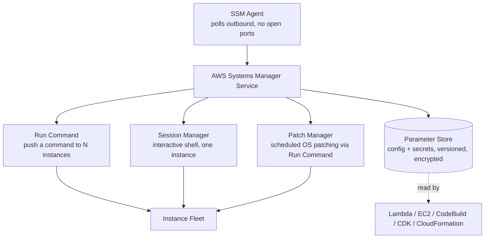

# AWS Systems Manager


## Definition

AWS Systems Manager (SSM) is a collection of operational tools for managing fleets of EC2
instances and on-premises servers at scale — running commands across hundreds of machines at
once, storing configuration/secrets centrally, opening a secure shell session without SSH keys
or open ports, and patching operating systems automatically.

## Purpose

Managing a handful of servers by hand (SSH in, run a command, repeat) doesn't scale past a few
machines, and opening SSH/RDP ports for access is itself a security liability (an open port 22 to
the internet is one of the most common sources of compromise). AWS built Systems Manager so
fleets of instances could be configured, patched, inspected, and accessed — all through the AWS
API, authenticated by IAM, logged by CloudTrail, with zero inbound ports ever opened.

## How It Works

An **SSM Agent** runs on each managed instance (pre-installed on most Amazon Linux/Windows AMIs)
and polls the Systems Manager service outbound — no inbound port needed. From there, several
sub-capabilities build on that one channel: **Run Command** pushes a command/script to many
instances at once and collects output; **Session Manager** opens an interactive shell to one
instance through that same outbound channel (no SSH key, no bastion host, no open port 22);
**Patch Manager** uses Run Command under the hood to install OS patches on a schedule, tracked
against a patch baseline; **Parameter Store** is a separate, simpler piece — a secure key-value
store for config values and secrets that any service can read via API, with encryption and
version history.



Walking through it: (1) every managed instance runs the lightweight SSM Agent, which establishes
an *outbound* connection to the Systems Manager service — this single fact is why no inbound
SSH/RDP port ever needs to be open; (2) **Run Command** sends a command or script definition down
that channel to any number of tagged/targeted instances simultaneously, and SSM collects
stdout/stderr/exit codes back centrally; (3) **Session Manager** uses the identical channel to
open a live interactive shell to one instance, fully logged (every keystroke optionally
recorded to S3/CloudWatch Logs for audit) and governed entirely by IAM — no SSH key pair to
manage or leak; (4) **Patch Manager** is Run Command wrapped in a patch-specific workflow: define
a patch baseline (which updates are approved), a maintenance window (when it's allowed to run),
and it installs patches and reports compliance; (5) **Parameter Store**, architecturally
separate from the agent-based tools, is just a secure API any AWS service or application can call
directly to fetch a config value or secret — no agent involved at all.

## Key Features / Components

- **Parameter Store** — hierarchical key-value storage (`/app/prod/db-password`), String/
  StringList/SecureString types (SecureString is KMS-encrypted), versioning, and labels — free
  for standard parameters, a small per-API-call and per-parameter fee for the Advanced tier
  (higher throughput, more parameters, parameter policies/expiration).
- **Session Manager** — browser- or CLI-based interactive shell access with no open inbound
  ports, no SSH key management, and full session logging for audit.
- **Run Command** — execute a predefined or custom command document across a fleet, targeted by
  instance ID, tag, or resource group, with centralized output collection.
- **Patch Manager** — automated OS/software patching against a patch baseline and maintenance
  window, with compliance reporting.
- **Automation** — runbooks (documents) that execute multi-step operational procedures (e.g.,
  "stop instance → take snapshot → restart instance"), the same engine AWS Config uses for
  auto-remediation.
- **Inventory** — collects metadata about installed software/configuration across your fleet for
  visibility and compliance reporting.
- **State Manager** — ensures instances maintain a defined configuration state over time (similar
  spirit to Config, but acting on the instance rather than just observing it).
- **Maintenance Windows** — scheduled time windows during which disruptive operations (patching,
  restarts) are allowed to run.

## Use Cases — When to Use It

- Eliminating SSH keys and open port 22/3389 entirely — Session Manager for all interactive
  access, governed purely by IAM policy.
- Rolling out a configuration change or diagnostic command to hundreds of instances at once
  (Run Command) instead of scripting your own SSH fan-out.
- Centralizing application configuration and secrets that Lambda, ECS, EC2, and CI/CD pipelines
  all read from one place (Parameter Store) instead of baking values into code or AMIs.
- Keeping a large EC2 fleet's OS patch level compliant with a company security policy
  automatically, on a schedule, with reporting (Patch Manager).
- Feeding CloudFormation/CDK templates dynamic values (`{{resolve:ssm:/app/prod/db-host}}`)
  without hardcoding environment-specific values into the template.

## When NOT to Use It / Alternatives

- **Secrets requiring automatic rotation, fine-grained resource policies, or cross-account
  sharing as a first-class feature** — **Secrets Manager** is purpose-built for that (rotation
  Lambda integration, native cross-account resource policies); Parameter Store SecureString can
  hold secrets but doesn't natively rotate them.
- **Container orchestration/patching** (containers are typically replaced, not patched in place)
  — Patch Manager targets EC2/on-prem OS patching, not container image updates; use ECR image
  scanning and CI/CD rebuild pipelines for containers instead.
- **Configuration feature-flagging with gradual rollout/validation** — **AWS AppConfig** (a
  sibling service) is purpose-built for dynamic application configuration with deployment
  strategies and automatic rollback, which Parameter Store alone doesn't provide.
- **Very small, single-instance setups where SSH is already tightly controlled** — the overhead
  of standing up SSM may not be justified versus existing bastion/SSH tooling, though Session
  Manager's security benefit (no open ports) usually still wins at any scale.

## Why It's Important

**Real-world**: Session Manager eliminating open SSH/RDP ports is one of the highest-leverage,
lowest-effort security improvements available on AWS — it closes one of the most commonly
exploited attack surfaces (internet-facing SSH) with no workflow downside, since every session is
still fully logged. Parameter Store is the quiet backbone of most well-run AWS environments'
configuration management, decoupling "what values does my app need" from "what's baked into the
deployment artifact."

**Exam weight**:
- **SAA-C03 Domain 1 (Secure Architectures)** covers Session Manager as the preferred secure
  access pattern over bastion hosts/open SSH; **Domain 4 (Cost-Optimized Architectures, 20%)**
  touches Parameter Store as a free/cheap config mechanism versus custom solutions.
- **DVA-C03 Domain 3 (Testing and Deployment, 22%), Task 3.1 — Prepare application artifacts for
  deployment** explicitly names **Parameter Store/Secrets Manager/AppConfig** as config delivery
  mechanisms; Systems Manager resurfaces in **Domain 4 (Troubleshooting and Optimization)** for
  Run Command-based diagnostics.
- **MLA-C02 Domain 4 (Operating, Monitoring, and Securing ML and AI Solutions, 24%)** references
  Systems Manager for operational security (patching training/inference infrastructure, storing
  pipeline configuration securely).
- A very common exam trap: a question describing "need to SSH into an instance in a private
  subnet with no bastion host and no open ports" — the expected answer is **Session Manager**,
  not a NAT Gateway, not a bastion host, not a VPN.

## Pricing Model (summary)

**Session Manager, Run Command, Patch Manager, Automation, and Inventory carry no additional
service charge** — you pay only for any underlying resources used (e.g., CloudWatch Logs storage
if you enable session logging, S3 storage for Automation output). **Parameter Store**: Standard
tier (up to 10,000 parameters, standard throughput) is **free**; the **Advanced** tier (more
parameters, higher throughput, parameter policies) charges a small per-parameter monthly fee plus
per-API-call charges beyond the free allotment. See: https://aws.amazon.com/systems-manager/pricing/

## Hands-on Lab (Floci)

Floci emulates SSM's Parameter Store (version history, labels, SecureString, tagging) and Run
Command (`SendCommand`, `GetCommandInvocation`, direct EC2-container execution, agent polling)
in-process — both core pieces work locally.

```bash
alias awslocal='aws --endpoint-url=http://localhost:4566 --profile floci'

# 1. Parameter Store — store and version a config value
awslocal ssm put-parameter \
  --name "/lab/app/db-host" \
  --value "db.internal.lab" \
  --type String

awslocal ssm put-parameter \
  --name "/lab/app/db-password" \
  --value "super-secret-value" \
  --type SecureString

# 2. Read it back (SecureString requires --with-decryption)
awslocal ssm get-parameter --name "/lab/app/db-host"
awslocal ssm get-parameter --name "/lab/app/db-password" --with-decryption

# 3. Update it — Parameter Store automatically versions
awslocal ssm put-parameter --name "/lab/app/db-host" --value "db2.internal.lab" \
  --type String --overwrite
awslocal ssm get-parameter-history --name "/lab/app/db-host"

# 4. Run Command — requires a managed EC2 instance (Floci backs EC2 with real Docker)
INSTANCE_ID=$(awslocal ec2 run-instances --image-id ami-00000000 \
  --instance-type t2.micro --query 'Instances[0].InstanceId' --output text)

awslocal ssm send-command \
  --document-name "AWS-RunShellScript" \
  --targets "Key=instanceIds,Values=$INSTANCE_ID" \
  --parameters 'commands=["echo hello from managed instance","uptime"]'

# 5. Check the output
awslocal ssm list-command-invocations --details
```

**Honest note**: Session Manager's *interactive* shell (`start-session`) and Patch Manager's
patch-baseline workflow are not explicitly listed among Floci's supported SSM operations —
Parameter Store and Run Command are the solidly-emulated pieces. Treat Session Manager's live
shell and Patch Manager's scheduled patching as concepts to study against the official AWS docs,
and use Run Command above as the closest hands-on proxy for "push an operation to a fleet."

## Exam Tips

- **"No bastion host, no open SSH port, fully audited shell access" → Session Manager.** This is
  one of the most reliable keyword matches on SAA-C03/DVA-C03.
- **Parameter Store vs. Secrets Manager**: both can hold secrets, but **rotation** and
  **cross-account resource policies** are Secrets Manager's distinguishing, testable features —
  if a question specifically mentions automatic rotation, the answer is Secrets Manager even
  though Parameter Store SecureString looks superficially similar.
- **Patch Manager = scheduled OS patch compliance at fleet scale** — questions about keeping many
  EC2 instances' OS patch level compliant point here, not to manually SSHing in.
- **Run Command = fan-out execution across many instances with centralized output** — "run this
  script on all instances tagged `Environment=prod`" is a Run Command scenario.
- **Automation documents (runbooks)** power both standalone operational workflows *and* AWS
  Config's auto-remediation — a question connecting Config findings to automatic fixes is really
  asking about SSM Automation underneath.

## Related Terms

- [AWS Config](aws-config.md) — Config's auto-remediation is powered by SSM Automation documents
- [AWS CloudFormation](cloudformation.md) — templates commonly reference Parameter Store values
  via `{{resolve:ssm:...}}` dynamic references
- [AWS CDK](cdk.md) — CDK constructs frequently read/write Parameter Store for cross-stack config
- Glossary: Bastion Host, SSH, Patch Baseline, Maintenance Window, Secrets Manager
