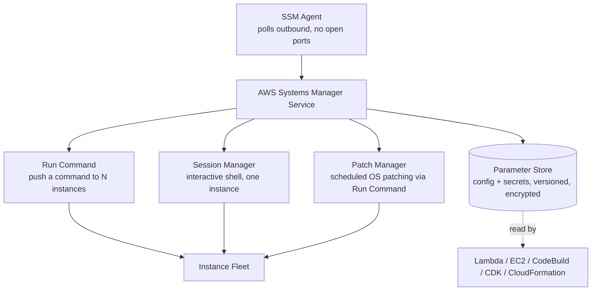
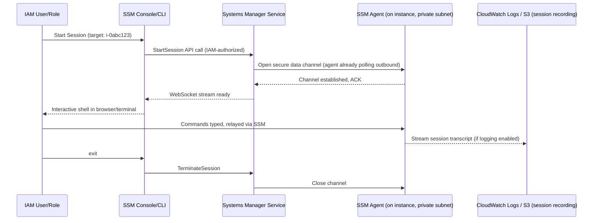
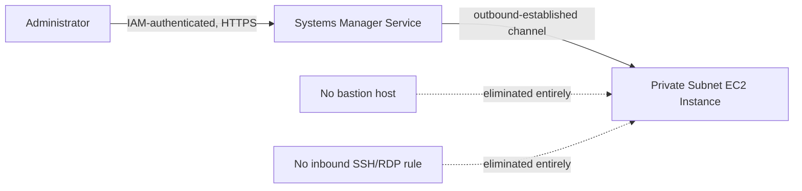

# AWS Systems Manager

> **Appears in:** [DVA-C03](../../certifications/dva-c03/README.md) · [SAA-C03](../../certifications/saa-c03/README.md)


## Definition

AWS Systems Manager (SSM) is a collection of operational tools for managing fleets of EC2
instances and on-premises servers at scale — running commands across hundreds of machines at
once, storing configuration/secrets centrally, opening a secure shell session without SSH keys
or open ports, and patching operating systems automatically.

## Purpose

Managing a handful of servers by hand (SSH in, run a command, repeat) doesn't scale past a few
machines, and opening SSH/RDP ports for access is itself a security liability (an open port 22 to
the internet is one of the most common sources of compromise). AWS built Systems Manager so
fleets of instances could be configured, patched, inspected, and accessed — all through the AWS
API, authenticated by IAM, logged by CloudTrail, with zero inbound ports ever opened.

The underlying design principle is **inversion of connection direction**. Traditional remote
management (SSH, RDP, WinRM) requires the administrator to reach *into* the network and the
server to listen on an open port. Systems Manager flips this: the agent on each instance reaches
*out* to AWS, and the administrator talks to AWS, never directly to the instance. This single
architectural choice is why Session Manager can offer interactive shell access to a fully
private-subnet instance with absolutely no inbound rule, no bastion host, and no VPN — the
instance is never listening for anything.

## How It Works

An **SSM Agent** runs on each managed instance (pre-installed on most Amazon Linux/Windows AMIs)
and polls the Systems Manager service outbound — no inbound port needed. From there, several
sub-capabilities build on that one channel: **Run Command** pushes a command/script to many
instances at once and collects output; **Session Manager** opens an interactive shell to one
instance through that same outbound channel (no SSH key, no bastion host, no open port 22);
**Patch Manager** uses Run Command under the hood to install OS patches on a schedule, tracked
against a patch baseline; **Parameter Store** is a separate, simpler piece — a secure key-value
store for config values and secrets that any service can read via API, with encryption and
version history.



Walking through it: (1) every managed instance runs the lightweight SSM Agent, which establishes
an *outbound* connection to the Systems Manager service — this single fact is why no inbound
SSH/RDP port ever needs to be open; (2) **Run Command** sends a command or script definition down
that channel to any number of tagged/targeted instances simultaneously, and SSM collects
stdout/stderr/exit codes back centrally; (3) **Session Manager** uses the identical channel to
open a live interactive shell to one instance, fully logged (every keystroke optionally
recorded to S3/CloudWatch Logs for audit) and governed entirely by IAM — no SSH key pair to
manage or leak; (4) **Patch Manager** is Run Command wrapped in a patch-specific workflow: define
a patch baseline (which updates are approved), a maintenance window (when it's allowed to run),
and it installs patches and reports compliance; (5) **Parameter Store**, architecturally
separate from the agent-based tools, is just a secure API any AWS service or application can call
directly to fetch a config value or secret — no agent involved at all.

### Session Manager connection establishment flow



Walking through it: (1) the user requests a session against a specific instance ID, authorized
purely by IAM policy (no SSH key exchange of any kind); (2) Systems Manager relays the request to
that instance's already-established outbound agent connection — at no point does AWS or the user
initiate an inbound connection to the instance; (3) a secure, TLS 1.2-encrypted data channel
carries the interactive session; (4) if session logging is enabled, every keystroke and output
line streams to CloudWatch Logs and/or S3 in parallel with the live session, producing a durable
audit transcript automatically, with no extra effort from the user; (5) ending the session cleanly
tears down the channel — there's no lingering open port or orphaned connection to clean up
afterward, unlike a forgotten bastion host SSH session.

### How It Works — Step by Step: Tracing a Patch Manager Run Across a Fleet

Session Manager's trace above covers interactive access; patching is the higher-volume,
scheduled counterpart, and it's worth tracing end to end since it touches the most machines at
once of any SSM capability.

1. **Sunday 02:00 — the maintenance window opens.** A maintenance window named
   `prod-patch-window`, configured for a 2-hour Sunday 02:00 UTC slot, becomes active. Its
   registered target is every instance tagged `Environment=prod, PatchGroup=web`.
2. **02:00:05 — the patch baseline is consulted.** Patch Manager checks the patch baseline attached
   to this patch group — say, "approve security patches 7 days after release, auto-approve
   critical severity immediately." Only patches meeting that approval rule are eligible to install
   tonight; a patch released 3 days ago at non-critical severity is correctly skipped this cycle.
3. **02:00:10 — Run Command is invoked under the hood.** Patch Manager is not a separate execution
   engine — it calls Run Command with the `AWS-RunPatchBaseline` document, targeted at every
   instance in the patch group, exactly the same mechanism the manual `send-command` example above
   uses for an ad hoc diagnostic.
4. **02:00:12 — the command fans out to the fleet.** Each instance's SSM Agent, already polling
   outbound, receives the command over its existing channel. With `MaxConcurrency` set to `25%`,
   only a quarter of the fleet patches simultaneously — a deliberate throttle so a bad patch
   doesn't take down the whole fleet's capacity at once mid-patch.
5. **02:00:15–02:35:00 — each instance patches independently.** On each instance, the agent
   downloads and applies the approved patches, then reports its own exit code and patch state back
   to SSM centrally — a failure on one instance (a disk-space-full patch install, say) doesn't
   block or roll back any other instance's patching.
6. **02:35:05 — compliance is recomputed.** Once an instance finishes, Patch Manager re-scans its
   installed packages against the baseline and marks it `COMPLIANT` or `NON_COMPLIANT` (if a patch
   failed to apply, or a newly-released patch isn't yet installed because it's outside the
   approval window).
7. **02:40:00 — the maintenance window closes.** Any instance still mid-patch when the window ends
   is left as-is (Patch Manager doesn't forcibly interrupt) — this is why maintenance windows need
   a realistic duration buffer, not the bare minimum expected patch time.
8. **Monday 09:00 — compliance reporting.** The platform team checks fleet-wide patch compliance
   via Explorer or a direct `describe-instance-patch-states` call. Three instances show
   `NON_COMPLIANT`, each for a different reason (one hit a dependency conflict, one was outside the
   maintenance window's target scope due to a stale tag, one is a new instance launched after the
   window started). Each gets triaged individually rather than assumed to share the same root
   cause — patch failures across a fleet are rarely one uniform problem.
9. **The same agent channel, the same IAM dependency.** Every one of the steps above depended on
   the identical SSM Agent outbound channel and IAM instance profile described in the "Note on the
   Shared Agent Architecture" section later in this document — a missing instance profile on the
   third non-compliant instance, for example, would show up here as "never attempted," distinct
   from "attempted and failed."

## Worked Example: Run Command at Fleet Scale With Output Aggregation

```bash
# Run a diagnostic script across every instance tagged Environment=prod, Role=web
aws ssm send-command \
  --document-name "AWS-RunShellScript" \
  --targets "Key=tag:Environment,Values=prod" "Key=tag:Role,Values=web" \
  --parameters 'commands=[
    "echo === disk usage ===",
    "df -h /",
    "echo === top 5 memory processes ===",
    "ps aux --sort=-%mem | head -6",
    "echo === nginx status ===",
    "systemctl is-active nginx || echo NGINX_DOWN"
  ]' \
  --comment "Fleet-wide health diagnostic" \
  --output text --query "Command.CommandId"

# Poll for completion and pull all instance outputs centrally
COMMAND_ID="<id-from-above>"
aws ssm list-command-invocations \
  --command-id "$COMMAND_ID" \
  --details \
  --query "CommandInvocations[].{Instance:InstanceId,Status:Status,Output:CommandPlugins[0].Output}"
```

This single command replaces what would otherwise be a hand-rolled SSH fan-out script (or a
third-party fleet-management tool) — targeting by tag rather than a static instance list means
the same command automatically covers newly launched instances in that Auto Scaling group
without updating a target list.

## Worked Example: Parameter Store Hierarchy and Dynamic References

```bash
# Build a realistic hierarchical config tree
aws ssm put-parameter --name "/myapp/prod/db/host" --value "prod-db.internal" --type String
aws ssm put-parameter --name "/myapp/prod/db/port" --value "5432" --type String
aws ssm put-parameter --name "/myapp/prod/db/password" --value "S3cr3t!" --type SecureString
aws ssm put-parameter --name "/myapp/staging/db/host" --value "staging-db.internal" --type String

# Fetch an entire environment's config tree in one call
aws ssm get-parameters-by-path --path "/myapp/prod/" --recursive --with-decryption
```

A CloudFormation template can reference these values directly without ever hardcoding them,
using a dynamic reference resolved at deploy time:

```yaml
Resources:
  AppInstance:
    Type: AWS::EC2::Instance
    Properties:
      UserData:
        Fn::Base64: !Sub
          - |
            #!/bin/bash
            echo "DB_HOST=${DbHost}" >> /etc/environment
          - DbHost: '{{resolve:ssm:/myapp/prod/db/host:1}}'
```

The `{{resolve:ssm:...}}` syntax fetches the parameter's value at stack deploy/update time — the
actual secret value never appears in the template itself, which matters both for security review
and for keeping the template safely committable to a Git repository.

## Key Features / Components

- **Parameter Store** — hierarchical key-value storage (`/app/prod/db-password`), String/
  StringList/SecureString types (SecureString is KMS-encrypted), versioning, and labels — free
  for standard parameters, a small per-API-call and per-parameter fee for the Advanced tier
  (higher throughput, more parameters, parameter policies/expiration).
- **Session Manager** — browser- or CLI-based interactive shell access with no open inbound
  ports, no SSH key management, and full session logging for audit.
- **Run Command** — execute a predefined or custom command document across a fleet, targeted by
  instance ID, tag, or resource group, with centralized output collection.
- **Patch Manager** — automated OS/software patching against a patch baseline and maintenance
  window, with compliance reporting.
- **Automation** — runbooks (documents) that execute multi-step operational procedures (e.g.,
  "stop instance → take snapshot → restart instance"), the same engine AWS Config uses for
  auto-remediation.
- **Inventory** — collects metadata about installed software/configuration across your fleet for
  visibility and compliance reporting.
- **State Manager** — ensures instances maintain a defined configuration state over time (similar
  spirit to Config, but acting on the instance rather than just observing it).
- **Maintenance Windows** — scheduled time windows during which disruptive operations (patching,
  restarts) are allowed to run.
- **OpsCenter** — a centralized view of "OpsItems," operational issues (often created
  automatically from a CloudWatch alarm or Config finding) with runbook-driven remediation tracked
  to resolution — the operational-incident counterpart to Config's compliance findings.
- **Explorer** — a cross-account, cross-region operational dashboard summarizing patch compliance,
  inventory, and OpsItems — the Systems Manager analog to a Config aggregator.

## CloudWatch Logs Insights Query for Session Manager Audit

If Session Manager logging is configured to stream to CloudWatch Logs, you can audit shell
activity directly with Logs Insights:

```
fields @timestamp, @message
| filter @logStream like /i-0abc123456789def0/
| filter @message like /sudo/ or @message like /rm -rf/
| sort @timestamp desc
```

This surfaces potentially risky commands (`sudo`, destructive `rm` invocations) run during any
Session Manager session on a specific instance — a realistic security review step after an
incident, made possible only because Session Manager logs sessions centrally rather than leaving
command history scattered across each instance's local shell history file, which an attacker with
root could simply delete.

## Cost Worked Example: Parameter Store Standard vs. Advanced Tier

| Scenario | Tier needed | Cost impact |
|---|---|---|
| Fewer than 10,000 parameters, standard throughput, no expiration policies | Standard | Free |
| More than 10,000 parameters | Advanced (required) | Small per-parameter monthly charge |
| Need parameter expiration/notification policies | Advanced (required) | Small per-parameter monthly charge |
| High-throughput reads (e.g., thousands of Lambda cold starts per minute each reading config) | Advanced (for higher throughput tier) | Per-API-call charges beyond the free allotment |

```bash
# Check whether a parameter is Standard or Advanced tier, and upgrade if needed
aws ssm put-parameter \
  --name "/myapp/prod/feature-flags" \
  --value '{"newCheckout":true}' \
  --type String \
  --tier Advanced \
  --overwrite
```

A common real-world cost mistake: creating tens of thousands of fine-grained parameters (one per
feature flag per environment per service) without realizing the account has silently crossed into
Advanced-tier billing territory — consolidating related config into fewer, structured JSON-valued
parameters (one parameter holding a JSON blob of flags, rather than one parameter per flag) is a
common mitigation.

## Common Architectures

**1. Zero-bastion-host network design**



An entire fleet in private subnets, with **no bastion host anywhere in the architecture** and
**no security group rule allowing inbound SSH/RDP from anywhere** — access is exclusively via
Session Manager, governed by IAM policy and optionally restricted further by IAM Condition keys
(time-of-day, source IP of the *administrator*, MFA presence) scoped to the SSM API calls
themselves rather than network-layer rules on the instance.

**2. Patch Manager fleet compliance with tiered maintenance windows**

Production instances patch in a narrow, off-peak maintenance window with a conservative patch
baseline (security patches only, delayed N days after release to catch any bad patches reported
by the community first); dev/staging instances patch immediately against a broader baseline
(security + all updates) — giving patches a "soak period" in lower environments before reaching
production, a common and testable pattern.

**3. Config auto-remediation powered by SSM Automation (cross-reference)**

As detailed in [AWS Config](aws-config.md), Config's "automatic remediation" feature is Systems
Manager Automation underneath — a Config rule flags a non-compliant security group, and an SSM
Automation document (potentially the same Run Command mechanics described here) applies the fix.

**4. CI/CD pipeline reading deployment config from Parameter Store, not hardcoded values**

A CodeBuild/CodePipeline stage reads `{{resolve:ssm:/app/${Environment}/image-tag}}`-style
dynamic references, meaning promoting a build from staging to production is a Parameter Store
value change (or a pipeline stage approval), never a template edit requiring a code review cycle
for a pure config change.

## Use Cases — When to Use It

1. **Eliminating SSH keys and open port 22/3389 entirely (zero-bastion-host architecture).** A
   security review flags internet-facing SSH as the account's single largest attack surface.
   **Why this fits:** Session Manager's outbound-only agent channel means IAM policy, not a
   network rule, governs access, closing the exposure with no workflow downside since sessions are
   still fully logged. **Tradeoff:** every engineer needing instance access must have the right
   IAM permissions configured — a team used to sharing a single SSH key pair has to migrate to
   per-person IAM access first, which is a real (if one-time) migration cost.

2. **Fleet patch management with scheduled compliance reporting (patch management fleets).** A
   200-instance production fleet must stay patched against known CVEs on a predictable cadence,
   with proof for a security audit. **Why this fits:** Patch Manager's baseline + maintenance
   window + compliance reporting gives exactly this without anyone manually SSHing into 200
   machines. **Tradeoff:** patches can themselves introduce regressions — an aggressive baseline
   approving patches immediately on release risks rolling out a bad patch fleet-wide before the
   community has reported issues with it, which is why a delayed-approval baseline is the common
   mitigation.

3. **Fan-out diagnostic or remediation commands across a tagged fleet.** An incident requires
   checking disk usage and a specific service's status across every instance tagged
   `Role=web` simultaneously. **Why this fits:** Run Command targets by tag, not a static instance
   list, so newly launched Auto Scaling instances are automatically included with no target-list
   maintenance. **Tradeoff:** a command sent to hundreds of instances at once with no
   `MaxConcurrency`/`MaxErrors` throttling can itself become a mini-incident if the command has an
   unintended side effect — rate-limited rollout is a deliberate safety practice, not optional
   polish.

4. **Centralizing application configuration across Lambda, ECS, EC2, and CI/CD.** Five different
   compute platforms in one application all need the same database connection string, currently
   duplicated in five places. **Why this fits:** Parameter Store gives one canonical location any
   service reads via API, eliminating drift between copies. **Tradeoff:** Parameter Store is
   region-scoped — a multi-region application needs the same parameter replicated (or a
   cross-region read pattern) rather than a single global source of truth.

5. **Feeding dynamic, non-hardcoded values into CloudFormation/CDK templates (infra-as-code
   rollout across environments).** A template needs the current environment's database host
   without hardcoding it or committing it to Git. **Why this fits:** `{{resolve:ssm:/myapp/prod/
   db/host:1}}` resolves at deploy time, keeping the literal value out of the versioned template
   while still being usable in IaC. **Tradeoff:** a dynamic reference resolves to whatever the
   parameter's *current* value is at deploy time — if someone updates the parameter without
   intending to affect the next deploy, that deploy silently picks up the new value, which can
   surprise a team expecting template changes to be the only thing that changes behavior.

6. **Multi-step operational runbooks via Automation documents.** An operational procedure ("stop
   instance → snapshot the volume → restart") needs to run identically every time, not depend on
   someone remembering the exact sequence. **Why this fits:** an Automation document encodes the
   steps once, runs consistently, and is the same engine AWS Config's auto-remediation uses under
   the hood. **Tradeoff:** an Automation document with a bug executes that bug consistently and
   fleet-wide too — the same consistency that makes it valuable also means a flawed runbook causes
   uniform damage rather than a one-off mistake.

7. **Incident post-mortem: auditing exactly what commands were run in a Session Manager
   session.** After an incident, a team needs to confirm whether a specific engineer's shell
   session included any destructive commands. **Why this fits:** session logging to CloudWatch
   Logs/S3 produces a durable, centralized transcript no local shell-history file (which an
   attacker with root could delete) can provide. **Tradeoff:** logging must be enabled
   *before* the session happens — there's no retroactive way to recover a transcript for a session
   that ran before logging was configured.

8. **Compliance drift detection paired with Config's auto-remediation.** A Config rule flags a
   security group as non-compliant and needs an actual fix applied, not just a notification.
   **Why this fits:** the remediation action is an SSM Automation document — Systems Manager is the
   execution layer underneath Config's detective capability, not a separate tool a team has to
   additionally stand up. **Tradeoff:** the remediation document needs its own correctly-scoped IAM
   role, separate from Config's; a misconfigured remediation role causes the fix to fail silently
   while Config still correctly reports the finding, which can look like "Config isn't working" when
   the actual gap is in the remediation role.

9. **Promoting a build from staging to production via a config value, not a code change.** A
   CI/CD pipeline needs "which image tag is live in prod" to change without triggering a full code
   review cycle for what's really just a config change. **Why this fits:** reading
   `{{resolve:ssm:/app/${Environment}/image-tag}}` means a Parameter Store update (or a pipeline
   approval gate) is the promotion mechanism, decoupled from a template edit. **Tradeoff:** this
   convenience means a config change can ship to production without going through the same code
   review a template edit would — teams need a separate approval gate on the parameter update
   itself if that change still needs sign-off.

10. **Accessing fully private-subnet instances with no NAT Gateway budgeted.** A cost-conscious
    architecture has no NAT Gateway, so instances have no outbound internet path at all — yet
    engineers still need shell access. **Why this fits:** VPC interface endpoints for `ssm`,
    `ssmmessages`, and `ec2messages` let the agent reach Systems Manager entirely within the VPC,
    no internet route required. **Tradeoff:** three VPC endpoints carry their own hourly and
    data-processing charges — for a very small fleet, this cost should be compared against simply
    provisioning a (more expensive, but simpler) NAT Gateway if other services in the VPC also need
    general outbound internet access anyway.

11. **Inventory collection for a software license or vulnerability audit.** A security team needs
    to know exactly which package versions are installed across the entire fleet, right now,
    without manually checking each instance. **Why this fits:** Inventory collects this metadata
    centrally and continuously, turning "what's installed where" into a query instead of a
    multi-day manual survey. **Tradeoff:** Inventory reflects what's installed at collection time —
    a vulnerability disclosed an hour ago won't be flagged as a problem until the next collection
    cycle runs and someone cross-references the new CVE against the collected data manually.

12. **OpsCenter-driven incident tracking from automated findings.** A CloudWatch alarm or Config
    finding generates work that needs tracking to resolution, not just a one-time notification that
    can get lost in a chat channel. **Why this fits:** OpsCenter turns an automated signal into a
    tracked "OpsItem" with an assigned owner and a runbook-driven remediation path, giving
    operational findings the same lifecycle discipline a ticketing system gives bugs.
    **Tradeoff:** OpsCenter is one more operational surface a team has to actually check and
    triage — if nobody owns reviewing the OpsItem backlog, findings accumulate there just as
    silently as they would in an unread dashboard.

## When NOT to Use It / Alternatives

- **Secrets requiring automatic rotation, fine-grained resource policies, or cross-account
  sharing as a first-class feature** — **Secrets Manager** is purpose-built for that (rotation
  Lambda integration, native cross-account resource policies); Parameter Store SecureString can
  hold secrets but doesn't natively rotate them.
- **Container orchestration/patching** (containers are typically replaced, not patched in place)
  — Patch Manager targets EC2/on-prem OS patching, not container image updates; use ECR image
  scanning and CI/CD rebuild pipelines for containers instead.
- **Configuration feature-flagging with gradual rollout/validation** — **AWS AppConfig** (a
  sibling service) is purpose-built for dynamic application configuration with deployment
  strategies and automatic rollback, which Parameter Store alone doesn't provide.
- **Very small, single-instance setups where SSH is already tightly controlled** — the overhead
  of standing up SSM may not be justified versus existing bastion/SSH tooling, though Session
  Manager's security benefit (no open ports) usually still wins at any scale.

## Why It's Important

**Real-world**: Session Manager eliminating open SSH/RDP ports is one of the highest-leverage,
lowest-effort security improvements available on AWS — it closes one of the most commonly
exploited attack surfaces (internet-facing SSH) with no workflow downside, since every session is
still fully logged. Parameter Store is the quiet backbone of most well-run AWS environments'
configuration management, decoupling "what values does my app need" from "what's baked into the
deployment artifact."

**Exam weight**:
- **SAA-C03 Domain 1 (Secure Architectures)** covers Session Manager as the preferred secure
  access pattern over bastion hosts/open SSH; **Domain 4 (Cost-Optimized Architectures, 20%)**
  touches Parameter Store as a free/cheap config mechanism versus custom solutions.
- **DVA-C03 Domain 3 (Testing and Deployment, 22%), Task 3.1 — Prepare application artifacts for
  deployment** explicitly names **Parameter Store/Secrets Manager/AppConfig** as config delivery
  mechanisms; Systems Manager resurfaces in **Domain 4 (Troubleshooting and Optimization)** for
  Run Command-based diagnostics. Expect a scenario comparing Parameter Store vs. Secrets Manager
  where the deciding detail is whether automatic rotation is required.
- **MLA-C02 Domain 4 (Operating, Monitoring, and Securing ML and AI Solutions, 24%)** references
  Systems Manager for operational security (patching training/inference infrastructure, storing
  pipeline configuration securely).
- A very common exam trap: a question describing "need to SSH into an instance in a private
  subnet with no bastion host and no open ports" — the expected answer is **Session Manager**,
  not a NAT Gateway, not a bastion host, not a VPN.

## Pricing Model (summary)

**Session Manager, Run Command, Patch Manager, Automation, and Inventory carry no additional
service charge** — you pay only for any underlying resources used (e.g., CloudWatch Logs storage
if you enable session logging, S3 storage for Automation output). **Parameter Store**: Standard
tier (up to 10,000 parameters, standard throughput) is **free**; the **Advanced** tier (more
parameters, higher throughput, parameter policies) charges a small per-parameter monthly fee plus
per-API-call charges beyond the free allotment. See: https://aws.amazon.com/systems-manager/pricing/

## Limits & Quotas

| Limit | Default Value | Practical Impact |
|---|---|---|
| Standard-tier parameters per account/region | 10,000 | Large organizations with per-service, per-environment config trees hit this faster than expected — plan for Advanced tier or consolidation |
| Parameter value size (Standard) | 4 KB | Large config blobs (e.g., a full JSON config file) often need Advanced tier (up to 8 KB) or S3 instead |
| Parameter value size (Advanced) | 8 KB | Still too small for large files — use S3 + a parameter holding the S3 URI for anything bigger |
| Run Command targets per command | 50 instances (synchronous) / up to 50,000 via S3 output + rate control | Large fleets need rate-controlled execution (`MaxConcurrency`/`MaxErrors`), not one giant blast |
| Session Manager concurrent sessions per instance | 1 interactive session at a time (practically) | Coordinate team access; two engineers can't both interactively drive the same shell session simultaneously |
| Maintenance window duration | Up to 24 hours | Long enough for virtually any patch cycle, including large Windows Server patch sets |

## Troubleshooting / Common Issues

- **"Instance not showing in Session Manager's target list"** — the instance needs the SSM Agent
  running (usually pre-installed, but can be out of date), an attached IAM instance profile with
  `AmazonSSMManagedInstanceCore` (or equivalent), and outbound HTTPS connectivity (either a public
  IP + internet route, or VPC endpoints for `ssm`, `ssmmessages`, `ec2messages` if fully private).
  The single most common cause is a **missing IAM instance profile**, not a network issue.
  Missing VPC endpoints in a fully private subnet with no NAT Gateway is the second most common.
- **Run Command reports `Delivery Timed Out`** — usually the same connectivity/IAM gap as above;
  confirm the instance can actually reach the SSM service endpoints at all.
- **Patch Manager shows instances as "Non-Compliant" indefinitely** — check the patch baseline's
  approval rules (a baseline with an aggressive delay, e.g., "approve 30 days after release," will
  correctly show instances non-compliant against patches not yet approved — this may be intended
  behavior, not a bug) and confirm the maintenance window is actually enabled and has a target
  registered.
- **Parameter Store `ParameterNotFound` despite the parameter clearly existing** — check the exact
  case-sensitive path and whether you're querying the right region; Parameter Store is region-scoped,
  and a parameter created in `us-east-1` doesn't exist in `eu-west-1`.
- **SecureString parameter decrypts to garbage/fails** — confirm the caller's IAM policy includes
  both `ssm:GetParameter` with `--with-decryption` *and* `kms:Decrypt` on the specific KMS key used
  to encrypt it; a caller can have SSM read permission but still fail decryption without the KMS
  permission.
- **Session Manager logging shows gaps in the transcript** — confirm both the CloudWatch Logs *and*
  S3 logging destinations (if both configured) have correct IAM permissions for the SSM service
  role to write to them; a misconfigured destination silently drops logging for that destination
  without necessarily blocking the session itself.

## Further Reading

- AWS Systems Manager User Guide: https://docs.aws.amazon.com/systems-manager/latest/userguide/
- AWS Systems Manager Session Manager documentation:
  https://docs.aws.amazon.com/systems-manager/latest/userguide/session-manager.html
- "Using AWS Systems Manager in Hybrid Cloud Environments" (AWS Architecture Blog):
  https://aws.amazon.com/blogs/architecture/using-aws-systems-manager-in-hybrid-cloud-environments/
- Systems Manager pricing: https://aws.amazon.com/systems-manager/pricing/
- Parameter Store vs. Secrets Manager comparison:
  https://docs.aws.amazon.com/systems-manager/latest/userguide/parameter-store-vs-secrets-manager.html


*Starting an interactive Session Manager session against a managed instance — no SSH key, no
bastion host, no open inbound port. Source: "Using AWS Systems Manager in Hybrid Cloud
Environments," AWS Architecture Blog, aws.amazon.com/blogs/architecture (official AWS blog).*


*Session Manager activity streamed to CloudWatch Logs, giving a durable, centralized audit
transcript of a remote session. Source: "Using AWS Systems Manager in Hybrid Cloud Environments,"
AWS Architecture Blog, aws.amazon.com/blogs/architecture (official AWS blog).*

## Hands-on Lab (Floci)

Floci emulates SSM's Parameter Store (version history, labels, SecureString, tagging) and Run
Command (`SendCommand`, `GetCommandInvocation`, direct EC2-container execution, agent polling)
in-process — both core pieces work locally.

```bash
alias awslocal='aws --endpoint-url=http://localhost:4566 --profile floci'

# 1. Parameter Store — store and version a config value
awslocal ssm put-parameter \
  --name "/lab/app/db-host" \
  --value "db.internal.lab" \
  --type String

awslocal ssm put-parameter \
  --name "/lab/app/db-password" \
  --value "super-secret-value" \
  --type SecureString

# 2. Read it back (SecureString requires --with-decryption)
awslocal ssm get-parameter --name "/lab/app/db-host"
awslocal ssm get-parameter --name "/lab/app/db-password" --with-decryption

# 3. Update it — Parameter Store automatically versions
awslocal ssm put-parameter --name "/lab/app/db-host" --value "db2.internal.lab" \
  --type String --overwrite
awslocal ssm get-parameter-history --name "/lab/app/db-host"

# 4. Run Command — requires a managed EC2 instance (Floci backs EC2 with real Docker)
INSTANCE_ID=$(awslocal ec2 run-instances --image-id ami-00000000 \
  --instance-type t2.micro --query 'Instances[0].InstanceId' --output text)

awslocal ssm send-command \
  --document-name "AWS-RunShellScript" \
  --targets "Key=instanceIds,Values=$INSTANCE_ID" \
  --parameters 'commands=["echo hello from managed instance","uptime"]'

# 5. Check the output
awslocal ssm list-command-invocations --details
```

**Honest note**: Session Manager's *interactive* shell (`start-session`) and Patch Manager's
patch-baseline workflow are not explicitly listed among Floci's supported SSM operations —
Parameter Store and Run Command are the solidly-emulated pieces. Treat Session Manager's live
shell and Patch Manager's scheduled patching as concepts to study against the official AWS docs,
and use Run Command above as the closest hands-on proxy for "push an operation to a fleet."

## Exam Tips

- **"No bastion host, no open SSH port, fully audited shell access" → Session Manager.** This is
  one of the most reliable keyword matches on SAA-C03/DVA-C03.
- **Parameter Store vs. Secrets Manager**: both can hold secrets, but **rotation** and
  **cross-account resource policies** are Secrets Manager's distinguishing, testable features —
  if a question specifically mentions automatic rotation, the answer is Secrets Manager even
  though Parameter Store SecureString looks superficially similar.
- **Patch Manager = scheduled OS patch compliance at fleet scale** — questions about keeping many
  EC2 instances' OS patch level compliant point here, not to manually SSHing in.
- **Run Command = fan-out execution across many instances with centralized output** — "run this
  script on all instances tagged `Environment=prod`" is a Run Command scenario.
- **Automation documents (runbooks)** power both standalone operational workflows *and* AWS
  Config's auto-remediation — a question connecting Config findings to automatic fixes is really
  asking about SSM Automation underneath.
- **A missing IAM instance profile is the #1 real-world and exam-scenario cause** of "I can't
  connect via Session Manager" — not a network/security-group issue, since Session Manager
  requires no inbound rule at all.
- **Dynamic references (`{{resolve:ssm:...}}`)** let CloudFormation/CDK templates pull config
  without hardcoding or committing secrets to source control — a question about keeping secrets
  out of a Git-committed template points here (or to the equivalent Secrets Manager resolver).

## Exam Scenario Walkthroughs (SAA-C03 / DVA-C03 / MLA-C02)

**Scenario 1 (SAA-C03, Domain 1 — Secure Architectures).** An architect needs to allow engineers
to manage EC2 instances in a fully private subnet, with no bastion host and no NAT Gateway
budgeted. Which service, and what prerequisite must exist on the instances?
> **Answer: Session Manager, with VPC interface endpoints for `ssm`, `ssmmessages`, and
> `ec2messages`** (since there's no NAT Gateway for outbound internet access) **plus an IAM
> instance profile granting `AmazonSSMManagedInstanceCore`.** The "no NAT Gateway" detail is the
> trap — without it, the agent needs VPC endpoints specifically, not just "Session Manager will
> handle it," to reach the Systems Manager service from a fully isolated private subnet.

**Scenario 2 (DVA-C03, Domain 3 — Testing and Deployment).** A CI/CD pipeline needs to read a
database connection string at deploy time without ever committing the actual value to the Git
repository holding the CloudFormation template. What's the mechanism?
> **Answer: A `{{resolve:ssm:/path/to/parameter}}` dynamic reference** inside the template,
> resolved by CloudFormation at deploy time — the template itself never contains the literal
> value, satisfying both the "don't commit secrets" requirement and the "still usable in IaC"
> requirement simultaneously.

**Scenario 3 (DVA-C03, Domain 4 — Troubleshooting).** A newly launched EC2 instance doesn't
appear as a target in Session Manager despite the SSM Agent clearly running (confirmed via the
instance's own local agent logs). What's the single most likely cause?
> **Answer: A missing or incorrectly scoped IAM instance profile** — the agent running locally
> doesn't guarantee it has credentials to actually register with the Systems Manager service;
> this is overwhelmingly the most common real-world and exam-tested root cause, ahead of network
> connectivity issues.

**Scenario 4 (MLA-C02, Domain 4 — Operating and Securing ML Solutions).** An ML team needs to
patch the OS on a fleet of GPU training instances on a predictable schedule, with compliance
reporting for an internal security audit, without manually logging into each instance.
> **Answer: Patch Manager**, with a patch baseline and a maintenance window scoped to the
> training fleet — the "predictable schedule + compliance reporting + fleet scale" combination
> specifically identifies Patch Manager over a manual or ad hoc Run Command approach.

**Scenario 5 (Cross-cert — Parameter Store vs. Secrets Manager).** A question describes a
requirement for a database password that must automatically rotate every 30 days with zero manual
intervention, used by a Lambda function via an SDK call. Does Parameter Store satisfy this?
> **Answer: No — this is Secrets Manager's distinguishing feature.** Parameter Store SecureString
> can *store* a secret securely, but automatic, scheduled rotation with a rotation Lambda
> integration is a Secrets Manager-specific capability; a question explicitly mentioning
> automatic rotation should always point away from Parameter Store alone.

## Quick Reference: Choosing the Right Systems Manager Capability

A condensed lookup table matching a described need to the specific SSM capability, since exam
questions and real-world architecture decisions both hinge on picking the right sub-tool:

| Need | Capability |
|---|---|
| Interactive shell access to one instance, no SSH key, no open port | Session Manager |
| Run the same command/script across many tagged instances at once | Run Command |
| Keep OS patches current on a fleet, on a schedule, with compliance reporting | Patch Manager |
| Store and version application config/secrets, read via API | Parameter Store |
| Execute a multi-step operational procedure (stop, snapshot, restart) | Automation (runbooks) |
| Collect installed software/configuration metadata across a fleet | Inventory |
| Ensure instances maintain a defined configuration over time | State Manager |
| Track and resolve operational issues centrally, often from alarms/findings | OpsCenter |
| One cross-account/cross-region operational health dashboard | Explorer |

## Note on the Shared Agent Architecture

Every capability described in this document — Run Command, Session Manager, Patch Manager,
Automation targeting an instance, Inventory collection — depends on the exact same underlying
mechanism: the SSM Agent's outbound connection to the Systems Manager service. This is why a
single root cause (a missing IAM instance profile, a blocked outbound connection, an out-of-date
agent) tends to simultaneously break *several* SSM capabilities at once on the same instance, and
why troubleshooting "Session Manager doesn't work" and "Run Command times out on this instance"
converges on the identical checklist: agent running, correct IAM instance profile attached,
outbound connectivity (public IP + route, or the three required VPC endpoints) actually present.
Recognizing this shared dependency is what lets you diagnose a new SSM-related failure quickly
even if you haven't seen that exact symptom described before.

## Related Terms

- [AWS Config](aws-config.md) — Config's auto-remediation is powered by SSM Automation documents
- [AWS CloudFormation](cloudformation.md) — templates commonly reference Parameter Store values
  via `{{resolve:ssm:...}}` dynamic references
- [AWS CDK](cdk.md) — CDK constructs frequently read/write Parameter Store for cross-stack config
- Glossary: Bastion Host, SSH, Patch Baseline, Maintenance Window, Secrets Manager, OpsItem,
  Managed Instance, SSM Agent
