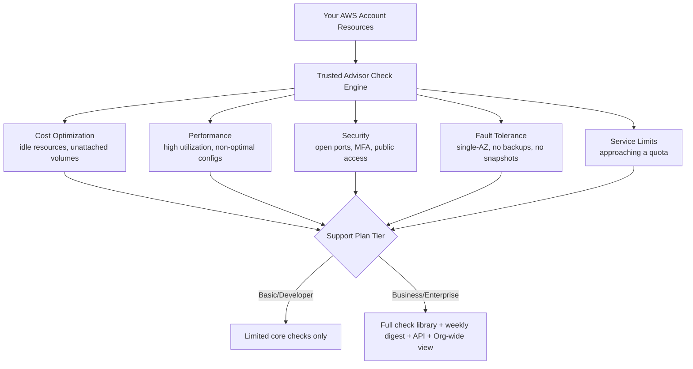
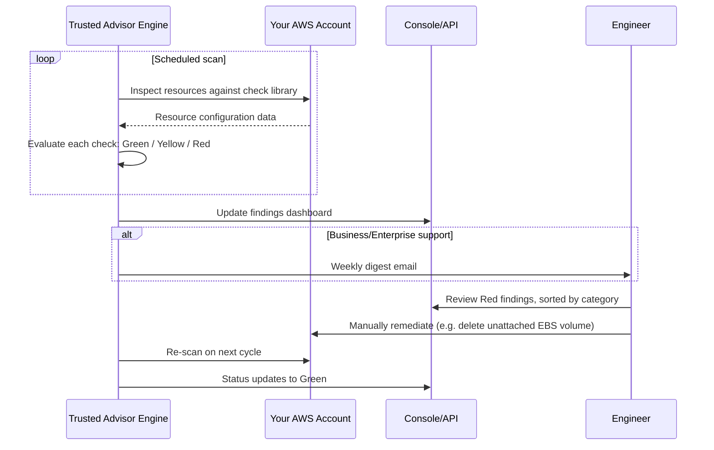
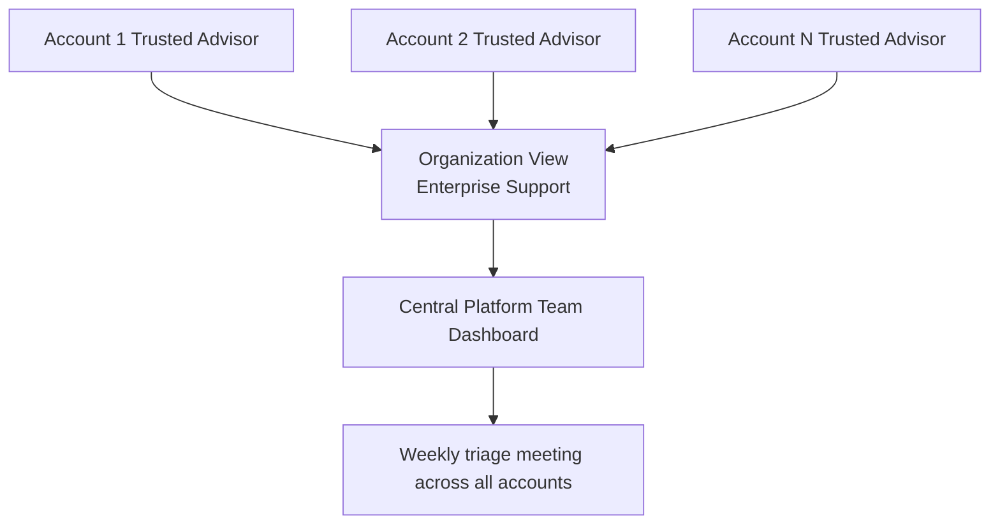

# AWS Trusted Advisor

> **Appears in:** [DVA-C03](../../certifications/dva-c03/README.md) · [SAA-C03](../../certifications/saa-c03/README.md)


## Definition

AWS Trusted Advisor is an automated service that inspects your AWS account against a set of AWS
best-practice checks and reports findings across five categories: **Cost Optimization,
Performance, Security, Fault Tolerance, and Service Limits**. In one sentence: it's AWS's
built-in "here's what you're doing wrong (or could do better), according to our own best
practices" checklist.

## Purpose

AWS has decades of operational experience seeing what good and bad architectures look like
across millions of accounts — idle load balancers, unencrypted public buckets, single-AZ
database deployments with no failover, accounts about to hit a service quota. Rather than making
customers discover these issues the hard way (an outage, a bill surprise, a security incident),
AWS built Trusted Advisor to surface them proactively, continuously, for free (at a basic level)
in every account.

The underlying design tradeoff worth understanding: Trusted Advisor is deliberately a **fixed,
curated checklist**, not an extensible rules engine. That's a feature, not a limitation — it
means every check reflects AWS's own accumulated operational judgment about what "good" looks
like, maintained centrally and updated as practices evolve, rather than something each customer
has to author and keep current themselves. The cost of that tradeoff is that you can't add a
company-specific check (that's what Config custom rules are for) — Trusted Advisor is breadth
and zero-effort, not depth and customization.

## How It Works

Trusted Advisor runs a library of automated checks against your account's resources on a regular
cadence, each check mapped to one of five categories, and assigns each a status — green (no
problem), yellow (investigate), or red (action recommended). The depth of checks available
depends on your **AWS Support plan**: Basic and Developer support plans get a handful of core
checks (mostly security and service-limit related) for free; **Business, Enterprise On-Ramp, and
Enterprise** support plans unlock the **full check library** across all five categories, plus the
ability to set up **weekly email digests**, **Organization-wide aggregated views**, and
programmatic access via the Trusted Advisor API.



Walking through it: (1) Trusted Advisor continuously scans resources across the categories it
checks; (2) each individual check (e.g., "Low Utilization Amazon EC2 Instances," "Security Groups
- Unrestricted Access," "Amazon RDS Backups") produces a status per affected resource; (3) which
checks you actually get access to depends entirely on your **AWS Support plan** — this is the
single most important mechanical fact about Trusted Advisor, and the source of most exam
confusion; (4) on a paid Business/Enterprise support plan, the full set of checks runs
continuously and can notify you proactively (weekly digest email) rather than requiring you to
log in and look.

### Check evaluation and remediation flow



Walking through it: (1) Trusted Advisor's checks run on AWS's own schedule (some near-real-time,
others periodic); (2) results populate a dashboard, organized by category and severity; (3) on
Business/Enterprise support, a weekly digest proactively surfaces new/ongoing Red findings instead
of relying on someone remembering to check the console; (4) remediation itself is **manual** —
Trusted Advisor does not auto-fix findings (unlike AWS Config, which can); it only identifies and
recommends; (5) the next scheduled scan picks up whether the fix actually resolved the
finding, flipping the status back to green.

### How It Works — Step by Step: Tracing a Finding From Scan to Resolution

The sequence diagram above shows the general evaluate/remediate loop; here's one concrete check
traced through a realistic timeline, including the part Trusted Advisor explicitly does *not* do.

1. **Tuesday, scheduled scan.** Trusted Advisor's check engine runs its "Low Utilization Amazon
   EC2 Instances" check against the account, as it does on its regular internal cadence — this
   isn't triggered by a specific event, unlike a Config rule's on-change evaluation.
2. **The check's own logic.** For each running EC2 instance, the check pulls CPU utilization data
   over its own internal lookback window (commonly around 14 days) from CloudWatch and computes an
   average. An instance named `batch-worker-07` averages 4% CPU over that window.
3. **The finding is recorded.** `batch-worker-07` is flagged Red under Cost Optimization, with an
   estimated monthly cost and a recommended action ("consider stopping or downsizing this
   instance"). This finding, and every other check's results, populate the dashboard.
4. **Wednesday — the weekly digest (Business/Enterprise support only).** A scheduled email
   summarizing all current Red/Yellow findings lands in the account's registered inbox — on
   Basic/Developer support, this step simply never happens, and the only way to see findings is
   logging into the console directly.
5. **Thursday — a human reviews the finding, and investigates rather than acting blindly.**
   Recognizing `batch-worker-07`'s name suggests a scheduled job, an engineer cross-references
   actual CloudWatch CPU data over a longer 30-day window (as shown in the worked example's Logs
   Insights cross-reference) and discovers a once-a-month spike consistent with a real, legitimate
   batch job — not genuinely idle.
6. **Friday — the decision.** Rather than terminating the instance, the team decides to downsize
   it to a smaller instance type that still comfortably handles the monthly spike, and documents
   the decision (there's no native "accept this exception" flag in Trusted Advisor itself, so this
   gets tracked in an external ticket).
7. **The following Tuesday — re-scan.** The check re-runs on its normal cadence against the
   now-downsized instance. If the new instance type's utilization during its monthly spike is still
   comfortably low relative to its new, smaller capacity, the finding may still show Yellow/Red
   depending on the check's specific thresholds — Trusted Advisor doesn't know about the team's
   documented exception decision, it only re-evaluates the raw utilization numbers.
8. **What Trusted Advisor never does.** At no point in this entire trace does Trusted Advisor
   itself downsize, stop, or modify the instance — every action step (steps 5-7) was performed by
   a human. This is the core mechanical distinction from AWS Config: Trusted Advisor identifies
   and recommends; it has no remediation action of its own to trigger, automatic or manual.

## Worked Example: Reading and Prioritizing a Realistic Findings Set

A Business-support account's Trusted Advisor dashboard after a quarter of organic growth might
show something like this (illustrative, not a live API call since findings depend on your actual
account):

| Category | Check | Status | Resources Affected |
|---|---|---|---|
| Cost Optimization | Low Utilization Amazon EC2 Instances | Red | 14 instances averaging <10% CPU over 14 days |
| Cost Optimization | Idle Load Balancers | Yellow | 2 ALBs with zero requests in 7 days |
| Security | Security Groups - Specific Ports Unrestricted | Red | 3 security groups allow 0.0.0.0/0 on port 3389 (RDP) |
| Security | MFA on Root Account | Red | Root account has no MFA device |
| Fault Tolerance | Amazon RDS Backups | Yellow | 1 RDS instance with automated backups disabled |
| Fault Tolerance | Amazon EBS Snapshots | Yellow | 1 volume with no recent snapshot |
| Service Limits | VPCs per Region | Yellow | 4 of 5 default VPC limit used in us-east-1 |

A disciplined triage order, and the reasoning behind it:

1. **Root MFA first** — a single-point-of-failure security gap affecting the entire account; the
   fix (enabling MFA) takes minutes and closes a catastrophic risk.
2. **Open RDP to the world** second — actively exploitable right now, highest real-world risk of
   the set.
3. **RDS backups disabled** third — a silent data-loss risk; if that database fails before this
   is fixed, there's no recovery path.
4. **Cost findings last** — real money, but not an active risk; appropriate to batch into a
   scheduled cleanup rather than an emergency fix.

This ordering — **active security risk > data-loss risk > cost waste** — is the kind of
judgment call Domain 4 scenario questions expect you to make when a question presents multiple
Trusted Advisor findings and asks which to address first.

## Logs Insights Cross-Reference: Confirming an "Idle" Finding Before Acting

Trusted Advisor's "Low Utilization" finding is based on CloudWatch CPU metrics over a lookback
window — before terminating an instance flagged as idle, it's worth confirming with a direct
query rather than trusting the label blindly (a batch job that runs one night a month would show
as "idle" most days):

```
fields @timestamp, @message
| filter @logStream like /i-0abc123456789def0/
| stats count() as invocations by bin(1d)
| sort @timestamp desc
```

Paired with a direct CloudWatch metric check:

```bash
aws cloudwatch get-metric-statistics \
  --namespace AWS/EC2 \
  --metric-name CPUUtilization \
  --dimensions Name=InstanceId,Value=i-0abc123456789def0 \
  --start-time "$(date -u -d '-30 days' +%Y-%m-%dT%H:%M:%S)" \
  --end-time "$(date -u +%Y-%m-%dT%H:%M:%S)" \
  --period 86400 \
  --statistics Maximum
```

If the 30-day maximum CPU shows a single spike day each month (consistent with a scheduled batch
job) rather than genuinely flat near-zero utilization throughout, that's a case for excluding the
instance from Trusted Advisor's recommended action rather than blindly terminating it — Trusted
Advisor flags *patterns*, a human still needs to confirm *intent* before acting on a finding that
would destroy a resource.

## Key Features / Components

- **Five Check Categories** — Cost Optimization, Performance, Security, Fault Tolerance, Service
  Limits (a sixth, "Operational Excellence," has also been added covering broader operational
  best practices).
- **Priority/Action Recommendations** — on supported plans, findings are grouped by priority with
  a clear recommended remediation.
- **Service Limits (Quota) Checks** — available even on the Basic support plan, flagging when
  you're approaching an account-level service quota.
- **Security Checks** — available even on Basic support plan for a small set of critical items
  (e.g., root account MFA, security group with unrestricted access to specific high-risk ports).
- **Organization View** — on Enterprise support, a consolidated Trusted Advisor view across every
  account in an AWS Organization, for a central team to track fleet-wide health.
- **Trusted Advisor API** — programmatic retrieval of check results, for feeding into your own
  dashboards or ticketing automation (Business support plan and above).
- **Refresh on demand** — most checks can be manually refreshed from the console rather than
  waiting for the next scheduled scan, useful immediately after remediating a finding to confirm
  the fix took effect without waiting out the full cycle.

## Cost Worked Example: Quantifying Trusted Advisor's Cost Findings

A realistic exercise in translating Trusted Advisor's Cost Optimization findings into actual
dollar impact, cross-referenced with Cost Explorer:

```bash
# Trusted Advisor flags 14 EC2 instances as "Low Utilization" — confirm the actual
# monthly cost of just those instances via Cost Explorer, filtered by resource
aws ce get-cost-and-usage \
  --time-period Start=2026-11-01,End=2026-12-01 \
  --granularity MONTHLY \
  --filter '{
    "Dimensions": {"Key": "SERVICE", "Values": ["Amazon Elastic Compute Cloud - Compute"]}
  }' \
  --group-by Type=DIMENSION,Key=INSTANCE_TYPE \
  --metrics "UnblendedCost"
```

If the 14 flagged instances are a mix of `m5.2xlarge` running at under 10% average CPU, a
reasonable remediation path is: rightsize to `m5.large` or `t3.large` (roughly a 50-75% per-hour
cost reduction depending on the target size) or move to Spot/Savings Plans if the workload
tolerates interruption — Trusted Advisor's finding identifies *which* resources, but **Cost
Explorer and the Compute Optimizer recommendations quantify exactly how much rightsizing would
actually save**, which is the number that justifies the engineering time to act.

## Common Architectures

**1. Organization-wide Trusted Advisor rollup for a central platform team**



On Enterprise Support, the Organization view gives one team visibility across every member
account without needing individual console access into each — the standard pattern for a
platform/FinOps/security team responsible for fleet-wide hygiene in a large multi-account
Organization.

**2. Trusted Advisor findings piped into Security Hub alongside Config/GuardDuty**

Trusted Advisor's Security category findings can feed into **Security Hub** as one of several
normalized finding sources, letting a SOC team triage Trusted Advisor security findings in the
same console as GuardDuty and Config findings, rather than checking five separate dashboards.

**3. Trusted Advisor API feeding a ticketing system automatically**

On Business/Enterprise support, the Trusted Advisor API lets a platform team auto-create Jira/
ServiceNow tickets for new Red findings on a schedule, rather than relying on someone manually
reviewing the console weekly — turning a passive dashboard into an actively tracked backlog.

**4. New-account onboarding checklist using Trusted Advisor as the first stop**

For a freshly created AWS account, Trusted Advisor is often the very first tool checked — even on
Basic support, the free security and service-limit checks catch the most embarrassing possible
gaps (no root MFA, a default VPC approaching its limit) before any real workload is deployed.

## Use Cases — When to Use It

1. **Zero-setup health check spanning five categories at once.** A newly onboarded account has no
   existing tooling and the team wants an immediate signal across cost, security, performance, and
   resilience. **Why this fits:** no custom rules to write, no Lambda to deploy — Trusted Advisor
   runs automatically the moment the account exists. **Tradeoff:** the breadth comes at the cost of
   depth and customization; it catches generic AWS best-practice violations, not anything specific
   to this company's own internal standards.

2. **Low-hanging-fruit cost cleanup: idle resources nobody remembered.** An account accumulated
   unattached EBS volumes, idle load balancers, and underutilized instances over years of organic
   growth. **Why this fits:** the Cost Optimization category surfaces exactly this class of waste
   with zero engineering effort beyond reading the report — often the highest-ROI-per-minute review
   available. **Tradeoff:** this category requires Business/Enterprise support to see at all;
   Basic/Developer support shows none of it, which is easy to forget when recommending Trusted
   Advisor as a free-tier solution.

3. **Pre-emptive service quota exhaustion detection.** A deployment is about to fail because the
   account is approaching its default VPC-per-region limit, and nobody noticed until the deploy
   actually failed. **Why this fits:** Service Limits checks are available on every support plan
   including Basic, so this specific category of finding is genuinely free and universal.
   **Tradeoff:** quota checks only flag *approaching* a limit based on current usage trend — a
   sudden, unplanned spike in resource creation can still blow past a limit between scheduled
   check runs, so it's not a substitute for actively monitoring a known upcoming large deployment.

4. **A lightweight second opinion on security basics alongside specialized threat tools.** A team
   already runs GuardDuty for active threat detection but wants a quick check that root MFA is
   enabled and no security group is wide open. **Why this fits:** Trusted Advisor's Security
   category checks these specific, well-known misconfigurations cheaply and continuously, as a
   complement to (not a replacement for) GuardDuty's active threat detection. **Tradeoff:** Trusted
   Advisor checks *configuration*, not *behavior* — it won't catch an attacker using legitimately
   configured, MFA-protected credentials maliciously; that's squarely GuardDuty's job, not Trusted
   Advisor's.

5. **Organization-wide findings rollup for a central platform team (multi-account governance).** A
   platform team responsible for 50 accounts in an Organization needs one view of best-practice
   adherence instead of 50 separate console logins. **Why this fits:** Enterprise Support's
   Organization view consolidates every member account's findings centrally.
   **Tradeoff:** this requires Enterprise Support specifically (not just Business), which is the
   highest, most expensive support tier — a real cost commitment to unlock this particular view.

6. **Automated ticketing from the Trusted Advisor API.** A team wants new Red findings to
   automatically create Jira tickets rather than relying on someone remembering to check the
   console weekly. **Why this fits:** the Trusted Advisor API (Business support and above) exposes
   findings programmatically, letting a scheduled job turn passive findings into an actively
   tracked backlog. **Tradeoff:** building and maintaining this integration is extra engineering
   work a team now owns — if the integration breaks silently, the team may believe findings are
   being tracked when they actually aren't.

7. **Incident post-mortem context: was this a known, previously-flagged risk?** After an incident
   caused by an exposed security group, the team wants to know whether Trusted Advisor had already
   flagged it before the incident happened. **Why this fits:** checking the finding's history
   (via the API or console) answers "was this a known, unaddressed risk" versus "something nobody
   could have predicted" — directly informing both the retrospective and future prioritization.
   **Tradeoff:** Trusted Advisor itself doesn't retain a long historical timeline the way Config
   does — confirming "was this flagged a month ago" may require cross-referencing with whatever
   external tracking (tickets, exported reports) the team already had in place.

8. **Catching an exposed access key before it's exploited.** A developer accidentally commits an
   AWS access key to a public GitHub repository. **Why this fits:** the "Exposed Access Keys" check
   is one of the few Security checks available even on Basic support, reflecting how seriously AWS
   treats this specific risk — it's surfaced for free regardless of support tier. **Tradeoff:**
   this check depends on AWS's own external scanning catching the exposure; it isn't instantaneous,
   and the window between the commit and the check catching it is a real, non-zero exposure period
   the team should also close by rotating the key immediately upon any suspicion, not waiting for
   the finding.

9. **New-account onboarding checklist baseline.** A freshly created AWS account needs a quick,
   standardized first-day review before any real workload goes live. **Why this fits:** even on
   Basic support, the free security and service-limit checks catch the most embarrassing possible
   gaps (no root MFA) before anything of value is deployed. **Tradeoff:** Basic support's limited
   check set means this baseline check is shallow — a team that wants the full review should budget
   for Business support from day one rather than assuming the free checks are comprehensive.

10. **Quantifying cost findings before prioritizing engineering time.** A team sees 14 "Low
    Utilization" findings and needs to know whether fixing them is worth a sprint's effort.
    **Why this fits:** cross-referencing the flagged instances against Cost Explorer's actual
    dollar spend for those specific instance types turns a vague "14 findings" into a concrete
    "$1,850/month at stake," justifying (or not) the engineering time to act. **Tradeoff:** this
    cross-referencing is a manual step — Trusted Advisor's own dashboard doesn't natively show the
    dollar value of its own findings, only the configuration fact.

11. **Security Hub aggregation of Trusted Advisor's security findings alongside GuardDuty/Config.**
    A SOC team is tired of checking five separate dashboards for security findings. **Why this
    fits:** Trusted Advisor's Security category findings can feed into Security Hub as one
    normalized input alongside GuardDuty and Config, unifying triage into one console.
    **Tradeoff:** Security Hub normalization necessarily loses some of each source tool's
    category-specific nuance (e.g., Trusted Advisor's non-security categories don't feed Security
    Hub at all) — a team relying solely on Security Hub may miss Cost Optimization or Service Limit
    findings that never appear there.

12. **Supporting a Well-Architected Tool review with fast, automated evidence.** A team filling out
    the Well-Architected Tool's Cost Optimization pillar questions wants concrete evidence rather
    than an optimistic guess about whether idle resources exist. **Why this fits:** pulling current
    Trusted Advisor Cost Optimization findings gives a factual basis for honestly answering "do you
    identify and eliminate idle resources" in the slower, more structured Well-Architected review.
    **Tradeoff:** Trusted Advisor's findings are a point-in-time snapshot at review time — the
    Well-Architected Tool's own Milestone mechanism, not Trusted Advisor, is what tracks whether
    this specific risk trend is actually improving release over release.

## When NOT to Use It / Alternatives

- **Deep, continuous, rule-based compliance tracking with history and custom rules** — that's
  **AWS Config**, which is far more extensible (custom Lambda rules, conformance packs, full
  historical timeline) than Trusted Advisor's fixed check library.
- **Active threat detection (malware, compromised credentials, anomalous API behavior)** — that's
  **GuardDuty**/**Security Hub**, not Trusted Advisor, which checks *configuration* best
  practices, not *active threats*.
- **Needing the full check library but on a Basic/Developer support plan** — you simply won't see
  most checks; the fix is upgrading the AWS Support plan, not troubleshooting Trusted Advisor
  itself (a common real-world point of confusion).
- **Granular, team-specific, codified rules** ("our company requires exactly this tag schema") —
  Trusted Advisor's checks are AWS-wide best practices, not customizable to your org's specific
  policy; Config custom rules fit that need instead.

## Why It's Important

**Real-world**: Trusted Advisor is often the very first thing a new AWS account owner should
look at — it routinely surfaces immediately actionable, embarrassingly simple findings (root
account has no MFA, a security group open to the world on port 22) that represent real risk and
cost zero effort to fix once known. For cost-conscious teams, its Cost Optimization checks
regularly identify idle/forgotten resources worth real money with no engineering effort beyond
reading the report.

**Exam weight**:
- **SAA-C03 Domain 1 (Secure Architectures)** and **Domain 4 (Cost-Optimized Architectures,
  20%)** both reference Trusted Advisor — Domain 1 for its security checks, Domain 4 heavily for
  its cost-optimization and idle-resource findings; it's a named, testable tool in this domain.
- **DVA-C03** — less central, but can appear in **Domain 4 (Troubleshooting and Optimization,
  22%)** scenarios about identifying low-hanging-fruit optimization opportunities.
- **MLA-C02 Domain 4 (Operating, Monitoring, and Securing ML and AI Solutions, 24%)** references
  Trusted Advisor alongside Cost Explorer/Budgets as part of ongoing cost and operational health
  monitoring once an ML solution is live.
- A very commonly tested fact: **which checks you get depends on your Support Plan tier** — a
  question describing "I don't see most Trusted Advisor checks" is almost always answered with
  "upgrade to Business or Enterprise Support," not a technical Trusted Advisor configuration fix.
  Expect a scenario question asking you to prioritize among several simultaneous findings — the
  expected reasoning order is active security risk, then data-loss/resilience risk, then cost.

## Pricing Model (summary)

**Trusted Advisor itself has no separate charge** — but as described above, **its usefulness is
gated by your AWS Support plan**: Basic/Developer support (which itself may be free or
low-cost) unlocks only a handful of core checks (service limits, a few critical security checks);
**Business ($100/mo minimum or % of spend, whichever is greater), Enterprise On-Ramp, and
Enterprise Support** unlock the full check library, API access, and Organization-wide
aggregation. In effect, "full Trusted Advisor" is a benefit bundled into a paid AWS Support tier,
not purchased standalone. See: https://aws.amazon.com/premiumsupport/pricing/

## Limits & Quotas

| Limit | Default Value | Practical Impact |
|---|---|---|
| Checks visible on Basic/Developer support | A small fixed subset (Service Limits + select Security/Fault Tolerance checks) | Most of the value of Trusted Advisor is invisible without a paid Support plan |
| Checks visible on Business/Enterprise support | Full library (100+ checks across all categories) | The realistic "real" Trusted Advisor experience most guidance assumes |
| Refresh frequency (manual) | Most checks refreshable on demand, rate-limited per check | Can't force-refresh the same check repeatedly in rapid succession |
| Organization view availability | Enterprise Support only | Business support gets per-account views but not the consolidated Organization rollup |
| API access | Business support and above | Basic/Developer support cannot programmatically pull findings at all |

## Troubleshooting / Common Issues

- **"Most of my Trusted Advisor checks are grayed out / missing"** — this is almost always the
  AWS Support plan tier, not a configuration problem; confirm the account's current Support plan
  before assuming something is broken.
- **A finding shows Red but the resource is intentionally configured that way** — Trusted
  Advisor has no concept of "intentional exception" built in; teams typically track accepted
  exceptions in an external list (a wiki page, a ticket) rather than expecting the check itself to
  suppress, since there's no native per-resource "ignore this finding" flag.
- **"Low Utilization" finding doesn't match what I observe** — confirm the lookback window and
  statistic Trusted Advisor uses for that specific check; a workload with a legitimate periodic
  spike (nightly batch job) can still show as "idle" most of the time by the check's own metric
  window, as discussed in the Logs Insights cross-reference worked example above.
- **Organization view shows stale data for a member account** — confirm that account hasn't left
  the Organization or had its Trusted Advisor-relevant permissions altered; Organization view
  depends on cross-account access remaining intact.
- **Refreshing a check seems to have no effect** — some checks refresh near-instantly, others are
  only recalculated on a longer internal cadence regardless of a manual refresh request; not every
  check is equally responsive to an on-demand refresh.

## Further Reading

- AWS Trusted Advisor documentation:
  https://docs.aws.amazon.com/awssupport/latest/user/trusted-advisor.html
- Trusted Advisor check reference (full list of checks by category):
  https://docs.aws.amazon.com/awssupport/latest/user/trusted-advisor-check-reference.html
- AWS Support plan comparison/pricing: https://aws.amazon.com/premiumsupport/pricing/
- Using other AWS services to view Trusted Advisor reports (Athena/QuickSight):
  https://docs.aws.amazon.com/awssupport/latest/user/use-other-aws-services-with-trusted-advisor-reports.html
- Trusted Advisor Organizational (TAO) Dashboard guidance:
  https://docs.aws.amazon.com/guidance/latest/cloud-intelligence-dashboards/trusted-advisor-dashboard.html


*Architecture for aggregating Trusted Advisor findings across an entire AWS Organization into a
QuickSight dashboard. Source: AWS Cloud Intelligence Dashboards guidance, docs.aws.amazon.com
(official AWS documentation).*


*A live demo of the Trusted Advisor Organizational dashboard, visualizing findings across
multiple accounts by category and severity. Source: AWS Cloud Intelligence Dashboards guidance,
docs.aws.amazon.com (official AWS documentation).*

## Hands-on Lab (Floci)

**Trusted Advisor is not part of Floci's emulated service set** — it's fundamentally an
AWS-operated analysis service gated by your Support plan tier, not a provisionable resource with
its own API surface that a local emulator would meaningfully replicate (there's no "create a
Trusted Advisor check" API — findings are generated by AWS's internal systems against real
account data).

**Practical substitute for hands-on practice**: since Trusted Advisor's checks mirror AWS Config
rules and Cost Explorer data conceptually (idle resources, open security groups, unattached
volumes), the closest genuine hands-on exercise in this repo is:
1. Run the [AWS Config](aws-config.md) lab and write a custom rule that mimics a real Trusted
   Advisor check — e.g., `s3-bucket-versioning-enabled` or a custom "flag any security group with
   `0.0.0.0/0` on port 22" rule.
2. Run the [Cost Management Tools](cost-management-tools.md) lab's Cost Explorer query to see the
   same category of insight ("what's costing money") that Trusted Advisor's Cost Optimization
   category reports on, just via a different mechanism.

For the real thing, read a few actual Trusted Advisor findings in the AWS Console on a personal
account with Business/Enterprise support, or review AWS's published sample check catalog in the
official docs — there's no faithful free local substitute for the finding-generation engine
itself.

## Exam Tips

- **Memorize the five categories**: Cost Optimization, Performance, Security, Fault Tolerance,
  Service Limits. Questions frequently ask "which category does this finding belong to" as a
  direct knowledge check.
- **Support plan tier gates check depth** — this is the #1 tested fact. Basic/Developer = minimal
  checks (service limits + a few security). Business/Enterprise = full library + API + weekly
  digest + Organization view.
- **Trusted Advisor checks configuration best practices; it does not detect active threats** —
  don't confuse it with GuardDuty (threat detection) or Security Hub (aggregated security
  findings across multiple tools, including Trusted Advisor's security checks as one input).
- **Trusted Advisor ≠ AWS Config** — Trusted Advisor is a fixed library of AWS best-practice
  checks with no customization; Config is an extensible, rule-based compliance engine with full
  history you can write custom rules for. If a question mentions "custom rule" or "historical
  compliance timeline," it's Config, not Trusted Advisor.
- **Trusted Advisor does not auto-remediate** — unlike Config, which can trigger SSM Automation to
  fix a finding automatically, Trusted Advisor only identifies and recommends; remediation is a
  manual step. A question about automatic fixing points to Config, not Trusted Advisor.
- Service Limit checks are available on **every support plan including Basic** — a question
  asking "will I see quota warnings without paying for support" has the answer "yes, for service
  limits specifically."
- **Prioritization questions**: when a scenario lists multiple simultaneous findings, the expected
  triage order is active security risk first, data-loss/fault-tolerance risk second, cost findings
  last — reflecting real operational judgment, not an arbitrary category order.

## Exam Scenario Walkthroughs (SAA-C03 / DVA-C03 / MLA-C02)

**Scenario 1 (SAA-C03, Domain 4 — Cost-Optimized Architectures).** A newly onboarded team asks
why they can't see most Trusted Advisor checks even though the console clearly advertises five
categories. They're on the account's default Basic support plan. What's the fix?
> **Answer: Upgrade to Business (or higher) AWS Support.** This is purely a Support plan gating
> issue, not a configuration problem — Basic/Developer support only exposes Service Limits checks
> plus a small set of core Security checks. No amount of IAM permission changes or console
> settings unlocks the rest; it requires a different Support plan tier entirely.

**Scenario 2 (SAA-C03, Domain 1 — Secure Architectures).** Trusted Advisor flags a security group
as "Red" for unrestricted access on port 3389 (RDP). A question asks whether Trusted Advisor will
automatically close this port.
> **Answer: No.** Trusted Advisor only identifies and recommends — it does not auto-remediate.
> If the requirement is automatic remediation, the correct tool is **AWS Config** with a
> remediation action attached to an equivalent rule (e.g., `restricted-rdp`), backed by an SSM
> Automation document. This exact "detects vs. fixes" distinction between Trusted Advisor and
> Config is one of the most frequently tested facts in this category.

**Scenario 3 (DVA-C03, Domain 4 — Troubleshooting and Optimization).** A developer notices
Trusted Advisor flags an EC2 instance as "Low Utilization" but knows it runs a critical monthly
batch job. How should they validate before acting on the finding?
> **Answer: Cross-reference actual CloudWatch CPU/network metrics over a longer lookback window**
> (e.g., 30-60 days) rather than trusting the label at face value. A workload with a legitimate,
> infrequent but critical usage pattern can still show as "idle" by Trusted Advisor's shorter
> default lookback — the finding is a signal to investigate, not an instruction to immediately
> terminate the resource.

**Scenario 4 (MLA-C02, Domain 4 — Operating, Monitoring, and Securing ML and AI Solutions).** An
ML team wants ongoing, zero-effort visibility into whether their SageMaker training instances are
appropriately sized and whether any are idle between training runs, without building custom
tooling. Which tool, at minimum support tier, addresses this?
> **Answer: Trusted Advisor's Cost Optimization category, available in full on Business support
> or above.** The "zero additional tooling" framing is the signal — Trusted Advisor requires no
> custom Lambda rules or dashboards (unlike Config) and no manual questionnaire (unlike the
> Well-Architected Tool); it's the lowest-effort automated option for this specific ask.

**Scenario 5 (Cross-cert — prioritization under multiple simultaneous findings).** A question
presents a Trusted Advisor dashboard showing: root account has no MFA (Red, Security), two idle
load balancers (Yellow, Cost Optimization), and an RDS instance with backups disabled (Yellow,
Fault Tolerance). Which should be addressed first, and why?
> **Answer: Root MFA first.** The reasoning hierarchy tested here is active security risk >
> data-loss/resilience risk > cost waste. An unprotected root account is a catastrophic,
> actively exploitable risk right now; disabled RDS backups is a silent data-loss risk that
> matters only if/when the database fails; idle load balancers are real but non-urgent cost
> waste. This ordering recurs across nearly every multi-finding prioritization question in this
> domain, regardless of which specific tool generated the findings.

## Check Reference Deep Dive: Commonly Tested Checks by Category

A table of the checks that appear most often in real exam scenarios and real-world usage, worth
knowing by name and category:

| Category | Check Name | What It Flags | Available on Basic Support? |
|---|---|---|---|
| Cost Optimization | Low Utilization Amazon EC2 Instances | Instances averaging low CPU over a lookback window | No |
| Cost Optimization | Idle Load Balancers | ELB/ALB/NLB with no requests over a period | No |
| Cost Optimization | Underutilized Amazon EBS Volumes | Attached volumes with minimal read/write activity | No |
| Security | MFA on Root Account | Root account has no MFA device configured | Yes |
| Security | Security Groups - Specific Ports Unrestricted | SG allows 0.0.0.0/0 on high-risk ports (22, 3389, etc.) | Yes (subset) |
| Security | IAM Access Key Rotation | Access keys not rotated within a recommended window | No |
| Security | Exposed Access Keys | Access keys publicly visible (e.g., committed to a public repo) | Yes |
| Fault Tolerance | Amazon RDS Backups | RDS instances with automated backups disabled | No |
| Fault Tolerance | Amazon EBS Snapshots | Volumes lacking a recent snapshot | No |
| Fault Tolerance | Auto Scaling Group Health Check | ASG not configured with ELB health checks | No |
| Performance | High Utilization Amazon EC2 Instances | Instances consistently near capacity, candidate for upsizing | No |
| Performance | CloudFront Content Delivery Optimization | Suboptimal CloudFront configuration for a given distribution | No |
| Service Limits | Multiple checks across EC2, VPC, IAM, RDS, etc. | Usage approaching a default service quota | Yes |

Notice that **"Exposed Access Keys"** is available even on Basic support — AWS treats a publicly
leaked credential as severe enough to surface for free to every customer regardless of support
tier, distinct from the general pattern that most Security checks require Business support.

## Building an Internal Severity Matrix

Teams that operationalize Trusted Advisor findings into a ticketing workflow typically define an
explicit severity-to-SLA mapping up front, rather than triaging ad hoc each time:

| Trusted Advisor Status | Category | Internal SLA |
|---|---|---|
| Red | Security | Fix within 24 hours, page on-call if public-facing |
| Red | Fault Tolerance | Fix within 1 week |
| Red | Cost Optimization | Fix within 1 sprint (2 weeks) |
| Yellow | Any category | Triage within 1 week, schedule a fix |
| Green | Any category | No action — periodic re-confirmation only |

This mirrors exactly the exam's implicit prioritization logic (security first, resilience second,
cost last) but turns it into an actual operational commitment a team can be held to, rather than
a one-time judgment call made during a single review session.

## Real-World Case Study: A Trusted Advisor-Driven Cost Cleanup

A composite but realistic narrative, useful for grounding the abstract categories in an actual
before/after:

**Starting state.** A 200-person company's shared AWS account, three years old, has accumulated:
22 EBS volumes with no attached instance (leftover from terminated EC2 instances that didn't
clean up their volumes), 6 Elastic IPs not associated with a running instance (billed hourly once
unassociated), 3 "Idle Load Balancers" flagged Yellow, and 9 EC2 instances flagged "Low
Utilization" averaging under 5% CPU over 14 days.

**Investigation.** Before acting, the platform team cross-references Cost Explorer (as shown in
the [Cost Management Tools](cost-management-tools.md) worked example) to quantify each finding's
actual dollar cost rather than treating every Red/Yellow finding as equally urgent:

```bash
aws ce get-cost-and-usage \
  --time-period Start=2026-10-01,End=2026-11-01 \
  --granularity MONTHLY \
  --filter '{"Dimensions":{"Key":"SERVICE","Values":["Amazon Elastic Block Store"]}}' \
  --metrics "UnblendedCost"
```

**Findings, quantified:**

| Finding | Monthly Cost (approx.) | Action Taken |
|---|---|---|
| 22 unattached EBS volumes | $340 | Snapshotted (for safety), then deleted |
| 6 unassociated Elastic IPs | $22 | Released immediately — no snapshot needed, trivial to re-allocate if ever needed |
| 3 idle load balancers | $65 | Investigated with the owning teams; 2 were genuinely abandoned test environments, 1 was pre-provisioned for a launch scheduled next month and kept |
| 9 low-utilization EC2 instances | $1,850 | Rightsized to smaller instance types after confirming with Cost Explorer + CloudWatch that none had periodic batch-job spikes |

**Outcome.** Roughly $2,277/month in recovered spend, achieved entirely from a Trusted Advisor
dashboard review plus straightforward cross-referencing with Cost Explorer and CloudWatch — no
custom tooling, no Config rules, no new infrastructure. This is the realistic shape of what
"Trusted Advisor's Cost Optimization category is often the highest-ROI-per-minute-spent review a
team can do" actually looks like in practice, and the kind of concrete before/after exam questions
in this domain are modeling when they ask you to compute savings from a described finding set.

## Related Terms

- [AWS Config](aws-config.md) — the extensible, rule-based alternative/complement; Trusted
  Advisor's checks are fixed, Config's are customizable
- [Cost Management Tools](cost-management-tools.md) — Trusted Advisor's Cost Optimization
  category findings are a subset of the broader cost visibility/control story
- [AWS Well-Architected Tool](well-architected-tool.md) — a structured, deeper self-assessment
  framework; Trusted Advisor is faster/automated but shallower
- Glossary: AWS Support Plan, Service Quota, GuardDuty, Security Hub, Finding, Remediation
