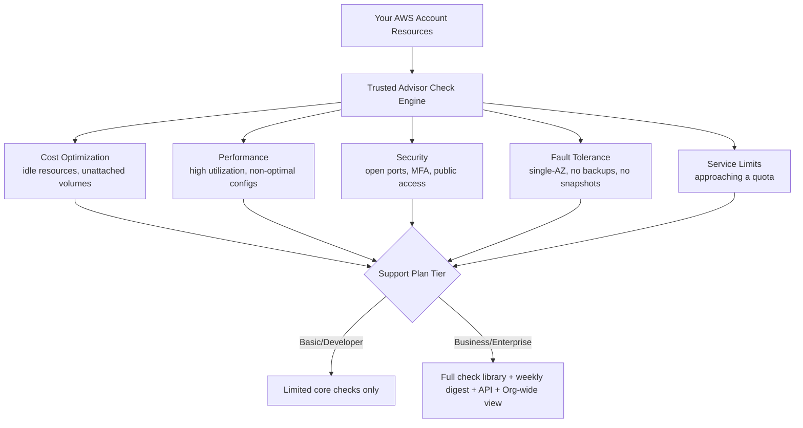

# AWS Trusted Advisor

## Definition

AWS Trusted Advisor is an automated service that inspects your AWS account against a set of AWS
best-practice checks and reports findings across five categories: **Cost Optimization,
Performance, Security, Fault Tolerance, and Service Limits**. In one sentence: it's AWS's
built-in "here's what you're doing wrong (or could do better), according to our own best
practices" checklist.

## Purpose

AWS has decades of operational experience seeing what good and bad architectures look like
across millions of accounts — idle load balancers, unencrypted public buckets, single-AZ
database deployments with no failover, accounts about to hit a service quota. Rather than making
customers discover these issues the hard way (an outage, a bill surprise, a security incident),
AWS built Trusted Advisor to surface them proactively, continuously, for free (at a basic level)
in every account.

## How It Works

Trusted Advisor runs a library of automated checks against your account's resources on a regular
cadence, each check mapped to one of five categories, and assigns each a status — green (no
problem), yellow (investigate), or red (action recommended). The depth of checks available
depends on your **AWS Support plan**: Basic and Developer support plans get a handful of core
checks (mostly security and service-limit related) for free; **Business, Enterprise On-Ramp, and
Enterprise** support plans unlock the **full check library** across all five categories, plus the
ability to set up **weekly email digests**, **Organization-wide aggregated views**, and
programmatic access via the Trusted Advisor API.

Walking through it: (1) Trusted Advisor continuously scans resources across the categories it
checks; (2) each individual check (e.g., "Low Utilization Amazon EC2 Instances," "Security Groups
- Unrestricted Access," "Amazon RDS Backups") produces a status per affected resource; (3) which
checks you actually get access to depends entirely on your **AWS Support plan** — this is the
single most important mechanical fact about Trusted Advisor, and the source of most exam
confusion; (4) on a paid Business/Enterprise support plan, the full set of checks runs
continuously and can notify you proactively (weekly digest email) rather than requiring you to
log in and look.

## Key Features / Components

- **Five Check Categories** — Cost Optimization, Performance, Security, Fault Tolerance, Service
  Limits (a sixth, "Operational Excellence," has also been added covering broader operational
  best practices).
- **Priority/Action Recommendations** — on supported plans, findings are grouped by priority with
  a clear recommended remediation.
- **Service Limits (Quota) Checks** — available even on the Basic support plan, flagging when
  you're approaching an account-level service quota.
- **Security Checks** — available even on Basic support plan for a small set of critical items
  (e.g., root account MFA, security group with unrestricted access to specific high-risk ports).
- **Organization View** — on Enterprise support, a consolidated Trusted Advisor view across every
  account in an AWS Organization, for a central team to track fleet-wide health.
- **Trusted Advisor API** — programmatic retrieval of check results, for feeding into your own
  dashboards or ticketing automation (Business support plan and above).

## Use Cases — When to Use It

- A quick, zero-setup health check across cost, security, performance, and resilience without
  building any custom tooling.
- Catching low-hanging-fruit cost waste: unattached EBS volumes, idle load balancers,
  underutilized EC2 instances — classic Trusted Advisor findings.
- Pre-emptively catching service quota exhaustion before it blocks a deployment (e.g., hitting
  the default VPC-per-region limit).
- A lightweight second opinion on security basics (root MFA enabled? any security group wide open
  to the internet on a sensitive port?) alongside more specialized tools like GuardDuty/Security
  Hub.
- Organizations on Enterprise Support wanting one dashboard of best-practice adherence across
  every member account.

## When NOT to Use It / Alternatives

- **Deep, continuous, rule-based compliance tracking with history and custom rules** — that's
  **AWS Config**, which is far more extensible (custom Lambda rules, conformance packs, full
  historical timeline) than Trusted Advisor's fixed check library.
- **Active threat detection (malware, compromised credentials, anomalous API behavior)** — that's
  **GuardDuty**/**Security Hub**, not Trusted Advisor, which checks *configuration* best
  practices, not *active threats*.
- **Needing the full check library but on a Basic/Developer support plan** — you simply won't see
  most checks; the fix is upgrading the AWS Support plan, not troubleshooting Trusted Advisor
  itself (a common real-world point of confusion).
- **Granular, team-specific, codified rules** ("our company requires exactly this tag schema") —
  Trusted Advisor's checks are AWS-wide best practices, not customizable to your org's specific
  policy; Config custom rules fit that need instead.

## Why It's Important

**Real-world**: Trusted Advisor is often the very first thing a new AWS account owner should
look at — it routinely surfaces immediately actionable, embarrassingly simple findings (root
account has no MFA, a security group open to the world on port 22) that represent real risk and
cost zero effort to fix once known. For cost-conscious teams, its Cost Optimization checks
regularly identify idle/forgotten resources worth real money with no engineering effort beyond
reading the report.

**Exam weight**:
- **SAA-C03 Domain 1 (Secure Architectures)** and **Domain 4 (Cost-Optimized Architectures,
  20%)** both reference Trusted Advisor — Domain 1 for its security checks, Domain 4 heavily for
  its cost-optimization and idle-resource findings; it's a named, testable tool in this domain.
- **DVA-C03** — less central, but can appear in **Domain 4 (Troubleshooting and Optimization,
  22%)** scenarios about identifying low-hanging-fruit optimization opportunities.
- **MLA-C02 Domain 4 (Operating, Monitoring, and Securing ML and AI Solutions, 24%)** references
  Trusted Advisor alongside Cost Explorer/Budgets as part of ongoing cost and operational health
  monitoring once an ML solution is live.
- A very commonly tested fact: **which checks you get depends on your Support Plan tier** — a
  question describing "I don't see most Trusted Advisor checks" is almost always answered with
  "upgrade to Business or Enterprise Support," not a technical Trusted Advisor configuration fix.

## Pricing Model (summary)

**Trusted Advisor itself has no separate charge** — but as described above, **its usefulness is
gated by your AWS Support plan**: Basic/Developer support (which itself may be free or
low-cost) unlocks only a handful of core checks (service limits, a few critical security checks);
**Business ($100/mo minimum or % of spend, whichever is greater), Enterprise On-Ramp, and
Enterprise Support** unlock the full check library, API access, and Organization-wide
aggregation. In effect, "full Trusted Advisor" is a benefit bundled into a paid AWS Support tier,
not purchased standalone. See: https://aws.amazon.com/premiumsupport/pricing/

## Hands-on Lab (Floci)

**Trusted Advisor is not part of Floci's emulated service set** — it's fundamentally an
AWS-operated analysis service gated by your Support plan tier, not a provisionable resource with
its own API surface that a local emulator would meaningfully replicate (there's no "create a
Trusted Advisor check" API — findings are generated by AWS's internal systems against real
account data).

**Practical substitute for hands-on practice**: since Trusted Advisor's checks mirror AWS Config
rules and Cost Explorer data conceptually (idle resources, open security groups, unattached
volumes), the closest genuine hands-on exercise in this repo is:
1. Run the [AWS Config](aws-config.md) lab and write a custom rule that mimics a real Trusted
   Advisor check — e.g., `s3-bucket-versioning-enabled` or a custom "flag any security group with
   `0.0.0.0/0` on port 22" rule.
2. Run the [Cost Management Tools](cost-management-tools.md) lab's Cost Explorer query to see the
   same category of insight ("what's costing money") that Trusted Advisor's Cost Optimization
   category reports on, just via a different mechanism.

For the real thing, read a few actual Trusted Advisor findings in the AWS Console on a personal
account with Business/Enterprise support, or review AWS's published sample check catalog in the
official docs — there's no faithful free local substitute for the finding-generation engine
itself.

## Exam Tips

- **Memorize the five categories**: Cost Optimization, Performance, Security, Fault Tolerance,
  Service Limits. Questions frequently ask "which category does this finding belong to" as a
  direct knowledge check.
- **Support plan tier gates check depth** — this is the #1 tested fact. Basic/Developer = minimal
  checks (service limits + a few security). Business/Enterprise = full library + API + weekly
  digest + Organization view.
- **Trusted Advisor checks configuration best practices; it does not detect active threats** —
  don't confuse it with GuardDuty (threat detection) or Security Hub (aggregated security
  findings across multiple tools, including Trusted Advisor's security checks as one input).
- **Trusted Advisor ≠ AWS Config** — Trusted Advisor is a fixed library of AWS best-practice
  checks with no customization; Config is an extensible, rule-based compliance engine with full
  history you can write custom rules for. If a question mentions "custom rule" or "historical
  compliance timeline," it's Config, not Trusted Advisor.
- Service Limit checks are available on **every support plan including Basic** — a question
  asking "will I see quota warnings without paying for support" has the answer "yes, for service
  limits specifically."

## Related Terms

- [AWS Config](aws-config.md) — the extensible, rule-based alternative/complement; Trusted
  Advisor's checks are fixed, Config's are customizable
- [Cost Management Tools](cost-management-tools.md) — Trusted Advisor's Cost Optimization
  category findings are a subset of the broader cost visibility/control story
- [AWS Well-Architected Tool](well-architected-tool.md) — a structured, deeper self-assessment
  framework; Trusted Advisor is faster/automated but shallower
- Glossary: AWS Support Plan, Service Quota, GuardDuty, Security Hub
