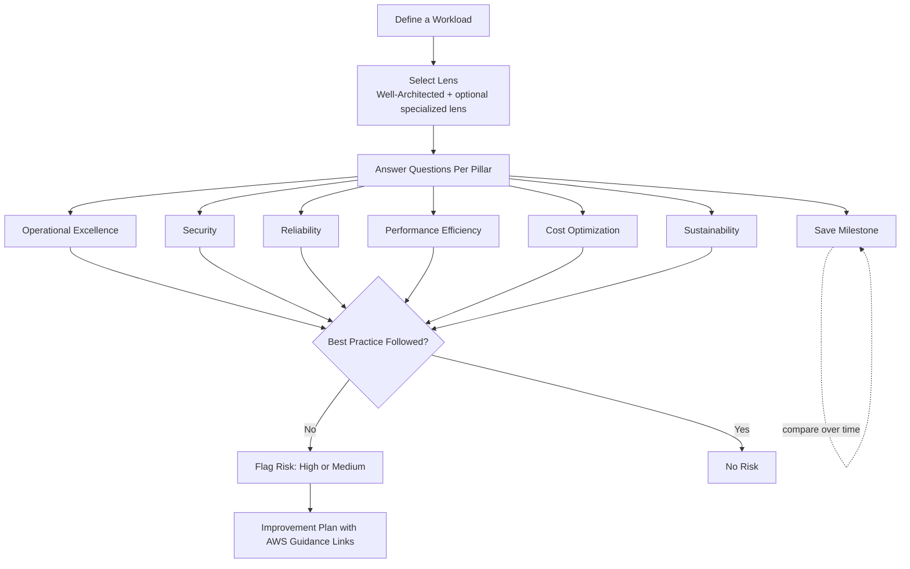

# AWS Well-Architected Tool

## Definition

The AWS Well-Architected Tool is a free console-based service that walks you through a
structured questionnaire about a specific workload's architecture — across six pillars
(Operational Excellence, Security, Reliability, Performance Efficiency, Cost Optimization, and
Sustainability) — and produces a report of risks found plus specific AWS guidance to fix each
one.

## Purpose

The **AWS Well-Architected Framework** is a large body of accumulated best-practice guidance (a
set of whitepapers) for designing cloud architectures well. Reading whitepapers doesn't by
itself tell you whether *your specific workload* follows that guidance — someone has to actually
sit down, go question by question, and honestly assess the real architecture. AWS built the
Well-Architected Tool to turn that whitepaper guidance into a structured, repeatable, documented
self-review process with a persistent record you can revisit as the architecture evolves,
instead of a one-time conversation that's forgotten by the next design review.

## How It Works

You define a **Workload** in the tool (a logical unit — e.g., "checkout service," "ML training
pipeline") and select which **Lenses** apply (the base Well-Architected Lens always applies; you
can add specialized lenses like the Serverless Lens, SaaS Lens, Machine Learning Lens, or your
own custom lens). You then answer a structured set of questions **per pillar** — each question
asks which best practices you currently follow, with explanations of what "good" looks like and
why it matters. Unanswered or "not followed" best practices generate a **risk** (flagged High or
Medium), and the tool produces a **Milestone** — a timestamped snapshot of your review — letting
you track whether risk is going down release over release.

Walking through it: (1) you create a Workload record describing the system under review and
choose which lens(es) to assess it against; (2) you work through the pillar-by-pillar question
set — this is a genuinely manual, honest self-assessment, not an automated scan of your account;
(3) each answer either confirms a best practice is followed or flags it as not followed; (4) not-
followed items become risks, prioritized High or Medium based on severity, each with a link to
the specific AWS guidance/whitepaper section explaining how to fix it; (5) saving a **Milestone**
locks in a snapshot of the review at that point in time, so a future re-review of the same
workload can show concretely whether risk count went down (or up) since the last review — turning
architecture review from an opinion into a trackable metric.

## Key Features / Components

- **Workloads** — the logical unit you assess (not literally scanned resources — you describe
  the architecture yourself through the questionnaire).
- **Six Pillars** — Operational Excellence, Security, Reliability, Performance Efficiency, Cost
  Optimization, Sustainability (Sustainability was added in 2021, the newest pillar).
- **Lenses** — the base Well-Architected Lens plus specialized ones (Serverless, SaaS, Machine
  Learning, Data Analytics, IoT, Financial Services, and others) with pillar-specific questions
  relevant to that architecture style; you can also author a **Custom Lens** for internal
  standards.
- **Risks (High/Medium)** — generated per unanswered or not-followed best practice, each linked
  to specific remediation guidance.
- **Milestones** — timestamped snapshots enabling before/after risk tracking across review
  cycles.
- **Improvement Plan** — a prioritized, generated list of what to fix first, based on risk
  severity.
- **Integration with Trusted Advisor** — for AWS accounts with applicable support plans, some
  Well-Architected Tool answers can be informed/cross-checked by related Trusted Advisor findings.

## Use Cases — When to Use It

- A structured architecture review before a major launch, or periodically (quarterly/annually)
  for an existing production workload.
- Onboarding a new team to "what does AWS consider a well-built system" via the pillar questions
  themselves, which double as an architecture-education tool.
- Tracking architectural debt over time — milestones give a concrete, comparable record instead
  of "I think we've improved since last time."
- Preparing for a customer/partner/compliance review that specifically asks about Well-Architected
  alignment (this happens in enterprise sales and partner certification contexts).
- Applying a specialized lens (e.g., Machine Learning Lens) to get pillar guidance specific to
  that workload style rather than generic advice.

## When NOT to Use It / Alternatives

- **Needing automated, continuous, no-effort scanning of your actual account** — the
  Well-Architected Tool is a manual questionnaire you fill out yourself; for automated findings
  with zero manual review effort, use **Trusted Advisor** (fixed best-practice checks) or
  **AWS Config** (customizable compliance rules) instead.
- **A single, tiny, low-stakes workload** — the full six-pillar review is significant time
  investment; it earns its cost for workloads where an architecture mistake would be expensive
  (production, customer-facing, regulated) rather than a weekend side project.
- **Real-time security threat detection** — this tool reviews design decisions periodically, not
  live security events; that's GuardDuty/Security Hub territory.
- **Wanting instant answers with no questionnaire** — if you want a fast read on obvious
  misconfigurations right now, Trusted Advisor's automated checks are quicker, even though they
  cover less ground than a full Well-Architected review.

## Why It's Important

**Real-world**: the Well-Architected Framework (and by extension, this tool) is AWS's own
canonical definition of "good architecture," and is frequently referenced directly in enterprise
procurement, partner competency programs, and solution architect job interviews — being able to
discuss a design in terms of its six pillars is a genuinely expected professional skill, not just
exam trivia. The tool itself gives teams a lightweight, free, repeatable way to operationalize
that framework instead of it staying a whitepaper nobody actually applies.

**Exam weight**:
- **SAA-C03** is explicitly built around the Well-Architected Framework's structure — its four
  domains (Secure, Resilient, High-Performing, Cost-Optimized Architectures) map almost directly
  onto four of the six pillars (Security, Reliability, Performance Efficiency, Cost
  Optimization). **Domain 4 (Cost-Optimized Architectures, 20%)** specifically draws on the Cost
  Optimization pillar's guidance, and the tool itself is a named service in this domain's scope.
- **DVA-C03 Domain 4 (Troubleshooting and Optimization, 22%)** references Well-Architected
  principles when evaluating whether an optimization recommendation is actually sound practice,
  not just a quick fix.
- **MLA-C02 Domain 4 (Operating, Monitoring, and Securing ML and AI Solutions, 24%)** references
  the **Machine Learning Lens** specifically — a specialized lens applying Well-Architected
  pillars to ML workload design, directly relevant to this domain's "operate and secure" focus.
- A reliably tested fact: **there are six pillars, not five** — Sustainability was added in 2021
  and is sometimes missed by outdated study materials; confirm all six when memorizing.

## Pricing Model (summary)

**The AWS Well-Architected Tool is completely free** — there is no charge for creating workloads,
answering questions, generating reports, or saving milestones, regardless of AWS Support plan.
You only incur cost if the review's recommendations lead you to change/add AWS resources (the
normal cost of those resources), not from using the tool itself. See:
https://aws.amazon.com/well-architected-tool/pricing/ (confirms free usage)

## Hands-on Lab (Floci)

**The Well-Architected Tool is not part of Floci's emulated service set**, and conceptually
wouldn't benefit much from one — it's a manual questionnaire interface over your own judgment
about a workload's design, not a provisionable resource or an API that inspects live
infrastructure automatically. There's no "run `awslocal wellarchitected ...`" exercise that would
teach the actual skill, which is the self-assessment process itself.

**Practical substitute for hands-on practice**:
1. Pick one of the other labs already built in this repo (e.g., the [CloudFormation](cloudformation.md)
   stack or the [CloudTrail](cloudtrail.md) trail you stood up locally) and walk it, by hand,
   through a few real Well-Architected questions from the Security and Reliability pillars —
   e.g., "Is the root bucket encrypted?", "Is there more than one Availability Zone in play?",
   "Is access logged and auditable?" — exactly as you would in the real tool's questionnaire.
2. For the real interface, the AWS Well-Architected Tool itself is free in any real AWS account
   (no Floci/local equivalent needed, since it costs nothing to use) — creating a Workload there
   against a sandbox account's actual resources is the most faithful hands-on practice available.

## Exam Tips

- **Memorize all six pillars**: Operational Excellence, Security, Reliability, Performance
  Efficiency, Cost Optimization, **Sustainability** (newest, added 2021 — don't forget it).
- **The tool is a manual questionnaire, not an automated scanner** — don't confuse it with
  Trusted Advisor (automated checks) or Config (automated, rule-based compliance). If a question
  describes "a human answers structured questions about design decisions," that's the
  Well-Architected Tool; if it describes "automatic scanning with no human input," that's Trusted
  Advisor or Config.
- **Lenses apply pillar questions to a specific architecture style** — a question mentioning a
  serverless or ML-specific review points to the Serverless Lens or Machine Learning Lens, not a
  generic review.
- **Milestones = trackable history of a workload's review over time** — a question about
  "measuring whether we've reduced architectural risk since last quarter" points to comparing
  Milestones.
- **It's free regardless of Support plan** — unlike Trusted Advisor, there's no paywall gating
  which pillars/lenses you can use; this is a frequently tested contrast between the two tools.

## Related Terms

- [Trusted Advisor](trusted-advisor.md) — the automated, always-on counterpart; faster but
  shallower than a full Well-Architected review
- [AWS Config](aws-config.md) — automated compliance checking that can supply evidence for a
  Well-Architected review's Security/Reliability pillar answers
- [Cost Management Tools](cost-management-tools.md) — referenced directly by the Cost
  Optimization pillar's best practices
- Glossary: Well-Architected Framework, Pillar, Lens, Milestone, Risk (High/Medium)
