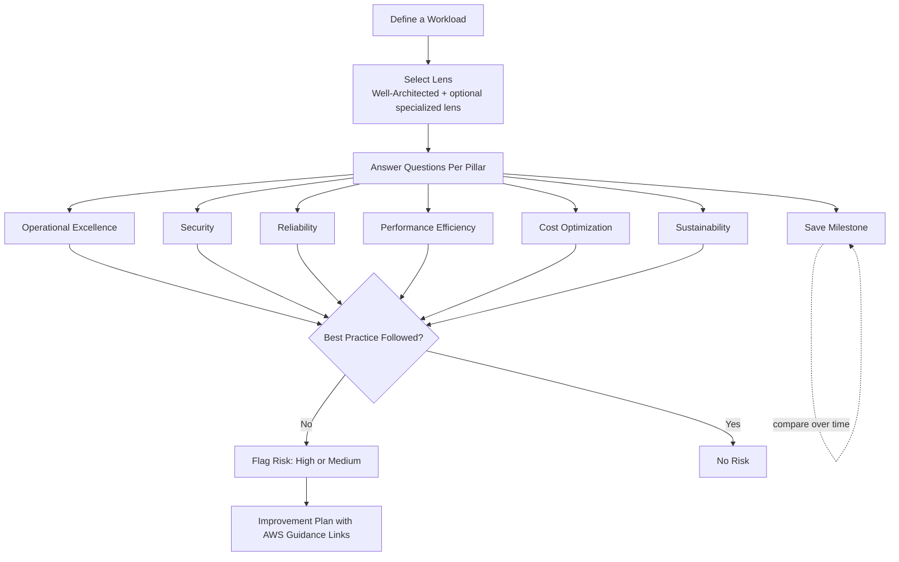
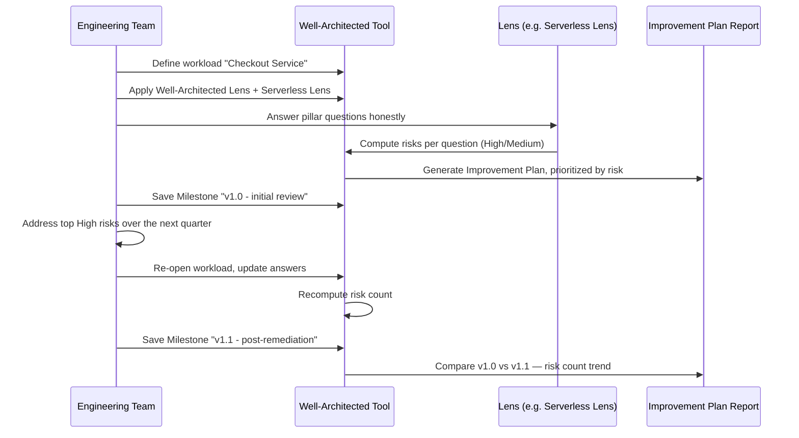
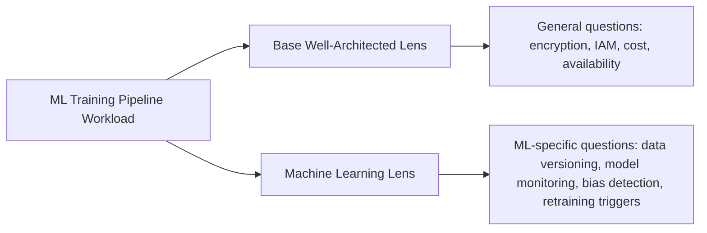

# AWS Well-Architected Tool

> **Appears in:** [DVA-C03](../../certifications/dva-c03/README.md)


## Definition

The AWS Well-Architected Tool is a free console-based service that walks you through a
structured questionnaire about a specific workload's architecture — across six pillars
(Operational Excellence, Security, Reliability, Performance Efficiency, Cost Optimization, and
Sustainability) — and produces a report of risks found plus specific AWS guidance to fix each
one.

## Purpose

The **AWS Well-Architected Framework** is a large body of accumulated best-practice guidance (a
set of whitepapers) for designing cloud architectures well. Reading whitepapers doesn't by
itself tell you whether *your specific workload* follows that guidance — someone has to actually
sit down, go question by question, and honestly assess the real architecture. AWS built the
Well-Architected Tool to turn that whitepaper guidance into a structured, repeatable, documented
self-review process with a persistent record you can revisit as the architecture evolves,
instead of a one-time conversation that's forgotten by the next design review.

The deeper reason this tool exists as a *questionnaire*, not an *automated scanner*, is that many
of the Well-Architected Framework's best practices concern decisions that no API call can
observe — "does your team have a documented runbook for this failure mode," "have you tested your
disaster recovery plan in the last year," "is your architecture reviewed by someone outside the
team that built it." These are process and design questions, not configuration facts a scanner
can read off a resource — which is exactly the gap Trusted Advisor and Config, both automated,
cannot close, and why this tool deliberately keeps a human in the loop.

## How It Works

You define a **Workload** in the tool (a logical unit — e.g., "checkout service," "ML training
pipeline") and select which **Lenses** apply (the base Well-Architected Lens always applies; you
can add specialized lenses like the Serverless Lens, SaaS Lens, Machine Learning Lens, or your
own custom lens). You then answer a structured set of questions **per pillar** — each question
asks which best practices you currently follow, with explanations of what "good" looks like and
why it matters. Unanswered or "not followed" best practices generate a **risk** (flagged High or
Medium), and the tool produces a **Milestone** — a timestamped snapshot of your review — letting
you track whether risk is going down release over release.



Walking through it: (1) you create a Workload record describing the system under review and
choose which lens(es) to assess it against; (2) you work through the pillar-by-pillar question
set — this is a genuinely manual, honest self-assessment, not an automated scan of your account;
(3) each answer either confirms a best practice is followed or flags it as not followed; (4) not-
followed items become risks, prioritized High or Medium based on severity, each with a link to
the specific AWS guidance/whitepaper section explaining how to fix it; (5) saving a **Milestone**
locks in a snapshot of the review at that point in time, so a future re-review of the same
workload can show concretely whether risk count went down (or up) since the last review — turning
architecture review from an opinion into a trackable metric.

### Full review lifecycle, including re-review cadence



Walking through it: the realistic cadence is quarterly or pre-major-release, not continuous — a
team documents a workload once, generates an improvement plan, works through the highest-priority
items, then re-opens the *same* workload record (not a new one) to update answers and save a new
Milestone. Comparing milestones over time is what turns "we think we've improved" into "here is
the specific risk count delta, question by question."

### How It Works — Step by Step: Tracing a Workload From First Review to a Trending Milestone

The sequence diagram above shows the lifecycle shape; here's a single workload's realistic
first-year journey through that lifecycle, including what actually changes between reviews.

1. **Q1, day 1 — the workload is defined.** A platform team creates a Workload record named
   "Checkout Service" in the tool, describing the architecture (ALB → ECS Fargate → Aurora, with a
   Redis cache) and selects the base Well-Architected Lens plus nothing specialized yet, since this
   is a conventional three-tier web service.
2. **Q1, days 1-3 — the questionnaire.** Engineers from the team spend roughly three half-days
   working through all six pillars' questions. For the Security pillar's "how do you protect data
   at rest" question, rather than answering from memory, someone actually checks: RDS encryption
   is confirmed off on this specific (older) Aurora instance, contradicting the team's assumption
   that "we always encrypt everything."
3. **Q1, day 3 — risks are generated.** That answer alone generates a High risk flagged
   specifically against this instance, with a direct link to the RDS encryption documentation. By
   the end of the questionnaire, the workload has 6 High risks and 11 Medium risks across all six
   pillars — a number nobody had before this review existed as anything more than a gut feeling.
4. **Q1, day 3 — Milestone 1 is saved.** The team locks in "v1.0 - initial review" as a timestamped
   snapshot. This is the baseline every future comparison measures against.
5. **Q1-Q3 — remediation happens outside the tool.** Over the following two quarters, the team
   enables Aurora encryption (requiring a snapshot-and-restore, since encryption can't be toggled
   on an existing unencrypted instance), writes a disaster-recovery runbook that didn't exist
   before, and adds a WAF in front of the public ALB — none of this activity happens *inside* the
   Well-Architected Tool; the tool only recorded that these gaps existed.
6. **Q3, day 1 — the workload is re-opened, not recreated.** The same engineers return to the
   *same* Workload record (critically not a new one — a new record would lose the comparison
   baseline) and update their answers to reflect what's now actually true: RDS encryption is now
   "Yes," the incident response runbook now exists and has been tested once.
7. **Q3, day 1 — risks recompute.** The tool recalculates: High risks drop from 6 to 1, Medium from
   11 to 4. The one remaining High risk is a genuinely new one introduced by a different feature
   shipped in Q2 (a newly added Lambda function with an overly broad IAM policy) — the Milestone
   comparison surfaces this honestly rather than just showing "net improvement," which matters,
   since new risk can accumulate even while old risk is being fixed.
8. **Q3, day 1 — Milestone 3 is saved** (Milestone 2 having been an interim check at end of Q1).
   The team now has a concrete, defensible number — "High risks down from 6 to 1" — to present to
   leadership, instead of a verbal "things feel better."
9. **The honest failure mode worth knowing.** If the team had skipped re-opening the review and
   just assumed things improved, there would be no record distinguishing genuine progress from
   wishful thinking — the entire value of this trace depends on the discipline of actually
   re-answering the questionnaire against real evidence, not on the tool doing anything
   automatically in the background between reviews.

## Worked Example: A Mini Security Pillar Review

Below is a condensed, realistic walkthrough of several Security pillar questions as they'd
actually be answered for a workload — illustrating what "honest self-assessment" produces in
practice (this mirrors the tool's actual question structure, condensed):

| Question (abbreviated) | Answer | Risk Generated |
|---|---|---|
| How do you manage credentials and authentication? | IAM roles used everywhere; no long-lived access keys in code | None |
| How do you control human access? | SSO federated via IAM Identity Center; MFA enforced org-wide | None |
| How do you detect and investigate security events? | CloudTrail organization trail enabled; GuardDuty on in all accounts | None |
| How do you protect data at rest? | S3 default encryption enabled; RDS NOT encrypted (legacy instance, pre-dates policy) | **High** — unencrypted data at rest on a production database |
| How do you protect network boundaries? | Public subnets used for app tier directly, no WAF in front of public ALB | **Medium** — internet-facing without a web application firewall |
| How do you prepare for incidents? | No documented incident response runbook exists | **High** — no tested process when (not if) an incident occurs |

This table is exactly the shape of a real Improvement Plan output: each "not followed" answer
produces a specific, actionable risk with a clear AWS guidance link (e.g., straight to the RDS
encryption documentation, or to the Incident Response whitepaper), rather than a vague "improve
security" recommendation.

### Generating and reading the workload report

```bash
# List workloads (illustrative CLI shape — most teams use the console for the Q&A itself)
aws wellarchitected list-workloads

# Pull milestone history to compare risk trend over time
aws wellarchitected list-milestones --workload-id w-abc123def456

# Pull the full list of high/medium risks for a specific lens on a workload
aws wellarchitected list-lens-review-improvements \
  --workload-id w-abc123def456 \
  --lens-alias wellarchitected
```

Teams that integrate Well-Architected reviews into a formal release-gate process often script
this last call into a CI/CD pipeline check — not to block automatically (the tool isn't designed
for hard gating the way a Config rule is), but to surface the current risk count in a release
readiness dashboard alongside more automated signals.

## Key Features / Components

- **Workloads** — the logical unit you assess (not literally scanned resources — you describe
  the architecture yourself through the questionnaire).
- **Six Pillars** — Operational Excellence, Security, Reliability, Performance Efficiency, Cost
  Optimization, Sustainability (Sustainability was added in 2021, the newest pillar).
- **Lenses** — the base Well-Architected Lens plus specialized ones (Serverless, SaaS, Machine
  Learning, Data Analytics, IoT, Financial Services, and others) with pillar-specific questions
  relevant to that architecture style; you can also author a **Custom Lens** for internal
  standards.
- **Risks (High/Medium)** — generated per unanswered or not-followed best practice, each linked
  to specific remediation guidance.
- **Milestones** — timestamped snapshots enabling before/after risk tracking across review
  cycles.
- **Improvement Plan** — a prioritized, generated list of what to fix first, based on risk
  severity.
- **Integration with Trusted Advisor** — for AWS accounts with applicable support plans, some
  Well-Architected Tool answers can be informed/cross-checked by related Trusted Advisor findings.
- **Profiles** — a newer feature letting you weight/prioritize specific best practices as more
  important to your organization's context, so the generated report emphasizes what matters most
  to you rather than treating every best practice as equally weighted.

## Cross-Referencing a Pillar Answer With Real Telemetry

A disciplined review doesn't just answer questions from memory — it checks. For the Reliability
pillar question "do you test your system's resilience to a single Availability Zone failure," a
team can actually verify rather than guess, using the kind of CloudWatch query covered in the
[CloudWatch](cloudwatch.md) doc:

```
fields @timestamp, @message
| filter @message like /AZ failover/ or @message like /chaos-test/
| stats count() as testRuns by bin(30d)
```

If this query shows zero matching log entries over the last year, that's hard evidence the
answer to "do you regularly test AZ failure resilience" should honestly be "no," rather than an
optimistic assumption based on the architecture *theoretically* supporting failover — the
Well-Architected review is only as good as the honesty of the self-assessment, and pulling real
telemetry is how a rigorous team avoids grading its own homework generously.

## Common Architectures

**1. Well-Architected review as a mandatory pre-production launch gate**

A platform team requires every new production workload to complete a Well-Architected review
(at minimum the Security and Reliability pillars) before launch, with any High risk requiring
either remediation or an explicit, documented, time-bound risk acceptance signed off by a senior
engineer — turning the framework from optional guidance into an actual governance checkpoint.

**2. Machine Learning Lens applied specifically to an ML pipeline workload**



The ML Lens adds questions a generic review wouldn't ask — does the pipeline track data lineage,
is model drift monitored post-deployment, is there a retraining trigger — directly relevant to
MLA-C02 Domain 4's "operate and secure ML solutions" content.

**3. Milestone-driven quarterly architecture review cadence**

A recurring calendar process: each quarter, re-open the workload record for every production
system, update answers to reflect what's actually changed, save a new milestone, and present the
risk-count trend (not just a snapshot) to engineering leadership — making "architectural debt" a
tracked, visible metric rather than an informal, easily-ignored concern.

**4. Custom Lens encoding internal standards beyond AWS's own guidance**

A company with its own internal security/compliance requirements beyond AWS's generic best
practices (e.g., "every production database must replicate to a specific DR region," "every
public endpoint must sit behind this company's specific WAF rule set") authors a Custom Lens, so
internal-standard questions appear in the same review flow and report alongside the standard
AWS Well-Architected Lens questions.

## Use Cases — When to Use It

1. **A structured pre-launch architecture review before a major production release.** A team is
   about to launch a customer-facing service and wants a disciplined check against AWS best
   practices beyond "it passed QA." **Why this fits:** the six-pillar questionnaire forces
   consideration of operational, security, reliability, performance, cost, and sustainability
   dimensions a feature-focused QA pass wouldn't naturally cover. **Tradeoff:** a thorough review of
   a complex workload is a genuinely significant time investment (often multiple half-days) —
   teams under launch pressure are tempted to skip or rush it, precisely when the review would be
   most valuable.

2. **Quarterly architectural debt tracking via Milestones.** Leadership wants to know whether
   engineering is actually reducing accumulated risk over time, not just hear "we're working on
   it." **Why this fits:** comparing Milestone risk counts quarter over quarter turns "we think
   we've improved" into a specific, defensible number. **Tradeoff:** the risk count can
   legitimately go up even while real remediation work happens, if new features introduce new
   risks faster than old ones are fixed — a naive reading of "risk count didn't drop" as "the
   review process failed" misses this nuance.

3. **Onboarding a new team to AWS's own definition of good architecture.** A team newly migrating
   to AWS doesn't yet have an intuitive sense of what "well-architected" means in AWS's specific
   vocabulary. **Why this fits:** working through the pillar questions themselves functions as an
   education tool, with each question explaining the best practice and why it matters.
   **Tradeoff:** this works best when a knowledgeable facilitator or experienced engineer guides
   the first pass — a team with zero AWS experience working through 100+ questions cold can find
   some answers genuinely hard to self-assess accurately without that guidance.

4. **Compliance/partner review evidence beyond automated scanning.** An enterprise customer's
   procurement process specifically asks for evidence of Well-Architected alignment, which an
   automated tool's findings alone don't satisfy. **Why this fits:** a saved Workload with
   Milestones is a documented, structured artifact that directly answers this kind of partner/
   procurement question. **Tradeoff:** producing this evidence requires having actually done the
   review beforehand — it can't be generated retroactively on short notice the way a Trusted
   Advisor report (reflecting current state) can.

5. **Applying the Machine Learning Lens to an ML pipeline workload.** An ML platform team wants
   pillar guidance addressing model drift, data lineage, and retraining triggers — none of which a
   generic review covers. **Why this fits:** the ML Lens adds questions specific to ML workload
   design on top of the base lens, directly relevant to operating and securing ML solutions.
   **Tradeoff:** honestly answering the ML Lens's questions (e.g., "has a retraining trigger
   actually fired recently") requires pulling real telemetry, not assuming the pipeline's
   theoretical design is being followed — a review done from memory alone risks grading its own
   homework too generously.

6. **A mandatory governance gate before production launch (multi-account/organizational
   governance).** A platform team requires every new production workload across the organization
   to pass a Well-Architected review (at minimum Security and Reliability pillars) before go-live.
   **Why this fits:** turning the framework from optional guidance into an actual checkpoint, with
   any High risk requiring remediation or an explicit, signed-off risk acceptance, gives governance
   real teeth. **Tradeoff:** this adds a real, often multi-day process step to every launch —
   teams under aggressive deadlines will push back, and the gate only has teeth if leadership
   actually backs enforcing it rather than letting exceptions become the norm.

7. **Post-incident retrospective: was this risk already known?** After an incident, the team wants
   to know whether the failure mode that caused it was a previously flagged, unaddressed risk, or
   something nobody had considered. **Why this fits:** checking whether a saved Milestone already
   flagged the exact failure mode (e.g., "no tested disaster-recovery runbook") gives direct,
   dated evidence either way — a materially different retrospective conclusion than treating it as
   completely unforeseeable. **Tradeoff:** this only works if a review actually happened before the
   incident and covered the relevant pillar — a workload that was never reviewed has no such record
   to check against.

8. **Authoring a Custom Lens for internal standards beyond AWS's own guidance.** A company has its
   own requirements (every production database must replicate to a specific DR region) that no
   AWS-managed best practice captures. **Why this fits:** a Custom Lens's questions appear in the
   same review flow and generate risks/improvement plans using the identical Milestone-tracked
   mechanism, just driven by company-authored logic. **Tradeoff:** authoring and maintaining a
   Custom Lens is real, ongoing content-ownership work — someone has to keep its questions current
   as internal standards evolve, unlike the base AWS lens, which AWS itself maintains.

9. **Scoping a first review to just the highest-stakes pillars when time is limited.** A team
   facing a tight deadline can't realistically complete all six pillars before launch. **Why this
   fits:** the tool doesn't require answering every pillar at once — scoping the first pass to
   Security and Reliability, with Performance/Cost/Sustainability deferred to a follow-up session,
   is a legitimate, commonly recommended way to get the highest-value coverage first.
   **Tradeoff:** a partial review leaves real gaps (cost and performance risks genuinely unassessed,
   not just deprioritized) — the team needs explicit follow-through to actually complete the
   deferred pillars, or "we'll do it later" quietly becomes "we never did."

10. **Comparing automated findings against a structured self-assessment to catch blind spots.** A
    team wants to confirm their own honest self-assessment roughly matches what automated tools
    (Trusted Advisor, Config) are independently finding. **Why this fits:** cross-referencing a
    pillar answer like "we don't have any public S3 buckets" against an actual Config rule's
    current compliance status catches a case where the team's belief and reality have quietly
    diverged. **Tradeoff:** this cross-referencing is a manual step the team has to deliberately
    do — the Well-Architected Tool doesn't automatically pull in Trusted Advisor/Config findings
    to validate every answer for you.

11. **Measuring the ROI of the review process itself to justify continuing it.** Leadership
    questions whether the quarterly review cadence is worth the engineer time it costs.
    **Why this fits:** connecting a specific flagged-but-unfixed risk to a subsequent real incident
    that happened because of it (or didn't happen once fixed) is a far more persuasive, concrete
    argument than citing the raw risk count alone. **Tradeoff:** this argument only exists if the
    team tracks incidents against specific prior findings deliberately — without that explicit
    cross-referencing effort, the connection between "we reviewed this" and "this didn't happen
    again" remains anecdotal rather than demonstrated.

12. **Distinguishing a Performance Efficiency concern from a Cost Optimization one for the same
    underlying symptom.** A workload runs EC2 instances consistently at 15% CPU, "to be safe."
    **Why this fits:** the tool captures this as two separate, pillar-specific risks — Cost
    Optimization flags the spend waste, Performance Efficiency separately flags that the sizing
    decision wasn't data-driven — giving a more complete picture than treating it as a single
    cost-only issue. **Tradeoff:** recognizing both angles requires understanding that the same
    observed symptom can map to multiple pillars for genuinely different underlying reasons, which
    takes some practice to apply consistently across a real review rather than defaulting to
    whichever pillar comes to mind first.

## When NOT to Use It / Alternatives

- **Needing automated, continuous, no-effort scanning of your actual account** — the
  Well-Architected Tool is a manual questionnaire you fill out yourself; for automated findings
  with zero manual review effort, use **Trusted Advisor** (fixed best-practice checks) or
  **AWS Config** (customizable compliance rules) instead.
- **A single, tiny, low-stakes workload** — the full six-pillar review is significant time
  investment; it earns its cost for workloads where an architecture mistake would be expensive
  (production, customer-facing, regulated) rather than a weekend side project.
- **Real-time security threat detection** — this tool reviews design decisions periodically, not
  live security events; that's GuardDuty/Security Hub territory.
- **Wanting instant answers with no questionnaire** — if you want a fast read on obvious
  misconfigurations right now, Trusted Advisor's automated checks are quicker, even though they
  cover less ground than a full Well-Architected review.

## Why It's Important

**Real-world**: the Well-Architected Framework (and by extension, this tool) is AWS's own
canonical definition of "good architecture," and is frequently referenced directly in enterprise
procurement, partner competency programs, and solution architect job interviews — being able to
discuss a design in terms of its six pillars is a genuinely expected professional skill, not just
exam trivia. The tool itself gives teams a lightweight, free, repeatable way to operationalize
that framework instead of it staying a whitepaper nobody actually applies.

**Exam weight**:
- **SAA-C03** is explicitly built around the Well-Architected Framework's structure — its four
  domains (Secure, Resilient, High-Performing, Cost-Optimized Architectures) map almost directly
  onto four of the six pillars (Security, Reliability, Performance Efficiency, Cost
  Optimization). **Domain 4 (Cost-Optimized Architectures, 20%)** specifically draws on the Cost
  Optimization pillar's guidance, and the tool itself is a named service in this domain's scope.
- **DVA-C03 Domain 4 (Troubleshooting and Optimization, 22%)** references Well-Architected
  principles when evaluating whether an optimization recommendation is actually sound practice,
  not just a quick fix.
- **MLA-C02 Domain 4 (Operating, Monitoring, and Securing ML and AI Solutions, 24%)** references
  the **Machine Learning Lens** specifically — a specialized lens applying Well-Architected
  pillars to ML workload design, directly relevant to this domain's "operate and secure" focus.
- A reliably tested fact: **there are six pillars, not five** — Sustainability was added in 2021
  and is sometimes missed by outdated study materials; confirm all six when memorizing. Expect a
  scenario question distinguishing "an automated check flags this" (Trusted Advisor/Config) from
  "a human answered this honestly in a structured review" (Well-Architected Tool).

## Pricing Model (summary)

**The AWS Well-Architected Tool is completely free** — there is no charge for creating workloads,
answering questions, generating reports, or saving milestones, regardless of AWS Support plan.
You only incur cost if the review's recommendations lead you to change/add AWS resources (the
normal cost of those resources), not from using the tool itself. See:
https://aws.amazon.com/well-architected-tool/pricing/ (confirms free usage)

## Limits & Quotas

| Limit | Default Value | Practical Impact |
|---|---|---|
| Workloads per account/region | 100 (soft, raisable) | Large organizations tracking many individual services as separate workloads can approach this — consider grouping closely related microservices into one workload record |
| Lenses applicable per workload | Multiple, no hard practical ceiling | A workload can combine the base lens with several specialized/custom lenses simultaneously |
| Milestones per workload | 100 | More than enough for even a multi-year quarterly review cadence (100 quarters = 25 years) |
| Custom Lens versions | Several per lens, versioned | Supports iterating on an internal standard over time without losing historical review data tied to earlier versions |
| Shared workloads/lenses across accounts | Supported via AWS RAM (Resource Access Manager) | Central teams can share a Custom Lens across many accounts without re-authoring it per account |

## Troubleshooting / Common Issues

- **"We completed a review but risk count didn't actually go down the next quarter"** — this
  usually reflects genuine architectural debt accumulation (new risks introduced by new features
  outpacing remediation of old ones), not a tool malfunction; the Milestone comparison is doing
  its job by surfacing this honestly.
- **A specialized lens's questions feel irrelevant to the workload** — confirm the right lens was
  actually selected; applying the Serverless Lens to a workload that's mostly EC2-based, for
  example, produces questions that won't map cleanly onto the actual architecture.
  Re-evaluate which lens(es) genuinely fit before trusting the generated risk list.
- **Review takes far longer than expected and stalls** — a full six-pillar review of a complex
  workload is a genuinely significant time investment; teams that stall usually benefit from
  scoping the first pass to just Security and Reliability, then expanding to the remaining
  pillars in a follow-up session, rather than attempting all six pillars in one sitting.
- **Custom Lens questions don't appear for some team members** — Custom Lens sharing requires
  explicit RAM-based sharing configuration; a lens authored in one account isn't automatically
  visible in another without that step.
- **Workload report PDF seems out of date** — the report reflects the state at generation time,
  not live; regenerate it after updating any answers rather than relying on a previously
  downloaded copy.

## Further Reading

- AWS Well-Architected Tool documentation: https://docs.aws.amazon.com/wellarchitected/latest/userguide/
- AWS Well-Architected Framework whitepaper (the six pillars in full):
  https://docs.aws.amazon.com/wellarchitected/latest/framework/welcome.html
- Tutorial: Document an AWS Well-Architected Tool workload:
  https://docs.aws.amazon.com/wellarchitected/latest/userguide/tutorial.html
- Machine Learning Lens: https://docs.aws.amazon.com/wellarchitected/latest/machine-learning-lens/
- AWS Well-Architected Tool pricing: https://aws.amazon.com/well-architected-tool/pricing/


*The Well-Architected Tool's structured question screen, where a team documents whether a best
practice is currently followed for a given workload. Source: AWS Well-Architected Tool User
Guide, docs.aws.amazon.com (official AWS documentation).*


*The workload details page summarizing high and medium risks identified across pillars after
completing a review. Source: AWS Well-Architected Tool User Guide, docs.aws.amazon.com (official
AWS documentation).*

## Hands-on Lab (Floci)

**The Well-Architected Tool is not part of Floci's emulated service set**, and conceptually
wouldn't benefit much from one — it's a manual questionnaire interface over your own judgment
about a workload's design, not a provisionable resource or an API that inspects live
infrastructure automatically. There's no "run `awslocal wellarchitected ...`" exercise that would
teach the actual skill, which is the self-assessment process itself.

**Practical substitute for hands-on practice**:
1. Pick one of the other labs already built in this repo (e.g., the [CloudFormation](cloudformation.md)
   stack or the [CloudTrail](cloudtrail.md) trail you stood up locally) and walk it, by hand,
   through a few real Well-Architected questions from the Security and Reliability pillars —
   e.g., "Is the root bucket encrypted?", "Is there more than one Availability Zone in play?",
   "Is access logged and auditable?" — exactly as you would in the real tool's questionnaire.
2. For the real interface, the AWS Well-Architected Tool itself is free in any real AWS account
   (no Floci/local equivalent needed, since it costs nothing to use) — creating a Workload there
   against a sandbox account's actual resources is the most faithful hands-on practice available.

## Exam Tips

- **Memorize all six pillars**: Operational Excellence, Security, Reliability, Performance
  Efficiency, Cost Optimization, **Sustainability** (newest, added 2021 — don't forget it).
- **The tool is a manual questionnaire, not an automated scanner** — don't confuse it with
  Trusted Advisor (automated checks) or Config (automated, rule-based compliance). If a question
  describes "a human answers structured questions about design decisions," that's the
  Well-Architected Tool; if it describes "automatic scanning with no human input," that's Trusted
  Advisor or Config.
- **Lenses apply pillar questions to a specific architecture style** — a question mentioning a
  serverless or ML-specific review points to the Serverless Lens or Machine Learning Lens, not a
  generic review.
- **Milestones = trackable history of a workload's review over time** — a question about
  "measuring whether we've reduced architectural risk since last quarter" points to comparing
  Milestones.
- **It's free regardless of Support plan** — unlike Trusted Advisor, there's no paywall gating
  which pillars/lenses you can use; this is a frequently tested contrast between the two tools.
- **Risks are High or Medium, not a numeric score** — a question asking you to interpret a report
  should expect qualitative severity levels tied to specific best practices, not a single
  aggregate percentage grade.
- **Custom Lenses encode your own organization's standards** — a question about adding
  company-specific questions beyond AWS's own guidance into the same review flow points to
  authoring a Custom Lens, not modifying the base Well-Architected Lens (which you can't edit).

## Exam Scenario Walkthroughs (SAA-C03 / DVA-C03 / MLA-C02)

**Scenario 1 (SAA-C03, Domain 4 — Cost-Optimized Architectures).** A company's finance team
wants a structured way to periodically confirm that a production workload still follows AWS cost
best practices, with a documented trail showing improvement over time to present to leadership.
Which tool, and why?
> **Answer: AWS Well-Architected Tool, Cost Optimization pillar.** The requirement for a
> *structured, repeatable, documented* process with a *trend over time* points specifically to
> Milestones — Trusted Advisor gives you automated findings right now, but not a persistent,
> comparable review record across quarters the way a saved Milestone does. Cost Explorer gives
> you the underlying spend data the pillar questions would reference as evidence, but it doesn't
> itself produce a structured best-practice questionnaire or risk-tracked improvement plan.

**Scenario 2 (SAA-C03, Domain 1 — Secure Architectures, crossing into Domain 4 cost framing).** An
architect wants to assess whether a new serverless application follows AWS's recommended patterns
specifically for Lambda/API Gateway/DynamoDB-style architectures, not just generic best
practices. What's the right lens, and is a generic Well-Architected review alone sufficient?
> **Answer: Apply the Serverless Lens in addition to the base Well-Architected Lens.** A generic
> review alone would miss serverless-specific questions (cold start mitigation, DynamoDB
> on-demand vs. provisioned capacity choices, API Gateway throttling design) that only the
> Serverless Lens's question set covers — this is the exact "specialized lens adds
> architecture-style-specific depth" pattern the exam tests.

**Scenario 3 (DVA-C03, Domain 4 — Troubleshooting and Optimization).** During a post-incident
review, a team wants to confirm whether the incident represents a known category of risk they'd
already identified but hadn't yet fixed, versus something nobody had ever considered. How would a
prior Well-Architected review help answer this, specifically?
> **Answer: Check whether the failure mode matches an existing High/Medium risk already flagged
> in a saved Milestone for that workload.** If the review already identified "no tested
> disaster-recovery runbook" as a High risk two quarters ago and this incident is exactly that
> scenario playing out, the review record itself is direct evidence the risk was known and
> unaddressed — valuable both for the retrospective and for prioritizing the fix going forward,
> distinct from treating the incident as a completely novel, unforeseeable failure.

**Scenario 4 (MLA-C02, Domain 4 — Operating, Monitoring, and Securing ML and AI Solutions).** An
ML platform team wants pillar-based guidance specifically addressing model drift monitoring, data
lineage tracking, and retraining triggers — none of which appear in a generic Well-Architected
review. What should they apply, and what tool would supply the live telemetry their answers should
be grounded in?
> **Answer: The Machine Learning Lens, grounded in evidence from CloudWatch (and SageMaker Model
> Monitor) rather than memory.** The ML Lens's questions map directly onto these ML-specific
> operational concerns; answering honestly requires pulling actual monitoring data (e.g., "has a
> retraining trigger actually fired in the last quarter") rather than assuming the pipeline's
> theoretical design is being followed in practice.

**Scenario 5 (Cross-cert — distinguishing automated vs. manual governance tools).** A question
describes three simultaneous requirements: (a) continuously and automatically flag any S3 bucket
that becomes public, (b) get a free, automated best-practice health check across cost/security/
performance, and (c) conduct a structured, human-reviewed assessment of a workload's design
decisions with a trackable history. Match each requirement to the correct tool.
> **Answer: (a) AWS Config** (continuous, rule-based, automated detection — and can
> auto-remediate); **(b) AWS Trusted Advisor** (automated, checklist-based, no human
> questionnaire involved); **(c) AWS Well-Architected Tool** (manual, structured, Milestone-
> tracked). This three-way split is one of the most reliably tested distinctions in the
> Management & Governance category — each tool answers a genuinely different question, and
> exam writers frequently bundle all three into one multi-part scenario specifically to test
> whether you can tell them apart.

## Worked Example: Authoring a Minimal Custom Lens

Custom Lenses are themselves defined as JSON documents, versioned and shareable — here's a
minimal but realistic one encoding one company-specific best practice:

```json
{
  "schemaVersion": "2021-11-01",
  "name": "Acme Internal Standards Lens",
  "description": "Company-specific best practices beyond the base AWS Well-Architected Lens",
  "pillars": [
    {
      "id": "security",
      "name": "Security",
      "questions": [
        {
          "id": "acme-waf-requirement",
          "title": "Does every internet-facing endpoint sit behind the company-standard WAF rule set?",
          "choices": [
            {
              "id": "yes-waf",
              "title": "Yes, every internet-facing endpoint uses the Acme-Standard-WAF-RuleSet"
            },
            {
              "id": "no-waf",
              "title": "No, or only some endpoints are covered"
            }
          ],
          "riskRules": [
            {"condition": "choice == 'no-waf'", "risk": "HIGH_RISK"}
          ],
          "improvementPlans": [
            {
              "choiceId": "no-waf",
              "content": "Attach the Acme-Standard-WAF-RuleSet to every public ALB/CloudFront distribution. See the internal security wiki for the Terraform/CDK module reference."
            }
          ]
        }
      ]
    }
  ]
}
```

```bash
# Import and publish the custom lens for team use
aws wellarchitected create-lens-version \
  --lens-alias acme-internal-standards \
  --lens-version "1.0"

# Share it with another account via AWS Resource Access Manager, so other teams'
# workload reviews can apply it without re-authoring the lens themselves
aws wellarchitected create-lens-share \
  --lens-alias acme-internal-standards \
  --shared-with arn:aws:organizations::123456789012:organization/o-exampleorgid
```

This is the mechanism behind "apply our own internal standards inside the same review flow as
AWS's own guidance" — the custom lens's questions appear alongside the base Well-Architected
Lens's questions in the same workload review, generating risks and an improvement plan using the
exact same Milestone-tracked mechanism, just driven by company-authored logic instead of AWS's.

## Pillar-by-Pillar Quick Reference

A table worth memorizing cold — each pillar's core question and a representative best practice,
since exam questions frequently describe a scenario and expect you to name the pillar it maps to:

| Pillar | Core Question | Representative Best Practice |
|---|---|---|
| Operational Excellence | Can you run and monitor systems to deliver business value, and continuously improve processes? | Make frequent, small, reversible changes; use runbooks/playbooks for routine and incident response |
| Security | How do you protect information, systems, and assets? | Apply least privilege everywhere; enable traceability (CloudTrail); automate security responses |
| Reliability | Can the workload perform its function correctly and consistently when expected? | Automatically recover from failure; test recovery procedures; scale horizontally to increase aggregate availability |
| Performance Efficiency | Are you using computing resources efficiently to meet requirements as demand changes? | Use serverless architectures where possible; experiment more often; go global in minutes |
| Cost Optimization | Can you run systems to deliver business value at the lowest price point? | Adopt a consumption model (pay only for what you use); measure overall efficiency; analyze and attribute expenditure |
| Sustainability | Are you minimizing the environmental impacts of running cloud workloads? | Understand your impact and quantify it; maximize utilization to minimize idle resources; adopt managed services that share resources at scale |

Note that **Sustainability** best practices often *overlap* mechanically with Cost Optimization
ones (higher utilization tends to reduce both cost and environmental impact simultaneously) —
but the pillar exists as a distinct lens because the *motivating question* is different
(environmental impact vs. dollar cost), even when the recommended action looks identical.

### Additional scenario walkthroughs by pillar

**Scenario 6 (Reliability pillar).** A question describes a three-tier application running
entirely in a single Availability Zone, with no automated failover tested, and asks which
Well-Architected best practice is violated and what the fix implies architecturally.
> **Answer:** This violates the Reliability pillar's "scale horizontally" and "test recovery
> procedures" best practices. The fix is multi-AZ deployment (at minimum) with regularly tested
> failover — not simply adding more capacity in the same single AZ, which would address
> Performance Efficiency concerns but do nothing for the actual Reliability gap being tested.

**Scenario 7 (Operational Excellence pillar).** A team deploys changes to production via large,
infrequent releases bundling months of work, and asks the tool to assess their Operational
Excellence posture.
> **Answer:** This directly violates the "make frequent, small, reversible changes" best
> practice — large infrequent deployments increase blast radius and make root-causing a bad
> release far harder, since many changes land simultaneously. The Well-Architected Tool would
> flag this as a risk and link to CI/CD and deployment-strategy guidance (e.g., incremental
> rollout, feature flags) as the remediation path.

**Scenario 8 (Performance Efficiency pillar, distinguishing from Cost Optimization).** A workload
over-provisions EC2 instance sizes "to be safe," running consistently at 15% CPU utilization. Is
this a Cost Optimization risk, a Performance Efficiency risk, or both?
> **Answer: Both, but for different reasons the review captures separately.** Cost Optimization
> flags it as unnecessary spend (the "measure overall efficiency" best practice); Performance
> Efficiency separately flags it under "use the right resource for the job" — an oversized
> instance isn't actually a performance problem today, but it signals the sizing decision wasn't
> data-driven, which the Performance Efficiency pillar's best practices specifically call out as
> a review target independent of whether cost is currently a stated priority for that workload.

## Measuring the ROI of a Review Cycle

A frequent pushback from leadership: "this quarterly review takes real engineer time — is it
worth it?" A concrete way to answer with data rather than opinion, using the Milestone comparison
itself:

```bash
# Pull risk counts from two milestones, six months apart
aws wellarchitected get-milestone --workload-id w-abc123def456 --milestone-number 1
aws wellarchitected get-milestone --workload-id w-abc123def456 --milestone-number 3
```

| Metric | Milestone 1 (Q1) | Milestone 3 (Q3) | Delta |
|---|---|---|---|
| High risks | 6 | 1 | -5 |
| Medium risks | 11 | 4 | -7 |
| Incidents traceable to a flagged-but-unfixed risk | 2 | 0 | -2 |

The last row is the number that actually justifies the review cadence to leadership — connecting
a flagged risk to a *subsequent real incident that didn't happen* once it was fixed is a far more
persuasive argument than the raw risk count alone, and it's only possible to make this argument
because the Milestone history exists as a dated, specific record rather than an informal
recollection of "we talked about this once."

## Related Terms

- [Trusted Advisor](trusted-advisor.md) — the automated, always-on counterpart; faster but
  shallower than a full Well-Architected review
- [AWS Config](aws-config.md) — automated compliance checking that can supply evidence for a
  Well-Architected review's Security/Reliability pillar answers
- [Cost Management Tools](cost-management-tools.md) — referenced directly by the Cost
  Optimization pillar's best practices
- Glossary: Well-Architected Framework, Pillar, Lens, Milestone, Risk (High/Medium), Custom Lens,
  Improvement Plan
