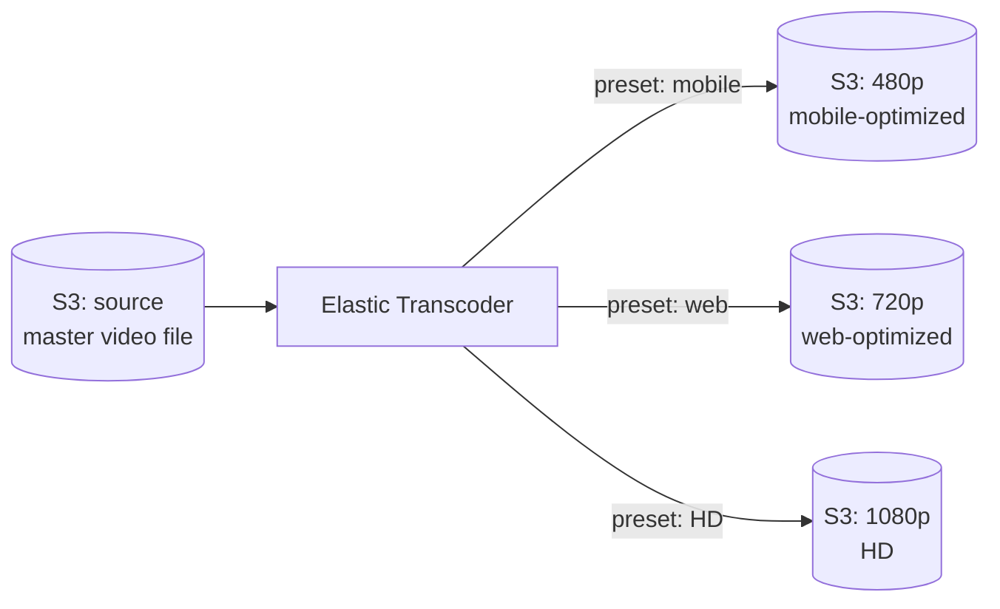
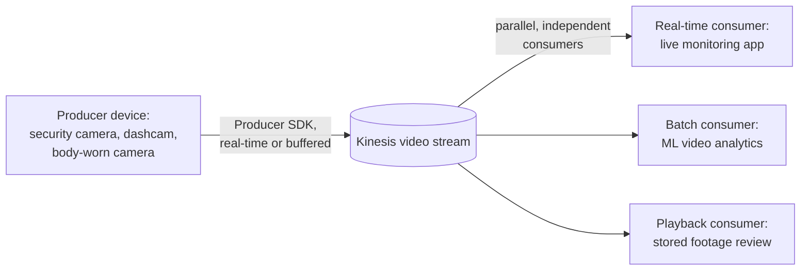

# Amazon Elastic Transcoder & Amazon Kinesis Video Streams

> **Appears in:** [SAA-C03](../../certifications/saa-c03/README.md)
>
> Amazon Kinesis Video Streams also appears in: [MLA-C02](../../certifications/mla-c02/README.md)
> (Media category)

This is a new `media` service category — both services covered here confirmed in-scope per the
exam appendices but with no existing standalone doc. Each section covers definition, purpose, a
concrete use case, and the exam-trigger phrasing to recognize.

## Amazon Elastic Transcoder

### Definition
Amazon Elastic Transcoder is a managed media transcoding service that converts video and audio
files from one format/resolution/bitrate into others — e.g., a single high-resolution master
file into multiple smaller formats suited to phones, tablets, and web browsers — without you
running or scaling your own transcoding servers/software.

### Purpose
Video needs to be delivered in different formats, resolutions, and bitrates depending on the
viewer's device and network conditions, but transcoding is computationally expensive and the
underlying codec tooling (and its licensing/version management) is genuinely fiddly to run and
scale yourself. Elastic Transcoder exists to make converting a media library into
device-appropriate formats a managed API call with predefined presets, rather than standing up
and operating your own transcoding infrastructure.

### Use Case
A media company has a library of high-resolution master video files in S3 and needs each one
converted into several device-appropriate formats (a lower-bitrate mobile version, a standard web
version, an HD version) for its streaming catalog — Elastic Transcoder processes each master file
against predefined presets and writes the resulting variants back to S3, without the company
operating any transcoding servers itself.

### Exam Tip
**"Convert video/audio into different formats/resolutions for different devices," "managed
transcoding without running your own encoding infrastructure"** → Elastic Transcoder. Know that
**AWS Elemental MediaConvert** is the newer, more broadly-featured file-based transcoding service
AWS now generally steers new workloads toward (broader codec/format support, more advanced
features) — Elastic Transcoder is the older, simpler, still-supported service; a question's exact
naming ("Elastic Transcoder" specifically vs. "MediaConvert") determines which is being tested,
and either can appear as the answer when a scenario is phrased as "convert stored video files into
multiple output formats."

---

## Amazon Kinesis Video Streams

*Figure: AWS's own overview of how Kinesis Video Streams works — one or more producer devices push
media into a stream, which one or more independent consumer applications can read from in
parallel, either in real time or after the fact. Source: AWS Kinesis Video Streams Developer
Guide (docs.aws.amazon.com/kinesisvideostreams/latest/dg/how-it-works.html).*

### Definition
Amazon Kinesis Video Streams is a fully managed service for securely streaming live video (and
other time-encoded data like audio, RADAR, or LIDAR feeds) from millions of connected devices to
AWS, durably storing it and making it available for both real-time processing and later batch
analysis.

### Purpose
Streaming live video from many distributed devices (security cameras, dashcams, body-worn
cameras, IoT sensors) at scale, reliably, with low latency, and with durable storage for later
review is a genuinely hard distributed-systems and media-pipeline problem — buffering,
time-indexing, supporting many independent consumers of the same stream, and doing all of this
securely at IoT-device scale. Kinesis Video Streams exists to handle that ingestion, storage, and
multi-consumer distribution problem as a managed service, so application teams can focus on what
they actually do with the video (analysis, playback, alerting) rather than the streaming
infrastructure itself.

Walking the diagram: a **producer** (any video-generating device) uses the **Kinesis Video
Streams producer libraries** to securely connect and push media into a **Kinesis video stream** —
either in real time, after a short local buffer, or as after-the-fact uploads. Multiple,
independent **consumer** applications can then read from that same stream in parallel: one doing
live monitoring in real time, another running batch-oriented ML video analytics (e.g., via
Rekognition Video) over stored footage, another simply serving stored footage back for playback
review — each consumer reads the stream on its own terms without competing with the others.

### Use Case
A fleet of connected security cameras needs to stream live video to the cloud for both real-time
monitoring and later ML-based analysis (e.g., detecting specific events in stored footage), while
also keeping durable, time-indexed footage available for playback review after an incident —
Kinesis Video Streams ingests from every camera, and separate consumer applications read the same
underlying stream for live monitoring, ML analytics, and stored-footage playback independently.

### Exam Tip
**"Stream live video from many devices to AWS," "durable video storage with real-time and batch
consumption," "connected cameras/IoT video at scale"** → Kinesis Video Streams. On **SAA-C03**,
recognize it as the video-specific sibling of Kinesis Data Streams — same core
producer/stream/consumer shape, specialized for time-encoded media. On **MLA-C02** (Media
category), know the direct pairing with **Amazon Rekognition Video** for ML-based video
analysis on a Kinesis Video Streams source — a scenario combining "ingest live video from devices"
with "run ML analysis on that video" is testing exactly this KVS → Rekognition Video pipeline.
Also know **Kinesis Video Streams with WebRTC** as the distinct sub-feature for real-time,
peer-to-peer, bi-directional video (e.g., a live camera-viewing mobile app), separate from the
standard producer/consumer durable-storage model.

## Related Terms

- [`../analytics/`](../analytics/) — Kinesis Data Streams/Firehose, the non-video sibling services
  sharing the same producer/stream/consumer shape.
- [`../machine-learning-ai/`](../machine-learning-ai/) — Amazon Rekognition Video, the typical ML
  consumer of a Kinesis Video Streams source.
- Glossary: Producer, Consumer, Transcoding, Codec, WebRTC, Time-encoded data.
