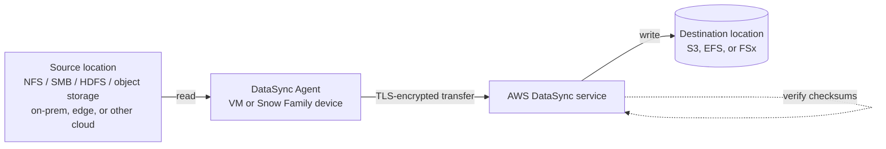
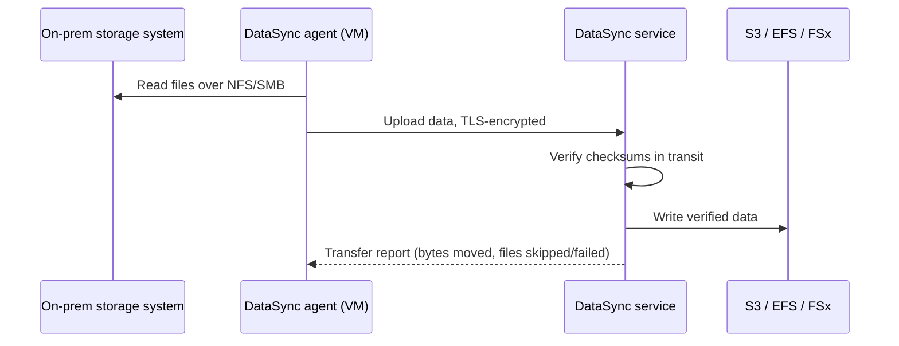
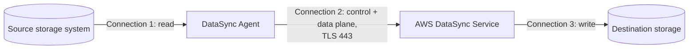

# AWS DataSync

> **Appears in:** [SAA-C03](../../certifications/saa-c03/README.md) · [MLA-C02](../../certifications/mla-c02/README.md)

<!-- No vendored icon exists for AWS DataSync in diagrams/assets/icons/ at the time this doc was
written. Per diagrams/README.md convention, a missing icon is skipped rather than linking an
unverified external CDN URL. If a DataSync icon is later vendored from aws-icons-for-plantuml
(dist/Migration-Transfer/AWSDataSync.png or similar), add it here as
``. -->

*Service · Migration & Transfer · SAA-C03 exam-guide appendix category "Migration and Transfer" ·
also confirmed in-scope for MLA-C02's "Migration and Transfer" appendix category*

## Definition

AWS DataSync is an **online data transfer service** that moves large amounts of data — files and
objects — quickly and securely between on-premises storage, other clouds, edge locations, and AWS
storage services (Amazon S3, Amazon EFS, Amazon FSx), or between AWS storage services themselves,
without you writing custom scripts to handle retries, checksums, or scheduling.

## Purpose

Before DataSync existed, moving large file datasets into AWS usually meant writing (and
maintaining) a custom `rsync`/`robocopy`-style script, babysitting it through network blips,
manually verifying every file actually arrived intact, and re-running it by hand every time new
files showed up. That approach doesn't scale past a few hundred gigabytes without becoming a
part-time job for whoever owns it.

DataSync exists to turn "copy this dataset into AWS, correctly, repeatedly, and verifiably" into a
managed job: it automatically handles encryption in transit, end-to-end data integrity
verification, retries on transient network failures, incremental re-transfers (only changed files
after the first full copy), bandwidth throttling, and scheduling — at **up to 10 times the speed**
of generic open-source copy tools, according to AWS, because its transfer protocol is purpose-built
to saturate the available network path rather than being limited by a single-threaded, chatty
protocol like plain NFS or SMB.

## How It Works



Walking through it:

1. You define a **source location** — this can be an on-premises NFS or SMB file share, a Hadoop
   Distributed File System (HDFS), a self-managed object storage system (S3-compatible, e.g. MinIO
   or on-prem appliances), or another cloud provider's storage.
2. For non-AWS sources, you deploy a **DataSync agent** — a virtual machine (VMware, KVM, Hyper-V)
   or a dedicated hardware appliance — close to the source data, which reads data locally and
   streams it to the DataSync service over a TLS-encrypted connection. No agent is needed when both
   source and destination are AWS storage services in the same account (an "agentless" in-cloud
   transfer).
3. DataSync reads the data, calculates and verifies checksums **during and after** the transfer
   (not just at the end), and applies your configured transfer options (filters, inclusion lists,
   file metadata preservation).
4. Data lands at the **destination location** — Amazon S3 (any storage class), Amazon EFS, Amazon
   FSx for Windows File Server, FSx for Lustre, FSx for OpenZFS, or FSx for NetApp ONTAP.

### Transferring on-premises to AWS


*Figure: the official "on-premises to AWS" DataSync architecture — a DataSync agent at the source
reads on-prem data and uploads it over TLS to the DataSync service, which writes it into the
chosen AWS storage target. Source: [How AWS DataSync works](https://docs.aws.amazon.com/datasync/latest/userguide/how-datasync-transfer-works.html), © Amazon Web Services.*



This is the classic use case the service was built for: a DataSync agent lives on-premises (or in
a colocation facility), reads from an existing NFS/SMB share, and the service itself — not the
agent — does the heavy lifting of chunking, encrypting, verifying, and landing the data in AWS.

### Transferring between AWS storage services (agentless)


*Figure: the official "AWS-to-AWS" DataSync architecture — no agent is required because both the
source and destination are already AWS-managed storage, even across AWS Regions. Source: [How AWS DataSync works](https://docs.aws.amazon.com/datasync/latest/userguide/how-datasync-transfer-works.html), © Amazon Web Services.*

When both ends are AWS storage (e.g., copying an S3 bucket's contents into an EFS file system, or
replicating an EFS file system cross-Region), DataSync doesn't need an agent at all — it calls the
AWS storage APIs directly. This agentless mode is the one most relevant to **data lake / ML data
pipeline** scenarios: syncing a raw-data S3 prefix into a curated prefix, or replicating training
data across Regions for disaster recovery or multi-Region training jobs.

### The three network connections every transfer needs


*Figure: DataSync requires three distinct network paths — agent-to-source, agent-to-service, and
service-to-destination — each independently securable and each a common place for a transfer to
stall if misconfigured. Source: [Connecting your network for AWS DataSync transfers](https://docs.aws.amazon.com/datasync/latest/userguide/networking-datasync.html), © Amazon Web Services.*



1. **Connection 1 — Agent to source**: the protocol-specific link (NFS/SMB/HDFS/object-storage API)
   between the agent and the actual data. If this is misconfigured (firewall, credentials,
   mount permissions), the task fails immediately at the "verify source" step.
2. **Connection 2 — Agent to DataSync service**: outbound HTTPS (443) from the agent to AWS, either
   over the public internet, a VPC endpoint (PrivateLink), or Direct Connect. This carries both the
   control-plane (task definitions, status) and data-plane (actual file bytes) traffic.
3. **Connection 3 — DataSync service to destination**: the service's own connection into the target
   AWS storage service, which (for S3/EFS/FSx within AWS) never needs agent involvement at all.

## Key Features / Components

- **DataSync Agent** — deployed as a VM image (VMware ESXi, KVM, Microsoft Hyper-V) or on
  supported hardware (including **Snowcone and Snowball Edge devices**, letting you run DataSync
  locally on a Snow Family device even before it ships back to AWS).
- **Locations** — reusable, named endpoints (an NFS share, an S3 bucket + prefix, an EFS file
  system, etc.) that tasks reference as source or destination.
- **Tasks** — the actual transfer definition: source location, destination location, options
  (bandwidth limit, verification mode, filters/exclude patterns, overwrite behavior), and an
  optional **schedule** (cron-like, for recurring incremental syncs).
- **Incremental transfers** — after the first full copy, subsequent runs of the same task only
  transfer **new or changed** files, using file metadata (size, modification time) to detect
  changes cheaply without re-reading every byte.
- **Data integrity verification** — checksums computed and verified both during transfer and (for
  deep verification mode) after the full task completes, catching silent corruption that a simple
  "did the copy finish" check would miss.
- **Bandwidth throttling** — cap how much of the source network link a task consumes, configurable
  per-agent.
- **Object storage support (non-S3)** — can treat a self-managed, S3-API-compatible system
  (on-prem appliances, other clouds) as a source or destination, not just as a bucket in AWS.
- **DataSync Discovery** — an assessment feature that profiles an on-premises NFS/SMB environment
  (capacity, IOPS, throughput) to help size the right AWS storage target before migrating.
- **CloudWatch + Amazon SNS integration** — task execution metrics and completion/failure
  notifications, letting a recurring sync be monitored like any other pipeline step.
- **Task reports** — per-run output detailing which files were transferred, skipped, verified, or
  failed, with reasons.

## Use Cases — When to Use It

- **Migrating a file server's active dataset into Amazon EFS with zero custom tooling.** A company
  retiring an on-prem NAS wants its NFS share mirrored into EFS before cutting over applications.
  A DataSync agent reads the NAS, writes into EFS, and a scheduled incremental task keeps both in
  sync until cutover night. *Alternative cost:* a hand-rolled `rsync` cron job instead means
  someone personally owns retry logic, checksum verification, and bandwidth contention with
  production traffic.
- **Feeding a data lake with recurring on-premises exports.** A manufacturing plant exports daily
  sensor logs to a local file share; a scheduled DataSync task uploads only the new files each
  night into an S3 prefix that Glue/Athena already watches. *Alternative cost:* a custom upload
  script needs its own scheduler, failure alerting, and checksum logic that DataSync provides
  out of the box.
- **Seeding ML training data from on-premises storage into S3 for SageMaker.** A model-training
  pipeline needs a multi-terabyte image dataset copied from an on-prem HPC cluster's NFS mount into
  an S3 bucket that SageMaker training jobs read from. DataSync's throughput and built-in
  verification matter here specifically because a silently corrupted image file would be a subtle,
  hard-to-diagnose training bug. *Alternative cost:* `aws s3 sync` from a mounted NFS path works for
  small datasets but has no agent-based throughput optimization and no post-transfer deep
  verification mode.
- **Cross-Region replication of a data lake for disaster recovery or multi-Region training.** An ML
  team wants the training data bucket in `us-east-1` continuously mirrored into `eu-west-1` for a
  regional team, without managing S3 Replication's event-driven model. An agentless DataSync task
  runs on a schedule between the two buckets. *Alternative cost:* S3 Cross-Region Replication (CRR)
  is actually the more natural fit for continuous object-level replication — DataSync wins when you
  need filtering, scheduling flexibility, or a one-time bulk copy rather than ongoing CRR.
- **Decommissioning a legacy Hadoop cluster into S3.** An on-prem HDFS cluster is being retired; a
  DataSync agent with HDFS support reads the cluster and lands the data as S3 objects, letting a
  Glue/EMR pipeline pick up where Hadoop left off. *Alternative cost:* `distcp` to S3 works but
  needs manual throughput tuning and doesn't give the same centralized task history/reporting.
- **Migrating data off another cloud provider.** A company moving off a competitor's object storage
  uses a DataSync agent to read the other cloud's S3-compatible API and write directly into an S3
  bucket, avoiding an export-to-local-disk-then-upload round trip. *Alternative cost:* downloading
  everything locally first and re-uploading doubles the transfer time and requires enough local
  disk to stage the entire dataset.
- **Database backup file transfer at scale.** A DBA team exports nightly database dumps to a local
  file share and needs them in S3 for long-term retention; a scheduled DataSync task picks up new
  dump files automatically each night. *Alternative cost:* a manual or scripted SCP/SFTP upload
  lacks DataSync's incremental-only transfer and integrated monitoring.
- **FSx for Windows File Server population from an existing Windows file share.** A company
  migrating file services to FSx needs the existing SMB share's ACL-preserving contents copied in,
  keeping NTFS permissions and timestamps intact. DataSync preserves file metadata by default on
  SMB-to-FSx transfers. *Alternative cost:* robocopy works for a single migration event but has no
  built-in AWS-native scheduling, reporting, or throttling.
- **Edge-to-cloud transfer using a Snow Family device as the agent.** A remote site with
  intermittent connectivity runs DataSync directly on a Snowcone or Snowball Edge device, staging
  data locally and syncing to AWS whenever connectivity allows, rather than waiting for a full
  offline ship-the-device cycle. *Alternative cost:* shipping the device back every time means
  losing the incremental, continuous-sync benefit entirely — this hybrid pattern gets the best of
  both the Snow Family's offline durability and DataSync's online incremental model.
- **Pre-migration assessment with DataSync Discovery.** Before committing to EFS vs. FSx sizing, a
  team runs DataSync Discovery against the existing on-prem NFS environment to capture real
  throughput/IOPS/capacity numbers rather than guessing. *Alternative cost:* guessing the target
  file system's performance tier based on vendor marketing specs instead of real workload
  telemetry risks under- or over-provisioning after cutover.
- **Compliance-driven data retention migration.** A healthcare org needs to move years of
  on-premises patient-record files into S3 Glacier Deep Archive for retention, with an auditable
  per-file transfer log proving what moved and when. DataSync's task reports provide that audit
  trail natively. *Alternative cost:* a custom script would need to build its own audit logging
  from scratch to satisfy the same compliance requirement.
- **Synchronizing a hybrid build pipeline's artifact store.** A CI/CD pipeline running partly
  on-premises needs its build artifacts mirrored into S3 for cloud-based deployment stages.
  Scheduled DataSync tasks keep the artifact directory and its S3 mirror consistent on every
  pipeline run. *Alternative cost:* uploading artifacts directly from the CI job avoids DataSync
  entirely for small build outputs, but DataSync's incremental model wins once artifact volume or
  transfer frequency grows large.

## When NOT to Use It / Alternatives

- **Truly offline, bandwidth-constrained bulk transfers (tens to hundreds of terabytes, poor or no
  internet link)** — DataSync still needs *some* network path; for genuinely offline, physically
  shipped transfers at that scale, use the **AWS Snow Family** (see
  [`snow-family.md`](snow-family.md)) instead.
- **Live, ongoing database replication with change data capture** — DataSync moves files/objects,
  not transactional database rows with CDC semantics; use **AWS DMS**
  (see [`dms.md`](dms.md)) for that.
- **Interactive file transfer for external partners over SFTP/FTPS** — DataSync is a batch/scheduled
  transfer service, not an interactive managed file-transfer endpoint; use
  **AWS Transfer Family** (see [`transfer-family.md`](transfer-family.md)) when partners need to
  push/pull files themselves over a standard FTP-family protocol.
- **A single, tiny, one-off file copy** — standing up an agent and a task for moving a handful of
  small files is overkill; a plain `aws s3 cp`/console upload is faster to set up.
- **Continuous, S3-native cross-Region object replication with event-driven triggering** — if the
  requirement is "replicate every new object automatically, forever," native **S3 Cross-Region
  Replication (CRR)** is usually a simpler, more idiomatic fit than scheduling DataSync tasks.

## Why It's Important

**Real world:** every large migration or hybrid-cloud project eventually hits the "how do we
actually move the data" problem, and hand-rolled transfer scripts are a recurring source of silent
data-loss incidents (a script that "finished" without actually verifying every file landed
correctly). DataSync is the default managed answer, and it directly feeds ML pipelines (datasets
into S3 for SageMaker), analytics pipelines (file-based sources into a data lake), and classic
lift-and-shift file-server migrations.

**Exam weight:** **SAA-C03** lists DataSync in the exam guide's "Migration and Transfer" in-scope
services appendix — expect it as the answer whenever a scenario describes **moving large file
datasets** (not a database, not an interactive file-transfer need) between on-premises storage
(or another cloud) and AWS storage services, especially when the scenario emphasizes "automatically,
repeatedly, and with verified integrity." **MLA-C02** also confirms DataSync in its own "Migration
and Transfer" appendix category — there, the framing is specifically about getting external/on-prem
training or inference data into S3 reliably as a **Domain 1 (Data Preparation)** concern, since a
corrupted or incomplete dataset transfer is a data-quality problem before it's ever a modeling
problem.

## Pricing Model — Deep Dive

DataSync charges **per gigabyte of data copied** (not per-GB stored — that's billed separately by
the destination storage service), with the rate varying slightly by source/destination type.

| Transfer type | Illustrative rate (confirm current pricing page) |
|---|---|
| Transfer into AWS from on-premises/other locations | ~$0.0125 per GB copied |
| Transfer between AWS storage services (agentless) | ~$0.0125 per GB copied (can vary by service pair) |
| Underlying destination storage | billed separately at S3/EFS/FSx's own rates |
| Data transfer out of AWS (egress), if applicable | standard AWS data-transfer-out rates apply |

*(Illustrative — confirm current numbers at https://aws.amazon.com/datasync/pricing/.)*

### Worked example — on-prem file server migration

A company migrates 50 TB of file-server data from on-premises into S3, running the full copy once
and then daily incremental syncs of roughly 200 GB/day of changed files afterward:

```
Initial full copy:    50,000 GB × $0.0125/GB                         = $625.00  (one-time)
Daily incremental:        200 GB × $0.0125/GB                        = $2.50/day
Monthly incremental (30 days):                                       = $75.00/month
                      + ongoing S3 storage cost at S3's own rate (separate line item)
```

The DataSync charge is only for **data actually copied** each run — the incremental model keeps the
ongoing cost low because only changed files move after the initial full transfer, which is the
entire economic argument for using scheduled incremental tasks instead of re-copying the whole
dataset on every run.

### Worked example — DataSync vs. hand-rolled script, the real cost comparison

A 20 TB one-time migration, comparing a DataSync task against an engineer manually scripting and
babysitting an `rsync`-equivalent transfer:

```
DataSync:        20,000 GB × $0.0125/GB                               = $250.00 (service fee)
                 + engineer time to configure the agent/task (hours, not days)

Hand-rolled script: $0 direct AWS service fee
                 + engineer time writing retry/checksum/logging logic (days)
                 + engineer time re-running/debugging failed transfers (ongoing, unpredictable)
                 + risk of an undetected partial/corrupted transfer going unnoticed
```

The DataSync service fee is almost always smaller than the **engineering time** saved by not
building and maintaining custom transfer tooling — this is the standard business case made for
adopting it over a script, even though the AWS bill shows a non-zero line item a script wouldn't.

## Common Architectures

**1. Hybrid file-server-to-EFS migration with cutover sync.** A DataSync agent mirrors an
on-premises NFS share into EFS continuously during a migration window; applications are cut over
to EFS only after a final incremental sync confirms zero drift between source and destination,
minimizing the actual migration downtime to the time of the last small sync rather than the time
to copy the entire dataset.

**2. Data lake ingestion from distributed branch file shares.** Multiple branch locations each run
a DataSync agent on a nightly schedule, landing their local file shares into per-branch prefixes of
a central S3 bucket that an existing Glue/Athena pipeline already watches — new branches are added
by deploying one more agent, not by building new ingestion code.

**3. ML dataset pipeline seeding.** A one-time DataSync task copies a large labeled image/video
dataset from an on-prem research cluster into an S3 bucket, with deep verification mode enabled, so
a SageMaker training job downstream can trust that every file transferred byte-for-byte correctly
before training begins — catching corruption here is far cheaper than debugging a model that
trained on silently truncated files.

**4. Snow Family device as a local DataSync agent in disconnected environments.** A remote facility
with unreliable connectivity runs DataSync on a Snowcone device locally, staging data on the device
itself and syncing to AWS incrementally whenever a connection window opens, combining the Snow
Family's offline durability with DataSync's incremental online-transfer model instead of choosing
strictly one or the other.

**5. Multi-source consolidation for a merger integration.** Two companies merging their IT
estates run several DataSync agents in parallel — one per legacy environment — each writing into a
shared destination bucket's own prefix, letting the combined data lake exist before any deeper
application-level integration work begins, and letting each legacy environment be decommissioned
on its own independent timeline once its data has safely landed.

## Limits & Quotas

- **Tasks per account/Region** — a default soft quota (commonly around 400, raisable via Support).
- **Agents per account/Region** — a default soft quota; most deployments need far fewer than the
  limit unless running many parallel high-throughput transfers.
- **Files per task execution** — very large (hundreds of millions of files supported), though
  extremely small-file-heavy datasets (many files under a few KB) transfer less efficiently than
  fewer, larger files, since per-file overhead dominates.
- **Maximum file size per transfer** — effectively bound by the destination service's own object/
  file size limits (e.g., S3's 5 TB single-object maximum).
- **Bandwidth throttle granularity** — configurable per-agent, in Mbps, letting you cap a transfer's
  impact on shared network links during business hours.
- **Task execution concurrency** — a single task runs one execution at a time; overlapping schedules
  queue rather than run in parallel against the same location pair.

## Security Considerations

- **Encryption in transit is mandatory, not optional** — every DataSync transfer uses TLS between
  the agent and the service, and between the service and AWS storage destinations; there's no
  "unencrypted mode" to accidentally leave on.
- **IAM role scoping for S3 destinations** — the IAM role DataSync assumes to write into an S3
  bucket should be scoped to exactly the bucket/prefix the task needs, not account-wide S3 access;
  a task misconfigured with an overly broad role is a common least-privilege gap in otherwise
  well-designed transfers.
- **Agent network exposure** — the DataSync agent VM only needs **outbound** HTTPS to AWS service
  endpoints; it doesn't need to accept inbound connections from the internet, and should be placed
  on a network segment that reflects that (no unnecessary inbound firewall rules).
- **VPC endpoints for private connectivity** — for environments that can't route transfer traffic
  over the public internet (common in regulated industries), DataSync supports **VPC endpoints
  (PrivateLink)** so the agent-to-service connection never touches the public internet at all.
- **Credentials for non-AWS object storage sources** — when DataSync reads from a self-managed,
  S3-API-compatible source, those credentials should be stored and rotated the same way any other
  sensitive credential would be (e.g., AWS Secrets Manager), not hardcoded into agent configuration.
- **Data residency during transfer** — for data subject to residency requirements, confirm which
  Region the DataSync service endpoint and destination storage are in; a transfer configured
  against the wrong Region's endpoint can inadvertently move data outside its required jurisdiction.

## Troubleshooting / Common Issues

- **Task fails immediately at "verifying source location"** — almost always a Connection 1 problem:
  check NFS export permissions, SMB share credentials, or object-storage API credentials the agent
  uses to reach the source.
- **Agent shows as offline in the console** — check Connection 2: the agent needs outbound HTTPS
  (443) to AWS DataSync service endpoints; a restrictive on-prem firewall/proxy is the most common
  cause.
- **Transfer is much slower than expected** — check whether bandwidth throttling is set too low, or
  whether the source storage system itself (not the network) is the bottleneck (e.g., spinning disk
  NAS with low random-read IOPS feeding many small files).
- **Incremental runs transfer more data than expected** — file metadata (size and modified time)
  drives change detection; if an upstream process rewrites files' timestamps without changing
  content (e.g., a backup tool touching every file), DataSync will treat them all as changed.
- **Deep verification mode significantly increases run time** — this is expected: it re-reads and
  re-checksums data after transfer for the strongest integrity guarantee, at the cost of roughly
  doubling the effective transfer time; use it for data where corruption would be costly (ML
  training sets, financial records), and standard verification for everything else.

## Hands-on Lab (Floci)

**Honest limitation:** DataSync is not in Floci's documented support table (see
`labs-floci/README.md`) — it fundamentally requires a real network path to a source storage system
and an agent VM, which a local API emulator can't meaningfully represent. The commands below show
the **real control-plane CLI shape** for study purposes; expect them to be unsupported against a
local Floci endpoint. The practical substitute: build the S3 lab in
[`../storage/s3.md`](../storage/s3.md) and mentally map it as "this is what DataSync would be
writing into."

```bash
# Create an S3 location (a common DataSync destination)
aws datasync create-location-s3 \
  --s3-bucket-arn arn:aws:s3:::my-study-bucket \
  --s3-config BucketAccessRoleArn=arn:aws:iam::111122223333:role/DataSyncS3Role

# Create an NFS location (a common DataSync source, requires a running agent in real AWS)
aws datasync create-location-nfs \
  --server-hostname 10.0.0.50 \
  --subdirectory /export/data \
  --onprem-config AgentArns=arn:aws:datasync:us-east-1:111122223333:agent/agent-0123456789abcdef0

# Create a task linking source and destination locations
aws datasync create-task \
  --source-location-arn arn:aws:datasync:us-east-1:111122223333:location/loc-nfs-example \
  --destination-location-arn arn:aws:datasync:us-east-1:111122223333:location/loc-s3-example \
  --name my-migration-task

# Start a task execution
aws datasync start-task-execution \
  --task-arn arn:aws:datasync:us-east-1:111122223333:task/task-0123456789abcdef0

# Check execution status and bytes transferred
aws datasync describe-task-execution \
  --task-execution-arn arn:aws:datasync:us-east-1:111122223333:task/task-0123456789abcdef0/execution/exec-0123456789abcdef0
```

## Exam-Style Scenario Walkthroughs

**Scenario 1:** A company needs to migrate 80 TB of files from an on-premises NFS share into Amazon
S3, with automatic retry on network interruption and verification that every file transferred
correctly, and then keep the two in sync nightly until cutover. What's the solution?

*Answer:* AWS DataSync — deploy an agent against the NFS share, create a task targeting the S3
bucket, run the initial full copy, then schedule nightly incremental runs; built-in checksums
handle the integrity verification requirement without custom scripting.

**Scenario 2:** A data engineering team needs a multi-terabyte labeled dataset currently sitting on
an on-premises research cluster copied into S3 for a SageMaker training job, and a corrupted file
reaching the training job would silently produce a bad model. Which DataSync feature specifically
addresses this risk?

*Answer:* DataSync's **deep data verification** mode — it re-reads and re-checksums data after the
transfer completes (not just during), catching silent corruption that standard verification alone
might miss, at the cost of additional transfer time.

**Scenario 3:** An architecture needs to replicate an S3 data lake bucket in `us-east-1` into a
second bucket in `eu-west-1` on a scheduled basis with custom filtering (only certain prefixes),
rather than continuous event-driven replication of every object. Which service, and does it need an
agent?

*Answer:* AWS DataSync, running in **agentless** mode — since both source and destination are AWS
storage services (S3 to S3, even cross-Region), no DataSync agent VM is required; the service talks
to both buckets' APIs directly.

**Scenario 4:** A company has a self-managed, S3-API-compatible object storage appliance on
premises and needs its contents migrated into Amazon S3 directly, without first exporting
everything to local disk and re-uploading. Does DataSync support this, and how?

*Answer:* Yes — DataSync supports treating a self-managed, S3-API-compatible system as a
**source location** directly (object storage support, not just NFS/SMB/HDFS), letting a DataSync
agent read from the appliance's API and write straight into an S3 bucket in one hop, avoiding an
unnecessary local-disk staging round trip.

## Exam Tips

- **Keyword "large file dataset," "on-premises NFS/SMB," "move into S3/EFS/FSx," "automatically,
  verified, incremental"** → AWS DataSync, almost every time.
- If the scenario is about a **database** (not files) needing continuous replication → that's
  **AWS DMS**, not DataSync — a frequent distractor pairing on the exam.
- If the scenario is about **offline, no/poor network, very large bulk transfer** → that's the
  **Snow Family**, not DataSync — DataSync still needs a working network path.
- If the scenario is about a **partner uploading/downloading files interactively over SFTP** →
  that's **Transfer Family**, not DataSync — DataSync is scheduled/batch, not an interactive
  endpoint.
- **MLA-C02 framing**: DataSync shows up as a **Domain 1 (Data Preparation)** concern — getting
  external/on-prem data into S3 reliably, as a precondition for everything downstream in an ML
  pipeline.
- DataSync agents can run **on Snow Family devices** (Snowcone, Snowball Edge) — a combination
  question testing whether you know these two "Migration and Transfer" services aren't mutually
  exclusive.

## Further Reading

- [What Is AWS DataSync?](https://docs.aws.amazon.com/datasync/latest/userguide/what-is-datasync.html) — official documentation home
- [How AWS DataSync works](https://docs.aws.amazon.com/datasync/latest/userguide/how-datasync-transfer-works.html) — architecture diagrams referenced above
- [Connecting your network for AWS DataSync transfers](https://docs.aws.amazon.com/datasync/latest/userguide/networking-datasync.html)
- [AWS DataSync pricing](https://aws.amazon.com/datasync/pricing/) — current, authoritative rates
- [AWS DataSync Discovery](https://docs.aws.amazon.com/datasync/latest/userguide/understanding-datasync-discovery.html)

## Related Terms

- [`snow-family.md`](snow-family.md) — the offline counterpart for bandwidth-constrained bulk
  transfers; DataSync can also run directly on a Snow Family device
- [`dms.md`](dms.md) — the database-specific migration/replication service, distinct from
  DataSync's file/object focus
- [`transfer-family.md`](transfer-family.md) — interactive, partner-facing SFTP/FTPS/FTP transfer,
  distinct from DataSync's scheduled/batch model
- [`../storage/s3.md`](../storage/s3.md), [`../storage/efs.md`](../storage/efs.md),
  [`../storage/fsx.md`](../storage/fsx.md) — common DataSync destinations
- `Checksum verification`, `Agent-based vs. agentless transfer`, `Incremental sync` — see glossary
