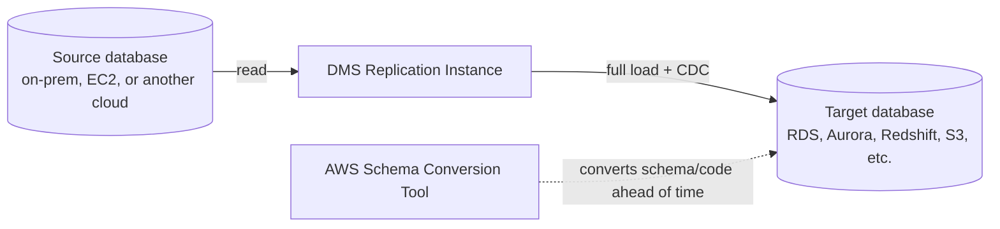
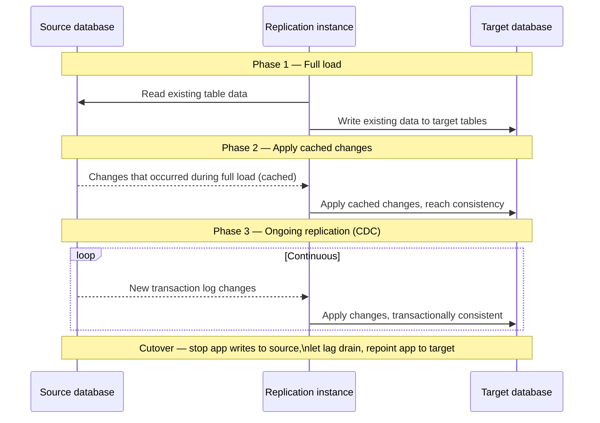
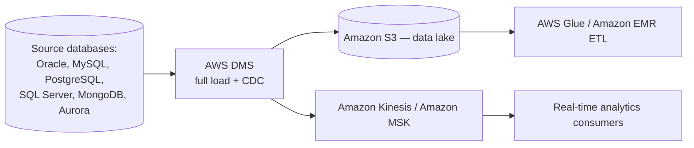

# AWS Database Migration Service (AWS DMS)

> **Appears in:** [SAA-C03](../../certifications/saa-c03/README.md)

<!-- No vendored icon exists for AWS DMS in diagrams/assets/icons/ at the time this doc was
written. Per diagrams/README.md convention, a missing icon is skipped rather than linking an
unverified external CDN URL. If a DMS icon is later vendored from aws-icons-for-plantuml
(dist/Migration-Transfer/AWSDatabaseMigrationService.png or similar), add it here as
``. -->

*Service · Migration & Transfer · SAA-C03 exam-guide appendix category "Migration and Transfer"*

## Definition

AWS Database Migration Service (AWS DMS) is a managed service that migrates databases **into,
out of, or between** AWS and other environments while the source database keeps running — moving
existing data and, optionally, continuing to replicate every ongoing change so the target stays
in sync until you're ready to cut over.

## Purpose

Database migrations are historically one of the riskiest parts of any cloud migration project:
the database is almost always the component an application can least afford extended downtime on,
and "export, copy, import" approaches mean the source database has to be frozen (no writes) for
the entire transfer window — which for anything beyond a small database is an unacceptable
business outage.

DMS exists to remove that tradeoff. It performs an initial **full load** of existing data while
the source database remains fully live and serving production traffic, then switches to
**ongoing replication (change data capture, CDC)** — continuously applying every insert/update/
delete that happens on the source to the target — so that at cutover time, the gap between source
and target is seconds, not days. It also solves the **heterogeneous migration** problem (e.g.,
Oracle to PostgreSQL) by pairing with the **AWS Schema Conversion Tool (SCT)**, which automatically
converts most of the source schema and code into the target engine's dialect.

## How It Works



Walking through it:

1. You provision a **replication instance** — a fully managed EC2 instance running AWS's
   replication engine (you don't manage its OS or patching).
2. You create a **source endpoint** and a **target endpoint** — connection details and
   credentials for the database DMS reads from and writes to.
3. You create a **replication task** that pairs those endpoints and specifies the migration type:
   full load only, full load + CDC, or CDC only (for a target already seeded another way).
4. The task runs the **full load** — reading existing table data from the source and writing it
   into the target, while the source stays online and serving its normal workload.
5. Once full load completes, DMS automatically applies any **changes cached during the full load**
   (transactions that happened while tables were being copied), bringing source and target to a
   transactionally consistent point.
6. DMS then enters **ongoing replication**, continuously capturing and applying new changes from
   the source's transaction/binary log to the target, keeping the gap small until you choose to
   cut applications over to the target.

### High-level migration workflow


*Figure: the official AWS DMS process diagram — source and target endpoints feed a replication
instance that performs the full load and then ongoing change data capture into the target.
Source: [AWS Database Migration Service overview](https://docs.aws.amazon.com/dms/latest/sql-server-to-aurora-postgresql-migration-playbook/chap-sql-server-aurora-pg.tools.awsdms.html), © Amazon Web Services.*

### The three phases of a replication task



This three-phase model is the single most important thing to internalize about DMS: **Phase 1**
moves the bulk of the data while the source stays live; **Phase 2** catches up on anything that
changed mid-copy; **Phase 3** is where the "near-zero-downtime" promise actually lives — the
target keeps tracking the source in near-real time until you decide to cut over, at which point
you briefly pause application writes, let the last few seconds of replication lag drain, and
repoint the application connection string.

### Change data capture feeding a data lake or streaming pipeline



DMS isn't limited to database-to-database migrations — it's also a common **CDC streaming
source**: pointing a DMS task's target endpoint at S3 builds a continuously-updating transactional
data lake, and pointing it at Kinesis Data Streams or Amazon MSK feeds real-time analytics
consumers directly from database change events, without the source database ever being touched by
analytics workloads.

## Key Features / Components

- **Replication instance** — the managed compute that actually runs the migration; sized by vCPU/
  memory based on expected throughput, and can be deployed **Multi-AZ** for migrations that need
  high availability during a long-running CDC phase.
- **Endpoints** — reusable connection definitions for source and target databases, each
  independently testable before a task runs.
- **Replication tasks** — the migration definition itself: full load, full load + CDC, or CDC-only,
  plus table-mapping rules (which schemas/tables to include, transformation rules like renaming
  columns).
- **AWS Schema Conversion Tool (SCT)** — a separate, free tool that analyzes a source schema and
  automatically converts most tables, views, stored procedures, and functions into the target
  engine's SQL dialect for **heterogeneous** migrations (different source and target engines).
- **Homogeneous vs. heterogeneous migrations** — DMS handles both: Oracle→Oracle (homogeneous, no
  schema conversion needed) and Oracle→Aurora PostgreSQL (heterogeneous, SCT does the schema work
  first).
- **DMS Serverless** — an auto-scaling deployment mode that removes the need to manually size and
  manage a replication instance, scaling capacity automatically with migration/replication load.
- **DMS Fleet Advisor** — a discovery and assessment tool that inventories existing on-premises
  database and analytics server fleets to help plan which migrate where.
- **Validation** — an optional task setting that compares source and target data row-by-row after
  migration to confirm accuracy, beyond just "the task reported success."
- **Multiple simultaneous targets** — a single source can feed more than one target (e.g.,
  replicating to both an RDS instance for cutover and an S3 data lake for analytics) via separate
  tasks sharing the same source endpoint.

## Use Cases — When to Use It

- **Near-zero-downtime migration of a production database to RDS/Aurora.** An e-commerce company
  needs to move its self-managed MySQL database to Aurora MySQL without a multi-hour maintenance
  window. DMS performs the full load while the site stays live, then CDC keeps Aurora in sync
  until a brief cutover window (minutes, not hours). *Alternative cost:* a traditional dump-and-
  restore migration requires freezing writes for the entire export+import duration — unacceptable
  for a 24/7 storefront.
- **Heterogeneous engine migration off expensive commercial licensing.** A company migrating from
  Oracle to Aurora PostgreSQL to cut licensing costs uses SCT to convert the schema/stored
  procedures first, then DMS to migrate the actual data with CDC bridging the cutover.
  *Alternative cost:* manually rewriting schema and procedures by hand for a large Oracle database
  is a multi-month, highly error-prone undertaking SCT automates the bulk of.
- **Continuous replication for read-scaling or reporting offload.** A retailer wants analytical
  queries run against a replica that doesn't compete with the production OLTP database for
  resources. An ongoing DMS CDC task keeps a reporting-only Redshift or RDS replica current.
  *Alternative cost:* running heavy reporting queries directly against production risks lock
  contention and performance degradation for customer-facing transactions.
- **Building a near-real-time data lake from transactional databases.** An analytics team needs
  database changes to show up in S3 within minutes for downstream Glue/Athena processing, without
  querying production databases directly. A DMS CDC task streams changes into S3 continuously.
  *Alternative cost:* periodic batch ETL exports introduce hours of latency the business can't
  tolerate for near-real-time dashboards.
- **Consolidating multiple database sources into one target for M&A integration.** A company
  acquiring another business needs several disparate database systems consolidated into a single
  target schema. Multiple DMS tasks, each with its own table-mapping transformation rules, feed one
  consolidated target. *Alternative cost:* custom ETL scripts per source system multiply the
  integration effort linearly with the number of acquired systems.
- **Disaster recovery staging for an on-premises database.** A regulated company keeps its primary
  database on-premises but wants a continuously-updated AWS-hosted standby for DR. An ongoing DMS
  CDC task from on-prem to RDS keeps that standby current, ready to be promoted if the primary site
  fails. *Alternative cost:* a from-scratch DR rebuild after an outage, instead of a near-current
  standby ready to promote.
- **Feeding a streaming analytics pipeline from database changes.** A fraud-detection system needs
  to react to new transaction rows within seconds. DMS targets Kinesis Data Streams directly,
  letting downstream Lambda/Kinesis Data Analytics consumers process changes in near-real-time.
  *Alternative cost:* polling the database on an interval for "new" rows is both slower and adds
  direct load to production that a log-based CDC approach avoids.
- **Cross-Region database migration for a global expansion.** A company expanding into a new AWS
  Region needs its primary database's data replicated into the new Region's RDS instance ahead of
  launch. DMS handles the full load and keeps the new Region's copy current until go-live.
  *Alternative cost:* manual snapshot export/import/restore across Regions lacks the ongoing CDC
  sync DMS provides automatically.
- **Database engine version upgrade with rollback safety.** A team upgrading a major database
  version uses DMS to replicate into a new instance running the target version, testing thoroughly
  against the new version while the old one keeps serving traffic, with an easy rollback (just
  don't cut over) if issues surface. *Alternative cost:* an in-place major version upgrade is much
  harder to safely roll back once started.
- **Validating migration accuracy before go-live.** A compliance-sensitive migration (financial
  records) needs provable row-level accuracy, not just a "task succeeded" status. DMS's built-in
  validation feature compares source and target row-by-row and reports discrepancies.
  *Alternative cost:* manual spot-checking a sample of rows doesn't provide the same audit-grade
  assurance a full validation pass does.
- **Right-sizing migration capacity without managing replication instance infrastructure.** A team
  with unpredictable, bursty migration workloads uses DMS Serverless instead of guessing a fixed
  replication instance size up front. *Alternative cost:* an undersized manually-provisioned
  instance throttles the migration; an oversized one wastes money sitting idle between runs.
- **Pre-migration fleet assessment for a large enterprise.** Before committing resources, an
  enterprise IT team uses DMS Fleet Advisor to inventory hundreds of on-premises database servers
  and prioritize which to migrate first based on usage and complexity data.
  *Alternative cost:* manually surveying every database server by hand doesn't scale past a
  handful of systems.

## When NOT to Use It / Alternatives

- **Migrating flat files, not database rows** — DMS operates on database engines with transaction
  logs, not file shares; use **AWS DataSync** (see [`datasync.md`](datasync.md)) for file/object
  data instead.
- **A brand-new, empty target database with no existing data to migrate** — if there's nothing to
  migrate or replicate, DMS adds unnecessary complexity; just provision the target directly.
- **Database engines or versions DMS doesn't support as a source/target** — always check the
  current supported-engines list before assuming DMS covers an exotic or very old database version;
  some combinations may need a different migration path (native export/import tooling, a partner
  migration tool).
- **Simple schema-only conversion with no data migration need** — if you only need the schema
  converted and will load data a different way, AWS SCT alone (without a DMS replication task) may
  be sufficient.
- **Very large one-time bulk database dumps with no ongoing-replication requirement and severe
  network constraints** — for genuinely offline transfer needs, the **Snow Family** (see
  [`snow-family.md`](snow-family.md)) can physically move a large database export, with DMS used
  afterward only for the CDC "catch-up" phase once the bulk data has landed.

## Why It's Important

**Real world:** the database is usually the hardest single component to migrate with acceptable
downtime, and DMS's CDC-based approach is the industry-standard pattern for near-zero-downtime
cutovers — it's also a widely used building block for streaming/CDC-based data lake architectures
that have nothing to do with "migration" in the traditional sense (continuous replication as a
permanent architecture, not just a one-time event).

**Exam weight:** **SAA-C03** lists AWS DMS in the exam guide's "Migration and Transfer" in-scope
services appendix. Expect it as the answer whenever a scenario describes **migrating a database to
AWS with minimal downtime**, especially when the source must **remain operational during
migration** — that phrase is close to a direct keyword match for DMS. A common exam pairing tests
whether you know DMS handles the *data*, while the **AWS Schema Conversion Tool** handles the
*schema/code* for heterogeneous migrations — picking DMS alone for an Oracle-to-PostgreSQL
migration without mentioning SCT is a classic incomplete-answer trap.

## Pricing Model — Deep Dive

DMS billing has two main components: the **replication instance** (billed like an EC2 instance,
per hour, by instance class) and **data transfer** out of AWS if the target is outside the source
Region, plus the destination database/storage's own costs.

| Cost component | What drives it |
|---|---|
| Replication instance | Hourly rate by instance class (e.g., `dms.t3.medium`, `dms.r5.large`), On-Demand or Reserved |
| Storage (for the replication instance) | GB-month for the instance's attached storage, used for caching/logs during migration |
| Data transfer | Standard AWS data-transfer-out rates if source and target cross Regions/accounts |
| Target database/storage | Billed separately at that service's own rates (RDS, Aurora, Redshift, S3, etc.) |

*(Illustrative — confirm current numbers at https://aws.amazon.com/dms/pricing/.)*

### Worked example — one-time migration vs. ongoing CDC replication instance cost

A `dms.r5.large` replication instance (~$0.252/hour On-Demand, illustrative) used for (a) a
one-time weekend migration versus (b) left running for a month of ongoing CDC replication:

```
One-time migration (48 hours):      48 hours × $0.252/hour                 = $12.10
Ongoing CDC (720 hours/month):      720 hours × $0.252/hour                 = $181.44/month
```

The instance cost scales directly with **how long it runs**, not how much data it moves — a
one-time migration with a short full-load window is cheap; leaving ongoing CDC replication running
indefinitely (e.g., for permanent read-replica or data-lake-feeding architectures) is a recurring
monthly cost that should be sized deliberately, not left on an oversized instance class by default.

### Worked example — Reserved vs. On-Demand for a long-running CDC pipeline

A permanent CDC-to-data-lake pipeline running a `dms.r5.large` instance continuously for a year:

```
On-Demand:   720 hours/month × 12 months × $0.252/hour                     ≈ $2,177/year
1-yr Reserved (illustrative ~40% discount):                                ≈ $1,306/year
```

For a migration task that's genuinely temporary (a few weeks around a cutover), On-Demand is
correct — there's no multi-year commitment to make. For a pipeline that has quietly become
**permanent infrastructure** (CDC feeding an always-on data lake), switching to a Reserved
commitment is the same cost-optimization logic applied to any other long-running EC2-backed
workload, and it's a common oversight when a "temporary migration task" outlives its original
purpose without anyone revisiting its pricing model.

## Common Architectures

**1. Near-zero-downtime database cutover.** A production MySQL database on EC2 is migrated to
Aurora MySQL via a DMS task running full load + CDC; the application keeps writing to the original
database throughout, and cutover consists of a brief write-freeze, a final CDC catch-up, and a
connection-string change — turning what used to be an hours-long maintenance window into minutes.

**2. Heterogeneous migration with SCT + DMS in sequence.** AWS SCT first converts an Oracle
schema's tables, views, and stored procedures into PostgreSQL-compatible DDL/PL-pgSQL; a DMS task
then migrates the actual table data into that pre-converted target schema, with CDC bridging
anything that changed in the source during the conversion-and-migration process.

**3. CDC-fed transactional data lake.** Several production OLTP databases each run a DMS CDC task
targeting a shared S3 bucket; Glue crawlers and Athena query the continuously-updating data lake
for analytics, completely decoupled from the production databases' own performance and availability
concerns.

**4. Multi-target fan-out from a single source.** One source database feeds two independent DMS
tasks: one doing a one-time full-load-only migration into a new RDS instance for cutover, and
another running continuous CDC into Kinesis Data Streams for a separate real-time fraud-detection
pipeline — both reading the same source transaction log independently.

**5. Phased engine-upgrade migration with a safe rollback window.** A team upgrading from an old,
unsupported database major version runs a DMS task replicating continuously into a new instance on
the current supported version; the old instance keeps serving production traffic throughout
testing, and cutover only happens once the team is confident — with the old instance left running,
untouched, as an immediate rollback target for a defined grace period after cutover rather than
being decommissioned the same day.

## Limits & Quotas

- **Replication instances per account/Region** — a default soft quota (commonly around 20–40,
  raisable via Support).
- **Replication tasks per instance** — multiple tasks can run on one instance, bounded by the
  instance's own CPU/memory capacity for the combined workload.
- **Table-mapping rules per task** — large numbers of included/excluded tables and transformation
  rules are supported, but very large rule sets can affect task-start time.
- **LOB (large object) column handling** — DMS supports migrating LOB columns, but very large LOBs
  may need specific task settings (limited LOB mode vs. full LOB mode) to avoid replication-instance
  memory pressure.
- **Validation overhead** — enabling full data validation roughly doubles the read load against
  both source and target during the validation pass, which should be factored into timing for
  large tables.
- **DMS Serverless capacity units** — auto-scales within a configured min/max DCU (DMS Capacity
  Unit) range rather than a fixed instance class, which is itself a quota to plan around for very
  large workloads.
- **Maximum number of tables per task** — very large schemas (thousands of tables) are supported,
  but splitting an extremely large schema across multiple tasks is a common practice to improve
  parallelism and isolate failures to a smaller blast radius than one all-encompassing task.

## Security Considerations

- **Replication instance network placement** — deploy the replication instance inside a VPC with
  security groups scoped to exactly the source and target database ports it needs, not a broad
  "allow all" rule; the instance has direct read access to the source database's actual data.
- **Encryption at rest for the replication instance** — the replication instance's storage
  (used for caching changes and logs during migration) supports encryption via AWS KMS; enable it
  for any migration involving sensitive data, since cached transactional data sits there
  temporarily during the full-load and CDC phases.
- **Encryption in transit to source and target endpoints** — configure SSL/TLS on both source and
  target endpoint connections wherever the database engine supports it; DMS doesn't force this
  automatically — a migration task can be set up with unencrypted endpoint connections if someone
  isn't careful during endpoint creation.
- **Credential handling for endpoints** — source/target database credentials should be stored in
  AWS Secrets Manager and referenced by the endpoint configuration rather than embedded directly,
  the same pattern any other database-credential use case should follow.
- **Least-privilege database users for migration** — the database user DMS connects as should have
  only the permissions actually needed for replication (read on source, write on target), not a
  full administrative account, limiting blast radius if credentials are ever compromised.
- **Data exposure during CDC-to-analytics architectures** — when a DMS CDC task feeds S3 or a
  streaming service for analytics, apply the same data classification and access-control review to
  that destination as you would to the production database itself — CDC doesn't inherit source-
  database access controls automatically at the destination.

## Troubleshooting / Common Issues

- **Full load is slow for very large tables** — check whether parallel load settings (splitting a
  large table into segments loaded concurrently) are enabled; also verify the replication
  instance class isn't undersized for the data volume.
- **CDC lag keeps growing instead of staying near zero** — the replication instance is likely
  under-provisioned for the source's change rate, or the source database's transaction/binary log
  retention is too short, forcing DMS to work through a backlog; check `CDCLatencySource` and
  `CDCLatencyTarget` CloudWatch metrics.
- **Task fails with a schema/data-type conversion error (heterogeneous migration)** — almost always
  means AWS SCT's schema conversion wasn't completed or wasn't fully applied to the target before
  the DMS task started; re-run SCT's assessment report and resolve flagged incompatibilities first.
- **Task stuck at "Table statistics not available"** — usually a sign full load hasn't actually
  started moving data yet; check source endpoint connectivity and permissions before assuming the
  task itself is broken.
- **Validation reports mismatched rows** — investigate whether unsupported data types, collation
  differences, or timezone handling differences between source and target engines are the root
  cause rather than an actual replication bug; heterogeneous migrations are especially prone to
  this class of discrepancy.
- **Replication instance storage fills up during a long CDC run** — happens when the target can't
  keep pace with the source's change rate and changes queue up on the instance; this is the same
  root cause as growing CDC lag and should be diagnosed together.

## Hands-on Lab (Floci)

**Honest limitation:** DMS is not in Floci's documented support table (only S3, DynamoDB, RDS,
and a handful of other services are emulated — see `labs-floci/README.md`), and DMS's replication
instance and transaction-log-based CDC mechanics have no meaningful local emulation path. The
commands below show the **real control-plane CLI shape** for study purposes; expect them to be
unsupported against a local Floci endpoint. The practical substitute for hands-on practice: build
two local Postgres/MySQL containers, manually script a one-time "full load" copy with a tool like
`pg_dump`/`mysqldump`, and mentally map that to Phase 1 of what DMS automates — then read through
DMS's CDC documentation to understand what the manual approach is missing (Phases 2 and 3).

```bash
# Create a replication instance
aws dms create-replication-instance \
  --replication-instance-identifier my-study-instance \
  --replication-instance-class dms.t3.medium \
  --allocated-storage 50

# Create a source endpoint (e.g., on-prem/EC2 MySQL)
aws dms create-endpoint \
  --endpoint-identifier my-source-mysql \
  --endpoint-type source \
  --engine-name mysql \
  --server-name 10.0.0.20 --port 3306 \
  --username admin --password 'REDACTED' --database-name appdb

# Create a target endpoint (Aurora MySQL)
aws dms create-endpoint \
  --endpoint-identifier my-target-aurora \
  --endpoint-type target \
  --engine-name aurora \
  --server-name my-aurora-cluster.cluster-xxxx.us-east-1.rds.amazonaws.com --port 3306 \
  --username admin --password 'REDACTED' --database-name appdb

# Create a replication task — full load + CDC
aws dms create-replication-task \
  --replication-task-identifier my-migration-task \
  --source-endpoint-arn arn:aws:dms:us-east-1:111122223333:endpoint:source-example \
  --target-endpoint-arn arn:aws:dms:us-east-1:111122223333:endpoint:target-example \
  --replication-instance-arn arn:aws:dms:us-east-1:111122223333:rep:instance-example \
  --migration-type full-load-and-cdc \
  --table-mappings '{"rules":[{"rule-type":"selection","rule-id":"1","rule-name":"1","object-locator":{"schema-name":"%","table-name":"%"},"rule-action":"include"}]}'

# Start the task
aws dms start-replication-task \
  --replication-task-arn arn:aws:dms:us-east-1:111122223333:task:task-example \
  --start-replication-task-type start-replication
```

## Exam-Style Scenario Walkthroughs

**Scenario 1:** A company's production Oracle database must migrate to Amazon Aurora PostgreSQL
with the source staying fully operational throughout, and the team is concerned about manually
rewriting hundreds of stored procedures. What two-service combination addresses this?

*Answer:* AWS Schema Conversion Tool (SCT) to automatically convert the schema and most stored
procedures/functions into PostgreSQL-compatible code, paired with AWS DMS running full load + CDC
to migrate the actual data while the source Oracle database keeps serving production traffic.

**Scenario 2:** A retailer needs a continuously updated, near-real-time copy of transactional data
in S3 for analytics, without querying the production database directly for reporting. What's the
architecture?

*Answer:* A DMS replication task configured for ongoing CDC with S3 as the target endpoint —
this streams every database change into S3 continuously, decoupling analytics entirely from the
production database's load.

**Scenario 3:** During a DMS migration, the task reports growing replication lag between source
and target that never seems to catch up, even though the full load completed successfully. What's
the most likely cause and fix?

*Answer:* The replication instance is under-provisioned for the source's actual change rate (too
small an instance class), or the target can't write fast enough to keep pace. Check
`CDCLatencySource`/`CDCLatencyTarget` CloudWatch metrics and scale up the replication instance
class or investigate target-side write throughput.

**Scenario 4:** A fraud-detection platform needs to react to new transaction rows within seconds
of them being written to a production database, without adding polling load to that database.
Which DMS capability fits, and what target would it typically use?

*Answer:* A DMS task running **ongoing replication (CDC)** with **Amazon Kinesis Data Streams** (or
Amazon MSK) as the target endpoint — DMS reads changes from the source's transaction log (not by
polling the database), streaming them to Kinesis for near-real-time downstream consumption by the
fraud-detection logic.

## Exam Tips

- **Keyword "minimal downtime," "source stays operational," "migrate a database to AWS"** → AWS
  DMS, almost every time.
- **Heterogeneous engine migration (different source and target engine)** → pair DMS with **AWS
  Schema Conversion Tool (SCT)**; DMS alone doesn't convert schema/code, only data.
- **CDC feeding a data lake or streaming pipeline** → still DMS, just with S3/Kinesis/MSK as the
  target endpoint instead of another relational database — a common "is this even a migration
  scenario" distractor.
- If the scenario is about **files, not database rows** → that's **AWS DataSync**, not DMS.
- **Multi-AZ replication instance** — tests DR/HA for the *migration process itself* (the
  replication instance), not the target database's own Multi-AZ setting — these are two separate
  Multi-AZ configurations that get conflated on the exam.
- **DMS Serverless vs. provisioned instances** — know that DMS Serverless removes the need to
  choose an instance class up front, auto-scaling capacity instead; a scenario emphasizing
  unpredictable or bursty migration workloads is a hint toward DMS Serverless specifically.

## Further Reading

- [What Is AWS Database Migration Service?](https://docs.aws.amazon.com/dms/latest/userguide/Welcome.html) — official documentation home
- [High-level view of AWS DMS](https://docs.aws.amazon.com/dms/latest/userguide/CHAP_Introduction.HighLevelView.html) — the three-phase workflow referenced above
- [AWS Schema Conversion Tool](https://docs.aws.amazon.com/SchemaConversionTool/latest/userguide/CHAP_Welcome.html)
- [Change Data Capture Using AWS DMS: Migrate and Replicate](https://docs.aws.amazon.com/reference-architecture-diagrams/latest/change-data-capture-dms/change-data-capture-dms-migrate.html)
- [AWS DMS pricing](https://aws.amazon.com/dms/pricing/) — current, authoritative rates
- [AWS Schema Conversion Tool user guide](https://docs.aws.amazon.com/SchemaConversionTool/latest/userguide/CHAP_Welcome.html) — deeper reference for heterogeneous schema conversion specifics

## Related Terms

- [`datasync.md`](datasync.md) — the file/object-level counterpart to DMS's database focus
- [`migration-services-overview.md`](migration-services-overview.md) — how DMS fits into a
  broader migration strategy alongside Application Discovery Service, MGN, and Migration Hub
- [`../database/rds.md`](../database/rds.md), [`../database/aurora.md`](../database/aurora.md) —
  common DMS migration targets
- `Change Data Capture (CDC)`, `Homogeneous vs. heterogeneous migration`, `Full load` — see glossary
