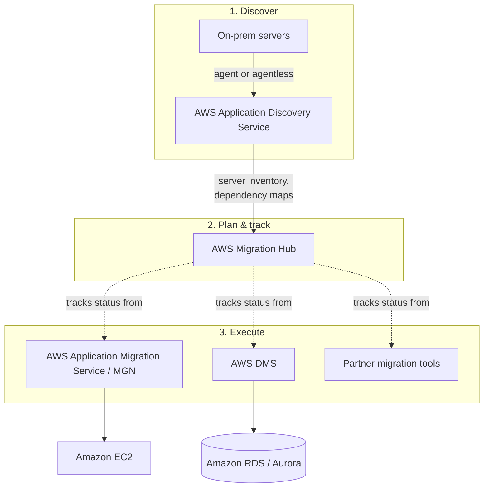
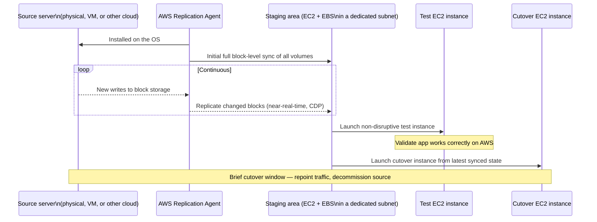
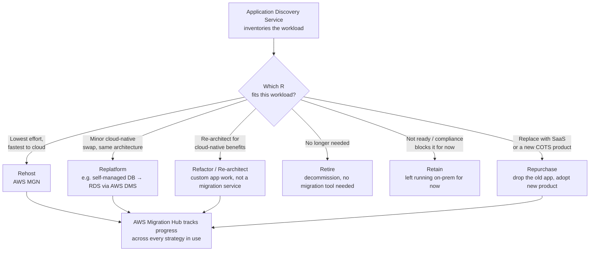

# Migration Services Overview — Application Discovery Service, MGN & Migration Hub

> **Appears in:** [SAA-C03](../../certifications/saa-c03/README.md)

<!-- No vendored icons exist for Application Discovery Service, MGN, or Migration Hub in
diagrams/assets/icons/ at the time this doc was written. Per diagrams/README.md convention,
missing icons are skipped rather than linking unverified external CDN URLs. -->

*Comparison doc · Migration & Transfer · SAA-C03 exam-guide appendix category "Migration and
Transfer" — covers the services that answer "where do I even start, and how do I track it," as
distinct from [`datasync.md`](datasync.md), [`dms.md`](dms.md), [`snow-family.md`](snow-family.md),
and [`transfer-family.md`](transfer-family.md), which answer "how do I move the data itself."*

> ⚠️ **Currency note:** AWS Migration Hub **stopped accepting new customers as of November 7,
> 2025**, and AWS's current documentation points new customers toward **AWS Transform** for
> similar capabilities. AWS Application Migration Service has also been rebranded in current AWS
> documentation to **AWS Transform MGN**. This doc documents the classic "Application Discovery
> Service + MGN + Migration Hub" trio under their long-standing names because that's how SAA-C03's
> published exam guide appendix lists them, and because the underlying *concepts* (discover →
> migrate → track) remain exactly how AWS frames migration regardless of the current product
> naming. Treat the names/availability as subject to change; treat the architecture pattern as
> durable.

## Definition

These three services answer three different questions in a migration project, and a huge amount
of exam confusion comes from not keeping those questions separate:

- **AWS Application Discovery Service** answers *"what do we even have, and how is it connected?"*
  — it inventories on-premises servers, their utilization, and their network dependencies.
- **AWS Application Migration Service (MGN)** answers *"how do we actually move a server to
  AWS?"* — it's the execution engine for lift-and-shift (rehost) migrations, via continuous
  block-level replication.
- **AWS Migration Hub** answers *"how is the whole migration project going, across every tool
  we're using?"* — a single dashboard tracking migration status regardless of which specific tool
  (MGN, DMS, a partner tool) is doing the actual moving.

## Purpose

A large migration almost never starts with "we know exactly what we're moving and how." It starts
with an incomplete, often-outdated spreadsheet of servers, unknown dependencies between them (that
"small internal app" nobody remembers is actually called by four other systems), and no single
place to see whether application A's database migration (via DMS) and its web tier migration (via
MGN) are both on track for the same cutover date. These three services exist specifically to
remove those three gaps — discovery, execution, and visibility — and they're explicitly designed
to be used **together**, not as competing choices for the same job.

## How It Works — The Three Services Together



Walking through it:

1. **Application Discovery Service** runs either **agentless** (collecting VM-level configuration
   and utilization data from a VMware environment without installing anything on each server) or
   **agent-based** (installing a lightweight agent on each server for deeper utilization and
   network-connection data, including on physical, non-virtualized servers).
2. The collected data — server specs, utilization metrics, and **network dependency maps** (which
   servers talk to which) — feeds into **Migration Hub**, where it becomes the basis for grouping
   servers into "applications" (a cluster of interdependent servers that should migrate together).
3. Once you know what you have and how it's grouped, you choose an **execution tool** per
   workload: **MGN** for a straight lift-and-shift of a server, **DMS** for a database, or a
   partner migration tool for something neither covers well.
4. **Migration Hub** aggregates status updates from whichever execution tool is doing the actual
   work, giving one dashboard view across the entire portfolio of applications being migrated —
   regardless of how many different tools are involved.

### How AWS Application Migration Service (MGN) actually moves a server



MGN's defining mechanic is **block-level replication**, not file-level or application-level — an
agent installed on the source server's OS captures writes at the block-storage-device layer
(essentially a continuous, low-RPO backup) and streams them to a staging area in AWS made of EBS
volumes. Because replication is continuous, you can launch a **test instance** from the replicated
data at any time without disrupting the still-running source server, validate the application
actually works on AWS, and only perform the real **cutover** (launching the final instance and
repointing traffic) once you're confident — with the gap between source and target at cutover time
measured in seconds, not hours.

### A Windows infrastructure modernization reference architecture using MGN + Migration Hub


*Figure: AWS Application Migration Service (MGN) performs block-level replication of on-premises
or other-cloud servers into Amazon EC2, while AWS Migration Hub provides the centralized planning
and progress-tracking dashboard across the whole migration effort. Source: [Scenario 5: Windows-based infrastructure modernization — AWS Well-Architected Framework, Microsoft Workloads Lens](https://docs.aws.amazon.com/wellarchitected/latest/microsoft-workloads-lens/scenario-5-windows-based-infrastructure-modernization.html), © Amazon Web Services.*

### The official AWS "Migration and Transfer" category, in one diagram


*Figure: AWS's own "Migration and Transfer" category overview, showing how Application Discovery
Service, Application Migration Service (MGN), Database Migration Service, the Snow Family,
DataSync, Transfer Family, and Migration Hub relate as a family of services. Source: [AWS Overview Whitepaper — Migration and transfer](https://docs.aws.amazon.com/whitepapers/latest/aws-overview/migration-services.html), © Amazon Web Services.*

## The 6 R's of Migration Strategy — and Which Service Maps to Each

Every workload in a migration portfolio gets assessed against six possible strategies (sometimes
called "the 6 R's"), and the services in this doc map unevenly across them — some R's have a
direct service; others are really "don't use a migration service at all, make a different kind of
decision."



- **Rehost** ("lift-and-shift") — move a workload to AWS with minimal to no changes. This is
  **AWS MGN's** entire purpose: continuous block-level replication, test, and cutover, with the
  application running basically unchanged on EC2 afterward. Fastest R to execute, lowest
  immediate cloud-native benefit.
- **Replatform** ("lift-tinker-and-shift") — move to AWS with a small number of cloud-optimizing
  swaps, without changing the application's core architecture. The textbook example is swapping a
  self-managed database for a managed equivalent (e.g., self-managed MySQL on EC2 → Amazon RDS for
  MySQL), which is exactly where **AWS DMS** fits — migrating the data into the managed service
  while the application code barely changes.
- **Refactor / Re-architect** — rebuild the application to be genuinely cloud-native (e.g.,
  monolith → microservices, EC2 → Lambda/containers). This is **application engineering work**,
  not something a migration-category service executes for you — Application Discovery Service's
  dependency-mapping data is still valuable here (you need to understand the existing
  architecture before you can safely decompose it), but the actual refactor is custom development.
- **Retire** — decommission a workload that's no longer needed at all. Application Discovery
  Service's utilization data is exactly what surfaces retirement candidates (a server with near-
  zero CPU/network utilization over months is a strong retirement signal) — there's no "retirement
  execution" service because retiring something just means turning it off and cleaning up.
- **Retain** — deliberately keep a workload on-premises for now (compliance, a recent investment
  not yet depreciated, or a dependency not yet ready to move). No migration service applies because
  nothing is moving yet — but it's still tracked in **Migration Hub** as a known, intentional
  decision rather than an overlooked gap in the portfolio.
- **Repurchase** ("drop and shop") — replace the existing application entirely with a different
  product, typically a SaaS offering, rather than migrating the old one at all. This is a
  procurement/business decision, not a migration-service execution path — Application Discovery
  Service's dependency data still matters for understanding what the old system was actually doing
  before cutting it over to the new product.

The practical pattern: **Application Discovery Service informs which R applies to each workload**,
**AWS MGN executes Rehost**, **AWS DMS (often) executes the database half of Replatform**, and
**Migration Hub tracks all of it** — while Refactor, Retire, Retain, and Repurchase are strategic
decisions supported by discovery data rather than migration-service executions in their own right.

## Key Features / Components

### AWS Application Discovery Service

- **Agentless discovery** — connects to a VMware vCenter environment and collects VM
  configuration and utilization data without installing anything on individual VMs.
- **Agent-based discovery** — a lightweight agent installed on each server (physical or virtual)
  for deeper system-level utilization data and **network connection** data between servers.
- **Dependency/network mapping** — visualizes which servers communicate with which others, letting
  you group interdependent servers into "applications" that should migrate together rather than
  independently.
- **TCO estimation export** — collected data can be exported as CSV to estimate the Total Cost of
  Ownership of running the equivalent workload on AWS, supporting the business case for migration.
- **Integration with Migration Hub** — discovered servers and their grouping flow directly into
  Migration Hub for tracking.

### AWS Application Migration Service (MGN)

- **AWS Replication Agent** — installed at the OS level on the source server, captures block-level
  writes continuously (works across physical, virtual, and other-cloud sources, and across
  Windows/Linux).
- **Continuous Data Protection (CDP) replication** — near-second RPO, since every write is
  streamed to the staging area essentially as it happens, not on a periodic snapshot schedule.
- **Non-disruptive testing** — launch a fully functional test EC2 instance from replicated data at
  any point, without affecting the still-running, still-replicating source server.
- **Replication, launch, and post-launch templates** — reusable configuration applied to every
  newly added server, with per-server overrides available when needed.
- **Applications and waves** — group related source servers into an "application," and group
  applications into migration "waves," enabling bulk actions (test, cutover, archive) at scale
  rather than one server at a time.
- **Supports x86 Windows and Linux**, across physical, VMware/Hyper-V virtual, and other-cloud
  source servers.

### AWS Migration Hub

- **Centralized tracking dashboard** — a single place to see migration status for every
  application in a portfolio, regardless of which tool (MGN, DMS, a partner tool) is executing
  each one.
- **Application grouping** — organizes discovered servers (from Application Discovery Service)
  into logical applications for coordinated tracking and bulk operations.
- **Network diagram view** — visualizes server dependencies discovered by Application Discovery
  Service directly within the Hub, informing how servers should be grouped.
- **Migration Hub Orchestrator** — automates multi-step migration workflows end-to-end, reducing
  manual, error-prone coordination between discovery, execution, and validation steps.
- **Multi-tool status aggregation** — specifically designed to pull progress updates from more
  than one migration tool at once (e.g., MGN for compute, DMS for databases) into one unified view.

## Use Cases — When to Use Which

- **Starting a migration with an incomplete, outdated server inventory.** A company's only record
  of its data center is a years-old spreadsheet nobody trusts. Application Discovery Service's
  agentless or agent-based collection builds a current, accurate inventory with real utilization
  data, replacing guesswork with evidence. *Alternative cost:* planning migration waves against a
  stale spreadsheet risks missing critical dependencies and under- or over-provisioning the target
  environment.
- **Identifying hidden dependencies before grouping servers into migration waves.** A team
  assumes "App X" is just two web servers, but discovery's network mapping reveals it also depends
  on a database server and an internal API nobody documented. Migration Hub's network diagram view
  surfaces this before a wave is planned around an incomplete picture. *Alternative cost:*
  migrating "App X" without its undocumented dependency causes an outage when the dependency is
  left behind on a decommissioned source server.
- **Lift-and-shift of a large VMware estate with a hard decommissioning deadline.** A company
  closing a leased data center on a fixed date needs hundreds of servers rehosted to EC2 with
  minimal application changes, fast. AWS MGN's continuous replication plus wave-based bulk cutover
  fits a deadline-driven, high-volume rehost. *Alternative cost:* individually re-architecting
  each application before the deadline isn't realistic — Rehost specifically trades cloud-native
  optimization for migration speed.
- **Non-disruptive migration testing before committing to a cutover.** A risk-averse team wants to
  validate a critical application actually works on AWS before touching the still-running
  production source server. MGN's non-disruptive test-instance launch validates this without any
  impact to the live source. *Alternative cost:* a destructive test (actually cutting over before
  validating) risks a failed migration with no safe rollback path.
- **Coordinating a database migration (via DMS) and its application tier migration (via MGN) on
  the same cutover schedule.** A three-tier application's web/app servers move via MGN while its
  database moves via DMS; Migration Hub gives one dashboard showing both tracks' progress, so the
  team can confirm both are actually ready for the same cutover window. *Alternative cost:*
  tracking two tools' progress in two separate consoles risks a mismatched cutover where one tier
  is ready and the other isn't, discovered only at cutover time.
- **Building the business case for migration with a TCO estimate.** A finance stakeholder needs a
  dollar comparison of current on-prem costs versus running the equivalent workload on AWS before
  approving budget. Application Discovery Service's exported utilization data feeds a TCO estimate
  grounded in real usage, not vendor-provided generic sizing. *Alternative cost:* a TCO estimate
  based on nameplate hardware specs rather than actual utilization typically over-provisions the
  AWS target, inflating the projected cost and weakening the business case.
- **Identifying retirement candidates during discovery.** While profiling a data center, a team
  notices several servers with near-zero CPU and network utilization over months. Application
  Discovery Service's utilization data is exactly what surfaces this "Retire" candidate before
  effort is wasted migrating something nobody actually uses. *Alternative cost:* migrating an
  unused server to AWS wastes both migration effort and ongoing AWS spend on something that should
  have been decommissioned instead.
- **Running a migration with multiple partner and native AWS tools simultaneously.** A large
  enterprise uses MGN for most servers, DMS for a handful of databases, and a specific partner
  tool for a legacy mainframe-adjacent system that neither AWS-native service covers well.
  Migration Hub aggregates status from all three into one view regardless of which tool executed
  which piece. *Alternative cost:* checking three separate tools' consoles for status doesn't give
  leadership a single, trustworthy "how's the migration going" answer.
- **Grouping interdependent servers so they migrate — and cut over — together.** A three-tier
  application's web, app, and cache servers must all move in the same maintenance window because
  they're tightly coupled. Migration Hub's application-grouping feature (informed by discovery's
  dependency map) ensures all three are tracked and cut over as one unit rather than
  independently. *Alternative cost:* migrating tightly coupled servers independently and on
  different schedules risks a broken application mid-migration.
- **Planning a wave-based migration for hundreds of servers.** A large-scale migration needs
  servers grouped into manageable batches (waves) based on dependency, risk, and business priority
  rather than migrating everything at once. MGN's wave grouping plus Migration Hub's tracking
  supports bulk operations per wave. *Alternative cost:* attempting a single "big bang" migration
  of hundreds of servers at once dramatically increases the blast radius of any single failure.

## When NOT to Use It / Alternatives

- **A workload that's clearly being replaced by a SaaS product (Repurchase)** — Application
  Discovery Service's dependency data is still useful for understanding what's being replaced, but
  neither MGN nor DMS applies here; the "migration" is really a procurement and cutover-to-new-
  product project.
- **A workload intentionally staying on-premises (Retain)** — don't force a discovery/execution
  workflow onto something that isn't actually migrating yet; just record the decision in Migration
  Hub so it's not mistaken for an overlooked gap.
- **A workload needing genuine cloud-native re-architecture (Refactor)** — MGN's block-level
  replication produces a like-for-like copy of the existing server; it does nothing to help
  decompose a monolith into microservices. That's application engineering work informed by
  discovery data, not a migration-service execution.
- **A database-only migration with no server/compute component** — AWS DMS alone (see
  [`dms.md`](dms.md)) handles that directly; involving MGN, Application Discovery Service, or
  Migration Hub adds unnecessary process overhead for a single database migration.
- **A very small migration (a handful of servers, no complex dependencies)** — the full
  discover → plan → execute → track workflow is overhead that doesn't pay for itself at very small
  scale; a direct, manually-planned rehost may be faster.

## Why It's Important

**Real world:** the single most common cause of a migration project running over budget or over
schedule isn't the actual data transfer — it's **discovering a dependency too late** (an
application that silently depended on a server nobody planned to migrate in the same wave) or
**losing visibility into a multi-tool migration's actual progress** until a cutover date arrives
and half the dependencies aren't ready. These three services exist specifically to catch both
failure modes earlier.

**Exam weight:** **SAA-C03** lists this trio in the exam guide's "Migration and Transfer" in-scope
services appendix category. Expect a scenario that describes **assessing an unknown on-premises
environment before migrating** to point to **Application Discovery Service**; a scenario describing
**lift-and-shift with minimal downtime and non-disruptive testing** to point to **MGN**; and a
scenario describing **tracking progress across multiple migration tools/applications** to point to
**Migration Hub**. A classic exam trap is conflating MGN (an execution tool) with Migration Hub (a
tracking tool) — they solve different problems and are almost always used together, not as
alternatives to each other.

## Pricing Model — Deep Dive

| Service | Billing model |
|---|---|
| AWS Application Discovery Service | No charge for the discovery service itself; agent-based discovery may incur minimal data-transfer costs for the small telemetry payloads sent to AWS |
| AWS Application Migration Service (MGN) | No charge for the first 90 days of replication per source server (promotional free period); after that, billed hourly per replicating server; the staging-area EC2/EBS resources used during replication are billed at standard EC2/EBS rates |
| AWS Migration Hub | No charge for the Hub dashboard/tracking itself; you pay only for the underlying execution tools' own costs (MGN, DMS, etc.) |

*(Illustrative — confirm current numbers at https://aws.amazon.com/application-migration-service/pricing/
and https://aws.amazon.com/migration-hub/pricing/; both discovery and Migration Hub are
"free control plane, pay for what you execute" services.)*

### Worked example — MGN replication cost for a mid-size rehost project

Migrating 50 servers via MGN, with the project taking 120 days from initial replication start to
final cutover (illustrative per-server post-free-period rate):

```
First 90 days per server:          No charge (promotional free period)
Remaining 30 days × 50 servers:    1,500 server-days × $1.00/server-day (illustrative) = $1,500
                                    + staging-area EC2/EBS costs during the full 120-day
                                      replication window, at standard EC2/EBS rates
```

The practical lesson: **a migration that drags well past 90 days per server starts accruing a
real, server-count-multiplied charge** — this is a genuine incentive (beyond just project
management discipline) to keep replication-to-cutover windows reasonably tight rather than letting
replicated servers sit in a "ready but not yet cut over" state indefinitely.

### Worked example — why discovery and tracking being free changes the calculus

Because Application Discovery Service and Migration Hub themselves carry no direct service charge,
the decision to use them isn't really a cost-benefit tradeoff against *not* using them on price
grounds — the cost that matters is the **engineering/project-management time** spent setting up
and interpreting discovery data and the dashboard, against the cost of a late-discovered dependency
or an invisible multi-tool status mismatch:

```
Using discovery + Hub:        engineer time to configure agents/review data (days)
                               + avoided cost of a late-discovered dependency breaking a cutover
                               + avoided cost of reconciling status across multiple tool consoles

Skipping discovery + Hub:     $0 direct setup cost
                               + real risk of an undiscovered dependency causing a failed cutover
                               + real risk of leadership losing confidence in migration status
                                 reporting across multiple disconnected tool consoles
```

## Common Architectures

**1. Full discover-plan-execute-track pipeline.** Application Discovery Service profiles the
entire on-premises estate; the resulting server and dependency data flows into Migration Hub, which
groups servers into applications; each application is assigned a strategy (predominantly Rehost
via MGN, with Replatform via DMS for databases); Migration Hub tracks every application's status
across both execution tools through to final cutover.

**2. Wave-based enterprise rehost.** Hundreds of discovered servers are grouped into migration
"waves" based on dependency and business priority; each wave is replicated via MGN, tested
non-disruptively, and cut over as a batch — with Migration Hub providing a portfolio-level view of
which waves are complete, in progress, or not yet started.

**3. Coordinated multi-tier cutover.** A three-tier application's web/app servers (MGN) and
database (DMS) are migrated in parallel on independent timelines but coordinated through Migration
Hub's application grouping, ensuring the actual cutover only happens once both tracks report ready
— avoiding a partial, broken cutover where one tier moved and the other didn't.

**4. Discovery-informed decommissioning.** Application Discovery Service's utilization data
identifies long-idle servers across the estate; these are marked "Retire" in the migration plan
rather than being migrated at all, and Migration Hub still tracks them (as retired/decommissioned)
so the portfolio view accounts for every discovered server, not only the ones that actually moved.

## Limits & Quotas

- **Application Discovery Service agents per account** — a default soft quota on the number of
  discovery agents deployable per account/Region, raisable for very large environments.
- **MGN source servers per account/Region** — a default soft quota (commonly in the hundreds,
  raisable via Support) on concurrently replicating source servers.
- **MGN applications and waves** — supports large numbers of applications and waves per account,
  designed specifically for enterprise-scale, hundreds-of-servers migrations.
- **Migration Hub applications per account/Region** — a default soft quota on the number of
  tracked applications, raisable for large migration portfolios.
- **Discovery data retention** — collected discovery data has a defined retention period in the
  Application Discovery Service data store; plan to export TCO/inventory reports before that
  window lapses if long-term record-keeping is required.

## Troubleshooting / Common Issues

- **Agentless discovery shows incomplete utilization data** — agentless discovery (via vCenter)
  typically captures less granular data than agent-based discovery; if detailed per-process
  utilization or network-connection data is missing, deploy the agent-based collector instead.
- **MGN replication lag never catches up** — check the staging area's network bandwidth and the
  source server's actual write rate; a staging-area instance or network path undersized for the
  source's change volume will perpetually lag, the same root cause pattern as DMS's CDC lag issue.
- **A test instance launched from MGN doesn't behave like production** — verify the launch
  template's configuration (instance type, security groups, IAM role) matches what the application
  actually needs; MGN replicates the disk data faithfully, but launch configuration is a separate,
  manually-defined setting that must be set up correctly.
- **Migration Hub shows a different status than the underlying tool's own console** — Migration
  Hub aggregates status based on what each tool reports to it; a sync delay or a misconfigured
  integration between the execution tool and Hub is the most common cause of this mismatch, not an
  actual migration problem.
- **Servers grouped incorrectly into applications** — this is almost always a data problem, not a
  tooling bug: review the underlying network dependency data from Application Discovery Service and
  manually correct the application grouping rather than assuming the tool's automatic grouping is
  always right.

## Hands-on Lab (Floci)

**Honest limitation:** none of these three services are in Floci's documented support table (see
`labs-floci/README.md`). Application Discovery Service needs a real on-premises/VMware environment
to discover; MGN needs a real OS-level replication agent and EC2/EBS staging infrastructure;
Migration Hub is purely an aggregation layer over other tools' real status. The commands below show
the **real control-plane CLI shape** for study purposes; expect them to be unsupported against a
local Floci endpoint. The practical substitute for hands-on practice: build the EC2 lab in
[`../compute/ec2.md`](../compute/ec2.md) to understand what MGN's cutover instance actually becomes,
and review the DMS lab in [`dms.md`](dms.md) to understand the Replatform half of this picture.

```bash
# Application Discovery Service — start a data collection
aws discovery start-data-collection-by-agent-ids \
  --agent-ids agent-0123456789abcdef0

# List discovered servers
aws discovery describe-agents

# MGN — initialize the service in a Region (one-time per account/Region)
aws mgn initialize-service

# MGN — describe source servers currently registered for replication
aws mgn describe-source-servers

# MGN — launch a non-disruptive test instance from a source server's replicated data
aws mgn start-test \
  --source-server-id s-0123456789abcdef0

# Migration Hub — create an application grouping migration task progress entry
aws migrationhub create-progress-update-stream \
  --progress-update-stream-name my-migration-wave-1

aws migrationhub notify-application-state \
  --progress-update-stream my-migration-wave-1 \
  --application-id app-001 \
  --status IN_PROGRESS
```

## Exam-Style Scenario Walkthroughs

**Scenario 1:** A company has no reliable, current inventory of its on-premises data center and
needs to understand server utilization and dependencies before planning a migration. Which
service, and what are the two collection methods?

*Answer:* AWS Application Discovery Service, via either **agentless** discovery (VMware
vCenter-based, no per-VM install) or **agent-based** discovery (a lightweight agent per server,
for deeper utilization and network-dependency data, including on physical servers).

**Scenario 2:** A migration project needs to lift-and-shift 200 physical and virtual servers to
EC2 with minimal application changes, validate each one works correctly on AWS before committing,
and keep a single leadership-facing view of overall progress across the whole 200-server effort.
What combination of services fits?

*Answer:* AWS Application Migration Service (MGN) for the actual rehost execution — continuous
block-level replication plus non-disruptive test-instance launches — grouped into waves, with
AWS Migration Hub providing the aggregated, portfolio-level progress dashboard across all 200
servers and however many waves they're split into.

**Scenario 3:** During discovery, a team finds several servers with near-zero utilization over the
past six months. What migration strategy ("R") does this most likely indicate, and which service
surfaced the signal?

*Answer:* **Retire** — Application Discovery Service's utilization data is exactly the evidence
used to identify retirement candidates; these servers should be decommissioned rather than
migrated, and the decision should still be recorded in Migration Hub so the portfolio view accounts
for every discovered server.

## Exam Tips

- **Keyword "inventory," "dependency mapping," "utilization data before migrating"** →
  AWS Application Discovery Service.
- **Keyword "lift-and-shift," "minimal downtime," "block-level replication," "non-disruptive
  testing before cutover"** → AWS Application Migration Service (MGN).
- **Keyword "single dashboard," "track progress across multiple tools/applications"** →
  AWS Migration Hub — and remember it's a **tracking** layer, not an execution tool; it doesn't
  move any data itself.
- **The 6 R's**: know that only **Rehost (MGN)** and the database half of **Replatform (DMS)**
  have a direct AWS migration-service execution path; Refactor, Retire, Retain, and Repurchase are
  strategic decisions informed by discovery data, not services that execute them.
- **MGN vs. DMS**: MGN replicates at the **block storage level** for whole servers; DMS replicates
  at the **database row/transaction level** for a specific database engine — a scenario about "the
  whole server" is MGN, a scenario specifically about "the database" is DMS, and a scenario may
  legitimately need both for different tiers of the same application.
- These three services sit alongside [`datasync.md`](datasync.md), [`dms.md`](dms.md),
  [`snow-family.md`](snow-family.md), and [`transfer-family.md`](transfer-family.md) under the
  same SAA-C03 "Migration and Transfer" appendix category — a scenario naming any of them together
  is testing whether you can tell "moving data" services apart from "discovering/tracking the
  migration" services.

## Further Reading

- [What Is AWS Application Discovery Service?](https://docs.aws.amazon.com/application-discovery/latest/userguide/what-is-appdiscovery.html) — official documentation home
- [AWS Application Migration Service (MGN) — What Is AWS Application Migration Service?](https://docs.aws.amazon.com/mgn/latest/ug/what-is-mgn.html)
- [Network requirements for MGN](https://docs.aws.amazon.com/mgn/latest/ug/preparing-environments.html) — the replication architecture referenced above
- [What Is AWS Migration Hub?](https://docs.aws.amazon.com/migrationhub/latest/ug/) — includes the
  current new-customer availability notice
- [AWS Overview Whitepaper — Migration and transfer](https://docs.aws.amazon.com/whitepapers/latest/aws-overview/migration-services.html) — the category diagram referenced above
- [Scenario 5: Windows-based infrastructure modernization](https://docs.aws.amazon.com/wellarchitected/latest/microsoft-workloads-lens/scenario-5-windows-based-infrastructure-modernization.html) — the reference architecture referenced above

## Related Terms

- [`datasync.md`](datasync.md), [`dms.md`](dms.md), [`snow-family.md`](snow-family.md),
  [`transfer-family.md`](transfer-family.md) — the "move the data" services this trio coordinates
  alongside
- [`../compute/ec2.md`](../compute/ec2.md) — the destination for MGN's rehosted servers
- [`../database/rds.md`](../database/rds.md), [`../database/aurora.md`](../database/aurora.md) —
  common Replatform targets for the database half of a migration
- `Rehost`, `Replatform`, `Refactor`, `Retire`, `Retain`, `Repurchase` (the 6 R's), `Change Data
  Capture (CDC)`, `Block-level replication` — see glossary
