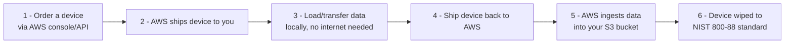
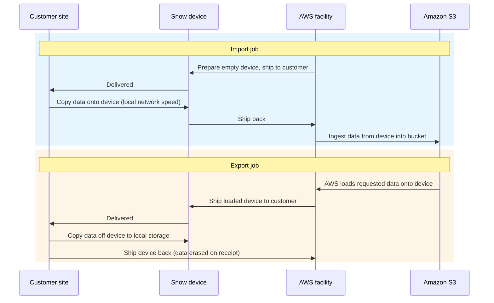
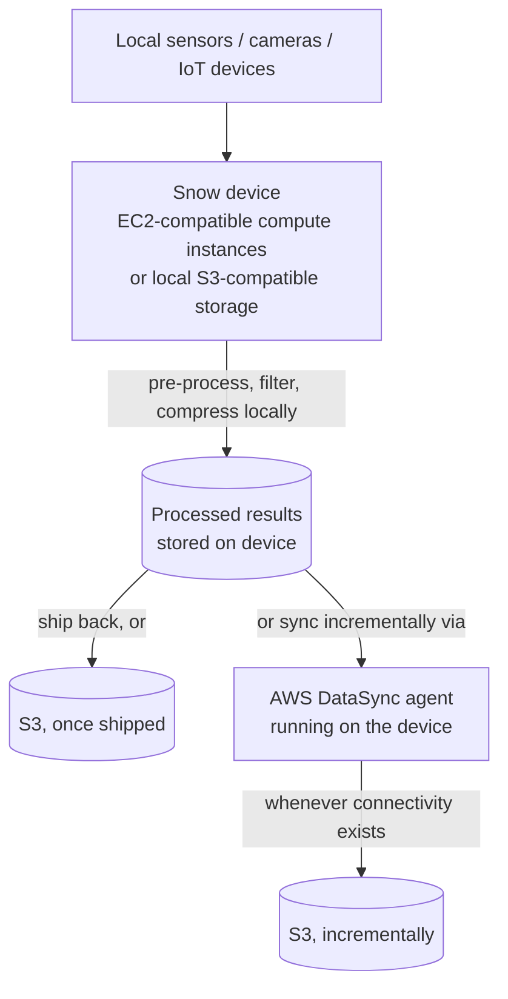

# AWS Snow Family

> **Appears in:** [SAA-C03](../../certifications/saa-c03/README.md)
> **Exam-relevance note:** explicitly **out of scope** for [DVA-C03](../../certifications/dva-c03/README.md)
> per that exam's official appendix — a Developer – Associate scenario should never require
> choosing a Snow Family device as the answer. SAA-C03's appendix confirms it under the
> "Migration and Transfer" in-scope category.

<!-- No vendored icon exists for the Snow Family in diagrams/assets/icons/ at the time this doc
was written. Per diagrams/README.md convention, a missing icon is skipped rather than linking an
unverified external CDN URL. If a Snow Family icon is later vendored from aws-icons-for-plantuml
(dist/Migration-Transfer/AWSSnowball.png or similar), add it here as
``. -->

*Service · Migration & Transfer · SAA-C03 exam-guide appendix category "Migration and Transfer"*

> ⚠️ **Currency note (read before the rest of this doc):** as of this writing, AWS has been
> winding down the physical Snow Family hardware line: **AWS Snowmobile retired in April 2024**,
> **AWS Snowcone stopped taking new orders on November 12, 2024**, and **AWS Snowball Edge devices
> went end-of-sale for new customers effective November 7, 2025** — AWS's own current
> documentation tells new customers to use **AWS DataSync** for online transfers, the newer
> **AWS Data Transfer Terminal** for secure physical transfers, or **AWS Outposts** for ongoing
> edge compute instead. This doc still covers the Snow Family in full because (a) SAA-C03's
> official exam guide, as published, still lists it as an in-scope "Migration and Transfer"
> service and tests the underlying concepts (offline bulk transfer, edge compute at
> disconnected sites), and (b) a large number of existing production deployments still run on
> Snowball Edge hardware already in the field. Treat the architecture/use-case knowledge below as
> exam- and legacy-deployment-relevant; treat it as **not a recommended choice for a brand-new
> real-world project** without first checking AWS's current service availability in your account.

## Definition

The AWS Snow Family is a set of physically rugged, AWS-owned devices — shipped to your location —
that move large amounts of data into or out of AWS **without relying on your network connection**,
and that can also run local compute workloads at the edge before, during, or instead of shipping
data back to AWS at all.

## Purpose

Moving very large datasets (many terabytes to petabytes) over the internet — even with a fast
connection — runs into basic physics: a 100 TB dataset over a (generously fast) 1 Gbps link takes
roughly 9+ days of **continuous, uninterrupted, full-bandwidth** transfer, and that's before
accounting for the fact that most organizations can't actually dedicate their entire internet link
to one transfer job for over a week. For environments with no reliable connectivity at all —
ships, mines, remote manufacturing sites, military/field operations — online transfer isn't even
an option.

The Snow Family solves this by turning "data transfer" into "data shipping": AWS ships you
tamper-resistant, encrypted hardware; you load data onto it locally at full local-network speed
(no internet bottleneck at all); you ship it back; AWS ingests the data from the device directly
into your account over its own internal high-speed network. The same hardware, because it has
real onboard compute and storage, also doubles as an **edge computing platform** for sites that
need to process data locally before any of it ever reaches AWS.

## How It Works



Walking through it:

1. You **order a device** through the AWS Snow Family console or API, specifying the job type
   (import into S3, export from S3, or local compute/storage) and the device variant that matches
   your capacity and compute needs.
2. AWS **prepares and ships** the device — pre-configured with your job details and security
   credentials where applicable, and in its own rugged, weather-resistant shipping enclosure.
3. You **connect the device to your local network** and transfer data onto it using the Snowball
   Edge Client, AWS OpsHub (GUI tool), the S3-compatible API, or an NFS mount point — all at local
   network speed, with no dependency on your internet uplink.
4. You **ship the device back** to the AWS facility it was prepared from.
5. AWS **ingests the data** from the device into the destination S3 bucket over AWS's internal
   network, verifying integrity as it goes.
6. The device is **securely wiped** following NIST 800-88 data-sanitization standards before
   being reused for another customer's job.

### The physical device


*Figure: the official AWS Snowball Edge appliance — the device is its own rugged shipping
container, with an E Ink display on top used both for status/connection information and as a
self-updating shipping label. Source: [Receiving the Snowball Edge](https://docs.aws.amazon.com/snowball/latest/developer-guide/receive-device.html), © Amazon Web Services.*

### Import vs. export job flow



The two job types are mirror images of each other: **import** starts with an empty device and ends
with your data in S3; **export** starts with AWS pre-loading a device from an existing S3 bucket
and ends with your data on your local systems, with the device wiped once AWS gets it back.

### Edge compute — data processing before it ever leaves the site



Snow devices aren't just "dumb" shipping containers — they run real **Amazon EC2-compatible
compute instances** and provide **S3-compatible local storage**, so a disconnected site can run
actual workloads (ML inference, video analytics, data filtering/compression) locally before any
data moves anywhere. A device can even run a **DataSync agent** locally, letting it sync
incrementally over any available connection instead of strictly waiting for the full ship-it-back
cycle — combining this service's offline durability with DataSync's online incremental model (see
[`datasync.md`](datasync.md)).

## Key Features / Components

- **AWS Snowcone** *(discontinued for new orders Nov 12, 2024)* — the smallest device (8 TB HDD
  or 14 TB SSD variants), lightweight (4.5 lb/2.1 kg), portable enough for a messenger bag,
  battery-powerable, designed for extremely space-constrained field environments.
- **AWS Snowball Edge** *(end-of-sale for new customers as of Nov 7, 2025; large installed base
  remains in service)* — the core of the family, offered in **Storage Optimized** (up to 80 TB,
  or a 210 TB variant) and **Compute Optimized** (up to 104 vCPUs, 416 GB memory, optional GPU)
  configurations; a single, rugged, self-contained unit (~50 lb/22.5 kg) that is its own shipping
  container.
- **AWS Snowmobile** *(retired April 2024)* — a 45-foot shipping container truck for exabyte-scale
  transfers (up to 100 PB per vehicle), used for the very largest data center migrations before
  smaller devices and improved online transfer (DataSync) made it unnecessary.
- **Amazon S3 compatible storage on Snow** — a local, S3-API-compatible storage layer (`SNOW`
  storage class) that lets applications store/retrieve objects directly on the device for local
  processing, data residency, or intermittent-connectivity use cases.
- **Amazon EC2-compatible compute instances** — run real compute workloads directly on a Snowball
  Edge device, using the same AMI-based model as cloud EC2, letting you develop and test in AWS
  then deploy the same workload to the edge.
- **AWS OpsHub for Snow Family** — a GUI-based management tool for unlocking, configuring, and
  monitoring devices without needing CLI familiarity.
- **AWS IoT Greengrass support** — pre-installed capability for running Lambda functions and
  Greengrass components locally on the device.
- **Clustering** — 5 to 10 Snowball Edge devices can be clustered together for local durability
  (data redundancy across devices) and to grow/shrink local storage/compute capacity on demand.
- **Tamper detection and physical security** — hidden magnetic screws, intrusion switches, NFC
  validation tags, anti-tamper inserts, and a companion Android app to verify a device hasn't been
  physically compromised in transit.
- **Encryption** — all data on-device is encrypted at rest using keys managed by AWS KMS that are
  never stored on the device itself, and in transit during any network-based use.

## Use Cases — When to Use It

- **Large-scale, one-time data center migration with limited or no suitable network bandwidth.**
  An enterprise decommissioning an on-premises data center has 500 TB of archival data and no
  realistic way to upload it over the internet in an acceptable timeframe. Multiple Snowball Edge
  (Storage Optimized) devices are ordered, loaded in parallel, and shipped back. *Alternative
  cost:* even a dedicated 1 Gbps link would need roughly 46 days of continuous full-bandwidth
  transfer for 500 TB — operationally unrealistic alongside normal business network usage.
- **Edge computing and data collection in a disconnected environment.** An offshore oil platform
  or cargo ship needs to run local analytics on sensor data with no reliable satellite internet. A
  Snowball Edge Compute Optimized device runs EC2-compatible instances locally, processing data at
  the edge and syncing opportunistically. *Alternative cost:* waiting for connectivity to process
  data in the cloud means analytics insights arrive too late to be operationally useful.
- **Petabyte-to-exabyte-scale historical migration (legacy context).** A media company migrating
  decades of archival footage (multiple petabytes) historically used AWS Snowmobile for the
  largest single migrations; today, that scale would more likely use **many parallel Snowball
  Edge devices** instead, since Snowmobile has been retired. *Alternative cost:* even with many
  parallel high-bandwidth links, exabyte-scale online transfer remains impractical for most
  organizations' existing network infrastructure.
- **Military, government, or extremely remote field operations.** A unit operating in a location
  with no civilian network infrastructure needs both local compute for mission-critical processing
  and a way to eventually get collected data into AWS once the device can be physically returned.
  *Alternative cost:* no network-based alternative exists at all in a genuinely disconnected
  environment — this is the use case with no real substitute.
- **Database/VM backup migration at large scale.** A company needs to migrate an 80 TB on-premises
  database's backup files into S3. Backup files are copied onto a Snowball Edge device over a
  local 10 Gb Ethernet connection, then shipped for S3 ingestion. *Alternative cost:* uploading an
  80 TB backup set over a typical corporate internet connection would saturate it for days to
  weeks, disrupting normal business traffic.
- **Hadoop cluster decommissioning with direct HDFS compatibility.** An organization retiring an
  on-prem Hadoop cluster uses Snowball Edge's HDFS client support to migrate cluster data directly
  onto the device in its native format, landing it as S3 objects once ingested. *Alternative
  cost:* exporting Hadoop data to a different intermediate format first just to upload it online
  adds an unnecessary transformation step.
- **Temporary field compute cluster via device clustering.** A research team on an extended
  remote expedition clusters 5–10 Snowball Edge devices together for combined local storage and
  compute capacity, growing or shrinking capacity as the expedition's data needs change.
  *Alternative cost:* a single device's fixed capacity may not flex with a project's actual needs
  over a multi-month deployment.
- **Edge ML inference with intermittent connectivity.** A manufacturing plant with a spotty network
  link runs ML inference models directly on a Snowball Edge device's compute instances against
  local camera feeds, only syncing summarized results (not raw video) back to AWS when connectivity
  allows. *Alternative cost:* streaming raw video continuously to the cloud for inference would
  both overwhelm the unreliable link and add unacceptable latency for real-time quality control.
- **Disaster-recovery data evacuation from a site being decommissioned under time pressure.** A
  company closing a physical office location on a hard deadline uses a Snowcone-class (historically)
  or Snowball Edge device to rapidly extract critical data before the site's network is
  disconnected, rather than racing to finish an online upload before the deadline.
  *Alternative cost:* an online transfer racing against a hard physical deadline risks not
  finishing in time if the link underperforms on the day.
- **Combining offline bulk transfer with incremental online sync.** A remote facility with
  occasional, narrow connectivity windows runs a DataSync agent directly on a Snowball Edge device,
  getting the benefit of local bulk storage plus whatever incremental online sync the connectivity
  window allows, rather than strictly choosing one transfer model. *Alternative cost:* waiting for
  the full ship-back cycle every time, instead of syncing incrementally whenever a window opens,
  delays data availability in AWS unnecessarily.
- **Secure, chain-of-custody-sensitive data transport.** A government or financial services
  customer needs provable chain-of-custody and tamper-evidence for a physical data transfer. Snow
  Family devices' tamper-detection hardware (intrusion switches, NFC validation, anti-tamper
  inserts) provides an auditable physical security story that a generic shipped hard drive
  wouldn't. *Alternative cost:* shipping an unencrypted or weakly-secured consumer storage device
  instead carries real data-breach-in-transit risk.
- **Content distribution to disconnected or low-bandwidth retail/field locations.** A company
  needs to push a large content package (software updates, media libraries) to many remote sites
  that lack bandwidth for a direct download. An export job loads the content onto a device shipped
  to each site. *Alternative cost:* each site individually downloading a large package over a thin
  link is slow and unreliable compared to physically delivering it pre-loaded.

## When NOT to Use It / Alternatives

- **You have adequate network bandwidth and some time flexibility** — for anything that can
  realistically transfer online within an acceptable window, **AWS DataSync** (see
  [`datasync.md`](datasync.md)) is simpler, faster to start, and doesn't involve physical shipping
  logistics or lead time.
- **A brand-new project today** — given the end-of-sale status noted above, check current AWS
  service availability for your account before designing around Snow Family hardware; AWS now
  points new customers toward DataSync (online) or **AWS Data Transfer Terminal** (physical,
  successor offering) instead.
- **Ongoing, permanent edge compute needs at a connected site** — if the site actually has reliable
  connectivity and needs sustained edge infrastructure rather than a temporary/disconnected use
  case, **AWS Outposts** is the better-fit long-term edge compute platform.
- **Database migration with change data capture requirements** — Snow Family devices move static
  data snapshots; they don't provide ongoing replication. Pair a one-time Snowball Edge-assisted
  bulk load with **AWS DMS** for the CDC "catch-up" phase if both are needed.
- **Small datasets (well under a few terabytes)** — the lead time to receive, load, and ship back a
  physical device usually exceeds the time a reasonably-paced online transfer would take for small
  volumes.

## Why It's Important

**Real world:** physics-bound bandwidth limits are a real, recurring constraint for large
migrations and for genuinely disconnected environments (maritime, remote industrial, military),
and "ship a hard drive" is a legitimately faster and often more secure option than trying to force
a huge transfer over an inadequate network link — this is a durable pattern even as AWS's specific
hardware lineup evolves.

**Exam weight:** **SAA-C03** lists the Snow Family in the exam guide's "Migration and Transfer"
in-scope services appendix, and it's a classic exam signal: whenever a scenario mentions **very
large data volumes, limited/no network bandwidth, remote or disconnected locations, or a strict
deadline that online transfer can't realistically meet**, Snow Family devices are very likely the
intended answer. **DVA-C03's** official appendix explicitly places the Snow Family **out of
scope** — a Developer – Associate scenario testing application code, deployment, or troubleshooting
shouldn't ever hinge on choosing Snowball hardware, which is a useful signal for eliminating it as
a distractor on that exam specifically.

## Pricing Model — Deep Dive

Snow Family pricing (historically) combines a **per-job device usage fee**, a **daily on-site
rate** beyond an included free usage period, and **shipping charges** — plus standard AWS storage
rates for wherever the data ultimately lands (e.g., S3).

| Cost component | What drives it |
|---|---|
| Device usage fee | Per job, varies by device type/configuration (flat fee per job) |
| Extra days on-site | Daily rate charged beyond the included free usage period (commonly 10 days) |
| Shipping | Carrier-based, varies by device size/weight and distance |
| Data transfer into S3 | Included in the job fee for standard import; no separate per-GB ingest charge for basic import jobs |
| Ongoing S3 storage | Billed separately at S3's own rates once data lands |

*(Illustrative — confirm current numbers, availability, and device options for your account at
https://aws.amazon.com/snow/pricing/ or in the AWS console, given the end-of-sale changes noted
above.)*

### Worked example — Snowball Edge vs. online transfer for a 100 TB migration

Comparing a single Storage Optimized device (up to 80 TB, so two devices needed for 100 TB) against
online transfer over a shared 500 Mbps corporate link:

```
Online transfer:   100,000 GB × 8 bits / 500 Mbps ÷ 3600               ≈ 444 hours ≈ 18.5 days
                   (continuous, full-bandwidth — unrealistic alongside normal business traffic;
                    real elapsed time typically 2–4× longer once contention is factored in)

Snow Family:       2 devices × device usage fee (illustrative ~$300–500/job each)
                   + shipping both ways
                   + on-site loading time (days, not weeks) at full local network speed
                   ≈ total elapsed time measured in days, not weeks, and zero contention
                     with production network traffic
```

The real argument for physical transfer at this scale isn't just raw transfer math — it's that the
**online alternative competes with every other use of the network link** for its entire multi-week
duration, while the device-based approach loads at full local-network speed with zero ongoing
contention, and the elapsed "device in transit" time is often shorter in practice than a
sustained, contention-free multi-week online transfer would require.

### Worked example — extra on-site days

A job keeps a device for 20 days against a 10-day included free period, at an illustrative $15–20/
day rate thereafter:

```
Included free period:    10 days, no extra charge
Extra days:               10 days × $15–20/day                         = $150–200
```

This is a common real-world cost surprise: teams that underestimate how long on-site data loading
will actually take (especially for very large or very small-file-heavy datasets) can accumulate a
meaningful extra-days charge — planning the loading timeline realistically before ordering avoids
this.

## Common Architectures

**1. Parallel multi-device data center evacuation.** A large migration orders several Storage
Optimized Snowball Edge devices simultaneously, loads them in parallel from different racks/
systems to maximize local loading throughput, and ships them back together — effectively
parallelizing what would otherwise be one sequential very-large transfer.

**2. Hybrid offline-plus-online edge pipeline.** A remote facility runs a Snowball Edge device for
local compute and bulk storage, with a DataSync agent also running on the same device to
opportunistically sync incremental changes whenever a connectivity window opens, rather than
purely waiting for the full device-return cycle to get any data into AWS.

**3. Clustered edge deployment for sustained remote operations.** Multiple Snowball Edge devices
are clustered together at a long-term remote site (an offshore platform, a mining operation) for
combined storage/compute capacity and local data redundancy, functioning as a small, durable,
disconnected data center until connectivity or a return shipment is arranged.

**4. Bulk-load-then-CDC-catchup database migration.** A very large on-premises database's backup is
loaded onto a Snowball Edge device and shipped for bulk ingestion into S3/RDS, after which a short-
lived AWS DMS CDC task catches up on any changes that occurred on the source database during the
device's transit time — combining physical bulk transfer with the "keep the source live" benefit
DMS alone provides for a database workload.

## Limits & Quotas

- **Jobs per account/Region** — a default soft quota on concurrent active jobs, raisable via
  Support for very large migrations needing many devices simultaneously.
- **Device capacity by variant** — Storage Optimized: up to 80 TB (or 210 TB variant) usable;
  Compute Optimized: up to 104 vCPUs / 416 GB memory depending on generation; capacity planning
  should account for usable, not raw, capacity.
- **Free on-site usage period** — commonly 10 days included before daily extra-day charges apply;
  plan the loading timeline to fit within this window where possible.
- **Clustering limit** — 5 to 10 devices per local cluster for combined capacity/durability.
- **Data transfer window** — for security purposes, data transfers for a given job typically must
  complete within a bounded window (commonly cited around 90 days) after device preparation.
- **Small-file transfer overhead** — large numbers of very small files (well under 1 MB each) load
  onto a device far less efficiently than fewer, larger files, due to per-file overhead dominating
  throughput — a real-world planning consideration, not a hard quota, but one that materially
  affects how long on-site loading actually takes.

## Security Considerations

- **Encryption is always on, keys never stored on the device** — data on a Snow Family device is
  encrypted at rest using AWS KMS-managed keys that are never physically stored on the hardware
  itself, so a lost or stolen device in transit doesn't expose the keys needed to decrypt it.
- **Tamper-evidence as a control, not just a feature** — the physical tamper-detection hardware
  (intrusion switches, NFC validation tags, anti-tamper inserts) exists specifically so that a
  device showing signs of physical tampering in transit can be treated as a security incident
  rather than silently trusted on arrival; always check tamper-evidence status before unlocking a
  received device.
- **Manifest and unlock code are the actual access control** — the job manifest and its unlock
  code are cryptographically bound to one specific device and account; losing control of either
  effectively means losing control of access to that device's data, so they should be handled with
  the same care as any other root credential.
- **NIST 800-88 wipe between jobs** — AWS's sanitization process between customer jobs is the
  control that makes device reuse safe for the next customer; this is relevant to know when a
  security review asks "how is customer data isolated between successive users of the same
  physical hardware."
- **Local IAM on Snowball Edge** — devices support local IAM, letting you scope which local
  applications/users can access on-device S3-compatible storage and compute resources, mirroring
  cloud IAM practice at the edge rather than leaving the device's local resources wide open.
- **Chain-of-custody documentation for regulated data** — for compliance-sensitive transfers
  (healthcare, financial, government), retain the shipping/tracking records and job completion
  report as part of the audit trail proving custody was maintained throughout the physical
  transfer.

## Troubleshooting / Common Issues

- **Device won't power on or appears dead on arrival** — verify power cable/voltage compatibility
  for your region (devices ship with country-specific cables) before assuming hardware failure;
  contact AWS Support if it persists.
- **Can't find the device's IP address** — check the device's LCD/E Ink display's **CONNECTION**
  tab, which shows the current IP; a misconfigured local network (no DHCP, wrong VLAN) is the most
  common root cause if the display shows no valid address.
- **Snowball Edge Client fails to unlock the device** — double-check the manifest file and unlock
  code match the specific device received (they're cryptographically bound to one device and
  account); a mismatched manifest from a different job is a common mistake when managing several
  concurrent jobs.
- **Data loading is far slower than expected** — check whether the bottleneck is the local network
  (not the device itself) — a device connected via a slow switch/NIC rather than its full-speed
  network interface will load much more slowly than the hardware is capable of.
- **Device returned but data isn't showing up in S3** — verify the job's status in the console;
  "At AWS" and "Importing" are distinct states, and import of a very large or small-file-heavy
  dataset can legitimately take a few days after the device physically arrives.
- **Accidentally exceeding the free on-site usage window** — plan loading schedules against the
  included free period in advance; this is an avoidable cost, not a technical fault.

## Hands-on Lab (Floci)

**Honest limitation:** the Snow Family is not in Floci's documented support table (see
`labs-floci/README.md`) and fundamentally cannot be emulated locally — it's physical hardware
shipped to a real address, with real carrier logistics. The commands below show the **real
control-plane CLI shape** (job creation, not data loading) for study purposes; expect them to be
unsupported against a local Floci endpoint. The practical substitute for hands-on practice: the
Snowball Edge Client and AWS OpsHub tooling both work against a **local AWS Snowball Edge device
simulator** that AWS documents for development/testing without ordering real hardware — see the
official developer guide's section on local testing. Beyond that, build the S3 lab in
[`../storage/s3.md`](../storage/s3.md) and mentally map it as "this is where a Snowball Edge
import job's data ends up."

```bash
# Create an import job (ships an empty device to you)
aws snowball create-job \
  --job-type IMPORT \
  --resources S3Resources='[{BucketArn=arn:aws:s3:::my-study-bucket}]' \
  --snowball-type EDGE_S \
  --shipping-option SECOND_DAY \
  --role-arn arn:aws:iam::111122223333:role/SnowballRole

# Check job status
aws snowball describe-job --job-id JID0123456789ABCDEF

# List all jobs on the account
aws snowball list-jobs

# Cancel a job before it's shipped (only possible in early job states)
aws snowball cancel-job --job-id JID0123456789ABCDEF
```

## Exam-Style Scenario Walkthroughs

**Scenario 1:** A company needs to migrate 300 TB of archival data from an on-premises data center
into Amazon S3, and its available internet link would take over two months of continuous transfer
to move that volume, which isn't acceptable. What's the solution?

*Answer:* Order multiple AWS Snowball Edge (Storage Optimized) devices, load them locally over the
on-prem network (no internet bottleneck), and ship them back for AWS to ingest directly into S3 —
bypassing the network bandwidth constraint entirely.

**Scenario 2:** A maritime shipping company needs to run real-time video analytics on cargo
inspection footage while vessels are at sea with no reliable satellite internet connection, and
only wants to sync summarized results back to AWS once in port. What's the architecture?

*Answer:* An AWS Snowball Edge Compute Optimized device running EC2-compatible compute instances
onboard the vessel, processing video locally with S3-compatible on-device storage, syncing only
the processed/summarized results (not raw footage) back to AWS when connectivity is available —
possibly via a DataSync agent running on the same device.

**Scenario 3:** A scenario describes a Developer – Associate exam question asking which service
should be used to transfer a large on-premises dataset into AWS. Is the Snow Family a valid answer
choice on that exam?

*Answer:* No — the Snow Family is explicitly listed as **out of scope** in DVA-C03's official exam
guide appendix. On that specific exam, eliminate Snow Family answer choices outright; the correct
answer there would point to a Developer-relevant service instead (e.g., DataSync, or direct S3
upload patterns), depending on the exact scenario.

## Exam Tips

- **Keyword "petabyte-scale," "no reliable internet connection," "ship a device," "offline data
  transfer," "remote/disconnected site"** → Snow Family, almost every time on SAA-C03.
- **Edge compute at a disconnected location (not just storage)** → Snowball Edge Compute
  Optimized specifically, distinguishing it from pure data-transfer scenarios.
- **Remember the DVA-C03 exclusion** — if you're studying for DVA-C03 specifically, Snow Family
  answer choices can be eliminated outright per that exam's official appendix.
- **Don't confuse with DataSync** — Snow Family is for when online transfer genuinely isn't
  practical (bandwidth or connectivity constrained); if the scenario describes a working, if slow,
  network link and no hard disconnection, DataSync is usually the better-fit answer.
- **Snowmobile is retired, Snowcone is discontinued for new orders** — exam content written
  against the historical lineup may still name them; know the concept (device size scales with
  data volume) even if the specific named products have changed in the real world since the exam
  guide was last revised.

## Further Reading

- [AWS Snow Family](https://aws.amazon.com/snow/) — official service overview and current device
  availability
- [How Snow Family devices work](https://docs.aws.amazon.com/snow/latest/swsbe/how-it-works.html)
  — the import/export workflow referenced above
- [AWS Snowball Edge Developer Guide](https://docs.aws.amazon.com/snowball/latest/developer-guide/whatisedge.html)
- [AWS Snowball FAQs](https://aws.amazon.com/snowball/faqs/) — current end-of-sale/availability
  notices
- [An Overview of AWS Cloud Data Migration Services](https://docs.aws.amazon.com/whitepapers/latest/overview-aws-cloud-data-migration-services/overview-aws-cloud-data-migration-services.html) — whitepaper covering the Snow Family alongside DataSync/DMS/Transfer Family

## Related Terms

- [`datasync.md`](datasync.md) — the online counterpart; can also run as an agent directly on a
  Snow device for hybrid offline/online transfer
- [`migration-services-overview.md`](migration-services-overview.md) — how Snow Family fits into
  a broader migration strategy
- [`../storage/s3.md`](../storage/s3.md) — the typical destination for an import job's data
- `AWS Outposts` — the long-term, connected edge-compute alternative once a site has reliable
  connectivity; see glossary
- `NIST 800-88` — the data-sanitization standard devices are wiped to between customer jobs
