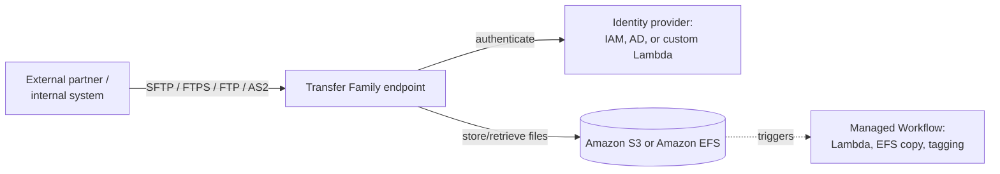
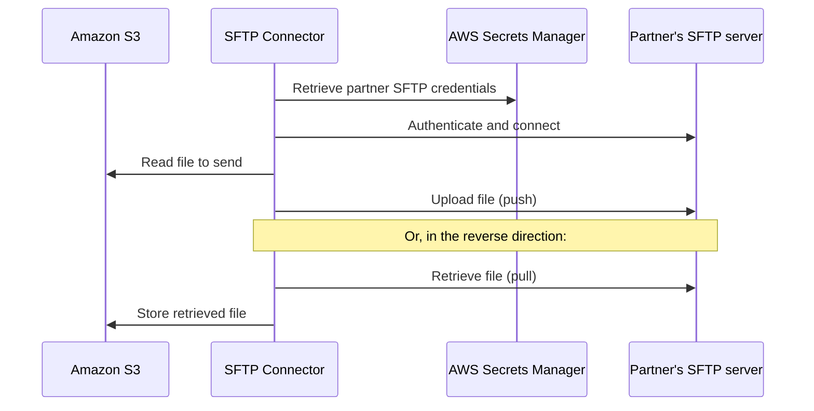
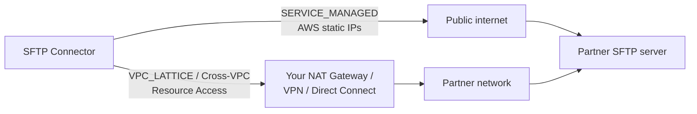

# AWS Transfer Family

> **Appears in:** [SAA-C03](../../certifications/saa-c03/README.md)
> **Exam-relevance note:** explicitly **out of scope** for [DVA-C03](../../certifications/dva-c03/README.md)
> per that exam's official appendix — a Developer – Associate scenario should not require choosing
> AWS Transfer Family as the answer. SAA-C03's appendix confirms it under the "Migration and
> Transfer" in-scope category.

<!-- No vendored icon exists for AWS Transfer Family in diagrams/assets/icons/ at the time this
doc was written. Per diagrams/README.md convention, a missing icon is skipped rather than linking
an unverified external CDN URL. If a Transfer Family icon is later vendored from
aws-icons-for-plantuml (dist/Migration-Transfer/AWSTransferFamily.png or similar), add it here as
``. -->

*Service · Migration & Transfer · SAA-C03 exam-guide appendix category "Migration and Transfer"*

## Definition

AWS Transfer Family is a **fully managed file transfer service** that gives you SFTP, FTPS, FTP,
and AS2 endpoints backed by Amazon S3 or Amazon EFS — so external partners, customers, or internal
systems can push and pull files using the exact same standard file-transfer protocols they already
use today, without you having to run, patch, or scale your own FTP/SFTP servers.

## Purpose

Decades of business-to-business data exchange — especially in finance, healthcare, logistics, and
retail — still runs over SFTP, FTPS, or even plain FTP, because that's what the partner's system on
the other end expects, and renegotiating a partner integration to use a modern API is often not
realistic or fast. Historically, supporting that meant **running your own file-transfer server**:
an EC2 instance (or fleet) running `vsftpd`/`OpenSSH`, patched regularly, scaled manually, with
custom scripting to get uploaded files into your actual storage and processing pipeline.

Transfer Family exists to make "I need an SFTP/FTPS/FTP endpoint" a managed, serverless-feeling
capability: AWS runs and scales the actual protocol endpoints, authentication is pluggable (IAM,
Active Directory, or a custom Lambda-backed identity provider), and the files themselves land
directly in S3 or EFS — the storage your other AWS services already know how to process — with no
EC2 fleet for you to patch or scale.

## How It Works



Walking through it:

1. You create a **server** (an endpoint) choosing the protocol(s) you need — SFTP, FTPS, FTP, or
   AS2 — and whether it's reachable publicly, through a VPC endpoint, or internally only.
2. A connecting user (partner, customer, or internal system) authenticates using your configured
   **identity provider**: AWS-managed service users, an existing Active Directory (via AD
   Connector), or a fully custom identity provider backed by a **Lambda function** (useful for
   integrating an existing homegrown user database).
3. Each authenticated user is mapped to an IAM role and a specific **storage location** — typically
   a particular S3 bucket/prefix or EFS path — so different partners only ever see their own slice
   of storage.
4. The user transfers files using their normal SFTP/FTPS/FTP client, exactly as they would against
   any other file server — Transfer Family's endpoint handles the protocol translation into S3/EFS
   API calls behind the scenes.
5. Optionally, a **Managed Workflow** fires on file upload — running steps like a Lambda function,
   copying to another location, tagging, or decrypting a PGP-encrypted file — turning "a file
   landed" into an automated processing pipeline trigger.

### SFTP Connectors — Transfer Family talking outbound to a partner's server


*Figure: the official SFTP connector architecture — the connector retrieves credentials from AWS
Secrets Manager, authenticates to a remote partner SFTP server, and moves files between that
server and Amazon S3, with CloudWatch logging and IAM controlling access throughout. Source: [Setting up and using SFTP connectors](https://docs.aws.amazon.com/transfer/latest/userguide/sftp-connectors-tutorial.html), © Amazon Web Services.*



This is the direction most people don't initially expect from a "managed SFTP" service: Transfer
Family isn't only an **inbound** endpoint partners connect to — **SFTP Connectors** let *you* be
the client, reaching out to a partner's existing SFTP server to push or pull files on a schedule,
which matters when the partner's system is the one that can't change, not yours.

### Egress routing options for SFTP connectors



Connectors can egress either through **AWS-managed static IPs** (useful when a partner needs to
allowlist a fixed, known IP range) or through **your own VPC's egress path** (NAT Gateway, VPN,
Direct Connect) when the partner requires traffic to originate from infrastructure you control or
from a private network path rather than the public internet.

## Key Features / Components

- **Protocols supported** — SFTP (SSH File Transfer Protocol), FTPS (FTP over TLS), FTP (unencrypted
  — generally only appropriate inside a private VPC, never over the public internet), and AS2
  (Applicability Statement 2, common in EDI/B2B integrations in retail and healthcare).
- **Storage backends** — Amazon S3 (most common) or Amazon EFS (useful when files need POSIX
  file-system semantics that downstream on-premises-style applications expect).
- **Identity providers** — AWS Identity and Access Management (service-managed users), Microsoft
  Active Directory (via AD Connector, for enterprises with an existing AD-based partner/user
  directory), or a fully **custom identity provider** via a Lambda function, letting you plug in
  any existing user store (a legacy database, a third-party identity system).
- **Managed Workflows** — a no-infrastructure way to chain post-upload actions: run a Lambda
  function, copy/tag the file, or decrypt a PGP-encrypted upload, triggered automatically when a
  file lands.
- **SFTP Connectors** — outbound capability letting Transfer Family push/pull files to/from a
  **partner's** SFTP server, rather than only hosting an inbound endpoint.
- **VPC hosting** — endpoints can be deployed inside a VPC (private, internet-facing via an
  Elastic IP, or internal-only), giving the same networking control patterns as any other VPC-
  hosted service.
- **Custom hostnames** — bring your own domain name for the file-transfer endpoint (e.g.,
  `sftp.yourcompany.com`) instead of the default AWS-generated endpoint address, so partners see a
  branded, stable address.
- **Logging and monitoring** — CloudWatch Logs integration for every connection and file transfer
  event, giving an audit trail of who transferred what, when.
- **High availability by default** — the service itself is managed and highly available; you're
  not responsible for patching, scaling, or failing over an underlying server fleet.

## Use Cases — When to Use It

- **Replacing a self-managed SFTP server for partner file exchange.** A logistics company runs an
  EC2-based SFTP server that partners upload shipment manifests to; migrating to Transfer Family
  removes the patching/scaling burden while partners keep using the exact same SFTP client
  configuration (just a new hostname). *Alternative cost:* the self-managed server needs ongoing
  OS patching, manual scaling for peak upload periods, and custom scripting to move uploaded files
  into S3 for downstream processing — all of which Transfer Family absorbs.
- **Healthcare EDI/claims processing over AS2.** A healthcare clearinghouse needs to exchange
  claims files with insurance partners using the AS2 protocol, a near-universal standard in that
  industry that a generic S3 API integration can't satisfy because the partner's system only
  speaks AS2. *Alternative cost:* building a custom AS2 implementation from scratch is a
  significant, specialized engineering effort Transfer Family provides natively.
- **Mainframe file migration without rewriting legacy JCL jobs.** A bank's mainframe batch jobs
  push files via SFTP as part of an existing JCL (Job Control Language) workflow; pointing that job
  at a Transfer Family endpoint instead of a legacy on-prem SFTP server moves the destination to S3
  with zero changes to the mainframe-side job logic. *Alternative cost:* rewriting mainframe batch
  jobs to call a modern API instead of SFTP is often infeasible on a reasonable timeline given
  mainframe development constraints.
- **Customer-facing file upload portal for a B2B SaaS product.** A company needs enterprise
  customers to be able to securely upload large data files (bulk imports) using their existing
  internal SFTP tooling rather than a web upload form. Transfer Family gives each customer an
  isolated SFTP user mapped to their own S3 prefix. *Alternative cost:* building a custom
  authenticated web upload flow ignores that many enterprise customers' internal processes are
  already built around SFTP automation, not browser uploads.
- **Automated, scheduled retrieval from a partner's SFTP server.** A retailer needs to pull a daily
  inventory feed file from a supplier's existing SFTP server, where the supplier won't change their
  system. An SFTP Connector, scheduled via EventBridge, retrieves the file into S3 automatically
  every day. *Alternative cost:* a custom script polling the partner's server needs its own
  credential management, retry logic, and scheduling infrastructure that a connector provides
  out of the box.
- **Post-upload automated processing pipeline.** A financial services firm needs every uploaded
  file to be automatically validated, virus-scanned, and routed based on content as soon as it
  arrives, without a human manually checking an inbox. A Managed Workflow triggers a Lambda
  function on every upload to handle this. *Alternative cost:* a separate polling process checking
  S3 for new files introduces latency and complexity a native upload-triggered workflow avoids.
- **Migrating off a legacy on-premises FTP server used only internally within a VPC.** An internal
  system still relies on plain FTP (not SFTP/FTPS) for historical reasons, and the requirement is
  strictly internal, private-network-only traffic. Transfer Family can host an FTP endpoint
  **inside a VPC only** — appropriate specifically because FTP's lack of encryption makes it
  otherwise unsuitable over the public internet. *Alternative cost:* exposing plain FTP to the
  public internet (instead of keeping it VPC-internal) would transmit credentials and data
  unencrypted — a real security risk this use case specifically avoids by scoping it internal-only.
- **PGP-encrypted file exchange with automatic decryption.** A partner sends PGP-encrypted files
  for compliance reasons; a Managed Workflow step automatically decrypts incoming files after
  upload, landing a usable plaintext copy for downstream processing while preserving the encrypted
  original. *Alternative cost:* manual decryption, or a custom decryption script running
  separately from the upload pipeline, adds an operational step and a place for files to get
  stuck.
- **Branded, custom-domain file transfer endpoint for partner trust.** A company wants partners to
  connect to `sftp.ourcompany.com` rather than an AWS-generated hostname, for both branding and to
  avoid partners having to update firewall allowlists if the underlying AWS endpoint ever changes.
  *Alternative cost:* using the raw AWS-generated endpoint address directly ties partner
  configuration to an AWS-specific hostname rather than a company-controlled one.
- **EFS-backed file transfer for applications needing POSIX semantics.** An on-premises-style
  application migrating to AWS still expects real file-system semantics (permissions, directory
  structures) rather than flat S3 objects. Transfer Family backed by EFS instead of S3 preserves
  that expectation for the application layer. *Alternative cost:* an S3-backed endpoint works for
  most use cases but doesn't give the same POSIX file-system behavior some legacy applications
  depend on.
- **Centralizing dozens of partner integrations onto one managed platform.** A company with 40+
  partner SFTP integrations, each previously requiring its own server or script, consolidates them
  all onto Transfer Family with per-partner IAM roles and isolated storage prefixes, cutting
  operational overhead from "40 things to patch" to "one managed service to configure."
  *Alternative cost:* maintaining dozens of individually-managed file-transfer endpoints multiplies
  patching, scaling, and security-review effort linearly with partner count.

## When NOT to Use It / Alternatives

- **Bulk, one-time, scheduled file transfer between systems you control** — if there's no
  requirement for a partner-facing SFTP/FTPS/FTP/AS2 protocol specifically, **AWS DataSync** (see
  [`datasync.md`](datasync.md)) is a better fit for scheduled, large-scale, protocol-agnostic
  transfers between your own storage systems.
- **Modern API-based partner integrations where you control both sides** — if a partner integration
  is new and both sides can agree on a REST/API-based exchange instead of a legacy file protocol,
  building a direct API integration is usually simpler than standing up a file-transfer endpoint.
- **Public-internet-facing plain FTP** — Transfer Family supports plain FTP, but it should be
  scoped to **VPC-internal** traffic only; FTP transmits credentials unencrypted, so exposing it
  publicly defeats the purpose of using a managed, security-conscious service in the first place.
- **One-time bulk database migration** — Transfer Family moves files, not database rows with
  transactional semantics; use **AWS DMS** (see [`dms.md`](dms.md)) for database migrations
  instead.
- **Extremely bandwidth-constrained or fully disconnected transfer** — Transfer Family still
  requires a working network path; for genuinely offline bulk transfer, use the **Snow Family**
  (see [`snow-family.md`](snow-family.md)).

## Why It's Important

**Real world:** SFTP/FTPS/AS2 aren't legacy curiosities — they remain the default data-exchange
protocol across huge swaths of finance, healthcare, logistics, and retail B2B integration, and
self-managing that infrastructure is a persistent, unglamorous operational burden that Transfer
Family removes almost entirely, letting teams focus engineering effort on what happens to the
files after they arrive rather than on keeping an SFTP daemon patched and available.

**Exam weight:** **SAA-C03** lists AWS Transfer Family in the exam guide's "Migration and Transfer"
in-scope services appendix. Expect it as the answer whenever a scenario describes needing to
**support SFTP/FTPS/FTP/AS2 for partner or customer file exchange** without managing your own
server fleet — especially when the scenario explicitly says the **protocol can't change** (a
partner's existing system requires SFTP specifically) but the **backend storage should be
S3/EFS**. **DVA-C03's** official appendix explicitly places Transfer Family **out of scope** — a
Developer – Associate scenario shouldn't hinge on choosing it as the answer.

## Pricing Model — Deep Dive

Transfer Family bills by **endpoint uptime** (per protocol, per hour) plus **data transferred**
through the service, with S3/EFS storage billed separately at those services' own rates.

| Cost component | What drives it |
|---|---|
| Endpoint hours | Per protocol enabled, per hour the server exists (even if idle) |
| Data uploaded/downloaded | Per-GB rate for data moving through the Transfer Family endpoint |
| SFTP Connector usage | Per-GB rate for data moved via outbound connectors to partner servers |
| Underlying storage | Billed separately at S3 or EFS's own rates |

*(Illustrative — confirm current numbers at https://aws.amazon.com/aws-transfer-family/pricing/.)*

### Worked example — partner SFTP endpoint running continuously

A company runs one SFTP-enabled server continuously for a month, with partners uploading roughly
2 TB of files total during that period (illustrative rates):

```
Endpoint hours:    720 hours × $0.30/hour (illustrative)                = $216.00/month
Data uploaded:     2,000 GB × $0.04/GB (illustrative)                   = $80.00/month
                   + S3 storage for the received files, billed separately at S3 rates
```

The **endpoint-hours charge accrues whether or not anyone actually connects** — a common real-world
oversight is leaving multiple protocol endpoints (SFTP, FTPS, FTP) enabled on the same server "just
in case," each accruing its own hourly charge, when only one protocol is actually used by any
partner.

### Worked example — self-managed EC2 SFTP server vs. Transfer Family, total cost of ownership

Comparing a small EC2 instance running `OpenSSH`/`vsftpd` (24/7) against an equivalent Transfer
Family endpoint, focused on the full cost picture, not just the AWS bill line item:

```
EC2 self-managed:   t3.medium instance, 720 hrs × ~$0.042/hour          ≈ $30.24/month (compute only)
                    + EBS volume storage
                    + engineer time: OS patching, security hardening, scaling for peak load,
                      writing a custom script to move uploaded files into S3
                    + on-call burden if the instance or SFTP daemon goes down

Transfer Family:    ~$0.30/hour × 720 hrs                               ≈ $216.00/month (endpoint)
                    + data transfer charges
                    + zero patching/scaling/on-call burden for the transfer layer itself
```

The AWS bill for Transfer Family is **higher** in raw dollars than a minimal self-managed EC2
instance — this is the honest tradeoff: you're paying a premium specifically to eliminate the
ongoing operational burden (patching, scaling, custom S3-integration scripting, on-call) that the
cheaper EC2 option doesn't include in its sticker price. Whether that premium is worth it depends
entirely on how much that operational burden actually costs in engineering time, which is the real
comparison the exam's "why would you pick the managed service" framing is testing.

## Common Architectures

**1. Partner onboarding with isolated per-partner storage.** Each partner gets their own Transfer
Family user (via IAM, AD, or a custom Lambda identity provider) mapped to a dedicated S3 prefix, so
partner A can never see partner B's files even though both connect to the same endpoint — access
isolation enforced by IAM policy, not by application logic.

**2. Upload-triggered processing pipeline.** A Managed Workflow fires immediately on file upload,
running a Lambda function that validates file format, then either moves the file to a "processed"
prefix or a "quarantine" prefix for files that fail validation — turning a passive file drop into
an active, automated intake pipeline.

**3. Outbound scheduled retrieval from a legacy partner system.** An SFTP Connector, triggered by
an EventBridge schedule, connects outbound to a partner's unchanging legacy SFTP server every
night, retrieves a feed file, and lands it in S3 for a downstream Glue ETL job — without the
partner ever needing to change anything on their end.

**4. Mainframe-to-cloud file bridge over Direct Connect.** A mainframe's existing JCL-driven SFTP
job uploads files over a Direct Connect private link to a VPC-hosted Transfer Family endpoint,
landing directly in S3 — letting a decades-old batch process feed a modern cloud data pipeline
with no changes to the mainframe-side job itself.

**5. Multi-protocol partner support with a single storage backend.** A company exposes both SFTP
and FTPS endpoints (different partners historically settled on different protocols) backed by the
same underlying S3 bucket, so the choice of protocol never affects where or how downstream
processing consumes the uploaded files — the protocol is purely a connection-layer detail, not a
data-modeling one.

## Limits & Quotas

- **Servers per account/Region** — a default soft quota (commonly around 30–40, raisable via
  Support) on the number of Transfer Family server endpoints.
- **Users per server** — supports large numbers of users per server, bounded by your identity
  provider's own scale rather than a small fixed Transfer Family limit.
- **Concurrent connections per server** — scales automatically with the managed service; no fixed
  server instance size to plan around like a self-managed EC2 SFTP server would need.
- **File size limits** — effectively bound by the backing storage service's own limits (S3's 5 TB
  single-object maximum, or EFS's file-system limits).
- **SFTP Connector concurrency** — connectors have their own throughput characteristics separate
  from the inbound server endpoints; very high-frequency scheduled retrievals should be tested for
  the partner server's own tolerance, not just Transfer Family's.
- **Custom hostname requirements** — bringing your own domain requires a valid ACM certificate and
  DNS configuration pointed at the Transfer Family endpoint; this is a one-time setup
  consideration, not an ongoing quota.
- **AS2 message size and partner limits** — AS2 transfers have their own practical size
  considerations tied to the partner's own AS2 implementation tolerance, worth confirming directly
  with a new EDI partner before assuming an existing SFTP-sized file will transfer the same way
  over AS2.

## Security Considerations

- **Never expose plain FTP publicly** — FTP transmits credentials and data unencrypted; if FTP
  must be supported for a legacy reason, scope the Transfer Family endpoint to **VPC-internal**
  access only, never a public-facing endpoint.
- **Per-user IAM role scoping** — each Transfer Family user should map to an IAM role scoped to
  only that user's own storage prefix/path, so one compromised partner credential can't expose
  another partner's files — this is the core isolation mechanism, not an optional hardening step.
- **Custom identity provider input validation** — when using a Lambda-backed custom identity
  provider, treat it like any other authentication code path: validate and sanitize inputs,
  because it's making the actual authorization decision for every connecting user.
- **Logging for audit and incident response** — enable CloudWatch Logs for every server; file
  transfer activity (who uploaded/downloaded what, when) is exactly the kind of record a security
  or compliance review will ask for after an incident, and it's not retained by default unless
  configured.
- **Secrets Manager for SFTP Connector credentials** — a connector's credentials for a partner's
  server should live in Secrets Manager with rotation configured where the partner supports it,
  not embedded directly in connector configuration.
- **VPC endpoint hosting for sensitive integrations** — for partners or internal systems requiring
  traffic to never traverse the public internet, host the Transfer Family server on a VPC endpoint
  rather than a publicly reachable one, pairing it with the connector egress options described
  above for symmetric private-network handling in both directions.

## Troubleshooting / Common Issues

- **Partner can't connect / authentication fails** — verify the identity provider configuration
  first (IAM service-managed user credentials, AD Connector trust, or the custom Lambda identity
  provider's response format) before assuming a network issue; auth misconfiguration is the most
  common connection failure.
- **Files upload successfully but the downstream pipeline never fires** — check the Managed
  Workflow's trigger configuration and the Lambda function's permissions; a workflow silently
  failing to invoke is a common gap between "file is in S3" and "pipeline ran."
- **Partner reports the connection is slow** — check whether the partner is using plain FTP over a
  public endpoint path unnecessarily, or whether the bottleneck is actually on the partner's own
  network, not the Transfer Family endpoint itself.
- **SFTP Connector can't reach a partner's server** — check the connector's egress type
  (SERVICE_MANAGED static IPs vs. VPC egress); a partner that allowlists specific IPs needs the
  correct, current static IP range or a VPC-based egress path they've allowlisted instead.
- **Public FTP endpoint flagged in a security review** — this is almost always the right finding;
  plain FTP over the public internet transmits credentials unencrypted and should be reconfigured
  as VPC-internal-only or migrated to FTPS/SFTP.
- **Cost higher than expected** — check for unused protocol endpoints left enabled "just in case"
  on a server (each protocol enabled accrues its own hourly charge regardless of actual usage).

## Hands-on Lab (Floci)

**Honest limitation:** Transfer Family is not in Floci's documented support table (see
`labs-floci/README.md`) — its managed SFTP/FTPS/FTP/AS2 protocol endpoints have no meaningful local
emulation path for a control-plane API mock. The commands below show the **real control-plane CLI
shape** for study purposes; expect them to be unsupported against a local Floci endpoint. The
practical substitute for hands-on practice: build the S3 lab in [`../storage/s3.md`](../storage/s3.md)
and, separately, run a local `OpenSSH`/`vsftpd` SFTP server in a Docker container pointed at a
local directory, to understand the protocol mechanics Transfer Family is managing on your behalf.

```bash
# Create an SFTP-enabled server backed by S3
aws transfer create-server \
  --identity-provider-type SERVICE_MANAGED \
  --protocols SFTP \
  --endpoint-type PUBLIC

# Create a user mapped to a specific S3 prefix
aws transfer create-user \
  --server-id s-0123456789abcdef0 \
  --user-name partner-acme \
  --role arn:aws:iam::111122223333:role/TransferFamilyUserRole \
  --home-directory /my-study-bucket/partner-acme \
  --home-directory-type LOGICAL

# List servers
aws transfer list-servers

# Create an SFTP connector to reach a partner's own SFTP server
aws transfer create-connector \
  --url sftp://partner-sftp.example.com \
  --access-role arn:aws:iam::111122223333:role/TransferFamilyConnectorRole \
  --sftp-config UserSecretId=arn:aws:secretsmanager:us-east-1:111122223333:secret:partner-creds

# Test the connector's connectivity
aws transfer test-connection --connector-id c-0123456789abcdef0
```

## Exam-Style Scenario Walkthroughs

**Scenario 1:** A healthcare clearinghouse needs to exchange claims files with insurance partners
over SFTP, and the partners' systems cannot be changed to use a different protocol. The company
also wants the received files to land directly in S3 for downstream processing, without managing
its own SFTP server fleet. What's the solution?

*Answer:* AWS Transfer Family with an SFTP-enabled server backed by Amazon S3 — partners keep using
their existing SFTP clients unchanged, files land directly in S3, and AWS manages the endpoint's
availability and scaling.

**Scenario 2:** A retailer needs to retrieve a daily inventory file from a supplier's existing
SFTP server every night automatically, where the retailer is the one initiating the connection
(not the supplier uploading to the retailer). What Transfer Family feature fits, and how would it
typically be triggered?

*Answer:* An SFTP Connector, configured to connect outbound to the supplier's server, triggered on
a schedule via Amazon EventBridge — the connector pulls the file and lands it in S3 automatically
each night.

**Scenario 3:** A Developer – Associate (DVA-C03) practice question presents Transfer Family as an
answer choice for handling file uploads in an application. Should it be selected?

*Answer:* No — Transfer Family is explicitly out of scope for DVA-C03 per that exam's official
appendix. On DVA-C03, a file-upload scenario is more likely testing direct S3 API usage, presigned
URLs, or API Gateway/Lambda patterns instead.

**Scenario 4:** A company's existing on-premises FTP server is used only by a small set of
internal, legacy batch jobs that live entirely within the corporate network, and leadership asks
whether it's safe to simply expose the same FTP service publicly through Transfer Family instead of
modernizing those jobs. What's the right guidance?

*Answer:* No — keep the FTP endpoint **VPC-internal only**. FTP transmits credentials and data
unencrypted, so exposing it over the public internet (even via a managed service) would introduce
a real security exposure; Transfer Family's FTP support exists specifically for private,
VPC-scoped legacy use cases like this one, not for public-facing traffic.

## Exam Tips

- **Keyword "SFTP/FTPS/FTP/AS2," "partners," "existing file-transfer protocol can't change,"
  "without managing servers"** → AWS Transfer Family, almost every time on SAA-C03.
- **Backend storage is S3 or EFS** — Transfer Family is the protocol front-end; the actual data
  lives in whichever storage service you choose as the backend, and that choice matters for
  downstream processing questions.
- **SFTP Connectors go outbound** — don't assume Transfer Family only receives files; a scenario
  about *retrieving* files from a partner's unchanging server is still Transfer Family, via a
  connector.
- **Plain FTP = VPC-internal only** — a scenario proposing public-internet-facing plain FTP should
  be treated as a red flag/wrong-answer signal; FTP's lack of encryption makes public exposure
  inappropriate.
- **Remember the DVA-C03 exclusion** — eliminate Transfer Family answer choices outright if
  studying specifically for DVA-C03.
- Don't confuse with **AWS DataSync** — if there's no partner-facing standard file-transfer
  protocol requirement (just moving data between your own systems), DataSync is usually the
  better-fit service.
- **Custom identity providers are Lambda functions** — a scenario describing integration with an
  existing, non-AD user database is pointing at Transfer Family's custom identity provider option,
  which is just a Lambda function returning an authorization decision per connection attempt.

## Further Reading

- [What Is AWS Transfer Family?](https://docs.aws.amazon.com/transfer/latest/userguide/what-is-aws-transfer-family.html) — official documentation home
- [Setting up and using SFTP connectors](https://docs.aws.amazon.com/transfer/latest/userguide/sftp-connectors-tutorial.html) — the connector architecture referenced above
- [Reference architectures using SFTP connectors](https://docs.aws.amazon.com/transfer/latest/userguide/reference-architectures.html)
- [Move mainframe files directly to Amazon S3 using Transfer Family](https://docs.aws.amazon.com/prescriptive-guidance/latest/patterns/move-mainframe-files-directly-to-amazon-s3-using-transfer-family.html)
- [AWS Transfer Family pricing](https://aws.amazon.com/aws-transfer-family/pricing/) — current,
  authoritative rates
- [AWS Transfer Family custom identity providers](https://docs.aws.amazon.com/transfer/latest/userguide/custom-identity-provider-users.html) — deeper reference for Lambda-backed authentication

## Related Terms

- [`datasync.md`](datasync.md) — the non-partner-facing, scheduled/batch transfer alternative
- [`migration-services-overview.md`](migration-services-overview.md) — how Transfer Family fits
  into a broader migration strategy
- [`../storage/s3.md`](../storage/s3.md), [`../storage/efs.md`](../storage/efs.md) — the two
  supported storage backends
- `SFTP`, `FTPS`, `AS2`, `PGP encryption` — see glossary
