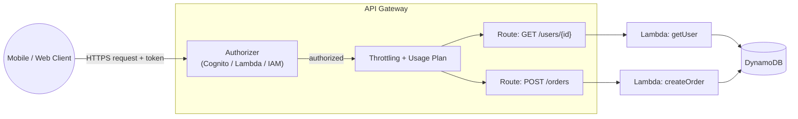

# Amazon API Gateway


## Definition

Amazon API Gateway is a fully managed service for creating, publishing, securing, and monitoring
APIs — it's the "front door" that sits between API clients (web apps, mobile apps, other
services) and your backend logic (Lambda functions, HTTP servers, other AWS services), handling
everything around the actual business logic: routing, auth, throttling, request/response
transformation, and versioning.

## Purpose

Building a production-grade API by hand means solving a long list of cross-cutting concerns
before you've written a single line of business logic: authentication, rate limiting, request
validation, CORS, API versioning, usage metering, caching, and monitoring. API Gateway exists so
developers can focus purely on the backend logic (often a Lambda function) while AWS handles all
of that surrounding API infrastructure as a managed, auto-scaling layer.

## How It Works

Plain explanation: you define an API as a collection of **routes** (a path + HTTP method, like
`GET /users/{id}`), each wired to a backend **integration** — most commonly a Lambda function,
but also HTTP endpoints, or other AWS services directly. API Gateway organizes deployments into
**stages** (e.g., `dev`, `prod`), each with its own URL and configuration (throttling limits,
logging, stage variables).



Step by step: the client sends an HTTPS request with a bearer token. API Gateway's **authorizer**
(a Cognito User Pool, a custom Lambda authorizer, or plain IAM auth) validates it before anything
else runs — unauthenticated requests never reach the backend. Once authorized, the request passes
through **throttling** (per-client/usage-plan rate limits), then is matched to the correct
**route** by path and method, and finally invoked against its **integration** — here, a specific
Lambda function. The Lambda does its work (e.g., reading/writing DynamoDB) and returns a
response, which API Gateway can transform (mapping templates) before sending it back to the
client in the expected shape.

## Key Features / Components

- **REST API** — the original, feature-rich API type: request validation, API keys, usage plans,
  caching, SDK generation, private APIs via VPC endpoints.
- **HTTP API** — a newer, leaner, cheaper, lower-latency API type covering the most common use
  cases (JWT authorizers, simple routing) without every REST API feature — the default choice
  today unless you need a REST-API-only capability.
- **WebSocket API** — for persistent, bidirectional connections (chat apps, real-time dashboards).
- **Integrations** — Lambda (proxy or custom), HTTP backend, AWS service integration (e.g.,
  directly to DynamoDB/SQS/Step Functions without a Lambda in between, for simple pass-through).
- **Stages** — named deployment environments, each with independent config and a unique
  invoke URL; supports stage variables for environment-specific values.
- **Authorizers** — Cognito User Pools, Lambda custom authorizers (token or request-based), or
  native IAM/SigV4 auth.
- **Usage plans & API keys** — meter and throttle individual API consumers, often for a
  monetized/partner API.
- **Throttling** — account-level, per-method, and per-usage-plan rate/burst limits to protect
  backends from overload.
- **Caching** (REST API) — cache GET responses at the API Gateway layer to reduce backend load
  and latency for repeat requests.
- **Request/response mapping templates** (VTL) — transform payload shape between client and
  backend without changing backend code.
- **Custom domain names + Route 53** — put a friendly domain in front of the default
  `execute-api` URL.

## Use Cases — When to Use It

- **Serverless REST/HTTP APIs backed by Lambda** — the canonical pairing; API Gateway + Lambda +
  DynamoDB is the most common serverless web backend pattern on AWS.
- **Exposing internal services to external partners** — API keys, usage plans, and throttling
  give you metering and abuse protection out of the box.
- **Real-time apps (chat, live dashboards, multiplayer features)** — WebSocket API.
- **Mobile backends** — Cognito-authenticated, auto-scaling API with no servers to manage.
- **Legacy/on-prem backend modernization** — API Gateway can front an existing HTTP backend (even
  non-AWS) as an incremental step toward serverless, adding auth/throttling/caching immediately.
- **Private, internal-only APIs** — REST API type supports Private API Gateway, reachable only
  via a VPC endpoint, never exposed to the public internet.

## When NOT to Use It / Alternatives

- **Extremely high-throughput, low-latency internal service-to-service calls** — the per-request
  pricing and added hop can be unnecessary overhead for internal microservice mesh traffic;
  consider direct ALB/NLB routing, AWS App Mesh, or VPC Lattice for east-west service traffic.
- **You just need basic HTTP routing with no auth/throttling/API-management needs** — an ALB
  alone (cheaper per-request at high volume, no per-request metering overhead) may be sufficient
  if you don't need API Gateway's API-management features.
- **GraphQL APIs** — **AWS AppSync** is purpose-built for GraphQL (resolvers, subscriptions,
  offline sync) rather than bolting GraphQL onto REST-shaped API Gateway.
- **Extremely simple single-Lambda webhook receivers with no auth complexity** — a **Lambda
  Function URL** (a direct HTTPS endpoint on the function itself, no API Gateway needed) can be
  simpler and cheaper for that one narrow case.

## Why It's Important

**Real-world:** API Gateway removes an enormous amount of "undifferentiated heavy lifting" —
teams that build their own auth/throttling/versioning layer on raw EC2/load balancers routinely
spend weeks on infrastructure that API Gateway provides out of the box, and get it wrong more
often (rate limiting bugs, inconsistent auth enforcement across routes). It's also a common
attack surface, so authorizer and throttling misconfiguration shows up repeatedly in real security
reviews.

**Exam mapping:**
- **SAA-C03** — Domain 2 (Resilient Architectures) Task 2.1 names API Gateway explicitly as part
  of scalable, loosely coupled, event-driven architecture design.
- **DVA-C03** — Domain 1 Task 1.1 (develop code hosted on AWS, API Gateway stages) is core
  content; this is one of the most central services on the Developer exam specifically, since
  API Gateway + Lambda is the primary serverless development pattern being tested.
- **MLA-C02** — Domain 3 (Deployment/Orchestration) uses API Gateway to front real-time
  inference endpoints or expose a Bedrock Agent/RAG pipeline as a callable API.

## Pricing Model (summary)

Billed per **API call** received (HTTP APIs are notably cheaper per-call than REST APIs) plus
**data transfer out**. REST APIs add optional per-hour caching charges if enabled, and WebSocket
APIs bill per message plus connection-minutes. There's no charge for API definitions sitting
idle — you only pay when requests actually come in. AWS Free Tier includes a monthly API call
allowance for the first 12 months. Official pricing: https://aws.amazon.com/api-gateway/pricing/

## Hands-on Lab (Floci)

API Gateway is **explicitly supported** by Floci (both REST and HTTP/v2 APIs) — this is one of
the most reliable, fully-working labs in this category:

```bash
# Create a Lambda function first (zip a simple handler, e.g. index.py returning {"statusCode":200,"body":"hello"})
awslocal lambda create-function --function-name study-api-fn \
  --runtime python3.12 --handler index.handler \
  --zip-file fileb://function.zip \
  --role arn:aws:iam::000000000000:role/lambda-role

# Create a REST API
awslocal apigateway create-rest-api --name study-api

# Get the root resource ID, then create a /hello resource
awslocal apigateway get-resources --rest-api-id <api-id>
awslocal apigateway create-resource --rest-api-id <api-id> \
  --parent-id <root-resource-id> --path-part hello

# Wire a GET method to the Lambda integration
awslocal apigateway put-method --rest-api-id <api-id> \
  --resource-id <hello-resource-id> --http-method GET --authorization-type NONE

awslocal apigateway put-integration --rest-api-id <api-id> \
  --resource-id <hello-resource-id> --http-method GET \
  --type AWS_PROXY --integration-http-method POST \
  --uri arn:aws:apigateway:us-east-1:lambda:path/2015-03-31/functions/arn:aws:lambda:us-east-1:000000000000:function:study-api-fn/invocations

# Deploy to a stage and call it
awslocal apigateway create-deployment --rest-api-id <api-id> --stage-name dev
curl http://localhost:4566/restapis/<api-id>/dev/_user_request_/hello
```

Full walkthrough: `labs-floci/networking-vpc-lab.md` (or the app-integration-specific lab file
if one exists under that category).

## Exam Tips

- **HTTP API vs. REST API**: if the question emphasizes lowest cost/latency and simple JWT auth,
  the answer is HTTP API. If it needs API keys/usage plans, request validation, caching, or
  private VPC-only APIs, the answer is REST API — these are genuinely different products with
  overlapping but not identical features.
- **Lambda proxy integration** (`AWS_PROXY`) passes the whole request/response through
  untransformed (handled in code); non-proxy integration uses mapping templates for
  transformation at the gateway layer — know which is simpler to reason about (proxy) vs. more
  flexible for legacy backend shapes (non-proxy/custom).
- **Throttling is layered**: account-level default limits, per-method limits, and usage-plan
  limits can all apply simultaneously — the most restrictive one wins.
- **Private API Gateway** requires an **interface VPC endpoint** (PrivateLink) — if a question
  says "API Gateway reachable only from inside our VPC, never the public internet," the answer
  needs both a Private API type AND a VPC endpoint, not just one or the other.
- Stage variables + Lambda aliases together enable safe canary/blue-green API deployments without
  duplicating the whole API definition.

## Related Terms

- `services/compute/lambda.md` — the most common API Gateway integration target
- [`cloudfront.md`](cloudfront.md) — often placed in front of API Gateway for caching/edge TLS
- [`vpc-endpoints-privatelink.md`](vpc-endpoints-privatelink.md) — private API Gateway access
- `services/security-identity-compliance/cognito.md` — common authorizer source
- `glossary/throttling.md`, `glossary/cors.md`
