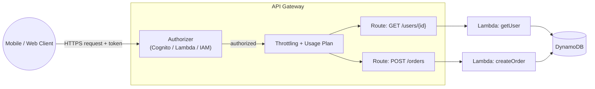
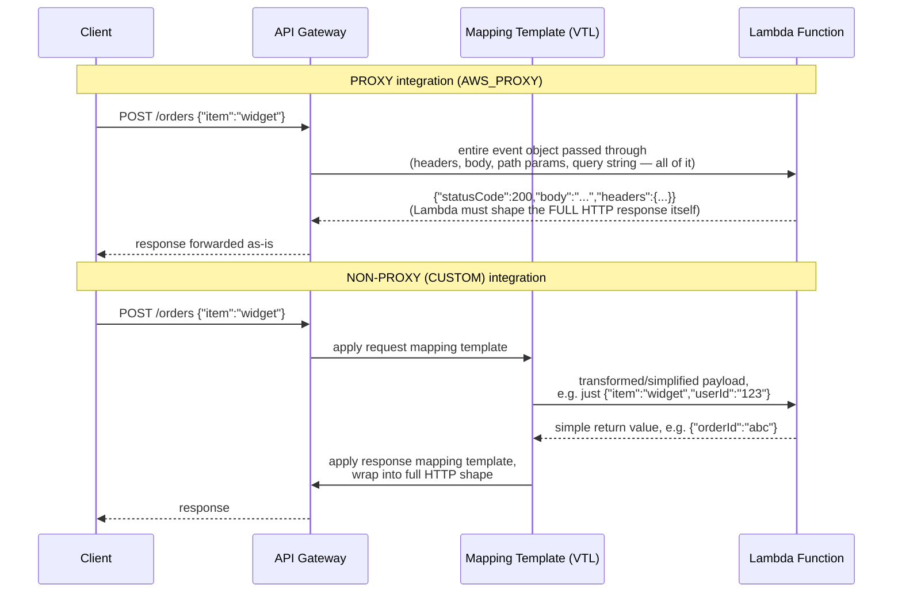
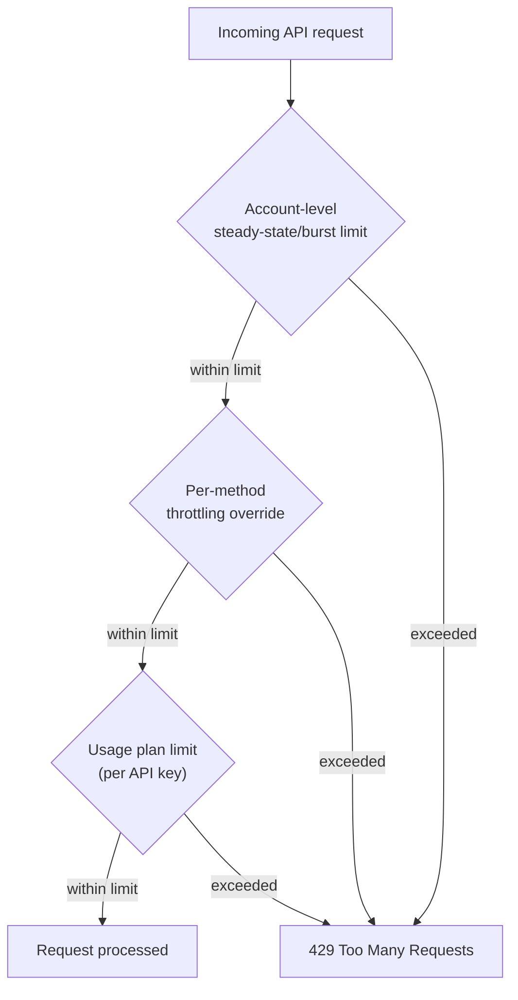
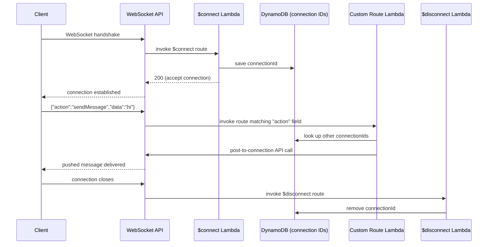
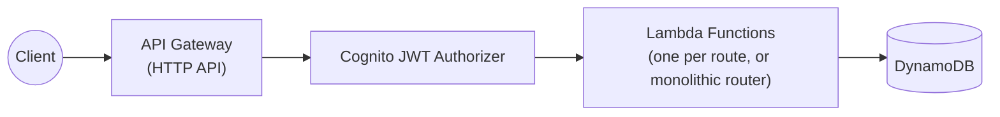
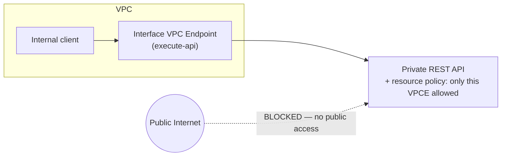

# Amazon API Gateway

> **Appears in:** [DVA-C03](../../certifications/dva-c03/README.md) · [SAA-C03](../../certifications/saa-c03/README.md)


## Definition

Amazon API Gateway is a fully managed service for creating, publishing, securing, and monitoring
APIs — it's the "front door" that sits between API clients (web apps, mobile apps, other
services) and your backend logic (Lambda functions, HTTP servers, other AWS services), handling
everything around the actual business logic: routing, auth, throttling, request/response
transformation, and versioning.

## Purpose

Building a production-grade API by hand means solving a long list of cross-cutting concerns
before you've written a single line of business logic: authentication, rate limiting, request
validation, CORS, API versioning, usage metering, caching, and monitoring. API Gateway exists so
developers can focus purely on the backend logic (often a Lambda function) while AWS handles all
of that surrounding API infrastructure as a managed, auto-scaling layer.

## How It Works

Plain explanation: you define an API as a collection of **routes** (a path + HTTP method, like
`GET /users/{id}`), each wired to a backend **integration** — most commonly a Lambda function,
but also HTTP endpoints, or other AWS services directly. API Gateway organizes deployments into
**stages** (e.g., `dev`, `prod`), each with its own URL and configuration (throttling limits,
logging, stage variables).


*Figure: AWS's own architecture diagram showing API Gateway as the front door between clients
(web, mobile, services) and backend targets (EC2, Lambda, other AWS services), handling traffic
management, authorization/access control, monitoring, and API version management. Source: AWS
documentation, "What is Amazon API Gateway?" —
https://docs.aws.amazon.com/apigateway/latest/developerguide/welcome.html*



Step by step: the client sends an HTTPS request with a bearer token. API Gateway's **authorizer**
(a Cognito User Pool, a custom Lambda authorizer, or plain IAM auth) validates it before anything
else runs — unauthenticated requests never reach the backend. Once authorized, the request passes
through **throttling** (per-client/usage-plan rate limits), then is matched to the correct
**route** by path and method, and finally invoked against its **integration** — here, a specific
Lambda function. The Lambda does its work (e.g., reading/writing DynamoDB) and returns a
response, which API Gateway can transform (mapping templates) before sending it back to the
client in the expected shape.

### Packet/request-level walkthrough: proxy vs. non-proxy Lambda integration



**Proxy integration** (`AWS_PROXY`) is the default, simpler mental model: API Gateway passes the
*entire* request through untransformed, and the Lambda function is responsible for returning a
complete, correctly-shaped HTTP response (status code, headers, body) itself — all the
request/response logic lives in application code. **Non-proxy (custom) integration** instead
uses **Velocity Template Language (VTL) mapping templates** at the gateway layer to transform the
payload shape in both directions — useful for fronting a legacy backend that expects a
specific payload shape without touching its code, at the cost of more configuration complexity
living in API Gateway itself rather than in code you can unit-test easily.

## Key Features / Components

- **REST API** — the original, feature-rich API type: request validation, API keys, usage plans,
  caching, SDK generation, private APIs via VPC endpoints.
- **HTTP API** — a newer, leaner, cheaper, lower-latency API type covering the most common use
  cases (JWT authorizers, simple routing) without every REST API feature — the default choice
  today unless you need a REST-API-only capability.
- **WebSocket API** — for persistent, bidirectional connections (chat apps, real-time dashboards).
- **Integrations** — Lambda (proxy or custom), HTTP backend, AWS service integration (e.g.,
  directly to DynamoDB/SQS/Step Functions without a Lambda in between, for simple pass-through).
- **Stages** — named deployment environments, each with independent config and a unique
  invoke URL; supports stage variables for environment-specific values.
- **Authorizers** — Cognito User Pools, Lambda custom authorizers (token or request-based), or
  native IAM/SigV4 auth.
- **Usage plans & API keys** — meter and throttle individual API consumers, often for a
  monetized/partner API.
- **Throttling** — account-level, per-method, and per-usage-plan rate/burst limits to protect
  backends from overload.
- **Caching** (REST API) — cache GET responses at the API Gateway layer to reduce backend load
  and latency for repeat requests.
- **Request/response mapping templates** (VTL) — transform payload shape between client and
  backend without changing backend code.
- **Custom domain names + Route 53** — put a friendly domain in front of the default
  `execute-api` URL.
- **Private API Gateway** — a REST API type reachable only through a VPC interface endpoint, with
  a resource policy restricting which VPCs/VPC endpoints may invoke it.

## Throttling — layered limits, most restrictive wins



All three layers can be configured simultaneously and independently, and a request only needs to
violate **one** of them to be rejected with a 429 — the account-level default (an AWS-wide
per-Region ceiling protecting against runaway usage across every API in the account), a
per-method override (tighter or looser than the account default for one specific route), and a
usage-plan limit (specific to one API key/consumer, for metering and fairness between different
partners/customers). A scenario describing one customer being throttled while others aren't is
almost always a usage-plan-level limit being hit, not the account-wide default.

## WebSocket API — connection lifecycle



Unlike REST/HTTP APIs, a WebSocket API's three built-in special routes (`$connect`,
`$disconnect`, `$default`) plus any custom routes you define (matched by a field inside the
message payload, not a URL path) together manage the entire connection lifecycle. Because
WebSocket connections are long-lived and stateful, the backend typically needs its own durable
store (commonly DynamoDB) tracking which connection IDs are currently active, since API Gateway
itself doesn't persist a list you can query — pushing a message to a specific connected client
requires calling the Management API's `post-to-connection` action with that connection's ID.

## Authorizer Types Compared

| Authorizer | Mechanism | Best for |
|---|---|---|
| Cognito User Pool | Validates a Cognito-issued JWT directly | Mobile/web apps using Cognito for user management |
| Lambda (token-based) | Passes a bearer token to a Lambda function that returns an IAM policy | Custom token formats, third-party identity providers |
| Lambda (request-based) | Passes full request context (headers, query params, path) to a Lambda | Decisions needing more than just a token (IP, custom headers) |
| IAM / SigV4 | Validates AWS Signature V4 signed requests | Service-to-service calls already using AWS credentials |
| JWT (HTTP API native) | Built-in JWT validation against a configured issuer, no Lambda needed | Simple JWT auth without custom logic, lowest latency/cost |

The JWT authorizer (HTTP API only) is worth specifically remembering as the simplest, cheapest
option when a scenario needs plain JWT validation with no custom authorization logic — it avoids
the extra Lambda invocation (and its associated cost/latency) that a Lambda authorizer would add
for the same basic job.

## Common Architectures

**1. Serverless REST backend: API Gateway + Lambda + DynamoDB.** The canonical serverless web
API — no servers to manage at any layer, scales automatically, pay only for actual requests.



**2. Partner/monetized API with usage plans.** Multiple external partners each get their own API
key tied to a usage plan with distinct rate limits and quotas, letting one API serve many
differently-tiered consumers (free tier vs. paid tier) from the same underlying routes.

**3. Private, VPC-internal API.** A REST API configured as `PRIVATE`, reachable only through an
interface VPC endpoint, with a resource policy restricting invocation to specific VPC endpoints
— used for internal microservice APIs that should never be exposed to the public internet at all.



**4. Real-time chat application via WebSocket API.** Persistent bidirectional connections, routed
by a `$connect`/`$disconnect`/custom-route-key model, with connection IDs tracked (often in
DynamoDB) so the backend can push messages to specific connected clients asynchronously.

**5. Legacy backend modernization via custom (non-proxy) integration.** API Gateway fronts an
existing on-prem or EC2-hosted HTTP backend that expects a specific legacy payload shape, using
mapping templates to adapt modern client requests to that shape without touching the legacy
code at all — a common incremental-migration pattern.

## Use Cases — When to Use It

- **Serverless REST/HTTP APIs backed by Lambda** — the canonical pairing; API Gateway + Lambda +
  DynamoDB is the most common serverless web backend pattern on AWS.
- **Exposing internal services to external partners** — API keys, usage plans, and throttling
  give you metering and abuse protection out of the box.
- **Real-time apps (chat, live dashboards, multiplayer features)** — WebSocket API.
- **Mobile backends** — Cognito-authenticated, auto-scaling API with no servers to manage.
- **Legacy/on-prem backend modernization** — API Gateway can front an existing HTTP backend (even
  non-AWS) as an incremental step toward serverless, adding auth/throttling/caching immediately.
- **Private, internal-only APIs** — REST API type supports Private API Gateway, reachable only
  via a VPC endpoint, never exposed to the public internet.

## When NOT to Use It / Alternatives

- **Extremely high-throughput, low-latency internal service-to-service calls** — the per-request
  pricing and added hop can be unnecessary overhead for internal microservice mesh traffic;
  consider direct ALB/NLB routing, AWS App Mesh, or VPC Lattice for east-west service traffic.
- **You just need basic HTTP routing with no auth/throttling/API-management needs** — an ALB
  alone (cheaper per-request at high volume, no per-request metering overhead) may be sufficient
  if you don't need API Gateway's API-management features.
- **GraphQL APIs** — **AWS AppSync** is purpose-built for GraphQL (resolvers, subscriptions,
  offline sync) rather than bolting GraphQL onto REST-shaped API Gateway.
- **Extremely simple single-Lambda webhook receivers with no auth complexity** — a **Lambda
  Function URL** (a direct HTTPS endpoint on the function itself, no API Gateway needed) can be
  simpler and cheaper for that one narrow case.

## Why It's Important

**Real-world:** API Gateway removes an enormous amount of "undifferentiated heavy lifting" —
teams that build their own auth/throttling/versioning layer on raw EC2/load balancers routinely
spend weeks on infrastructure that API Gateway provides out of the box, and get it wrong more
often (rate limiting bugs, inconsistent auth enforcement across routes). It's also a common
attack surface, so authorizer and throttling misconfiguration shows up repeatedly in real security
reviews.

**Exam mapping:**
- **SAA-C03** — Domain 2 (Resilient Architectures) Task 2.1 names API Gateway explicitly as part
  of scalable, loosely coupled, event-driven architecture design.
- **DVA-C03** — Domain 1 Task 1.1 (develop code hosted on AWS, API Gateway stages) is core
  content; this is one of the most central services on the Developer exam specifically, since
  API Gateway + Lambda is the primary serverless development pattern being tested.
- **MLA-C02** — Domain 3 (Deployment/Orchestration) uses API Gateway to front real-time
  inference endpoints or expose a Bedrock Agent/RAG pipeline as a callable API.

## Pricing Model (summary)

Billed per **API call** received (HTTP APIs are notably cheaper per-call than REST APIs) plus
**data transfer out**. REST APIs add optional per-hour caching charges if enabled, and WebSocket
APIs bill per message plus connection-minutes. There's no charge for API definitions sitting
idle — you only pay when requests actually come in. AWS Free Tier includes a monthly API call
allowance for the first 12 months. Official pricing: https://aws.amazon.com/api-gateway/pricing/

## Limits & Quotas

| Resource | Default quota |
|---|---|
| REST APIs per account per Region | 600 (soft) |
| Resources per REST API | 300 |
| Throttle: account-level steady-state | 10,000 requests/sec (soft, Region-dependent) |
| Throttle: account-level burst | 5,000 requests (token bucket) |
| Payload size (REST/HTTP API) | 10 MB |
| Integration timeout | 29 seconds (hard maximum, not increasable) |
| WebSocket message size | 128 KB |
| WebSocket idle connection timeout | 10 minutes |
| Usage plans per account | 300 (soft) |

The **29-second integration timeout is a hard ceiling**, not a soft/raisable limit — this is a
real architectural constraint: any backend integration (typically Lambda) that might run longer
than 29 seconds cannot be called synchronously through API Gateway at all; the standard fix is an
asynchronous pattern (API Gateway kicks off the long-running work via Step Functions/SQS and
returns immediately, with the client polling or receiving a webhook/websocket push later).

## Troubleshooting / Common Issues

- **"Requests intermittently fail with 429 Too Many Requests even though traffic seems within
  expected limits."** Check all three throttling layers — account-level, per-method, and
  usage-plan — a usage-plan limit tighter than expected for one specific API key is a very common
  cause even when overall account traffic looks fine.
- **"A Lambda integration call fails after exactly 29 seconds, even though the Lambda function's
  own timeout is set much higher."** This is API Gateway's hard 29-second integration timeout,
  which cannot be raised — the Lambda function's own (longer) timeout setting is irrelevant if
  API Gateway itself gives up first; redesign for asynchronous invocation if the work genuinely
  takes longer.
- **"CORS errors in the browser console even though the Lambda function returns the correct
  `Access-Control-Allow-Origin` header."** For proxy integrations, CORS headers must be returned
  by the Lambda function itself on *every* response including error responses, and the OPTIONS
  preflight method must also be explicitly configured — a very common proxy-integration gotcha
  since API Gateway doesn't inject CORS headers automatically in proxy mode.
- **"A private API Gateway returns 403 Forbidden for all requests, even from inside the VPC."**
  Check the API's resource policy explicitly allows the specific VPC endpoint ID — a private API
  type alone doesn't automatically trust every VPC endpoint; the resource policy must name it.
- **"Stage variables aren't resolving as expected in a Lambda integration's ARN."** Confirm the
  stage variable reference syntax (`${stageVariables.variableName}`) is used correctly in the
  integration URI, and that the variable is actually defined for the specific stage being
  invoked — a variable defined only in `prod` won't resolve when testing against `dev`.
- **"Usage plan quota resets don't align with what was expected."** Usage plan quotas (requests
  per day/week/month) reset on a fixed calendar boundary tied to when the plan was created, not
  necessarily calendar-day/month boundaries exactly as a user might assume — verify the specific
  quota period configuration rather than assuming standard calendar alignment.

## Hands-on Lab (Floci)

API Gateway is **explicitly supported** by Floci (both REST and HTTP/v2 APIs) — this is one of
the most reliable, fully-working labs in this category:

```bash
# Create a Lambda function first (zip a simple handler, e.g. index.py returning {"statusCode":200,"body":"hello"})
awslocal lambda create-function --function-name study-api-fn \
  --runtime python3.12 --handler index.handler \
  --zip-file fileb://function.zip \
  --role arn:aws:iam::000000000000:role/lambda-role

# Create a REST API
awslocal apigateway create-rest-api --name study-api

# Get the root resource ID, then create a /hello resource
awslocal apigateway get-resources --rest-api-id <api-id>
awslocal apigateway create-resource --rest-api-id <api-id> \
  --parent-id <root-resource-id> --path-part hello

# Wire a GET method to the Lambda integration
awslocal apigateway put-method --rest-api-id <api-id> \
  --resource-id <hello-resource-id> --http-method GET --authorization-type NONE

awslocal apigateway put-integration --rest-api-id <api-id> \
  --resource-id <hello-resource-id> --http-method GET \
  --type AWS_PROXY --integration-http-method POST \
  --uri arn:aws:apigateway:us-east-1:lambda:path/2015-03-31/functions/arn:aws:lambda:us-east-1:000000000000:function:study-api-fn/invocations

# Deploy to a stage and call it
awslocal apigateway create-deployment --rest-api-id <api-id> --stage-name dev
curl http://localhost:4566/restapis/<api-id>/dev/_user_request_/hello

# Add a usage plan with throttling and an API key
awslocal apigateway create-usage-plan --name study-plan \
  --throttle burstLimit=5,rateLimit=2 --quota limit=1000,period=MONTH
```

Full walkthrough: `labs-floci/networking-vpc-lab.md` (or the app-integration-specific lab file
if one exists under that category).

## Exam Scenario Deep Dive

**Scenario 1 — "A mobile app backend needs low cost, low latency, and simple JWT-based
authentication with no need for API keys, usage plans, or request caching."**
HTTP API, not REST API — it's cheaper per call, has lower latency, and natively supports JWT
authorizers, covering exactly this requirement without the overhead of REST API's broader (here,
unneeded) feature set.

**Scenario 2 — "A SaaS company wants to offer a public API with three pricing tiers (free,
pro, enterprise), each with different rate limits and monthly quotas, enforced per customer."**
REST API with API keys and usage plans — one usage plan per tier, each API key associated with a
specific plan, giving per-customer throttling and quota enforcement that HTTP API's simpler
feature set doesn't natively provide at this granularity.

**Scenario 3 — "An internal microservice API must never be reachable from the public internet,
only from specific VPCs within the company's AWS Organization."**
A Private REST API type, exposed only through a VPC interface endpoint, with a resource policy
naming the specific allowed VPC endpoint ID(s) — satisfies the "never publicly reachable"
requirement at the API Gateway configuration level, not just via network ACL/security group
controls.

**Scenario 4 — "A data processing endpoint occasionally needs more than a minute to complete a
request, and the team wants to keep using API Gateway as the entry point."**
API Gateway's 29-second integration timeout is a hard ceiling that cannot be increased — the
correct redesign is asynchronous: API Gateway triggers the long-running work (e.g., via Step
Functions or by dropping a message onto SQS for a worker to process) and returns immediately with
a job ID; the client polls a separate status endpoint or receives a push notification/WebSocket
message when the work completes.

**Scenario 5 — "A development team wants to test a new API version without affecting production
traffic, and needs environment-specific configuration values (like a different DynamoDB table
name) without duplicating the entire API definition."**
Stages with stage variables — separate `dev`/`prod` stages of the same API definition, each with
its own stage variable values referenced inside integration URIs/Lambda ARNs, avoiding the need
to maintain two entirely separate API definitions for what's otherwise identical routing logic.

## Exam Tips

- **HTTP API vs. REST API**: if the question emphasizes lowest cost/latency and simple JWT auth,
  the answer is HTTP API. If it needs API keys/usage plans, request validation, caching, or
  private VPC-only APIs, the answer is REST API — these are genuinely different products with
  overlapping but not identical features.
- **Lambda proxy integration** (`AWS_PROXY`) passes the whole request/response through
  untransformed (handled in code); non-proxy integration uses mapping templates for
  transformation at the gateway layer — know which is simpler to reason about (proxy) vs. more
  flexible for legacy backend shapes (non-proxy/custom).
- **Throttling is layered**: account-level default limits, per-method limits, and usage-plan
  limits can all apply simultaneously — the most restrictive one wins.
- **Private API Gateway** requires an **interface VPC endpoint** (PrivateLink) — if a question
  says "API Gateway reachable only from inside our VPC, never the public internet," the answer
  needs both a Private API type AND a VPC endpoint, not just one or the other.
- Stage variables + Lambda aliases together enable safe canary/blue-green API deployments without
  duplicating the whole API definition.
- **The 29-second integration timeout is hard, not soft** — a scenario about a long-running
  backend process through API Gateway is almost always pointing at an asynchronous redesign, not
  a "request a limit increase" answer, since this particular limit cannot be raised at all.
- **CORS in proxy integrations must be handled in application code** — a scenario describing
  CORS failures despite "correct" backend code is often really about missing the OPTIONS
  preflight method configuration or inconsistent headers on error-path responses specifically.

## Further Reading

- AWS Docs — What is Amazon API Gateway?: https://docs.aws.amazon.com/apigateway/latest/developerguide/welcome.html
- AWS Docs — REST API vs HTTP API: https://docs.aws.amazon.com/apigateway/latest/developerguide/http-api-vs-rest.html
- AWS Docs — Amazon API Gateway quotas: https://docs.aws.amazon.com/apigateway/latest/developerguide/limits.html
- AWS Docs — Working with AWS Lambda proxy integrations: https://docs.aws.amazon.com/apigateway/latest/developerguide/set-up-lambda-proxy-integrations.html
- AWS Prescriptive Guidance — Choosing the right AWS service for your microservice endpoints: https://docs.aws.amazon.com/prescriptive-guidance/latest/choosing-the-right-aws-service-for-your-microservice-endpoints/api-gateway.html
- AWS re:Post — Troubleshoot API Gateway throttling: https://repost.aws/knowledge-center/api-gateway-429-error

## Related Terms

- `services/compute/lambda.md` — the most common API Gateway integration target
- [`cloudfront.md`](cloudfront.md) — often placed in front of API Gateway for caching/edge TLS
- [`vpc-endpoints-privatelink.md`](vpc-endpoints-privatelink.md) — private API Gateway access
- `services/security-identity-compliance/cognito.md` — common authorizer source
- `glossary/throttling.md`, `glossary/cors.md`
