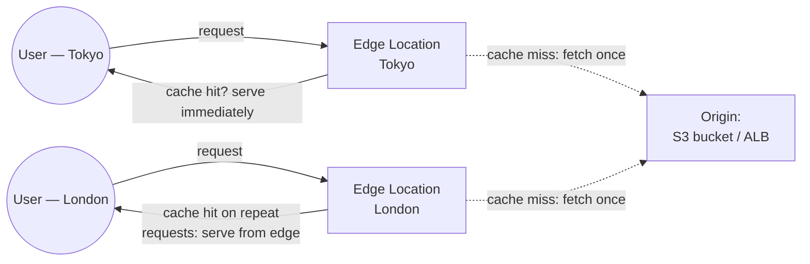
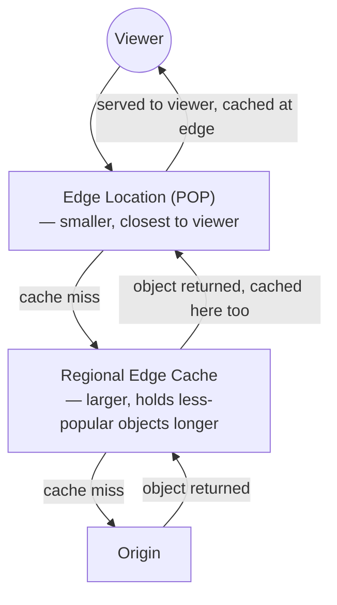
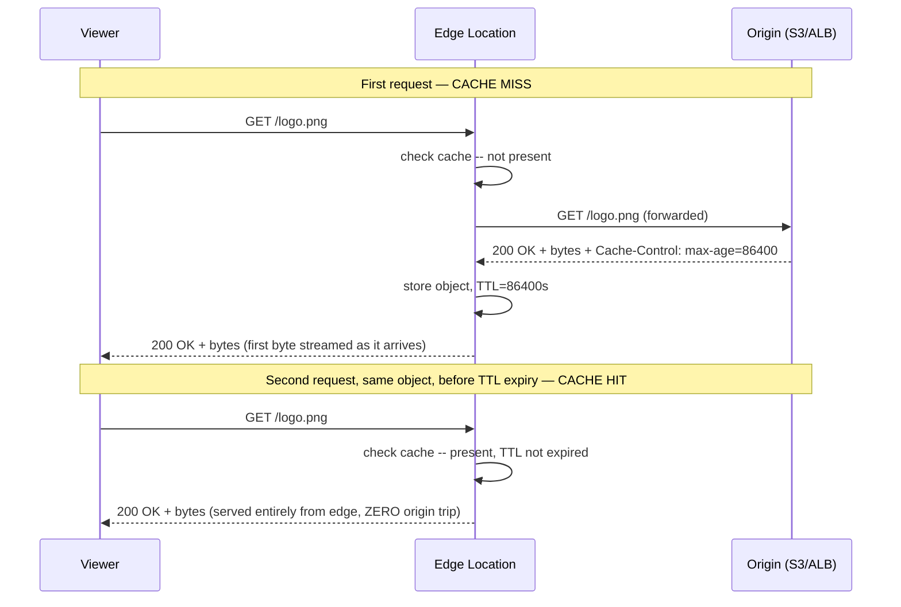
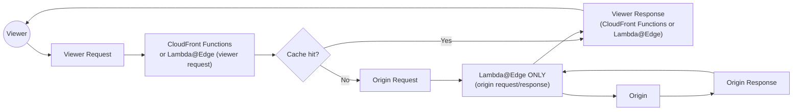
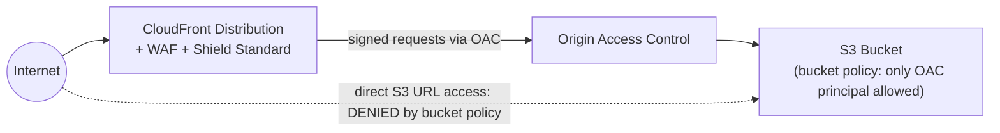
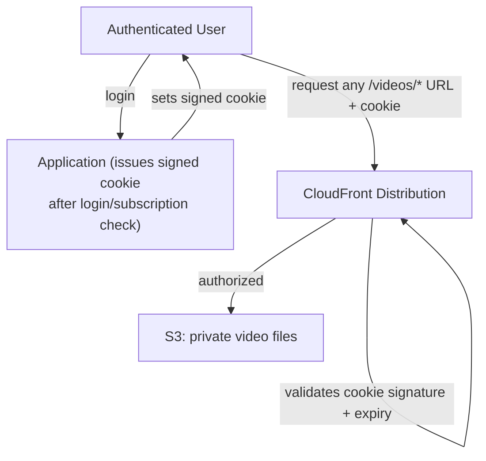
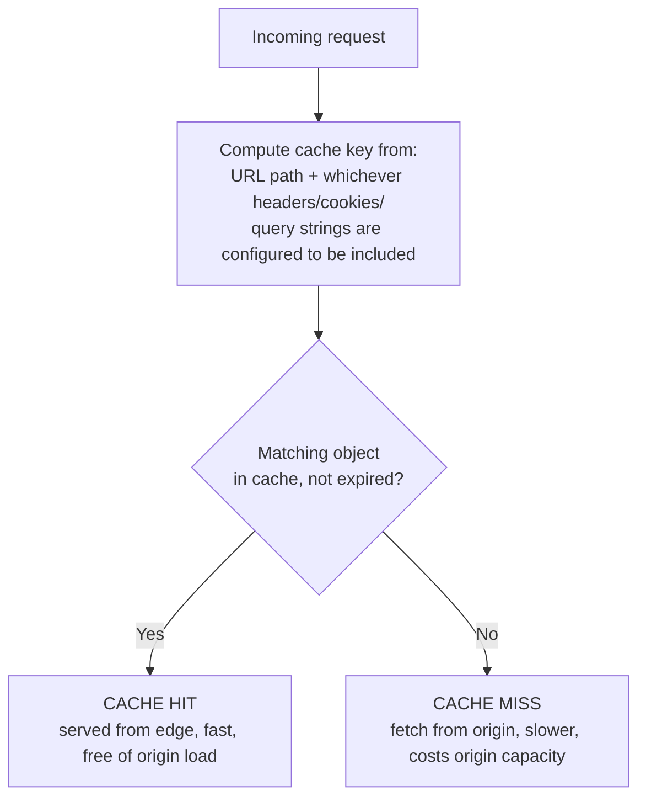

# Amazon CloudFront

> **Appears in:** [SAA-C03](../../certifications/saa-c03/README.md)


## Definition

Amazon CloudFront is AWS's **Content Delivery Network (CDN)** — a globally distributed network
of caching servers ("edge locations") that stores copies of your content physically close to
users, so it loads faster and your origin server handles far less direct traffic.

## Purpose

Without a CDN, every single user request — whether from Tokyo or São Paulo — has to travel all
the way to wherever your server actually lives, which adds latency and puts full load on that one
origin. CloudFront solves both problems: it caches static (and increasingly dynamic) content at
hundreds of edge locations worldwide, so most requests are answered from a nearby cache instead
of a round trip to the origin, and it absorbs traffic spikes/DDoS attempts at the edge before
they ever reach your actual infrastructure.

## How It Works

Plain explanation: you create a **distribution** pointing at an **origin** (an S3 bucket, an ALB,
a custom HTTP server, or even a non-AWS server). CloudFront assigns it a domain name
(`d123abc.cloudfront.net`, or your own custom domain via ACM certificate). When a user requests
content, their request is routed (via DNS anycast) to the **nearest edge location**. If that edge
already has a cached copy, it serves it immediately — a "cache hit." If not, it's a "cache miss":
the edge fetches the content from the origin, serves it to the user, and caches it for the next
request.


*Figure: AWS's reference diagram of the full request/response path — a viewer's request is
routed to the nearest edge location (POP); on a cache miss, CloudFront fetches from the origin,
begins forwarding the response to the viewer as soon as the first byte arrives, and caches the
object for future requests. Source: AWS documentation, "How CloudFront delivers content" —
https://docs.aws.amazon.com/AmazonCloudFront/latest/DeveloperGuide/HowCloudFrontWorks.html*



Step by step: the **Tokyo user** requests an image; CloudFront's anycast DNS routes them to the
**Tokyo edge location**. If it's the first request for that object, it's a cache miss — the edge
pulls it once from the **origin** (S3/ALB), caches it according to the configured TTL, and
returns it to the user. Every subsequent request for that same object from anyone near Tokyo is
now served straight from the edge cache — no trip to the origin at all. The **London user**
follows the identical pattern against their own nearest edge, independently. The origin only ever
sees the first request per edge location per cache-expiry window, not every single user request —
this is the core latency and origin-load win.

### Regional Edge Caches — the tier between edge and origin


*Figure: AWS's reference diagram showing that on a cache miss at a POP (edge location),
CloudFront typically checks the nearest Regional Edge Cache next before going all the way back
to the origin — a larger, longer-lived cache tier positioned between edge locations and
origins. Source: AWS documentation, "How CloudFront delivers content" —
https://docs.aws.amazon.com/AmazonCloudFront/latest/DeveloperGuide/HowCloudFrontWorks.html*



This two-tier design means a genuinely rare object doesn't have to be re-fetched from the origin
by *every* edge location independently — once one edge pulls it through a Regional Edge Cache,
other nearby edges hitting the same Regional Edge Cache for the first time get a faster,
closer-than-origin cache hit instead of each needing their own trip all the way back to the
origin.

### Packet-level walkthrough: cache miss vs. cache hit, byte by byte



The `Cache-Control` / `Expires` header returned by the origin (or an override set directly in the
CloudFront cache behavior) is what determines the TTL — this is why cache behavior configuration
and origin response headers need to agree; a misconfigured origin that returns
`Cache-Control: no-store` will defeat CloudFront's caching entirely regardless of distribution
settings, unless the cache behavior explicitly overrides the origin's headers.

## Key Features / Components

- **Distribution** — the CloudFront configuration object; has one domain name and routes to one
  or more origins based on path patterns.
- **Origin** — where the real content lives: S3 (optionally locked down with **Origin Access
  Control/OAC** so the bucket is only reachable via CloudFront, not directly), ALB/EC2, or any
  custom HTTP(S) origin, even outside AWS.
- **Cache behaviors** — per-path-pattern rules (`/images/*` cached 1 day, `/api/*` not cached at
  all) controlling TTL, allowed methods, and which headers/cookies/query strings affect caching.
- **Edge locations & Regional Edge Caches** — 600+ points of presence globally; Regional Edge
  Caches sit between edge locations and the origin, holding a larger, longer-lived cache tier.
- **Origin Access Control (OAC)** — ensures an S3 origin can only be reached through CloudFront,
  not by anyone hitting the S3 URL directly — a standard security best practice.
- **Signed URLs / Signed Cookies** — restrict access to specific users/time windows for private
  content (video streaming, paid downloads).
- **Field-level encryption, Lambda@Edge / CloudFront Functions** — run lightweight code at the
  edge (header manipulation, A/B testing, redirects, authentication checks) without a round trip
  to the origin; CloudFront Functions are lighter/cheaper/faster for simple JS logic,
  Lambda@Edge supports heavier Node.js/Python logic with more runtime access.
- **AWS WAF integration** — attach a web ACL directly to a distribution for L7 protection.
- **AWS Shield integration** — Shield Standard is automatically included for every distribution.
- **Origin groups (failover)** — define a primary and secondary origin; CloudFront automatically
  fails over to the secondary if the primary returns specific error status codes.
- **Cache key normalization** — control exactly which request attributes (query strings,
  headers, cookies) factor into the cache key, directly affecting your cache hit ratio.

## CloudFront Functions vs. Lambda@Edge — where each runs and what it can touch



**CloudFront Functions** only run at the two **viewer**-facing trigger points (viewer request,
viewer response) — lightweight JavaScript, sub-millisecond execution, no network calls, ideal for
header manipulation, simple redirects, or A/B test bucketing decided purely from the request
itself. **Lambda@Edge** can run at all **four** trigger points (viewer request, origin request,
origin response, viewer response), supports full Node.js/Python runtimes with network access and
heavier compute, but has materially higher latency and cost per invocation — if a scenario
describes needing to modify the request **before it reaches the origin** (not just before the
viewer sees it), that's an origin-request trigger, which only Lambda@Edge supports.

## Common Architectures

**1. S3 + CloudFront + OAC static website (the canonical secure pattern).** The S3 bucket is
fully private — no public access at all — and CloudFront's Origin Access Control is the only
principal allowed to read from it, enforced via the bucket policy. All public traffic goes
through CloudFront, gaining caching, TLS, WAF, and Shield for free in the process.



**2. Dynamic content acceleration in front of an ALB/API Gateway.** Even with caching disabled
for most routes (truly dynamic, personalized content), CloudFront still accelerates the
connection via its optimized backbone routing between edge and origin, and absorbs DDoS
volumetric attacks at the edge before they ever reach the ALB — a common pattern even for apps
with little cacheable content.

**3. Origin failover for high availability.** An origin group with a primary S3 bucket/ALB and a
secondary standby — CloudFront automatically serves from the secondary if the primary returns
configured failure status codes (5xx, or specific 4xx codes), without any DNS change or client-
visible interruption.

**4. Video-on-demand with signed cookies.** A media site's entire `/videos/*` path pattern is
protected by signed cookies issued after a successful login/subscription check, letting a user
play any video under that path for the cookie's validity window without the application needing
to sign every individual video URL.



**5. Multi-tenant SaaS with per-customer cache behaviors.** Different path patterns or host
headers route to different origins/cache rules per tenant, letting a single distribution serve
many customers with isolated caching/TLS/WAF rules without standing up a distribution per
customer.

## Cache Hit Ratio — what actually drives it



The single biggest lever on cache hit ratio is **how narrow the cache key is**. Every header,
cookie, or query string parameter you include in the cache key creates a *new, separate* cache
entry for every distinct value seen — a cache behavior that includes every cookie in its key, for
instance, can end up with as many cache entries as there are unique sessions, destroying the hit
ratio even for otherwise-identical content. The fix is almost always narrowing the cache key to
only the dimensions that genuinely change the response (e.g., just an `Accept-Language` header
for localized content, nothing else), letting everything else collapse into shared cache entries.

| Cache key includes | Effect on hit ratio |
|---|---|
| URL path only | Highest possible hit ratio (fewest distinct keys) |
| + a few specific headers (e.g., `Accept-Language`) | Slightly lower, but still high if values are few |
| + all cookies | Often collapses to near-zero hit ratio if cookies are session-unique |
| + all query strings | Can fragment caching badly if query strings include tracking params (UTM, etc.) |

## Use Cases — When to Use It

- **Static website/asset hosting** — the classic S3 + CloudFront pattern for websites, images,
  JS/CSS bundles, downloads.
- **Video/media streaming** — on-demand and live streaming with signed URLs for access control.
- **API acceleration** — caching cacheable API GET responses, or even just using CloudFront as a
  fast, globally distributed TLS termination/DDoS-absorbing front door for an API Gateway/ALB
  origin, even with caching disabled for non-cacheable routes.
- **Software/game distribution** — large file downloads benefit heavily from edge caching and
  CloudFront's optimized long-haul network between edge and origin.
- **Dynamic content acceleration** — even uncacheable, dynamic requests benefit from CloudFront's
  persistent connections and optimized backbone routing between edge and origin.

## When NOT to Use It / Alternatives

- **Purely internal, VPC-only traffic with no external users** — a CDN exists to shorten the
  distance to end users; internal east-west traffic inside a VPC gains nothing from it.
- **Extremely low/unpredictable traffic with tight cost sensitivity and no latency requirement**
  — serving directly from the origin (e.g., S3 website endpoint) may be simpler and the marginal
  CloudFront request/data-transfer cost isn't justified; evaluate against actual traffic patterns.
- **Content that changes on literally every request and must never be cached anywhere** — make
  sure cache behaviors are configured correctly (TTL=0, correct cache keys) rather than avoiding
  CloudFront altogether, since it's still useful purely as a TLS/DDoS front door even uncached.
- **Multi-cloud / non-AWS origins needing a CDN** — CloudFront works fine with non-AWS origins,
  but if your whole stack is on another cloud, that provider's native CDN may integrate more
  tightly with their other services.

## Why It's Important

**Real-world:** CloudFront is frequently the cheapest, highest-leverage performance improvement
available — moving static assets behind a CDN can cut page load time dramatically and reduce
origin infrastructure cost (fewer, smaller origin servers needed since most requests never reach
them). It's also a first-line DDoS defense: absorbing volumetric attacks at the edge before they
reach your actual application.

**Exam mapping:**
- **SAA-C03** — Domain 3 (High-Performing Architectures, 24%) explicitly lists CDN as a core
  performance pattern; Domain 1 (Secure) covers OAC + WAF + Shield integration for securing
  origins. A near-guaranteed exam topic, usually paired with S3 as the origin.
- **DVA-C03** — Domain 1 covers API Gateway/CloudFront caching strategies for application
  performance; Domain 2 touches signed URLs/cookies for access control to private content.
- **MLA-C02** — less central, but can appear where ML-generated content/model artifacts are
  distributed globally, or inference results are cached at the edge.

## Pricing Model (summary)

Billed primarily by **data transfer out** (per-GB, varies by edge location/Region, generally
cheaper than EC2/S3 direct internet data transfer at volume) plus a small per-**HTTP(S) request**
charge. There's no hourly/flat fee for having a distribution. CloudFront Functions and
Lambda@Edge invocations are billed separately per-invocation/compute-time. AWS Free Tier includes
a meaningful monthly CloudFront data transfer/request allowance. Official pricing:
https://aws.amazon.com/cloudfront/pricing/

## Limits & Quotas

| Resource | Default quota |
|---|---|
| Distributions per account | 200 (soft, increasable) |
| Cache behaviors per distribution | 25 (soft) |
| Origins per distribution | 25 (soft) |
| Alternate domain names (CNAMEs) per distribution | 100 (soft) |
| Origin groups per distribution | 10 |
| CloudFront Functions per distribution | 2 (one per viewer trigger type) |
| Lambda@Edge functions per distribution | varies by trigger, soft limits apply |
| Maximum origin response timeout | 60 seconds default, configurable up to 180s |
| Minimum TTL on cache behavior | 0 seconds |

## Troubleshooting / Common Issues

- **"Users get a 403 Forbidden when accessing content through CloudFront, even though it works
  when hitting S3 directly."** Expected if OAC is configured correctly and someone's testing the
  wrong (direct S3) URL — but if it also fails through CloudFront, check the S3 bucket policy
  actually grants the OAC principal (not the old Origin Access Identity format, which has a
  different principal ARN shape) read access.
- **"Content updates on the origin aren't showing up for users."** The object is still within
  its cached TTL window — either wait it out, invalidate the specific path (costs money, not
  instant across every edge), or adopt versioned object keys (`app.v2.js`) so updates are
  naturally new cache keys instead of requiring invalidation at all.
- **"A dynamic, personalized API response is being cached and served to the wrong user."** The
  cache behavior's cache key configuration is including too little of the request (e.g., not
  forwarding the `Authorization` header or a session cookie into the cache key) — review which
  headers/cookies/query strings are part of the cache key for that path pattern.
- **"Signed URLs expire unexpectedly early/late compared to what was configured."** Check for
  clock drift between the signing system and the expected expiry calculation — signed URL/cookie
  expiry is based on Unix epoch time embedded in the signed policy, so a signing system with an
  incorrect system clock produces incorrectly-timed URLs regardless of the intended expiry value.
- **"Origin failover isn't triggering even though the primary origin is clearly failing."**
  Confirm the origin group's failover criteria actually include the status codes the primary is
  returning — if the primary returns an error code not listed in the origin group's failover
  configuration, CloudFront won't treat it as a failover trigger.
- **"Lambda@Edge function changes aren't taking effect."** Lambda@Edge functions are replicated
  to edge locations and that replication/propagation isn't instant — recent deployments can take
  time to fully roll out globally; also confirm the function was published as a versioned
  (not `$LATEST`) Lambda version, which CloudFront requires for Lambda@Edge associations.

## Hands-on Lab (Floci)

**Honest limitation:** CloudFront is **not** in Floci's confirmed-supported service list.
Commands below show the real-AWS CLI shape for study purposes:

```bash
# Real-AWS shape — verify behavior against Floci before relying on it
awslocal cloudfront create-distribution --distribution-config '{
  "CallerReference": "study-dist-1",
  "Origins": {
    "Quantity": 1,
    "Items": [{
      "Id": "study-s3-origin",
      "DomainName": "study-bucket.s3.amazonaws.com",
      "S3OriginConfig": {"OriginAccessIdentity": ""}
    }]
  },
  "DefaultCacheBehavior": {
    "TargetOriginId": "study-s3-origin",
    "ViewerProtocolPolicy": "redirect-to-https",
    "TrustedSigners": {"Enabled": false, "Quantity": 0},
    "ForwardedValues": {"QueryString": false, "Cookies": {"Forward": "none"}},
    "MinTTL": 86400
  },
  "Comment": "study distribution",
  "Enabled": true
}'
```

A genuinely working free alternative: since Floci **does** support **S3** fully, practice the
origin side of this pattern end-to-end there (bucket policy, OAC-equivalent lockdown concepts),
then study CloudFront's edge/caching behavior conceptually and validate it against AWS's real
Free Tier, which includes a CloudFront allowance. Full notes: `labs-floci/networking-vpc-lab.md`.

## Exam Scenario Deep Dive

**Scenario 1 — "A company's S3 bucket serving a static website is currently publicly readable,
and a security review flags this as a risk. The requirement is to keep the site publicly
accessible to end users while removing direct public access to the bucket itself."**
Put CloudFront in front of the bucket with **Origin Access Control**, and change the bucket
policy to allow reads only from the CloudFront distribution's OAC principal — end users still
reach the content (now through CloudFront, gaining caching and TLS as a bonus), but direct S3 URL
access is denied.

**Scenario 2 — "An e-commerce site's product catalog is mostly static and cacheable, but the
shopping cart and checkout pages are fully dynamic and must never be cached, all under the same
domain."**
A single CloudFront distribution with multiple cache behaviors — a long-TTL behavior for
`/products/*` and static assets, and a separate behavior with TTL=0 (or caching disabled
entirely) for `/cart/*` and `/checkout/*` — letting one distribution serve both needs correctly
without duplicating the domain or TLS setup.

**Scenario 3 — "A media company wants to let paying subscribers stream any video from a large
library for the duration of their login session, without generating and distributing a separately
signed URL for every single video file."**
Signed cookies, not signed URLs — a signed cookie, scoped to the `/videos/*` path pattern, grants
access to the whole path for its validity window in one shot, whereas a signed URL would need to
be generated per individual file.

**Scenario 4 — "An application needs to inspect and rewrite a request's path before it's sent to
the origin — for example, routing legacy URL patterns to a different backend path — and this
logic needs to run with full Node.js capability, including potentially calling another service
to decide the rewrite."**
This must be an **origin request** trigger, and only **Lambda@Edge** supports origin-request/
origin-response triggers (CloudFront Functions are limited to viewer request/response only) — if
the question specifies modifying the request *before* it reaches the origin with non-trivial
logic, Lambda@Edge is the only correct answer among the two edge-compute options.

**Scenario 5 — "A global company wants to minimize both latency and cost for a very high-volume,
mostly static website serving users across six continents, while retaining the ability to
quickly roll back a bad deployment's cached content."**
CloudFront with long cache TTLs for static assets, combined with **versioned object keys**
(rather than relying on cache invalidation for routine deploys) — invalidation remains available
as an emergency rollback tool for a genuinely bad deploy, but the primary content-update strategy
should be the cheaper, instantaneous-effect versioned-filename pattern.

## Exam Tips

- **S3 + CloudFront + OAC** is the textbook secure static-hosting pattern — if a question
  describes a public S3 bucket serving a website directly, the "more secure" answer is almost
  always "put CloudFront in front with Origin Access Control and make the bucket private."
- **Cache invalidation vs. versioned object keys**: invalidating a CloudFront cache costs money
  and isn't instant across all edges; the recommended pattern for frequently-updated assets is
  versioned filenames (`app.v2.js`) so the "update" is really just a new cache key, not an
  invalidation. Exam favors the versioned-filename answer for cost/architecture-quality questions.
- **Signed URLs vs. Signed Cookies**: signed URL = single file; signed cookie = access to
  multiple files/a whole path pattern without modifying every URL (e.g., a video streaming site).
- CloudFront Functions (lightweight JS, millisecond execution, viewer request/response only) vs.
  Lambda@Edge (full Node/Python, can touch origin request/response, higher latency/cost budget)
  — pick based on how much logic and which of the four trigger points you need.
- Remember CloudFront includes **AWS Shield Standard automatically** at no extra cost — a common
  "which combination of services gives DDoS protection for free" exam answer.
- **Origin groups provide failover**, distinct from cache behaviors (which route by path) — don't
  confuse the two; a scenario about automatic failover to a backup origin on error codes is an
  origin group question, not a cache behavior question.
- **Regional Edge Caches sit between edge locations and the origin** — know this two-tier model
  exists; a question about why a rarely-requested object still loaded faster than expected from a
  "cold" edge is testing awareness of this intermediate cache tier.

## Further Reading

- AWS Docs — What is Amazon CloudFront?: https://docs.aws.amazon.com/AmazonCloudFront/latest/DeveloperGuide/Introduction.html
- AWS Docs — How CloudFront delivers content: https://docs.aws.amazon.com/AmazonCloudFront/latest/DeveloperGuide/HowCloudFrontWorks.html
- AWS Docs — Restricting access to an Amazon S3 origin: https://docs.aws.amazon.com/AmazonCloudFront/latest/DeveloperGuide/private-content-restricting-access-to-s3.html
- AWS Docs — CloudFront Functions vs Lambda@Edge: https://docs.aws.amazon.com/AmazonCloudFront/latest/DeveloperGuide/edge-functions-choosing.html
- AWS Blog — Speeding up your website with Amazon CloudFront: https://docs.aws.amazon.com/AmazonS3/latest/userguide/website-hosting-cloudfront-walkthrough.html
- AWS re:Post — Troubleshoot CloudFront 403 errors: https://repost.aws/knowledge-center/cloudfront-403-errors

## Related Terms

- [`route53.md`](route53.md), [`elastic-load-balancing.md`](elastic-load-balancing.md),
  [`api-gateway.md`](api-gateway.md)
- `services/storage/s3.md` — the most common CloudFront origin
- `services/security-identity-compliance/waf.md`, `services/security-identity-compliance/shield.md`
- `glossary/cdn.md`, `glossary/ttl.md`, `glossary/edge-location.md`
