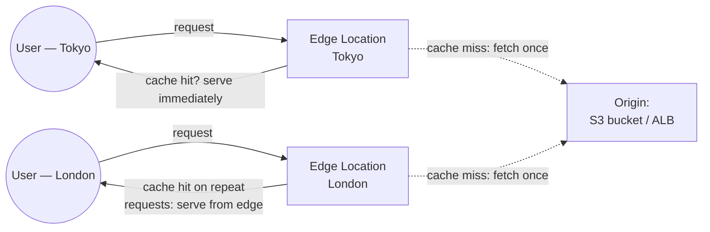

# Amazon CloudFront


## Definition

Amazon CloudFront is AWS's **Content Delivery Network (CDN)** — a globally distributed network
of caching servers ("edge locations") that stores copies of your content physically close to
users, so it loads faster and your origin server handles far less direct traffic.

## Purpose

Without a CDN, every single user request — whether from Tokyo or São Paulo — has to travel all
the way to wherever your server actually lives, which adds latency and puts full load on that one
origin. CloudFront solves both problems: it caches static (and increasingly dynamic) content at
hundreds of edge locations worldwide, so most requests are answered from a nearby cache instead
of a round trip to the origin, and it absorbs traffic spikes/DDoS attempts at the edge before
they ever reach your actual infrastructure.

## How It Works

Plain explanation: you create a **distribution** pointing at an **origin** (an S3 bucket, an ALB,
a custom HTTP server, or even a non-AWS server). CloudFront assigns it a domain name
(`d123abc.cloudfront.net`, or your own custom domain via ACM certificate). When a user requests
content, their request is routed (via DNS anycast) to the **nearest edge location**. If that edge
already has a cached copy, it serves it immediately — a "cache hit." If not, it's a "cache miss":
the edge fetches the content from the origin, serves it to the user, and caches it for the next
request.



Step by step: the **Tokyo user** requests an image; CloudFront's anycast DNS routes them to the
**Tokyo edge location**. If it's the first request for that object, it's a cache miss — the edge
pulls it once from the **origin** (S3/ALB), caches it according to the configured TTL, and
returns it to the user. Every subsequent request for that same object from anyone near Tokyo is
now served straight from the edge cache — no trip to the origin at all. The **London user**
follows the identical pattern against their own nearest edge, independently. The origin only ever
sees the first request per edge location per cache-expiry window, not every single user request —
this is the core latency and origin-load win.

## Key Features / Components

- **Distribution** — the CloudFront configuration object; has one domain name and routes to one
  or more origins based on path patterns.
- **Origin** — where the real content lives: S3 (optionally locked down with **Origin Access
  Control/OAC** so the bucket is only reachable via CloudFront, not directly), ALB/EC2, or any
  custom HTTP(S) origin, even outside AWS.
- **Cache behaviors** — per-path-pattern rules (`/images/*` cached 1 day, `/api/*` not cached at
  all) controlling TTL, allowed methods, and which headers/cookies/query strings affect caching.
- **Edge locations & Regional Edge Caches** — 400+ points of presence globally; Regional Edge
  Caches sit between edge locations and the origin, holding a larger, longer-lived cache tier.
- **Origin Access Control (OAC)** — ensures an S3 origin can only be reached through CloudFront,
  not by anyone hitting the S3 URL directly — a standard security best practice.
- **Signed URLs / Signed Cookies** — restrict access to specific users/time windows for private
  content (video streaming, paid downloads).
- **Field-level encryption, Lambda@Edge / CloudFront Functions** — run lightweight code at the
  edge (header manipulation, A/B testing, redirects, authentication checks) without a round trip
  to the origin; CloudFront Functions are lighter/cheaper/faster for simple JS logic,
  Lambda@Edge supports heavier Node.js/Python logic with more runtime access.
- **AWS WAF integration** — attach a web ACL directly to a distribution for L7 protection.
- **AWS Shield integration** — Shield Standard is automatically included for every distribution.

## Use Cases — When to Use It

- **Static website/asset hosting** — the classic S3 + CloudFront pattern for websites, images,
  JS/CSS bundles, downloads.
- **Video/media streaming** — on-demand and live streaming with signed URLs for access control.
- **API acceleration** — caching cacheable API GET responses, or even just using CloudFront as a
  fast, globally distributed TLS termination/DDoS-absorbing front door for an API Gateway/ALB
  origin, even with caching disabled for non-cacheable routes.
- **Software/game distribution** — large file downloads benefit heavily from edge caching and
  CloudFront's optimized long-haul network between edge and origin.
- **Dynamic content acceleration** — even uncacheable, dynamic requests benefit from CloudFront's
  persistent connections and optimized backbone routing between edge and origin.

## When NOT to Use It / Alternatives

- **Purely internal, VPC-only traffic with no external users** — a CDN exists to shorten the
  distance to end users; internal east-west traffic inside a VPC gains nothing from it.
- **Extremely low/unpredictable traffic with tight cost sensitivity and no latency requirement**
  — serving directly from the origin (e.g., S3 website endpoint) may be simpler and the marginal
  CloudFront request/data-transfer cost isn't justified; evaluate against actual traffic patterns.
- **Content that changes on literally every request and must never be cached anywhere** — make
  sure cache behaviors are configured correctly (TTL=0, correct cache keys) rather than avoiding
  CloudFront altogether, since it's still useful purely as a TLS/DDoS front door even uncached.
- **Multi-cloud / non-AWS origins needing a CDN** — CloudFront works fine with non-AWS origins,
  but if your whole stack is on another cloud, that provider's native CDN may integrate more
  tightly with their other services.

## Why It's Important

**Real-world:** CloudFront is frequently the cheapest, highest-leverage performance improvement
available — moving static assets behind a CDN can cut page load time dramatically and reduce
origin infrastructure cost (fewer, smaller origin servers needed since most requests never reach
them). It's also a first-line DDoS defense: absorbing volumetric attacks at the edge before they
reach your actual application.

**Exam mapping:**
- **SAA-C03** — Domain 3 (High-Performing Architectures, 24%) explicitly lists CDN as a core
  performance pattern; Domain 1 (Secure) covers OAC + WAF + Shield integration for securing
  origins. A near-guaranteed exam topic, usually paired with S3 as the origin.
- **DVA-C03** — Domain 1 covers API Gateway/CloudFront caching strategies for application
  performance; Domain 2 touches signed URLs/cookies for access control to private content.
- **MLA-C02** — less central, but can appear where ML-generated content/model artifacts are
  distributed globally, or inference results are cached at the edge.

## Pricing Model (summary)

Billed primarily by **data transfer out** (per-GB, varies by edge location/Region, generally
cheaper than EC2/S3 direct internet data transfer at volume) plus a small per-**HTTP(S) request**
charge. There's no hourly/flat fee for having a distribution. CloudFront Functions and
Lambda@Edge invocations are billed separately per-invocation/compute-time. AWS Free Tier includes
a meaningful monthly CloudFront data transfer/request allowance. Official pricing:
https://aws.amazon.com/cloudfront/pricing/

## Hands-on Lab (Floci)

**Honest limitation:** CloudFront is **not** in Floci's confirmed-supported service list.
Commands below show the real-AWS CLI shape for study purposes:

```bash
# Real-AWS shape — verify behavior against Floci before relying on it
awslocal cloudfront create-distribution --distribution-config '{
  "CallerReference": "study-dist-1",
  "Origins": {
    "Quantity": 1,
    "Items": [{
      "Id": "study-s3-origin",
      "DomainName": "study-bucket.s3.amazonaws.com",
      "S3OriginConfig": {"OriginAccessIdentity": ""}
    }]
  },
  "DefaultCacheBehavior": {
    "TargetOriginId": "study-s3-origin",
    "ViewerProtocolPolicy": "redirect-to-https",
    "TrustedSigners": {"Enabled": false, "Quantity": 0},
    "ForwardedValues": {"QueryString": false, "Cookies": {"Forward": "none"}},
    "MinTTL": 86400
  },
  "Comment": "study distribution",
  "Enabled": true
}'
```

A genuinely working free alternative: since Floci **does** support **S3** fully, practice the
origin side of this pattern end-to-end there (bucket policy, OAC-equivalent lockdown concepts),
then study CloudFront's edge/caching behavior conceptually and validate it against AWS's real
Free Tier, which includes a CloudFront allowance. Full notes: `labs-floci/networking-vpc-lab.md`.

## Exam Tips

- **S3 + CloudFront + OAC** is the textbook secure static-hosting pattern — if a question
  describes a public S3 bucket serving a website directly, the "more secure" answer is almost
  always "put CloudFront in front with Origin Access Control and make the bucket private."
- **Cache invalidation vs. versioned object keys**: invalidating a CloudFront cache costs money
  and isn't instant across all edges; the recommended pattern for frequently-updated assets is
  versioned filenames (`app.v2.js`) so the "update" is really just a new cache key, not an
  invalidation. Exam favors the versioned-filename answer for cost/architecture-quality questions.
- **Signed URLs vs. Signed Cookies**: signed URL = single file; signed cookie = access to
  multiple files/a whole path pattern without modifying every URL (e.g., a video streaming site).
- CloudFront Functions (lightweight JS, millisecond execution, viewer request/response only) vs.
  Lambda@Edge (full Node/Python, can touch origin request/response, higher latency/cost budget)
  — pick based on how much logic and which of the four trigger points you need.
- Remember CloudFront includes **AWS Shield Standard automatically** at no extra cost — a common
  "which combination of services gives DDoS protection for free" exam answer.

## Related Terms

- [`route53.md`](route53.md), [`elastic-load-balancing.md`](elastic-load-balancing.md),
  [`api-gateway.md`](api-gateway.md)
- `services/storage/s3.md` — the most common CloudFront origin
- `services/security-identity-compliance/waf.md`, `services/security-identity-compliance/shield.md`
- `glossary/cdn.md`, `glossary/ttl.md`, `glossary/edge-location.md`
