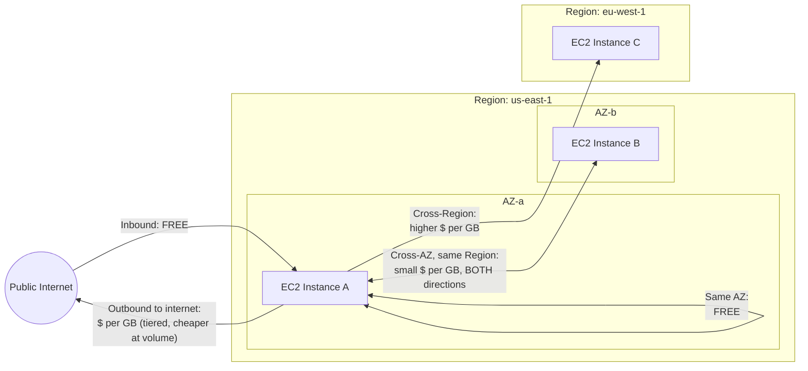

# Data Transfer Pricing (Networking Cost Model)

<!-- Icon note: this is a pricing/cost concept, not a discrete AWS service, so there is no
     dedicated service icon. Using the generic VPC icon as a category marker; see
     diagrams/README.md for the icon-fallback convention. -->


## Definition

Data transfer pricing is AWS's model for charging you based on **where data moves, not just how
much compute/storage you use** — moving data into AWS is (almost always) free, moving it between
AWS resources can be free or cheap depending on how close together they are, and moving it *out*
of AWS to the internet is where the real, often-underestimated cost lives.

## Purpose

Networking isn't free to operate at a global, redundant, multi-Region scale — AWS's data transfer
pricing exists to reflect the real cost difference between traffic that never leaves an AWS data
center, traffic that crosses Availability Zones or Regions over AWS's backbone, and traffic that
exits to the public internet (which involves peering/transit agreements with ISPs AWS itself pays
for). Understanding this model is, in practice, one of the single highest-leverage skills for
keeping an AWS bill under control — far more AWS bills are inflated by data transfer surprises
than by raw compute/storage pricing mistakes.

## How It Works

Plain explanation: think of data transfer cost as a function of **distance and direction**. Data
**coming into** AWS from the internet is (with very rare exceptions) always free. Data moving
**within the same Availability Zone** is free. Data moving **between Availability Zones in the
same Region** has a small per-GB charge in **both directions**. Data moving **between Regions**
costs more per GB than cross-AZ. Data moving **out to the internet** ("egress") is the most
expensive tier, with a tiered per-GB rate that gets cheaper at higher volumes, and a modest free
tier allowance per month.



Step by step: **Instance A** receiving a request from the public internet pays nothing for that
inbound data. If Instance A replies to the internet, that **outbound/egress** traffic is billed
per GB (the most expensive category, with volume-based tiering that lowers the rate as monthly
volume grows). If Instance A talks to **Instance B** in a different AZ within the same Region,
both the sender and receiver are charged a small per-GB fee — this is why "keep chatty services
in the same AZ" is a real cost optimization, not just a latency one. If Instance A instead talks
to **Instance C** in a completely different Region, the per-GB rate is higher still, reflecting
the real cost and distance of inter-Region backbone transit.

## Key Features / Components

- **Inbound (ingress) to AWS** — free, in virtually all cases and services.
- **Intra-AZ** — free (two resources in the same AZ, same VPC).
- **Inter-AZ (same Region)** — billed per GB, in each direction (sender and receiver both billed)
  — this is the charge most often forgotten when designing multi-AZ architectures.
- **Inter-Region** — billed per GB, generally higher than inter-AZ; varies by source/destination
  Region pair.
- **Internet egress** — the highest, tiered per-GB rate; the first several GB/month are typically
  included in the Free Tier, then price steps down as monthly volume grows (first tier priciest).
- **CloudFront/Direct Connect discounted egress** — data transferred out via CloudFront, or over
  a Direct Connect connection, is typically **cheaper per GB** than the standard EC2/S3 direct
  internet egress rate — a key reason both services get recommended for cost-optimization.
- **VPC Endpoint traffic** — Gateway Endpoint traffic (S3/DynamoDB) has **no data transfer
  charge** at all; Interface Endpoint traffic has its own (lower-than-NAT-Gateway) per-GB
  processing charge.
- **NAT Gateway data processing charge** — separate from, and in addition to, any underlying data
  transfer charge — a NAT Gateway adds its own per-GB fee on top of whatever the traffic's normal
  transfer cost would have been.
- **Same-Region, different-service transfer** (e.g., EC2 to S3 in the same Region) — typically
  free, another reason to co-locate dependent services in the same Region when possible.

## Use Cases — When to Use It (i.e., when this model should shape your design)

- **Choosing where to place replicas/read-replicas** — placing a database read replica in the
  same AZ as its most frequent reader avoids the inter-AZ charge, at the cost of losing AZ-level
  fault tolerance — a direct resiliency-vs-cost tradeoff this pricing model forces you to make.
  consciously.
- **Choosing CloudFront for internet-facing content** — because CloudFront egress is cheaper than
  direct-from-origin egress at volume, high-traffic public content almost always benefits.
- **Choosing VPC Endpoints over NAT Gateway for AWS-service traffic** — removes both the NAT
  Gateway's data processing fee and, for S3/DynamoDB, removes any data transfer charge entirely.
- **Architecting multi-Region DR with awareness of replication cost** — cross-Region replication
  (S3 CRR, RDS cross-Region read replicas, DynamoDB Global Tables) has a real, ongoing inter-
  Region data transfer cost that should be modeled into the DR strategy's running cost, not just
  its RTO/RPO.
- **Keeping chatty microservices in the same AZ** where latency AND cost both favor doing so, as
  long as you accept the single-AZ exposure for that pair of services.

## When NOT to Use It / Alternatives

This section is about the *pricing model itself* rather than a swappable service, so "when not to
use it" reframes as: **when this cost model doesn't apply, or when optimizing for it would be a
mistake.**

- **Don't sacrifice genuine multi-AZ high availability purely to avoid inter-AZ charges** — the
  per-GB inter-AZ fee is usually small relative to the cost of an outage from single-AZ
  concentration; cost-optimize data-heavy, high-volume paths first, not your core HA topology.
- **Don't over-engineer around Region placement for workloads with genuinely low data volume** —
  data transfer optimization matters most at scale; a low-traffic internal tool doesn't need the
  same scrutiny as a high-volume data pipeline.
- **Don't assume CloudFront/Direct Connect pricing fixes everything** — they lower the *rate*,
  but for genuinely enormous, one-time transfers, also evaluate **AWS Snowball/Snowmobile**
  (physical data transport), which can be cheaper and faster than any network-based transfer path
  at sufficiently large data volumes.

## Why It's Important

**Real-world:** data transfer is consistently one of the top line items that surprises teams on
their first few AWS bills, precisely because it's invisible until it's aggregated — no single
request looks expensive, but billions of small cross-AZ calls or large internet-facing downloads
add up fast. Senior architects are expected to model data transfer cost explicitly during design
reviews, not discover it after the first invoice.

**Exam mapping:**
- **SAA-C03** — Domain 4 (Cost-Optimized Architectures, 20%) Task 4.4 explicitly names "data
  transfer cost minimization" as an exam task — this topic is directly, namedly tested, not just
  implied. Expect scenario questions comparing architecture options purely on data transfer cost.
- **DVA-C03** — Domain 4 (Troubleshooting and Optimization) touches cost-awareness as part of
  "optimization recommendations," including AI-assisted cost analysis tooling.
- **MLA-C02** — Domain 4 explicitly adds "GenAI cost monitoring," and data transfer cost is
  relevant wherever large training datasets or model artifacts move between Regions/accounts.

## Pricing Model (summary)

There is no single flat "data transfer price" — it's a matrix of source, destination, and path:

| Transfer path | Typical cost |
|---|---|
| Internet → AWS (inbound) | Free |
| Same AZ, same VPC | Free |
| Cross-AZ, same Region | Small $/GB, billed both ways |
| Cross-Region | Higher $/GB than cross-AZ |
| AWS → Internet (egress) | Highest $/GB, tiered down at volume, small free tier/month |
| Via CloudFront to internet | Lower $/GB than direct origin egress |
| Via Direct Connect | Lower $/GB than standard internet egress |
| Via Gateway VPC Endpoint (S3/DynamoDB) | Free |
| Via NAT Gateway | Standard transfer rate + NAT Gateway's own per-GB processing fee |

Exact current rates vary by Region and change periodically — always check the official page for
real numbers before making a cost decision: https://aws.amazon.com/ec2/pricing/on-demand/#Data_Transfer

## Hands-on Lab (Floci)

Data transfer pricing isn't a callable API — there's no CLI command that "is" this concept. The
practical hands-on equivalent is a **cost-modeling exercise** rather than a CLI lab:

```bash
# Use Floci to stand up a realistic multi-AZ topology (from vpc.md / subnets lab),
# then reason about which paths in it would incur inter-AZ vs. egress charges on real AWS
awslocal ec2 describe-instances --filters Name=vpc-id,Values=<vpc-id> \
  --query 'Reservations[].Instances[].[InstanceId,Placement.AvailabilityZone]'

# Exercise: for each pair of instances above, classify the traffic path:
#   same AZ -> free | cross-AZ -> billed both ways | would it cross a NAT Gateway? | etc.
```

For real numbers, use the **AWS Pricing Calculator** (https://calculator.aws/) to model an
architecture's expected monthly data transfer cost before building it — this is the actual
professional workflow for this topic, not a CLI command. Full notes:
`labs-floci/networking-vpc-lab.md`.

## Exam Tips

- **Memorize the hierarchy of cost, cheapest to most expensive**: same-AZ (free) → cross-AZ
  (cheap, both ways) → cross-Region (more) → internet egress (most, tiered). Internet *ingress*
  is free at every level of that hierarchy.
- **"Reduce cost of traffic to S3/DynamoDB from a private subnet" → Gateway VPC Endpoint**, not
  NAT Gateway — this is the most frequently tested specific cost-optimization pairing in this
  whole category.
- **"Reduce cost of serving static content globally" → CloudFront**, both for performance and
  because its egress rate is cheaper than direct origin egress at volume.
- **"Reduce cost of a large, steady, high-volume hybrid data transfer" → Direct Connect** over
  VPN/internet, once volume justifies the port-hour cost.
- **NAT Gateway's data processing charge is separate from and additional to the underlying data
  transfer rate** — a NAT Gateway doesn't just "use" the existing egress rate, it adds its own
  fee on top; exam questions about "why is my NAT Gateway bill so high" are testing this stacked
  cost, not a single rate.
- Always read exam questions for the word **"minimize cost"** specifically — it signals this
  domain/task directly and usually has one architecturally-correct, cheapest answer among several
  technically-valid options.

## Related Terms

- [`subnets-route-tables-igw-natgw.md`](subnets-route-tables-igw-natgw.md) — NAT Gateway's own fee
- [`vpc-endpoints-privatelink.md`](vpc-endpoints-privatelink.md) — the free/cheap alternative path
- [`cloudfront.md`](cloudfront.md), [`direct-connect.md`](direct-connect.md) — discounted egress
  paths
- `certifications/saa-c03/domain-4-cost-optimized-architectures/README.md`
- `glossary/egress.md`, `glossary/availability-zone.md`
