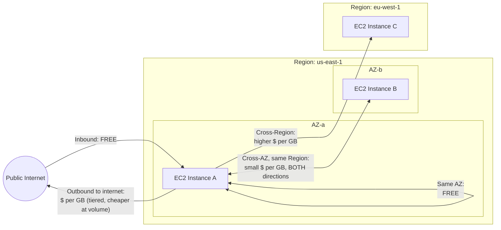
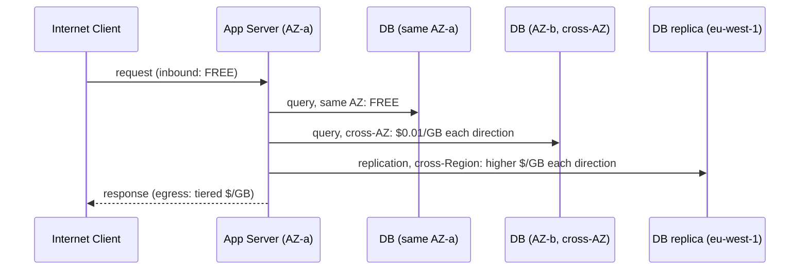
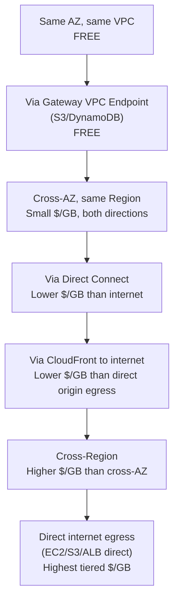
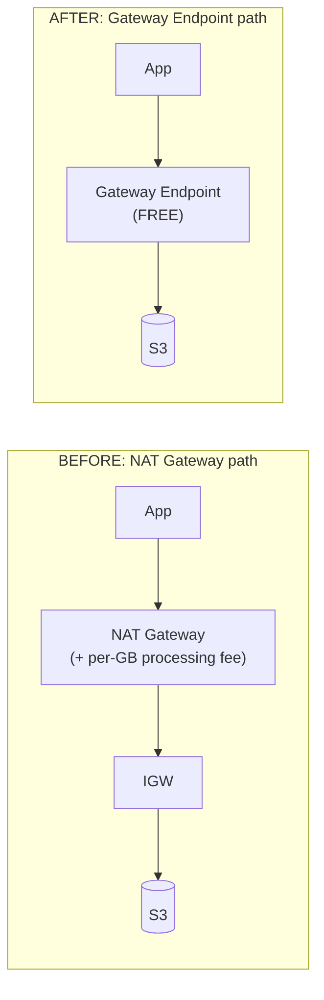

# Data Transfer Pricing (Networking Cost Model)

<!-- Icon note: this is a pricing/cost concept, not a discrete AWS service, so there is no
     dedicated service icon. Using the generic VPC icon as a category marker; see
     diagrams/README.md for the icon-fallback convention. -->


## Definition

Data transfer pricing is AWS's model for charging you based on **where data moves, not just how
much compute/storage you use** — moving data into AWS is (almost always) free, moving it between
AWS resources can be free or cheap depending on how close together they are, and moving it *out*
of AWS to the internet is where the real, often-underestimated cost lives.

## Purpose

Networking isn't free to operate at a global, redundant, multi-Region scale — AWS's data transfer
pricing exists to reflect the real cost difference between traffic that never leaves an AWS data
center, traffic that crosses Availability Zones or Regions over AWS's backbone, and traffic that
exits to the public internet (which involves peering/transit agreements with ISPs AWS itself pays
for). Understanding this model is, in practice, one of the single highest-leverage skills for
keeping an AWS bill under control — far more AWS bills are inflated by data transfer surprises
than by raw compute/storage pricing mistakes.

## How It Works

Plain explanation: think of data transfer cost as a function of **distance and direction**. Data
**coming into** AWS from the internet is (with very rare exceptions) always free. Data moving
**within the same Availability Zone** is free. Data moving **between Availability Zones in the
same Region** has a small per-GB charge in **both directions**. Data moving **between Regions**
costs more per GB than cross-AZ. Data moving **out to the internet** ("egress") is the most
expensive tier, with a tiered per-GB rate that gets cheaper at higher volumes, and a modest free
tier allowance per month.


*Figure: AWS's reference diagram comparing two patterns for accessing AWS services in the same
Region — via an Internet Gateway (no data transfer charge) versus via a NAT Gateway (which adds
its own per-GB data processing charge on top of any underlying transfer cost). Source: AWS
Architecture Blog, "Overview of Data Transfer Costs for Common Architectures" —
https://aws.amazon.com/blogs/architecture/overview-of-data-transfer-costs-for-common-architectures/*



Step by step: **Instance A** receiving a request from the public internet pays nothing for that
inbound data. If Instance A replies to the internet, that **outbound/egress** traffic is billed
per GB (the most expensive category, with volume-based tiering that lowers the rate as monthly
volume grows). If Instance A talks to **Instance B** in a different AZ within the same Region,
both the sender and receiver are charged a small per-GB fee — this is why "keep chatty services
in the same AZ" is a real cost optimization, not just a latency one. If Instance A instead talks
to **Instance C** in a completely different Region, the per-GB rate is higher still, reflecting
the real cost and distance of inter-Region backbone transit.

### Worked example: comparing three request paths by cost



A concrete monthly illustration for 500 GB of application response traffic, 200 GB of cross-AZ
database chatter, and 50 GB of cross-Region replication, using indicative rounded rates (always
verify current numbers):

```
Internet egress:     500 GB x ~$0.09/GB  = $45.00
Cross-AZ (both ways): 200 GB x ~$0.01/GB x 2 = $4.00
Cross-Region:          50 GB x ~$0.02/GB x 2 = $2.00
---------------------------------------------------
Total data transfer cost (illustrative):    ~$51.00/month
```

Even in this small example, internet egress alone dwarfs the cross-AZ and cross-Region costs
combined — the practical lesson behind "egress is where the money goes," and why cost-
optimization efforts (CloudFront, Direct Connect, Gateway Endpoints) specifically target
reducing *that* category first.

## Key Features / Components

- **Inbound (ingress) to AWS** — free, in virtually all cases and services.
- **Intra-AZ** — free (two resources in the same AZ, same VPC).
- **Inter-AZ (same Region)** — billed per GB, in each direction (sender and receiver both billed)
  — this is the charge most often forgotten when designing multi-AZ architectures.
- **Inter-Region** — billed per GB, generally higher than inter-AZ; varies by source/destination
  Region pair.
- **Internet egress** — the highest, tiered per-GB rate; the first several GB/month are typically
  included in the Free Tier, then price steps down as monthly volume grows (first tier priciest).
- **CloudFront/Direct Connect discounted egress** — data transferred out via CloudFront, or over
  a Direct Connect connection, is typically **cheaper per GB** than the standard EC2/S3 direct
  internet egress rate — a key reason both services get recommended for cost-optimization.
- **VPC Endpoint traffic** — Gateway Endpoint traffic (S3/DynamoDB) has **no data transfer
  charge** at all; Interface Endpoint traffic has its own (lower-than-NAT-Gateway) per-GB
  processing charge.
- **NAT Gateway data processing charge** — separate from, and in addition to, any underlying data
  transfer charge — a NAT Gateway adds its own per-GB fee on top of whatever the traffic's normal
  transfer cost would have been.
- **Same-Region, different-service transfer** (e.g., EC2 to S3 in the same Region) — typically
  free, another reason to co-locate dependent services in the same Region when possible.
- **ELB data processing charges** — load balancers add their own LCU-based processing charge
  independent of the underlying data transfer rate for the traffic flowing through them.

## The Full Cost Hierarchy, Visualized



This hierarchy (cheapest to most expensive, roughly) is worth memorizing as a mental model: every
cost-optimization pattern in the networking category — Gateway Endpoints over NAT Gateway,
CloudFront over direct origin serving, Direct Connect over internet transfer at volume, same-AZ
placement for chatty services — is really just "move this traffic one or more steps to the left
on this diagram."

## Common Architectures (cost-optimized patterns)

**1. Co-locating chatty services in the same AZ.** An application server and its most
frequently-accessed database replica placed deliberately in the same AZ, accepting the tradeoff
of reduced AZ-level fault tolerance for that specific pair, in exchange for eliminating both the
cross-AZ data transfer charge and the extra network hop's latency.

**2. CloudFront in front of all internet-facing static content.** Because CloudFront's egress
rate is typically cheaper than direct-from-origin internet egress at volume (and it also reduces
origin load through caching), routing all public static content through CloudFront is close to a
strictly-dominant cost/performance choice for any meaningful traffic volume.

**3. Gateway VPC Endpoints for all S3/DynamoDB-heavy private workloads.** Removing NAT Gateway
entirely from the path for S3/DynamoDB traffic — free, same-Region, zero code changes — is
usually the single highest-leverage, lowest-effort data transfer cost fix available in an
existing VPC.



**4. Direct Connect for large, steady hybrid transfer volumes.** Once a steady-state monthly
transfer volume between on-prem and AWS crosses a certain threshold, Direct Connect's lower
per-GB rate (plus fixed port-hour cost) becomes cheaper in aggregate than standard internet
egress, despite the additional fixed cost — see the worked comparison in `direct-connect.md`.

**5. Same-Region multi-service pipelines.** A data pipeline (e.g., S3 → Lambda → DynamoDB → 
analytics) built entirely within one Region captures the "same-Region, different-service, often
free" category for every internal hop, versus spreading the same pipeline's stages across
multiple Regions for no architectural reason.

## Use Cases — When to Use It (i.e., when this model should shape your design)

- **Choosing where to place replicas/read-replicas** — placing a database read replica in the
  same AZ as its most frequent reader avoids the inter-AZ charge, at the cost of losing AZ-level
  fault tolerance — a direct resiliency-vs-cost tradeoff this pricing model forces you to make.
  consciously.
- **Choosing CloudFront for internet-facing content** — because CloudFront egress is cheaper than
  direct-from-origin egress at volume, high-traffic public content almost always benefits.
- **Choosing VPC Endpoints over NAT Gateway for AWS-service traffic** — removes both the NAT
  Gateway's data processing fee and, for S3/DynamoDB, removes any data transfer charge entirely.
- **Architecting multi-Region DR with awareness of replication cost** — cross-Region replication
  (S3 CRR, RDS cross-Region read replicas, DynamoDB Global Tables) has a real, ongoing inter-
  Region data transfer cost that should be modeled into the DR strategy's running cost, not just
  its RTO/RPO.
- **Keeping chatty microservices in the same AZ** where latency AND cost both favor doing so, as
  long as you accept the single-AZ exposure for that pair of services.

## When NOT to Use It / Alternatives

This section is about the *pricing model itself* rather than a swappable service, so "when not to
use it" reframes as: **when this cost model doesn't apply, or when optimizing for it would be a
mistake.**

- **Don't sacrifice genuine multi-AZ high availability purely to avoid inter-AZ charges** — the
  per-GB inter-AZ fee is usually small relative to the cost of an outage from single-AZ
  concentration; cost-optimize data-heavy, high-volume paths first, not your core HA topology.
- **Don't over-engineer around Region placement for workloads with genuinely low data volume** —
  data transfer optimization matters most at scale; a low-traffic internal tool doesn't need the
  same scrutiny as a high-volume data pipeline.
- **Don't assume CloudFront/Direct Connect pricing fixes everything** — they lower the *rate*,
  but for genuinely enormous, one-time transfers, also evaluate **AWS Snowball/Snowmobile**
  (physical data transport), which can be cheaper and faster than any network-based transfer path
  at sufficiently large data volumes.

## Why It's Important

**Real-world:** data transfer is consistently one of the top line items that surprises teams on
their first few AWS bills, precisely because it's invisible until it's aggregated — no single
request looks expensive, but billions of small cross-AZ calls or large internet-facing downloads
add up fast. Senior architects are expected to model data transfer cost explicitly during design
reviews, not discover it after the first invoice.

**Exam mapping:**
- **SAA-C03** — Domain 4 (Cost-Optimized Architectures, 20%) Task 4.4 explicitly names "data
  transfer cost minimization" as an exam task — this topic is directly, namedly tested, not just
  implied. Expect scenario questions comparing architecture options purely on data transfer cost.
- **DVA-C03** — Domain 4 (Troubleshooting and Optimization) touches cost-awareness as part of
  "optimization recommendations," including AI-assisted cost analysis tooling.
- **MLA-C02** — Domain 4 explicitly adds "GenAI cost monitoring," and data transfer cost is
  relevant wherever large training datasets or model artifacts move between Regions/accounts.

## Pricing Model (summary)

There is no single flat "data transfer price" — it's a matrix of source, destination, and path:

| Transfer path | Typical cost |
|---|---|
| Internet → AWS (inbound) | Free |
| Same AZ, same VPC | Free |
| Cross-AZ, same Region | Small $/GB, billed both ways |
| Cross-Region | Higher $/GB than cross-AZ |
| AWS → Internet (egress) | Highest $/GB, tiered down at volume, small free tier/month |
| Via CloudFront to internet | Lower $/GB than direct origin egress |
| Via Direct Connect | Lower $/GB than standard internet egress |
| Via Gateway VPC Endpoint (S3/DynamoDB) | Free |
| Via NAT Gateway | Standard transfer rate + NAT Gateway's own per-GB processing fee |

Exact current rates vary by Region and change periodically — always check the official page for
real numbers before making a cost decision: https://aws.amazon.com/ec2/pricing/on-demand/#Data_Transfer

## Limits & Quotas

Data transfer pricing isn't a provisioned resource with hard quotas the way a service API is, but
a few genuinely fixed boundaries are worth knowing for both exam and real design purposes:

| Aspect | Note |
|---|---|
| Inbound data transfer | No quota; effectively unlimited and free at any volume |
| AWS Free Tier egress allowance | A fixed small GB/month allowance (varies, check current Free Tier terms), shared across most egress-billed services in aggregate |
| NAT Gateway bandwidth | Scales automatically to 45 Gbps (a throughput ceiling, not a data-transfer-cost ceiling) |
| Direct Connect port speed | 1/10/100 Gbps tiers — a throughput ceiling that indirectly bounds how much data can move per unit time over that path |
| Billing granularity | Data transfer is metered and billed per GB, generally with monthly aggregation and regional/service-specific tiering boundaries |

## Troubleshooting / Common Issues

- **"The monthly AWS bill includes an unexpectedly large data transfer line item with no
  obvious source."** Use **AWS Cost Explorer** filtered by usage type (it breaks out data
  transfer by category: `DataTransfer-Out-Bytes`, `DataTransfer-Regional-Bytes`, etc.) rather
  than guessing — the usage-type breakdown directly identifies whether the cost is egress,
  cross-AZ, cross-Region, or NAT Gateway processing.
- **"NAT Gateway costs are high despite seemingly modest total application traffic."** Remember
  the NAT Gateway's per-GB processing charge is **separate from and additional to** whatever the
  underlying transfer would have cost anyway — check whether some or most of that traffic is
  actually S3/DynamoDB-bound and could be moved to a free Gateway Endpoint instead.
- **"Cross-AZ charges appeared after adding a Multi-AZ RDS deployment."** Standard primary-to-
  standby replication traffic for RDS Multi-AZ does **not** incur its own additional data
  transfer charge — if unexpected cross-AZ charges appear, they're more likely from application/
  read traffic crossing AZs to reach the database, not the replication mechanism itself; verify
  the actual source using Cost Explorer's usage-type breakdown.
- **"A multi-Region architecture's data transfer costs are higher than expected for DR
  purposes."** Cross-Region replication (S3 CRR, DynamoDB Global Tables, RDS cross-Region read
  replicas) has an ongoing, volume-proportional data transfer cost that should have been modeled
  during design — if it wasn't, this is a design-review gap, not a billing error.
- **"Switching from direct S3 serving to CloudFront didn't reduce costs as much as expected."**
  Verify the cache hit ratio — a low hit ratio means most requests still reach the origin,
  partially defeating both the performance and cost benefit CloudFront is meant to provide; see
  `cloudfront.md`'s cache hit ratio guidance.

## Hands-on Lab (Floci)

Data transfer pricing isn't a callable API — there's no CLI command that "is" this concept. The
practical hands-on equivalent is a **cost-modeling exercise** rather than a CLI lab:

```bash
# Use Floci to stand up a realistic multi-AZ topology (from vpc.md / subnets lab),
# then reason about which paths in it would incur inter-AZ vs. egress charges on real AWS
awslocal ec2 describe-instances --filters Name=vpc-id,Values=<vpc-id> \
  --query 'Reservations[].Instances[].[InstanceId,Placement.AvailabilityZone]'

# Exercise: for each pair of instances above, classify the traffic path:
#   same AZ -> free | cross-AZ -> billed both ways | would it cross a NAT Gateway? | etc.

# A second exercise: list which services are reachable via a Gateway Endpoint today
# (only S3 and DynamoDB) versus which would need an Interface Endpoint for everything else,
# and estimate which choice is cheaper for a given traffic volume assumption.
```

For real numbers, use the **AWS Pricing Calculator** (https://calculator.aws/) to model an
architecture's expected monthly data transfer cost before building it — this is the actual
professional workflow for this topic, not a CLI command. Full notes:
`labs-floci/networking-vpc-lab.md`.

## Exam Scenario Deep Dive

**Scenario 1 — "An architecture review identifies that an application server and its database
are deployed in different Availability Zones for high availability, and data transfer costs
between them are now a meaningful line item. The team wants to reduce this cost without
sacrificing availability."**
This is a trick in disguise: the per-GB cross-AZ charge is usually small relative to the outage
risk of collapsing to single-AZ — the better answer is almost never "move them to the same AZ,"
but rather examining *whether the volume of chatty cross-AZ traffic itself can be reduced*
(caching, batching requests, read replicas placed per-AZ) while preserving multi-AZ resilience.

**Scenario 2 — "A company's private subnet workload calls S3 heavily and currently routes that
traffic through a NAT Gateway, generating a large monthly data processing charge."**
Add a free Gateway VPC Endpoint for S3 — this is the single most reliably tested, highest-
confidence answer in this entire cost category, removing both the data transfer charge (zero
for Gateway Endpoint traffic) and the NAT Gateway's separate per-GB processing fee for that
traffic.

**Scenario 3 — "A global media company serves large video files to users worldwide directly
from an S3 bucket's public endpoint, and egress costs are a major, growing expense."**
Route the content through CloudFront instead — its egress rate is typically cheaper than direct
S3-to-internet egress at volume, and caching reduces how often the origin (S3) is hit at all,
compounding the cost reduction beyond just the lower per-GB rate.

**Scenario 4 — "An organization replicates a large S3 bucket to a second Region nightly for
disaster recovery, and the monthly data transfer cost for this replication has become
significant as the bucket has grown."**
This cross-Region transfer cost is an expected, ongoing cost of the chosen DR strategy's RPO/RTO
target — the fix (if cost reduction is truly needed) is evaluating whether the replication
frequency/scope can be reduced (e.g., only replicating specific prefixes, or less frequently) to
match the actual DR requirement, not assuming this is a misconfiguration; some ongoing cost is
inherent to any meaningful cross-Region DR posture.

**Scenario 5 — "A one-time migration involves moving 500 TB from on-premises to AWS, and the
team is deciding between standard internet transfer, Direct Connect, and AWS Snowball."**
At 500 TB, even Direct Connect's favorable per-GB rate may be slower and more expensive in
aggregate than a **physical transfer appliance (AWS Snowball)** for a one-time migration of this
scale — this is the scenario where the exam expects you to recognize that network-based transfer
options (VPN, Direct Connect, internet) all have a practical ceiling where physical data
transport becomes the more sensible choice, purely due to the volume and one-time nature of the
transfer.

## Exam Tips

- **Memorize the hierarchy of cost, cheapest to most expensive**: same-AZ (free) → cross-AZ
  (cheap, both ways) → cross-Region (more) → internet egress (most, tiered). Internet *ingress*
  is free at every level of that hierarchy.
- **"Reduce cost of traffic to S3/DynamoDB from a private subnet" → Gateway VPC Endpoint**, not
  NAT Gateway — this is the most frequently tested specific cost-optimization pairing in this
  whole category.
- **"Reduce cost of serving static content globally" → CloudFront**, both for performance and
  because its egress rate is cheaper than direct origin egress at volume.
- **"Reduce cost of a large, steady, high-volume hybrid data transfer" → Direct Connect** over
  VPN/internet, once volume justifies the port-hour cost.
- **NAT Gateway's data processing charge is separate from and additional to the underlying data
  transfer rate** — a NAT Gateway doesn't just "use" the existing egress rate, it adds its own
  fee on top; exam questions about "why is my NAT Gateway bill so high" are testing this stacked
  cost, not a single rate.
- Always read exam questions for the word **"minimize cost"** specifically — it signals this
  domain/task directly and usually has one architecturally-correct, cheapest answer among several
  technically-valid options.
- **For truly massive one-time transfers, know physical transport (Snowball/Snowmobile) exists
  as an option beyond all network-based paths** — a scenario emphasizing extreme data volume and
  a one-time (not recurring) transfer is testing awareness of this alternative outside the
  networking services covered elsewhere in this category.
- **Use AWS Cost Explorer's usage-type breakdown, not guesswork, to diagnose unexpected data
  transfer charges** — a troubleshooting-style question about "where is this cost coming from"
  is testing whether you know this specific diagnostic tool and approach.

## Further Reading

- AWS Blog — Overview of Data Transfer Costs for Common Architectures: https://aws.amazon.com/blogs/architecture/overview-of-data-transfer-costs-for-common-architectures/
- AWS Blog — Exploring Data Transfer Costs for Classic and Application Load Balancers: https://aws.amazon.com/blogs/networking-and-content-delivery/exploring-data-transfer-costs-for-classic-and-application-load-balancers/
- AWS Blog — AWS Data Transfer Charges for Server and Serverless Architectures: https://aws.amazon.com/blogs/apn/aws-data-transfer-charges-for-server-and-serverless-architectures/
- AWS Pricing — Amazon EC2 On-Demand Pricing, Data Transfer section: https://aws.amazon.com/ec2/pricing/on-demand/#Data_Transfer
- AWS Pricing Calculator: https://calculator.aws/
- `certifications/saa-c03/domain-4-cost-optimized-architectures/README.md`

## Related Terms

- [`subnets-route-tables-igw-natgw.md`](subnets-route-tables-igw-natgw.md) — NAT Gateway's own fee
- [`vpc-endpoints-privatelink.md`](vpc-endpoints-privatelink.md) — the free/cheap alternative path
- [`cloudfront.md`](cloudfront.md), [`direct-connect.md`](direct-connect.md) — discounted egress
  paths
- `certifications/saa-c03/domain-4-cost-optimized-architectures/README.md`
- `glossary/egress.md`, `glossary/availability-zone.md`
