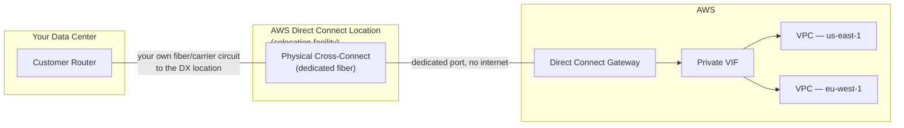
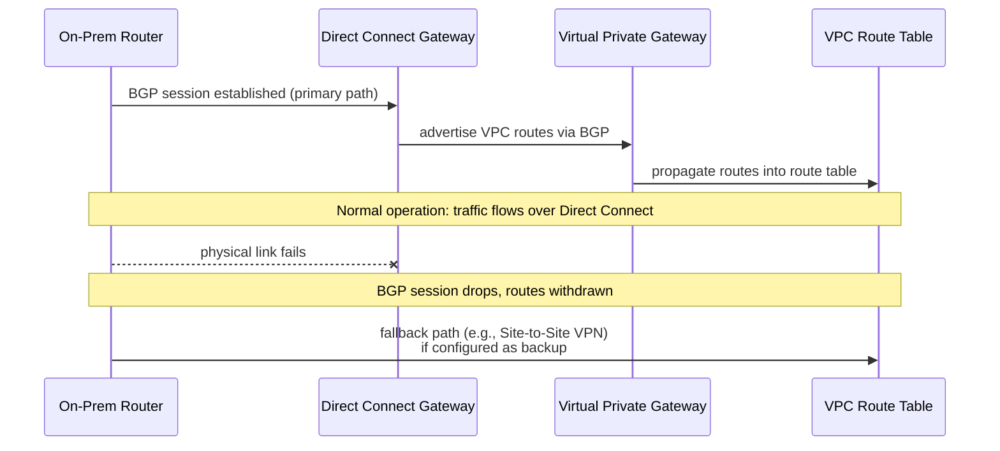
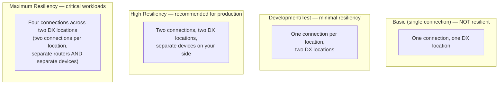
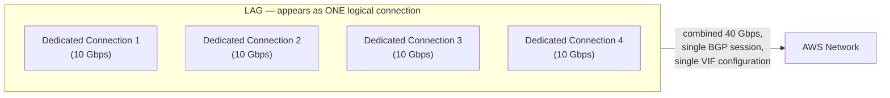
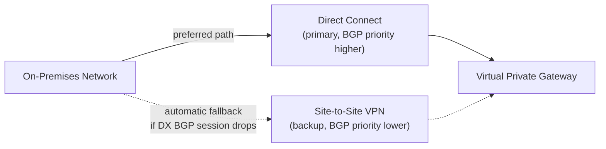
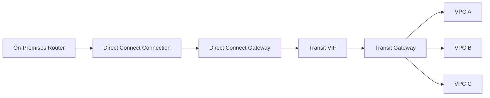

# AWS Direct Connect


## Definition

AWS Direct Connect is a dedicated, private **physical network connection** between your own
data center (or a colocation facility) and AWS — a real fiber link, not a connection that
travels over the public internet at all.

## Purpose

Connecting to AWS over the public internet works, but the internet gives you no guarantees:
variable latency, variable bandwidth, and exposure to the public network's congestion and
security surface. For workloads that need consistent, high-bandwidth, low-latency, private
connectivity — large data migrations, hybrid applications split between on-prem and AWS, strict
compliance requirements that forbid traversing the public internet — Direct Connect gives you a
dedicated physical link with predictable performance and a smaller attack surface.

## How It Works

Plain explanation: you either provision a **dedicated connection** (a physical cross-connect at
an AWS Direct Connect location, a 1/10/100 Gbps port reserved just for you) or a **hosted
connection/hosted VIF** through an AWS Direct Connect Partner (for smaller bandwidth needs or
faster provisioning, since you share the partner's infrastructure). On top of the physical
connection, you configure one or more **Virtual Interfaces (VIFs)**: a **private VIF** to reach
resources inside a VPC, a **public VIF** to reach AWS public services (S3, DynamoDB) over the
dedicated link instead of the internet, or a **transit VIF** to reach a Transit Gateway.


*Figure: AWS's reference diagram showing the three virtual interface types — private VIF to a
VPC, public VIF to AWS public services, and transit VIF to a Transit Gateway — all riding over
one physical Direct Connect connection. Source: AWS documentation, "What is Direct Connect?" —
https://docs.aws.amazon.com/directconnect/latest/UserGuide/Welcome.html*



Step by step: traffic leaves the **customer router** over a circuit you arrange (your own dark
fiber, or a carrier) to the **Direct Connect location** — a physical meet-me facility where AWS
has a presence. There, a **cross-connect** physically patches your circuit into AWS's network at
a **dedicated port** reserved for you — at this point, traffic never touches the public internet.
A **Direct Connect Gateway** then lets a single Direct Connect connection reach **multiple VPCs
across multiple Regions** (without it, a private VIF connects to just one VPC in one Region),
which is why most real deployments use a DX Gateway rather than a bare private VIF.

### Direct Connect Gateway reaching multiple Regions


*Figure: AWS's reference diagram of a Direct Connect Gateway bridging one physical connection in
one Region to VPCs with Virtual Private Gateways in two different Regions — a single DX
connection, multiple Regions reached. Source: AWS documentation, "Direct Connect gateways" —
https://docs.aws.amazon.com/directconnect/latest/UserGuide/direct-connect-gateways-intro.html*

### Packet-level walkthrough: BGP route exchange and failover



Direct Connect uses **BGP**, not static routes, to exchange reachability information — this is
what allows automatic failover behavior when a backup path (commonly a Site-to-Site VPN) exists:
if the BGP session over Direct Connect drops, routes advertised over it are withdrawn, and if a
VPN connection is also configured with its own BGP session advertising the same destinations,
traffic can shift to it automatically without manual route table intervention — provided this
backup path was deliberately designed in, since Direct Connect has **no redundancy by default**.

## Key Features / Components

- **Dedicated connection** — a physical 1/10/100 Gbps port allocated entirely to you; requires
  you to physically be present (or use a partner) at an AWS Direct Connect location.
- **Hosted connection** — provisioned through an AWS Direct Connect Partner at sub-1Gbps to
  10Gbps increments; faster to set up, shared underlying infrastructure.
- **Virtual Interface (VIF)** — Private (VPC access via VPN Gateway or Direct Connect Gateway),
  Public (AWS public service endpoints over the dedicated link), Transit (Transit Gateway access).
- **Direct Connect Gateway** — a global construct letting one DX connection reach VPCs across
  multiple Regions/accounts without separate physical connections per Region.
- **Link Aggregation Group (LAG)** — bundle multiple dedicated connections into one logical,
  higher-bandwidth, redundant connection.
- **Resiliency models** — AWS publishes reference architectures (e.g., "High Resiliency,"
  "Maximum Resiliency") using multiple connections across multiple Direct Connect locations to
  avoid any single point of failure — a dedicated connection itself is not redundant by default.
- **BGP routing** — Direct Connect uses BGP (Border Gateway Protocol) to exchange routes between
  your network and AWS, not static routes.
- **MACsec** — optional Layer 2 encryption available on certain dedicated connections (Direct
  Connect itself is physically private but not encrypted in transit by default — MACsec or an
  overlay VPN adds encryption if required by compliance).

## Resiliency Models, Side by Side



AWS explicitly publishes these four named resiliency tiers because "just add a Direct Connect
connection" is not synonymous with "now I have a redundant hybrid link" — a single dedicated
connection, even a very fast one, remains a single point of failure at the physical layer (fiber
cut, router failure, facility power event). The exam-relevant takeaway: any scenario emphasizing
fault tolerance for Direct Connect specifically needs **multiple connections at multiple
locations**, not just a bigger single connection.

## Link Aggregation Group (LAG) — bundling connections for bandwidth and resiliency



A LAG requires all member connections to be the **same speed** and terminate at the **same
Direct Connect location**, and it's managed as a single logical connection for configuration
purposes (one set of VIFs, one BGP session configuration applied across the bundle) while still
providing N-1 physical redundancy — if one physical connection in the LAG fails, the others
continue carrying traffic, just at reduced aggregate bandwidth, without manual VIF
reconfiguration. This differs from the multi-location resiliency models above in one key way: a
LAG's redundancy is only at the connection level *within a single location* — it does not protect
against a whole-facility failure, which is exactly why "Maximum Resiliency" additionally requires
separate locations, not just a LAG.

## Worked Cost Comparison: Direct Connect vs. Internet Egress at Scale

A simplified illustrative comparison for a steady 100 TB/month transfer out of AWS to on-prem,
using indicative, rounded rates (always check current pricing before a real decision):

| Path | Approximate monthly cost driver | Illustrative total |
|---|---|---|
| Standard internet egress | ~$0.09/GB tiered rate × 100,000 GB | ~$9,000/month (data alone) |
| Direct Connect (1 Gbps dedicated, always-on) | Port-hour (~$0.30/hr × 730) + lower per-GB rate (~$0.02/GB × 100,000 GB) | ~$219 (port) + ~$2,000 (data) ≈ $2,219/month |

At this volume, Direct Connect's lower per-GB rate dramatically outweighs its fixed port-hour
cost, illustrating why the exam's cost-optimization questions consistently favor Direct Connect
once volume crosses a certain steady-state threshold — the crossover point depends on actual
current rates and connection speed, but the *shape* of the tradeoff (fixed cost + cheap marginal
rate vs. no fixed cost + expensive marginal rate) is the concept being tested, not memorizing an
exact dollar crossover number.

## Common Architectures

**1. Direct Connect + VPN as backup (the standard hybrid HA pattern).** Primary traffic flows
over Direct Connect; a Site-to-Site VPN connection (over the internet, cheap, fast to provision)
serves as an automatic BGP-based fallback if the dedicated connection fails.



**2. Direct Connect Gateway + Transit Gateway for enterprise-scale hybrid networking.** One
physical Direct Connect connection, through a Direct Connect Gateway, associated with a Transit
Gateway that fans out to dozens of VPCs across many accounts — a single hybrid entry point for an
entire AWS Organization's network.

**3. Public VIF for direct, non-internet access to AWS public services.** A workload that calls
S3 or DynamoDB heavily from on-prem, without a VPC in the picture at all, uses a public VIF to
reach those services' public endpoints over the dedicated link rather than the internet —
reducing both latency variability and internet egress costs for that traffic.

**4. Private IP VPN over Direct Connect (encrypted without public IPs).** For workloads needing
both the guaranteed path of Direct Connect and encryption in transit, a Site-to-Site VPN can be
layered **on top of** a private VIF, encrypting traffic end-to-end while still avoiding the
public internet entirely — distinct from running a VPN purely over the internet as a backup path.

## Transit VIF — reaching a Transit Gateway directly



A transit VIF is the modern, scale-friendly pairing with Transit Gateway: instead of a private
VIF reaching one VPC's Virtual Private Gateway at a time, a transit VIF connects a Direct
Connect Gateway directly to a Transit Gateway, inheriting whatever VPC attachments that Transit
Gateway already has — adding a new VPC to the hybrid network becomes "attach it to the Transit
Gateway," with zero additional Direct Connect-side configuration required. This is the preferred
pattern for any organization already standardizing on Transit Gateway as their VPC
interconnection hub (see `transit-gateway-and-peering.md`), since it avoids maintaining a growing
list of individual private VIFs as the VPC count grows.

## Use Cases — When to Use It

- **Large, consistent data transfer workloads** — bulk data migration, backup replication, media
  workflows — where internet-based transfer is too slow, too variable, or too expensive at scale.
- **Hybrid applications needing low, predictable latency** — trading systems, real-time
  analytics pipelines split between on-prem and AWS.
- **Regulatory requirements to avoid the public internet** — certain compliance frameworks or
  internal security policies mandate private connectivity for specific data categories.
- **Reducing data transfer costs at scale** — Direct Connect data transfer rates are typically
  lower than standard internet egress for high-volume, steady-state transfer.
- **Multi-Region, multi-VPC enterprise connectivity** — paired with a Direct Connect Gateway and
  Transit Gateway for a single physical entry point reaching a whole AWS organization's network.

## When NOT to Use It / Alternatives

- **Quick setup, low/variable bandwidth, or temporary connectivity needs** — Direct Connect
  provisioning (cross-connects, carrier circuits) can take **weeks to months**; a **Site-to-Site
  VPN** can be stood up in minutes and is the right choice when you need connectivity now, don't
  have steady high-volume traffic, or are just testing a hybrid architecture.
- **Small/startup workloads without the budget or physical presence for dedicated circuits** — a
  VPN over the internet, or no hybrid connectivity at all (go fully cloud-native), is usually more
  appropriate.
- **You need encryption and Direct Connect's MACsec isn't configured/available at your chosen
  location** — run a VPN **over** Direct Connect (a common hybrid pattern) to get both the
  private physical path and IPsec encryption.
- **A temporary bandwidth spike** — provisioning a bigger dedicated connection takes real-world
  lead time; it's not an elastic, instantly-scalable resource like most AWS services.

## Why It's Important

**Real-world:** Direct Connect is a cornerstone of serious enterprise hybrid-cloud architecture
— migrations measured in petabytes, or latency-sensitive hybrid trading/manufacturing systems,
are simply impractical over the public internet. It's also a frequent point of real-world
misunderstanding: many teams assume Direct Connect is automatically redundant/encrypted, when
neither is true without deliberate extra design (multiple connections/locations for redundancy,
MACsec or an overlay VPN for encryption).

**Exam mapping:**
- **SAA-C03** — Domain 1 Task 1.2 names Direct Connect alongside VPN for secure workload
  connectivity; Domain 4 Task 4.4 (cost-optimized networking) directly tests Direct Connect vs.
  VPN vs. internet cost/tradeoff scenarios — a recurring exam pattern.
- **DVA-C03** — less central (this is an infrastructure/network-engineering topic more than an
  application-development one), but appears conceptually where hybrid application architecture
  is discussed.
- **MLA-C02** — relevant where on-prem data sources must be securely/reliably ingested into AWS
  for training pipelines at scale (Domain 1, Data Preparation).

## Pricing Model (summary)

Billed by **port-hour** (based on connection speed: 1/10/100 Gbps) plus **outbound data
transfer** (typically cheaper per-GB than standard internet egress at the same Region).
Inbound data transfer to AWS over Direct Connect is free. There's also a cost for the physical
cross-connect itself, charged by the colocation facility (not AWS), and any carrier/circuit fees
to physically reach the Direct Connect location. Official pricing:
https://aws.amazon.com/directconnect/pricing/

## Limits & Quotas

| Resource | Default quota |
|---|---|
| Dedicated connections per Region | 10 (soft) |
| Private VIFs per dedicated connection | 50 (soft) |
| Public VIFs per dedicated connection | 1 (soft, increasable) |
| Private VIFs per Direct Connect Gateway | 30 |
| Direct Connect Gateways per account | 200 (soft) |
| Connections per Link Aggregation Group | 4 |
| Transit VIFs per connection | 1 (soft, increasable) |
| BGP route limit per VIF | 100 (soft) advertised routes |

## Troubleshooting / Common Issues

- **"Direct Connect shows as UP but no traffic flows between on-prem and the VPC."** Check the
  BGP session state specifically (not just physical link state) — a connection can be physically
  up while BGP hasn't established, meaning no routes are being exchanged at all; verify BGP
  neighbor status and route advertisements on both sides.
- **"Failover to a backup VPN connection isn't happening when Direct Connect fails."** Confirm
  the VPN connection is also BGP-based (not static-route-only) and configured with appropriate
  route preference (usually via AS path prepending or local preference) so it only becomes active
  when Direct Connect's routes are withdrawn — a static VPN alongside a BGP-based Direct Connect
  typically won't fail over automatically.
- **"A new VPC in a second Region can't be reached over an existing single-Region Direct Connect
  connection."** A private VIF alone only reaches one VPC in one Region — reaching additional
  Regions requires a Direct Connect Gateway associated with each Region's Virtual Private
  Gateway/Transit Gateway.
- **"Traffic over Direct Connect appears to be unencrypted and a compliance audit flags this."**
  Expected — Direct Connect provides physical privacy, not encryption, by default; the fix is
  enabling MACsec (if available for the specific connection/location) or layering a VPN on top of
  the private VIF.
- **"After ordering a dedicated connection, the team is surprised it isn't usable for weeks."**
  Expected — physical cross-connects and carrier circuits have real-world lead times; this is
  precisely why VPN is recommended as the interim or lower-urgency alternative, not a Direct
  Connect misconfiguration.
- **"BGP routes from on-prem aren't being accepted by the Direct Connect Gateway."** Check the
  advertised route count against the per-VIF BGP route limit (100 by default) — exceeding it can
  cause the session to reset or routes beyond the limit to be silently dropped, depending on
  configuration.

## Hands-on Lab (Floci)

**Honest limitation — by definition, not just a Floci gap:** Direct Connect requires a real
physical cross-connect at an actual AWS Direct Connect location; it cannot be meaningfully
emulated locally or in any software sandbox, Floci included. The only "lab" available is
exploring the read-only, informational API:

```bash
# Real-AWS, read-only exploration — works against real AWS (requires valid creds),
# not meaningful against Floci since there's no physical network to describe
aws directconnect describe-locations
aws directconnect describe-connections
aws directconnect describe-direct-connect-gateways
aws directconnect describe-virtual-interfaces
```

For hands-on understanding of what Direct Connect *configures on the AWS side* (Virtual
Interfaces, Direct Connect Gateway route propagation into a VPC), use the **VPN lab**
(`vpn.md`) instead — a Site-to-Site VPN connection's VPC-side configuration (Virtual Private
Gateway, route propagation, Customer Gateway) is structurally identical to what you'd configure
for a Direct Connect private VIF, and VPN's control-plane APIs are exercisable via Floci's EC2
backing. Full notes: `labs-floci/networking-vpc-lab.md`.

## Exam Scenario Deep Dive

**Scenario 1 — "A company needs guaranteed bandwidth and low latency for a mission-critical
hybrid application, and cannot tolerate a single point of failure anywhere in the connectivity
path, including at the physical facility level."**
This calls for AWS's "Maximum Resiliency" model — multiple dedicated connections across
**multiple, physically separate** Direct Connect locations, each terminating on separate routers
on the customer side — a single connection, even duplicated at the same location, still leaves a
facility-level single point of failure.

**Scenario 2 — "A startup needs hybrid connectivity to AWS set up this week for a proof of
concept, with modest, non-steady traffic volume."**
Site-to-Site VPN, not Direct Connect — Direct Connect's provisioning lead time (weeks to months)
makes it unsuitable for an immediate need regardless of its long-term cost/performance
advantages at scale, which this low/non-steady-volume scenario doesn't need anyway.

**Scenario 3 — "An enterprise has a single Direct Connect connection to us-east-1 and needs to
extend the same physical connection's reach to a newly created VPC in eu-west-1 without
provisioning a second physical circuit."**
Direct Connect Gateway — it's specifically designed to let one physical connection in one Region
reach VPCs (via their Virtual Private Gateways) in other Regions, which a bare private VIF
cannot do on its own.

**Scenario 4 — "A compliance requirement states that hybrid traffic must never traverse the
public internet AND must be encrypted end-to-end."**
Direct Connect with either MACsec enabled (if available for the connection) or a Site-to-Site
VPN layered on top of the private VIF — Direct Connect alone satisfies "never touches the
internet" but not "encrypted," so one of these two encryption mechanisms must be added
deliberately; a standalone VPN-over-internet wouldn't satisfy the "never touches the internet"
half of the requirement.

**Scenario 5 — "A finance company needs on-premises systems to call Amazon S3 and DynamoDB
directly, without routing through any VPC, while avoiding the public internet for cost and
latency reasons."**
A public VIF — it specifically grants access to AWS public service endpoints over the dedicated
Direct Connect link, bypassing both the public internet and the need for a private VIF/VPC
connection at all, matching the "no VPC involved" detail precisely.

## Exam Tips

- **Direct Connect is not redundant or encrypted by default** — two of the most common exam
  traps. If a question wants fault tolerance, the answer needs a second connection at a
  **different** Direct Connect location (or a VPN as backup); if it wants encryption, the answer
  needs MACsec or a VPN layered on top.
- **Provisioning lead time is Direct Connect's biggest practical weakness** — if the scenario
  needs connectivity "today" or "this week," that's a VPN question in disguise, not Direct
  Connect.
- **Direct Connect Gateway is what lets one connection reach multiple VPCs/Regions** — without
  it, a private VIF is tied to one VPC. Don't confuse DX Gateway with Transit Gateway: DX Gateway
  is specifically for extending Direct Connect reach; Transit Gateway is for interconnecting many
  VPCs/VPNs generally (they're often used together).
- **Public VIF reaches AWS public services over the dedicated link** (S3, DynamoDB) without
  going over the internet — this is distinct from a private VIF, which reaches your VPC's
  private IP space.
- **Cost-optimization scenario**: high, steady, predictable data volume between on-prem and AWS
  → Direct Connect wins on both cost-per-GB and reliability at scale; low/sporadic volume → VPN
  or standard internet transfer is more cost-effective since you avoid port-hour and circuit
  costs entirely.
- **Know the four resiliency models by name** (Basic, Development/Test, High Resiliency, Maximum
  Resiliency) and which one satisfies "no single point of failure, including facility-level" —
  only Maximum Resiliency does, since it mandates multiple physically separate locations.
- **Direct Connect uses BGP, not static routing, for VPC/Gateway route exchange** — this is also
  the mechanism that enables automatic failover to a BGP-based VPN backup; a purely static VPN
  backup won't fail over automatically the same way.

## Further Reading

- AWS Docs — What is AWS Direct Connect?: https://docs.aws.amazon.com/directconnect/latest/UserGuide/Welcome.html
- AWS Docs — Direct Connect resiliency recommendations: https://docs.aws.amazon.com/directconnect/latest/UserGuide/resiliency_toolkit.html
- AWS Docs — Direct Connect gateways: https://docs.aws.amazon.com/directconnect/latest/UserGuide/direct-connect-gateways-intro.html
- AWS Whitepaper — Amazon VPC Connectivity Options, Direct Connect section: https://docs.aws.amazon.com/whitepapers/latest/aws-vpc-connectivity-options/aws-direct-connect.html
- AWS re:Post — Troubleshoot Direct Connect BGP: https://repost.aws/knowledge-center/direct-connect-bgp-troubleshoot

## Related Terms

- [`vpn.md`](vpn.md) — the faster-to-provision alternative/complement
- [`transit-gateway-and-peering.md`](transit-gateway-and-peering.md) — often paired via Direct
  Connect Gateway + Transit Gateway for enterprise-scale hybrid networks
- [`vpc.md`](vpc.md), [`subnets-route-tables-igw-natgw.md`](subnets-route-tables-igw-natgw.md)
- `glossary/bgp.md`, `glossary/hybrid-cloud.md`
