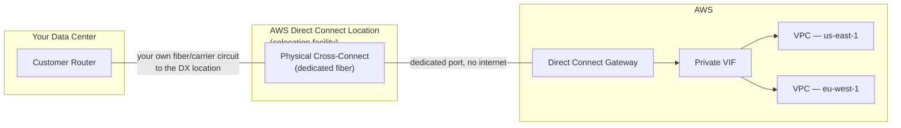

# AWS Direct Connect


## Definition

AWS Direct Connect is a dedicated, private **physical network connection** between your own
data center (or a colocation facility) and AWS — a real fiber link, not a connection that
travels over the public internet at all.

## Purpose

Connecting to AWS over the public internet works, but the internet gives you no guarantees:
variable latency, variable bandwidth, and exposure to the public network's congestion and
security surface. For workloads that need consistent, high-bandwidth, low-latency, private
connectivity — large data migrations, hybrid applications split between on-prem and AWS, strict
compliance requirements that forbid traversing the public internet — Direct Connect gives you a
dedicated physical link with predictable performance and a smaller attack surface.

## How It Works

Plain explanation: you either provision a **dedicated connection** (a physical cross-connect at
an AWS Direct Connect location, a 1/10/100 Gbps port reserved just for you) or a **hosted
connection/hosted VIF** through an AWS Direct Connect Partner (for smaller bandwidth needs or
faster provisioning, since you share the partner's infrastructure). On top of the physical
connection, you configure one or more **Virtual Interfaces (VIFs)**: a **private VIF** to reach
resources inside a VPC, a **public VIF** to reach AWS public services (S3, DynamoDB) over the
dedicated link instead of the internet, or a **transit VIF** to reach a Transit Gateway.



Step by step: traffic leaves the **customer router** over a circuit you arrange (your own dark
fiber, or a carrier) to the **Direct Connect location** — a physical meet-me facility where AWS
has a presence. There, a **cross-connect** physically patches your circuit into AWS's network at
a **dedicated port** reserved for you — at this point, traffic never touches the public internet.
A **Direct Connect Gateway** then lets a single Direct Connect connection reach **multiple VPCs
across multiple Regions** (without it, a private VIF connects to just one VPC in one Region),
which is why most real deployments use a DX Gateway rather than a bare private VIF.

## Key Features / Components

- **Dedicated connection** — a physical 1/10/100 Gbps port allocated entirely to you; requires
  you to physically be present (or use a partner) at an AWS Direct Connect location.
- **Hosted connection** — provisioned through an AWS Direct Connect Partner at sub-1Gbps to
  10Gbps increments; faster to set up, shared underlying infrastructure.
- **Virtual Interface (VIF)** — Private (VPC access via VPN Gateway or Direct Connect Gateway),
  Public (AWS public service endpoints over the dedicated link), Transit (Transit Gateway access).
- **Direct Connect Gateway** — a global construct letting one DX connection reach VPCs across
  multiple Regions/accounts without separate physical connections per Region.
- **Link Aggregation Group (LAG)** — bundle multiple dedicated connections into one logical,
  higher-bandwidth, redundant connection.
- **Resiliency models** — AWS publishes reference architectures (e.g., "High Resiliency,"
  "Maximum Resiliency") using multiple connections across multiple Direct Connect locations to
  avoid any single point of failure — a dedicated connection itself is not redundant by default.
- **BGP routing** — Direct Connect uses BGP (Border Gateway Protocol) to exchange routes between
  your network and AWS, not static routes.
- **MACsec** — optional Layer 2 encryption available on certain dedicated connections (Direct
  Connect itself is physically private but not encrypted in transit by default — MACsec or an
  overlay VPN adds encryption if required by compliance).

## Use Cases — When to Use It

- **Large, consistent data transfer workloads** — bulk data migration, backup replication, media
  workflows — where internet-based transfer is too slow, too variable, or too expensive at scale.
- **Hybrid applications needing low, predictable latency** — trading systems, real-time
  analytics pipelines split between on-prem and AWS.
- **Regulatory requirements to avoid the public internet** — certain compliance frameworks or
  internal security policies mandate private connectivity for specific data categories.
- **Reducing data transfer costs at scale** — Direct Connect data transfer rates are typically
  lower than standard internet egress for high-volume, steady-state transfer.
- **Multi-Region, multi-VPC enterprise connectivity** — paired with a Direct Connect Gateway and
  Transit Gateway for a single physical entry point reaching a whole AWS organization's network.

## When NOT to Use It / Alternatives

- **Quick setup, low/variable bandwidth, or temporary connectivity needs** — Direct Connect
  provisioning (cross-connects, carrier circuits) can take **weeks to months**; a **Site-to-Site
  VPN** can be stood up in minutes and is the right choice when you need connectivity now, don't
  have steady high-volume traffic, or are just testing a hybrid architecture.
- **Small/startup workloads without the budget or physical presence for dedicated circuits** — a
  VPN over the internet, or no hybrid connectivity at all (go fully cloud-native), is usually more
  appropriate.
- **You need encryption and Direct Connect's MACsec isn't configured/available at your chosen
  location** — run a VPN **over** Direct Connect (a common hybrid pattern) to get both the
  private physical path and IPsec encryption.
- **A temporary bandwidth spike** — provisioning a bigger dedicated connection takes real-world
  lead time; it's not an elastic, instantly-scalable resource like most AWS services.

## Why It's Important

**Real-world:** Direct Connect is a cornerstone of serious enterprise hybrid-cloud architecture
— migrations measured in petabytes, or latency-sensitive hybrid trading/manufacturing systems,
are simply impractical over the public internet. It's also a frequent point of real-world
misunderstanding: many teams assume Direct Connect is automatically redundant/encrypted, when
neither is true without deliberate extra design (multiple connections/locations for redundancy,
MACsec or an overlay VPN for encryption).

**Exam mapping:**
- **SAA-C03** — Domain 1 Task 1.2 names Direct Connect alongside VPN for secure workload
  connectivity; Domain 4 Task 4.4 (cost-optimized networking) directly tests Direct Connect vs.
  VPN vs. internet cost/tradeoff scenarios — a recurring exam pattern.
- **DVA-C03** — less central (this is an infrastructure/network-engineering topic more than an
  application-development one), but appears conceptually where hybrid application architecture
  is discussed.
- **MLA-C02** — relevant where on-prem data sources must be securely/reliably ingested into AWS
  for training pipelines at scale (Domain 1, Data Preparation).

## Pricing Model (summary)

Billed by **port-hour** (based on connection speed: 1/10/100 Gbps) plus **outbound data
transfer** (typically cheaper per-GB than standard internet egress at the same Region).
Inbound data transfer to AWS over Direct Connect is free. There's also a cost for the physical
cross-connect itself, charged by the colocation facility (not AWS), and any carrier/circuit fees
to physically reach the Direct Connect location. Official pricing:
https://aws.amazon.com/directconnect/pricing/

## Hands-on Lab (Floci)

**Honest limitation — by definition, not just a Floci gap:** Direct Connect requires a real
physical cross-connect at an actual AWS Direct Connect location; it cannot be meaningfully
emulated locally or in any software sandbox, Floci included. The only "lab" available is
exploring the read-only, informational API:

```bash
# Real-AWS, read-only exploration — works against real AWS (requires valid creds),
# not meaningful against Floci since there's no physical network to describe
aws directconnect describe-locations
aws directconnect describe-connections
```

For hands-on understanding of what Direct Connect *configures on the AWS side* (Virtual
Interfaces, Direct Connect Gateway route propagation into a VPC), use the **VPN lab**
(`vpn.md`) instead — a Site-to-Site VPN connection's VPC-side configuration (Virtual Private
Gateway, route propagation, Customer Gateway) is structurally identical to what you'd configure
for a Direct Connect private VIF, and VPN's control-plane APIs are exercisable via Floci's EC2
backing. Full notes: `labs-floci/networking-vpc-lab.md`.

## Exam Tips

- **Direct Connect is not redundant or encrypted by default** — two of the most common exam
  traps. If a question wants fault tolerance, the answer needs a second connection at a
  **different** Direct Connect location (or a VPN as backup); if it wants encryption, the answer
  needs MACsec or a VPN layered on top.
- **Provisioning lead time is Direct Connect's biggest practical weakness** — if the scenario
  needs connectivity "today" or "this week," that's a VPN question in disguise, not Direct
  Connect.
- **Direct Connect Gateway is what lets one connection reach multiple VPCs/Regions** — without
  it, a private VIF is tied to one VPC. Don't confuse DX Gateway with Transit Gateway: DX Gateway
  is specifically for extending Direct Connect reach; Transit Gateway is for interconnecting many
  VPCs/VPNs generally (they're often used together).
- **Public VIF reaches AWS public services over the dedicated link** (S3, DynamoDB) without
  going over the internet — this is distinct from a private VIF, which reaches your VPC's
  private IP space.
- **Cost-optimization scenario**: high, steady, predictable data volume between on-prem and AWS
  → Direct Connect wins on both cost-per-GB and reliability at scale; low/sporadic volume → VPN
  or standard internet transfer is more cost-effective since you avoid port-hour and circuit
  costs entirely.

## Related Terms

- [`vpn.md`](vpn.md) — the faster-to-provision alternative/complement
- [`transit-gateway-and-peering.md`](transit-gateway-and-peering.md) — often paired via Direct
  Connect Gateway + Transit Gateway for enterprise-scale hybrid networks
- [`vpc.md`](vpc.md), [`subnets-route-tables-igw-natgw.md`](subnets-route-tables-igw-natgw.md)
- `glossary/bgp.md`, `glossary/hybrid-cloud.md`
