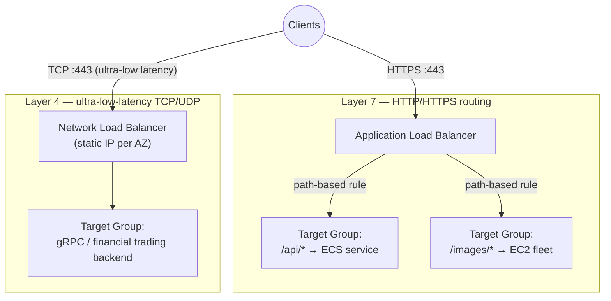
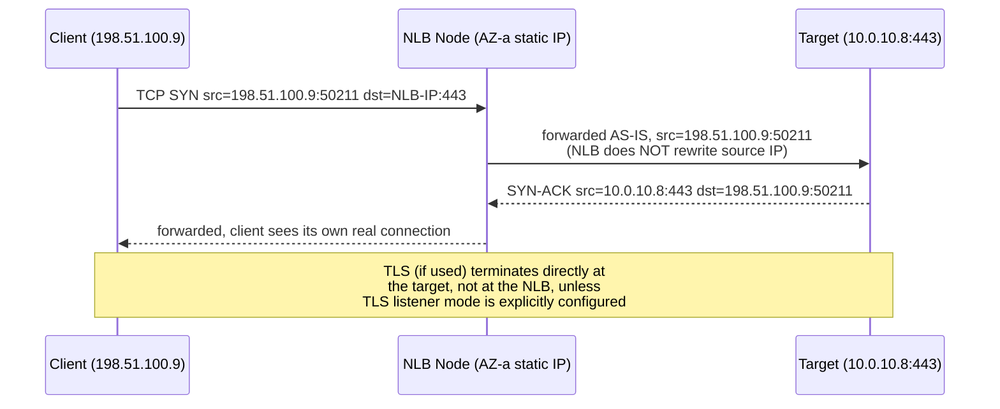
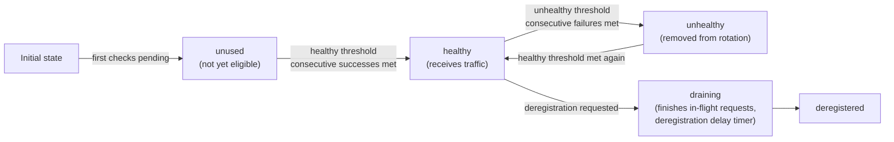
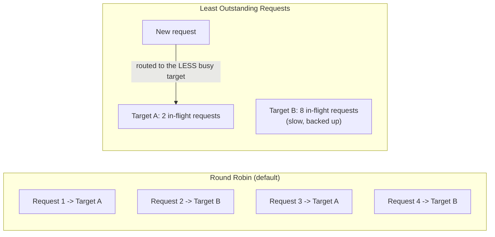
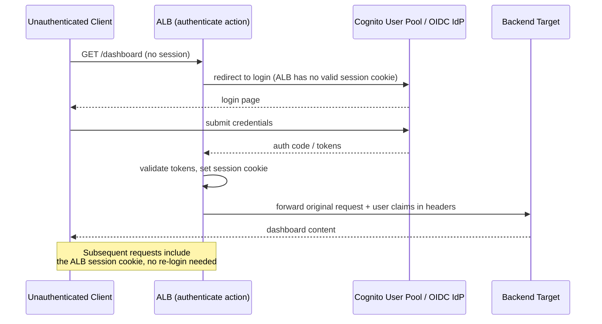
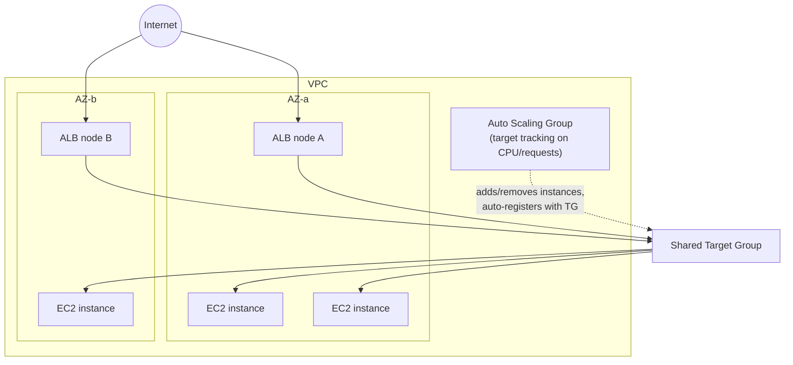
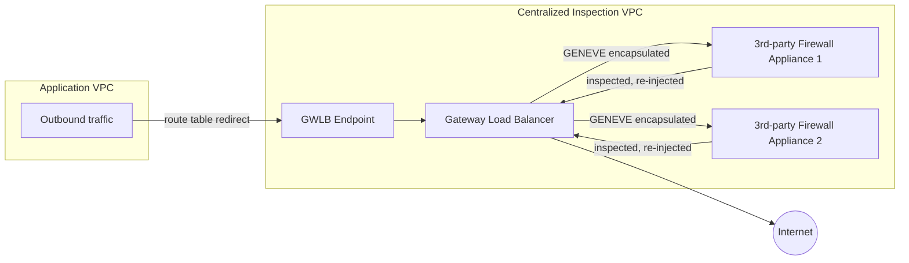
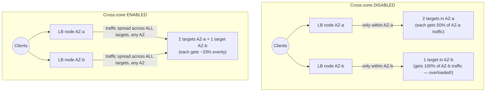

# Elastic Load Balancing (ALB / NLB / GWLB / CLB)

> **Appears in:** [SAA-C03](../../certifications/saa-c03/README.md)


## Definition

Elastic Load Balancing (ELB) is AWS's managed service for automatically distributing incoming
traffic across multiple targets (EC2 instances, containers, IP addresses, Lambda functions) so no
single server gets overwhelmed and traffic keeps flowing even if some targets fail. It comes in
four flavors tuned for different layers of the network stack: **Application Load Balancer
(ALB)**, **Network Load Balancer (NLB)**, **Gateway Load Balancer (GWLB)**, and the legacy
**Classic Load Balancer (CLB)**.

## Purpose

Before ELB, scaling meant manually running your own load-balancing software (HAProxy, nginx) on
an EC2 instance — which was itself a single point of failure and something you had to patch,
scale, and keep highly available yourself. AWS built ELB as a fully managed, horizontally
scaling, highly available load balancer that requires no capacity planning from you — it scales
to handle traffic spikes automatically and integrates natively with Auto Scaling, health checks,
and (for ALB) application-layer routing logic.

## How It Works

Plain explanation: a load balancer sits in front of your application, receives all incoming
traffic, continuously health-checks a set of registered **targets**, and only forwards traffic to
targets that pass the health check — automatically pulling a failed target out of rotation and
putting it back once it recovers. Which load balancer type you pick depends on which OSI layer
you need to operate at: ALB understands HTTP/HTTPS content (Layer 7), NLB handles raw TCP/UDP at
extreme speed and fixed IPs (Layer 4), and GWLB is for inserting third-party virtual appliances
(firewalls, IDS/IPS) transparently into a traffic path (Layer 3/4, GENEVE encapsulation).


*Figure: AWS's reference diagram of ALB's core components — listeners with rules, routing to
target groups, and a target registered with multiple target groups. Source: AWS documentation,
"What is an Application Load Balancer?" —
https://docs.aws.amazon.com/elasticloadbalancing/latest/application/introduction.html*



Step by step: the **client** connects over HTTPS to the **ALB**, which terminates TLS, inspects
the HTTP request (path, host header, headers), and uses **listener rules** to decide which
**target group** should handle it — `/api/*` goes to one ECS service, `/images/*` goes to a
different EC2 fleet, all behind one load balancer and one DNS name. In parallel, a latency-
sensitive client connecting over raw TCP hits the **NLB**, which doesn't look inside the packet
at all — it just forwards at near line-rate to a target group, preserving the client's source IP
and offering one static IP per AZ (useful when downstream firewalls need to allowlist a fixed IP).

### Packet-level walkthrough: a request through an ALB, TLS termination and all

```mermaid
sequenceDiagram
    participant Client as Client Browser
    participant ALBNode as ALB Node (AZ-a)
    participant Listener as HTTPS Listener :443
    participant Rule as Listener Rule Engine
    participant TG as Target Group
    participant Target as EC2 Target (10.0.10.5:8080)

    Client->>ALBNode: TCP SYN, TLS ClientHello (dst :443)
    ALBNode->>Listener: TLS handshake terminates HERE
    Note over ALBNode,Listener: ALB owns the certificate (ACM);<br/>client's encrypted session ends at the ALB
    Listener->>Rule: decrypted HTTP request: GET /api/orders
    Rule->>Rule: evaluate rules by priority:<br/>path /api/* -> forward to orders-tg
    Rule->>TG: select healthy target (round robin / least outstanding)
    TG->>Target: NEW plaintext (or re-encrypted) connection,<br/>10.0.10.5:8080, X-Forwarded-For header added
    Target-->>TG: HTTP response
    TG-->>Listener: response
    Listener-->>ALBNode: re-encrypt over original TLS session
    ALBNode-->>Client: HTTPS response
```

The detail worth internalizing: the ALB terminates the client's TLS connection and opens a
**separate** connection to the target — this is why the target only ever sees the ALB's internal
IP as the source address unless you read the `X-Forwarded-For` header, which the ALB inserts
specifically so the application can still learn the real client IP despite the connection being
re-originated. Contrast this with NLB, which (in its default mode) does **not** terminate the
TCP connection — it preserves the original client IP natively at the packet level because it's
forwarding, not re-originating, the connection.

### Packet-level walkthrough: NLB — preserving client IP without touching TCP



Because NLB operates at Layer 4, it can forward the original TCP connection essentially
untouched — the target application sees the real client source IP in its own socket without
needing `X-Forwarded-For` at all. This is the mechanical reason behind "NLB preserves client IP
natively" and "ALB needs `X-Forwarded-For`," a distinction the exam tests constantly.

## Key Features / Components

- **Application Load Balancer (ALB)** — Layer 7 (HTTP/HTTPS/gRPC); host- and path-based routing,
  native support for ECS/EKS/Lambda targets, WebSocket, redirects, fixed responses, integrates
  with AWS WAF and Cognito for authentication at the load balancer.
- **Network Load Balancer (NLB)** — Layer 4 (TCP/UDP/TLS); millions of requests/sec, ultra-low
  latency, one **static IP (or Elastic IP) per AZ**, preserves client source IP by default.
- **Gateway Load Balancer (GWLB)** — Layer 3/4; transparently inserts third-party virtual
  appliances (firewalls, deep packet inspection) into the traffic path using GENEVE
  encapsulation — traffic flows *through* the appliance without the client/server knowing it's
  there.
- **Classic Load Balancer (CLB)** — the original, pre-2016 load balancer; operates at both L4
  and limited L7; **legacy, AWS recommends migrating off it** for new workloads — still appears
  on exams as the "what NOT to pick for new designs" answer.
- **Target groups** — the set of registered destinations (instance IDs, IP addresses, Lambda
  ARNs) a listener routes to, each with its own health check configuration.
- **Listener rules** — host/path/header-based conditions (ALB) that decide which target group
  handles a request.
- **Health checks** — periodic probes (HTTP path or TCP connect) that determine if a target is
  "healthy" and eligible to receive traffic.
- **Cross-zone load balancing** — spreads traffic evenly across targets in *all* enabled AZs,
  not just the AZ the request happened to land in (default on for ALB, optional/billed
  differently for NLB).
- **Sticky sessions** — optional cookie-based affinity to keep a client's requests on the same
  target (ALB).
- **Connection draining (deregistration delay)** — when a target is deregistered (scaling in,
  failed health check), the load balancer waits a configurable delay before fully cutting it off,
  letting in-flight requests complete instead of being abruptly dropped.
- **Slow start** — gradually ramps traffic to a newly healthy/registered target instead of
  immediately sending it a full share, useful for targets that need JIT warm-up (JVM, caches).
- **ALB authentication (Cognito/OIDC)** — can require authentication at the load balancer itself
  before forwarding to the target, offloading login logic from the application.

## Health Check Mechanics — the full state machine



A target isn't binary healthy/unhealthy instantly — it must pass (or fail) a **consecutive
threshold count** of checks at a configured interval before its state flips. This matters for
troubleshooting: a target that briefly fails one check due to a transient blip won't be pulled
immediately (assuming the unhealthy threshold is >1), but a genuinely broken target also won't
be marked unhealthy instantly — there's a real, configurable delay baked into the design that
explains "why did it take 30 seconds for the load balancer to notice my instance was down."

### Worked example: health check timing math

With a health check interval of 10 seconds, a healthy threshold of 3, and an unhealthy threshold
of 2:

```
Time to detect a failing target:  2 (unhealthy threshold) x 10s (interval) = 20 seconds minimum
Time to re-admit a recovered target: 3 (healthy threshold) x 10s (interval) = 30 seconds minimum
```

Tuning these thresholds and intervals is a direct cost/responsiveness tradeoff: tighter (lower)
thresholds and intervals detect failure faster but increase health-check traffic/load on targets
and raise the risk of false-positive removal from a single transient blip; looser settings are
more tolerant of noise but slower to react to a real outage.

## Listener Rule Priority — a worked example

ALB listener rules are evaluated in **priority order** (lowest number first, like NACLs), with a
mandatory default rule evaluated last if nothing else matches:

| Priority | Condition | Action |
|---|---|---|
| 10 | Host header = `api.example.com` AND path = `/v2/*` | Forward to `api-v2-tg` |
| 20 | Host header = `api.example.com` | Forward to `api-v1-tg` |
| 30 | Path = `/static/*` | Redirect to CloudFront distribution |
| Default | (always matches) | Forward to `web-tg` |

A request to `api.example.com/v2/orders` matches rule 10 first (more specific) and stops there,
even though rule 20's host-header condition would also technically match — exactly like NACL
evaluation, the **first** matching rule by priority wins, not the most specific one by some other
measure. This is why rule ordering (not just rule content) is a deliberate design decision, and
why a newly added narrower rule must be given a *lower* priority number than any broader rule it
needs to take precedence over.

## Load Balancing Algorithms — Round Robin vs. Least Outstanding Requests



Round robin simply alternates targets regardless of how long each one takes to respond — fine
when all targets process requests at roughly the same speed. **Least outstanding requests**
instead tracks how many requests are currently in-flight per target and routes new requests to
whichever target has fewer pending — this matters when request processing times vary
significantly (e.g., some requests are cheap reads, others are expensive writes), since round
robin alone can pile new requests onto an already-backed-up target purely because "it's its turn"
in rotation.

## Authentication at the Load Balancer (ALB + Cognito/OIDC)



This offloads an entire authentication flow out of the application entirely — the backend target
never has to implement OAuth/OIDC itself, it simply trusts that any request reaching it already
passed the ALB's authenticate action and reads user identity claims from headers the ALB injects.
Combined with **AWS WAF** attached to the same ALB (or the CloudFront distribution in front of
it), you get both identity verification and request-content filtering (SQL injection, XSS
patterns, rate limiting) without writing either concern into the application's own code — a
pattern worth recognizing whenever a scenario asks to "add authentication/security without
application code changes."

## Common Architectures

**1. Multi-AZ ALB with Auto Scaling group.** The standard, almost-always-correct web tier
pattern: an ALB spanning 2+ AZs, each registered with an Auto Scaling group's target tracking
policy, so instance count and load balancer capacity both scale together automatically.



**2. ALB with path-based microservices routing.** One ALB, one domain, many backend services —
`/users/*` to one ECS service, `/orders/*` to another, `/static/*` to an S3-backed target via a
second listener rule redirect — consolidating what would otherwise be several separate load
balancers (and separate DNS names/certificates) into one.

**3. NLB fronting a fleet needing a fixed IP for partner allowlisting.** A financial services
integration where the partner firewall only allows traffic from specific, pre-approved IPs — an
NLB's one static IP per AZ satisfies that requirement in a way ALB (no native static IP) cannot.

**4. GWLB centralizing third-party firewall inspection across many VPCs.** Multiple application
VPCs route their traffic through a central inspection VPC's GWLB, which forwards every packet to
a fleet of third-party firewall/IDS appliances and back, completely transparently to both the
client and the application — neither side's configuration changes at all.



**5. Blue/green deployment via weighted target groups.** One ALB listener with two target
groups — "blue" (current production) and "green" (new version) — and a weighted forwarding
action that gradually shifts traffic percentage from blue to green, watching error rates before
completing the cutover; if problems appear, the weight is simply shifted back.

## Classic Load Balancer — why it's the legacy answer

CLB predates target groups entirely — it routes directly to registered instances with no
separate target group abstraction, has far more limited health check and routing capability (no
path/host-based rules, no native container/Lambda target support), and AWS has been pushing
migration off it for years. If an exam scenario describes a CLB in use today, the "improve this
architecture" answer is almost always "migrate to ALB or NLB depending on the traffic type" —
CLB itself is never the right choice for anything new.

| Capability | CLB | ALB | NLB |
|---|---|---|---|
| OSI Layer | L4 + limited L7 | L7 | L4 |
| Target groups | No (direct instance registration) | Yes | Yes |
| Path/host-based routing | No | Yes | No |
| Container/Lambda targets | No | Yes | IP targets only (not Lambda) |
| Static IP | No | No | Yes, per AZ |
| WebSocket | Limited | Yes | Yes (raw TCP) |
| Recommended for new designs | Never | Yes (HTTP/HTTPS) | Yes (TCP/UDP, extreme perf) |

## TLS/SSL Termination Models

```mermaid
flowchart TB
    subgraph EndToEnd["End-to-end encryption"]
        C1((Client)) -->|"TLS"| LB1["Load Balancer<br/>(re-encrypts)"]
        LB1 -->|"TLS (new session)"| T1["Target"]
    end
    subgraph Offload["TLS offload at the LB"]
        C2((Client)) -->|"TLS"| LB2["Load Balancer<br/>(terminates, decrypts)"]
        LB2 -->|"plaintext HTTP"| T2["Target (same VPC, trusted)"]
    end
    subgraph PassThrough["TLS passthrough (NLB TCP listener)"]
        C3((Client)) -->|"TLS (opaque to LB)"| LB3["NLB — forwards raw bytes"]
        LB3 -->|"TLS (same session,<br/>LB never decrypts)"| T3["Target terminates TLS itself"]
    end
```



ALB most commonly runs the "offload" model — it terminates the client's TLS session using an ACM
certificate and talks plaintext (or a second, separate TLS session) to the target inside the
trusted VPC boundary. NLB in **TCP mode** does true passthrough — it never sees inside the TLS
session at all, simply forwarding encrypted bytes, which is why NLB is the right choice when a
compliance requirement states the load balancer itself must never have access to decrypted
traffic. NLB also supports a native **TLS listener mode** where it *does* terminate TLS (offload
model) if that's what the architecture calls for instead — the choice between NLB's TCP and TLS
listener types is exactly this decryption-location decision.

## Target Group Attributes Worth Knowing

| Attribute | What it controls | Typical use |
|---|---|---|
| `deregistration_delay.timeout_seconds` | How long draining targets get to finish in-flight requests | Graceful scale-in (default 300s) |
| `slow_start.duration_seconds` | Ramp-up period for newly healthy targets | Avoid overwhelming cold targets |
| `stickiness.enabled` | Cookie-based session affinity (ALB) | Stateful apps without external session store |
| `load_balancing.algorithm.type` | Round robin vs. least outstanding requests (ALB) | Uneven request processing times |
| `preserve_client_ip.enabled` | Whether NLB preserves the original client IP | Usually leave enabled unless NAT'd deliberately |

## Use Cases — When to Use It

- **Multi-tier web application front door.** A standard web app needs HTTPS termination,
  path-based routing, and health-check-driven failover across an Auto Scaling group. An ALB in
  front of the app tier handles all three natively. Tradeoff vs. no load balancer (single
  instance + Elastic IP): ALB adds a small hourly + LCU cost and a network hop, but removes the
  single point of failure a lone instance represents and enables horizontal scaling.
- **Hybrid cloud API front end with static IP allowlisting.** An on-prem partner's firewall only
  permits traffic from specific, pre-approved IPs reaching a backend that's otherwise fronted by
  an ALB (no native static IP). An NLB — or Global Accelerator in front of the ALB — provides the
  fixed IP the partner's firewall requires. Tradeoff vs. an ALB alone: NLB/Global Accelerator adds
  the static IP capability, but NLB can't do ALB's path/host-based HTTP routing, so complex
  routing logic still needs an ALB behind it.
- **Multi-Region disaster recovery target.** A DR Region's standby infrastructure needs its own
  regional load balancer ready to receive traffic the moment Route 53 or Global Accelerator
  fails over to it. Tradeoff vs. provisioning the load balancer only after failover begins:
  a pre-provisioned standby ALB/NLB is instantly ready (seconds, not the minutes an ALB needs to
  warm up/scale), at the cost of paying its baseline hourly charge even while idle.
- **Global content delivery origin for dynamic content.** A CloudFront distribution needs a
  regional origin for non-cacheable, personalized requests. An ALB behind CloudFront handles
  this, with CloudFront handling the global edge/caching layer and the ALB handling in-Region
  routing to the right backend service. Tradeoff vs. pointing CloudFront directly at individual
  instances: the ALB adds health-check-driven resilience and path-based routing CloudFront alone
  doesn't provide, at the cost of one more component to operate.
- **Microservices mesh path-based routing.** A platform with many backend services wants one
  public domain and one TLS certificate covering all of them. One ALB with multiple listener
  rules (`/users/*`, `/orders/*`, `/payments/*`) routes to separate target groups per service.
  Tradeoff vs. one load balancer per microservice: dramatically fewer load balancers/domains/
  certificates to manage, but all services now share one ALB's listener-rule limit and blast
  radius if the ALB itself has an issue.
- **Compliance-driven TLS passthrough.** A regulated workload requires that the load balancer
  itself never have access to decrypted traffic — only the application may terminate TLS. NLB in
  TCP mode forwards encrypted bytes without ever decrypting them. Tradeoff vs. ALB's TLS
  termination-and-reencrypt model: satisfies strict "never decrypts" compliance language, but
  loses ALB's ability to route by HTTP content (path/host), since the NLB never looks inside the
  encrypted stream at all.
- **M&A account consolidation — unifying legacy and modern load balancers.** A newly merged
  company inherits a fleet of pre-2016 Classic Load Balancers from the acquired entity. Migrating
  them to ALB/NLB (depending on traffic type) unifies the combined organization's tooling,
  observability, and target-group-based deployment patterns. Tradeoff vs. leaving CLBs in place:
  migration takes real engineering effort and testing, but CLB lacks target groups, container/
  Lambda target support, and the routing flexibility the rest of the merged estate now expects.
- **Third-party security appliance insertion across many VPCs.** A security team wants every
  packet entering/leaving several VPCs inspected by a next-generation firewall, without each
  application team changing their own routing beyond a one-time update. Gateway Load Balancer,
  paired with GWLB endpoints per VPC, inserts the appliance transparently. Tradeoff vs. deploying
  the firewall inline per-VPC: centralizes the appliance fleet (fewer to manage/scale), but adds
  a GWLB hop and its own throughput/cost profile to every inspected packet's path.
- **Blue/green and canary deployments.** A team wants to gradually shift production traffic from
  version 1 to version 2 of an application while watching error rates, with instant rollback
  capability. Weighted target groups on a single ALB listener rule achieve this per-request, with
  no DNS propagation delay. Tradeoff vs. a Route 53 weighted-record-based cutover: ALB weighting
  shifts and reverts instantly; Route 53 weighting is subject to DNS TTL/resolver caching delay
  before a shift is fully reflected in real traffic.
- **Extreme low-latency, non-HTTP backend.** A financial trading platform or real-time gaming
  backend needs raw TCP/UDP at the lowest possible latency with millions of requests/sec. NLB's
  Layer 4 design (no HTTP parsing, no TLS termination overhead unless explicitly configured)
  fits this precisely. Tradeoff vs. ALB: NLB can't do content-aware routing at all, so any
  workload that also needs path/host-based logic must add an ALB downstream of the NLB or forgo
  that routing entirely.

## When NOT to Use It / Alternatives

- **Single-instance workloads with no scaling need** — a load balancer adds cost and a hop of
  latency for no benefit if there's genuinely only ever one target; a Route 53 record pointing
  directly at the instance (with health checks for failover) can suffice for very simple cases.
- **Global multi-Region traffic steering by latency/health, not just load distribution across
  targets in one Region** — that's **Route 53 routing policies** or **AWS Global Accelerator**,
  which operate above/across ELB, not instead of it (often used together: Global Accelerator
  routes to the nearest Region's ALB).
- **You need deep L7 app logic beyond routing** (complex business-rule-based routing, response
  transformation) — consider **API Gateway** in front of, or instead of, an ALB for API-specific
  workloads (throttling, API keys, request validation).
- **Static content only** — serve directly from S3 + CloudFront; no load balancer needed at all.

## Why It's Important

**Real-world:** choosing the wrong load balancer type is a common production performance and
cost mistake — e.g., using an ALB for a non-HTTP TCP protocol (it simply can't route it
correctly) or using an NLB when you actually needed host/path-based routing (it can't do that at
all, it's blind to HTTP content). ELB is also usually the single most visible component in an
outage (if it misbehaves, everything behind it looks down), so understanding its health check and
cross-zone behavior is critical to real incident response.

**Exam mapping:**
- **SAA-C03** — Domain 2 (Resilient Architectures, 26%) Task 2.1 explicitly lists load balancing;
  Domain 3 (High-Performing) Task 3.4 tests choosing the right ELB type for a given protocol/
  latency requirement — this ALB vs. NLB vs. GWLB distinction is one of the most reliably tested
  single topics on the whole exam.
- **DVA-C03** — Domain 1 (ECS/EKS deployment) assumes ALB target group integration with
  containers; Domain 3 (Testing/Deployment) covers blue/green and canary deployments that rely
  on ALB weighted target groups.
- **MLA-C02** — Domain 3 (Deployment/Orchestration) uses ALB in front of real-time SageMaker
  endpoints or custom inference containers for scaling and health-check-based failover.

## Pricing Model (summary)

Each load balancer type bills an **hourly charge** plus a usage-based charge measured in **Load
Balancer Capacity Units (LCUs)** — an LCU bundles new connections/sec, active connections,
bandwidth, and (for ALB) rule evaluations into one unit; you're billed for whichever dimension is
highest that hour. There is no per-request flat fee like API Gateway — it's capacity-based. NLB
additionally has no charge for cross-zone data transfer when cross-zone load balancing is
disabled (it's on by default for ALB, optional and separately priced for NLB). Official pricing:
https://aws.amazon.com/elasticloadbalancing/pricing/

**LCU dimensions, by load balancer type:**

| Dimension | ALB | NLB |
|---|---|---|
| New connections/sec | Counted | Counted |
| Active connections/min | Counted | Counted |
| Processed bytes | Counted | Counted |
| Rule evaluations | Counted (ALB only — reflects listener rule complexity) | N/A |

Because you're billed for the *highest* dimension, a workload with very few connections but huge
payload sizes (large file transfers) can be billed primarily on the bytes-processed dimension even
though connection count looks tiny — a subtlety worth knowing when a scenario describes unusually
high LCU costs despite "low traffic" by request-count alone.

## Cross-Zone Load Balancing — enabled vs. disabled


*Figure: AWS's reference diagram of cross-zone load balancing enabled — each load balancer node
distributes its share of traffic evenly across registered targets in every enabled Availability
Zone, not just its own AZ. Source: AWS documentation, "How Elastic Load Balancing works" —
https://docs.aws.amazon.com/elasticloadbalancing/latest/userguide/how-elastic-load-balancing-works.html*



This is a real, concrete operational risk: if AZs have an uneven number of registered targets and
cross-zone load balancing is off, the AZ with fewer targets gets proportionally more load per
target — ALB has this always enabled with no way to disable it at the load balancer level (only
per target group); NLB defaults it off and it's a deliberate choice with its own billing
implications (cross-zone traffic for NLB is a separately metered data transfer charge when
enabled, whereas it's included at no extra charge for ALB).

## Limits & Quotas

| Resource | Default quota |
|---|---|
| Load balancers per Region | 50 (soft, increasable) |
| Listeners per load balancer | 50 |
| Target groups per load balancer | 100 |
| Targets per target group (instance/IP targets) | 1,000 |
| Targets per target group (Lambda) | 1 |
| Rules per ALB listener | 100 (not counting default rule) |
| Certificates per ALB (via SNI) | 25 default, more via Service Quotas |
| Idle timeout (ALB default) | 60 seconds (configurable 1-4000s) |
| NLB AZs | Up to 1 static IP per enabled AZ |

The idle timeout number is a genuinely practical one: long-polling or WebSocket connections that
exceed the configured idle timeout get silently closed by the ALB even if both the client and
backend are otherwise healthy — a very common "why does my WebSocket connection randomly drop
every 60 seconds" support issue traced directly back to this default.

## Troubleshooting / Common Issues

- **"Targets are marked unhealthy, but the application itself is running fine."** Check the
  health check's configured *path* and *port* against what the application actually serves on —
  a common mistake is health-checking `/` when the app only returns 200 on `/health`, or
  health-checking the wrong port entirely (e.g., checking port 80 when the target listens on
  8080).
- **"WebSocket or long-polling connections drop every ~60 seconds."** The ALB's default idle
  timeout is 60 seconds — raise the listener's idle timeout setting, or ensure the application
  sends periodic keepalive frames within that window.
- **"The application can't determine the real client IP — it always sees the load balancer's
  IP."** Expected behavior for ALB (it terminates and re-originates the TCP connection) — read
  the `X-Forwarded-For` header instead of the socket's peer address. For NLB, the real client IP
  is preserved natively at the TCP layer, so this shouldn't be an issue unless a proxy protocol
  setting is misconfigured.
- **"One AZ's targets are consistently more loaded than another AZ's targets."** Check whether
  cross-zone load balancing is enabled, especially for NLB (off by default) — and check whether
  target counts per AZ are actually balanced in the first place.
- **"A newly launched target takes a long time to receive meaningful traffic even after passing
  health checks."** Slow start is likely enabled and intentionally ramping traffic gradually —
  this is a feature, not a bug, designed to avoid overwhelming a cold target (e.g., one with an
  empty cache or a JIT-compiled runtime still warming up).
- **"A target was removed from the fleet but connections to it took a while to fully stop."**
  Connection draining (deregistration delay) is doing its job — in-flight requests are allowed to
  finish for the configured delay window before the target is fully cut off; this is intentional
  graceful termination, not a bug.
- **"ALB returns a 46x-series error directly, without reaching any target."** These are ALB-
  generated errors distinct from backend errors — e.g., a 460 means the client didn't send a
  complete request in time, a 463 often relates to an invalid/duplicate header like
  `X-Forwarded-For` already present in an unexpected way; check the ALB's own access logs
  (distinct from application logs) to see these before assuming it's a backend issue.

## Hands-on Lab (Floci)

**Honest limitation:** Elastic Load Balancing (`elbv2`/`elb` CLI namespace) is **not** in Floci's
confirmed-supported service list (unlike EC2/VPC, which are Docker-backed). Commands below show
the exact real-AWS CLI shape for study purposes — try them against Floci, but expect a
"not implemented" or empty response rather than a working load balancer:

```bash
# Real-AWS shape (verify against Floci's actual support before relying on output)
awslocal elbv2 create-load-balancer --name study-alb --type application \
  --subnets <subnet-id-1> <subnet-id-2>

awslocal elbv2 create-target-group --name study-tg --protocol HTTP --port 80 \
  --vpc-id <vpc-id> --target-type instance --health-check-path /health \
  --healthy-threshold-count 3 --unhealthy-threshold-count 2 --health-check-interval-seconds 10

awslocal elbv2 register-targets --target-group-arn <tg-arn> \
  --targets Id=<instance-id>

awslocal elbv2 create-listener --load-balancer-arn <alb-arn> \
  --protocol HTTP --port 80 \
  --default-actions Type=forward,TargetGroupArn=<tg-arn>

# Add a path-based routing rule
awslocal elbv2 create-rule --listener-arn <listener-arn> --priority 10 \
  --conditions Field=path-pattern,Values='/api/*' \
  --actions Type=forward,TargetGroupArn=<api-tg-arn>
```

For a working hands-on alternative: spin up two local Docker containers running a simple web
server and put **nginx** or **HAProxy** in front of them in round-robin mode to internalize the
health-check/target-pool concept, or use the AWS Free Tier (750 hrs/month ALB-eligible on new
accounts) for a real, billed-but-free-tier lab. Full notes: `labs-floci/networking-vpc-lab.md`.

## Exam Scenario Deep Dive

**Scenario 1 — "An application needs to route `/images/*` requests to an S3-backed fleet and
`/api/*` requests to an ECS service, all under one domain name and one TLS certificate."**
This is a textbook ALB path-based routing scenario — one ALB, one listener, two listener rules
by path pattern, two target groups. NLB cannot do this (it's blind to HTTP content); a separate
load balancer per path would work but is unnecessarily complex and costly compared to one ALB
with rules.

**Scenario 2 — "A gaming company needs UDP support and the lowest possible latency, with a
downstream firewall at a partner studio that requires a fixed IP allowlist entry."**
NLB is the only ELB type that supports UDP at all, and it's the only one offering a static IP
per AZ — ALB supports neither requirement. This is one of the cleanest "pick NLB, no ambiguity"
scenarios on the exam.

**Scenario 3 — "A security team wants every packet entering and leaving several VPCs inspected
by a third-party next-generation firewall appliance, without any application teams needing to
change their VPC routing configuration beyond a one-time route table update."**
Gateway Load Balancer, paired with GWLB endpoints in each application VPC, routes traffic
transparently through the centralized appliance fleet — the application and client see no
difference in behavior, satisfying the "no application-level changes" requirement precisely.

**Scenario 4 — "During a load test, one Availability Zone's targets show significantly higher
CPU utilization than targets in other AZs, despite Auto Scaling appearing to add instances
evenly across AZs."**
Check cross-zone load balancing first — if it's disabled (the NLB default) and target counts are
uneven across AZs even briefly during a scaling event, the AZ with fewer targets absorbs a
disproportionate share of that AZ's incoming traffic. Enabling cross-zone load balancing (while
being aware of the NLB data-transfer cost implication) resolves the imbalance.

**Scenario 5 — "A team wants to gradually shift production traffic from version 1 to version 2
of an application, watching error rates in real time, with the ability to instantly revert if
problems appear."**
Weighted target groups on a single ALB listener rule — set an initial 95/5 split favoring the old
version, monitor CloudWatch metrics/alarms on the new version's target group, and progressively
shift the weight toward the new version; reverting is as simple as resetting the weight back to
the old distribution, with no DNS propagation delay involved (unlike a Route 53 weighted record
based cutover, which has to wait out TTL-driven caching).

## Exam Tips

- **ALB = Layer 7 (content-aware), NLB = Layer 4 (speed/static IP), GWLB = Layer 3/4 (traffic
  interception for appliances), CLB = legacy, don't pick it for new designs.** This single
  mapping resolves a large fraction of ELB exam questions.
- **Static IP requirement in the question = NLB**, almost always — ALB does not support a
  static/Elastic IP directly (you'd need Global Accelerator in front of it for that).
- **Path-based or host-based routing in the question = ALB** — NLB cannot inspect HTTP content.
- **"Preserve client IP without extra configuration" = NLB** (preserves it natively); ALB needs
  the `X-Forwarded-For` header since it terminates the TCP connection itself.
- **Third-party firewall/IDS "transparently inline" = GWLB** — this is GWLB's one unique,
  unambiguous use case on the exam.
- Health check failures and cross-zone load balancing settings are common troubleshooting-style
  questions: "an instance is marked unhealthy and removed — why?" ⇒ check health check path/port/
  thresholds, not the instance's actual app logic first.
- **Know the health check timing formula**: time-to-detect-failure = unhealthy threshold ×
  interval; a scenario describing "it took exactly 30 seconds to notice a failure" is testing
  whether you can reverse this formula from given threshold/interval numbers.
- **LCU billing is dimension-based, not flat per-request** — a scenario about unexpectedly high
  ELB cost despite "low traffic" is often pointing at a non-obvious LCU dimension (bytes
  processed, rule evaluation count) being the actual cost driver, not raw request volume.
- **Cross-zone load balancing is always-on for ALB, optional (and separately billed when
  enabled) for NLB** — a frequent point of confusion the exam exploits directly.

## Further Reading

- AWS Docs — What is an Application Load Balancer?: https://docs.aws.amazon.com/elasticloadbalancing/latest/application/introduction.html
- AWS Docs — How Elastic Load Balancing works: https://docs.aws.amazon.com/elasticloadbalancing/latest/userguide/how-elastic-load-balancing-works.html
- AWS Docs — Network Load Balancers: https://docs.aws.amazon.com/elasticloadbalancing/latest/network/introduction.html
- AWS Docs — Gateway Load Balancers: https://docs.aws.amazon.com/elasticloadbalancing/latest/gateway/introduction.html
- AWS Blog — Exploring Data Transfer Costs for Classic and Application Load Balancers: https://aws.amazon.com/blogs/networking-and-content-delivery/exploring-data-transfer-costs-for-classic-and-application-load-balancers/
- AWS re:Post — Troubleshoot ALB unhealthy targets: https://repost.aws/knowledge-center/elb-fix-failing-health-checks-alb

## Related Terms

- [`vpc.md`](vpc.md), [`subnets-route-tables-igw-natgw.md`](subnets-route-tables-igw-natgw.md)
- [`route53.md`](route53.md) — DNS-level routing, often paired with ELB
- [`global-accelerator.md`](global-accelerator.md) — static anycast IP + cross-Region routing in
  front of multiple regional load balancers
- `services/containers/ecs.md`, `services/containers/eks.md` — common ALB/NLB targets
- `glossary/osi-model.md`, `glossary/health-check.md`
