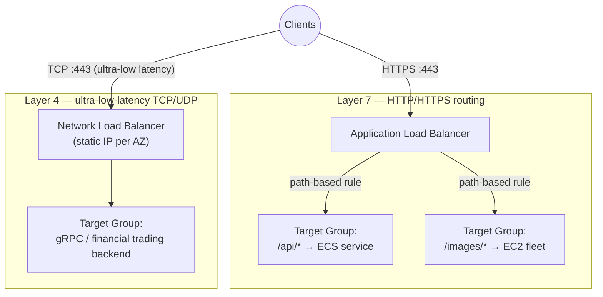

# Elastic Load Balancing (ALB / NLB / GWLB / CLB)


## Definition

Elastic Load Balancing (ELB) is AWS's managed service for automatically distributing incoming
traffic across multiple targets (EC2 instances, containers, IP addresses, Lambda functions) so no
single server gets overwhelmed and traffic keeps flowing even if some targets fail. It comes in
four flavors tuned for different layers of the network stack: **Application Load Balancer
(ALB)**, **Network Load Balancer (NLB)**, **Gateway Load Balancer (GWLB)**, and the legacy
**Classic Load Balancer (CLB)**.

## Purpose

Before ELB, scaling meant manually running your own load-balancing software (HAProxy, nginx) on
an EC2 instance — which was itself a single point of failure and something you had to patch,
scale, and keep highly available yourself. AWS built ELB as a fully managed, horizontally
scaling, highly available load balancer that requires no capacity planning from you — it scales
to handle traffic spikes automatically and integrates natively with Auto Scaling, health checks,
and (for ALB) application-layer routing logic.

## How It Works

Plain explanation: a load balancer sits in front of your application, receives all incoming
traffic, continuously health-checks a set of registered **targets**, and only forwards traffic to
targets that pass the health check — automatically pulling a failed target out of rotation and
putting it back once it recovers. Which load balancer type you pick depends on which OSI layer
you need to operate at: ALB understands HTTP/HTTPS content (Layer 7), NLB handles raw TCP/UDP at
extreme speed and fixed IPs (Layer 4), and GWLB is for inserting third-party virtual appliances
(firewalls, IDS/IPS) transparently into a traffic path (Layer 3/4, GENEVE encapsulation).



Step by step: the **client** connects over HTTPS to the **ALB**, which terminates TLS, inspects
the HTTP request (path, host header, headers), and uses **listener rules** to decide which
**target group** should handle it — `/api/*` goes to one ECS service, `/images/*` goes to a
different EC2 fleet, all behind one load balancer and one DNS name. In parallel, a latency-
sensitive client connecting over raw TCP hits the **NLB**, which doesn't look inside the packet
at all — it just forwards at near line-rate to a target group, preserving the client's source IP
and offering one static IP per AZ (useful when downstream firewalls need to allowlist a fixed IP).

## Key Features / Components

- **Application Load Balancer (ALB)** — Layer 7 (HTTP/HTTPS/gRPC); host- and path-based routing,
  native support for ECS/EKS/Lambda targets, WebSocket, redirects, fixed responses, integrates
  with AWS WAF and Cognito for authentication at the load balancer.
- **Network Load Balancer (NLB)** — Layer 4 (TCP/UDP/TLS); millions of requests/sec, ultra-low
  latency, one **static IP (or Elastic IP) per AZ**, preserves client source IP by default.
- **Gateway Load Balancer (GWLB)** — Layer 3/4; transparently inserts third-party virtual
  appliances (firewalls, deep packet inspection) into the traffic path using GENEVE
  encapsulation — traffic flows *through* the appliance without the client/server knowing it's
  there.
- **Classic Load Balancer (CLB)** — the original, pre-2016 load balancer; operates at both L4
  and limited L7; **legacy, AWS recommends migrating off it** for new workloads — still appears
  on exams as the "what NOT to pick for new designs" answer.
- **Target groups** — the set of registered destinations (instance IDs, IP addresses, Lambda
  ARNs) a listener routes to, each with its own health check configuration.
- **Listener rules** — host/path/header-based conditions (ALB) that decide which target group
  handles a request.
- **Health checks** — periodic probes (HTTP path or TCP connect) that determine if a target is
  "healthy" and eligible to receive traffic.
- **Cross-zone load balancing** — spreads traffic evenly across targets in *all* enabled AZs,
  not just the AZ the request happened to land in (default on for ALB, optional/billed
  differently for NLB).
- **Sticky sessions** — optional cookie-based affinity to keep a client's requests on the same
  target (ALB).

## Use Cases — When to Use It

- **ALB**: standard web applications, microservices with path-based routing, container workloads
  (ECS/EKS), anything needing host-header or path-based routing, WAF integration, or
  authentication at the edge.
- **NLB**: extreme performance/low-latency requirements (gaming, financial trading, IoT),
  workloads needing a **static IP** for firewall allowlisting, non-HTTP TCP/UDP protocols,
  preserving the original client IP without needing `X-Forwarded-For`.
- **GWLB**: centralizing third-party security appliances (firewalls, IDS/IPS) in front of many
  VPCs without redesigning each VPC's routing — a common enterprise security architecture.
- **CLB**: only relevant if you're maintaining a pre-2016 legacy workload that hasn't migrated;
  never the right answer for a new design.

## When NOT to Use It / Alternatives

- **Single-instance workloads with no scaling need** — a load balancer adds cost and a hop of
  latency for no benefit if there's genuinely only ever one target; a Route 53 record pointing
  directly at the instance (with health checks for failover) can suffice for very simple cases.
- **Global multi-Region traffic steering by latency/health, not just load distribution across
  targets in one Region** — that's **Route 53 routing policies** or **AWS Global Accelerator**,
  which operate above/across ELB, not instead of it (often used together: Global Accelerator
  routes to the nearest Region's ALB).
- **You need deep L7 app logic beyond routing** (complex business-rule-based routing, response
  transformation) — consider **API Gateway** in front of, or instead of, an ALB for API-specific
  workloads (throttling, API keys, request validation).
- **Static content only** — serve directly from S3 + CloudFront; no load balancer needed at all.

## Why It's Important

**Real-world:** choosing the wrong load balancer type is a common production performance and
cost mistake — e.g., using an ALB for a non-HTTP TCP protocol (it simply can't route it
correctly) or using an NLB when you actually needed host/path-based routing (it can't do that at
all, it's blind to HTTP content). ELB is also usually the single most visible component in an
outage (if it misbehaves, everything behind it looks down), so understanding its health check and
cross-zone behavior is critical to real incident response.

**Exam mapping:**
- **SAA-C03** — Domain 2 (Resilient Architectures, 26%) Task 2.1 explicitly lists load balancing;
  Domain 3 (High-Performing) Task 3.4 tests choosing the right ELB type for a given protocol/
  latency requirement — this ALB vs. NLB vs. GWLB distinction is one of the most reliably tested
  single topics on the whole exam.
- **DVA-C03** — Domain 1 (ECS/EKS deployment) assumes ALB target group integration with
  containers; Domain 3 (Testing/Deployment) covers blue/green and canary deployments that rely
  on ALB weighted target groups.
- **MLA-C02** — Domain 3 (Deployment/Orchestration) uses ALB in front of real-time SageMaker
  endpoints or custom inference containers for scaling and health-check-based failover.

## Pricing Model (summary)

Each load balancer type bills an **hourly charge** plus a usage-based charge measured in **Load
Balancer Capacity Units (LCUs)** — an LCU bundles new connections/sec, active connections,
bandwidth, and (for ALB) rule evaluations into one unit; you're billed for whichever dimension is
highest that hour. There is no per-request flat fee like API Gateway — it's capacity-based. NLB
additionally has no charge for cross-zone data transfer when cross-zone load balancing is
disabled (it's on by default for ALB, optional and separately priced for NLB). Official pricing:
https://aws.amazon.com/elasticloadbalancing/pricing/

## Hands-on Lab (Floci)

**Honest limitation:** Elastic Load Balancing (`elbv2`/`elb` CLI namespace) is **not** in Floci's
confirmed-supported service list (unlike EC2/VPC, which are Docker-backed). Commands below show
the exact real-AWS CLI shape for study purposes — try them against Floci, but expect a
"not implemented" or empty response rather than a working load balancer:

```bash
# Real-AWS shape (verify against Floci's actual support before relying on output)
awslocal elbv2 create-load-balancer --name study-alb --type application \
  --subnets <subnet-id-1> <subnet-id-2>

awslocal elbv2 create-target-group --name study-tg --protocol HTTP --port 80 \
  --vpc-id <vpc-id> --target-type instance --health-check-path /health

awslocal elbv2 register-targets --target-group-arn <tg-arn> \
  --targets Id=<instance-id>

awslocal elbv2 create-listener --load-balancer-arn <alb-arn> \
  --protocol HTTP --port 80 \
  --default-actions Type=forward,TargetGroupArn=<tg-arn>
```

For a working hands-on alternative: spin up two local Docker containers running a simple web
server and put **nginx** or **HAProxy** in front of them in round-robin mode to internalize the
health-check/target-pool concept, or use the AWS Free Tier (750 hrs/month ALB-eligible on new
accounts) for a real, billed-but-free-tier lab. Full notes: `labs-floci/networking-vpc-lab.md`.

## Exam Tips

- **ALB = Layer 7 (content-aware), NLB = Layer 4 (speed/static IP), GWLB = Layer 3/4 (traffic
  interception for appliances), CLB = legacy, don't pick it for new designs.** This single
  mapping resolves a large fraction of ELB exam questions.
- **Static IP requirement in the question = NLB**, almost always — ALB does not support a
  static/Elastic IP directly (you'd need Global Accelerator in front of it for that).
- **Path-based or host-based routing in the question = ALB** — NLB cannot inspect HTTP content.
- **"Preserve client IP without extra configuration" = NLB** (preserves it natively); ALB needs
  the `X-Forwarded-For` header since it terminates the TCP connection itself.
- **Third-party firewall/IDS "transparently inline" = GWLB** — this is GWLB's one unique,
  unambiguous use case on the exam.
- Health check failures and cross-zone load balancing settings are common troubleshooting-style
  questions: "an instance is marked unhealthy and removed — why?" ⇒ check health check path/port/
  thresholds, not the instance's actual app logic first.

## Related Terms

- [`vpc.md`](vpc.md), [`subnets-route-tables-igw-natgw.md`](subnets-route-tables-igw-natgw.md)
- [`route53.md`](route53.md) — DNS-level routing, often paired with ELB
- [`global-accelerator.md`](global-accelerator.md) — static anycast IP + cross-Region routing in
  front of multiple regional load balancers
- `services/containers/ecs.md`, `services/containers/eks.md` — common ALB/NLB targets
- `glossary/osi-model.md`, `glossary/health-check.md`
