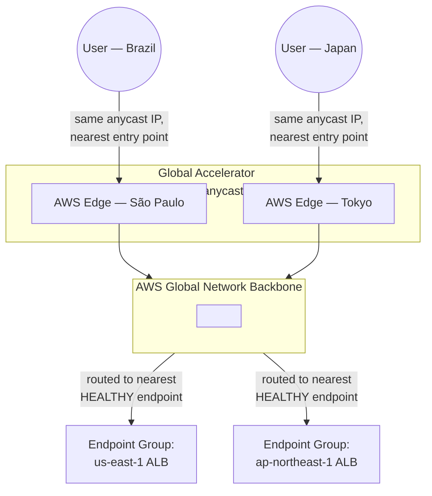
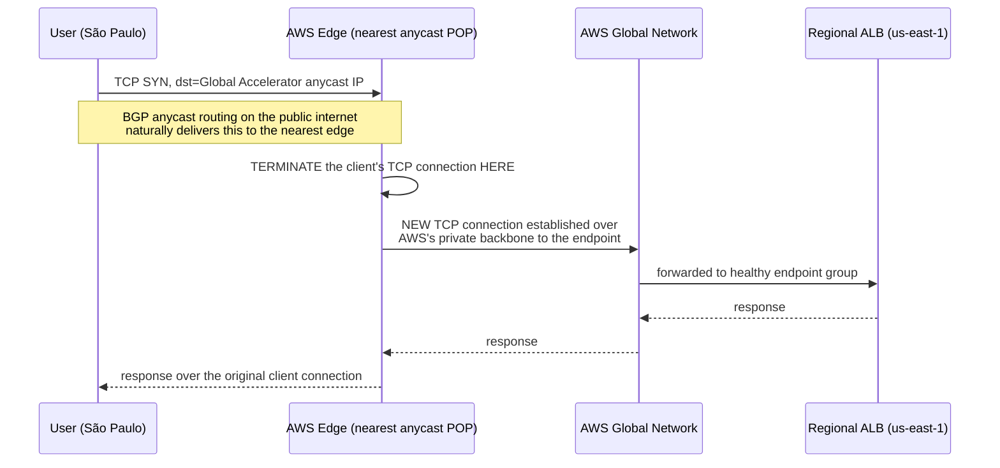
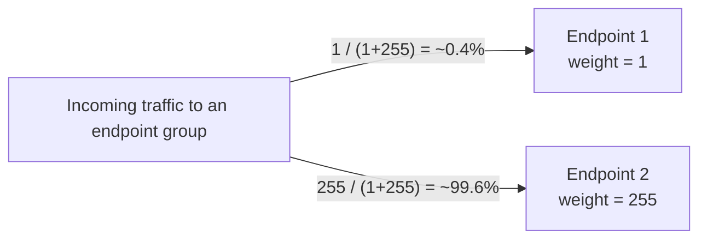
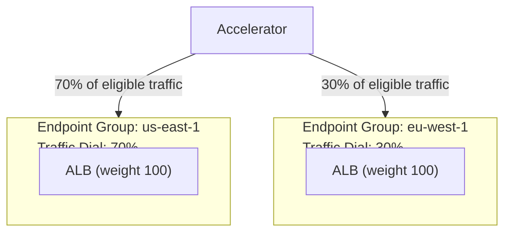
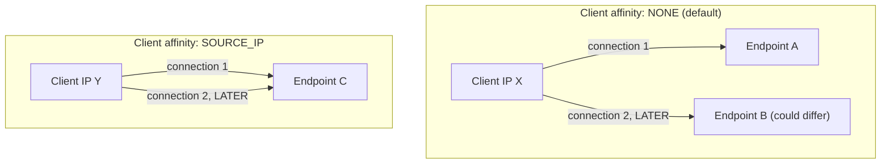
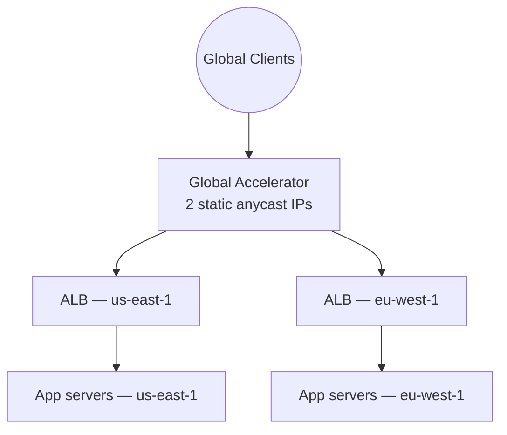

# AWS Global Accelerator

> **Appears in:** [SAA-C03](../../certifications/saa-c03/README.md)


## Definition

AWS Global Accelerator gives your application a small set of **static anycast IP addresses**
that act as a fixed front door, then routes traffic over AWS's private global network backbone
to the closest, healthiest regional endpoint (load balancer, EC2 instance, or Elastic IP) —
improving performance and enabling near-instant failover at the network layer instead of DNS.

## Purpose

Two persistent problems with internet-routed, DNS-based global traffic management: (1) the
public internet's routing between a user and your Region isn't optimized for performance — it
takes whatever path internet service providers' routing happens to choose; and (2) DNS-based
failover (like Route 53) is inherently slow because clients and resolvers cache answers for the
TTL duration. Global Accelerator solves both: **anycast IPs** mean the *same* IP address is
announced from many AWS edge locations, so a user's traffic automatically enters the AWS network
at the nearest edge and then travels over AWS's own private backbone (not the public internet)
the rest of the way; and because the client's IP never changes, failover happens by AWS
rerouting traffic at the network layer within seconds — no DNS cache to wait out.

## How It Works

Plain explanation: you create an **accelerator**, which is assigned 2 static anycast IPs. You
attach **listeners** (port ranges/protocols) and **endpoint groups** — one per Region, each
pointing at real endpoints (ALB, NLB, EC2 instance, Elastic IP). Global Accelerator continuously
health-checks every endpoint and automatically routes each user's traffic to the nearest *healthy*
endpoint group, shifting away instantly if a Region's endpoints fail health checks.



Step by step: both users connect to the **exact same two IP addresses** — Global Accelerator's
anycast routing means each user's traffic physically enters the AWS network at whichever edge is
geographically closest to them (São Paulo for the Brazil user, Tokyo for the Japan user), with no
DNS lookup required to pick a Region. From there, traffic travels over **AWS's private global
backbone** — not the public internet — to the healthiest, best-performing **endpoint group**, by
default the one in the user's nearest Region, but automatically rerouted to a different Region's
endpoint group within seconds if that Region's health checks start failing — far faster than
waiting for a DNS TTL to expire.

### Packet-level walkthrough: anycast entry + TCP termination/re-origination at the edge



The key mechanical fact: Global Accelerator **terminates the client's TCP connection at the
nearest edge location** and opens a **separate** new connection over AWS's own backbone to reach
the actual endpoint — conceptually similar to how an ALB terminates and re-originates a TLS
connection, except here it happens at the very edge of AWS's network, as close to the user as
possible, specifically to get the unpredictable public-internet segment of the journey over with
as early as possible.

### Weighted endpoint routing — relative weights explained



Endpoint weights inside an endpoint group work as a simple ratio: weight ÷ sum of all weights in
that group. A weight of 0 removes an endpoint from rotation entirely without deleting it —
useful for draining an endpoint ahead of maintenance while keeping its configuration intact for
a quick re-enable.

## Key Features / Components

- **Static anycast IP addresses** — 2 fixed IPs that never change, announced from many AWS edge
  locations simultaneously; useful when downstream firewalls need a stable IP to allowlist,
  which neither ALB nor CloudFront natively offers.
- **Listeners** — define which ports/protocols (TCP/UDP) the accelerator accepts.
- **Endpoint groups** — per-Region collections of endpoints (ALB, NLB, EC2, Elastic IP) with
  traffic dial percentages and health check configuration.
- **Health checks** — continuous probing; unhealthy endpoints/Regions are automatically removed
  from rotation at the network layer, independent of DNS caching.
- **Traffic dials** — control what percentage of traffic an endpoint group receives, useful for
  gradual Regional rollout or controlled failover testing.
- **Client affinity** — optional setting to keep a given client IP routed to the same endpoint
  for session consistency (useful for stateful/UDP protocols like gaming).
- **Custom routing accelerator** — a specialized mode that maps accelerator ports/IPs directly to
  specific EC2 instance ports across many VPCs/subnets, often used for gaming backends.
- **Endpoint weights** — within an endpoint group, individual endpoints can be weighted relative
  to each other for fine-grained traffic distribution beyond the group-level traffic dial.

## Traffic Dial vs. Endpoint Weight — two different knobs


*Figure: AWS's reference diagram of weighted endpoint traffic distribution — endpoint weights
determine what proportion of a listener's traffic each endpoint in a group receives, calculated
as each endpoint's weight divided by the sum of all weights in that group. Source: AWS
documentation, "How endpoint weights work to manage traffic volume" —
https://docs.aws.amazon.com/global-accelerator/latest/dg/about-endpoints-endpoint-weights.html*



**Traffic dial** operates at the **endpoint group (Region)** level — it controls what percentage
of traffic a whole Region's endpoint group is eligible to receive, often used to gradually bring
a newly deployed Region online (start at 0% or 10%, ramp up as confidence grows) or to drain a
Region ahead of planned maintenance. **Endpoint weight** operates *within* a single endpoint
group, distributing that group's share of traffic across multiple individual endpoints in the
same Region. A scenario describing "gradually shift traffic to a newly added Region" is a
traffic-dial question; a scenario describing "distribute load unevenly across two ALBs in the
same Region" is an endpoint-weight question.

## Client Affinity — keeping a client pinned to one endpoint



By default, Global Accelerator treats every new connection independently for load distribution
purposes — two separate TCP connections from the same client IP could, in principle, land on
different endpoints. Setting client affinity to `SOURCE_IP` instead consistently routes all
traffic from a given client IP to the **same** endpoint for the lifetime of that affinity
setting — important for stateful UDP protocols (like many game networking protocols) where a
client's session state lives on one specific server and splitting its traffic across multiple
backend instances would break the session entirely.

## Common Architectures

**1. Global Accelerator in front of multi-Region ALBs (the standard pairing).** One accelerator
with two static IPs, two endpoint groups pointing at regional ALBs, each ALB still doing its own
Layer 7 path/host routing within its Region — Global Accelerator handles the global entry point
and fast failover, the ALB handles in-Region request routing.



**2. Fixed-IP allowlisting for partner integrations.** A financial services or B2B integration
where a partner's firewall only permits traffic from specific, pre-registered IPs — Global
Accelerator's static IPs satisfy this even when the backend (e.g., an ALB, which has no native
static IP) changes or scales behind the scenes.

**3. UDP-based gaming backend with custom routing.** A custom routing accelerator maps specific
external ports to specific internal EC2 instance:port combinations across many VPCs, letting a
gaming company route individual game sessions to specific backend instances by the port the
client connects on.

**4. Blue/green Regional rollout via traffic dial.** A new Region's endpoint group starts at a
0% or low traffic dial, is validated with synthetic/internal traffic, then gradually dialed up as
confidence grows — a safer rollout pattern than an instant full cutover.

## Use Cases — When to Use It

- **Global applications needing a fixed, allowlist-friendly IP** — financial services, gaming,
  IoT backends where downstream firewalls or clients need to pin to a known, unchanging IP.
- **Multi-Region active-active or active-passive architectures needing fast failover** — when
  DNS TTL-based failover (Route 53) isn't fast enough for the application's availability target.
- **Non-HTTP(S) global traffic (TCP/UDP)** — Global Accelerator works at the network layer, so
  it supports protocols CloudFront (HTTP-focused CDN) cannot accelerate.
- **Improving global user latency to dynamic, non-cacheable content** — where CloudFront's
  caching model doesn't apply (CloudFront helps static/cacheable content; Global Accelerator
  helps the network path itself, including for fully dynamic traffic).
- **Combining with ALBs** — a very common pattern: Global Accelerator in front of regional ALBs
  across multiple Regions, giving a fixed global IP plus ALB's Layer 7 routing within each Region.

## When NOT to Use It / Alternatives

- **Primarily static/cacheable content** — **CloudFront** is the right tool (it caches at the
  edge, reducing origin load and repeat-request latency, which Global Accelerator does not do —
  Global Accelerator only optimizes the network path, it does not cache anything).
- **Single-Region applications** — Global Accelerator's value is explicitly about multi-Region/
  multi-endpoint global traffic management; a single-Region app gains nothing from it.
- **Cost-sensitive workloads where Route 53 latency/failover routing is "good enough"** — if
  your availability target tolerates DNS TTL-based failover timing, Route 53 alone is
  considerably cheaper and may be all you need.
- **You need request content inspection/routing (path-based, header-based)** — Global Accelerator
  operates below the HTTP layer; use ALB (behind it, if needed) for L7 routing logic.

## Why It's Important

**Real-world:** applications with hard real-time or near-real-time availability requirements
(online gaming matchmaking, trading platforms, mission-critical IoT) cannot tolerate DNS TTL
delays during a Regional failure — Global Accelerator's sub-minute network-layer failover is the
difference between a blip and a visible outage for end users. The fixed-IP property also solves
a very mundane but common enterprise pain point: downstream partners/firewalls that refuse to
allowlist a CloudFront/ALB domain name and insist on IP-based rules.

**Exam mapping:**
- **SAA-C03** — Domain 2 (Resilient Architectures) and Domain 3 (High-Performing Architectures)
  both reference Global Accelerator for fast failover and global performance optimization —
  expect it as a distractor/correct-answer pair against Route 53 and CloudFront, where the
  "fixed IP" or "fast failover without DNS" keywords point to Global Accelerator specifically.
- **DVA-C03** — lower weight; mentioned where multi-Region deployment strategy intersects with
  Domain 3 (Testing and Deployment).
- **MLA-C02** — minimal direct coverage; occasionally relevant for globally distributed
  real-time inference endpoints needing fast failover between Regions.

## Pricing Model (summary)

Billed with a small **fixed hourly fee** per accelerator plus a **per-GB data transfer premium**
on top of standard data transfer rates for traffic routed through it (this premium reflects the
cost of using AWS's private backbone instead of the public internet). There's no charge based on
the number of anycast IPs or listeners/endpoint groups themselves. Official pricing:
https://aws.amazon.com/global-accelerator/pricing/

## Limits & Quotas

| Resource | Default quota |
|---|---|
| Accelerators per account | 60 (soft) |
| Listeners per accelerator | 10 (soft) |
| Endpoint groups per listener | 10 (one per Region typically) |
| Endpoints per endpoint group | 10 (standard), varies for custom routing |
| Static IP addresses per accelerator | 2 (fixed, not configurable) |
| Endpoint weight range | 0-255 |
| Health check interval | 10 or 30 seconds (configurable) |

## Troubleshooting / Common Issues

- **"Traffic isn't failing over to a healthy Region as fast as expected during a simulated
  outage."** Check the health check configuration's interval and threshold — like ELB health
  checks, failover isn't instantaneous; it depends on the configured interval × threshold before
  an endpoint/Region is marked unhealthy and removed from rotation.
- **"A newly added Region's endpoint group isn't receiving any traffic despite being healthy."**
  Check its traffic dial — a dial set to 0% (common when staging a new Region before a gradual
  rollout) means the endpoint group is correctly configured but intentionally receiving no live
  traffic yet; this isn't a health check or routing bug.
- **"Traffic distribution between two endpoints in the same Region doesn't match
  expectations."** Check endpoint weights specifically (0-255 scale, ratio-based) — a
  misunderstanding of how weights translate to percentages (it's always relative to the sum of
  all weights in that group, not an absolute percentage) is a common source of confusion.
- **"A downstream partner's firewall still can't connect even after allowlisting the
  accelerator's static IPs."** Confirm the correct listener port/protocol is configured to accept
  the partner's traffic — the static IPs being allowlisted correctly doesn't help if no listener
  is actually configured for the port/protocol the partner is using.
- **"Global Accelerator doesn't seem to improve performance for a workload serving entirely
  static content."** Expected — Global Accelerator optimizes the network path, it does not cache
  content the way CloudFront does; for primarily static/cacheable content, CloudFront is the
  correct tool, and Global Accelerator provides little additional value on top of it for that
  specific workload type.
- **"Custom routing accelerator traffic isn't reaching the expected EC2 instance."** Custom
  routing maps a specific external port to a specific internal instance:port combination
  deterministically — verify the exact port mapping configuration rather than assuming any
  health-check-based endpoint selection is happening, since custom routing's selection logic
  differs from standard accelerators' health/weight-based routing.

## Hands-on Lab (Floci)

**Honest limitation:** Global Accelerator is **not** in Floci's confirmed-supported service
list, and its entire value proposition (anycast routing over AWS's physical global backbone)
cannot be meaningfully represented in a local, single-machine emulator by nature — there is no
"backbone" to route over locally. Commands below show the real-AWS CLI shape for study purposes:

```bash
# Real-AWS shape — not expected to produce a working accelerator against Floci
awslocal globalaccelerator create-accelerator --name study-ga --ip-address-type IPV4

awslocal globalaccelerator create-listener --accelerator-arn <ga-arn> \
  --protocol TCP --port-ranges FromPort=443,ToPort=443

awslocal globalaccelerator create-endpoint-group --listener-arn <listener-arn> \
  --endpoint-group-region us-east-1 \
  --endpoint-configurations EndpointId=<alb-arn>,Weight=100

# Add a second Region's endpoint group with a lower initial traffic dial
awslocal globalaccelerator create-endpoint-group --listener-arn <listener-arn> \
  --endpoint-group-region eu-west-1 \
  --endpoint-configurations EndpointId=<alb-arn-eu>,Weight=100 \
  --traffic-dial-percentage 10
```

Treat this topic as conceptual/architectural study rather than a CLI lab — focus on correctly
identifying *when* Global Accelerator is the right answer versus Route 53/CloudFront in
practice-question scenarios, since that judgment (not CLI syntax) is what the exam actually
tests for this service. Full notes: `labs-floci/networking-vpc-lab.md`.

## Exam Scenario Deep Dive

**Scenario 1 — "A trading platform operating in two Regions needs failover to complete within
seconds of a Regional outage, and downstream partner systems are configured to connect to a
fixed IP address that cannot easily be changed."**
Global Accelerator — it satisfies both the fixed-IP requirement (static anycast IPs) and the
fast-failover requirement (network-layer rerouting within seconds, not DNS-TTL-bound) in one
service; Route 53 alone would fail the failover-speed requirement, and neither Route 53 nor
CloudFront offers a fixed IP.

**Scenario 2 — "A gaming company's matchmaking backend uses UDP and needs the lowest possible
latency for players worldwide connecting to regional game servers."**
Global Accelerator — it explicitly supports UDP (CloudFront does not meaningfully accelerate
non-HTTP traffic, and Route 53 only handles DNS resolution, not the actual data path), and its
anycast-entry-plus-backbone-routing model directly targets this exact latency problem.

**Scenario 3 — "A company wants to validate a newly deployed secondary Region's infrastructure
with a small percentage of real production traffic before fully relying on it for failover."**
Set the new Region's endpoint group traffic dial to a low percentage (e.g., 5-10%) initially,
monitor its behavior under real traffic, then gradually increase the dial as confidence builds —
this is the dial's purpose precisely, distinct from weighting individual endpoints within one
Region.

**Scenario 4 — "An e-commerce site serving mostly static product images and a product catalog
experiences high latency for users far from its single AWS Region, and the team is deciding
between CloudFront and Global Accelerator."**
CloudFront — the workload described (mostly static, cacheable content) is squarely CDN territory;
Global Accelerator's value is in network path optimization for dynamic/non-cacheable traffic and
multi-Region failover, neither of which is the actual problem here (single Region, cacheable
content).

**Scenario 5 — "A B2B integration partner's security team insists on allowlisting a specific,
unchanging IP address rather than a domain name, for an API that currently sits behind an
Application Load Balancer which has no native static IP."**
Global Accelerator in front of the existing ALB — this is one of its most common real-world uses
specifically because ALB cannot offer a static IP on its own; Global Accelerator's two anycast
IPs solve exactly this allowlisting requirement without needing to re-architect away from ALB.

## Exam Tips

- **"Static IP" + "multi-Region" + "fast failover" in the same question = Global Accelerator.**
  This three-keyword combination is close to a direct giveaway on SAA-C03.
- **Global Accelerator ≠ CDN** — it does not cache content; don't confuse it with CloudFront.
  If the scenario is about caching static assets, that's CloudFront; if it's about network path
  optimization and failover speed for any traffic type (including dynamic/non-cacheable, or
  non-HTTP), that's Global Accelerator.
- **Global Accelerator vs. Route 53 failover**: Route 53's failover depends on DNS TTL and
  resolver caching (can take minutes); Global Accelerator reroutes at the network layer in
  seconds because the client-facing IP never changes — pick based on how fast the scenario
  needs failover to be.
- It supports **TCP and UDP**, not just HTTP(S) — a relevant distinction versus CloudFront, which
  is HTTP/HTTPS (and now also some TCP via certain features)-focused.
- Often paired *in front of* regional ALBs/NLBs in architecture diagrams — recognize this as
  "Global Accelerator handles the global entry point and failover; the regional load balancer
  still handles in-Region routing/distribution."
- **Traffic dial (per endpoint group/Region) vs. endpoint weight (per endpoint within a group)**
  — two distinct knobs at two distinct scopes; a scenario about gradual Regional rollout is a
  dial question, a scenario about uneven load across two targets in the same Region is a weight
  question.
- Remember the **2 static IPs are fixed for the life of the accelerator** and not configurable
  in number — a scenario implying more than 2 fixed IPs or changeable IPs is describing something
  other than standard Global Accelerator behavior.

## Further Reading

- AWS Docs — What is AWS Global Accelerator?: https://docs.aws.amazon.com/global-accelerator/latest/dg/what-is-global-accelerator.html
- AWS Docs — How AWS Global Accelerator works: https://docs.aws.amazon.com/global-accelerator/latest/dg/introduction-how-it-works.html
- AWS Docs — Endpoint weights: https://docs.aws.amazon.com/global-accelerator/latest/dg/about-endpoints-endpoint-weights.html
- AWS Prescriptive Guidance — Global Accelerator request routing: https://docs.aws.amazon.com/prescriptive-guidance/latest/dynamodb-global-tables/ga-request-routing.html
- AWS re:Post — Global Accelerator troubleshooting: https://repost.aws/knowledge-center/global-accelerator-troubleshoot

## Related Terms

- [`route53.md`](route53.md), [`cloudfront.md`](cloudfront.md),
  [`elastic-load-balancing.md`](elastic-load-balancing.md)
- `glossary/anycast.md`, `glossary/ttl.md`
