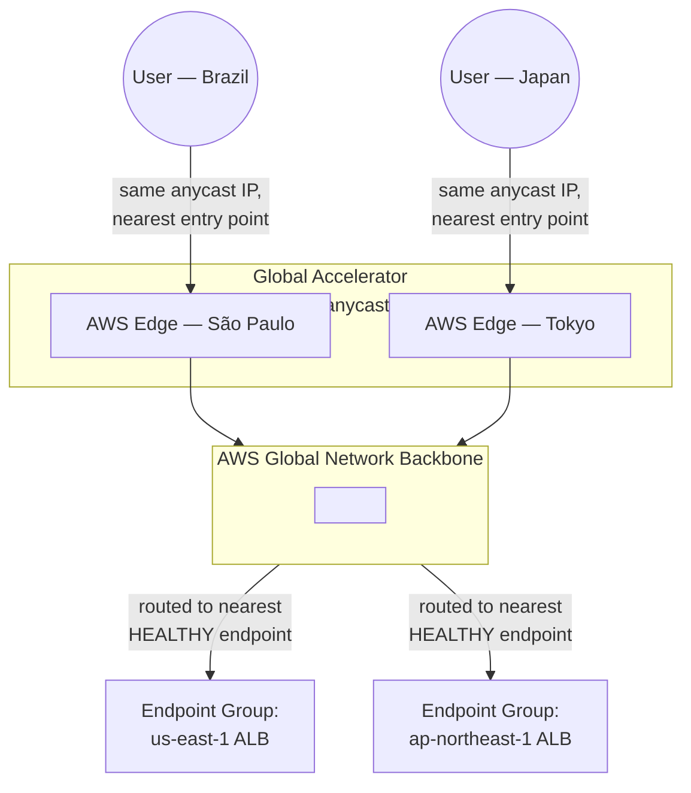

# AWS Global Accelerator


## Definition

AWS Global Accelerator gives your application a small set of **static anycast IP addresses**
that act as a fixed front door, then routes traffic over AWS's private global network backbone
to the closest, healthiest regional endpoint (load balancer, EC2 instance, or Elastic IP) —
improving performance and enabling near-instant failover at the network layer instead of DNS.

## Purpose

Two persistent problems with internet-routed, DNS-based global traffic management: (1) the
public internet's routing between a user and your Region isn't optimized for performance — it
takes whatever path internet service providers' routing happens to choose; and (2) DNS-based
failover (like Route 53) is inherently slow because clients and resolvers cache answers for the
TTL duration. Global Accelerator solves both: **anycast IPs** mean the *same* IP address is
announced from many AWS edge locations, so a user's traffic automatically enters the AWS network
at the nearest edge and then travels over AWS's own private backbone (not the public internet)
the rest of the way; and because the client's IP never changes, failover happens by AWS
rerouting traffic at the network layer within seconds — no DNS cache to wait out.

## How It Works

Plain explanation: you create an **accelerator**, which is assigned 2 static anycast IPs. You
attach **listeners** (port ranges/protocols) and **endpoint groups** — one per Region, each
pointing at real endpoints (ALB, NLB, EC2 instance, Elastic IP). Global Accelerator continuously
health-checks every endpoint and automatically routes each user's traffic to the nearest *healthy*
endpoint group, shifting away instantly if a Region's endpoints fail health checks.



Step by step: both users connect to the **exact same two IP addresses** — Global Accelerator's
anycast routing means each user's traffic physically enters the AWS network at whichever edge is
geographically closest to them (São Paulo for the Brazil user, Tokyo for the Japan user), with no
DNS lookup required to pick a Region. From there, traffic travels over **AWS's private global
backbone** — not the public internet — to the healthiest, best-performing **endpoint group**, by
default the one in the user's nearest Region, but automatically rerouted to a different Region's
endpoint group within seconds if that Region's health checks start failing — far faster than
waiting for a DNS TTL to expire.

## Key Features / Components

- **Static anycast IP addresses** — 2 fixed IPs that never change, announced from many AWS edge
  locations simultaneously; useful when downstream firewalls need a stable IP to allowlist,
  which neither ALB nor CloudFront natively offers.
- **Listeners** — define which ports/protocols (TCP/UDP) the accelerator accepts.
- **Endpoint groups** — per-Region collections of endpoints (ALB, NLB, EC2, Elastic IP) with
  traffic dial percentages and health check configuration.
- **Health checks** — continuous probing; unhealthy endpoints/Regions are automatically removed
  from rotation at the network layer, independent of DNS caching.
- **Traffic dials** — control what percentage of traffic an endpoint group receives, useful for
  gradual Regional rollout or controlled failover testing.
- **Client affinity** — optional setting to keep a given client IP routed to the same endpoint
  for session consistency (useful for stateful/UDP protocols like gaming).
- **Custom routing accelerator** — a specialized mode that maps accelerator ports/IPs directly to
  specific EC2 instance ports across many VPCs/subnets, often used for gaming backends.

## Use Cases — When to Use It

- **Global applications needing a fixed, allowlist-friendly IP** — financial services, gaming,
  IoT backends where downstream firewalls or clients need to pin to a known, unchanging IP.
- **Multi-Region active-active or active-passive architectures needing fast failover** — when
  DNS TTL-based failover (Route 53) isn't fast enough for the application's availability target.
- **Non-HTTP(S) global traffic (TCP/UDP)** — Global Accelerator works at the network layer, so
  it supports protocols CloudFront (HTTP-focused CDN) cannot accelerate.
- **Improving global user latency to dynamic, non-cacheable content** — where CloudFront's
  caching model doesn't apply (CloudFront helps static/cacheable content; Global Accelerator
  helps the network path itself, including for fully dynamic traffic).
- **Combining with ALBs** — a very common pattern: Global Accelerator in front of regional ALBs
  across multiple Regions, giving a fixed global IP plus ALB's Layer 7 routing within each Region.

## When NOT to Use It / Alternatives

- **Primarily static/cacheable content** — **CloudFront** is the right tool (it caches at the
  edge, reducing origin load and repeat-request latency, which Global Accelerator does not do —
  Global Accelerator only optimizes the network path, it does not cache anything).
- **Single-Region applications** — Global Accelerator's value is explicitly about multi-Region/
  multi-endpoint global traffic management; a single-Region app gains nothing from it.
- **Cost-sensitive workloads where Route 53 latency/failover routing is "good enough"** — if
  your availability target tolerates DNS TTL-based failover timing, Route 53 alone is
  considerably cheaper and may be all you need.
- **You need request content inspection/routing (path-based, header-based)** — Global Accelerator
  operates below the HTTP layer; use ALB (behind it, if needed) for L7 routing logic.

## Why It's Important

**Real-world:** applications with hard real-time or near-real-time availability requirements
(online gaming matchmaking, trading platforms, mission-critical IoT) cannot tolerate DNS TTL
delays during a Regional failure — Global Accelerator's sub-minute network-layer failover is the
difference between a blip and a visible outage for end users. The fixed-IP property also solves
a very mundane but common enterprise pain point: downstream partners/firewalls that refuse to
allowlist a CloudFront/ALB domain name and insist on IP-based rules.

**Exam mapping:**
- **SAA-C03** — Domain 2 (Resilient Architectures) and Domain 3 (High-Performing Architectures)
  both reference Global Accelerator for fast failover and global performance optimization —
  expect it as a distractor/correct-answer pair against Route 53 and CloudFront, where the
  "fixed IP" or "fast failover without DNS" keywords point to Global Accelerator specifically.
- **DVA-C03** — lower weight; mentioned where multi-Region deployment strategy intersects with
  Domain 3 (Testing and Deployment).
- **MLA-C02** — minimal direct coverage; occasionally relevant for globally distributed
  real-time inference endpoints needing fast failover between Regions.

## Pricing Model (summary)

Billed with a small **fixed hourly fee** per accelerator plus a **per-GB data transfer premium**
on top of standard data transfer rates for traffic routed through it (this premium reflects the
cost of using AWS's private backbone instead of the public internet). There's no charge based on
the number of anycast IPs or listeners/endpoint groups themselves. Official pricing:
https://aws.amazon.com/global-accelerator/pricing/

## Hands-on Lab (Floci)

**Honest limitation:** Global Accelerator is **not** in Floci's confirmed-supported service
list, and its entire value proposition (anycast routing over AWS's physical global backbone)
cannot be meaningfully represented in a local, single-machine emulator by nature — there is no
"backbone" to route over locally. Commands below show the real-AWS CLI shape for study purposes:

```bash
# Real-AWS shape — not expected to produce a working accelerator against Floci
awslocal globalaccelerator create-accelerator --name study-ga --ip-address-type IPV4

awslocal globalaccelerator create-listener --accelerator-arn <ga-arn> \
  --protocol TCP --port-ranges FromPort=443,ToPort=443

awslocal globalaccelerator create-endpoint-group --listener-arn <listener-arn> \
  --endpoint-group-region us-east-1 \
  --endpoint-configurations EndpointId=<alb-arn>,Weight=100
```

Treat this topic as conceptual/architectural study rather than a CLI lab — focus on correctly
identifying *when* Global Accelerator is the right answer versus Route 53/CloudFront in
practice-question scenarios, since that judgment (not CLI syntax) is what the exam actually
tests for this service. Full notes: `labs-floci/networking-vpc-lab.md`.

## Exam Tips

- **"Static IP" + "multi-Region" + "fast failover" in the same question = Global Accelerator.**
  This three-keyword combination is close to a direct giveaway on SAA-C03.
- **Global Accelerator ≠ CDN** — it does not cache content; don't confuse it with CloudFront.
  If the scenario is about caching static assets, that's CloudFront; if it's about network path
  optimization and failover speed for any traffic type (including dynamic/non-cacheable, or
  non-HTTP), that's Global Accelerator.
- **Global Accelerator vs. Route 53 failover**: Route 53's failover depends on DNS TTL and
  resolver caching (can take minutes); Global Accelerator reroutes at the network layer in
  seconds because the client-facing IP never changes — pick based on how fast the scenario
  needs failover to be.
- It supports **TCP and UDP**, not just HTTP(S) — a relevant distinction versus CloudFront, which
  is HTTP/HTTPS (and now also some TCP via certain features)-focused.
- Often paired *in front of* regional ALBs/NLBs in architecture diagrams — recognize this as
  "Global Accelerator handles the global entry point and failover; the regional load balancer
  still handles in-Region routing/distribution."

## Related Terms

- [`route53.md`](route53.md), [`cloudfront.md`](cloudfront.md),
  [`elastic-load-balancing.md`](elastic-load-balancing.md)
- `glossary/anycast.md`, `glossary/ttl.md`
