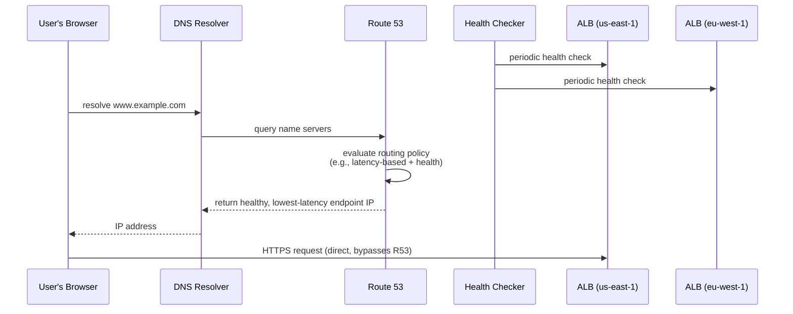
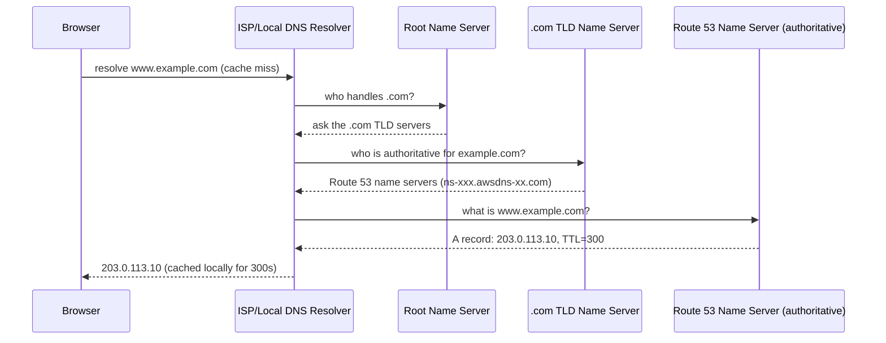
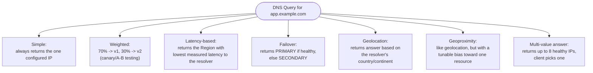
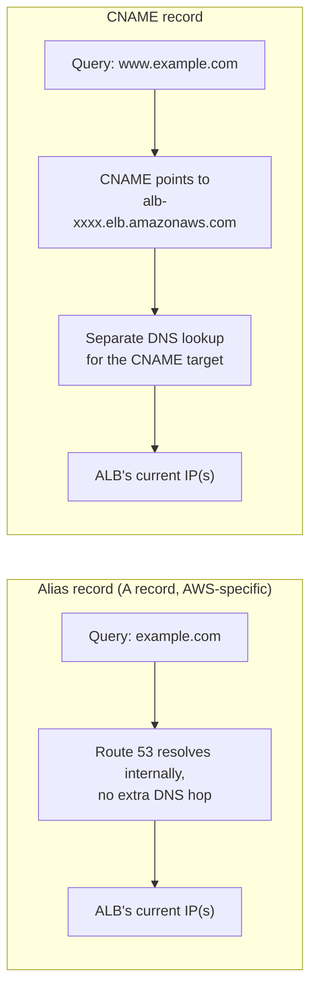
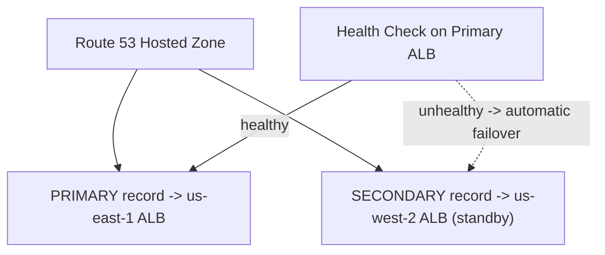
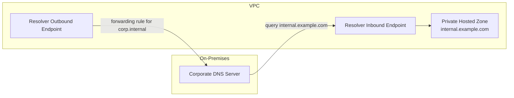
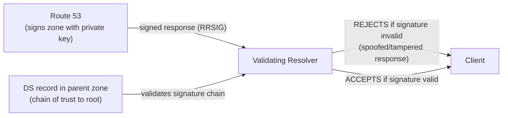

# Amazon Route 53

> **Appears in:** [SAA-C03](../../certifications/saa-c03/README.md)


## Definition

Amazon Route 53 is AWS's highly available, scalable **DNS (Domain Name System)** web service —
it translates human-readable names like `www.example.com` into the IP addresses computers use to
connect, and it can also register domain names and perform health-check-based traffic routing.
The name is a nod to TCP/UDP port 53, the standard DNS port.

## Purpose

Every application needs a way for users to find it by name instead of memorizing IP addresses,
and that lookup needs to be fast, globally available, and resistant to failure — DNS is a
foundational internet protocol, but running your own reliable, globally distributed DNS
infrastructure is hard. Route 53 gives you that infrastructure as a managed service, and goes
further than "just DNS" by baking in health checks and routing policies so DNS itself becomes
part of your availability and traffic-management strategy — not just a lookup table.

## How It Works

Plain explanation: you create a **hosted zone** for your domain, which holds **records** mapping
names to values (an IP, another domain name, a load balancer's address, etc.). When a user's
browser needs to reach `www.example.com`, their DNS resolver asks Route 53's name servers for the
record, and Route 53 returns an answer according to whatever **routing policy** you've configured
— simplest case: always the same answer; smartest case: the answer closest to the user, or the
answer for whichever endpoint is currently healthy.



Step by step: Route 53's **health checker** continuously probes both regional ALBs in the
background, independent of any user request. When a user's browser asks to resolve the domain,
the request goes through their **DNS resolver** to Route 53's **name servers**, which evaluate
the configured **routing policy** — say, latency-based routing combined with health checks — and
return the IP of whichever healthy endpoint is closest to that user. From that point on, the
user's browser talks **directly** to the ALB; Route 53 is out of the data path entirely, which is
why DNS-based routing is cheap and scales infinitely, but also why DNS failover has a delay (the
**TTL** — time-to-live — governs how long resolvers cache the old answer before asking again).


*Figure: AWS's reference diagram of hybrid DNS resolution — a Route 53 Resolver outbound
endpoint forwarding a query from a VPC to an on-premises DNS server, and an inbound endpoint
carrying queries the other direction, both over a private connection (Direct Connect/VPN).
Source: AWS documentation, "Resolving DNS queries between VPCs and your network" —
https://docs.aws.amazon.com/Route53/latest/DeveloperGuide/resolver-overview-DSN-queries-to-vpc.html*

### Packet/query-level walkthrough: a full recursive DNS resolution



This full chain only happens on a true cache miss (nobody nearby has asked recently) — in
practice, most queries are answered from a resolver's cache well before reaching Route 53's
actual name servers, which is exactly the point of TTL: it controls how often this expensive,
multi-hop lookup has to happen at all versus being served from cache.

### Routing policy comparison, side by side



Step by step through a concrete side-by-side: given the exact same query for `app.example.com`
hitting two backend Regions (`us-east-1` and `eu-west-1`), each policy answers differently. Simple
always returns whichever single record exists, ignoring health or location entirely. Weighted
returns `us-east-1` 70% of the time and `eu-west-1` 30% of the time, purely by configured
percentage, regardless of where the query came from. Latency-based measures which Region
genuinely responds faster to that specific resolver's location and returns that one. Failover
returns the primary unless its health check is failing, in which case it switches to the
secondary. Geolocation and geoproximity both consider location, but geoproximity additionally
lets you shift traffic with a "bias" dial even without moving any physical location. Multi-value
answer is the odd one out — it doesn't pick a single winner at all, it hands back several healthy
candidates and lets the client-side resolver/library choose.

## Key Features / Components

- **Hosted zone** — a container for DNS records for one domain (public, for internet; or
  private, resolvable only inside one or more VPCs).
- **Record types** — A/AAAA (IPv4/IPv6), CNAME (alias to another name), **Alias record**
  (AWS-specific, free, works at the zone apex unlike CNAME, points directly at AWS resources
  like ALBs/CloudFront/S3), MX, TXT, NS, SOA, and more.
- **Routing policies** — Simple (one static answer), **Weighted** (split traffic by percentage,
  e.g., canary deploys), **Latency-based** (route to the Region with lowest latency for that
  user), **Failover** (active/passive with health checks), **Geolocation** (route by the user's
  location, e.g., for compliance/content restrictions), **Geoproximity** (route by location with
  a tunable "bias" toward a particular endpoint, requires Route 53 Traffic Flow), **Multi-value
  answer** (return several healthy IPs for simple client-side load distribution), **IP-based**
  (route based on the client's specific IP/CIDR ranges, useful for known network segments like
  specific ISPs or corporate networks).
- **Health checks** — HTTP/HTTPS/TCP probes from multiple global locations; can trigger failover
  routing or CloudWatch alarms; can check an endpoint directly or evaluate a CloudWatch alarm's
  state, or be a "calculated" health check that combines several child checks with AND/OR/NOT
  logic.
- **Domain registration** — Route 53 can be your domain registrar directly (buy/renew/transfer
  `.com`, `.org`, etc.).
- **Resolver** — Route 53 Resolver handles DNS resolution within VPCs and can forward queries
  between on-prem and AWS over Direct Connect/VPN (hybrid DNS).
- **DNSSEC** — optional cryptographic signing to prevent DNS spoofing/cache poisoning.
- **Traffic Flow** — a visual policy editor for chaining multiple routing policies together
  (e.g., geolocation first, then latency-based within the matched region, then failover within
  that), producing one versioned, reusable traffic policy.

## Alias Records vs. CNAME — the mechanical difference



A CNAME is a genuine extra DNS hop — the resolver first learns the name is an alias for another
name, then has to look *that* name up separately. An Alias record is resolved entirely inside
Route 53's own infrastructure with no visible extra hop to the client, is free of the per-query
charge a CNAME lookup would otherwise incur, and critically, **can be used at the zone apex**
(the bare domain `example.com` with no subdomain) — the DNS specification forbids a CNAME at the
apex because the apex must also hold required `SOA`/`NS` records, and CNAME cannot coexist with
other record types for the same name. This is precisely why "point the root domain at an ALB"
questions always have Alias record as the answer, never CNAME.

## Common Architectures

**1. Active-passive disaster recovery with Failover routing.** A primary Region's ALB is the
PRIMARY failover record; a secondary Region's (often smaller, cost-optimized) standby
infrastructure is the SECONDARY record. Route 53 health-checks the primary continuously and
flips to secondary automatically if it fails, with no manual intervention required — the classic
DR pattern tested throughout SAA-C03's resiliency domain.



**2. Weighted canary deployment.** 95% of traffic to the current production version, 5% to the
new version, both tied to health checks — monitored and gradually shifted as confidence grows,
with instant rollback by resetting weights (though still subject to DNS TTL propagation delay,
unlike an ALB target-group weighted shift which is instant).

**3. Latency-based global routing across 3+ Regions.** Each Region's ALB gets a latency record;
Route 53 measures real network latency data between resolver locations and each Region, directing
each user to whichever Region genuinely responds fastest for them — not simply the geographically
nearest Region (latency and geography don't always correlate due to actual network topology).

**4. Hybrid DNS with Route 53 Resolver.** An on-prem data center and a VPC exchange DNS queries
bidirectionally: the VPC's Resolver outbound endpoint forwards queries for the on-prem domain to
the on-prem DNS servers over Direct Connect/VPN, and a Resolver inbound endpoint lets on-prem
systems query the VPC's private hosted zone records — letting both sides resolve each other's
internal names without manual `/etc/hosts`-style entries.



## DNSSEC — preventing spoofed DNS answers



Without DNSSEC, a resolver has no cryptographic way to confirm a DNS answer actually came from
the real authoritative server rather than an attacker who managed to inject a forged response
(cache poisoning). Enabling DNSSEC on a Route 53 hosted zone signs every record set, and
publishing the corresponding DS record in the parent zone extends a cryptographic chain of trust
up to the DNS root — a validating resolver can then mathematically verify a response wasn't
tampered with, rejecting it outright if the signature doesn't check out.

## IP-based Routing and Geoproximity — the less common policies

**IP-based routing** lets you map specific client CIDR ranges to specific endpoints — useful when
you know, for example, that a particular large customer's office network or ISP's egress ranges
should always be routed to a dedicated/regional endpoint, independent of where the public
internet's latency measurements would otherwise send them.

**Geoproximity routing** (via Traffic Flow) starts from each resource's geographic location, then
lets you apply a **bias** value (-99 to +99) to expand or shrink that resource's effective
"pull," shifting traffic toward or away from it without physically relocating anything — useful
for gradually rebalancing load between two Regions during a migration or capacity event, with
much finer, geography-aware control than a flat weighted split.

| Policy | Decision basis | Typical trigger phrase in a scenario |
|---|---|---|
| Weighted | Fixed percentage, no location awareness | "canary," "percentage of traffic" |
| Latency-based | Measured network latency per resolver location | "fastest response for each user" |
| Geolocation | Resolver's country/continent, strict | "comply with regional content laws" |
| Geoproximity | Resource location + tunable bias | "shift load between Regions gradually" |
| IP-based | Specific known client CIDR ranges | "route this specific customer/ISP differently" |

## Use Cases — When to Use It

- **Any public-facing domain on AWS** — the default, standard choice for DNS management.
- **Blue/green or canary deployments** — weighted routing to shift traffic gradually from an old
  version to a new one and watch for errors before a full cutover.
- **Active-passive disaster recovery** — failover routing policy pointing at a secondary Region's
  infrastructure, automatically promoted when health checks fail on the primary.
- **Global applications wanting lowest latency per user** — latency-based or geoproximity
  routing across multiple Regions' endpoints.
- **Compliance-driven content restriction** — geolocation routing to serve different content (or
  block access entirely) based on the user's country/continent.
- **Hybrid DNS** — Route 53 Resolver forwarding rules let on-prem systems resolve AWS private
  hosted zone names and vice versa over Direct Connect/VPN.

## When NOT to Use It / Alternatives

- **You need routing decisions at request-time with no DNS caching delay** — DNS-based failover
  always has a propagation lag tied to TTL; for truly instant failover at the connection level
  (not just the name lookup), front multiple backends with a load balancer or **AWS Global
  Accelerator**, which uses static anycast IPs and reroutes within seconds at the network layer,
  not the DNS layer.
- **You already have a domain registrar you like and only need AWS DNS hosting** — you can keep
  your existing registrar and just point its name servers at a Route 53 hosted zone; you don't
  have to transfer the domain itself to use Route 53 for DNS.
- **Internal service discovery inside a single VPC between microservices** — consider
  **AWS Cloud Map** or ECS/EKS service discovery, which are more application-aware than raw DNS
  zone management, though Route 53 private hosted zones remain a valid simpler option too.

## Why It's Important

**Real-world:** DNS is one of the most common single points of failure in real outages — if your
DNS provider has an incident, your application can be fully functional and still be completely
unreachable, because no one can resolve its name. Route 53's SLA and global anycast name server
network make this failure mode rare, which is precisely why it's the default choice for
production AWS workloads. Misconfigured TTLs (too long) are a frequent cause of "I fixed the
outage but customers are still hitting the dead server for the next hour."

**Exam mapping:**
- **SAA-C03** — Domain 2 (Resilient Architectures, 26%) Task 2.2 explicitly names "Route 53
  routing/failover" as core content — expect questions on choosing the correct routing policy
  for a given resiliency/latency/compliance scenario, a near-guaranteed topic.
- **DVA-C03** — relevant to Domain 3 (Testing/Deployment) in the context of weighted routing for
  canary/blue-green release strategies.
- **MLA-C02** — less central, but appears where multi-Region model endpoint failover or
  geolocation-based inference routing is discussed in Domain 3/4.

## Pricing Model (summary)

- **Hosted zones**: a small monthly charge per hosted zone.
- **Queries**: billed per million DNS queries answered (Alias records to AWS resources like
  ALB/CloudFront/S3 are **free** — a frequently tested cost-optimization fact).
- **Health checks**: billed per health check per month (more for checks with extra features
  like fast intervals, HTTPS, or string matching).
- **Domain registration**: annual fee that varies by TLD (`.com`, `.io`, etc.).
Official pricing: https://aws.amazon.com/route53/pricing/

## Limits & Quotas

| Resource | Default quota |
|---|---|
| Hosted zones per account | 500 (soft, increasable) |
| Records per hosted zone | 10,000 (soft) |
| Health checks per account | 200 (soft) |
| Traffic policies per account | 50 (soft) |
| Resolver endpoints per VPC | multiple inbound/outbound, soft limits apply |
| Weighted/latency/geolocation/failover record sets per name | subject to overall record limit |
| Minimum TTL | 0 seconds (effectively disables caching) |
| Maximum TTL | no hard cap, but very large TTLs defeat failover responsiveness |

## Troubleshooting / Common Issues

- **"I updated a DNS record but clients are still hitting the old endpoint."** Check the record's
  TTL — resolvers and client OS/browser caches honor the TTL and won't re-query until it expires;
  this is expected behavior, not a Route 53 bug. Lower the TTL *before* a planned change if fast
  propagation will be needed.
- **"Failover routing isn't switching to the secondary even though the primary is clearly
  down."** Verify the health check is actually configured and associated with the PRIMARY
  record, is checking the right endpoint/path/port, and has had time to cross its unhealthy
  threshold — a health check pointed at the wrong resource, or still within its detection window,
  won't trigger failover yet.
- **"A root domain (`example.com`, no subdomain) can't be pointed at an ALB."** You attempted a
  CNAME at the zone apex, which DNS doesn't allow — use an **Alias record** instead, which
  Route 53 specifically supports at the apex.
- **"Latency-based routing isn't sending users to the Region I expect."** Latency-based routing
  reflects AWS's measured network latency data between resolver locations and each Region — this
  doesn't always match simple geographic distance (actual network paths/peering can make a
  "farther" Region respond faster); this is working as intended, not a misconfiguration.
- **"Private hosted zone records aren't resolving from an on-premises network."** Confirm a
  Route 53 Resolver **inbound endpoint** exists in the VPC and the on-prem DNS server is
  configured to forward queries for that zone to the inbound endpoint's IPs — a private hosted
  zone is, by design, only resolvable inside its associated VPC(s) unless Resolver endpoints
  bridge that gap.
- **"Weighted routing traffic split doesn't match the configured percentages exactly."** DNS-
  based weighting is approximate by nature — individual resolvers cache answers for their TTL
  window, so the *observed* traffic split over a short time window can deviate meaningfully from
  the configured weights until enough independent resolver caches cycle through; this smooths out
  over a longer time window.

## Hands-on Lab (Floci)

**Honest limitation:** Route 53 is **not** in Floci's confirmed-supported service list. The
commands below show the real-AWS CLI shape for study/muscle-memory purposes:

```bash
# Real-AWS shape — verify behavior against Floci before relying on it
awslocal route53 create-hosted-zone --name study-example.com \
  --caller-reference "$(date +%s)"

awslocal route53 change-resource-record-sets --hosted-zone-id <zone-id> \
  --change-batch '{
    "Changes": [{
      "Action": "CREATE",
      "ResourceRecordSet": {
        "Name": "www.study-example.com",
        "Type": "A",
        "TTL": 300,
        "ResourceRecords": [{"Value": "203.0.113.10"}]
      }
    }]
  }'

awslocal route53 list-resource-record-sets --hosted-zone-id <zone-id>

# Create a health check and a failover record pair (real-AWS shape)
awslocal route53 create-health-check --caller-reference "$(date +%s)" \
  --health-check-config Type=HTTPS,ResourcePath=/health,FullyQualifiedDomainName=primary.example.com,Port=443
```

For a real, working-end-to-end lab: Route 53 has no meaningful offline equivalent (DNS is
inherently a globally distributed, internet-facing system) — the most practical free hands-on
path is AWS's own Free Tier (Route 53 hosted zones are cheap, pennies/month) rather than a local
emulator. Full notes: `labs-floci/networking-vpc-lab.md`.

## Exam Scenario Deep Dive

**Scenario 1 — "A company wants to point their root domain `example.com` directly at an ALB,
not a subdomain, and the DNS console rejects a CNAME record for it."**
Use an Alias record, not a CNAME — this is the one scenario practically guaranteed to appear in
some form, since it directly tests the DNS-spec reason CNAME can't exist at the zone apex and
Route 53's Alias record workaround.

**Scenario 2 — "An application serves different legal content to EU users versus the rest of
the world due to regulatory requirements, and needs this enforced at the DNS level rather than
in application code."**
Geolocation routing policy — it resolves differently based on the querying resolver's
geographic location, which is the direct DNS-layer mechanism for this requirement, distinct from
geoproximity (which is about shifting bias/traffic volume, not strict legal/compliance
segmentation by location).

**Scenario 3 — "A team wants automatic failover to a secondary Region if the primary becomes
unhealthy, and wants the failover to also account for the health of a downstream dependency (a
separately monitored internal API), not just the primary endpoint's own HTTP response."**
A **calculated health check** combining the primary endpoint's own health check with a second
health check (or CloudWatch alarm) for the downstream dependency, using AND logic — Route 53
supports composing multiple health checks this way so failover considers more than a single
shallow check.

**Scenario 4 — "A support team notices a canary deployment's weighted routing shows roughly the
intended 90/10 split in aggregate, but individual users occasionally report seeing the new
version persist across multiple sessions over several minutes, then suddenly switch back to the
old version."**
This is TTL-driven resolver caching behaving exactly as designed — once a resolver gets an
answer, it won't re-query until the TTL expires, so a given user's resolver can "stick" to
whichever version it first resolved for the TTL's duration; this is not a weighted-routing bug,
it's the inherent granularity limit of DNS-based traffic splitting, and the fix (if finer control
is truly needed) is ALB weighted target groups instead, which split per-request rather than
per-resolver-cache.

**Scenario 5 — "A merger between two companies requires their respective on-premises networks
and AWS environments to resolve each other's internal domain names without manually maintaining
hosts files."**
Route 53 Resolver with inbound and outbound endpoints on each side (or endpoints in a shared
VPC reachable via Transit Gateway) plus forwarding rules for each other's internal domains — the
standard hybrid DNS integration pattern, built specifically for this cross-environment name
resolution need.

## Exam Tips

- **Alias record vs. CNAME**: Alias records are free, work at the zone apex (`example.com` with
  no subdomain, which CNAME cannot do per DNS spec), and are AWS's preferred way to point at
  ALB/CloudFront/S3/another Route 53 record. If a question needs a root-domain pointing at an
  ALB, the answer is an Alias record, never a CNAME.
- **Routing policy keyword matching**: "lowest latency" → Latency-based. "percentage of traffic /
  canary" → Weighted. "active/standby, automatic failover" → Failover. "route by user's country"
  → Geolocation. "return multiple IPs, simple client-side balancing" → Multi-value answer.
  "shift traffic with a bias dial between locations" → Geoproximity (requires Traffic Flow).
- **TTL tradeoff**: low TTL = faster failover/change propagation but more DNS query volume/cost;
  high TTL = cheaper but slower to react to failover — a classic cost-vs-resiliency exam dial.
- Route 53 health checks can check an **endpoint directly** or **the status of a CloudWatch
  alarm** — useful for triggering failover based on application-level metrics, not just
  reachability.
- DNS failover (Route 53) is not instant like a load balancer removing an unhealthy target — it
  depends on TTL and resolver caching; don't confuse the two failure-handling speeds on the exam.
- **Private hosted zones need Resolver endpoints for hybrid reachability** — a private hosted
  zone alone only resolves inside its associated VPC(s); on-prem access requires inbound/outbound
  Resolver endpoints explicitly.
- **Weighted routing granularity is per-resolver-cache, not per-request** — if a scenario
  specifically needs precise, instant, per-request traffic splitting, that's an ALB weighted
  target group question in disguise, not a Route 53 weighted-record question.

## Further Reading

- AWS Docs — What is Amazon Route 53?: https://docs.aws.amazon.com/Route53/latest/DeveloperGuide/Welcome.html
- AWS Docs — Choosing a routing policy: https://docs.aws.amazon.com/Route53/latest/DeveloperGuide/routing-policy.html
- AWS Docs — What is Route 53 Resolver?: https://docs.aws.amazon.com/Route53/latest/DeveloperGuide/resolver.html
- AWS Blog — Manual Failover and Failback Strategy with Amazon Route53: https://aws.amazon.com/blogs/networking-and-content-delivery/manual-failover-and-failback-strategy-with-amazon-route53/
- AWS Blog — New – Route 53 Traffic Flow: https://aws.amazon.com/blogs/aws/new-route-53-traffic-flow/
- AWS re:Post — Route 53 DNS troubleshooting: https://repost.aws/knowledge-center/route-53-dns-troubleshoot

## Related Terms

- [`elastic-load-balancing.md`](elastic-load-balancing.md), [`cloudfront.md`](cloudfront.md),
  [`global-accelerator.md`](global-accelerator.md)
- [`vpn.md`](vpn.md), [`direct-connect.md`](direct-connect.md) — hybrid connectivity Resolver
  endpoints often ride over
- `glossary/dns.md`, `glossary/ttl.md`, `glossary/anycast.md`
