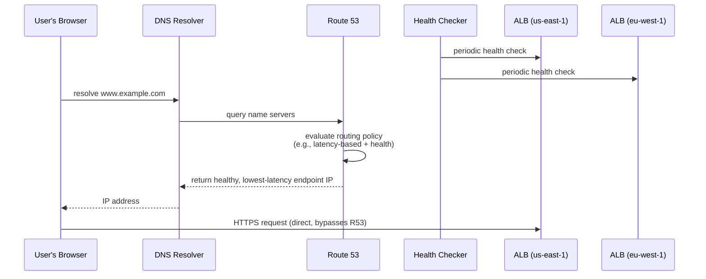

# Amazon Route 53


## Definition

Amazon Route 53 is AWS's highly available, scalable **DNS (Domain Name System)** web service —
it translates human-readable names like `www.example.com` into the IP addresses computers use to
connect, and it can also register domain names and perform health-check-based traffic routing.
The name is a nod to TCP/UDP port 53, the standard DNS port.

## Purpose

Every application needs a way for users to find it by name instead of memorizing IP addresses,
and that lookup needs to be fast, globally available, and resistant to failure — DNS is a
foundational internet protocol, but running your own reliable, globally distributed DNS
infrastructure is hard. Route 53 gives you that infrastructure as a managed service, and goes
further than "just DNS" by baking in health checks and routing policies so DNS itself becomes
part of your availability and traffic-management strategy — not just a lookup table.

## How It Works

Plain explanation: you create a **hosted zone** for your domain, which holds **records** mapping
names to values (an IP, another domain name, a load balancer's address, etc.). When a user's
browser needs to reach `www.example.com`, their DNS resolver asks Route 53's name servers for the
record, and Route 53 returns an answer according to whatever **routing policy** you've configured
— simplest case: always the same answer; smartest case: the answer closest to the user, or the
answer for whichever endpoint is currently healthy.



Step by step: Route 53's **health checker** continuously probes both regional ALBs in the
background, independent of any user request. When a user's browser asks to resolve the domain,
the request goes through their **DNS resolver** to Route 53's **name servers**, which evaluate
the configured **routing policy** — say, latency-based routing combined with health checks — and
return the IP of whichever healthy endpoint is closest to that user. From that point on, the
user's browser talks **directly** to the ALB; Route 53 is out of the data path entirely, which is
why DNS-based routing is cheap and scales infinitely, but also why DNS failover has a delay (the
**TTL** — time-to-live — governs how long resolvers cache the old answer before asking again).

## Key Features / Components

- **Hosted zone** — a container for DNS records for one domain (public, for internet; or
  private, resolvable only inside one or more VPCs).
- **Record types** — A/AAAA (IPv4/IPv6), CNAME (alias to another name), **Alias record**
  (AWS-specific, free, works at the zone apex unlike CNAME, points directly at AWS resources
  like ALBs/CloudFront/S3), MX, TXT, NS, SOA, and more.
- **Routing policies** — Simple (one static answer), **Weighted** (split traffic by percentage,
  e.g., canary deploys), **Latency-based** (route to the Region with lowest latency for that
  user), **Failover** (active/passive with health checks), **Geolocation** (route by the user's
  location, e.g., for compliance/content restrictions), **Geoproximity** (route by location with
  a tunable "bias" toward a particular endpoint, requires Route 53 Traffic Flow), **Multi-value
  answer** (return several healthy IPs for simple client-side load distribution).
- **Health checks** — HTTP/HTTPS/TCP probes from multiple global locations; can trigger failover
  routing or CloudWatch alarms.
- **Domain registration** — Route 53 can be your domain registrar directly (buy/renew/transfer
  `.com`, `.org`, etc.).
- **Resolver** — Route 53 Resolver handles DNS resolution within VPCs and can forward queries
  between on-prem and AWS over Direct Connect/VPN (hybrid DNS).
- **DNSSEC** — optional cryptographic signing to prevent DNS spoofing/cache poisoning.

## Use Cases — When to Use It

- **Any public-facing domain on AWS** — the default, standard choice for DNS management.
- **Blue/green or canary deployments** — weighted routing to shift traffic gradually from an old
  version to a new one and watch for errors before a full cutover.
- **Active-passive disaster recovery** — failover routing policy pointing at a secondary Region's
  infrastructure, automatically promoted when health checks fail on the primary.
- **Global applications wanting lowest latency per user** — latency-based or geoproximity
  routing across multiple Regions' endpoints.
- **Compliance-driven content restriction** — geolocation routing to serve different content (or
  block access entirely) based on the user's country/continent.
- **Hybrid DNS** — Route 53 Resolver forwarding rules let on-prem systems resolve AWS private
  hosted zone names and vice versa over Direct Connect/VPN.

## When NOT to Use It / Alternatives

- **You need routing decisions at request-time with no DNS caching delay** — DNS-based failover
  always has a propagation lag tied to TTL; for truly instant failover at the connection level
  (not just the name lookup), front multiple backends with a load balancer or **AWS Global
  Accelerator**, which uses static anycast IPs and reroutes within seconds at the network layer,
  not the DNS layer.
- **You already have a domain registrar you like and only need AWS DNS hosting** — you can keep
  your existing registrar and just point its name servers at a Route 53 hosted zone; you don't
  have to transfer the domain itself to use Route 53 for DNS.
- **Internal service discovery inside a single VPC between microservices** — consider
  **AWS Cloud Map** or ECS/EKS service discovery, which are more application-aware than raw DNS
  zone management, though Route 53 private hosted zones remain a valid simpler option too.

## Why It's Important

**Real-world:** DNS is one of the most common single points of failure in real outages — if your
DNS provider has an incident, your application can be fully functional and still be completely
unreachable, because no one can resolve its name. Route 53's SLA and global anycast name server
network make this failure mode rare, which is precisely why it's the default choice for
production AWS workloads. Misconfigured TTLs (too long) are a frequent cause of "I fixed the
outage but customers are still hitting the dead server for the next hour."

**Exam mapping:**
- **SAA-C03** — Domain 2 (Resilient Architectures, 26%) Task 2.2 explicitly names "Route 53
  routing/failover" as core content — expect questions on choosing the correct routing policy
  for a given resiliency/latency/compliance scenario, a near-guaranteed topic.
- **DVA-C03** — relevant to Domain 3 (Testing/Deployment) in the context of weighted routing for
  canary/blue-green release strategies.
- **MLA-C02** — less central, but appears where multi-Region model endpoint failover or
  geolocation-based inference routing is discussed in Domain 3/4.

## Pricing Model (summary)

- **Hosted zones**: a small monthly charge per hosted zone.
- **Queries**: billed per million DNS queries answered (Alias records to AWS resources like
  ALB/CloudFront/S3 are **free** — a frequently tested cost-optimization fact).
- **Health checks**: billed per health check per month (more for checks with extra features
  like fast intervals, HTTPS, or string matching).
- **Domain registration**: annual fee that varies by TLD (`.com`, `.io`, etc.).
Official pricing: https://aws.amazon.com/route53/pricing/

## Hands-on Lab (Floci)

**Honest limitation:** Route 53 is **not** in Floci's confirmed-supported service list. The
commands below show the real-AWS CLI shape for study/muscle-memory purposes:

```bash
# Real-AWS shape — verify behavior against Floci before relying on it
awslocal route53 create-hosted-zone --name study-example.com \
  --caller-reference "$(date +%s)"

awslocal route53 change-resource-record-sets --hosted-zone-id <zone-id> \
  --change-batch '{
    "Changes": [{
      "Action": "CREATE",
      "ResourceRecordSet": {
        "Name": "www.study-example.com",
        "Type": "A",
        "TTL": 300,
        "ResourceRecords": [{"Value": "203.0.113.10"}]
      }
    }]
  }'

awslocal route53 list-resource-record-sets --hosted-zone-id <zone-id>
```

For a real, working-end-to-end lab: Route 53 has no meaningful offline equivalent (DNS is
inherently a globally distributed, internet-facing system) — the most practical free hands-on
path is AWS's own Free Tier (Route 53 hosted zones are cheap, pennies/month) rather than a local
emulator. Full notes: `labs-floci/networking-vpc-lab.md`.

## Exam Tips

- **Alias record vs. CNAME**: Alias records are free, work at the zone apex (`example.com` with
  no subdomain, which CNAME cannot do per DNS spec), and are AWS's preferred way to point at
  ALB/CloudFront/S3/another Route 53 record. If a question needs a root-domain pointing at an
  ALB, the answer is an Alias record, never a CNAME.
- **Routing policy keyword matching**: "lowest latency" → Latency-based. "percentage of traffic /
  canary" → Weighted. "active/standby, automatic failover" → Failover. "route by user's country"
  → Geolocation. "return multiple IPs, simple client-side balancing" → Multi-value answer.
- **TTL tradeoff**: low TTL = faster failover/change propagation but more DNS query volume/cost;
  high TTL = cheaper but slower to react to failover — a classic cost-vs-resiliency exam dial.
- Route 53 health checks can check an **endpoint directly** or **the status of a CloudWatch
  alarm** — useful for triggering failover based on application-level metrics, not just
  reachability.
- DNS failover (Route 53) is not instant like a load balancer removing an unhealthy target — it
  depends on TTL and resolver caching; don't confuse the two failure-handling speeds on the exam.

## Related Terms

- [`elastic-load-balancing.md`](elastic-load-balancing.md), [`cloudfront.md`](cloudfront.md),
  [`global-accelerator.md`](global-accelerator.md)
- `glossary/dns.md`, `glossary/ttl.md`, `glossary/anycast.md`
