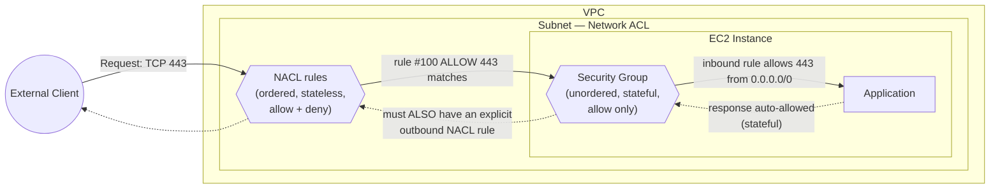
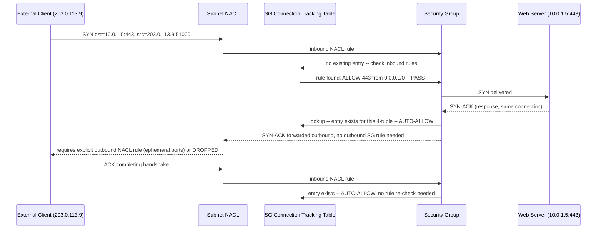
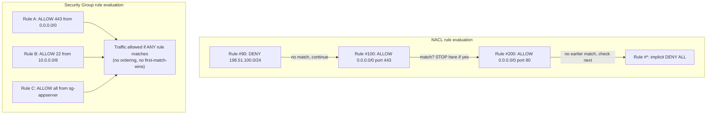
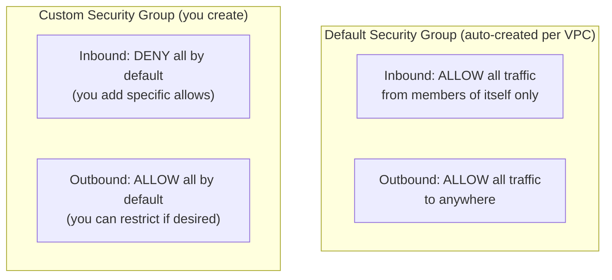
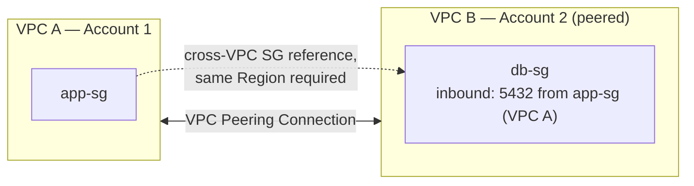
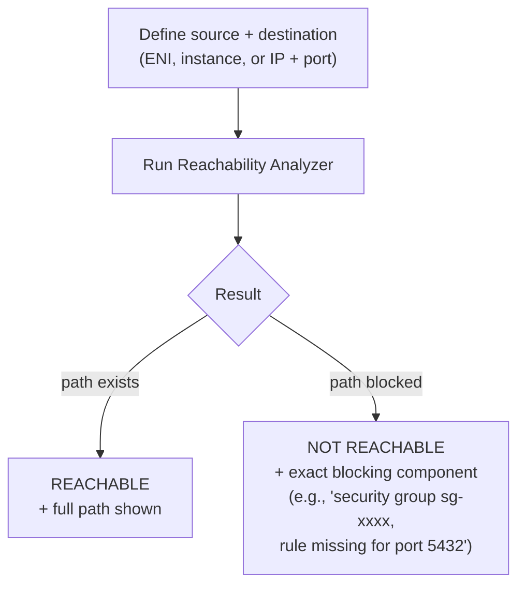
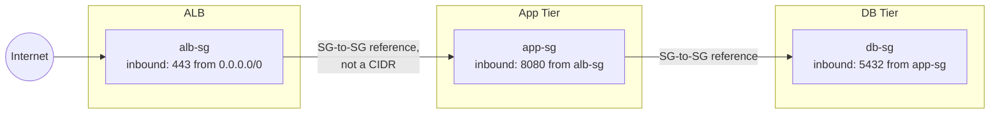
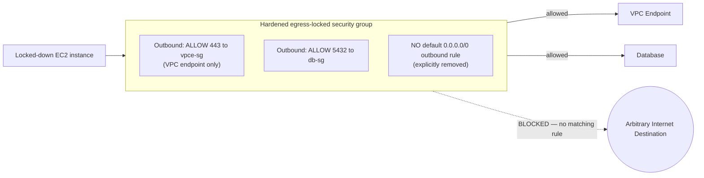

# Security Groups vs. Network ACLs (NACLs)

> **Appears in:** [SAA-C03](../../certifications/saa-c03/README.md)


## Definition

**Security Groups** are stateful, instance-level virtual firewalls — rules that control traffic
to/from individual resources (EC2 instances, RDS databases, ENIs, Lambda-in-VPC). **Network
ACLs (NACLs)** are stateless, subnet-level firewalls — rules evaluated for everything crossing a
subnet boundary, regardless of which instance inside it the traffic is headed to. They stack: a
packet must pass the NACL first, then the security group, to reach an instance.

## Purpose

AWS gives you two layers deliberately, mirroring defense-in-depth in physical data centers: NACLs
act like a perimeter fence around a subnet (coarse, subnet-wide rules, good for blanket
deny-lists), while security groups act like a lock on each individual door (fine-grained,
per-resource rules). Relying on only one layer means either too coarse a control (NACL alone
can't say "only this specific instance may receive traffic") or no network-wide blanket block
(security groups alone can't instantly block a known-bad IP range from an entire subnet in one
rule).

## How It Works

Plain explanation: traffic entering a subnet from outside hits the subnet's **NACL** first. The
NACL evaluates **numbered rules in order, lowest number first**, and stops at the first match
(allow or deny) — if nothing matches, the implicit final rule denies everything. Because NACLs
are **stateless**, you must write rules for both directions yourself (an allowed inbound request
needs a matching outbound rule for its response, or vice versa). If the NACL allows the packet
through, it then reaches the instance's **security group**. Security groups only have **allow**
rules (no explicit deny) and are **stateful** — if inbound traffic is allowed in, the response
traffic is automatically allowed back out, no matter what the outbound rules say.


*Figure: AWS's own diagram of how traffic from an internet gateway is first filtered by the
subnet's NACL, then by the destination instance's security group, before reaching the instance.
Source: AWS documentation, "Infrastructure security in Amazon VPC" —
https://docs.aws.amazon.com/vpc/latest/userguide/infrastructure-security.html*



Step by step: the client's request hits the **NACL** first — it's evaluated against ordered
rules (e.g., rule #100 "ALLOW TCP 443 from 0.0.0.0/0") and passes. It then hits the instance's
**security group**, which checks its inbound allow-list, finds a matching rule, and lets it
through to the **application**. When the application sends its response, the security group
*automatically* allows the outbound response because it tracked the original inbound connection
(statefulness) — no outbound security group rule needed. But the response still has to cross the
subnet boundary again, and because the NACL is stateless, **it does not remember the original
request** — you must have a separate explicit outbound NACL rule (e.g., allow outbound on
ephemeral ports 1024-65535) or the response packet gets silently dropped even though the
original request was allowed in.

### Packet-level walkthrough: stateful connection tracking in a security group



This is the mechanic that makes security groups "stateful": once the first packet of a
connection is evaluated against the rule set and allowed, the security group records that
connection's 4-tuple (source IP, source port, destination IP, destination port, protocol) in a
**connection tracking table**. Every subsequent packet belonging to that same tracked connection
— in either direction — is automatically permitted without re-checking the rule list. The NACL,
by contrast, has no equivalent table; every single packet, every single time, is evaluated fresh
against the numbered rule list with no memory of what came before, which is exactly why its
return-path rule must be written explicitly.

### Rule evaluation order: NACL (first match wins) vs. Security Group (union of all rules)



A NACL stops at the **first numeric match**, so rule order genuinely changes behavior — if rule
#90 denies a CIDR but rule #100 (a higher number, evaluated later) would have allowed it, the
deny at #90 wins because it's checked first. A security group has no such concept: every rule is
checked, and if *any* rule allows the traffic, it's allowed — there is no "first match" and no way
to write a security group rule that overrides another rule in the same group, because there are
no deny rules to conflict with in the first place.


*Figure: AWS's reference diagram showing instances in different subnets associated with
different security groups — each group's rules apply only to the instances attached to it,
independent of subnet boundaries. Source: AWS documentation, "Control traffic to your AWS
resources using security groups" —
https://docs.aws.amazon.com/vpc/latest/userguide/vpc-security-groups.html*

### Worked example: a complete 3-tier security group rule set

A concrete rule table for the ALB → App → DB chaining pattern shown above, the way you'd actually
write it in Terraform/CloudFormation or the console:

| Security Group | Direction | Protocol | Port | Source/Destination | Purpose |
|---|---|---|---|---|---|
| `alb-sg` | Inbound | TCP | 443 | `0.0.0.0/0` | Public HTTPS from any client |
| `alb-sg` | Outbound | TCP | 8080 | `app-sg` | Forward to app tier only |
| `app-sg` | Inbound | TCP | 8080 | `alb-sg` | Only accept from the ALB |
| `app-sg` | Outbound | TCP | 5432 | `db-sg` | Query the database only |
| `app-sg` | Outbound | TCP | 443 | `0.0.0.0/0` | Call external APIs (via NAT GW) |
| `db-sg` | Inbound | TCP | 5432 | `app-sg` | Only accept from the app tier |
| `db-sg` | Outbound | — | — | (none needed) | DB never initiates outbound |

Notice the `db-sg` has **no outbound rule at all** — because a database typically never initiates
its own outbound connections, and because security groups default to "outbound allowed" unless
you explicitly restrict it, a hardened design would in fact add an explicit outbound DENY-
equivalent by removing the default allow-all outbound rule and adding nothing back, effectively
making the group outbound-silent. This is a subtle but real hardening step many teams skip.

### Common ports worth memorizing for rule-writing speed

| Port | Protocol | Typical use |
|---|---|---|
| 22 | TCP | SSH |
| 80 | TCP | HTTP |
| 443 | TCP | HTTPS |
| 3306 | TCP | MySQL/Aurora MySQL |
| 5432 | TCP | PostgreSQL/Aurora PostgreSQL |
| 1433 | TCP | SQL Server |
| 6379 | TCP | Redis/ElastiCache |
| 11211 | TCP/UDP | Memcached |
| 3389 | TCP | RDP (Windows remote desktop) |
| 2049 | TCP | NFS/EFS |

### NACL rule-number planning worked example

A disciplined NACL rule table leaves numeric gaps for future insertions and groups denies before
broad allows:

| Rule # | Direction | Protocol | Port range | Source/Dest | Action |
|---|---|---|---|---|---|
| 50 | Inbound | ALL | ALL | `198.51.100.0/24` | DENY (known-bad range) |
| 60 | Inbound | ALL | ALL | `203.0.113.0/28` | DENY (second bad range, added later) |
| 100 | Inbound | TCP | 443 | `0.0.0.0/0` | ALLOW |
| 110 | Inbound | TCP | 80 | `0.0.0.0/0` | ALLOW |
| 120 | Inbound | TCP | 1024-65535 | `0.0.0.0/0` | ALLOW (ephemeral, for responses) |
| * | Inbound | ALL | ALL | `0.0.0.0/0` | DENY (implicit) |
| 100 | Outbound | TCP | 1024-65535 | `0.0.0.0/0` | ALLOW (ephemeral, client responses) |
| 110 | Outbound | TCP | 443 | `0.0.0.0/0` | ALLOW |
| * | Outbound | ALL | ALL | `0.0.0.0/0` | DENY (implicit) |

Rule 60 being added after rule 50 but still numbered *before* the allow rules at 100+ is exactly
why gapped numbering matters — a second bad range discovered after the fact slots in at 60
without renumbering 100, 110, and 120.

## Key Features / Components

- **Security Group** — attached to ENIs/instances (not subnets); default: all inbound denied, all
  outbound allowed; rules can reference other security groups by ID (not just CIDR), enabling
  "allow from my app-tier SG" style rules that survive IP changes.
- **Stateful (SG)** — return traffic for an allowed connection is automatically permitted.
- **Allow-only (SG)** — there is no "deny" rule type in a security group; you only add allows.
- **Network ACL** — attached to subnets; evaluated for every packet crossing that subnet boundary
  (both directions), independent of which instance is the destination.
- **Numbered, ordered rules (NACL)** — rules evaluated in ascending number order; first match
  wins; leave gaps (100, 200, 300...) so you can insert rules later without renumbering.
- **Explicit allow + deny (NACL)** — unlike security groups, NACLs can explicitly **deny**, which
  is the only native way to blanket-block a specific IP/CIDR at the subnet level.
- **Stateless (NACL)** — inbound and outbound rules are fully independent; you must author both.
- **Default NACL** — allows all inbound/outbound traffic by default (so it's invisible until you
  touch it); default security group allows all traffic among members of the same SG, denies all
  other inbound, allows all outbound.
- **Multiple SGs per instance, one NACL per subnet** — an instance can have several SGs attached
  (rules are additive/unioned); a subnet has exactly one NACL at a time.
- **Ephemeral ports** — the high, dynamically-assigned port range (1024–65535 on most OSes;
  32768–60999 specifically on Linux's default range, 1025-65535 on Windows) that a client uses as
  its *source* port for outbound connections — the single most common NACL outbound-rule mistake
  is forgetting to allow this range for return traffic.
- **Rule limits and increasing them** — both SG and NACL rule counts are soft limits raisable via
  Service Quotas, but an instance's *effective* rule budget is also capped by the number of
  security groups it can have attached (5 by default) multiplied by rules-per-group.

## Default Security Group vs. a Custom Security Group



The default security group's "allow all traffic among members of itself" rule is a frequent
source of unintended lateral-movement risk: if many unrelated instances are left attached to the
default security group (rather than purpose-built custom groups), any one of them can reach any
other on any port — a real security finding in audits, and a recognizable exam scenario whenever
a question describes unexpectedly broad internal connectivity with no obvious rule explaining it.

## Cross-account and cross-VPC security group references

A security group rule that references another security group as its source normally only works
within the same VPC. Two mechanisms extend this:

- **VPC peering security group references** — if two VPCs are peered, a security group in one
  VPC can reference a security group ID in the *peered* VPC directly as a rule source, as long as
  both VPCs are in the same Region — avoiding the need to fall back to CIDR-based rules just
  because the resources are a peering hop away.
- **Security group sharing via AWS Resource Access Manager (RAM)** — lets a security group
  defined in one account be shared and referenced by resources in other accounts within the same
  Organization, so a central security team can own and update the canonical rule set without
  every application account duplicating it.



## Reachability Analyzer for SG/NACL debugging

When a connectivity issue could be either layer, **VPC Reachability Analyzer** is the fastest
real diagnostic path — it statically evaluates the full chain (route table → NACL → security
group, both directions) and reports the exact hop that would block or allow a hypothetical
connection, without needing to manually trace through multiple rule tables by hand or generate
real traffic.



## AWS Network Firewall and WAF — where they fit relative to SG/NACL

Security groups and NACLs are both pure allow/deny-by-IP-and-port filters; neither inspects
packet *content*. Two other services extend protection into territory SG/NACL simply cannot
reach:

| Capability | Security Group | NACL | AWS WAF | AWS Network Firewall |
|---|---|---|---|---|
| Operates at | L3/L4 (IP, port, protocol) | L3/L4 | L7 (HTTP content) | L3-L7 (stateful deep inspection) |
| Scope | Instance/ENI | Subnet | CloudFront/ALB/API Gateway | VPC-wide traffic (via subnets/Gateway LB) |
| Can block by URL path/header/body pattern | No | No | Yes | Yes (with rule groups) |
| Intrusion detection/prevention | No | No | No | Yes |
| Stateful | Yes | No | N/A (request-scoped) | Yes |

If a scenario needs to block SQL injection attempts or rate-limit by URL path, that's WAF; if it
needs to inspect/block based on deep packet content across a whole VPC's traffic (not just at an
HTTP front door), that's Network Firewall — neither SG nor NACL can do either job, a distinction
the exam uses to separate "basic network ACL knowledge" questions from "do you know the limits of
L3/L4 filtering" questions.

## Common Architectures

**1. Three-tier security group chaining (the standard pattern).** Instead of hardcoding IP
ranges, each tier's security group references the *previous* tier's security group ID as its
allowed source — so as instances scale in/out, the rule never needs updating.



**2. NACL as a perimeter guard layered on top of security-group-based access control.** The
subnet-level NACL permits broad traffic classes (e.g., all TCP on expected app ports) but
explicitly denies a small, specific list of known-bad CIDRs at low rule numbers — a coarse
blanket block that doesn't require touching every instance's security group individually.

**3. Default-deny data subnet.** The data tier's NACL allows inbound only from the app tier's
specific subnet CIDR (not `0.0.0.0/0`) on the database port, and the data tier's security group
further restricts to just the app tier's security group ID — two independent layers both saying
essentially the same restriction, which is deliberate defense-in-depth: if one layer is ever
misconfigured, the other still blocks unauthorized access.

**4. Bastion-host jump pattern.** A bastion host's security group allows SSH (22) only from a
specific known office/VPN CIDR, and every other instance's security group allows SSH only from
the bastion's security group — so no instance except the bastion is ever reachable for
administrative access directly from the internet.

**5. Egress-lockdown security group for compliance.** A security group with its default
outbound-allow-all rule explicitly removed and replaced with narrow, specific outbound rules
(e.g., only to a specific VPC endpoint's security group, or only to a specific partner CIDR on a
specific port) — used when compliance requires proving an instance cannot exfiltrate data to
arbitrary destinations, not just that inbound access is restricted.



## Use Cases — When to Use It

- **Security Groups** — the default, everyday tool: "only allow port 443 from the internet to
  my load balancer," "only allow port 3306 from my app-tier SG to my database SG." This covers
  the vast majority of real-world rules.
- **NACLs** — reach for them when you need a **blanket block** independent of which instance:
  "deny this entire malicious IP range from the whole subnet right now," or as a coarse-grained
  compliance control layered on top of (never instead of) security groups.
- **Combining both** — standard production pattern: NACL as a broad perimeter guard (deny known
  bad ranges, restrict subnet to expected protocols), security groups as the precise per-tier
  access control (web SG → app SG → db SG chaining).

## When NOT to Use It / Alternatives

- **Don't use NACLs as your primary access control** — they're coarse, stateless, and easy to
  misconfigure (forgetting the return-traffic rule is a classic self-inflicted outage). Security
  groups should carry almost all of your real access logic.
- **Don't try to make a security group "deny" something** — it can't; if you need an explicit
  deny, that's a NACL job (or AWS Network Firewall / WAF for more sophisticated inspection).
- **For application-layer filtering** (blocking SQL injection patterns, rate limiting by URL
  path) — neither SGs nor NACLs operate above L4 (IP/port); use **AWS WAF** in front of
  CloudFront/ALB/API Gateway instead.
- **For full stateful deep packet inspection / intrusion detection at the VPC level** — use
  **AWS Network Firewall**, not NACLs — NACLs are simple allow/deny lists, not a true IDS/IPS.

## Why It's Important

**Real-world:** an overly permissive security group (e.g., `0.0.0.0/0` on port 22 or a database
port left open) is one of the single most common causes of real AWS security incidents found by
automated scanners and in breach post-mortems — it's the #1 thing a cloud security audit checks
first. Misconfigured NACLs (forgetting the stateless return-path rule) is one of the most common
"my app works for a minute then times out" production outages caused by networking.

Beyond the individual misconfiguration risk, the SG/NACL layering model is also foundational to
how AWS expects you to reason about **blast radius**: a correctly scoped security group limits
how much damage a single compromised credential or instance can do (it can only reach what its
security group explicitly permits), while a correctly scoped NACL provides a backstop that
doesn't depend on every individual security group being configured correctly. Security reviews
and well-architected framework assessments both explicitly check for "default security group
still in active use" and "overly broad NACL allow rules" as standard line items — this isn't
theoretical, it's a checklist item in real AWS Well-Architected reviews.

**Exam mapping:**
- **SAA-C03** — Domain 1 Task 1.2 names security groups and NACLs explicitly as the core VPC
  security mechanism — this is close to guaranteed exam content, usually as a "why can't this
  instance be reached" or "how do I block this specific CIDR" scenario question.
- **DVA-C03** — Domain 2 (Security, 26%) assumes understanding of SG/NACL layering when
  developers configure Lambda-in-VPC or RDS access from an application.
- **MLA-C02** — Domain 4 (Operating/Securing ML Solutions) uses security groups to restrict
  SageMaker notebook/endpoint network access as a standard security control.

## Pricing Model (summary)

**Free.** Security groups and NACLs carry no charge of their own — you only pay for the
resources they're attached to and any data transfer those resources generate. There's no reason
to under-use either for cost reasons; the only "cost" is operational complexity if rules sprawl
unmanaged.

## Limits & Quotas

| Resource | Default quota |
|---|---|
| Security groups per VPC | 2,500 (soft) |
| Rules per security group | 60 inbound + 60 outbound (soft, increasable) |
| Security groups per network interface | 5 (soft) |
| Effective max rules per ENI | rules-per-group × groups-per-ENI (e.g., 60 × 5 = 300 per direction) |
| Network ACLs per VPC | 200 (soft) |
| Rules per network ACL | 20 (soft, increasable to 40) |
| Subnets per NACL | unlimited associations, but one NACL active per subnet at a time |

The "effective max rules per ENI" row is a genuinely useful number to internalize: if a design
calls for more distinct allow rules than a single security group's 60-rule cap supports, the
standard fix is splitting rules across multiple security groups attached to the same instance
(up to 5), not requesting an ever-larger single-group rule limit.

## Troubleshooting / Common Issues

- **"Inbound connection succeeds but the response never arrives, even though the security group
  looks correct."** The textbook NACL statelessness trap — check the subnet's NACL has an
  **outbound** rule permitting the ephemeral port range (1024-65535) back to the client; the
  inbound rule being correct says nothing about the outbound rule existing.
- **"An instance can't be reached despite the security group clearly allowing the traffic."**
  Check the subnet's NACL next — a security group being correct doesn't mean the earlier NACL
  layer is also correct; use VPC Reachability Analyzer to pinpoint exactly which layer is
  blocking without manually re-reading every rule.
- **"I added a NACL deny rule but traffic is still getting through."** Check the **rule number**
  — if an earlier (lower-numbered) ALLOW rule already matches the same traffic, NACL evaluation
  stops there and never reaches your deny rule. Deny rules must have a *lower* number than any
  conflicting allow rule to take effect.
- **"Removing a security group rule didn't change behavior."** Check whether the instance has
  *multiple* security groups attached — rules from all attached groups are unioned, so another
  group's rule may still be allowing the same traffic you thought you removed.
- **"A rule referencing another security group as the source stopped matching after an
  instance was moved to a new security group."** SG-to-SG rules match by security group ID, not
  by IP — if the source instance's security group membership changes, the rule silently stops
  applying to it; this is a common post-refactor surprise when security groups get reorganized.
- **"NACL changes didn't seem to take effect immediately."** NACL (and security group) changes
  are applied immediately for *new* connections, but for security groups specifically, an
  *already-established* allowed connection is not retroactively re-evaluated/killed by a rule
  removal — existing connections can persist briefly until naturally closed, depending on
  protocol/keepalive behavior; don't assume a rule change instantly severs active sessions.
- **"A security group rule referencing another security group as the source isn't matching
  anything after a VPC peering connection was set up."** Confirm both VPCs are in the **same
  Region** — cross-VPC security group references over a peering connection only work for
  same-Region peering; cross-Region peering requires falling back to CIDR-based rules.
- **"An instance in a subnet with a correctly configured security group and NACL is still
  unreachable."** Before assuming a rule problem, verify basics outside the SG/NACL layer
  entirely: does the subnet's route table actually have a path to where the traffic is coming
  from (IGW for public traffic, a peering/TGW route for cross-VPC traffic)? SG and NACL rules
  are evaluated only *after* routing has already decided a packet belongs in this subnet at all.

## Hands-on Lab (Floci)

```bash
# Security group: allow inbound HTTPS from anywhere, nothing else
awslocal ec2 create-security-group --group-name web-sg \
  --description "Web tier SG" --vpc-id <vpc-id>

awslocal ec2 authorize-security-group-ingress --group-id <sg-id> \
  --protocol tcp --port 443 --cidr 0.0.0.0/0

awslocal ec2 describe-security-groups --group-ids <sg-id>

# SG-to-SG reference rule: app tier only reachable from the ALB's SG
awslocal ec2 authorize-security-group-ingress --group-id <app-sg-id> \
  --protocol tcp --port 8080 --source-group <alb-sg-id>

# Network ACL: explicitly deny one CIDR, allow everything else
awslocal ec2 create-network-acl --vpc-id <vpc-id> \
  --tag-specifications 'ResourceType=network-acl,Tags=[{Key=Name,Value=study-nacl}]'

awslocal ec2 create-network-acl-entry --network-acl-id <nacl-id> \
  --rule-number 90 --protocol -1 --rule-action deny \
  --cidr-block 198.51.100.0/24 --ingress

awslocal ec2 create-network-acl-entry --network-acl-id <nacl-id> \
  --rule-number 100 --protocol -1 --rule-action allow \
  --cidr-block 0.0.0.0/0 --ingress

# Don't forget the stateless outbound rule, or responses get silently dropped
awslocal ec2 create-network-acl-entry --network-acl-id <nacl-id> \
  --rule-number 100 --protocol -1 --rule-action allow \
  --cidr-block 0.0.0.0/0 --egress

awslocal ec2 associate-network-acl --network-acl-id <nacl-id> --subnet-id <subnet-id>
```

This is control-plane only (Floci stores and returns the rules correctly; it does not enforce
real packet filtering), so use it to build muscle memory for the CLI/IaC shape, not to verify
actual network behavior. Full lab: `labs-floci/networking-vpc-lab.md`.

## Exam Scenario Deep Dive

**Scenario 1 — "A web server's security group allows inbound HTTP (port 80) from 0.0.0.0/0.
Clients report they can load the page, but all images (served from the same server, same port)
intermittently fail to load, especially under traffic spikes."**
This points at the subnet's NACL, not the security group — if the NACL's **outbound** ephemeral
port rule has too narrow a range, or if the NACL is evaluating a competing rule before the
intended allow (rule-number ordering), some fraction of return traffic for established
connections can be dropped under load while others succeed, producing exactly this intermittent
pattern. The fix is auditing the NACL's full ephemeral port range and rule order, not touching
the security group, which is already correctly configured for the initial request.

**Scenario 2 — "Security needs to immediately, urgently block a known-malicious IP range from
an entire production subnet containing dozens of instances with different security groups,
without touching every instance individually."**
This is the canonical NACL use case — add one explicit DENY rule at a low rule number on the
subnet's NACL for that CIDR, both inbound and outbound to be safe, and it instantly applies to
every instance in the subnet regardless of their individual security groups. Doing this by
editing dozens of security groups individually would be slower and more error-prone.

**Scenario 3 — "An application team wants database access limited to only the application
tier's instances, but the application tier auto-scales, constantly launching and terminating
instances with new, unpredictable private IPs."**
Use a security-group-to-security-group reference rule on the database's security group
(`source-group = app-tier-sg`), not a CIDR-based rule — this automatically covers every current
and future instance that has the app tier's security group attached, regardless of its actual IP
address, eliminating the need to update the rule as the fleet scales.

**Scenario 4 — "During an audit, a security group is found with an inbound rule allowing
`0.0.0.0/0` on port 3389 (RDP), explicitly intended only for a specific office IP range that was
supposed to be entered. No NACL currently restricts this subnet."**
This is a pure security-group misconfiguration with no NACL safety net in this scenario — fix the
rule's source to the specific office CIDR. If a broader defense-in-depth posture is also desired,
a complementary NACL deny rule for unexpected RDP sources from the internet would catch similar
mistakes in the future, illustrating exactly why layering both tools matters even though security
groups alone can technically enforce the correct rule.

**Scenario 5 — "A company's compliance requirement states that database instances must never be
reachable even if a developer accidentally attaches an overly permissive security group to
them."**
This is a defense-in-depth scenario specifically testing whether you reach for NACLs as a backstop
— even though security groups are the primary control, a subnet-level NACL that only allows the
expected app-tier CIDR on the database port (regardless of what any individual instance's
security group says) protects against exactly this "someone attaches a bad SG" failure mode,
since the NACL is evaluated independently and would still block unauthorized sources.

**Scenario 6 — "A compliance audit requires proof that a tier of EC2 instances cannot establish
any outbound connection to the public internet, even though they're in a subnet whose NACL and
route table technically allow outbound internet traffic for other instances in the same
subnet."**
Since the NACL and route table are subnet-wide and shared with instances that legitimately need
outbound access, the fix at the instance level is an egress-locked security group — remove the
default outbound-allow-all rule from this specific tier's security group and add back only the
narrow rules it actually needs (e.g., to a VPC endpoint's security group). The subnet-level
controls stay broad for other tenants of the subnet; the instance-level security group is what
actually enforces the tighter requirement for this specific tier.

**Scenario 7 — "After a VPC peering connection was established between two VPCs, security
groups in VPC A that reference security groups in VPC B as a rule source are not taking effect,
even though the peering connection shows as active and routes are correctly propagated."**
Cross-VPC security group references require the peered VPCs to be in the **same Region** — if
VPC B is in a different Region than VPC A, SG-to-SG references across the peering connection
are not supported at all, and the rule must fall back to CIDR-based matching instead. This is a
frequently overlooked constraint since same-Region peering supports the feature seamlessly,
masking the limitation until someone tries it across Regions.

## Quick-Reference Cheat Sheet

| Characteristic | Security Group | Network ACL |
|---|---|---|
| Operates at | Instance/ENI level | Subnet level |
| Rule types | Allow only | Allow and Deny |
| State | Stateful (return traffic auto-allowed) | Stateless (must allow both directions) |
| Evaluation | All rules checked, union of matches | Numbered rules, first match wins |
| Default behavior | Deny all inbound, allow all outbound | Allow all (default NACL) |
| Can reference another SG as source | Yes | No (CIDR/protocol/port only) |
| Applies to | Only instances explicitly attached | Every resource in the associated subnet |
| Typical role | Primary, fine-grained access control | Secondary, coarse perimeter guard |

## Exam Tips

- **The #1 trap on this topic**: *"Security groups are stateful, NACLs are stateless."* Expect a
  question where traffic is allowed inbound but the response is blocked — the answer is almost
  always "the NACL is missing the outbound rule for the ephemeral port range," because the exam
  wants to confirm you know NACLs don't auto-allow return traffic.
- Security groups **cannot deny** — if a question's answer requires an explicit block, it must be
  a NACL (or WAF/Network Firewall for L7).
- NACL rules are evaluated **in numeric order, first match wins** — don't assume "more specific
  beats less specific" like route tables; it's purely about rule number order.
- Security group rules can reference **another security group as the source**, not just a CIDR —
  this is the standard, exam-favored way to allow "app tier talks to db tier" without hardcoding
  IPs.
- Multiple security groups on one instance are **additive** (union of all allow rules) — there's
  no conflict resolution needed since there's no deny to conflict with.
- Default security group only allows traffic **between members of itself** inbound, all outbound;
  default NACL allows **all** traffic both ways — know these starting points.
- **Connection tracking is the mechanism, not magic** — be able to explain *why* security groups
  are stateful in terms of the connection tracking table, not just recite "they're stateful";
  scenario questions sometimes describe the underlying behavior without using the word "stateful"
  at all, expecting you to recognize it.
- **Leave gaps between NACL rule numbers** (100, 200, 300, not 1, 2, 3) specifically so you can
  insert a new rule between two existing ones later without renumbering everything — a
  best-practice detail that occasionally appears as a "why did we number rules this way" question.

## Further Reading

- AWS Docs — Control traffic with security groups: https://docs.aws.amazon.com/vpc/latest/userguide/vpc-security-groups.html
- AWS Docs — Control subnet traffic with network ACLs: https://docs.aws.amazon.com/vpc/latest/userguide/vpc-network-acls.html
- AWS Docs — Infrastructure security in Amazon VPC: https://docs.aws.amazon.com/vpc/latest/userguide/infrastructure-security.html
- AWS Blog — Building three-tier architectures with security groups: https://aws.amazon.com/blogs/aws/building-three-tier-architectures-with-security-groups/
- AWS re:Post — Troubleshoot security group/NACL connectivity: https://repost.aws/knowledge-center/connect-http-https-ec2

## Related Terms

- [`vpc.md`](vpc.md), [`subnets-route-tables-igw-natgw.md`](subnets-route-tables-igw-natgw.md)
- `services/security-identity-compliance/waf.md` (L7 filtering, not covered here)
- `services/security-identity-compliance/network-firewall.md` (stateful deep packet inspection)
- `glossary/stateful-vs-stateless.md`, `glossary/cidr.md`
