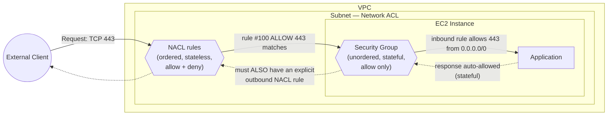

# Security Groups vs. Network ACLs (NACLs)


## Definition

**Security Groups** are stateful, instance-level virtual firewalls — rules that control traffic
to/from individual resources (EC2 instances, RDS databases, ENIs, Lambda-in-VPC). **Network
ACLs (NACLs)** are stateless, subnet-level firewalls — rules evaluated for everything crossing a
subnet boundary, regardless of which instance inside it the traffic is headed to. They stack: a
packet must pass the NACL first, then the security group, to reach an instance.

## Purpose

AWS gives you two layers deliberately, mirroring defense-in-depth in physical data centers: NACLs
act like a perimeter fence around a subnet (coarse, subnet-wide rules, good for blanket
deny-lists), while security groups act like a lock on each individual door (fine-grained,
per-resource rules). Relying on only one layer means either too coarse a control (NACL alone
can't say "only this specific instance may receive traffic") or no network-wide blanket block
(security groups alone can't instantly block a known-bad IP range from an entire subnet in one
rule).

## How It Works

Plain explanation: traffic entering a subnet from outside hits the subnet's **NACL** first. The
NACL evaluates **numbered rules in order, lowest number first**, and stops at the first match
(allow or deny) — if nothing matches, the implicit final rule denies everything. Because NACLs
are **stateless**, you must write rules for both directions yourself (an allowed inbound request
needs a matching outbound rule for its response, or vice versa). If the NACL allows the packet
through, it then reaches the instance's **security group**. Security groups only have **allow**
rules (no explicit deny) and are **stateful** — if inbound traffic is allowed in, the response
traffic is automatically allowed back out, no matter what the outbound rules say.



Step by step: the client's request hits the **NACL** first — it's evaluated against ordered
rules (e.g., rule #100 "ALLOW TCP 443 from 0.0.0.0/0") and passes. It then hits the instance's
**security group**, which checks its inbound allow-list, finds a matching rule, and lets it
through to the **application**. When the application sends its response, the security group
*automatically* allows the outbound response because it tracked the original inbound connection
(statefulness) — no outbound security group rule needed. But the response still has to cross the
subnet boundary again, and because the NACL is stateless, **it does not remember the original
request** — you must have a separate explicit outbound NACL rule (e.g., allow outbound on
ephemeral ports 1024-65535) or the response packet gets silently dropped even though the
original request was allowed in.

## Key Features / Components

- **Security Group** — attached to ENIs/instances (not subnets); default: all inbound denied, all
  outbound allowed; rules can reference other security groups by ID (not just CIDR), enabling
  "allow from my app-tier SG" style rules that survive IP changes.
- **Stateful (SG)** — return traffic for an allowed connection is automatically permitted.
- **Allow-only (SG)** — there is no "deny" rule type in a security group; you only add allows.
- **Network ACL** — attached to subnets; evaluated for every packet crossing that subnet boundary
  (both directions), independent of which instance is the destination.
- **Numbered, ordered rules (NACL)** — rules evaluated in ascending number order; first match
  wins; leave gaps (100, 200, 300...) so you can insert rules later without renumbering.
- **Explicit allow + deny (NACL)** — unlike security groups, NACLs can explicitly **deny**, which
  is the only native way to blanket-block a specific IP/CIDR at the subnet level.
- **Stateless (NACL)** — inbound and outbound rules are fully independent; you must author both.
- **Default NACL** — allows all inbound/outbound traffic by default (so it's invisible until you
  touch it); default security group allows all traffic among members of the same SG, denies all
  other inbound, allows all outbound.
- **Multiple SGs per instance, one NACL per subnet** — an instance can have several SGs attached
  (rules are additive/unioned); a subnet has exactly one NACL at a time.

## Use Cases — When to Use It

- **Security Groups** — the default, everyday tool: "only allow port 443 from the internet to
  my load balancer," "only allow port 3306 from my app-tier SG to my database SG." This covers
  the vast majority of real-world rules.
- **NACLs** — reach for them when you need a **blanket block** independent of which instance:
  "deny this entire malicious IP range from the whole subnet right now," or as a coarse-grained
  compliance control layered on top of (never instead of) security groups.
- **Combining both** — standard production pattern: NACL as a broad perimeter guard (deny known
  bad ranges, restrict subnet to expected protocols), security groups as the precise per-tier
  access control (web SG → app SG → db SG chaining).

## When NOT to Use It / Alternatives

- **Don't use NACLs as your primary access control** — they're coarse, stateless, and easy to
  misconfigure (forgetting the return-traffic rule is a classic self-inflicted outage). Security
  groups should carry almost all of your real access logic.
- **Don't try to make a security group "deny" something** — it can't; if you need an explicit
  deny, that's a NACL job (or AWS Network Firewall / WAF for more sophisticated inspection).
- **For application-layer filtering** (blocking SQL injection patterns, rate limiting by URL
  path) — neither SGs nor NACLs operate above L4 (IP/port); use **AWS WAF** in front of
  CloudFront/ALB/API Gateway instead.
- **For full stateful deep packet inspection / intrusion detection at the VPC level** — use
  **AWS Network Firewall**, not NACLs — NACLs are simple allow/deny lists, not a true IDS/IPS.

## Why It's Important

**Real-world:** an overly permissive security group (e.g., `0.0.0.0/0` on port 22 or a database
port left open) is one of the single most common causes of real AWS security incidents found by
automated scanners and in breach post-mortems — it's the #1 thing a cloud security audit checks
first. Misconfigured NACLs (forgetting the stateless return-path rule) is one of the most common
"my app works for a minute then times out" production outages caused by networking.

**Exam mapping:**
- **SAA-C03** — Domain 1 Task 1.2 names security groups and NACLs explicitly as the core VPC
  security mechanism — this is close to guaranteed exam content, usually as a "why can't this
  instance be reached" or "how do I block this specific CIDR" scenario question.
- **DVA-C03** — Domain 2 (Security, 26%) assumes understanding of SG/NACL layering when
  developers configure Lambda-in-VPC or RDS access from an application.
- **MLA-C02** — Domain 4 (Operating/Securing ML Solutions) uses security groups to restrict
  SageMaker notebook/endpoint network access as a standard security control.

## Pricing Model (summary)

**Free.** Security groups and NACLs carry no charge of their own — you only pay for the
resources they're attached to and any data transfer those resources generate. There's no reason
to under-use either for cost reasons; the only "cost" is operational complexity if rules sprawl
unmanaged.

## Hands-on Lab (Floci)

```bash
# Security group: allow inbound HTTPS from anywhere, nothing else
awslocal ec2 create-security-group --group-name web-sg \
  --description "Web tier SG" --vpc-id <vpc-id>

awslocal ec2 authorize-security-group-ingress --group-id <sg-id> \
  --protocol tcp --port 443 --cidr 0.0.0.0/0

awslocal ec2 describe-security-groups --group-ids <sg-id>

# Network ACL: explicitly deny one CIDR, allow everything else
awslocal ec2 create-network-acl --vpc-id <vpc-id> \
  --tag-specifications 'ResourceType=network-acl,Tags=[{Key=Name,Value=study-nacl}]'

awslocal ec2 create-network-acl-entry --network-acl-id <nacl-id> \
  --rule-number 90 --protocol -1 --rule-action deny \
  --cidr-block 198.51.100.0/24 --ingress

awslocal ec2 create-network-acl-entry --network-acl-id <nacl-id> \
  --rule-number 100 --protocol -1 --rule-action allow \
  --cidr-block 0.0.0.0/0 --ingress

# Don't forget the stateless outbound rule, or responses get silently dropped
awslocal ec2 create-network-acl-entry --network-acl-id <nacl-id> \
  --rule-number 100 --protocol -1 --rule-action allow \
  --cidr-block 0.0.0.0/0 --egress

awslocal ec2 associate-network-acl --network-acl-id <nacl-id> --subnet-id <subnet-id>
```

This is control-plane only (Floci stores and returns the rules correctly; it does not enforce
real packet filtering), so use it to build muscle memory for the CLI/IaC shape, not to verify
actual network behavior. Full lab: `labs-floci/networking-vpc-lab.md`.

## Exam Tips

- **The #1 trap on this topic**: *"Security groups are stateful, NACLs are stateless."* Expect a
  question where traffic is allowed inbound but the response is blocked — the answer is almost
  always "the NACL is missing the outbound rule for the ephemeral port range," because the exam
  wants to confirm you know NACLs don't auto-allow return traffic.
- Security groups **cannot deny** — if a question's answer requires an explicit block, it must be
  a NACL (or WAF/Network Firewall for L7).
- NACL rules are evaluated **in numeric order, first match wins** — don't assume "more specific
  beats less specific" like route tables; it's purely about rule number order.
- Security group rules can reference **another security group as the source**, not just a CIDR —
  this is the standard, exam-favored way to allow "app tier talks to db tier" without hardcoding
  IPs.
- Multiple security groups on one instance are **additive** (union of all allow rules) — there's
  no conflict resolution needed since there's no deny to conflict with.
- Default security group only allows traffic **between members of itself** inbound, all outbound;
  default NACL allows **all** traffic both ways — know these starting points.

## Related Terms

- [`vpc.md`](vpc.md), [`subnets-route-tables-igw-natgw.md`](subnets-route-tables-igw-natgw.md)
- `services/security-identity-compliance/waf.md` (L7 filtering, not covered here)
- `services/security-identity-compliance/network-firewall.md` (stateful deep packet inspection)
- `glossary/stateful-vs-stateless.md`, `glossary/cidr.md`
