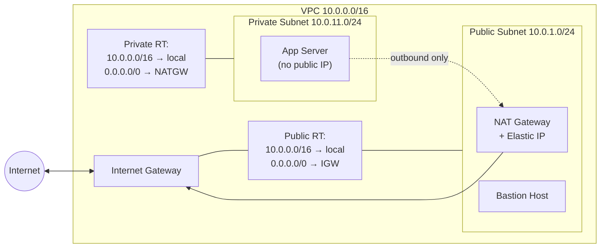

# Subnets, Route Tables, Internet Gateway & NAT Gateway


## Definition

These are the four building blocks that turn a VPC's empty address range into a working
network: **subnets** divide the VPC by Availability Zone, **route tables** decide where traffic
goes, the **Internet Gateway (IGW)** lets public-facing resources reach the internet directly,
and the **NAT Gateway (NATGW)** lets private resources reach *out* to the internet without being
reachable *from* it.

## Purpose

A VPC alone is just an IP range — it has no AZ placement, no traffic rules, and no internet
connectivity until these four pieces are configured. AWS split them into separate, composable
objects (rather than one monolithic "network config") so you can mix and match: multiple subnets
can share one route table, one VPC can have many route tables, and NAT/IGW are optional add-ons
layered on top. This modularity is what lets the same VPC primitive support everything from a
single public web server to a multi-tier, multi-AZ, hybrid-connected enterprise network.

## How It Works

Plain explanation: a **subnet** is created inside a VPC with a CIDR that's a subset of the VPC's
CIDR, and it's pinned to exactly one Availability Zone. Every subnet is associated with exactly
one **route table** (either an explicit association, or the VPC's main/default route table if
none is assigned). The route table is a list of rules: "traffic headed to this CIDR goes out
this target." A subnet becomes "public" the moment its route table contains a route sending
`0.0.0.0/0` (all internet-bound traffic) to an **Internet Gateway**. A subnet stays "private" if
its default route instead points to a **NAT Gateway** sitting in a public subnet — private
instances can then initiate outbound connections (e.g., `apt-get update`), but nothing from the
internet can initiate a connection back in.



Step by step: an outbound request from the **App Server** (private subnet) hits its route table,
which sends unmatched traffic (`0.0.0.0/0`) to the **NAT Gateway** living in the public subnet.
The NAT Gateway swaps the private IP for its own Elastic IP and forwards the request through the
**Internet Gateway** to the internet. The reply comes back to the NAT Gateway's Elastic IP, and
the NAT Gateway translates it back to the App Server's private IP — the App Server is never
directly addressable from outside. Meanwhile the **Bastion Host** in the public subnet has its
own public IP and a direct route to the IGW both ways, so it's reachable inbound (if a security
group allows it) and outbound.

## Key Features / Components

- **Subnet** — AZ-pinned CIDR subset; "public" or "private" purely by its route table, not a flag.
- **Route table** — ordered list of CIDR→target rules; every table has an implicit `local` route
  for in-VPC traffic that can never be removed or overridden.
- **Main route table** — the VPC's default; any subnet not explicitly associated with another
  table uses this one — a common misconfiguration source if forgotten.
- **Internet Gateway (IGW)** — one per VPC, horizontally scaled and redundant by AWS, no
  bandwidth limit or hourly charge of its own; performs 1:1 NAT for instances with public IPs.
- **Egress-Only Internet Gateway** — the IPv6 equivalent of a NAT Gateway (IPv6 addresses are
  globally routable by design, so there's no "private IP" concept to hide behind — this gateway
  instead blocks *inbound* connections while allowing *outbound*).
- **NAT Gateway (managed)** — AWS-managed, one per AZ (best practice), scales automatically to
  45 Gbps, billed hourly + per-GB processed; requires an Elastic IP.
- **NAT Instance (self-managed, legacy)** — an EC2 instance running NAT software; cheaper at low
  traffic, but you patch/scale/HA it yourself — mostly a legacy/cost-optimization pattern now.
- **Route propagation** — Virtual Private Gateways and Transit Gateway attachments can
  auto-populate route tables instead of you hand-entering every CIDR.
- **Subnet reserved IPs** — AWS reserves 5 addresses per subnet (network, VPC router, DNS,
  future use, broadcast) regardless of subnet size.

## Use Cases — When to Use It

- **Public subnet**: internet-facing load balancers, bastion/jump hosts, NAT Gateways themselves.
- **Private subnet**: application servers, databases, internal microservices — anything that
  should never be directly dialable from the internet.
- **Multiple subnets per AZ**: separate public/private/data tiers within the same AZ for
  defense-in-depth (e.g., a "data" subnet with even tighter NACLs than the "app" subnet).
- **NAT Gateway**: private EC2 instances that need outbound-only internet (OS patches, hitting
  external APIs, pulling container images) without being inbound-reachable.
- **One NAT Gateway per AZ** (not one shared across AZs): avoids cross-AZ data transfer charges
  and removes the single-AZ failure point — a standard SAA-C03 cost/resiliency tradeoff question.

## When NOT to Use It / Alternatives

- **Don't put a NAT Gateway where a VPC endpoint would do** — if private instances only need to
  reach AWS services (S3, DynamoDB, etc.), a **Gateway VPC Endpoint** is free and faster than
  routing that traffic through a NAT Gateway's per-GB charge. See `vpc-endpoints-privatelink.md`.
  This exact substitution is one of the most common SAA-C03 cost-optimization answers.
  being charged regardless of actual usage, that's the point of availability.
- **Don't use a NAT Instance in production at scale** — it's a single EC2 instance you must
  patch, monitor, and manually fail over; the managed NAT Gateway removes that operational burden
  for a modest cost premium. NAT instances remain valid only for very low-traffic/cost-sensitive
  edge cases or legacy environments.
- **If everything needs to be reachable from the internet** (e.g., a single-tier static site),
  you don't need private subnets/NAT at all — just a public subnet, or better, skip EC2 entirely
  and use S3 + CloudFront.

## Why It's Important

**Real-world:** NAT Gateway cost surprises are one of the most common "why is my AWS bill high"
support tickets — a forgotten NAT Gateway processing large data volumes (e.g., log shipping, ML
training data downloads) can rack up hundreds of dollars a month in per-GB charges alone.
Public/private subnet misconfiguration (a database accidentally in a subnet with a route to an
IGW) is a leading cause of data breach post-mortems.

**Exam mapping:**
- **SAA-C03** — Domain 1 Task 1.2 names "NAT gateways" and "public/private subnet segmentation"
  explicitly. Domain 4 Task 4.4 (cost-optimized networking) directly tests NAT Gateway vs VPC
  endpoint vs NAT instance cost tradeoffs — expect multiple questions on this exact topic.
- **DVA-C03** — Domain 1 Task 1.2 (Lambda VPC access) requires understanding that a Lambda
  function in a private subnet needs a NAT Gateway route to reach the public internet/other AWS
  APIs not reachable via VPC endpoint.
- **MLA-C02** — Domain 4 (Operating/Securing) assumes training/inference infra in private
  subnets reaching S3 via VPC endpoints rather than NAT Gateway, for both cost and security.

## Pricing Model (summary)

- **Subnets, route tables, Internet Gateway**: free.
- **NAT Gateway**: hourly charge (per NAT Gateway, per AZ) **plus** a per-GB data processing
  charge for all traffic through it — this is the one that adds up fast at scale.
- **NAT Instance**: just the EC2 instance cost (On-Demand/Reserved/Spot) + standard data
  transfer rates — can be cheaper at low/steady volumes but has no SLA/auto-scaling.
- **Elastic IP**: free while attached to a running resource; charged hourly if idle/unattached
  (AWS's way of discouraging IP hoarding).
Official pricing: https://aws.amazon.com/vpc/pricing/

## Hands-on Lab (Floci)

```bash
# Using the VPC created in vpc.md's lab (<vpc-id>), build out subnets + IGW route
awslocal ec2 create-route-table --vpc-id <vpc-id> \
  --tag-specifications 'ResourceType=route-table,Tags=[{Key=Name,Value=public-rt}]'

awslocal ec2 create-route --route-table-id <rtb-id> \
  --destination-cidr-block 0.0.0.0/0 --gateway-id <igw-id>

awslocal ec2 associate-route-table --route-table-id <rtb-id> --subnet-id <subnet-id>

# Allocate an Elastic IP and create a NAT Gateway in the public subnet
awslocal ec2 allocate-address --domain vpc
awslocal ec2 create-nat-gateway --subnet-id <public-subnet-id> \
  --allocation-id <eip-allocation-id> \
  --tag-specifications 'ResourceType=natgateway,Tags=[{Key=Name,Value=study-natgw}]'

# Inspect the private route table and point it at the NAT Gateway
awslocal ec2 create-route --route-table-id <private-rtb-id> \
  --destination-cidr-block 0.0.0.0/0 --nat-gateway-id <natgw-id>

awslocal ec2 describe-route-tables --route-table-ids <rtb-id> <private-rtb-id>
```

This exercises the exact API shape used in Terraform/CDK/CloudFormation for this pattern.
Floci's control-plane emulation lets you confirm the route entries are accepted and stored
correctly — it does not simulate actual packet forwarding, so you won't see real NAT traffic
flow. Full lab: `labs-floci/networking-vpc-lab.md`.

## Exam Tips

- **Memorize**: public subnet = route table has `0.0.0.0/0 → igw-xxxx`. Private subnet = it
  doesn't (routes `0.0.0.0/0` to a NAT Gateway instead, or has no default route at all).
- **NAT Gateway is AZ-scoped** — if it fails or its AZ goes down, private subnets in *other* AZs
  lose internet access unless each AZ has its own NAT Gateway. This exact resiliency vs. cost
  tradeoff (1 NAT Gateway shared vs. 1 per AZ) is a recurring SAA-C03 question pattern.
  Gateway is managed/scaled by AWS and costs more; an instance is self-managed, can be
  stopped/started, resized, and used as a bastion too, but you own patching and HA.
- **VPC endpoint beats NAT Gateway for AWS-service-only traffic** — if the only reason a private
  subnet needs a NAT Gateway is to reach S3/DynamoDB, add a Gateway VPC Endpoint instead and
  remove the NAT Gateway's per-GB cost for that traffic.
- Route table priority: **most specific route wins** (longest prefix match), not first-listed.
- The "main route table" catches any subnet without an explicit association — a classic trap
  question: "a new subnet can unexpectedly reach the internet" ⇒ check if it inherited the main
  route table's `0.0.0.0/0 → igw` route by default.

## Related Terms

- [`vpc.md`](vpc.md) — the container these all live inside
- [`security-groups-vs-nacls.md`](security-groups-vs-nacls.md) — what filters traffic once routed
- [`vpc-endpoints-privatelink.md`](vpc-endpoints-privatelink.md) — NAT Gateway's free alternative
  for AWS-service traffic
- [`data-transfer-pricing.md`](data-transfer-pricing.md) — NAT Gateway/cross-AZ cost detail
- `glossary/cidr.md`, `glossary/elastic-ip.md`
