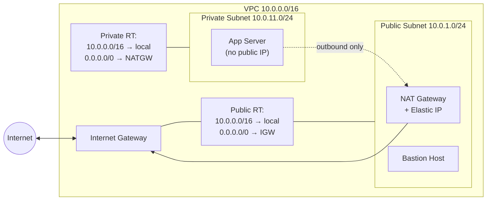
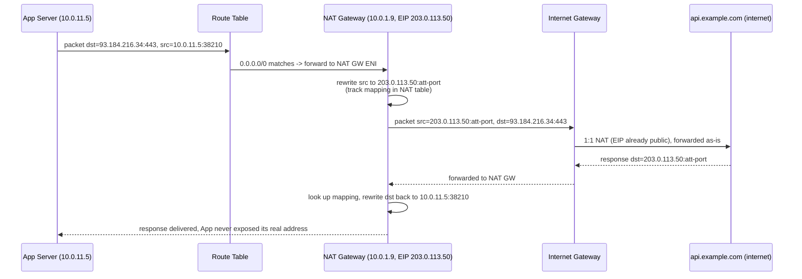
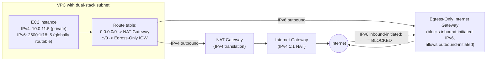
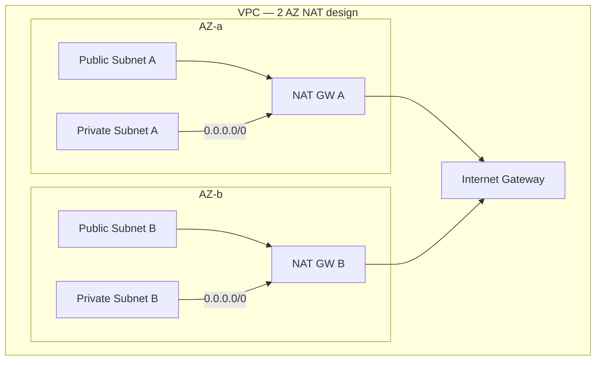

# Subnets, Route Tables, Internet Gateway & NAT Gateway

> **Appears in:** [SAA-C03](../../certifications/saa-c03/README.md)


## Definition

These are the four building blocks that turn a VPC's empty address range into a working
network: **subnets** divide the VPC by Availability Zone, **route tables** decide where traffic
goes, the **Internet Gateway (IGW)** lets public-facing resources reach the internet directly,
and the **NAT Gateway (NATGW)** lets private resources reach *out* to the internet without being
reachable *from* it.

## Purpose

A VPC alone is just an IP range — it has no AZ placement, no traffic rules, and no internet
connectivity until these four pieces are configured. AWS split them into separate, composable
objects (rather than one monolithic "network config") so you can mix and match: multiple subnets
can share one route table, one VPC can have many route tables, and NAT/IGW are optional add-ons
layered on top. This modularity is what lets the same VPC primitive support everything from a
single public web server to a multi-tier, multi-AZ, hybrid-connected enterprise network.

## How It Works

Plain explanation: a **subnet** is created inside a VPC with a CIDR that's a subset of the VPC's
CIDR, and it's pinned to exactly one Availability Zone. Every subnet is associated with exactly
one **route table** (either an explicit association, or the VPC's main/default route table if
none is assigned). The route table is a list of rules: "traffic headed to this CIDR goes out
this target." A subnet becomes "public" the moment its route table contains a route sending
`0.0.0.0/0` (all internet-bound traffic) to an **Internet Gateway**. A subnet stays "private" if
its default route instead points to a **NAT Gateway** sitting in a public subnet — private
instances can then initiate outbound connections (e.g., `apt-get update`), but nothing from the
internet can initiate a connection back in.


*Figure: AWS's reference diagram showing two Availability Zones — AZ A has a public subnet with
IGW access and a private subnet with no internet route at all; AZ B has a public subnet
containing a NAT Gateway, plus a private subnet whose instances reach the internet through that
NAT Gateway. Source: AWS documentation, "NAT gateway use cases" —
https://docs.aws.amazon.com/vpc/latest/userguide/nat-gateway-scenarios.html*



Step by step: an outbound request from the **App Server** (private subnet) hits its route table,
which sends unmatched traffic (`0.0.0.0/0`) to the **NAT Gateway** living in the public subnet.
The NAT Gateway swaps the private IP for its own Elastic IP and forwards the request through the
**Internet Gateway** to the internet. The reply comes back to the NAT Gateway's Elastic IP, and
the NAT Gateway translates it back to the App Server's private IP — the App Server is never
directly addressable from outside. Meanwhile the **Bastion Host** in the public subnet has its
own public IP and a direct route to the IGW both ways, so it's reachable inbound (if a security
group allows it) and outbound.

### Packet-level walkthrough: NAT Gateway address translation, step by step



The key detail: the NAT Gateway maintains an internal **translation table** mapping
`(private-IP, private-port) <-> (NAT-GW-EIP, translation-port)` for every active connection — this
is what lets a reply addressed to the NAT Gateway's single Elastic IP get routed back to the
*correct* private instance among potentially thousands behind it. This table is also why NAT
Gateway has a hard connection-tracking limit (55,000 simultaneous connections *per unique
destination* through one NAT Gateway) — a detail that occasionally shows up in
troubleshooting-style scenario questions about a NAT Gateway silently dropping new connections
under extreme fan-out load.


*Figure: AWS's reference diagram of address translation — a NAT device in a public subnet
replaces the source IPv4 address of private-subnet instances before forwarding through the
Internet Gateway, and reverses the translation for the response. Source: AWS documentation,
"Connect to the internet or other networks using NAT devices" —
https://docs.aws.amazon.com/vpc/latest/userguide/vpc-nat.html*

### Running a self-managed NAT Instance — what you're signing up for

Choosing a NAT Instance instead of a managed NAT Gateway means taking on several responsibilities
AWS otherwise handles for you:

- **Disable source/destination check** on the instance — by default EC2 drops any packet whose
  source/destination doesn't match the instance's own IP, which is exactly what a NAT instance
  needs to forward on others' behalf; this check must be explicitly turned off.
- **Size for peak bandwidth** — unlike NAT Gateway's automatic scaling to 45 Gbps, a NAT
  instance's throughput ceiling is whatever its instance type/network performance tier provides;
  undersizing causes silent throughput bottlenecks under load.
- **Patch and monitor the OS/NAT software yourself** — AMI updates, security patches, and the NAT
  software's own health are entirely your responsibility.
- **Build your own HA** — a single NAT instance is a single point of failure; HA requires a
  second instance in another AZ plus a health-check-driven failover mechanism (e.g., a Lambda
  function that re-points route tables on failure detection) that AWS builds in for free with NAT
  Gateway.
- **It can double as a bastion host** — the one genuine advantage over NAT Gateway: a NAT instance
  is a real EC2 instance you can SSH into, assign a security group to, and use for ad hoc
  administrative access, none of which applies to the fully managed NAT Gateway.

### CIDR math for route table design: why the most specific route wins

Route tables use **longest prefix match (LPM)**, not insertion order. Given a route table with
both a broad default and a narrower, more specific entry, traffic always takes the most specific
match:

```
Destination           Target            Matches for packet to 10.0.5.20?
10.0.0.0/16  (local)   local             Yes — /16 is 16 fixed bits
10.0.5.0/24            pcx-xxxx          Yes — /24 is 24 fixed bits (MORE specific)
0.0.0.0/0              igw-xxxx          Yes — /0 is 0 fixed bits (LEAST specific)
```

For a packet addressed to `10.0.5.20`, all three rows technically "match" (every CIDR up to `/0`
matches everything), but the router picks the row with the **longest (most specific) prefix** —
here, the `/24` peering route, not the `/16` local route or the `/0` internet route. This is why
you can have a specific peering connection route *inside* the same VPC CIDR range the `local`
route already covers, and traffic correctly prefers the peering route for that narrower slice —
a frequently misunderstood mechanic that the exam likes to probe with "which route actually wins"
style questions.

## Egress-Only Internet Gateway — the IPv6 NAT Gateway analogue, in detail



The core conceptual trap: an Egress-Only Internet Gateway does **not** hide the instance's
address the way NAT does — the instance's IPv6 address is still globally unique and visible on
the wire in every packet; the gateway simply refuses to let an *externally-initiated* connection
reach it. This is a stateful, direction-aware filter, not an address-translation device — a
subtle but frequently tested distinction versus NAT Gateway's actual address rewriting.

## Key Features / Components

- **Subnet** — AZ-pinned CIDR subset; "public" or "private" purely by its route table, not a flag.
- **Route table** — ordered list of CIDR→target rules; every table has an implicit `local` route
  for in-VPC traffic that can never be removed or overridden.
- **Main route table** — the VPC's default; any subnet not explicitly associated with another
  table uses this one — a common misconfiguration source if forgotten.
- **Internet Gateway (IGW)** — one per VPC, horizontally scaled and redundant by AWS, no
  bandwidth limit or hourly charge of its own; performs 1:1 NAT for instances with public IPs.
- **Egress-Only Internet Gateway** — the IPv6 equivalent of a NAT Gateway (IPv6 addresses are
  globally routable by design, so there's no "private IP" concept to hide behind — this gateway
  instead blocks *inbound* connections while allowing *outbound*).
- **NAT Gateway (managed)** — AWS-managed, one per AZ (best practice), scales automatically to
  45 Gbps, billed hourly + per-GB processed; requires an Elastic IP.
- **NAT Instance (self-managed, legacy)** — an EC2 instance running NAT software; cheaper at low
  traffic, but you patch/scale/HA it yourself — mostly a legacy/cost-optimization pattern now.
- **Route propagation** — Virtual Private Gateways and Transit Gateway attachments can
  auto-populate route tables instead of you hand-entering every CIDR.
- **Subnet reserved IPs** — AWS reserves 5 addresses per subnet (network, VPC router, DNS,
  future use, broadcast) regardless of subnet size.
- **Prefix lists** — named, reusable groups of CIDR blocks (AWS-managed, like the S3 prefix list
  used by Gateway Endpoints, or customer-managed) usable as a route target or security
  group/NACL reference instead of hand-listing every CIDR.
- **Private NAT Gateway** — a NAT Gateway variant with no Elastic IP/internet access at all, used
  purely to translate addresses *between* private networks (e.g., overlapping-CIDR environments
  connected through a Transit Gateway) — not for internet egress.

## Common Architectures

**1. One NAT Gateway per AZ (the resiliency-correct default).** Each AZ gets its own public
subnet with its own NAT Gateway, and that AZ's private subnet routes only to its own
same-AZ NAT Gateway — avoiding both a single point of failure and avoiding cross-AZ data transfer
charges for NAT-bound traffic.



**2. Single shared NAT Gateway (cost-optimized, less resilient).** One NAT Gateway in one AZ's
public subnet, with *every* private subnet in *every* AZ routing to it. Cheaper (one NAT Gateway
instead of N), but if that AZ fails, every private subnet in the VPC loses internet access, and
cross-AZ traffic to reach the shared NAT Gateway incurs data transfer charges. This is the
textbook "cost vs. resiliency" tradeoff the exam loves to ask about directly.

**3. Centralized NAT via Transit Gateway (hub VPC pattern).** Many "spoke" VPCs route their
outbound internet traffic through a central "hub" VPC's NAT Gateways via Transit Gateway,
instead of each spoke VPC running its own NAT Gateways — reduces the number of NAT Gateways to
manage/pay for across a large multi-VPC estate, at the cost of a Transit Gateway hop and its
own per-GB processing charge. See `transit-gateway-and-peering.md` for the attachment/routing
detail.

**4. Private subnet with zero internet path, Gateway Endpoint only.** No NAT Gateway at all — the
private subnet's route table has only the `local` route plus a Gateway Endpoint's prefix-list
route to S3/DynamoDB. Used when a workload's only "external" dependency is an AWS service that a
free Gateway Endpoint already covers — see `vpc-endpoints-privatelink.md`.

## Use Cases — When to Use It

- **Public subnet**: internet-facing load balancers, bastion/jump hosts, NAT Gateways themselves.
- **Private subnet**: application servers, databases, internal microservices — anything that
  should never be directly dialable from the internet.
- **Multiple subnets per AZ**: separate public/private/data tiers within the same AZ for
  defense-in-depth (e.g., a "data" subnet with even tighter NACLs than the "app" subnet).
- **NAT Gateway**: private EC2 instances that need outbound-only internet (OS patches, hitting
  external APIs, pulling container images) without being inbound-reachable.
- **One NAT Gateway per AZ** (not one shared across AZs): avoids cross-AZ data transfer charges
  and removes the single-AZ failure point — a standard SAA-C03 cost/resiliency tradeoff question.

## When NOT to Use It / Alternatives

- **Don't put a NAT Gateway where a VPC endpoint would do** — if private instances only need to
  reach AWS services (S3, DynamoDB, etc.), a **Gateway VPC Endpoint** is free and faster than
  routing that traffic through a NAT Gateway's per-GB charge. See `vpc-endpoints-privatelink.md`.
  This exact substitution is one of the most common SAA-C03 cost-optimization answers.
  being charged regardless of actual usage, that's the point of availability.
- **Don't use a NAT Instance in production at scale** — it's a single EC2 instance you must
  patch, monitor, and manually fail over; the managed NAT Gateway removes that operational burden
  for a modest cost premium. NAT instances remain valid only for very low-traffic/cost-sensitive
  edge cases or legacy environments.
- **If everything needs to be reachable from the internet** (e.g., a single-tier static site),
  you don't need private subnets/NAT at all — just a public subnet, or better, skip EC2 entirely
  and use S3 + CloudFront.

## Why It's Important

**Real-world:** NAT Gateway cost surprises are one of the most common "why is my AWS bill high"
support tickets — a forgotten NAT Gateway processing large data volumes (e.g., log shipping, ML
training data downloads) can rack up hundreds of dollars a month in per-GB charges alone.
Public/private subnet misconfiguration (a database accidentally in a subnet with a route to an
IGW) is a leading cause of data breach post-mortems.

**Exam mapping:**
- **SAA-C03** — Domain 1 Task 1.2 names "NAT gateways" and "public/private subnet segmentation"
  explicitly. Domain 4 Task 4.4 (cost-optimized networking) directly tests NAT Gateway vs VPC
  endpoint vs NAT instance cost tradeoffs — expect multiple questions on this exact topic.
- **DVA-C03** — Domain 1 Task 1.2 (Lambda VPC access) requires understanding that a Lambda
  function in a private subnet needs a NAT Gateway route to reach the public internet/other AWS
  APIs not reachable via VPC endpoint.
- **MLA-C02** — Domain 4 (Operating/Securing) assumes training/inference infra in private
  subnets reaching S3 via VPC endpoints rather than NAT Gateway, for both cost and security.

## Pricing Model (summary)

- **Subnets, route tables, Internet Gateway**: free.
- **NAT Gateway**: hourly charge (per NAT Gateway, per AZ) **plus** a per-GB data processing
  charge for all traffic through it — this is the one that adds up fast at scale.
- **NAT Instance**: just the EC2 instance cost (On-Demand/Reserved/Spot) + standard data
  transfer rates — can be cheaper at low/steady volumes but has no SLA/auto-scaling.
- **Elastic IP**: free while attached to a running resource; charged hourly if idle/unattached
  (AWS's way of discouraging IP hoarding).

**NAT Gateway vs. NAT Instance, side by side:**

| Factor | NAT Gateway (managed) | NAT Instance (self-managed) |
|---|---|---|
| Availability | AWS-managed, highly available within its AZ | You design/build HA yourself |
| Bandwidth | Scales automatically up to 45 Gbps | Capped by instance type |
| Maintenance | None — fully managed | You patch the OS/NAT software |
| Can be a bastion too | No | Yes — can double as a jump host |
| Security group | Not directly assignable | Has its own, assignable SG |
| Cost model | Hourly + per-GB processed | EC2 instance cost + standard data transfer |
| Source/destination check | N/A (managed) | Must be disabled on the instance |

Official pricing: https://aws.amazon.com/vpc/pricing/

## Limits & Quotas

| Resource | Default quota |
|---|---|
| NAT Gateways per AZ | 5 (soft limit) |
| Bandwidth per NAT Gateway | Scales to 45 Gbps automatically |
| Concurrent connections per NAT Gateway, per unique destination | 55,000 |
| Internet Gateways per Region | 5 (one attached per VPC) |
| Route tables per VPC | 200 |
| Routes per route table (non-propagated) | 50 (soft, increasable) |
| Routes per route table (propagated via VGW/TGW) | 100 (soft, increasable) |
| Subnets per VPC | 200 |
| Egress-only Internet Gateways per Region | 5 |

The 55,000-connections-per-destination NAT Gateway limit is a real, occasionally exam-relevant
detail: if many private instances all call the *same* external endpoint heavily (e.g., a single
third-party API), that per-destination ceiling can be hit well before any bandwidth limit is —
the fix is usually spreading destinations (e.g., via multiple NAT Gateways or VPC endpoints for
in-AWS destinations) rather than "just get a bigger NAT Gateway."

## Troubleshooting / Common Issues

- **"Private instances can't reach the internet even though I added a NAT Gateway."** Check: (1)
  is the NAT Gateway actually in a *public* subnet with its own route to an IGW? A NAT Gateway
  placed in a private subnet has no path out itself. (2) Does the private subnet's route table
  actually point `0.0.0.0/0` at the NAT Gateway (not left as `igw-xxxx` by mistake, and not
  missing entirely)? (3) Is the NAT Gateway's Elastic IP actually allocated and attached?
- **"NAT Gateway in one AZ works, but an instance in a different AZ loses internet access when
  that AZ has an issue."** Expected behavior if you're using a single shared NAT Gateway — NAT
  Gateways are AZ-scoped resources with no automatic cross-AZ failover. The fix is one NAT
  Gateway per AZ, each AZ's private subnets routing only to their own AZ's NAT Gateway.
- **"A new subnet unexpectedly has internet access I didn't configure."** It inherited the main
  route table's existing `0.0.0.0/0 → igw` route — always check which route table a new subnet is
  actually associated with.
- **"IPv6-only resources in a private subnet can't reach the internet for outbound updates."** A
  NAT Gateway doesn't handle IPv6 at all — the IPv6 equivalent is an **Egress-Only Internet
  Gateway**; check the route table has `::/0 → eigw-xxxx`, not a NAT Gateway target.
- **"Traffic that should hit a VPC peering connection is instead going to the internet (or
  vice versa)."** Almost always a longest-prefix-match surprise — check for an overly broad
  `0.0.0.0/0` route accidentally shadowing a narrower, intended route, or confirm the narrower
  route actually exists at all (a missing specific route silently falls through to the default).
- **"NAT Gateway shows healthy but new connections to one specific external service start
  failing under load."** Likely hitting the 55,000-connections-per-destination ceiling for that
  one destination; check CloudWatch's `ErrorPortAllocation` metric on the NAT Gateway, which
  spikes exactly when this limit is reached.

## Hands-on Lab (Floci)

```bash
# Using the VPC created in vpc.md's lab (<vpc-id>), build out subnets + IGW route
awslocal ec2 create-route-table --vpc-id <vpc-id> \
  --tag-specifications 'ResourceType=route-table,Tags=[{Key=Name,Value=public-rt}]'

awslocal ec2 create-route --route-table-id <rtb-id> \
  --destination-cidr-block 0.0.0.0/0 --gateway-id <igw-id>

awslocal ec2 associate-route-table --route-table-id <rtb-id> --subnet-id <subnet-id>

# Allocate an Elastic IP and create a NAT Gateway in the public subnet
awslocal ec2 allocate-address --domain vpc
awslocal ec2 create-nat-gateway --subnet-id <public-subnet-id> \
  --allocation-id <eip-allocation-id> \
  --tag-specifications 'ResourceType=natgateway,Tags=[{Key=Name,Value=study-natgw}]'

# Inspect the private route table and point it at the NAT Gateway
awslocal ec2 create-route --route-table-id <private-rtb-id> \
  --destination-cidr-block 0.0.0.0/0 --nat-gateway-id <natgw-id>

awslocal ec2 describe-route-tables --route-table-ids <rtb-id> <private-rtb-id>

# Inspect longest-prefix-match behavior: add a narrower, more specific route
# than the VPC's own local route and confirm it's stored distinctly
awslocal ec2 create-route --route-table-id <private-rtb-id> \
  --destination-cidr-block 10.0.5.0/24 --vpc-peering-connection-id <pcx-id>
```

This exercises the exact API shape used in Terraform/CDK/CloudFormation for this pattern.
Floci's control-plane emulation lets you confirm the route entries are accepted and stored
correctly — it does not simulate actual packet forwarding, so you won't see real NAT traffic
flow. Full lab: `labs-floci/networking-vpc-lab.md`.

## Exam Scenario Deep Dive

**Scenario 1 — "An application in a private subnet needs outbound internet access only during
a nightly batch job, and the team wants to minimize NAT Gateway cost since it's otherwise idle."**
NAT Gateway bills hourly regardless of actual traffic, so idle time still costs money every hour
it exists. If the workload is genuinely only active for a short nightly window, a **NAT Instance
that's stopped/started on a schedule** (e.g., via EventBridge + Lambda) can be meaningfully
cheaper than a permanently-running NAT Gateway, since EC2 instance costs stop when stopped — this
is one of the rare scenarios where the "legacy" NAT Instance is the better cost answer over the
managed NAT Gateway, specifically because of its ability to be stopped.

**Scenario 2 — "Two private subnets in different AZs both need outbound internet access. A
single NAT Gateway in AZ-a currently serves both. Leadership wants improved resiliency without
major redesign."**
Add a second NAT Gateway in AZ-b's public subnet, and update AZ-b's private route table to point
at the *local* AZ-b NAT Gateway instead of the cross-AZ one in AZ-a. This removes both the
single-AZ failure point and the cross-AZ data transfer charge for AZ-b's NAT-bound traffic — the
standard "most correct, modest-effort" answer.

**Scenario 3 — "A company notices NAT Gateway data-processing charges account for a large
portion of their monthly bill, and investigation shows most of the traffic is S3 uploads from
private EC2 instances."**
This is the canonical Gateway VPC Endpoint answer: add a free Gateway Endpoint for S3 to the
private subnet's route table, which removes that S3-bound traffic from the NAT Gateway path
entirely (and its per-GB cost) without any NAT Gateway reconfiguration otherwise needed for
non-S3 traffic.

**Scenario 4 — "A private subnet's route table has a `0.0.0.0/0` route to a NAT Gateway, and a
separate, more specific `10.0.5.0/24` route to a peering connection with another VPC whose CIDR
happens to be `10.0.5.0/24`. Traffic to a host at `10.0.5.20` is observed going to the NAT
Gateway instead of the peering connection."**
This shouldn't happen if the peering route is correctly entered — the longest prefix match
(`/24` beats `/0`) should always win. If traffic is still going to the NAT Gateway, the real bug
is almost always that the peering route was never actually added/propagated correctly, or it's in
the wrong route table (the subnet's associated table, not some other unrelated table in the VPC).
This is a "verify your assumption with Reachability Analyzer or `describe-route-tables`, don't
assume LPM failed" style trap.

## Exam Tips

- **Memorize**: public subnet = route table has `0.0.0.0/0 → igw-xxxx`. Private subnet = it
  doesn't (routes `0.0.0.0/0` to a NAT Gateway instead, or has no default route at all).
- **NAT Gateway is AZ-scoped** — if it fails or its AZ goes down, private subnets in *other* AZs
  lose internet access unless each AZ has its own NAT Gateway. This exact resiliency vs. cost
  tradeoff (1 NAT Gateway shared vs. 1 per AZ) is a recurring SAA-C03 question pattern.
  Gateway is managed/scaled by AWS and costs more; an instance is self-managed, can be
  stopped/started, resized, and used as a bastion too, but you own patching and HA.
- **VPC endpoint beats NAT Gateway for AWS-service-only traffic** — if the only reason a private
  subnet needs a NAT Gateway is to reach S3/DynamoDB, add a Gateway VPC Endpoint instead and
  remove the NAT Gateway's per-GB cost for that traffic.
- Route table priority: **most specific route wins** (longest prefix match), not first-listed.
- The "main route table" catches any subnet without an explicit association — a classic trap
  question: "a new subnet can unexpectedly reach the internet" ⇒ check if it inherited the main
  route table's `0.0.0.0/0 → igw` route by default.
- **The 55,000-connections-per-destination NAT Gateway limit** is a real, specific number worth
  remembering — a scenario about a NAT Gateway failing under load to one specific destination,
  despite having bandwidth headroom, is pointing at this connection-tracking ceiling, not raw
  throughput.
- **Private NAT Gateway (no Elastic IP)** is a distinct, less commonly known variant — if a
  scenario describes translating addresses between two private, possibly overlapping networks
  (not reaching the internet at all), that's a private NAT Gateway, not a standard public one.

## Further Reading

- AWS Docs — NAT gateways: https://docs.aws.amazon.com/vpc/latest/userguide/vpc-nat-gateway.html
- AWS Docs — NAT gateway use cases: https://docs.aws.amazon.com/vpc/latest/userguide/nat-gateway-scenarios.html
- AWS Docs — Route tables: https://docs.aws.amazon.com/vpc/latest/userguide/VPC_Route_Tables.html
- AWS Docs — Internet gateways: https://docs.aws.amazon.com/vpc/latest/userguide/VPC_Internet_Gateway.html
- AWS Docs — Egress-only internet gateways: https://docs.aws.amazon.com/vpc/latest/userguide/egress-only-internet-gateway.html
- AWS re:Post — NAT Gateway troubleshooting: https://repost.aws/knowledge-center/vpc-troubleshoot-nat-gateway

## Related Terms

- [`vpc.md`](vpc.md) — the container these all live inside
- [`security-groups-vs-nacls.md`](security-groups-vs-nacls.md) — what filters traffic once routed
- [`vpc-endpoints-privatelink.md`](vpc-endpoints-privatelink.md) — NAT Gateway's free alternative
  for AWS-service traffic
- [`transit-gateway-and-peering.md`](transit-gateway-and-peering.md) — centralized NAT patterns
- [`data-transfer-pricing.md`](data-transfer-pricing.md) — NAT Gateway/cross-AZ cost detail
- `glossary/cidr.md`, `glossary/elastic-ip.md`
