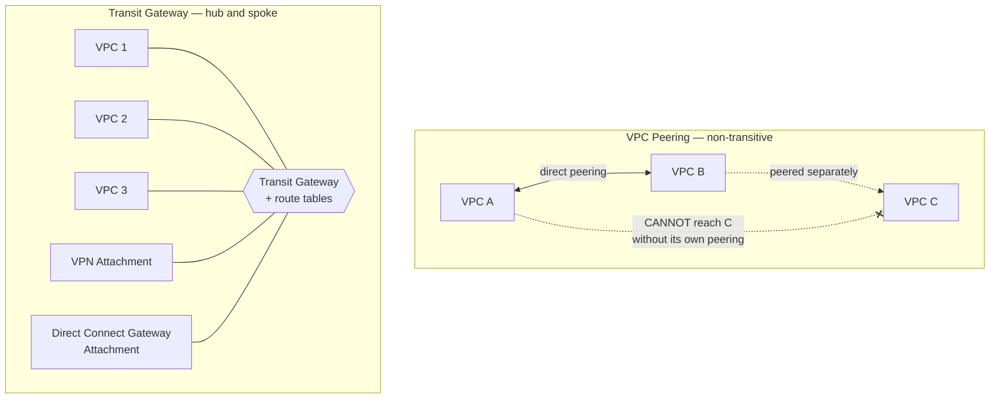
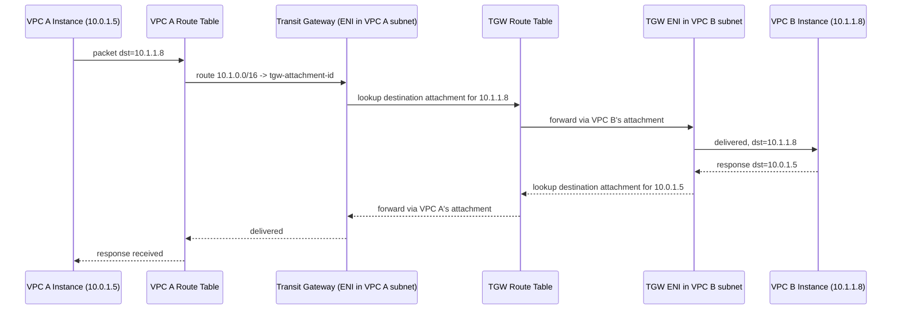
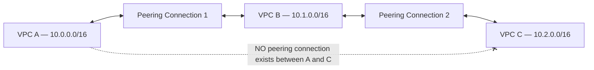
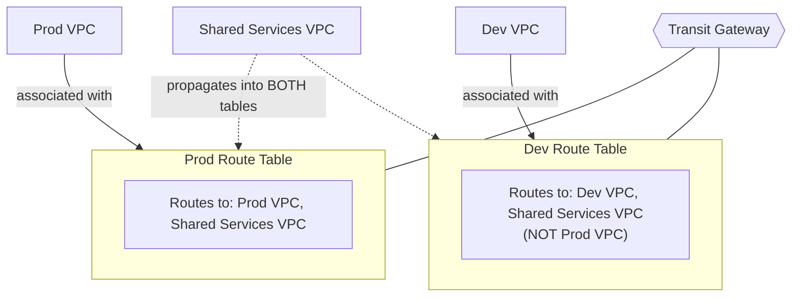
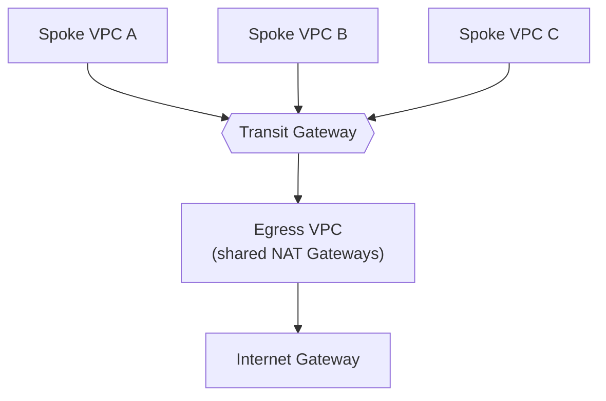
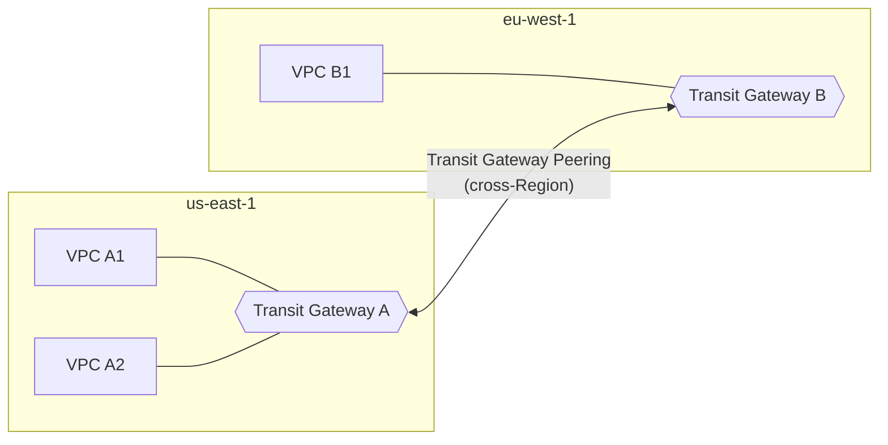

# Transit Gateway & VPC Peering

> **Appears in:** [SAA-C03](../../certifications/saa-c03/README.md)


## Definition

**VPC Peering** is a direct, one-to-one private network connection between exactly two VPCs.
**AWS Transit Gateway** is a managed, scalable, central network hub that connects many VPCs, VPN
connections, and Direct Connect attachments through a single point — like swapping dozens of
point-to-point cables for one switch.

## Purpose

As organizations grow past a handful of VPCs, pure peering becomes unmanageable: peering doesn't
transitively route (if A peers with B, and B peers with C, A still cannot reach C — you'd need a
direct A↔C peering too), so an organization with N VPCs that all need to talk to each other needs
roughly N×(N-1)/2 peering connections — a mesh that becomes a connection-management nightmare at
scale. Transit Gateway was built to replace that full mesh with a hub-and-spoke model: every VPC
attaches once to the Transit Gateway, and the Transit Gateway handles routing between all of them
centrally.

## How It Works

Plain explanation: **VPC Peering** creates a direct, non-transitive connection — you add routes
in each VPC's route table pointing specific CIDRs at the peering connection ID, and traffic flows
directly between the two VPCs without any intermediate device. **Transit Gateway** instead acts
as a regional router: each VPC/VPN/Direct Connect connection becomes an "attachment," and the
Transit Gateway's own route tables decide which attachments can reach which other attachments —
giving you both full-mesh connectivity (everything can reach everything by default) and
fine-grained segmentation (route tables can isolate certain attachments from others) in one place.


*Figure: AWS's reference diagram of a Transit Gateway with three VPC attachments — each VPC's
route table sends traffic destined for the other two VPCs to the Transit Gateway, which routes
it at Layer 3 based on destination IP. Source: AWS documentation, "How AWS Transit Gateway
works" — https://docs.aws.amazon.com/vpc/latest/tgw/how-transit-gateways-work.html*



Step by step (peering): VPC A and VPC B establish a direct peering connection and both add
routes to each other's CIDR — traffic flows directly, at no intermediate hop, which is also why
peering has **no bandwidth bottleneck device** and no extra per-GB hub charge. But A's peering
with B does not extend to C; reaching C requires its own separate peering connection — this
"non-transitive" rule is the single most tested fact about peering. Step by step (Transit
Gateway): VPCs 1, 2, 3, a VPN connection, and a Direct Connect Gateway attachment all connect
**once** to the central Transit Gateway. The Transit Gateway's **route tables** (which can differ
per attachment, enabling segmentation — e.g., a "shared services" route table vs. a "prod-only"
route table) decide who can reach whom, letting you express complex, segmented, enterprise-scale
topologies from one managed service instead of a sprawling peering mesh.

### Packet-level walkthrough: how a Transit Gateway actually routes a packet



The mechanical detail worth internalizing: a Transit Gateway attachment to a VPC is implemented
as an **Elastic Network Interface (ENI)** placed in one subnet per Availability Zone you enable —
traffic physically enters/exits the Transit Gateway through these ENIs, and routing between
attachments happens at true Layer 3 (destination-IP-based), independent of any particular VPC's
own internal route tables beyond the entry/exit hop.

### VPC Peering — the non-transitivity trap, visualized



Even though B can reach both A and C, and traffic *could* theoretically flow A → B → C at the
network layer, **AWS explicitly disallows this** — a VPC peering connection only permits traffic
whose source and destination are the two directly peered VPCs; it will not forward transit
traffic on behalf of a third VPC under any circumstances, even if that third VPC is itself peered
with one side. This isn't a configuration limitation you can work around with route tables — it's
an architectural rule of the peering connection object itself.

## Key Features / Components

- **VPC Peering Connection** — 1:1 link; works across accounts and across Regions (inter-Region
  peering); not transitive; no single point of failure/bottleneck device since there's no hub.
- **Non-overlapping CIDR requirement** — peered (or Transit-Gateway-connected) VPCs cannot have
  overlapping IP ranges, which is why enterprise-wide CIDR planning matters from day one.
- **Transit Gateway** — regional (can be extended cross-Region via **Transit Gateway peering**
  between two Transit Gateways); supports up to thousands of VPC/VPN/Direct Connect attachments.
- **Transit Gateway route tables** — independent of VPC route tables; let you segment which
  attachments can reach which others (e.g., isolate a dev VPC from reaching prod).
- **Transit Gateway VPN/Direct Connect Gateway attachments** — centralize hybrid connectivity so
  one VPN or Direct Connect Gateway can reach every attached VPC instead of needing a connection
  per VPC.
- **Multicast support** (Transit Gateway) — native multicast routing for workloads needing it
  (media, trading systems), which VPC Peering cannot provide.
- **Transit Gateway Network Manager** — centralized visibility/monitoring across the whole
  global network built on Transit Gateways and (optionally) AWS Cloud WAN.
- **Transit Gateway Connect attachment** — a GRE-tunnel-based attachment type for integrating
  SD-WAN appliances directly with the Transit Gateway, without a VPN/Direct Connect in between.

## Transit Gateway Route Table Segmentation — a worked example



This is the mechanism behind "dev should never reach prod, even though both are attached to the
same Transit Gateway": each attachment is **associated** with exactly one Transit Gateway route
table (determining what it can send traffic *to*), while a separate **propagation** setting
controls which route tables learn about a given attachment's routes (determining what can send
traffic *to it*). The Shared Services VPC propagates its routes into both the Prod and Dev route
tables (so both can reach it), but Prod's own routes are never propagated into the Dev route
table, so Dev attachments have no route to Prod at all — not merely a blocked route, but no
route existing in the first place.

## Common Architectures

**1. Hub-and-spoke with centralized egress.** All spoke VPCs route internet-bound traffic
through a central "egress VPC" attached to the same Transit Gateway, which holds the shared NAT
Gateways — reducing the number of NAT Gateways the organization needs to manage/pay for across
many VPCs.



**2. Multi-account landing zone with network segmentation.** Separate Transit Gateway route
tables per environment (prod, non-prod, shared-services) attached to the same hub, enforcing
"dev can never reach prod" purely at the network layer, independent of IAM policy.

**3. Simple two-VPC peering for a narrow, specific purpose.** A central "shared services" VPC
(hosting a company-wide artifact repository, say) peered with just one consuming application VPC
— no Transit Gateway needed at all for this narrow, two-party relationship.

**4. Transit Gateway peering across Regions.** Two Transit Gateways, one per Region, peered to
each other, letting every VPC attached to either hub reach every VPC attached to the other — a
global backbone built from regional hubs rather than a mesh of inter-Region VPC peerings.



**5. Centralized Direct Connect/VPN entry point.** A Direct Connect Gateway and/or multiple
Site-to-Site VPN connections attach once to the Transit Gateway, immediately reaching every VPC
already attached, instead of requiring a hybrid connection per VPC.

## Use Cases — When to Use It

- **Multi-tier application split across shared-services and app VPCs.** An application VPC needs
  to reach a central shared-services VPC (logging, secrets, artifact repository) but nothing else.
  A single, narrowly-scoped VPC Peering connection between just these two VPCs is the simplest
  fit. Tradeoff vs. attaching both to a Transit Gateway: no hub fee and no extra hop for this
  one relationship, but doesn't scale if a third or fourth VPC later needs the same shared
  services — at that point Transit Gateway becomes the better answer.
- **Hybrid cloud centralized entry point.** An enterprise has Direct Connect and/or multiple
  Site-to-Site VPN connections and dozens of VPCs that all need hybrid reachability. Attaching
  the Direct Connect Gateway and VPN connections once to a Transit Gateway lets every attached VPC
  reach on-prem without a hybrid connection per VPC. Tradeoff vs. a VGW per VPC: dramatically less
  connection sprawl as VPC count grows, but concentrates all hybrid traffic through the Transit
  Gateway's shared bandwidth ceiling and adds its own per-GB processing charge.
- **Multi-Region disaster recovery backbone.** A company operates Transit Gateways in two
  Regions and needs every VPC attached to either hub to reach every VPC attached to the other,
  without a mesh of inter-Region VPC peerings. Transit Gateway peering connects the two regional
  hubs directly. Tradeoff vs. direct inter-Region VPC peering per pair: avoids the mesh-growth
  problem as VPC count increases in either Region, but adds a cross-Region Transit Gateway hop
  (and its own cost) to every inter-Region packet.
- **Global content delivery origin network.** A media company's regional origin VPCs (one per
  Region, each feeding a CloudFront origin group) need to replicate content between themselves for
  redundancy. Transit Gateway peering between each Region's hub gives this without a point-to-
  point mesh. Tradeoff vs. direct VPC peering between origin VPCs: scales cleanly as more Regions
  are added, but every replication packet pays the Transit Gateway's per-GB processing fee on top
  of standard inter-Region transfer.
- **Microservices mesh hub-and-spoke segmentation.** A platform with many service-owning VPCs
  needs full mesh connectivity between most of them, but strict isolation for a handful of
  sensitive services. Transit Gateway route tables let most attachments share one route table
  while sensitive services get a separate, restricted route table. Tradeoff vs. VPC Peering for
  each pair that needs to talk: Transit Gateway collapses what would be dozens of peering
  connections into one hub with centrally managed segmentation, at the cost of an hourly
  attachment fee plus per-GB processing that peering's direct connections don't incur.
- **Compliance-driven environment isolation (dev/prod segmentation).** A security requirement
  states that development VPCs must never reach production VPCs, even though both need to reach a
  shared services VPC. Separate Transit Gateway route tables for dev and prod attachments, both
  with shared-services routes propagated in but not each other's, achieve this precisely.
  Tradeoff vs. relying on IAM policy alone for this isolation: enforces it at the network layer
  (can't be bypassed by an over-permissioned IAM role), but requires careful, ongoing discipline
  about which attachments get associated/propagated into which route table.
- **M&A account consolidation at scale.** Two merging organizations' combined VPC estate — now
  15+ VPCs across 5+ accounts — faces the N² peering-connection-management problem immediately.
  Migrating to a shared Transit Gateway collapses what would be up to 100+ individual peering
  connections into one attachment per VPC. Tradeoff vs. continuing to add peering connections as
  the two networks merge further: Transit Gateway requires an upfront migration effort (new
  attachments, updated route tables) but avoids an unmanageable, ever-growing peering mesh that
  gets harder to reason about with every additional VPC.
- **Centralized egress architecture.** An enterprise with many spoke VPCs wants to avoid running
  (and paying for) NAT Gateways in every single VPC. Routing all spokes' internet-bound traffic
  through one central "egress VPC" attached to the same Transit Gateway centralizes NAT Gateway
  management and cost. Tradeoff vs. per-VPC NAT Gateways: far fewer NAT Gateways to operate, but
  concentrates all egress traffic through one VPC's NAT Gateways and the Transit Gateway hop,
  creating a shared capacity/failure dependency across every spoke.
- **Multicast workload connectivity.** A media or financial trading platform needs native
  multicast routing between VPCs, which VPC Peering fundamentally cannot provide. Transit
  Gateway's multicast support handles this directly. Tradeoff vs. redesigning the workload around
  unicast-only peering: Transit Gateway is the only option that supports multicast at all here,
  but it's a capability you pay the Transit Gateway attachment/processing fee for regardless of
  whether you use any of its other segmentation features.
- **Latency-sensitive point-to-point traffic between exactly two VPCs.** Two specific VPCs need
  maximum throughput, minimum latency connectivity with no intermediate device at all, and no
  other VPC will ever need to be part of this relationship. Direct VPC Peering avoids the shared,
  metered Transit Gateway hop entirely. Tradeoff vs. Transit Gateway: potentially better raw
  throughput/latency for this one pair, but zero built-in path to add a third VPC later without
  provisioning a whole new peering connection.

## When NOT to Use It / Alternatives

- **Don't reach for Transit Gateway for just 2-3 VPCs** — it adds an hourly cost and a hop of
  latency/throughput ceiling (shared, though high) that a simple, free, direct peering connection
  doesn't have; Transit Gateway earns its cost at scale, not for a trivial topology.
- **Don't try to make VPC Peering transitive by adding more peering connections as a workaround**
  at any real scale — the N² connection growth becomes an operational and routing-table
  management burden quickly; that's the exact signal to migrate to Transit Gateway.
- **If you only need private access to specific AWS services (not whole-VPC connectivity)** —
  neither peering nor Transit Gateway is the right tool; use a **VPC Endpoint** instead (see
  `vpc-endpoints-privatelink.md`), which is cheaper and more precisely scoped.
- **Extremely latency-sensitive, max-throughput point-to-point traffic between exactly two VPCs**
  — direct peering avoids the Transit Gateway's (still high, but shared/metered) throughput
  ceiling and per-GB processing charge.

## Why It's Important

**Real-world:** as companies adopt multi-account AWS strategies (a very common enterprise
pattern — separate accounts per team/environment for billing and blast-radius isolation),
Transit Gateway becomes the backbone that makes that strategy operationally sane; without it,
network engineering teams drown in peering-connection sprawl. Transit Gateway segmentation
(different route tables per attachment) is also a key real-world security control for enforcing
"dev cannot reach prod" at the network layer, not just via IAM policy.

**Exam mapping:**
- **SAA-C03** — Domain 2 (Resilient Architectures) and Domain 4 (Cost-Optimized) Task 4.4 both
  reference Transit Gateway for multi-VPC/hybrid network design; the peering vs. Transit Gateway
  tradeoff (non-transitivity, connection count at scale, cost) is a frequently tested comparison.
- **DVA-C03** — lower weight; occasionally touched where an application's VPC needs connectivity
  to a shared-services VPC (e.g., a central logging or secrets VPC).
- **MLA-C02** — relevant to Domain 1/4 where a central "data lake" VPC must be reachable by
  multiple ML workload VPCs — a textbook Transit Gateway hub-and-spoke use case.

## Pricing Model (summary)

**VPC Peering**: no hourly charge for the connection itself; you pay standard (often reduced,
same-Region) data transfer rates for traffic crossing it. **Transit Gateway**: billed per
**attachment-hour** (each VPC/VPN/Direct Connect/peering attachment) plus a **per-GB processed**
charge for all data flowing through it — this per-GB charge is the key cost difference versus
peering's lack of a hub fee, and matters at high data volumes. Official pricing:
https://aws.amazon.com/transit-gateway/pricing/ and https://aws.amazon.com/vpc/pricing/

## Limits & Quotas

| Resource | Default quota |
|---|---|
| VPC peering connections per VPC | 50 (soft) |
| Transit Gateways per account per Region | 5 (soft) |
| Attachments per Transit Gateway | 5,000 |
| Transit Gateway route tables per Transit Gateway | 20 (soft) |
| Routes per Transit Gateway route table | 10,000 (soft) |
| Transit Gateway peering connections per Transit Gateway | 50 (soft) |
| Bandwidth per VPC attachment | Up to 50 Gbps (burstable, shared across the Transit Gateway) |
| Max transitive VPCs via peering | 0 (strictly non-transitive, no limit — it's a hard rule) |

## Troubleshooting / Common Issues

- **"VPC A can reach VPC B, and VPC B can reach VPC C, but VPC A can't reach VPC C."** This is
  expected, correct VPC Peering behavior — peering is strictly non-transitive. The fix is either
  a direct A↔C peering connection or, if this pattern is recurring/growing, migrating to Transit
  Gateway, which natively supports exactly this multi-VPC reachability.
- **"Two VPCs can't establish a peering connection or Transit Gateway attachment."** Check for
  overlapping CIDR blocks first — this is the single most common cause, and it cannot be worked
  around without re-IP'ing one side or using a secondary, non-overlapping CIDR block.
- **"Instances in one VPC attached to a Transit Gateway can't reach instances in another
  attached VPC."** Check three things in order: (1) does each VPC's own subnet route table have
  a route to the Transit Gateway for the other VPC's CIDR? (2) is the attachment associated with
  a Transit Gateway route table that has a route to the destination attachment? (3) are security
  groups/NACLs on both ends actually allowing the traffic? All three layers must be correct.
- **"A dev VPC can unexpectedly reach a prod VPC through the shared Transit Gateway."** Check
  route propagation settings — if dev's Transit Gateway route table was accidentally associated
  or propagated routes from the prod attachment, segmentation has been bypassed; route table
  association/propagation misconfiguration is the most common cause of accidental cross-
  environment reachability on a shared hub.
- **"Transit Gateway peering between two Regions shows established, but traffic doesn't flow
  between VPCs in each Region."** Transit Gateway peering only connects the two Transit Gateways
  themselves — you still need each Transit Gateway's route table to have routes (often via
  propagation) pointing at the peered Transit Gateway's attachment for the relevant CIDRs; the
  peering connection existing is necessary but not sufficient.
- **"Throughput through the Transit Gateway seems capped below expectations during a burst."**
  Transit Gateway bandwidth per attachment, while high (up to 50 Gbps), is burstable and shared
  — at extreme, sustained, very-high-throughput point-to-point needs between just two VPCs,
  direct VPC peering (no intermediate device at all) may outperform going through a shared hub.

## Hands-on Lab (Floci)

Both VPC Peering and Transit Gateway objects live in the `ec2` CLI namespace, which Floci backs
with real Docker-based EC2 emulation:

```bash
# VPC Peering between two VPCs (control-plane only; no real cross-VPC packet forwarding in Floci)
awslocal ec2 create-vpc-peering-connection \
  --vpc-id <vpc-a-id> --peer-vpc-id <vpc-b-id>
awslocal ec2 accept-vpc-peering-connection --vpc-peering-connection-id <pcx-id>

# Add routes on both sides pointing at the peering connection
awslocal ec2 create-route --route-table-id <rtb-a-id> \
  --destination-cidr-block 10.1.0.0/16 --vpc-peering-connection-id <pcx-id>
awslocal ec2 create-route --route-table-id <rtb-b-id> \
  --destination-cidr-block 10.0.0.0/16 --vpc-peering-connection-id <pcx-id>

# Transit Gateway: create it, attach a VPC, add a route
awslocal ec2 create-transit-gateway \
  --description "study-tgw" \
  --options AmazonSideAsn=64512,DefaultRouteTableAssociation=enable,DefaultRouteTablePropagation=enable

awslocal ec2 create-transit-gateway-vpc-attachment \
  --transit-gateway-id <tgw-id> --vpc-id <vpc-a-id> --subnet-ids <subnet-id>

awslocal ec2 describe-transit-gateway-attachments --transit-gateway-attachment-ids <attachment-id>

# Create a second, non-default Transit Gateway route table for segmentation practice
awslocal ec2 create-transit-gateway-route-table --transit-gateway-id <tgw-id>
awslocal ec2 associate-transit-gateway-route-table \
  --transit-gateway-route-table-id <custom-rtb-id> \
  --transit-gateway-attachment-id <attachment-id>
```

Full lab: `labs-floci/networking-vpc-lab.md`.

## Exam Scenario Deep Dive

**Scenario 1 — "An organization has 15 VPCs across 5 AWS accounts that increasingly need to
communicate with each other, and the network team reports growing difficulty managing dozens of
individual peering connections."**
This is the textbook Transit Gateway migration signal — 15 VPCs under full-mesh peering would
need up to 105 individual connections (15×14/2); Transit Gateway collapses this to 15 single
attachments to one hub, with route tables providing any needed segmentation.

**Scenario 2 — "Two specific VPCs, a shared analytics VPC and one consuming application VPC,
need a one-time, narrowly-scoped connection, with no other VPCs involved now or in the
foreseeable future."**
VPC Peering — a direct, free (no hub fee), simple connection is the right-sized answer for
exactly two VPCs with no anticipated growth in interconnection complexity; reaching for Transit
Gateway here would be premature over-engineering.

**Scenario 3 — "A security requirement states that development environment VPCs must never be
able to reach production environment VPCs, even though both need to reach a shared services VPC
hosting internal tooling."**
Transit Gateway with separate route tables for the dev and prod attachment groups, both of which
have the shared services VPC's routes propagated into them, but neither of which has the other
environment's routes propagated — this achieves the "shared access to common services, mutual
isolation from each other" requirement precisely.

**Scenario 4 — "A company operating Transit Gateways in two Regions needs VPCs in either Region
to reach VPCs in the other, without building a full mesh of inter-Region VPC peering
connections."**
Transit Gateway peering — connecting the two regional Transit Gateways directly extends
reachability between every VPC attached to either hub, avoiding both the mesh-growth problem and
the need for direct inter-Region VPC-to-VPC peering connections.

**Scenario 5 — "After merging with another company, two organizations' VPCs need to be
connected, but a CIDR overlap analysis reveals both use `10.0.0.0/16` for their primary VPCs."**
Neither VPC Peering nor Transit Gateway attachment can connect these VPCs directly as-is — the
overlapping CIDR must be resolved first, either by re-IP'ing one side's VPC or by using NAT-based
workarounds for specific resource-level connectivity; this is a CIDR-planning failure, not a
connectivity-service limitation, and no amount of Transit Gateway or peering configuration can
route around genuinely identical address spaces.

## Exam Tips

- **Peering is NOT transitive — memorize this cold.** This single fact, phrased a dozen
  different ways, is one of the most reliably recurring exam questions in the whole networking
  category. "VPC A peers with B, B peers with C — can A reach C?" → No, not without a direct
  A↔C peering (or migrating to Transit Gateway).
- **Transit Gateway solves the N² peering-mesh problem** — if a scenario describes more than a
  handful of interconnected VPCs or growing connection-management pain, Transit Gateway is almost
  always the intended answer over "add more peering connections."
- **Transit Gateway route tables enable segmentation** — a scenario needing "dev VPCs should
  never reach prod VPCs even though both are attached to the same hub" points directly at using
  separate Transit Gateway route tables per attachment group.
- **Association vs. propagation are two distinct settings** — association determines which route
  table an attachment *uses* to send traffic; propagation determines which route tables *learn
  about* an attachment's routes. A scenario describing unexpected reachability (or unexpected
  lack of it) is often really about one of these two settings being set incorrectly, not a
  missing route per se.
- **Cost tradeoff**: peering has no hub fee (good for simple, high-volume point-to-point); Transit
  Gateway charges per-GB processed on top of attachment-hours (worth it for manageability/
  segmentation at scale, a real cost to weigh in Domain 4-style questions).
- Non-overlapping CIDRs are required for both peering and Transit Gateway attachment — if a
  scenario mentions merging two companies'/VPCs' networks with overlapping address space, the
  answer involves re-IP'ing or NAT-based workarounds, not simply "just peer them."
- **Transit Gateway peering connects hubs, not individual VPCs directly** — know this is a
  distinct feature from VPC-to-VPC peering, used specifically to extend a Transit Gateway-based
  topology across Regions.

## Further Reading

- AWS Docs — What is AWS Transit Gateway?: https://docs.aws.amazon.com/vpc/latest/tgw/what-is-transit-gateway.html
- AWS Docs — How AWS Transit Gateway works: https://docs.aws.amazon.com/vpc/latest/tgw/how-transit-gateways-work.html
- AWS Docs — VPC peering basics: https://docs.aws.amazon.com/vpc/latest/peering/what-is-vpc-peering.html
- AWS Docs — Transit Gateway route tables: https://docs.aws.amazon.com/vpc/latest/tgw/tgw-route-tables.html
- AWS re:Post — Transit Gateway routing troubleshooting: https://repost.aws/knowledge-center/transit-gateway-vpc-connectivity

## Related Terms

- [`vpc.md`](vpc.md), [`subnets-route-tables-igw-natgw.md`](subnets-route-tables-igw-natgw.md)
- [`vpn.md`](vpn.md), [`direct-connect.md`](direct-connect.md) — common Transit Gateway attachments
- [`vpc-endpoints-privatelink.md`](vpc-endpoints-privatelink.md) — for service-level (not
  whole-network) private connectivity
- `glossary/cidr.md`, `glossary/hub-and-spoke.md`
