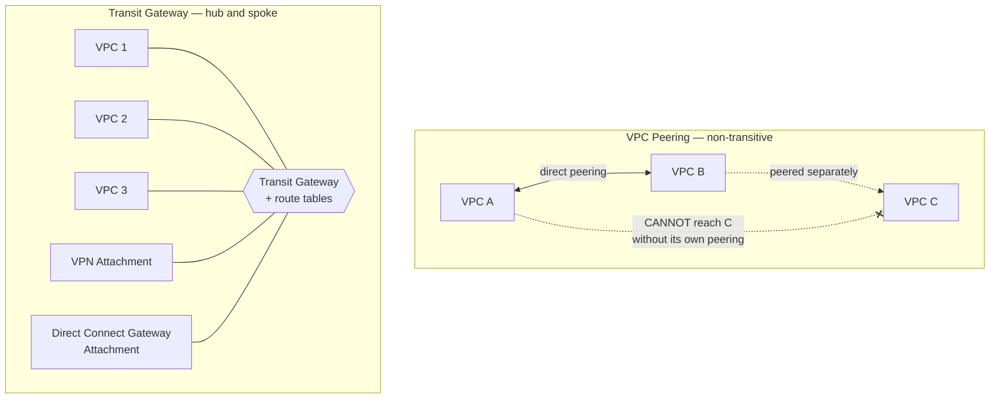

# Transit Gateway & VPC Peering


## Definition

**VPC Peering** is a direct, one-to-one private network connection between exactly two VPCs.
**AWS Transit Gateway** is a managed, scalable, central network hub that connects many VPCs, VPN
connections, and Direct Connect attachments through a single point — like swapping dozens of
point-to-point cables for one switch.

## Purpose

As organizations grow past a handful of VPCs, pure peering becomes unmanageable: peering doesn't
transitively route (if A peers with B, and B peers with C, A still cannot reach C — you'd need a
direct A↔C peering too), so an organization with N VPCs that all need to talk to each other needs
roughly N×(N-1)/2 peering connections — a mesh that becomes a connection-management nightmare at
scale. Transit Gateway was built to replace that full mesh with a hub-and-spoke model: every VPC
attaches once to the Transit Gateway, and the Transit Gateway handles routing between all of them
centrally.

## How It Works

Plain explanation: **VPC Peering** creates a direct, non-transitive connection — you add routes
in each VPC's route table pointing specific CIDRs at the peering connection ID, and traffic flows
directly between the two VPCs without any intermediate device. **Transit Gateway** instead acts
as a regional router: each VPC/VPN/Direct Connect connection becomes an "attachment," and the
Transit Gateway's own route tables decide which attachments can reach which other attachments —
giving you both full-mesh connectivity (everything can reach everything by default) and
fine-grained segmentation (route tables can isolate certain attachments from others) in one place.



Step by step (peering): VPC A and VPC B establish a direct peering connection and both add
routes to each other's CIDR — traffic flows directly, at no intermediate hop, which is also why
peering has **no bandwidth bottleneck device** and no extra per-GB hub charge. But A's peering
with B does not extend to C; reaching C requires its own separate peering connection — this
"non-transitive" rule is the single most tested fact about peering. Step by step (Transit
Gateway): VPCs 1, 2, 3, a VPN connection, and a Direct Connect Gateway attachment all connect
**once** to the central Transit Gateway. The Transit Gateway's **route tables** (which can differ
per attachment, enabling segmentation — e.g., a "shared services" route table vs. a "prod-only"
route table) decide who can reach whom, letting you express complex, segmented, enterprise-scale
topologies from one managed service instead of a sprawling peering mesh.

## Key Features / Components

- **VPC Peering Connection** — 1:1 link; works across accounts and across Regions (inter-Region
  peering); not transitive; no single point of failure/bottleneck device since there's no hub.
- **Non-overlapping CIDR requirement** — peered (or Transit-Gateway-connected) VPCs cannot have
  overlapping IP ranges, which is why enterprise-wide CIDR planning matters from day one.
- **Transit Gateway** — regional (can be extended cross-Region via **Transit Gateway peering**
  between two Transit Gateways); supports up to thousands of VPC/VPN/Direct Connect attachments.
- **Transit Gateway route tables** — independent of VPC route tables; let you segment which
  attachments can reach which others (e.g., isolate a dev VPC from reaching prod).
- **Transit Gateway VPN/Direct Connect Gateway attachments** — centralize hybrid connectivity so
  one VPN or Direct Connect Gateway can reach every attached VPC instead of needing a connection
  per VPC.
- **Multicast support** (Transit Gateway) — native multicast routing for workloads needing it
  (media, trading systems), which VPC Peering cannot provide.
- **Transit Gateway Network Manager** — centralized visibility/monitoring across the whole
  global network built on Transit Gateways and (optionally) AWS Cloud WAN.

## Use Cases — When to Use It

- **VPC Peering**: a small number of VPCs (2-5) that need to talk to each other, especially
  across accounts for a specific, limited purpose (e.g., a shared services VPC peered with just
  one consumer VPC) — simple, no extra hop, no extra hourly cost.
- **Transit Gateway**: any organization with more than a handful of VPCs needing interconnect,
  multi-account landing zones, centralizing hybrid (VPN/Direct Connect) connectivity, or needing
  network segmentation between groups of VPCs (e.g., prod vs. non-prod isolation) via different
  route tables on the same hub.
- **Transit Gateway peering**: connecting Transit Gateways in different Regions for a global,
  centrally managed backbone without a full mesh of cross-Region VPC peerings.

## When NOT to Use It / Alternatives

- **Don't reach for Transit Gateway for just 2-3 VPCs** — it adds an hourly cost and a hop of
  latency/throughput ceiling (shared, though high) that a simple, free, direct peering connection
  doesn't have; Transit Gateway earns its cost at scale, not for a trivial topology.
- **Don't try to make VPC Peering transitive by adding more peering connections as a workaround**
  at any real scale — the N² connection growth becomes an operational and routing-table
  management burden quickly; that's the exact signal to migrate to Transit Gateway.
- **If you only need private access to specific AWS services (not whole-VPC connectivity)** —
  neither peering nor Transit Gateway is the right tool; use a **VPC Endpoint** instead (see
  `vpc-endpoints-privatelink.md`), which is cheaper and more precisely scoped.
- **Extremely latency-sensitive, max-throughput point-to-point traffic between exactly two VPCs**
  — direct peering avoids the Transit Gateway's (still high, but shared/metered) throughput
  ceiling and per-GB processing charge.

## Why It's Important

**Real-world:** as companies adopt multi-account AWS strategies (a very common enterprise
pattern — separate accounts per team/environment for billing and blast-radius isolation),
Transit Gateway becomes the backbone that makes that strategy operationally sane; without it,
network engineering teams drown in peering-connection sprawl. Transit Gateway segmentation
(different route tables per attachment) is also a key real-world security control for enforcing
"dev cannot reach prod" at the network layer, not just via IAM policy.

**Exam mapping:**
- **SAA-C03** — Domain 2 (Resilient Architectures) and Domain 4 (Cost-Optimized) Task 4.4 both
  reference Transit Gateway for multi-VPC/hybrid network design; the peering vs. Transit Gateway
  tradeoff (non-transitivity, connection count at scale, cost) is a frequently tested comparison.
- **DVA-C03** — lower weight; occasionally touched where an application's VPC needs connectivity
  to a shared-services VPC (e.g., a central logging or secrets VPC).
- **MLA-C02** — relevant to Domain 1/4 where a central "data lake" VPC must be reachable by
  multiple ML workload VPCs — a textbook Transit Gateway hub-and-spoke use case.

## Pricing Model (summary)

**VPC Peering**: no hourly charge for the connection itself; you pay standard (often reduced,
same-Region) data transfer rates for traffic crossing it. **Transit Gateway**: billed per
**attachment-hour** (each VPC/VPN/Direct Connect/peering attachment) plus a **per-GB processed**
charge for all data flowing through it — this per-GB charge is the key cost difference versus
peering's lack of a hub fee, and matters at high data volumes. Official pricing:
https://aws.amazon.com/transit-gateway/pricing/ and https://aws.amazon.com/vpc/pricing/

## Hands-on Lab (Floci)

Both VPC Peering and Transit Gateway objects live in the `ec2` CLI namespace, which Floci backs
with real Docker-based EC2 emulation:

```bash
# VPC Peering between two VPCs (control-plane only; no real cross-VPC packet forwarding in Floci)
awslocal ec2 create-vpc-peering-connection \
  --vpc-id <vpc-a-id> --peer-vpc-id <vpc-b-id>
awslocal ec2 accept-vpc-peering-connection --vpc-peering-connection-id <pcx-id>

# Add routes on both sides pointing at the peering connection
awslocal ec2 create-route --route-table-id <rtb-a-id> \
  --destination-cidr-block 10.1.0.0/16 --vpc-peering-connection-id <pcx-id>
awslocal ec2 create-route --route-table-id <rtb-b-id> \
  --destination-cidr-block 10.0.0.0/16 --vpc-peering-connection-id <pcx-id>

# Transit Gateway: create it, attach a VPC, add a route
awslocal ec2 create-transit-gateway \
  --description "study-tgw" \
  --options AmazonSideAsn=64512,DefaultRouteTableAssociation=enable,DefaultRouteTablePropagation=enable

awslocal ec2 create-transit-gateway-vpc-attachment \
  --transit-gateway-id <tgw-id> --vpc-id <vpc-a-id> --subnet-ids <subnet-id>

awslocal ec2 describe-transit-gateway-attachments --transit-gateway-attachment-ids <attachment-id>
```

Full lab: `labs-floci/networking-vpc-lab.md`.

## Exam Tips

- **Peering is NOT transitive — memorize this cold.** This single fact, phrased a dozen
  different ways, is one of the most reliably recurring exam questions in the whole networking
  category. "VPC A peers with B, B peers with C — can A reach C?" → No, not without a direct
  A↔C peering (or migrating to Transit Gateway).
- **Transit Gateway solves the N² peering-mesh problem** — if a scenario describes more than a
  handful of interconnected VPCs or growing connection-management pain, Transit Gateway is almost
  always the intended answer over "add more peering connections."
- **Transit Gateway route tables enable segmentation** — a scenario needing "dev VPCs should
  never reach prod VPCs even though both are attached to the same hub" points directly at using
  separate Transit Gateway route tables per attachment group.
- **Cost tradeoff**: peering has no hub fee (good for simple, high-volume point-to-point); Transit
  Gateway charges per-GB processed on top of attachment-hours (worth it for manageability/
  segmentation at scale, a real cost to weigh in Domain 4-style questions).
- Non-overlapping CIDRs are required for both peering and Transit Gateway attachment — if a
  scenario mentions merging two companies'/VPCs' networks with overlapping address space, the
  answer involves re-IP'ing or NAT-based workarounds, not simply "just peer them."

## Related Terms

- [`vpc.md`](vpc.md), [`subnets-route-tables-igw-natgw.md`](subnets-route-tables-igw-natgw.md)
- [`vpn.md`](vpn.md), [`direct-connect.md`](direct-connect.md) — common Transit Gateway attachments
- [`vpc-endpoints-privatelink.md`](vpc-endpoints-privatelink.md) — for service-level (not
  whole-network) private connectivity
- `glossary/cidr.md`, `glossary/hub-and-spoke.md`
