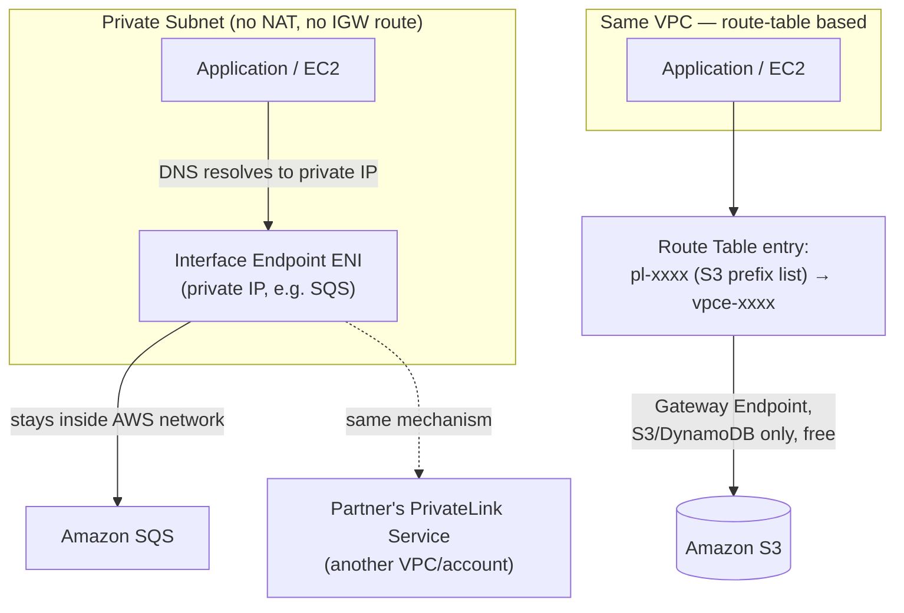
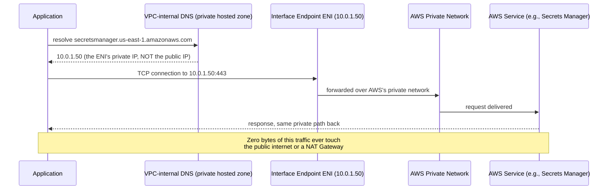
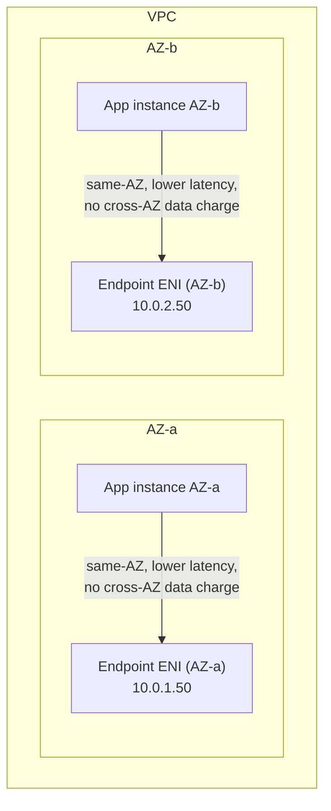
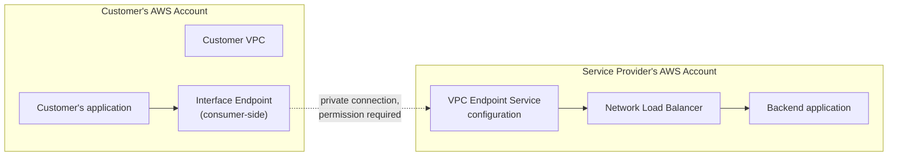
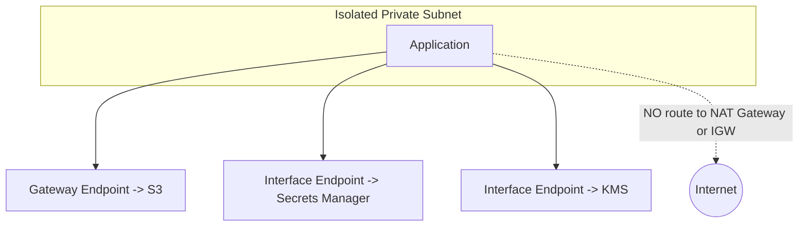

# VPC Endpoints & AWS PrivateLink

> **Appears in:** [DVA-C03](../../certifications/dva-c03/README.md) · [SAA-C03](../../certifications/saa-c03/README.md)


## Definition

A VPC Endpoint lets resources inside a VPC reach an AWS service (or another VPC's application)
**without that traffic ever leaving the AWS network or touching the public internet** — no NAT
Gateway, no Internet Gateway, no public IP required. **AWS PrivateLink** is the underlying
technology that powers *interface* endpoints, and also lets you expose your *own* application as
a privately-consumable "service" to other VPCs/accounts the same way AWS exposes S3 or
DynamoDB.

## Purpose

By default, reaching an AWS service's public API endpoint (e.g., `s3.amazonaws.com`) from inside
a private subnet requires routing out through a NAT Gateway and Internet Gateway — even though
the traffic's final destination is still inside AWS. That's wasteful (NAT Gateway per-GB cost for
traffic that never needed to touch the internet) and a larger attack surface than necessary
(anything with a route to the internet is a bigger blast radius if misconfigured). VPC Endpoints
exist so that AWS-service traffic — and even traffic to other companies' privately-hosted
services — can travel entirely within AWS's private network, cheaper and more securely.

## How It Works

Plain explanation: there are two kinds of VPC Endpoint. A **Gateway Endpoint** (only for S3 and
DynamoDB) works by adding a special route-table entry — private subnets can reach these two
services via a route, no new network interface, and it's **free**. An **Interface Endpoint**
(for almost every other AWS service, and for your own PrivateLink-exposed services) creates an
actual **Elastic Network Interface (ENI)** with a private IP inside your subnet — your
application just resolves the service's normal DNS name (via Route 53 private DNS integration)
and it transparently resolves to that private ENI instead of the public internet endpoint.


*Figure: AWS's reference diagram of the default path — reaching an AWS service through an
internet gateway. Even though the traffic technically stays within the AWS network, it still
requires a public IP path and an Internet Gateway/NAT Gateway hop. Source: AWS documentation,
"Access AWS services through AWS PrivateLink" —
https://docs.aws.amazon.com/vpc/latest/privatelink/privatelink-access-aws-services.html*



Step by step: the **Interface Endpoint** path (top) — an application calls SQS using the normal
SDK/endpoint hostname; because a private hosted zone is associated with the interface endpoint,
DNS resolution inside the VPC quietly returns the **endpoint's private IP** instead of SQS's
public IP, so the connection goes straight to the ENI sitting in your own subnet and from there
over AWS's private network to SQS — no internet, no NAT Gateway needed. The **Gateway Endpoint**
path (bottom) is simpler still: there's no ENI at all, just a route-table entry mapping a special
AWS-managed **prefix list** (representing all of S3's/DynamoDB's IP ranges) to the endpoint — any
traffic matching that prefix list is routed privately, completely free of charge.

### Interface Endpoint path, traced packet by packet



The DNS override is the detail that makes this invisible to application code: no SDK
configuration, endpoint URL, or code change is required — the application calls the exact same
hostname it always would, and the **private hosted zone** automatically associated with the
interface endpoint intercepts that specific DNS query inside the VPC and answers with the
private IP instead of letting it resolve publicly.

### Multi-AZ interface endpoint — one ENI per enabled AZ



Enabling an interface endpoint across multiple AZs creates a **separate ENI per AZ**, each
independently billed and each giving same-AZ traffic a local path to the service — this is why
best practice is enabling the endpoint in every AZ your workload actually runs in, rather than
one AZ shared by everything (which would otherwise incur cross-AZ data transfer charges purely
to reach the endpoint itself, on top of its own usage charges).

## Key Features / Components

- **Gateway Endpoint** — S3 and DynamoDB only; free; implemented as a route table entry +
  prefix list, no ENI, no hourly or per-GB charge.
- **Interface Endpoint** — nearly every other AWS service (SQS, SNS, Kinesis, Secrets Manager,
  KMS, CloudWatch, Bedrock, SageMaker API, etc.); implemented as an ENI with a private IP per
  subnet/AZ; billed hourly + per-GB processed.
- **AWS PrivateLink** — the underlying technology behind interface endpoints; also lets *you*
  publish your own service (sitting behind an NLB) as an "Endpoint Service" that other VPCs/
  AWS accounts can privately connect to via their own interface endpoint — the backbone of many
  SaaS-on-AWS architectures (the SaaS vendor's product is reached privately, never over the
  internet, by the customer's VPC).
- **Private DNS** — interface endpoints can automatically override the service's normal public
  DNS name inside the VPC, so you don't have to change any application code/endpoint URLs to
  start using the private path.
- **Endpoint policies** — IAM-style resource policies attached directly to a VPC endpoint,
  restricting exactly which API actions/resources are reachable through it (e.g., "this endpoint
  can only reach this one S3 bucket," even if the IAM principal's own permissions are broader).
- **Security groups on interface endpoints** — because interface endpoints are ENIs, they can
  have security groups attached, controlling which resources inside the VPC may use them.
- **VPC Lattice service networks** — a newer, related construct where a VPC endpoint can connect
  to an entire application network (a "service network") rather than one specific service, for
  more complex multi-service architectures.

## PrivateLink as a Provider — exposing your own service



This is the architecture behind most "connect privately to our SaaS product" offerings on AWS
Marketplace: the provider fronts their application with an NLB, publishes it as a VPC Endpoint
Service, and grants specific AWS account principals permission to connect. Each permitted
customer then creates their own interface endpoint pointing at that service — the customer's
traffic never crosses the public internet, and the provider never needs VPC peering or direct
network connectivity with every individual customer's VPC, which wouldn't scale to many
customers anyway.

## Common Architectures

**1. Private subnet, zero NAT Gateway, Gateway + Interface Endpoints only.** A fully isolated
subnet whose only "external" dependencies are specific AWS services — Gateway Endpoint for S3,
Interface Endpoints for Secrets Manager/KMS/SQS as needed — with no NAT Gateway and no IGW route
at all, the strongest security posture for a workload whose dependencies are entirely AWS-native.



**2. Lambda-in-VPC reaching other AWS services without a NAT Gateway.** A Lambda function placed
in a private subnet (to reach an RDS instance) also needs to call Secrets Manager for database
credentials — rather than adding a NAT Gateway just for that one call, an interface endpoint for
Secrets Manager handles it directly, keeping the function's only internet dependency (if any)
minimal or nonexistent.

**3. Cost optimization: replacing NAT Gateway traffic with Gateway Endpoints.** A workload
heavily reading/writing S3 from private subnets currently routes that traffic through a NAT
Gateway — adding a free Gateway Endpoint for S3 removes that traffic's NAT Gateway data
processing charge entirely, often the single highest-leverage, lowest-effort cost optimization
available in a VPC's network design.

**4. Private API Gateway access via interface endpoint.** An internal REST API configured as a
Private API type is only reachable through its associated interface VPC endpoint — satisfying a
"never expose this API to the public internet" requirement at the API Gateway configuration
level, enforced by the endpoint and its resource policy together.

**5. Multi-account SaaS consumption via PrivateLink.** Several business units, each in their own
AWS account, each create their own interface endpoint to a centrally hosted internal tool exposed
as a VPC Endpoint Service by a platform team — avoiding VPC peering sprawl for what's really just
service-level access, not whole-network connectivity.

## Use Cases — When to Use It

- **Private subnets needing S3/DynamoDB access without a NAT Gateway** — the single most common,
  highest-value VPC Endpoint use case; removes NAT Gateway per-GB cost for this traffic entirely.
- **Lambda-in-VPC calling other AWS services** — a classic DVA-C03-relevant scenario: a Lambda
  function placed in a VPC (to reach RDS) now needs interface endpoints to reach services like
  Secrets Manager or SQS, since it no longer has default internet access.
- **Compliance requirements mandating AWS API traffic never cross the public internet** — a
  common requirement in regulated industries (finance, healthcare), satisfied directly by using
  interface/gateway endpoints for every AWS service the workload touches.
- **SaaS vendors exposing a product privately to customer VPCs** — AWS PrivateLink lets a
  provider publish one NLB-backed service and have many customer accounts connect to it privately
  and securely, without VPC peering or exposing it to the public internet.
- **Private API Gateway access** — interface endpoints are what make a Private API Gateway
  reachable only from inside specified VPCs.

## When NOT to Use It / Alternatives

- **Public-facing resources that are meant to be reached over the internet anyway** — a VPC
  Endpoint adds nothing if the resource (e.g., a public website) is supposed to be internet-
  reachable in the first place.
- **Occasional/low-volume AWS API calls from a subnet that already has a NAT Gateway for other
  reasons** — if NAT Gateway is already present and the AWS-service traffic volume is small, the
  marginal savings of adding an interface endpoint (which itself has an hourly charge) may not be
  worth the operational overhead; this is genuinely a cost-tradeoff decision, not a default "always
  add endpoints" rule — Gateway Endpoints (free) are the exception, always worth adding for S3/
  DynamoDB traffic regardless of volume.
- **Connecting whole VPC networks to each other (not just reaching one specific service)** —
  that's VPC Peering or Transit Gateway's job, not VPC Endpoints, which are scoped to individual
  services, not general network connectivity.

## Why It's Important

**Real-world:** VPC Endpoints are one of the most common, high-value cost-optimization levers in
real AWS bills — teams running large S3-heavy workloads from private subnets routinely cut
meaningful NAT Gateway data-processing costs by adding a free Gateway Endpoint, often without any
application changes at all. They're equally important for security posture: removing a private
subnet's only reason to have internet access (reaching AWS APIs) lets you remove its NAT Gateway
route entirely, shrinking the blast radius if something in that subnet is compromised.

**Exam mapping:**
- **SAA-C03** — Domain 4 (Cost-Optimized Architectures, 20%) Task 4.4 explicitly names VPC
  endpoints as a cost-optimization technique versus NAT Gateway; Domain 1 (Secure Architectures)
  covers them as a security control. Expect this NAT-Gateway-vs-VPC-Endpoint substitution as a
  recurring, near-guaranteed question pattern.
- **DVA-C03** — Domain 1 Task 1.2 (Lambda VPC access) and the new Task 2.3 (AI service data
  privacy controls) both explicitly reference VPC endpoints as the mechanism for private,
  internet-free access to AWS APIs from within a VPC.
- **MLA-C02** — Domain 4 (Operating/Securing) uses VPC endpoints to keep SageMaker/Bedrock API
  traffic and S3 training-data access off the public internet — a standard ML security control.

## Pricing Model (summary)

- **Gateway Endpoint (S3/DynamoDB)**: completely **free** — no hourly charge, no per-GB charge.
- **Interface Endpoint**: billed **per AZ, per hour** (one ENI per enabled AZ) plus a
  **per-GB data processing** charge for traffic through it — generally still cheaper than
  routing the same traffic through a NAT Gateway at any meaningful volume, though worth
  comparing for very low-traffic cases.
- **PrivateLink Endpoint Service (provider side)**: the publishing account pays a small hourly
  fee per endpoint connection accepted from a consumer.
Official pricing: https://aws.amazon.com/privatelink/pricing/

## Limits & Quotas

| Resource | Default quota |
|---|---|
| VPC endpoints per VPC | 255 (soft) |
| Interface endpoints per service per VPC | 1 per AZ enabled (ENI-based) |
| Gateway endpoints per VPC | 20 (soft) |
| Endpoint services (provider side) per account | 100 (soft) |
| Endpoint connections per endpoint service | 1,000 (soft) |
| Security groups per interface endpoint ENI | 5 |
| Endpoint policy size | 20,480 characters |

## Troubleshooting / Common Issues

- **"An application still can't reach S3 even after adding a Gateway Endpoint."** Check that the
  Gateway Endpoint is associated with the **specific route table** used by the subnet the
  application runs in — a Gateway Endpoint only affects route tables it's explicitly associated
  with, not every route table in the VPC automatically.
- **"An interface endpoint was created, but the application is still reaching the service's
  public endpoint instead of the private one."** Confirm **Private DNS** is enabled on the
  endpoint — without it, the endpoint-specific DNS name must be used explicitly in application
  code; the public hostname will continue resolving publicly unless private DNS override is on.
- **"A request through an interface endpoint fails with an access-denied style error, even
  though the IAM principal's permissions look correct."** Check the **endpoint policy** attached
  directly to the VPC endpoint — it's a separate, additional layer of access control beyond IAM
  identity/resource policies; an endpoint policy that's more restrictive than the IAM principal's
  own permissions will still block the call.
- **"Interface endpoint traffic isn't reaching the service at all."** Check the security group
  attached to the endpoint's ENI(s) — since interface endpoints are real ENIs, they're subject to
  security group rules just like any other network interface, and a missing inbound rule for the
  calling application's security group will block the connection.
- **"Cross-AZ traffic charges appeared even though a VPC endpoint was added."** If the interface
  endpoint was only enabled in one AZ, but the application runs across multiple AZs, traffic from
  other AZs to reach that single AZ's endpoint ENI still crosses AZ boundaries and incurs the
  standard inter-AZ charge — enabling the endpoint in every AZ the application actually uses
  avoids this.
- **"A PrivateLink endpoint service connection request is stuck in 'pending' state."** The
  service provider must explicitly accept the connection request (unless auto-acceptance is
  configured) — a pending connection simply means the provider hasn't approved it yet, not a
  technical failure.

## Hands-on Lab (Floci)

VPC Endpoint creation lives in the `ec2` CLI namespace, which Floci backs with real Docker-based
EC2 emulation:

```bash
# Gateway Endpoint for S3 (free in real AWS; practice the exact API shape here)
awslocal ec2 create-vpc-endpoint --vpc-id <vpc-id> \
  --service-name com.amazonaws.us-east-1.s3 \
  --route-table-ids <private-rtb-id> \
  --vpc-endpoint-type Gateway

# Interface Endpoint for SQS
awslocal ec2 create-vpc-endpoint --vpc-id <vpc-id> \
  --service-name com.amazonaws.us-east-1.sqs \
  --subnet-ids <private-subnet-id> \
  --security-group-ids <sg-id> \
  --vpc-endpoint-type Interface \
  --private-dns-enabled

awslocal ec2 describe-vpc-endpoints --filters Name=vpc-id,Values=<vpc-id>

# Attach an endpoint policy restricting access to one specific S3 bucket
awslocal ec2 modify-vpc-endpoint --vpc-endpoint-id <vpce-id> \
  --policy-document '{
    "Version": "2012-10-17",
    "Statement": [{
      "Effect": "Allow",
      "Principal": "*",
      "Action": "s3:*",
      "Resource": ["arn:aws:s3:::study-bucket", "arn:aws:s3:::study-bucket/*"]
    }]
  }'
```

Since Floci fully supports **S3** and **SQS** as real services, this is a genuinely useful
combined lab: create the endpoint, then exercise `awslocal s3 ls` / `awslocal sqs
list-queues` and confirm the calls succeed — even though Floci's single-process architecture
means you won't observe an actual difference in network path the way you would against real
AWS (where you could show the private IP is used via `dig`/VPC Flow Logs). Full lab:
`labs-floci/networking-vpc-lab.md`.

## Exam Scenario Deep Dive

**Scenario 1 — "A company wants to minimize the cost of heavy S3 traffic from a private subnet
that currently routes through a NAT Gateway, with no other changes to application code."**
Add a Gateway VPC Endpoint for S3 associated with that subnet's route table — it's free, requires
no application changes (S3's hostname resolution is unaffected since Gateway Endpoints work via
routing, not DNS), and removes this traffic from the NAT Gateway's per-GB processing charge
entirely.

**Scenario 2 — "A Lambda function placed inside a VPC to reach an RDS database now fails when
trying to retrieve a secret from Secrets Manager, despite having correct IAM permissions."**
Placing a Lambda function in a VPC removes its default internet access — the fix is adding an
Interface Endpoint for Secrets Manager (with private DNS enabled) in the same VPC/subnets, not
adding a NAT Gateway purely for this one AWS-service call, and not just re-checking IAM
permissions, which are a separate concern from network reachability.

**Scenario 3 — "A SaaS company wants to offer their analytics product to hundreds of customer
AWS accounts, with each customer's traffic staying entirely private and never traversing the
public internet, without the operational burden of individually peering with every customer's
VPC."**
Expose the product as a VPC Endpoint Service (PrivateLink), fronted by an NLB — each customer
creates their own interface endpoint and connects privately, with the provider simply approving
connection requests rather than managing hundreds of individual peering connections.

**Scenario 4 — "An interface endpoint for KMS was created in only one Availability Zone, and a
workload running across three AZs is seeing both higher latency and unexpected cross-AZ data
transfer charges for KMS calls."**
Enable the interface endpoint in all three AZs the workload actually runs in — each AZ gets its
own ENI, giving every AZ's instances a local, same-AZ path to the service and eliminating both
the latency penalty and the cross-AZ charge that resulted from funneling every AZ's traffic to
a single AZ's endpoint.

**Scenario 5 — "A security review requires that even though an IAM role has broad S3
permissions, a specific private subnet's traffic through its VPC endpoint must be restricted to
only one named S3 bucket, regardless of what the IAM role could otherwise access."**
Attach an **endpoint policy** to the VPC endpoint itself, scoped to only that one bucket's ARN —
endpoint policies are a separate, additive restriction layer evaluated alongside IAM policies;
even a broadly-permissioned IAM role is still constrained to whatever the endpoint policy allows
when traffic flows through that specific endpoint.

## Exam Tips

- **"Private subnet needs S3/DynamoDB access, minimize cost" = Gateway Endpoint**, not NAT
  Gateway, not Interface Endpoint — this exact phrase pattern should trigger an instant answer.
- **Gateway Endpoints only cover S3 and DynamoDB** — every other AWS service needs an Interface
  Endpoint; don't assume Gateway Endpoint generalizes to other services.
- **Interface Endpoints are billed, Gateway Endpoints are free** — a direct cost-comparison trap
  the exam likes to set up.
- **PrivateLink lets you be the "AWS service"** — if a question describes a company wanting to
  offer *their own* application privately to *other* AWS accounts/VPCs without peering or VPN,
  that's an Endpoint Service (PrivateLink), not VPC Peering.
- **Private DNS** is what makes interface endpoints invisible to application code — if a
  scenario says "no code changes were needed but traffic now stays private," that's private DNS
  resolution on an interface endpoint being described.
- VPC Endpoints are a **service-level** private connection, not a general network-to-network
  tunnel — don't confuse with VPC Peering/Transit Gateway, which connect whole networks.
- **Endpoint policies are an additional, separate access-control layer from IAM** — a scenario
  describing access being blocked despite correct IAM permissions, specifically when going
  through a VPC endpoint, is pointing at the endpoint policy, not an IAM misconfiguration.
- **One ENI per enabled AZ for interface endpoints** — a scenario about unexpected cross-AZ
  charges or latency for endpoint traffic is testing whether you know to enable the endpoint in
  every AZ the workload actually uses, not just one.

## Further Reading

- AWS Docs — What is AWS PrivateLink?: https://docs.aws.amazon.com/vpc/latest/privatelink/what-is-privatelink.html
- AWS Docs — Access AWS services through AWS PrivateLink: https://docs.aws.amazon.com/vpc/latest/privatelink/privatelink-access-aws-services.html
- AWS Docs — Share your services through AWS PrivateLink: https://docs.aws.amazon.com/vpc/latest/privatelink/privatelink-share-your-services.html
- AWS Docs — Gateway endpoints for Amazon S3: https://docs.aws.amazon.com/AmazonS3/latest/userguide/privatelink-interface-endpoints.html
- AWS re:Post — VPC endpoint troubleshooting: https://repost.aws/knowledge-center/vpc-endpoint-troubleshoot

## Related Terms

- [`vpc.md`](vpc.md), [`subnets-route-tables-igw-natgw.md`](subnets-route-tables-igw-natgw.md) —
  NAT Gateway is the cost/security alternative this topic directly displaces
- [`transit-gateway-and-peering.md`](transit-gateway-and-peering.md) — whole-network connectivity,
  contrast with this service-level mechanism
- `services/storage/s3.md`, `services/application-integration/sqs.md`
- `glossary/eni.md` (Elastic Network Interface), `glossary/prefix-list.md`
