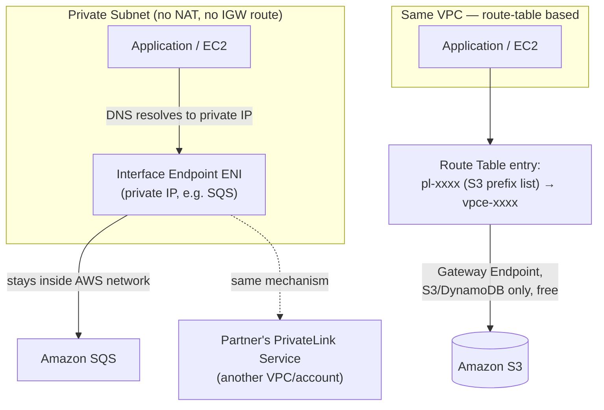

# VPC Endpoints & AWS PrivateLink


## Definition

A VPC Endpoint lets resources inside a VPC reach an AWS service (or another VPC's application)
**without that traffic ever leaving the AWS network or touching the public internet** — no NAT
Gateway, no Internet Gateway, no public IP required. **AWS PrivateLink** is the underlying
technology that powers *interface* endpoints, and also lets you expose your *own* application as
a privately-consumable "service" to other VPCs/accounts the same way AWS exposes S3 or
DynamoDB.

## Purpose

By default, reaching an AWS service's public API endpoint (e.g., `s3.amazonaws.com`) from inside
a private subnet requires routing out through a NAT Gateway and Internet Gateway — even though
the traffic's final destination is still inside AWS. That's wasteful (NAT Gateway per-GB cost for
traffic that never needed to touch the internet) and a larger attack surface than necessary
(anything with a route to the internet is a bigger blast radius if misconfigured). VPC Endpoints
exist so that AWS-service traffic — and even traffic to other companies' privately-hosted
services — can travel entirely within AWS's private network, cheaper and more securely.

## How It Works

Plain explanation: there are two kinds of VPC Endpoint. A **Gateway Endpoint** (only for S3 and
DynamoDB) works by adding a special route-table entry — private subnets can reach these two
services via a route, no new network interface, and it's **free**. An **Interface Endpoint**
(for almost every other AWS service, and for your own PrivateLink-exposed services) creates an
actual **Elastic Network Interface (ENI)** with a private IP inside your subnet — your
application just resolves the service's normal DNS name (via Route 53 private DNS integration)
and it transparently resolves to that private ENI instead of the public internet endpoint.



Step by step: the **Interface Endpoint** path (top) — an application calls SQS using the normal
SDK/endpoint hostname; because a private hosted zone is associated with the interface endpoint,
DNS resolution inside the VPC quietly returns the **endpoint's private IP** instead of SQS's
public IP, so the connection goes straight to the ENI sitting in your own subnet and from there
over AWS's private network to SQS — no internet, no NAT Gateway needed. The **Gateway Endpoint**
path (bottom) is simpler still: there's no ENI at all, just a route-table entry mapping a special
AWS-managed **prefix list** (representing all of S3's/DynamoDB's IP ranges) to the endpoint — any
traffic matching that prefix list is routed privately, completely free of charge.

## Key Features / Components

- **Gateway Endpoint** — S3 and DynamoDB only; free; implemented as a route table entry +
  prefix list, no ENI, no hourly or per-GB charge.
- **Interface Endpoint** — nearly every other AWS service (SQS, SNS, Kinesis, Secrets Manager,
  KMS, CloudWatch, Bedrock, SageMaker API, etc.); implemented as an ENI with a private IP per
  subnet/AZ; billed hourly + per-GB processed.
- **AWS PrivateLink** — the underlying technology behind interface endpoints; also lets *you*
  publish your own service (sitting behind an NLB) as an "Endpoint Service" that other VPCs/
  AWS accounts can privately connect to via their own interface endpoint — the backbone of many
  SaaS-on-AWS architectures (the SaaS vendor's product is reached privately, never over the
  internet, by the customer's VPC).
- **Private DNS** — interface endpoints can automatically override the service's normal public
  DNS name inside the VPC, so you don't have to change any application code/endpoint URLs to
  start using the private path.
- **Endpoint policies** — IAM-style resource policies attached directly to a VPC endpoint,
  restricting exactly which API actions/resources are reachable through it (e.g., "this endpoint
  can only reach this one S3 bucket," even if the IAM principal's own permissions are broader).
- **Security groups on interface endpoints** — because interface endpoints are ENIs, they can
  have security groups attached, controlling which resources inside the VPC may use them.

## Use Cases — When to Use It

- **Private subnets needing S3/DynamoDB access without a NAT Gateway** — the single most common,
  highest-value VPC Endpoint use case; removes NAT Gateway per-GB cost for this traffic entirely.
- **Lambda-in-VPC calling other AWS services** — a classic DVA-C03-relevant scenario: a Lambda
  function placed in a VPC (to reach RDS) now needs interface endpoints to reach services like
  Secrets Manager or SQS, since it no longer has default internet access.
- **Compliance requirements mandating AWS API traffic never cross the public internet** — a
  common requirement in regulated industries (finance, healthcare), satisfied directly by using
  interface/gateway endpoints for every AWS service the workload touches.
- **SaaS vendors exposing a product privately to customer VPCs** — AWS PrivateLink lets a
  provider publish one NLB-backed service and have many customer accounts connect to it privately
  and securely, without VPC peering or exposing it to the public internet.
- **Private API Gateway access** — interface endpoints are what make a Private API Gateway
  reachable only from inside specified VPCs.

## When NOT to Use It / Alternatives

- **Public-facing resources that are meant to be reached over the internet anyway** — a VPC
  Endpoint adds nothing if the resource (e.g., a public website) is supposed to be internet-
  reachable in the first place.
- **Occasional/low-volume AWS API calls from a subnet that already has a NAT Gateway for other
  reasons** — if NAT Gateway is already present and the AWS-service traffic volume is small, the
  marginal savings of adding an interface endpoint (which itself has an hourly charge) may not be
  worth the operational overhead; this is genuinely a cost-tradeoff decision, not a default "always
  add endpoints" rule — Gateway Endpoints (free) are the exception, always worth adding for S3/
  DynamoDB traffic regardless of volume.
- **Connecting whole VPC networks to each other (not just reaching one specific service)** —
  that's VPC Peering or Transit Gateway's job, not VPC Endpoints, which are scoped to individual
  services, not general network connectivity.

## Why It's Important

**Real-world:** VPC Endpoints are one of the most common, high-value cost-optimization levers in
real AWS bills — teams running large S3-heavy workloads from private subnets routinely cut
meaningful NAT Gateway data-processing costs by adding a free Gateway Endpoint, often without any
application changes at all. They're equally important for security posture: removing a private
subnet's only reason to have internet access (reaching AWS APIs) lets you remove its NAT Gateway
route entirely, shrinking the blast radius if something in that subnet is compromised.

**Exam mapping:**
- **SAA-C03** — Domain 4 (Cost-Optimized Architectures, 20%) Task 4.4 explicitly names VPC
  endpoints as a cost-optimization technique versus NAT Gateway; Domain 1 (Secure Architectures)
  covers them as a security control. Expect this NAT-Gateway-vs-VPC-Endpoint substitution as a
  recurring, near-guaranteed question pattern.
- **DVA-C03** — Domain 1 Task 1.2 (Lambda VPC access) and the new Task 2.3 (AI service data
  privacy controls) both explicitly reference VPC endpoints as the mechanism for private,
  internet-free access to AWS APIs from within a VPC.
- **MLA-C02** — Domain 4 (Operating/Securing) uses VPC endpoints to keep SageMaker/Bedrock API
  traffic and S3 training-data access off the public internet — a standard ML security control.

## Pricing Model (summary)

- **Gateway Endpoint (S3/DynamoDB)**: completely **free** — no hourly charge, no per-GB charge.
- **Interface Endpoint**: billed **per AZ, per hour** (one ENI per enabled AZ) plus a
  **per-GB data processing** charge for traffic through it — generally still cheaper than
  routing the same traffic through a NAT Gateway at any meaningful volume, though worth
  comparing for very low-traffic cases.
- **PrivateLink Endpoint Service (provider side)**: the publishing account pays a small hourly
  fee per endpoint connection accepted from a consumer.
Official pricing: https://aws.amazon.com/privatelink/pricing/

## Hands-on Lab (Floci)

VPC Endpoint creation lives in the `ec2` CLI namespace, which Floci backs with real Docker-based
EC2 emulation:

```bash
# Gateway Endpoint for S3 (free in real AWS; practice the exact API shape here)
awslocal ec2 create-vpc-endpoint --vpc-id <vpc-id> \
  --service-name com.amazonaws.us-east-1.s3 \
  --route-table-ids <private-rtb-id> \
  --vpc-endpoint-type Gateway

# Interface Endpoint for SQS
awslocal ec2 create-vpc-endpoint --vpc-id <vpc-id> \
  --service-name com.amazonaws.us-east-1.sqs \
  --subnet-ids <private-subnet-id> \
  --security-group-ids <sg-id> \
  --vpc-endpoint-type Interface \
  --private-dns-enabled

awslocal ec2 describe-vpc-endpoints --filters Name=vpc-id,Values=<vpc-id>
```

Since Floci fully supports **S3** and **SQS** as real services, this is a genuinely useful
combined lab: create the endpoint, then exercise `awslocal s3 ls` / `awslocal sqs
list-queues` and confirm the calls succeed — even though Floci's single-process architecture
means you won't observe an actual difference in network path the way you would against real
AWS (where you could show the private IP is used via `dig`/VPC Flow Logs). Full lab:
`labs-floci/networking-vpc-lab.md`.

## Exam Tips

- **"Private subnet needs S3/DynamoDB access, minimize cost" = Gateway Endpoint**, not NAT
  Gateway, not Interface Endpoint — this exact phrase pattern should trigger an instant answer.
- **Gateway Endpoints only cover S3 and DynamoDB** — every other AWS service needs an Interface
  Endpoint; don't assume Gateway Endpoint generalizes to other services.
- **Interface Endpoints are billed, Gateway Endpoints are free** — a direct cost-comparison trap
  the exam likes to set up.
- **PrivateLink lets you be the "AWS service"** — if a question describes a company wanting to
  offer *their own* application privately to *other* AWS accounts/VPCs without peering or VPN,
  that's an Endpoint Service (PrivateLink), not VPC Peering.
- **Private DNS** is what makes interface endpoints invisible to application code — if a
  scenario says "no code changes were needed but traffic now stays private," that's private DNS
  resolution on an interface endpoint being described.
- VPC Endpoints are a **service-level** private connection, not a general network-to-network
  tunnel — don't confuse with VPC Peering/Transit Gateway, which connect whole networks.

## Related Terms

- [`vpc.md`](vpc.md), [`subnets-route-tables-igw-natgw.md`](subnets-route-tables-igw-natgw.md) —
  NAT Gateway is the cost/security alternative this topic directly displaces
- [`transit-gateway-and-peering.md`](transit-gateway-and-peering.md) — whole-network connectivity,
  contrast with this service-level mechanism
- `services/storage/s3.md`, `services/application-integration/sqs.md`
- `glossary/eni.md` (Elastic Network Interface), `glossary/prefix-list.md`
