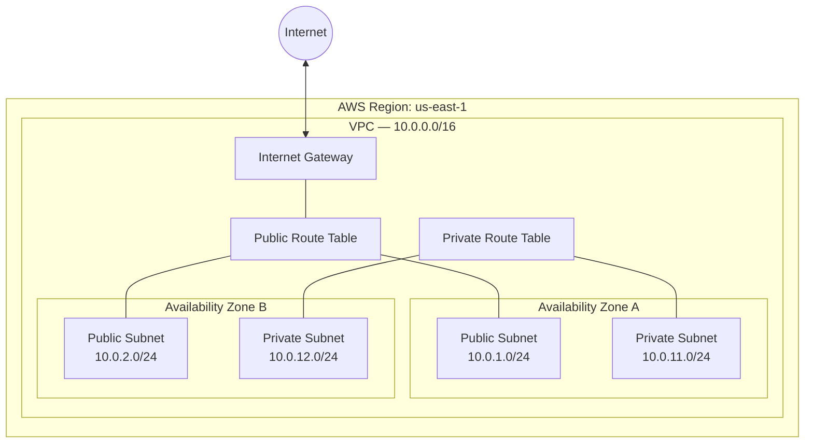
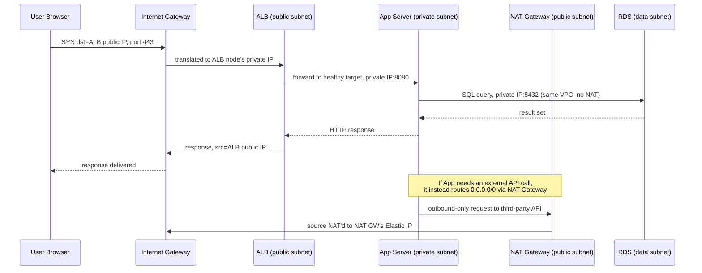
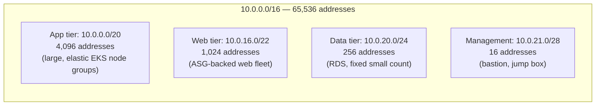
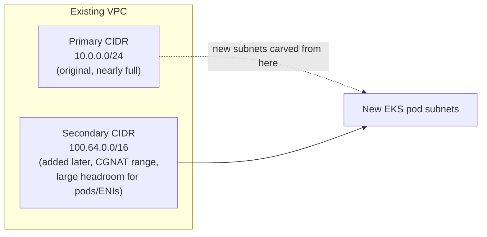
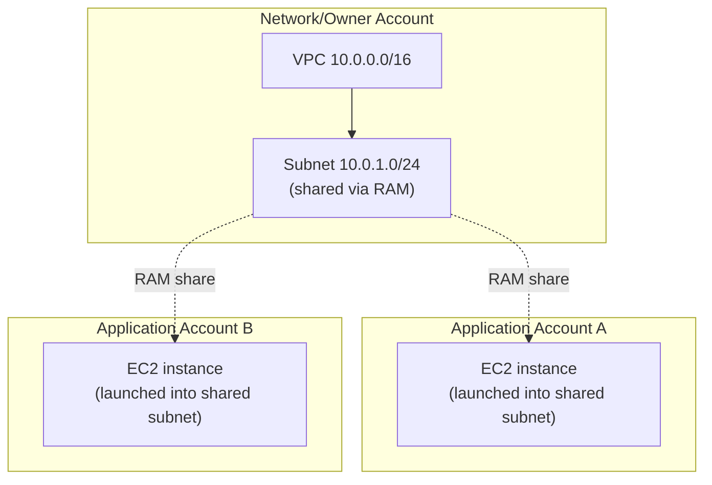
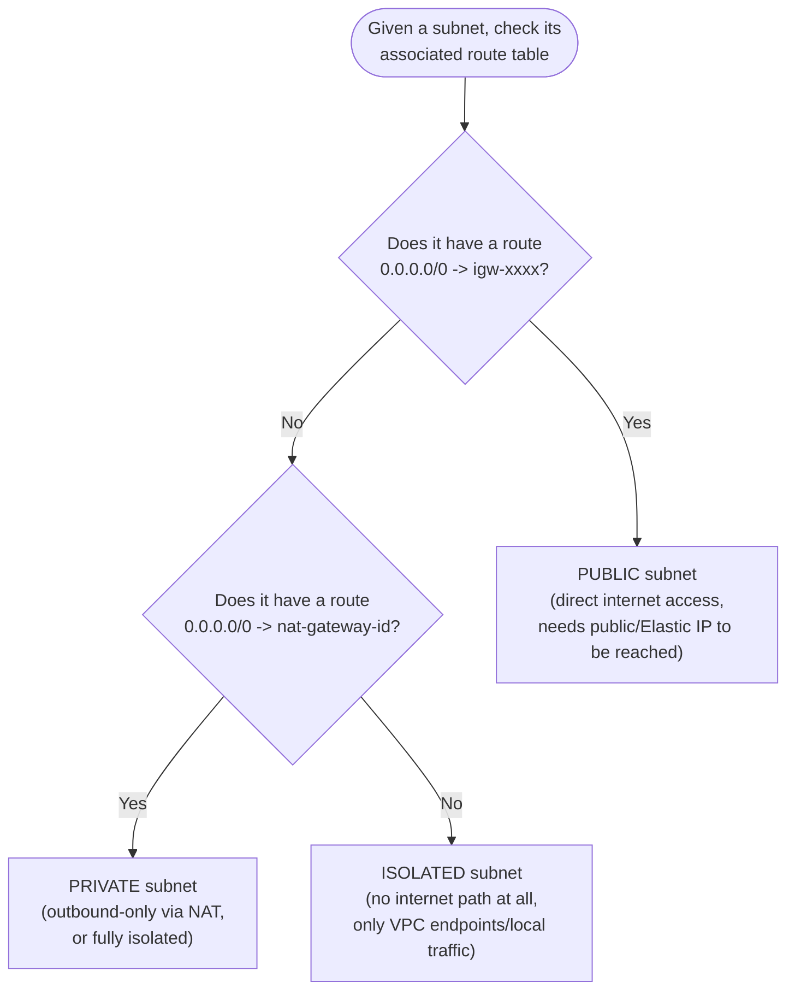
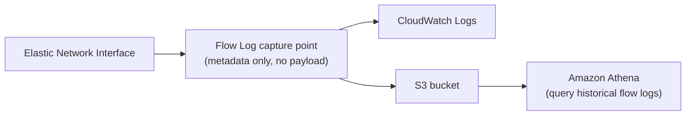
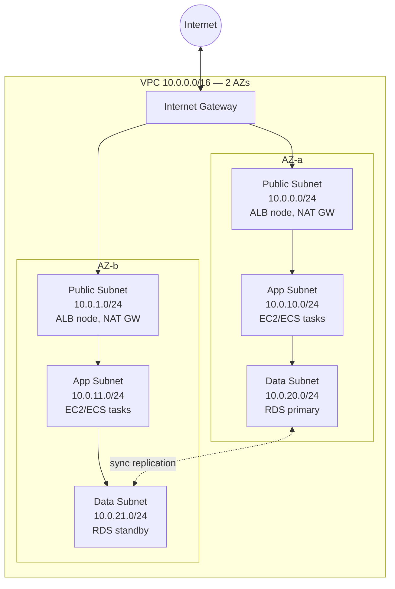
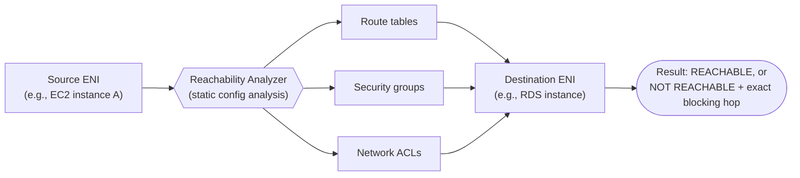

# Amazon VPC (Virtual Private Cloud)


## Definition

A Virtual Private Cloud (VPC) is your own private, logically isolated slice of the AWS network —
a virtual data center you fully control: you pick the IP address range, carve it into
sub-networks, decide what can talk to the internet, and decide what can talk to what. Nothing in
it is reachable from outside unless you explicitly open a door.

## Purpose

Before VPC existed (pre-2009, AWS's original "EC2-Classic"), every EC2 instance landed on a
single flat, shared network alongside every other AWS customer's instances — you got almost no
control over IP addressing, isolation, or topology. VPC was built to solve that: give each
customer the networking experience of running their own physical data center — subnets, routing,
firewalls, address planning — without owning a single router or cable. It's the foundational
layer every other networking service (subnets, security groups, load balancers, VPN, Direct
Connect, Transit Gateway) is built on top of. You cannot run most AWS resources without one.

## How It Works

Plain explanation: when you create a VPC, you give it an IP address range (a CIDR block, e.g.
`10.0.0.0/16`, which is ~65,536 addresses). That range lives entirely inside one AWS Region (it
spans all Availability Zones in that Region, but never crosses into another Region). Inside that
range you carve out subnets, each pinned to one Availability Zone. You then attach gateways to
control what traffic can enter/leave, route tables to say where traffic goes, and security
layers (security groups, NACLs) to say what's allowed. Every AWS account gets a **default VPC**
in every Region automatically (pre-configured with public subnets and internet access) so EC2
instances can be launched immediately — real-world production workloads almost always use a
custom VPC instead, built deliberately.


*Figure: AWS's own reference diagram of a VPC with one subnet per Availability Zone, EC2
instances in each subnet, and an Internet Gateway connecting the VPC to the internet. Source:
AWS documentation, "What is Amazon VPC?" —
https://docs.aws.amazon.com/vpc/latest/userguide/what-is-amazon-vpc.html*



Walking through it: the **VPC** (`10.0.0.0/16`) is the outer boundary — AWS Region-scoped, never
crossing Regions. Inside it, **subnets** divide the address range by Availability Zone (a subnet
is always 100% inside one AZ — this is why you need at least 2 subnets, one per AZ, for high
availability). The **Internet Gateway (IGW)** is the VPC's door to the public internet — attached
once, at the VPC level. Whether a subnet is "public" or "private" isn't a setting on the subnet
itself — it's purely determined by its **route table**: a subnet is public if its route table has
a route to the IGW (`0.0.0.0/0 → igw-xxxx`); otherwise it's private. This is the single most
exam-tested fact about VPC topology.

### CIDR math, worked from first principles

A VPC's size is entirely a function of the prefix length (the `/N` in `10.0.0.0/16`). The prefix
length tells you how many of the 32 bits in an IPv4 address are "fixed" (the network portion) —
the remaining bits are free to vary, and `2^(remaining bits)` is the total address count.

| VPC CIDR | Fixed bits | Host bits | Total addresses | Notes |
|---|---|---|---|---|
| `/16` | 16 | 16 | 65,536 | Largest VPC size AWS allows; typical top-level choice |
| `/20` | 20 | 12 | 4,096 | A common "medium" VPC size |
| `/24` | 24 | 8 | 256 | Smallest practical VPC for real multi-subnet designs |
| `/28` | 28 | 4 | 16 | Smallest VPC CIDR AWS allows at all |

Worked example — splitting `10.0.0.0/16` into subnets: a `/16` gives you 16 host bits to spend.
Every time you add 1 to the prefix length, you cut the available address space in half, but
double the number of possible subnets at that new size:

```
10.0.0.0/16  = 65,536 addresses (the whole VPC)
10.0.0.0/17  = 32,768 addresses (half the VPC — 2 possible /17 blocks)
10.0.0.0/18  = 16,384 addresses (4 possible /18 blocks)
10.0.0.0/20  =  4,096 addresses (16 possible /20 blocks)
10.0.0.0/24  =    256 addresses (256 possible /24 blocks)
```

So carving a `10.0.0.0/16` VPC into six `/24` subnets (two AZs × three tiers: public, app, data)
looks like this:

```
10.0.0.0/24   (256 IPs) -> AZ-a, public/web tier
10.0.1.0/24   (256 IPs) -> AZ-b, public/web tier
10.0.10.0/24  (256 IPs) -> AZ-a, private/app tier
10.0.11.0/24  (256 IPs) -> AZ-b, private/app tier
10.0.20.0/24  (256 IPs) -> AZ-a, private/data tier
10.0.21.0/24  (256 IPs) -> AZ-b, private/data tier
```

Out of a `10.0.0.0/16`'s 65,536 addresses, this plan uses only 1,536 (six `/24`s), leaving nearly
64,000 addresses unused — deliberately, so you can add more subnets, more tiers, or even entire
new AZs later without re-architecting or re-IP'ing anything. **Always leave CIDR headroom** —
running out of address space in a live VPC is a painful, sometimes outage-causing fix (you either
add a secondary CIDR block, which works but complicates routing, or you re-IP everything, which
usually doesn't).

Per-subnet usable IP math: AWS reserves exactly 5 addresses in *every* subnet regardless of its
size — the network address, a reserved address for the VPC router, a reserved address for DNS, a
reserved address for future use, and the broadcast address. So:

```
/24 subnet = 256 total - 5 reserved = 251 usable
/28 subnet =  16 total - 5 reserved =  11 usable
/20 subnet = 4,096 total - 5 reserved = 4,091 usable
```

This reservation applies identically to public and private subnets, IPv4 only (IPv6 subnets are
fixed at `/64` and don't reserve addresses the same way).

## Packet Walkthrough: a request entering and leaving the VPC

To really internalize VPC behavior, trace one HTTP request end to end, at the packet level,
through a 3-tier VPC: a user's browser hits an ALB in a public subnet, which forwards to an app
server in a private subnet, which queries a database in an even more private data subnet.



Step by step: the user's **SYN packet** arrives destined for the ALB's public IP on port 443; the
**Internet Gateway** performs 1:1 NAT, translating the public IP to the ALB node's private IP
inside the VPC — the IGW itself does no load balancing or inspection, it's a pure address
translator and routing target. The **ALB** terminates TLS and forwards the decrypted request over
its own private IP to a healthy registered target in the **app tier's private subnet** — this hop
never touches the IGW or the internet at all, it's pure intra-VPC routing via the implicit `local`
route every route table carries. The app server queries the **database** in the data subnet,
again purely intra-VPC. When the response flows back, it retraces the same path in reverse,
exiting through the IGW with its source address translated back to the ALB's public IP. Contrast
this with the **NAT Gateway** path at the bottom: if the app server needs to call an external
third-party API, that traffic can't use the ALB's listener (which only accepts inbound) — it
instead matches the private route table's `0.0.0.0/0 → nat-gateway-id` route, gets source-NAT'd to
the NAT Gateway's Elastic IP, and only then exits via the IGW.

### Variable Length Subnet Masking (VLSM) — subnets don't have to be equal size

Real designs rarely split a VPC into equal pieces. VLSM lets you size each subnet to its actual
need instead of wasting address space on a tiny management subnet that doesn't need 251 hosts.



The rule for VLSM is simple: start from the biggest subnet you need and carve it off the full
range first, then keep subdividing the remainder for progressively smaller needs — this avoids
fragmenting the address space in a way that makes later subnets impossible to fit contiguously.

### Secondary CIDR blocks — growing a VPC that's running out of room

A VPC created with a `/24` (256 addresses) that later needs to run a large EKS cluster (which can
consume one IP per pod with the VPC CNI) will run out of addresses fast. AWS lets you attach
additional, non-overlapping CIDR blocks to an existing VPC rather than forcing a rebuild:



Secondary CIDR blocks must not overlap the VPC's primary block or any other VPC it's
peered/Transit-Gateway-connected to, and routing/security groups must be updated to account for
the new range — but it avoids the alternative of recreating the entire VPC and every resource in
it, which is why it's the standard answer when a scenario says an existing, populated VPC has run
out of IP space.

### Shared VPC via AWS Resource Access Manager (RAM)



Participant accounts can launch resources (EC2, RDS, ALB targets) into the shared subnet and see
other participants' resources on the network, but they cannot modify the VPC, subnet CIDR, route
tables, or the share itself — only the owning account controls the underlying network. This is
the standard pattern for centralizing network governance (one team owns IP address planning and
routing) while still letting individual application teams self-serve compute within their own
AWS accounts for billing/blast-radius isolation.

### Decision flow: is this subnet public or private?



This decision tree is worth memorizing cold: it resolves the majority of "is this subnet exposed
to the internet" exam questions without needing any other context from the scenario.

## Key Features / Components

- **CIDR block** — the IP address range you assign the VPC at creation (primary, expandable
  later with secondary CIDR blocks); sizes from `/16` (65,536 IPs) to `/28` (16 IPs).
- **Subnets** — AZ-scoped subdivisions of the VPC CIDR; public or private based on routing.
- **Route tables** — per-subnet (or VPC-default) rules for where traffic is directed.
- **Internet Gateway (IGW)** — horizontally scaled, redundant AWS-managed gateway for
  internet in/out; one per VPC, no bandwidth charge itself.
- **NAT Gateway / NAT Instance** — lets private-subnet resources initiate outbound internet
  traffic (e.g., to download patches) without being reachable from the internet.
- **Security Groups & Network ACLs** — stateful (instance-level) and stateless (subnet-level)
  firewalls (full detail in `security-groups-vs-nacls.md`).
- **VPC Peering / Transit Gateway** — connect VPCs to each other (own file).
- **VPC Endpoints** — private connectivity to AWS services without traversing the internet.
- **DHCP option sets** — control DNS servers, domain names handed to instances.
- **Flow Logs** — capture IP traffic metadata in/out of network interfaces for auditing.
- **Default VPC** — one per Region per account, auto-created, pre-wired for instant internet
  access — fine for quick tests, not for production security posture.
- **Multiple VPCs per account/Region** — common pattern: one VPC per environment (dev/stage/prod)
  or per application, connected via Transit Gateway where needed.
- **Secondary CIDR blocks** — add more address space to an existing VPC after the fact (e.g.,
  growing into `100.64.0.0/16`-style CGNAT ranges for ENI-heavy EKS clusters) without recreating
  the VPC — the one practical escape hatch for "we sized the VPC too small" mistakes.
- **IPv6 support** — a VPC can get an Amazon-provided or BYOIP IPv6 `/56` block, broken into
  `/64` subnets; IPv6 addresses are globally unique and routable by design, so there's no private/
  public IP distinction the way there is in IPv4 — see the egress-only internet gateway discussion
  in `subnets-route-tables-igw-natgw.md`.
- **Dedicated vs. Default tenancy** — a VPC-level setting controlling whether instances launched
  in it run on shared or dedicated (single-tenant) hardware by default; a legacy-era control, now
  mostly superseded by per-instance Dedicated Hosts/Instances for compliance needs.

## VPC Flow Logs — reading a real log line

Flow Logs capture metadata (not packet payloads) about traffic hitting an ENI, subnet, or whole
VPC. Being able to read one is a practical skill tested indirectly through "diagnose this
connectivity issue" scenario questions. The default format:

```
<version> <account-id> <interface-id> <srcaddr> <dstaddr> <srcport> <dstport> <protocol> <packets> <bytes> <start> <end> <action> <log-status>
2          123456789012 eni-1235b8ca  10.0.1.5  203.0.113.5 443     51000     6         10       840     1618... 1618... REJECT    OK
```

Reading this line: `10.0.1.5` (inside the VPC) tried to reach `203.0.113.5` on destination port
443 (an outbound HTTPS attempt, source ephemeral port 51000), protocol `6` (TCP), and the
**action was REJECT** — meaning either a security group or a NACL blocked it. Flow Logs don't
tell you *which* layer rejected it or show packet contents, only the outcome — for deeper
diagnosis you'd pair this with VPC Reachability Analyzer, which actually simulates the path
through every security group/NACL/route table hop and tells you exactly where a path breaks.



## IPv6 in a VPC — what's genuinely different

IPv6 changes two VPC assumptions IPv4 users take for granted. First, **every IPv6 address is
globally routable** — there is no concept of a "private" RFC 1918-style IPv6 address inside a
VPC the way there is for IPv4, so there's no NAT-based privacy mechanism to lean on. Second, IPv6
subnets are **always a fixed `/64`** — you don't choose the subnet size the way you do for IPv4;
AWS allocates a `/56` to the VPC (either Amazon-provided or your own BYOIP range) and you carve
`/64` blocks out of it, one per subnet, with no further sizing decisions to make.

Because every IPv6 address is globally reachable by design, "private" IPv6 subnets instead rely
on an **Egress-Only Internet Gateway** — functionally NAT Gateway's IPv6 counterpart, but it
doesn't translate addresses (there's nothing to translate to since IPv6 addresses don't hide
behind a NAT device); it simply blocks any *inbound-initiated* connection while allowing
outbound-initiated traffic through, which is the real goal a NAT Gateway achieves for IPv4 via a
side effect of the translation itself. See `subnets-route-tables-igw-natgw.md` for the egress-
only gateway's route-table mechanics in detail.

## Default VPC vs. custom VPC — the concrete differences

| Property | Default VPC | Custom VPC |
|---|---|---|
| CIDR block | Always `172.31.0.0/16` | You choose |
| Subnets | One per AZ, all public, auto-created | None — you create exactly what you need |
| Internet Gateway | Pre-attached | You attach one explicitly, or not at all |
| Route tables | Main table already routes `0.0.0.0/0 → igw` | Starts with only the `local` route |
| Security group | Default SG allows all intra-SG traffic | Same default SG exists, but you'd typically build your own |
| Suitability for production | Discouraged — too permissive by default | Standard practice |

A default VPC is genuinely useful for a 5-minute "can I even launch an EC2 instance and SSH into
it" sanity check, which is exactly why AWS auto-creates one — but any question describing a
production-grade security posture, segmentation, or custom addressing should assume a custom VPC,
and any question describing an unexpectedly-too-permissive setup should make you suspect the
default VPC is still in play.

## Common Architectures

**1. Classic 3-tier web application (single Region, two AZs).** Public subnets hold only the
ALB and NAT Gateways; the application tier sits in private subnets reachable only from the ALB's
security group; the database tier sits in a third, even more locked-down set of private subnets
reachable only from the app tier's security group. This is the default "correct" answer pattern
on SAA-C03 whenever a question describes a standard web app needing isolation between tiers.



**2. Hub-and-spoke multi-account landing zone.** A central "network" account's VPC holds shared
services (DNS resolvers, a Network Firewall, a shared NAT), connected to many application-account
VPCs via Transit Gateway — see `transit-gateway-and-peering.md` for the full routing detail.

**3. Isolated/air-gapped data subnet.** A data tier with *no* route to a NAT Gateway or IGW at
all — not even outbound — reachable only via VPC endpoints for the specific AWS services it needs
(S3, KMS, Secrets Manager). This is the strongest-isolation answer when a scenario explicitly
says a workload must never have *any* path to the public internet.

**4. Shared VPC (AWS Resource Access Manager).** One account owns a VPC and shares specific
subnets with other accounts in the same AWS Organization — those accounts can launch resources
into the shared subnets as if they owned them, but can't modify the VPC/subnet/route table
configuration itself. Useful for centralizing network administration while letting app teams
self-serve compute.

**5. Multi-Region CIDR planning worksheet.** A frequent real-world (and exam) pitfall is
organizations expanding into a second Region without reserving address space for it up front.
A disciplined CIDR allocation plan looks like this before any VPC is created:

| Region | Environment | VPC CIDR | Notes |
|---|---|---|---|
| us-east-1 | prod | `10.0.0.0/16` | Primary Region |
| us-east-1 | staging | `10.1.0.0/16` | |
| us-west-2 | prod (DR) | `10.10.0.0/16` | Gap left for future us-east-1 VPCs |
| eu-west-1 | prod (new expansion) | `10.20.0.0/16` | Gap left for future us-west-2 VPCs |

Leaving numeric gaps between Regions/environments (rather than allocating `10.0.0.0/16`,
`10.1.0.0/16`, `10.2.0.0/16`... sequentially) means a future VPC can be slotted in without
reshuffling every existing CIDR assignment — the exam occasionally tests recognizing *why* a
company's growing multi-Region footprint ran into CIDR collisions: usually because this kind of
up-front planning wasn't done, and new VPCs were created with default suggested CIDRs that happen
to clash with an existing one.

## Use Cases — When to Use It

- **Any workload on EC2, RDS, ElastiCache, EKS/ECS (non-Fargate-only), Lambda-in-VPC** — these
  all require a VPC; there's no way to opt out of networking entirely.
- **Multi-tier applications** — web tier in public subnets, app/database tier in private subnets,
  the classic 3-tier architecture pattern tested throughout SAA-C03.
  isolated environments.
- **Regulatory/compliance isolation** — HIPAA, PCI-DSS workloads that must prove network
  segmentation and no direct internet exposure for data-handling tiers.
- **Hybrid cloud** — extending an on-prem data center's address space into AWS via VPN or
  Direct Connect, with careful non-overlapping CIDR planning.
- **Multi-account landing zones** — each AWS account (dev, prod, shared-services) gets its own
  VPC(s), stitched together with Transit Gateway for a scalable enterprise network.

## When NOT to Use It / Alternatives

- **You just need a quick throwaway Lambda with no VPC resource access** — don't put Lambda in a
  VPC unless it must reach a VPC-only resource (RDS, ElastiCache); VPC-attached Lambdas have
  cold-start/ENI overhead and need NAT Gateway for internet access, which costs money. Fully
  managed serverless services (DynamoDB, S3, most SaaS-style AWS APIs) are reached over the
  public AWS API endpoint and need no VPC at all.
- **Static website hosting** — S3 + CloudFront needs no VPC; don't over-engineer.
- **You want AWS to manage everything** — if you truly don't care about network topology,
  the default VPC is there; but for anything beyond a demo, a custom VPC with deliberate subnet
  design is the standard professional practice.

## Why It's Important

**Real-world:** VPC design mistakes are the single most common source of both security incidents
(overly permissive default VPCs, misconfigured public subnets exposing databases) and outages
(CIDR overlap blocking a merger/VPN, running out of IP space in a subnet that's too small). Good
VPC design is the first thing a cloud security review checks.

**Exam mapping:**
- **SAA-C03** — Domain 1 (Secure Architectures, 30%) Task 1.2 names VPC security explicitly
  (subnets, NAT gateways, segmentation). Domain 3 (High-Performing Architectures) Task 3.4
  covers network architecture design directly. This is arguably the single most tested
  foundational topic on SAA-C03.
- **DVA-C03** — Domain 1 Task 1.2 (Lambda VPC access to private resources) and Domain 2
  (Security) assume solid VPC fundamentals before touching Lambda-in-VPC or RDS connectivity.
- **MLA-C02** — Domain 1 (Data Preparation) and Domain 4 (Operating/Securing) both assume you
  can put a SageMaker notebook/training job inside a private VPC for data-access security.

## Pricing Model (summary)

The **VPC itself is free** — no charge to create a VPC, subnet, route table, security group, or
NACL. You pay for the *components that do work*: NAT Gateway (hourly + per-GB processed), VPN
connections (hourly), Transit Gateway (hourly + per-GB), Elastic IPs when unattached or extra,
VPC Flow Logs storage (CloudWatch Logs/S3 costs), and inter-AZ/cross-Region data transfer. See
`data-transfer-pricing.md` for the full breakdown — this is where most "surprise" network bills
come from, not the VPC itself. Official pricing: https://aws.amazon.com/vpc/pricing/

**Worked cost example:** a 3-tier VPC across 2 AZs with 1 NAT Gateway per AZ (best practice),
each NAT Gateway processing roughly 200 GB/month: 2 NAT Gateways × (hourly rate × 730 hours) +
400 GB total × (NAT Gateway per-GB processing rate). At illustrative 2024-era us-east-1 rates
(~$0.045/hour, ~$0.045/GB processed), that's roughly 2 × $32.85 + 400 × $0.045 ≈ **$83.70/month**
just for NAT Gateways — before any of the actual EC2/RDS/ALB cost. This is exactly the kind of
"where did this networking line item come from" number that surprises teams, and exactly why
`data-transfer-pricing.md` and the VPC-endpoint-vs-NAT-Gateway tradeoff matter in real designs,
not just on the exam. Always check current rates before relying on any number here; AWS pricing
changes over time and varies by Region.

## VPC Reachability Analyzer — diagnosing connectivity without touching a single resource

Reachability Analyzer is a configuration-analysis tool (not a live traffic test) that walks the
*theoretical* path between a source and destination — every route table, security group, and
NACL rule in between — and tells you exactly which hop would block the connection, without
sending a single real packet. This matters because it answers "why can't A reach B" faster than
manually reading through five separate route tables and a dozen security group rules by hand, and
it's increasingly referenced in scenario-based exam questions about efficient troubleshooting
methodology (the exam rewards knowing a purpose-built diagnostic tool exists over "SSH in and run
`traceroute`" as the first troubleshooting step).



## Limits & Quotas

These are the default (soft, mostly increasable via Service Quotas) limits as published by AWS;
always verify current numbers before an exam attempt or a real design, since AWS periodically
raises them:

| Resource | Default quota (per Region, per account unless noted) |
|---|---|
| VPCs | 5 |
| Subnets per VPC | 200 |
| CIDR blocks per VPC (IPv4) | 5 (1 primary + up to 4 secondary) |
| Internet Gateways per Region | 5 (one attached per VPC) |
| Route tables per VPC | 200 |
| Routes per route table | 50 (non-propagated) + 100 (propagated via VGW/TGW), soft limit |
| Security groups per VPC | 2,500 |
| Rules per security group | 60 inbound + 60 outbound |
| Security groups per network interface | 5 |
| Network ACLs per VPC | 200 |
| Rules per network ACL | 20 (soft, increasable to 40) |
| Elastic IPs per Region | 5 (soft limit, commonly raised) |
| VPC peering connections per VPC | 50 (soft) |
| Smallest/largest VPC CIDR | `/28` (16 IPs) to `/16` (65,536 IPs) |

Most of these are soft limits raisable through a Service Quotas request — but the exam tends to
test that you *know a limit exists* (e.g., "why can't I add another route") more than the exact
current number, since AWS revises numbers over time.

## Troubleshooting / Common Issues

- **"My instance has no internet access."** Check, in order: (1) does the subnet's route table
  have `0.0.0.0/0 → igw-xxxx` (public) or `→ nat-gateway-id` (private)? (2) does the instance have
  a public IP/Elastic IP if it's meant to be public? (3) does the security group allow the
  outbound/inbound traffic? (4) does the subnet's NACL allow it both directions? Work outside-in:
  route table, then gateway, then NACL, then security group.
- **"Two VPCs can't be peered/connected."** Almost always overlapping CIDR blocks — peering and
  Transit Gateway attachments both require non-overlapping address space; the fix is re-IP'ing one
  side or using a secondary, non-overlapping CIDR block.
- **"A newly created subnet unexpectedly has internet access I didn't configure."** It inherited
  the VPC's **main route table**, which may already have a `0.0.0.0/0 → igw` route from an earlier
  setup — always explicitly associate new subnets with the intended route table rather than
  relying on the main table's default.
- **"DNS resolution fails inside the VPC."** Check the VPC's `enableDnsSupport` and
  `enableDnsHostnames` attributes — both must be true for instances to get usable private DNS
  names and for the VPC's default DNS resolver (at the base of the VPC CIDR + 2, e.g.
  `10.0.0.2`) to answer queries.
- **"I ran out of IP addresses in a subnet."** Each AZ-scoped subnet is a hard ceiling (minus the
  5 reserved addresses) — the fix is either a new, larger subnet (requires re-launching resources)
  or adding another subnet in the same AZ for the same tier; this is why over-provisioning subnet
  size up front is cheap insurance.
- **"VPC reachability analyzer / flow logs show traffic reaching a resource that should be
  blocked."** Remember rule evaluation order differs: NACLs evaluate numbered rules until first
  match; security groups evaluate all rules and allow if any matches — a forgotten broad allow
  rule (e.g., `0.0.0.0/0` on all ports) in either layer is the usual culprit.

## Hands-on Lab (Floci)

Floci's EC2 Docker backing exposes the `ec2` CLI namespace, which includes VPC control-plane
APIs (create/describe/delete) — you can practice the exact calls and see real responses, though
Floci does not simulate actual packet-level routing/isolation between resources.

```bash
# Create a VPC with a /16 CIDR
awslocal ec2 create-vpc --cidr-block 10.0.0.0/16 \
  --tag-specifications 'ResourceType=vpc,Tags=[{Key=Name,Value=study-vpc}]'

# Capture the VPC ID from the output, then list it back
awslocal ec2 describe-vpcs --filters Name=tag:Name,Values=study-vpc

# Create a public subnet inside it (swap <vpc-id> for the real ID)
awslocal ec2 create-subnet --vpc-id <vpc-id> \
  --cidr-block 10.0.1.0/24 --availability-zone us-east-1a \
  --tag-specifications 'ResourceType=subnet,Tags=[{Key=Name,Value=public-subnet-a}]'

# Create and attach an Internet Gateway
awslocal ec2 create-internet-gateway \
  --tag-specifications 'ResourceType=internet-gateway,Tags=[{Key=Name,Value=study-igw}]'
awslocal ec2 attach-internet-gateway --vpc-id <vpc-id> --internet-gateway-id <igw-id>

# Try adding a secondary CIDR block, then verify it with describe-vpcs
awslocal ec2 associate-vpc-cidr-block --vpc-id <vpc-id> --cidr-block 10.1.0.0/16

# Clean up
awslocal ec2 delete-vpc --vpc-id <vpc-id>
```

Full walkthrough (multi-AZ, route tables, NAT): `labs-floci/networking-vpc-lab.md`.

## Exam Scenario Deep Dive

Worked scenarios, written the way SAA-C03 phrases them, with the reasoning spelled out — this is
the single highest-value section for exam prep on this topic, since the exam tests judgment under
a scenario far more than raw recall.

**Scenario 1 — "A company's EC2 instances in a private subnet occasionally need to reach the
internet to download OS patches, but must never be reachable from the internet. The subnet's
route table currently has no default route at all. What's the minimum change needed?"**
Add a route `0.0.0.0/0 → nat-gateway-id` pointing at a NAT Gateway that lives in a public subnet.
Do **not** add a route to an Internet Gateway directly — that would make the subnet public and
reachable inbound, which violates the "never reachable from the internet" requirement. The NAT
Gateway preserves the outbound-only property.

**Scenario 2 — "Two departments each manage their own VPC. Both VPCs were created independently
using the AWS default `10.0.0.0/16` CIDR suggestion and now need to be connected for a shared
reporting service. The connection attempt fails."**
This is the overlapping-CIDR trap. Both VPCs have *identical* address ranges, so peering (or a
Transit Gateway attachment) cannot be established — there's no way to route between two networks
that claim the same addresses. The fix is re-IP'ing one VPC (painful, usually means recreating
subnets/resources) or, if only specific services need to talk, using an architecture that doesn't
require whole-network routing at all, such as a PrivateLink-based service exposed by one side to
the other (see `vpc-endpoints-privatelink.md`).

**Scenario 3 — "A startup's VPC was created with a `/24` CIDR. Six months later, an EKS cluster
using the Amazon VPC CNI (one IP per pod) regularly fails to schedule new pods due to IP address
exhaustion, even though EC2 instance capacity is available."**
This is a secondary CIDR block scenario, not a scaling or EC2-capacity problem — the real
constraint is IP address space, not compute. The standard fix is attaching a secondary CIDR
block (often from the `100.64.0.0/10` CGNAT range specifically because AWS reserves it for this
exact EKS pod-density pattern) and creating new, larger subnets from it for pod networking.

**Scenario 4 — "A security team requires that a specific data-processing subnet never have *any*
path to the public internet, under any circumstances, including outbound."**
No IGW route and no NAT Gateway route at all — the subnet's route table should only contain the
implicit `local` route plus, if needed, routes to VPC endpoints for the specific AWS APIs the
workload must reach (S3, KMS, etc.). This is the fully isolated subnet pattern from the decision
tree above — any NAT Gateway route, even though it "only" allows outbound, technically creates a
path to the internet and would fail this requirement.

**Scenario 5 — "An architecture review flags that a new engineer launched a subnet and didn't
explicitly associate a route table, yet the subnet unexpectedly has internet access."**
The subnet silently inherited the VPC's **main route table** — if that main table already has a
`0.0.0.0/0 → igw` route (common in VPCs that started life as, or were cloned from, a default VPC
setup), every new subnet gets public access by default until explicitly re-associated with an
intended private route table. The fix going forward is to never leave a production VPC's main
route table pointed at the IGW — keep the main table private/isolated and make public subnets opt
in explicitly.

## Exam Tips

- **"Public" vs "private" subnet is a route table fact, not a subnet setting** — exam questions
  often describe a subnet with no route to an IGW and expect you to identify it as private even
  if it's named "public-subnet" in the scenario. Don't trust the label, trust the route table.
- A VPC **never spans Regions**, but it **does span every AZ in its Region** — a subnet is what's
  pinned to a single AZ, not the VPC.
- **CIDR planning**: watch for overlapping CIDR blocks between VPCs that need to be peered or
  connected via Transit Gateway/VPN — overlapping ranges cannot be connected without re-IP'ing.
- Default VPC exists per Region automatically — questions testing "why can I reach the internet
  immediately" are usually pointing at the default VPC's pre-attached IGW and public route.
- Know the CIDR math: a `/24` subnet has 256 addresses, but AWS reserves the first 4 and the
  last 1 (network address, VPC router, DNS, future use, broadcast) — so only 251 are usable.
- **Practice converting between prefix length and address count under time pressure**: a `/27` is
  32 addresses (27 to the fixed bits means the host portion is 5 bits, 2^5 = 32) minus 5 reserved
  = 27 usable; a `/26` is 64 total, 59 usable. Being able to do this math in your head, fast, pays
  off on scenario questions that describe a required host count and ask you to pick the right
  CIDR.
- **Secondary CIDR blocks** are the standard answer when a scenario says "we're running out of IP
  addresses in an existing VPC and can't recreate it" — know this exists as an option distinct
  from "create a whole new VPC."

## Further Reading

- AWS Docs — What is Amazon VPC?: https://docs.aws.amazon.com/vpc/latest/userguide/what-is-amazon-vpc.html
- AWS Docs — VPCs and subnets: https://docs.aws.amazon.com/vpc/latest/userguide/configure-your-vpc.html
- AWS Docs — VPC IP addressing: https://docs.aws.amazon.com/vpc/latest/userguide/vpc-ip-addressing.html
- AWS Whitepaper — Amazon VPC Connectivity Options: https://docs.aws.amazon.com/whitepapers/latest/aws-vpc-connectivity-options/introduction.html
- AWS Blog — Building a Secure Three-Tier Architecture on AWS: https://aws.amazon.com/blogs/aws/building-three-tier-architectures-with-security-groups/
- AWS re:Post — VPC design best practices: https://repost.aws/knowledge-center/vpc-design-best-practices

## Related Terms

- [`subnets-route-tables-igw-natgw.md`](subnets-route-tables-igw-natgw.md) — subnet/routing detail
- [`security-groups-vs-nacls.md`](security-groups-vs-nacls.md) — VPC-level firewalling
- [`transit-gateway-and-peering.md`](transit-gateway-and-peering.md) — connecting VPCs together
- [`vpc-endpoints-privatelink.md`](vpc-endpoints-privatelink.md) — private AWS service access
- [`vpn.md`](vpn.md) and [`direct-connect.md`](direct-connect.md) — hybrid connectivity into a VPC
- `glossary/cidr.md`, `glossary/availability-zone.md`
- `00-fundamentals/` — AWS global infrastructure (Regions, AZs) this all sits on top of
