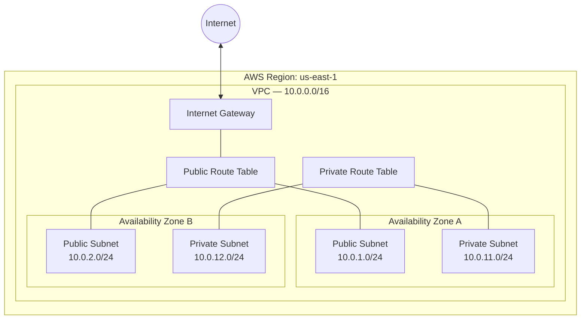

# Amazon VPC (Virtual Private Cloud)


## Definition

A Virtual Private Cloud (VPC) is your own private, logically isolated slice of the AWS network —
a virtual data center you fully control: you pick the IP address range, carve it into
sub-networks, decide what can talk to the internet, and decide what can talk to what. Nothing in
it is reachable from outside unless you explicitly open a door.

## Purpose

Before VPC existed (pre-2009, AWS's original "EC2-Classic"), every EC2 instance landed on a
single flat, shared network alongside every other AWS customer's instances — you got almost no
control over IP addressing, isolation, or topology. VPC was built to solve that: give each
customer the networking experience of running their own physical data center — subnets, routing,
firewalls, address planning — without owning a single router or cable. It's the foundational
layer every other networking service (subnets, security groups, load balancers, VPN, Direct
Connect, Transit Gateway) is built on top of. You cannot run most AWS resources without one.

## How It Works

Plain explanation: when you create a VPC, you give it an IP address range (a CIDR block, e.g.
`10.0.0.0/16`, which is ~65,536 addresses). That range lives entirely inside one AWS Region (it
spans all Availability Zones in that Region, but never crosses into another Region). Inside that
range you carve out subnets, each pinned to one Availability Zone. You then attach gateways to
control what traffic can enter/leave, route tables to say where traffic goes, and security
layers (security groups, NACLs) to say what's allowed. Every AWS account gets a **default VPC**
in every Region automatically (pre-configured with public subnets and internet access) so EC2
instances can be launched immediately — real-world production workloads almost always use a
custom VPC instead, built deliberately.



Walking through it: the **VPC** (`10.0.0.0/16`) is the outer boundary — AWS Region-scoped, never
crossing Regions. Inside it, **subnets** divide the address range by Availability Zone (a subnet
is always 100% inside one AZ — this is why you need at least 2 subnets, one per AZ, for high
availability). The **Internet Gateway (IGW)** is the VPC's door to the public internet — attached
once, at the VPC level. Whether a subnet is "public" or "private" isn't a setting on the subnet
itself — it's purely determined by its **route table**: a subnet is public if its route table has
a route to the IGW (`0.0.0.0/0 → igw-xxxx`); otherwise it's private. This is the single most
exam-tested fact about VPC topology.

## Key Features / Components

- **CIDR block** — the IP address range you assign the VPC at creation (primary, expandable
  later with secondary CIDR blocks); sizes from `/16` (65,536 IPs) to `/28` (16 IPs).
- **Subnets** — AZ-scoped subdivisions of the VPC CIDR; public or private based on routing.
- **Route tables** — per-subnet (or VPC-default) rules for where traffic is directed.
- **Internet Gateway (IGW)** — horizontally scaled, redundant AWS-managed gateway for
  internet in/out; one per VPC, no bandwidth charge itself.
- **NAT Gateway / NAT Instance** — lets private-subnet resources initiate outbound internet
  traffic (e.g., to download patches) without being reachable from the internet.
- **Security Groups & Network ACLs** — stateful (instance-level) and stateless (subnet-level)
  firewalls (full detail in `security-groups-vs-nacls.md`).
- **VPC Peering / Transit Gateway** — connect VPCs to each other (own file).
- **VPC Endpoints** — private connectivity to AWS services without traversing the internet.
- **DHCP option sets** — control DNS servers, domain names handed to instances.
- **Flow Logs** — capture IP traffic metadata in/out of network interfaces for auditing.
- **Default VPC** — one per Region per account, auto-created, pre-wired for instant internet
  access — fine for quick tests, not for production security posture.
- **Multiple VPCs per account/Region** — common pattern: one VPC per environment (dev/stage/prod)
  or per application, connected via Transit Gateway where needed.

## Use Cases — When to Use It

- **Any workload on EC2, RDS, ElastiCache, EKS/ECS (non-Fargate-only), Lambda-in-VPC** — these
  all require a VPC; there's no way to opt out of networking entirely.
- **Multi-tier applications** — web tier in public subnets, app/database tier in private subnets,
  the classic 3-tier architecture pattern tested throughout SAA-C03.
  isolated environments.
- **Regulatory/compliance isolation** — HIPAA, PCI-DSS workloads that must prove network
  segmentation and no direct internet exposure for data-handling tiers.
- **Hybrid cloud** — extending an on-prem data center's address space into AWS via VPN or
  Direct Connect, with careful non-overlapping CIDR planning.
- **Multi-account landing zones** — each AWS account (dev, prod, shared-services) gets its own
  VPC(s), stitched together with Transit Gateway for a scalable enterprise network.

## When NOT to Use It / Alternatives

- **You just need a quick throwaway Lambda with no VPC resource access** — don't put Lambda in a
  VPC unless it must reach a VPC-only resource (RDS, ElastiCache); VPC-attached Lambdas have
  cold-start/ENI overhead and need NAT Gateway for internet access, which costs money. Fully
  managed serverless services (DynamoDB, S3, most SaaS-style AWS APIs) are reached over the
  public AWS API endpoint and need no VPC at all.
- **Static website hosting** — S3 + CloudFront needs no VPC; don't over-engineer.
- **You want AWS to manage everything** — if you truly don't care about network topology,
  the default VPC is there; but for anything beyond a demo, a custom VPC with deliberate subnet
  design is the standard professional practice.

## Why It's Important

**Real-world:** VPC design mistakes are the single most common source of both security incidents
(overly permissive default VPCs, misconfigured public subnets exposing databases) and outages
(CIDR overlap blocking a merger/VPN, running out of IP space in a subnet that's too small). Good
VPC design is the first thing a cloud security review checks.

**Exam mapping:**
- **SAA-C03** — Domain 1 (Secure Architectures, 30%) Task 1.2 names VPC security explicitly
  (subnets, NAT gateways, segmentation). Domain 3 (High-Performing Architectures) Task 3.4
  covers network architecture design directly. This is arguably the single most tested
  foundational topic on SAA-C03.
- **DVA-C03** — Domain 1 Task 1.2 (Lambda VPC access to private resources) and Domain 2
  (Security) assume solid VPC fundamentals before touching Lambda-in-VPC or RDS connectivity.
- **MLA-C02** — Domain 1 (Data Preparation) and Domain 4 (Operating/Securing) both assume you
  can put a SageMaker notebook/training job inside a private VPC for data-access security.

## Pricing Model (summary)

The **VPC itself is free** — no charge to create a VPC, subnet, route table, security group, or
NACL. You pay for the *components that do work*: NAT Gateway (hourly + per-GB processed), VPN
connections (hourly), Transit Gateway (hourly + per-GB), Elastic IPs when unattached or extra,
VPC Flow Logs storage (CloudWatch Logs/S3 costs), and inter-AZ/cross-Region data transfer. See
`data-transfer-pricing.md` for the full breakdown — this is where most "surprise" network bills
come from, not the VPC itself. Official pricing: https://aws.amazon.com/vpc/pricing/

## Hands-on Lab (Floci)

Floci's EC2 Docker backing exposes the `ec2` CLI namespace, which includes VPC control-plane
APIs (create/describe/delete) — you can practice the exact calls and see real responses, though
Floci does not simulate actual packet-level routing/isolation between resources.

```bash
# Create a VPC with a /16 CIDR
awslocal ec2 create-vpc --cidr-block 10.0.0.0/16 \
  --tag-specifications 'ResourceType=vpc,Tags=[{Key=Name,Value=study-vpc}]'

# Capture the VPC ID from the output, then list it back
awslocal ec2 describe-vpcs --filters Name=tag:Name,Values=study-vpc

# Create a public subnet inside it (swap <vpc-id> for the real ID)
awslocal ec2 create-subnet --vpc-id <vpc-id> \
  --cidr-block 10.0.1.0/24 --availability-zone us-east-1a \
  --tag-specifications 'ResourceType=subnet,Tags=[{Key=Name,Value=public-subnet-a}]'

# Create and attach an Internet Gateway
awslocal ec2 create-internet-gateway \
  --tag-specifications 'ResourceType=internet-gateway,Tags=[{Key=Name,Value=study-igw}]'
awslocal ec2 attach-internet-gateway --vpc-id <vpc-id> --internet-gateway-id <igw-id>

# Clean up
awslocal ec2 delete-vpc --vpc-id <vpc-id>
```

Full walkthrough (multi-AZ, route tables, NAT): `labs-floci/networking-vpc-lab.md`.

## Exam Tips

- **"Public" vs "private" subnet is a route table fact, not a subnet setting** — exam questions
  often describe a subnet with no route to an IGW and expect you to identify it as private even
  if it's named "public-subnet" in the scenario. Don't trust the label, trust the route table.
- A VPC **never spans Regions**, but it **does span every AZ in its Region** — a subnet is what's
  pinned to a single AZ, not the VPC.
- **CIDR planning**: watch for overlapping CIDR blocks between VPCs that need to be peered or
  connected via Transit Gateway/VPN — overlapping ranges cannot be connected without re-IP'ing.
- Default VPC exists per Region automatically — questions testing "why can I reach the internet
  immediately" are usually pointing at the default VPC's pre-attached IGW and public route.
- Know the CIDR math: a `/24` subnet has 256 addresses, but AWS reserves the first 4 and the
  last 1 (network address, VPC router, DNS, future use, broadcast) — so only 251 are usable.

## Related Terms

- [`subnets-route-tables-igw-natgw.md`](subnets-route-tables-igw-natgw.md) — subnet/routing detail
- [`security-groups-vs-nacls.md`](security-groups-vs-nacls.md) — VPC-level firewalling
- [`transit-gateway-and-peering.md`](transit-gateway-and-peering.md) — connecting VPCs together
- [`vpc-endpoints-privatelink.md`](vpc-endpoints-privatelink.md) — private AWS service access
- [`vpn.md`](vpn.md) and [`direct-connect.md`](direct-connect.md) — hybrid connectivity into a VPC
- `glossary/cidr.md`, `glossary/availability-zone.md`
- `00-fundamentals/` — AWS global infrastructure (Regions, AZs) this all sits on top of
