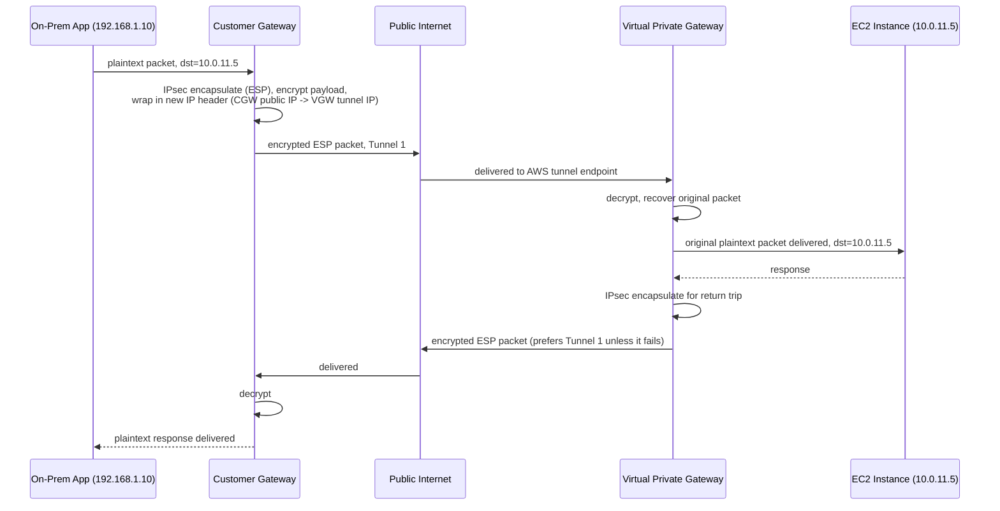
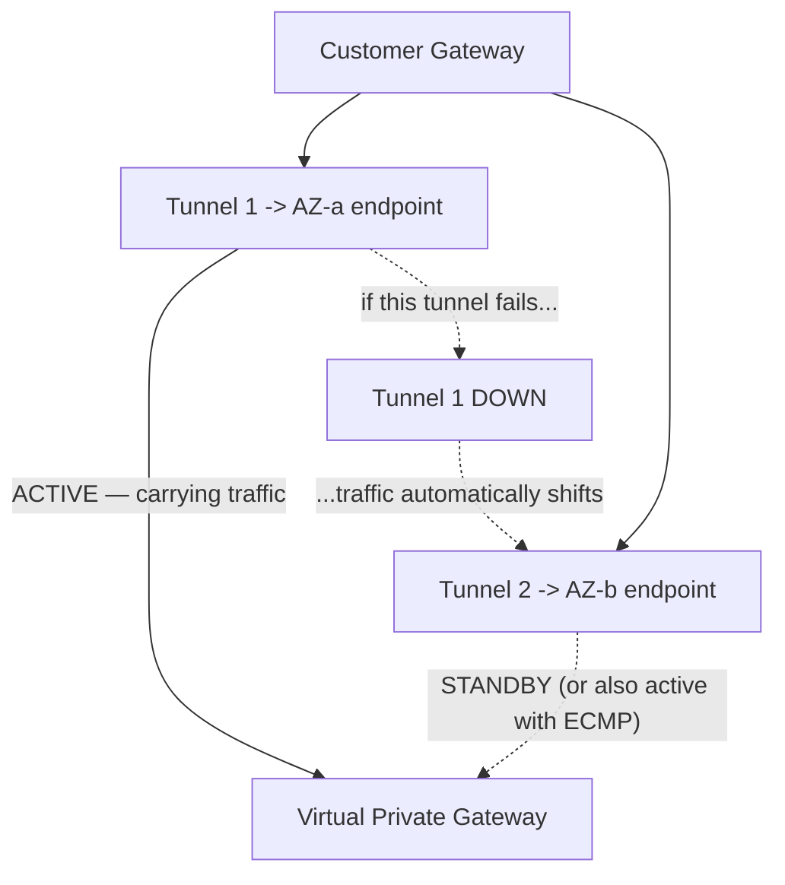
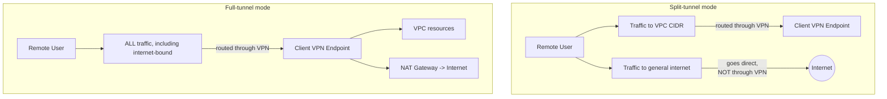
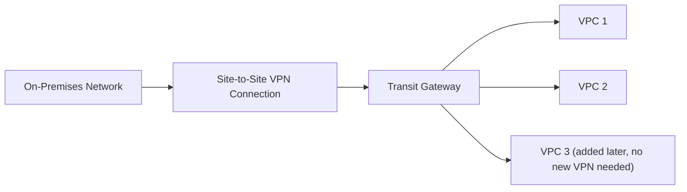
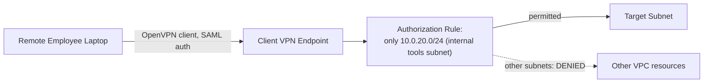

# AWS Site-to-Site VPN & Client VPN

> **Appears in:** [SAA-C03](../../certifications/saa-c03/README.md)


## Definition

AWS VPN provides encrypted, private connectivity over the **public internet** between your
network and AWS — **Site-to-Site VPN** connects an entire on-prem network (or another cloud) to
a VPC, while **Client VPN** connects individual remote users' laptops/devices directly into a
VPC, both using standard IPsec/OpenVPN-based encryption.

## Purpose

Not every organization can wait weeks for a Direct Connect cross-connect, or needs that level of
dedicated bandwidth — but plenty still need encrypted, private-feeling connectivity into AWS
right now. VPN solves that by layering strong encryption (IPsec) over the existing public
internet, giving you most of the security benefit of a private link without the physical
provisioning lead time or cost, at the tradeoff of variable, internet-dependent performance.

## How It Works

Plain explanation: **Site-to-Site VPN** connects two network *gateways* — a **Customer Gateway**
(representing your on-prem router/firewall) and a **Virtual Private Gateway** or **Transit
Gateway** (on the AWS side) — using IPsec tunnels, so every device on both networks can reach
each other as if they shared a private network, encrypted the whole way over the internet. Each
VPN connection provisions **two tunnels** to two different AWS endpoints for redundancy.
**Client VPN** is different in shape: instead of connecting two networks, it terminates
individual client software (laptops running the AWS-provided OpenVPN-based client) directly into
a VPC subnet, authenticating each user individually.


*Figure: AWS's reference diagram of a single Site-to-Site VPN connection — a VPC with an
attached Virtual Private Gateway on the AWS side, and a Customer Gateway device representing
your on-premises router, connected over the internet by an IPsec VPN connection. Source: AWS
documentation, "How AWS Site-to-Site VPN works" —
https://docs.aws.amazon.com/vpn/latest/s2svpn/how_it_works.html*

```mermaid
flowchart LR
    subgraph OnPrem["On-Premises Network"]
        CGW_HW["Customer Gateway<br/>(your router/firewall)"]
    end
    subgraph AWSCloud["AWS"]
        VGW["Virtual Private Gateway"]
        subgraph VPC["VPC"]
            RT["Route table<br/>(propagated via BGP)"]
            Resources["EC2 / RDS / etc."]
        end
    end
    CGW_HW ===|"Tunnel 1 (IPsec, encrypted)"| VGW
    CGW_HW -.=|"Tunnel 2 (IPsec, standby/active)"| VGW
    VGW --> RT
    RT --> Resources
```

Step by step: your on-prem **Customer Gateway** establishes **two separate encrypted IPsec
tunnels** to AWS's **Virtual Private Gateway** — built-in redundancy so if one tunnel's
underlying internet path has an issue, the other keeps traffic flowing. **BGP** (dynamic routing)
exchanges which networks are reachable over the VPN, automatically propagating routes into the
VPC's route table rather than requiring you to hand-enter static routes (though static routing is
also supported for simpler/non-BGP customer gateways). Once established, an EC2 instance inside
the VPC and a server on-prem can reach each other by private IP, exactly as if they were on the
same network — the public internet is just the transport, invisible to the applications.

### Packet-level walkthrough: IPsec encapsulation over the two tunnels



The core mechanic worth internalizing: IPsec doesn't just encrypt the original packet's payload —
it **encapsulates** the entire original IP packet inside a new one, with new source/destination
addresses matching the tunnel endpoints (the Customer Gateway's public IP and the Virtual
Private Gateway's tunnel IP). This is why the original private addressing (`192.168.1.10` and
`10.0.11.5`) is completely invisible to anything observing the public internet path — only the
tunnel endpoints' public IPs and encrypted ESP payload are visible in transit.

### Transit Gateway VPN attachment — reaching multiple VPCs with one VPN connection


*Figure: AWS's reference diagram showing a Transit Gateway with three VPC attachments and a
single VPN attachment, letting one Site-to-Site VPN connection reach every attached VPC through
the Transit Gateway's routing instead of needing a separate VPN per VPC. Source: AWS
documentation, "How AWS Site-to-Site VPN works" —
https://docs.aws.amazon.com/vpn/latest/s2svpn/how_it_works.html*

## Key Features / Components

- **Site-to-Site VPN** — network-to-network, IPsec-based, two redundant tunnels per connection.
- **Customer Gateway** — the AWS-side *representation* of your on-prem router (its public IP and
  BGP ASN); the actual device lives in your data center.
- **Virtual Private Gateway (VGW)** — the original AWS-side VPN endpoint, attached to one VPC.
- **Transit Gateway VPN attachment** — the modern pattern: terminate VPN connections on a
  Transit Gateway instead of a per-VPC VGW, so one VPN connection can reach many VPCs through the
  Transit Gateway's routing, rather than needing a separate VPN per VPC.
- **Client VPN** — a fully managed, elastic OpenVPN-based endpoint for individual remote users;
  integrates with Active Directory, SAML, or mutual certificate authentication; supports
  split-tunnel (only VPC-bound traffic goes over the VPN) or full-tunnel (all user traffic
  routed through AWS) modes.
- **BGP dynamic routing** vs. **static routing** — BGP automatically advertises/withdraws routes
  as topology changes; static routing requires manual route table maintenance on both sides.
- **VPN CloudHub** — using multiple Site-to-Site VPN connections to a single VGW to connect
  multiple on-prem sites to each other (hub-and-spoke) via AWS, without the sites connecting
  directly to one another.
- **Accelerated Site-to-Site VPN** — routes VPN traffic over the AWS Global Network using AWS
  Global Accelerator's anycast infrastructure for more consistent performance versus the raw
  public internet path.

## Two Tunnels Per Connection — why, and what happens on failure


*Figure: AWS's reference diagram of the two tunnels in a single VPN connection, each terminating
in a different Availability Zone on the AWS side for increased availability. Source: AWS
documentation, "Site-to-Site VPN tunnel endpoint replacement" —
https://docs.aws.amazon.com/vpn/latest/s2svpn/VPNTunnels.html*



Both tunnels terminate in **different Availability Zones** on the AWS side specifically for
increased availability — this is why a VPN connection always shows two distinct public IP
addresses, not a bug or a sign of misconfiguration. Outbound traffic (from AWS to on-prem)
typically prefers one tunnel but automatically fails over to the other if a problem is detected;
inbound traffic (from on-prem into AWS) uses whichever tunnel the customer gateway's own routing
sends it over — properly configuring **both** tunnels on the customer gateway device (not just
treating one as a true backup that's never actually tested) is a common real-world oversight that
undermines the built-in redundancy.

## Client VPN — Split-Tunnel vs. Full-Tunnel



**Split-tunnel** only routes traffic destined for the VPC's CIDR (or other explicitly routed
destinations) through the VPN — everything else (general web browsing) goes directly out the
user's own internet connection, which is bandwidth-efficient but means the organization has no
visibility or control over that other traffic. **Full-tunnel** routes *all* of the user's traffic
through the VPN and out through AWS, giving the organization full visibility/control (and the
ability to apply the same security controls, like forcing traffic through a centralized proxy or
firewall) at the cost of consuming the VPN's bandwidth for traffic that didn't strictly need to
go through AWS at all, and adding latency for ordinary web browsing. A scenario describing a
compliance requirement to monitor *all* of a remote user's network traffic, not just VPC-bound
traffic, is pointing at full-tunnel mode specifically.

## Common Architectures

**1. Direct Connect primary, VPN automatic backup.** The standard enterprise HA pattern — Direct
Connect carries normal traffic; if its BGP session drops, a parallel Site-to-Site VPN connection
(configured with lower BGP preference) automatically takes over, with no manual intervention.

**2. Transit Gateway VPN attachment for multi-VPC reach.** One Site-to-Site VPN connection
terminates on a Transit Gateway instead of a single VPC's VGW, immediately reaching every VPC
already attached to that Transit Gateway — adding a new VPC to the hybrid network requires no new
VPN connection at all, just a new Transit Gateway VPC attachment.



**3. VPN CloudHub for multi-site connectivity.** Several branch offices, each with their own
Customer Gateway, connect to a single Virtual Private Gateway — AWS (not a direct link between
the branches) becomes the hub that lets the branches reach each other via their respective VPN
tunnels, without any direct site-to-site circuits between the branches themselves.

**4. Client VPN for remote workforce access to private resources.** Employees run the AWS-
provided client, authenticate via SAML/Active Directory/certificates, and gain access scoped
(via security groups and authorization rules) to only the specific VPC subnets/resources they're
permitted to reach — not unrestricted network-wide access.



## Use Cases — When to Use It

- **Fast-to-provision hybrid connectivity** — a VPN can be stood up in minutes to an hour,
  versus weeks for Direct Connect — the default starting point for hybrid connectivity.
- **Backup/failover path for Direct Connect** — a common resiliency pattern: Direct Connect as
  primary, Site-to-Site VPN as an automatic encrypted fallback if the dedicated connection fails.
- **Remote workforce access to private AWS resources** — Client VPN for employees needing to
  reach internal dev/staging environments, internal admin tools, or VPC-only databases.
- **Low-to-moderate, non-steady bandwidth hybrid workloads** — where Direct Connect's cost/lead
  time isn't justified by the traffic volume.
- **Connecting multiple branch offices to AWS and to each other** — VPN CloudHub pattern, or
  (more commonly today) Transit Gateway with multiple VPN attachments.

## When NOT to Use It / Alternatives

- **Large, sustained, high-bandwidth transfer where internet variability matters** — Direct
  Connect gives more predictable throughput/latency and typically cheaper per-GB rates at scale;
  a VPN's performance is at the mercy of the public internet path between the two endpoints.
- **Strict regulatory requirement to never traverse the public internet, even encrypted** —
  Direct Connect is the only option that satisfies "never touches the internet," since VPN by
  definition tunnels over it (even though the payload is encrypted).
- **Very large numbers of remote users needing high-throughput access** — Client VPN scales, but
  for genuinely massive remote workforces, consider whether the architecture should instead
  expose specific applications through a more targeted, zero-trust access model (e.g., an
  internal ALB behind a reverse proxy/identity-aware proxy) rather than full network-level VPN
  access to everyone.
- **No existing on-prem router capable of IPsec/BGP** — budget for a compatible Customer Gateway
  device/software before assuming VPN is a zero-cost hybrid option.

## Why It's Important

**Real-world:** VPN is usually the first hybrid-connectivity step any organization takes toward
AWS — it's quick, cheap, and "good enough" for a huge range of real workloads, which is why it's
also one of the most commonly deployed networking services in practice, not just an exam topic.
Getting the BGP/route propagation wrong is a very common real support case ("my VPN is up but I
can't reach anything") because the tunnel being "UP" only means the encrypted path exists — it
says nothing about whether routes are actually being exchanged and applied.

**Exam mapping:**
- **SAA-C03** — Domain 1 Task 1.2 names VPN directly alongside Direct Connect for secure
  workload connectivity; Domain 4 Task 4.4 tests the cost/suitability tradeoff between VPN,
  Direct Connect, and plain internet transfer — a frequently recurring question pattern.
- **DVA-C03** — Domain 1 Task 1.2 (Lambda VPC access) occasionally intersects with VPN-connected
  private resources a Lambda function must reach.
- **MLA-C02** — relevant to Domain 1 (Data Preparation) when on-prem data sources feed ML
  pipelines over a VPN connection rather than Direct Connect, for cost/speed-to-deploy reasons.

## Pricing Model (summary)

**Site-to-Site VPN**: billed per **connection-hour** plus standard data transfer rates for
traffic that egresses AWS. **Client VPN**: billed per **association-hour** (per subnet the
endpoint is associated with) plus a per-**connection-hour** charge for each active client
connection. Accelerated Site-to-Site VPN adds a small additional charge for the Global
Accelerator-backed path. Official pricing: https://aws.amazon.com/vpn/pricing/

## Limits & Quotas

| Resource | Default quota |
|---|---|
| Site-to-Site VPN connections per VGW | 10 (soft) |
| Site-to-Site VPN connections per Transit Gateway | 50 (soft) |
| Throughput per VPN tunnel | ~1.25 Gbps (hard ceiling per tunnel) |
| ECMP-aggregated throughput (Transit Gateway, multiple tunnels) | Scales with number of tunnels via ECMP |
| Client VPN endpoints per Region | 5 (soft) |
| Client VPN concurrent connections per endpoint | Scales with associated subnet capacity |
| BGP ASN range (Customer Gateway) | Private ASN range typically used (64512-65534) |

The **1.25 Gbps per-tunnel ceiling** is a hard, non-negotiable limit worth remembering distinctly
— it's not a soft/raisable quota. The only way past it for aggregate throughput is **Equal-Cost
Multi-Path (ECMP)** routing across *multiple* VPN connections/tunnels on a Transit Gateway,
spreading load across several 1.25 Gbps tunnels rather than expecting any single tunnel to exceed
that ceiling.

## Troubleshooting / Common Issues

- **"The VPN connection shows UP but no traffic flows between networks."** Tunnel state being UP
  only confirms the IPsec encryption layer is established — check BGP session status separately;
  if BGP hasn't come up or routes aren't being advertised/accepted on both sides, no actual
  reachability exists despite the tunnel itself being healthy.
- **"Only one of the two tunnels is ever used, and testing failover doesn't work as expected."**
  Verify the Customer Gateway device is actually configured with **both** tunnels' parameters
  (not just the first one copy-pasted from the configuration file) — a common setup mistake is
  only configuring Tunnel 1 and never testing that Tunnel 2 genuinely works as a fallback.
- **"Throughput through the VPN is capped well below what the internet connection on both ends
  should support."** Check whether this is hitting the hard 1.25 Gbps per-tunnel ceiling — if so,
  the fix is spreading traffic across multiple tunnels/connections using ECMP on a Transit
  Gateway, not troubleshooting the existing tunnel as if it were underperforming.
- **"Client VPN users can connect but can't reach any VPC resources."** Check authorization rules
  (which subnets/CIDRs each user group is permitted to reach) and the Client VPN endpoint's
  associated security group — a successful VPN connection only grants network-layer reachability
  to whatever the authorization rules and security groups explicitly allow.
- **"VPN connected to a Virtual Private Gateway works, but after migrating to a Transit Gateway
  VPN attachment, some VPCs are unreachable."** Confirm those VPCs are actually attached to the
  same Transit Gateway and that the Transit Gateway's route table(s) include routes to/from the
  VPN attachment — migrating termination points doesn't automatically carry over VPC-level route
  propagation the way it worked with the single-VPC VGW model.
- **"Site-to-Site VPN performance is inconsistent, with occasional latency spikes."** Expected
  to some degree since standard VPN traverses the unpredictable public internet — if consistency
  matters, consider **Accelerated Site-to-Site VPN** (routes over AWS's global network via Global
  Accelerator's infrastructure) rather than troubleshooting ordinary internet variability as if
  it were a fixable AWS-side issue.

## Hands-on Lab (Floci)

Site-to-Site VPN's control-plane objects (Customer Gateway, Virtual Private Gateway, VPN
Connection) live in the `ec2` CLI namespace, which Floci backs with real Docker-based EC2
emulation — so the API shape is practicable, even though actual encrypted tunnel negotiation
isn't simulated:

```bash
# Register your "on-prem" router as a Customer Gateway
awslocal ec2 create-customer-gateway --type ipsec.1 \
  --public-ip 203.0.113.12 --bgp-asn 65000 \
  --tag-specifications 'ResourceType=customer-gateway,Tags=[{Key=Name,Value=study-cgw}]'

# Create and attach a Virtual Private Gateway to the VPC
awslocal ec2 create-vpn-gateway --type ipsec.1 \
  --tag-specifications 'ResourceType=vpn-gateway,Tags=[{Key=Name,Value=study-vgw}]'
awslocal ec2 attach-vpn-gateway --vpn-gateway-id <vgw-id> --vpc-id <vpc-id>

# Create the VPN connection itself (static routing for simplicity)
awslocal ec2 create-vpn-connection --type ipsec.1 \
  --customer-gateway-id <cgw-id> --vpn-gateway-id <vgw-id> \
  --options StaticRoutesOnly=true

awslocal ec2 create-vpn-connection-route --vpn-connection-id <vpn-id> \
  --destination-cidr-block 192.168.0.0/16

awslocal ec2 describe-vpn-connections --vpn-connection-ids <vpn-id>

# Alternatively, terminate on a Transit Gateway for multi-VPC reach
awslocal ec2 create-vpn-connection --type ipsec.1 \
  --customer-gateway-id <cgw-id> --transit-gateway-id <tgw-id> \
  --options StaticRoutesOnly=false
```

This builds real muscle memory for the exact objects Terraform/CloudFormation create for this
pattern. Full lab: `labs-floci/networking-vpc-lab.md`.

## Exam Scenario Deep Dive

**Scenario 1 — "A company needs hybrid connectivity to AWS established within the next few
days for an upcoming product launch, with moderate, non-steady traffic."**
Site-to-Site VPN — the only option realistically deployable in days; Direct Connect's physical
provisioning lead time rules it out regardless of its long-term advantages for this timeline.

**Scenario 2 — "An enterprise currently has Direct Connect to a single VPC's Virtual Private
Gateway and is rapidly adding new VPCs that also need hybrid connectivity, without provisioning
a new VPN or Direct Connect VIF for each one."**
Migrate the VPN/Direct Connect termination to a Transit Gateway (VPN attachment or transit VIF)
— new VPCs just need a Transit Gateway VPC attachment, with zero additional hybrid-connectivity
configuration required per VPC, versus the VGW-per-VPC model which doesn't scale this way.

**Scenario 3 — "A VPN connection's tunnel status shows UP on both tunnels, but a specific
on-premises subnet still cannot reach a specific VPC subnet, while other subnet pairs work
fine."**
This points to BGP route advertisement/acceptance, not the tunnel's encryption layer — check
whether that specific subnet's CIDR is actually being advertised by the customer gateway (or
entered as a static route, if not using BGP) and accepted into the VPC's route table; tunnel
"UP" status says nothing about which specific routes are actually being exchanged.

**Scenario 4 — "Remote employees need access to a specific internal admin tool running on a
private subnet, but the security team wants to avoid granting full network-level access to the
entire VPC."**
Client VPN with narrowly scoped **authorization rules** limiting access to just the specific
subnet/CIDR hosting the admin tool, combined with security groups on the tool itself — Client
VPN's authorization rules are specifically designed for this least-privilege access pattern,
distinct from a blanket "connect the whole network" Site-to-Site VPN model.

**Scenario 5 — "A workload occasionally needs more than 1.25 Gbps of throughput over a VPN
connection, and Direct Connect isn't an option due to budget/timeline constraints."**
Multiple VPN connections/tunnels terminated on a Transit Gateway with ECMP enabled, spreading
traffic across them to exceed any single tunnel's hard 1.25 Gbps ceiling — this is the only way
to scale VPN throughput beyond the per-tunnel limit, since that limit itself cannot be raised.

## Exam Tips

- **Two tunnels per VPN connection, always** — this is built-in redundancy; a question about
  "why does my VPN connection show two IP addresses" is just describing normal behavior, not a
  misconfiguration.
- **VPN is fast to provision, Direct Connect is slow but more performant/cheaper at scale** —
  the exam's cost/time tradeoff pair between these two is one of the most reliable patterns in
  the whole Networking category.
- **Transit Gateway VPN attachment vs. per-VPC Virtual Private Gateway**: if the scenario needs
  one VPN connection to reach *multiple* VPCs, the answer is a Transit Gateway VPN attachment,
  not stacking multiple separate VGWs.
- **Client VPN vs. Site-to-Site VPN**: "individual remote employees need access" → Client VPN.
  "Two entire networks need to talk to each other" → Site-to-Site VPN. Don't mix these up — they
  solve different connectivity shapes.
- **BGP vs. static routing**: BGP (dynamic) automatically adapts to route/topology changes;
  static routing needs manual updates — if the scenario values automatic failover/route
  adaptation, BGP is the better-practice answer.
- **VPN as Direct Connect backup** is a standard HA pattern worth recognizing instantly in a
  resiliency-themed question.
- **1.25 Gbps per tunnel is a hard limit** — a scenario about needing more VPN throughput points
  to ECMP across multiple tunnels/connections on a Transit Gateway, not a "request a quota
  increase" answer, since this specific number cannot be raised.
- **Tunnel UP ≠ routes working** — a classic troubleshooting trap distinguishing the encryption
  layer's health from the routing layer's health; always check BGP/route propagation separately.

## Further Reading

- AWS Docs — What is AWS Site-to-Site VPN?: https://docs.aws.amazon.com/vpn/latest/s2svpn/VPC_VPN.html
- AWS Docs — How AWS Site-to-Site VPN works: https://docs.aws.amazon.com/vpn/latest/s2svpn/how_it_works.html
- AWS Docs — Site-to-Site VPN tunnel endpoint replacement: https://docs.aws.amazon.com/vpn/latest/s2svpn/VPNTunnels.html
- AWS Docs — AWS Client VPN: https://docs.aws.amazon.com/vpn/latest/clientvpn-admin/what-is.html
- AWS Whitepaper — Amazon VPC Connectivity Options, Site-to-Site VPN section: https://docs.aws.amazon.com/whitepapers/latest/aws-vpc-connectivity-options/aws-site-to-site-vpn.html
- AWS re:Post — Troubleshoot Site-to-Site VPN tunnels: https://repost.aws/knowledge-center/vpn-tunnel-troubleshooting

## Related Terms

- [`direct-connect.md`](direct-connect.md) — the faster-but-slower-to-provision alternative
- [`transit-gateway-and-peering.md`](transit-gateway-and-peering.md) — modern VPN termination point
- [`vpc.md`](vpc.md), [`subnets-route-tables-igw-natgw.md`](subnets-route-tables-igw-natgw.md)
- `glossary/ipsec.md`, `glossary/bgp.md`
