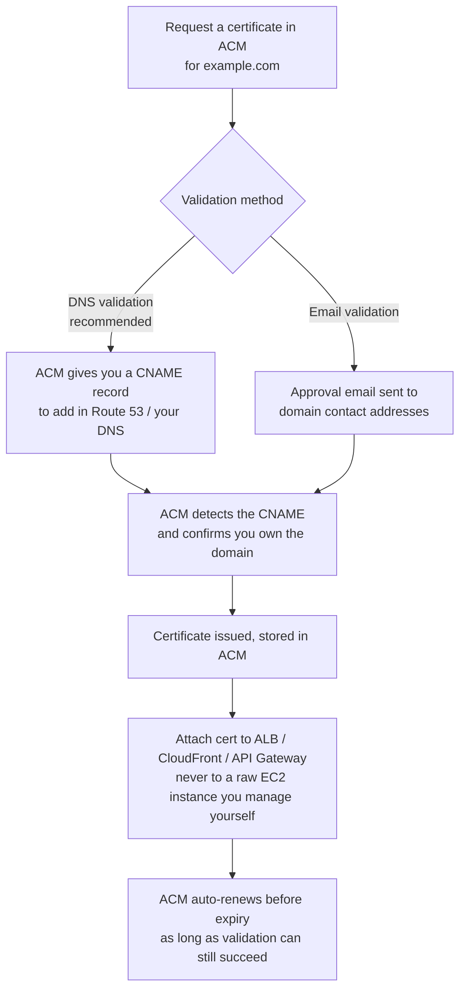
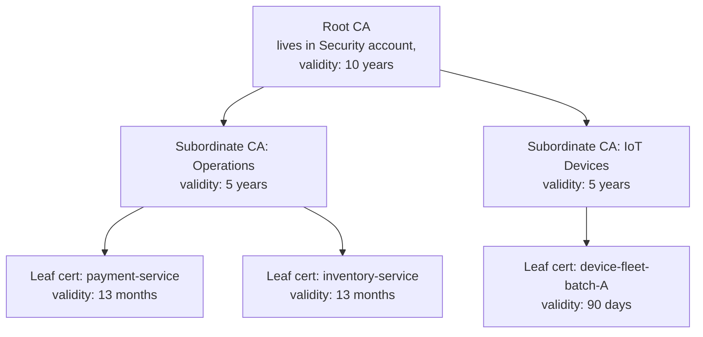
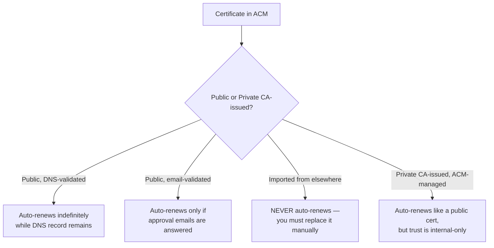
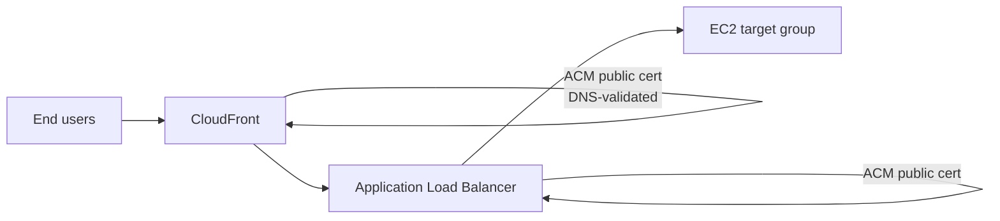
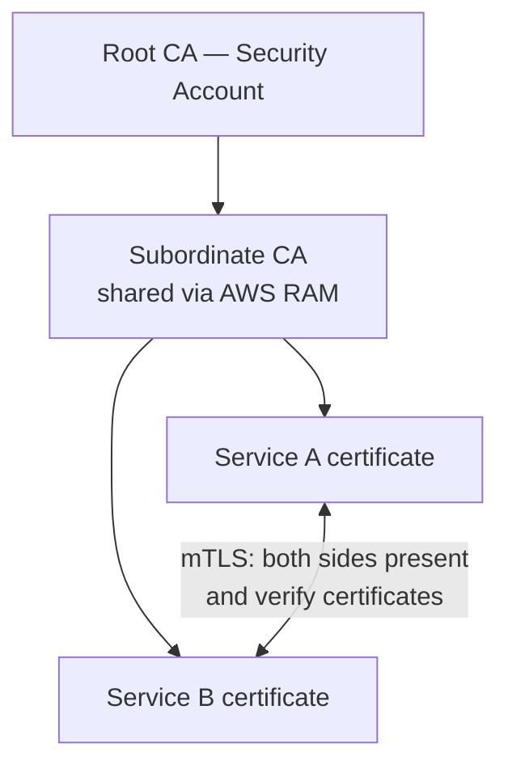
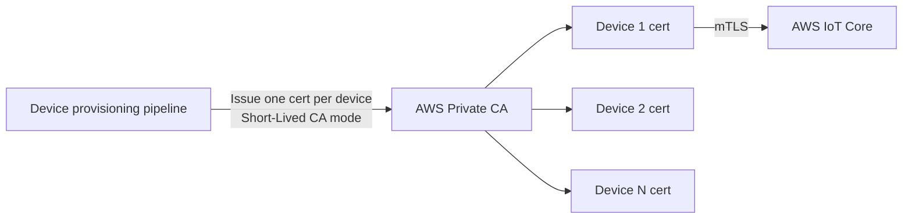
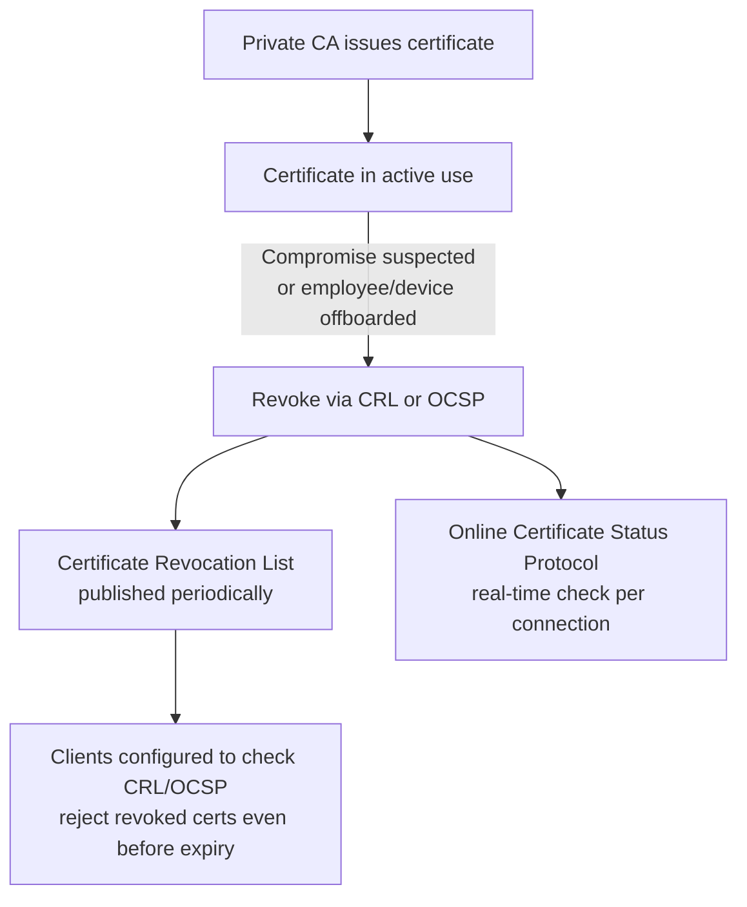

# AWS Certificate Manager (ACM) & Private CA


## Definition

ACM is the service that **issues, renews, and manages free public TLS/SSL certificates** for
AWS resources, so traffic to your website or API can be encrypted (HTTPS) without you ever
buying a certificate from a third party or manually tracking expiry dates. AWS Private CA is a
companion service that lets you run your **own private certificate authority** to issue
certificates for internal systems that should never be trusted by the public internet.

## Purpose

TLS certificate management used to be a recurring operational headache: pay a Certificate
Authority, generate a CSR, install the cert, and — critically — remember to renew it before it
expires (an expired cert is one of the most common causes of unplanned production outages
across the industry). ACM exists to make certificates for AWS-facing services (ALB, CloudFront,
API Gateway) **free and automatically renewed**, removing both the cost and the human
forgetfulness factor. Private CA exists because not every certificate should be trusted by
every browser on Earth — internal service-to-service traffic, IoT device identities, and
employee-only intranets need certificates from an authority *you* control, not a public one.

## How It Works



Step by step:

1. You request a certificate for a domain (e.g., `example.com`, or a wildcard `*.example.com`)
   through ACM.
2. ACM must verify you **actually own** that domain before issuing anything — via **DNS
   validation** (ACM gives you a CNAME record to add to your DNS zone; if you're using Route 53,
   this can even be automated with one click) or the older **email validation** (an approval
   email sent to standard addresses like `admin@domain.com`), or **HTTP validation** for
   certificates used specifically with CloudFront.
3. Once validation succeeds, ACM issues the certificate and stores it — **the private key
   never leaves ACM and cannot be exported**, which is a deliberate security boundary (and also
   why ACM certs can only be used with integrated AWS services, not installed on an arbitrary
   server you SSH into).
4. You attach the certificate to a service that terminates TLS for you: an Application Load
   Balancer, CloudFront distribution, or API Gateway custom domain. The TLS handshake happens
   at that layer.
5. As long as the DNS validation record is still in place (or email/HTTP validation can still
   succeed), ACM **automatically renews the certificate before it expires** — no manual
   intervention, no expiry-outage risk, which is the service's single biggest practical value.

### AWS Private CA — CA hierarchy and nested certificate validity periods


*Source: AWS Private Certificate Authority User Guide, "Manage the private CA lifecycle"
(docs.aws.amazon.com/privateca/latest/userguide/ca-lifecycle.html)*

This is the single most important design constraint for a Private CA hierarchy: a subordinate
CA's certificate validity must sit *entirely inside* its parent's validity window, and any
end-entity (leaf) certificate it issues must likewise sit entirely inside the subordinate's
window. A good rule of thumb AWS itself documents: a CA certificate's validity should be
roughly 2–5× longer than any certificate it will issue, so the hierarchy doesn't need constant
re-issuance just to keep leaf certificates valid near the end of a CA's own lifetime.

### Full multi-level CA hierarchy with delegated issuance



Sharing the subordinate CA (not the root) to individual application accounts via **AWS
Resource Access Manager (RAM)** lets application teams self-serve certificate issuance for
their own services while the root CA — the actual foundation of trust — stays locked down in a
dedicated security account, never directly exposed to workload teams.

### ACM certificate attachment and renewal decision flow



## Key Features / Components

- **Public certificates** — free, issued by Amazon's own public CA, trusted by all major
  browsers, used for anything public-facing.
- **DNS validation (recommended) vs. Email validation vs. HTTP validation** — DNS validation is
  preferred because it doesn't depend on a mailbox existing/being monitored and supports fully
  automated renewal; AWS has signaled it will deprecate email validation for new public
  certificates and renewals over time, making DNS validation the forward-looking default answer.
- **Only usable with integrated AWS services** — ACM public certificates can be attached to
  ALB/NLB, CloudFront, API Gateway, Elastic Beanstalk — but the private key cannot be
  downloaded/exported for use on a self-managed EC2 instance or on-premises server. If you need
  the actual key material, you must generate/import your own certificate instead.
- **Imported certificates** — you can import a certificate you bought elsewhere (or generated
  yourself) into ACM to get the same easy attachment to AWS services, but ACM does **not**
  auto-renew imported certificates — you're responsible for replacing them before they expire.
- **AWS Private Certificate Authority (Private CA)** — lets you stand up your own root or
  subordinate CA hierarchy (up to 5 levels deep), issuing certificates that are trusted only by
  systems you've explicitly configured to trust your private root, used for internal mTLS
  between microservices, IoT device certificates, VPN client certs, and code-signing — all
  without exposing anything to the public CA trust chain.
- **Certificate renewal for Private CA-issued certs** — ACM can manage issuance/renewal of
  certificates whose authority is your own Private CA, same automatic-renewal convenience but
  for private-trust certificates.
- **Certificate transparency logging** — public certs are automatically logged to public CT
  logs (an industry-wide requirement) for auditability.
- **Short-Lived CA mode (Private CA)** — a cheaper Private CA pricing tier purpose-built for
  CI/CD or frequently-rotated certificates (e.g., issuing a fresh certificate per deployment),
  distinct from the standard "General-Purpose" tier priced for steady, long-running usage.
- **Sharing a Private CA via AWS RAM** — lets a centrally-owned subordinate CA be shared to
  other accounts/OUs for self-service certificate issuance without distributing root-level trust.

## Use Cases — When to Use It

- Terminating HTTPS on an Application Load Balancer or CloudFront distribution in front of a
  public website, with zero cost for the certificate itself.
- A multi-service internal API mesh where every service needs to prove identity to every other
  service via mutual TLS (mTLS) — issue each service a certificate from a Private CA.
- IoT fleets where every device needs a unique, revocable certificate identity, issued from a
  private root you control rather than trusting a public CA for internal device auth.
- API Gateway custom domain names needing a valid HTTPS certificate for a branded API endpoint.
- Code-signing internal build artifacts using a Private CA-issued certificate so downstream
  systems can verify provenance without a public CA relationship.

## When NOT to Use It / Alternatives

- **You need the raw private key for use outside AWS-integrated services** (e.g., installed
  directly on a self-managed Nginx server on an EC2 instance via SSH) — ACM public certificates
  cannot be exported; either terminate TLS at an ALB in front of the instance instead, or buy/
  generate a certificate elsewhere and import it (accepting you'll manage its renewal manually).
- **You need certificates trusted by the public internet but issued by your own authority**
  — not possible; public trust requires certificates chained to a recognized public root CA.
  Private CA certificates are only trusted by parties you've explicitly configured to trust
  them.
- **Low-volume internal use where standing up a full Private CA hierarchy is overkill** — for
  a handful of internal services, a Private CA's hourly cost may not be justified versus
  simpler self-signed certs managed manually (with the tradeoff of losing automated issuance/
  renewal and centralized revocation).

## Common Architectures

### 1. Public-facing web app with ACM-backed HTTPS



### 2. Internal mTLS service mesh backed by a centralized Private CA



### 3. IoT fleet identity issuance at scale



## Why It's Important

**Real-world weight:** Expired certificates causing outages is a recurring, embarrassing, and
entirely preventable category of incident across the industry (multiple well-known companies
have had public outages from exactly this). ACM's automatic renewal removes an entire class of
human-error risk for free. Private CA is foundational to zero-trust/mTLS architectures, which
are increasingly a compliance and security-posture expectation, not just a nice-to-have.

**Exam weight:**
- **SAA-C03 — Domain 1, Task 1.3 "Determine appropriate data security controls"** explicitly
  lists "ACM/TLS encryption in transit" and "certificate renewal" — know which AWS services ACM
  certs can attach to and that DNS validation enables automatic renewal.
- **DVA-C03 — Domain 2, Task 2.2 "Implement encryption and manage sensitive data"** lists ACM
  and Private CA directly alongside KMS — developers need to know how to request/attach a
  cert via CLI/CloudFormation/CDK as part of deploying an HTTPS-enabled API or app.
- Less central to **MLA-C02**, though encryption-in-transit for model endpoints (API Gateway/
  ALB fronting a SageMaker endpoint) still touches it under Domain 4's security objectives.

## Limits & Quotas

| Resource | Default quota | Notes |
|---|---|---|
| ACM public certificates per account per Region | 2,500 (soft) | Rarely binding for typical workloads |
| Domain names per certificate (SANs) | 100 | Wildcard counts as one SAN but covers unlimited subdomains at that level |
| Certificate renewal eligibility window | Starts ~60 days before expiry | ACM attempts renewal automatically within this window if validation still holds |
| Private CA hierarchy depth | Up to 5 levels | Root + up to 4 subordinate levels |
| Private CA certificates issued | Essentially unbounded, billed per issuance | Cost scales with volume — see pricing |
| Private CA General-Purpose vs. Short-Lived mode | Different monthly fee tiers | Short-Lived mode trades a lower per-CA monthly fee against shorter max certificate validity |

## Pricing Model

- **Public ACM certificates are completely free** — no charge for issuance, renewal, or the
  certificate itself; you only pay for the underlying resources (ALB hours, CloudFront
  distribution usage) as normal.
- **AWS Private CA** has real, non-trivial cost: a monthly fee per active private CA
  (tiered: higher for a "General-Purpose" CA used frequently, lower for "Short-Lived" CA mode
  meant for CI/CD or frequently-rotated certs) plus a per-certificate-issued fee.
- See: https://aws.amazon.com/certificate-manager/pricing/ for the current exact numbers (this
  is one of the few AWS security services with real line-item cost that exam questions test
  understanding of — "it's free" is a trap if the question is specifically about Private CA).

## Hands-on Lab (Floci)

ACM in Floci emulates the control-plane API shape (request/list/describe certificates) but
cannot perform real DNS/email domain validation or produce certificates trusted by real
browsers — it's useful for practicing the CLI workflow and IaC integration, not for a real
working HTTPS endpoint:

```bash
# Request a certificate (DNS validation)
awslocal acm request-certificate --domain-name study.example.com \
  --validation-method DNS --subject-alternative-names "*.study.example.com"

# Describe it to see the DNS validation record ACM expects you to create
awslocal acm describe-certificate --certificate-arn <arn-from-above>

# List all certs in the account
awslocal acm list-certificates

# Simulate "importing" an externally generated cert instead
awslocal acm import-certificate \
  --certificate fileb://cert.pem --private-key fileb://key.pem --certificate-chain fileb://chain.pem
```

### Extended lab: building a real local CA hierarchy with openssl, mirroring Private CA's model

```bash
# 1. Create a root CA (mirrors AWS Private CA's root level)
openssl genrsa -out root-ca.key 4096
openssl req -x509 -new -nodes -key root-ca.key -sha256 -days 3650 \
  -subj "/CN=Study-Root-CA" -out root-ca.pem

# 2. Create a subordinate CA signed by the root (mirrors a delegated subordinate CA)
openssl genrsa -out sub-ca.key 4096
openssl req -new -key sub-ca.key -subj "/CN=Study-Subordinate-CA" -out sub-ca.csr
openssl x509 -req -in sub-ca.csr -CA root-ca.pem -CAkey root-ca.key -CAcreateserial \
  -days 1825 -sha256 -out sub-ca.pem

# 3. Issue a leaf (end-entity) certificate from the subordinate — note the validity
#    is deliberately much shorter than its parent, same nesting rule Private CA enforces
openssl genrsa -out leaf.key 2048
openssl req -new -key leaf.key -subj "/CN=payment-service.internal" -out leaf.csr
openssl x509 -req -in leaf.csr -CA sub-ca.pem -CAkey sub-ca.key -CAcreateserial \
  -days 397 -sha256 -out leaf.pem

# Verify the chain, exactly how a client performing mTLS would
openssl verify -CAfile root-ca.pem -untrusted sub-ca.pem leaf.pem
```

## Troubleshooting / Common Issues

**"Certificate renewal didn't happen and the site went down on expiry":**
1. Check the validation method — email-validated and imported certificates do **not**
   auto-renew reliably; only DNS-validated (and HTTP-validated for CloudFront) certificates
   with their validation record still in place renew automatically.
2. Check whether the DNS validation CNAME record was ever deleted (common after a DNS
   migration/cleanup) — ACM cannot re-validate domain ownership without it, and silently stops
   attempting renewal.
3. Check `DescribeCertificate`'s `RenewalSummary` field directly — it reports the specific
   renewal eligibility status rather than making you guess.

**"Can't install the ACM certificate on our EC2 instance directly":** this is expected
behavior, not a bug — ACM public/private-key material for AWS-issued certs cannot be exported.
Either front the instance with an ALB/CloudFront (recommended) or import a separately-obtained
certificate (accepting manual renewal responsibility) if TLS truly must terminate directly on
the instance.

**"mTLS handshake fails between two internal services using Private CA certs":** check the
nested validity window first — if a leaf certificate's validity somehow extends beyond its
issuing subordinate CA's own validity period (a configuration mistake, not the normal case),
clients performing strict chain validation will reject it once the CA's own window passes,
even if the leaf certificate's own `notAfter` date hasn't arrived yet.

## Exam Tips

- **ACM certs cannot be exported** — if a question's scenario needs the private key installed
  on a self-managed server outside AWS-integrated services, ACM alone is the wrong tool; it
  needs an imported certificate or a different approach.
- **DNS validation enables auto-renewal; email validation and imported certs do not auto-renew
  reliably** — a question about "the cert keeps expiring and breaking the site" often points to
  an imported certificate or lapsed email-validation contact, not a flaw in ACM itself.
- **ACM is free; Private CA is not** — don't assume all certificate-related AWS costs are zero;
  this exact distinction is tested because it's counter to many people's assumption that
  "ACM = free certs" covers everything in this space.
- **Public vs. Private CA — public trust vs. internal trust** — a scenario describing
  service-to-service mTLS inside a VPC, or IoT device identity, wants Private CA, not a public
  ACM certificate (public certs are for internet-facing endpoints only).
- **Where certs attach** — ALB/NLB, CloudFront, API Gateway custom domains are correct
  attachment points; EC2 instances directly are not (you'd terminate TLS at a load balancer in
  front of them instead).
- **CA hierarchy depth and nested validity** — know the 5-level maximum and that a subordinate/
  leaf certificate's validity must fit entirely within its parent's — a question about
  certificate chain validation failures despite an unexpired leaf cert is testing this.
- **Short-Lived CA mode vs. General-Purpose mode** — a scenario about frequent, CI/CD-driven
  certificate issuance at lower per-CA cost points to Short-Lived mode specifically.
- Tested within **SAA-C03 Domain 1 (30%)** and **DVA-C03 Domain 2 (26%)**, generally paired
  with KMS questions in the same "data security controls" cluster.

## Certificate Lifecycle Cost Comparison — Public ACM vs. Private CA vs. Self-Managed

| Approach | Issuance cost | Renewal effort | Trust scope | Best for |
|---|---|---|---|---|
| ACM public cert | Free | Automatic (DNS validation) | Public internet | Internet-facing ALB/CloudFront/API Gateway |
| ACM + Private CA | Per-CA monthly fee + per-cert fee | Automatic (ACM-managed) | Internal only, trust configured explicitly | mTLS service mesh, IoT fleets |
| Self-managed (openssl, manual) | Free (tooling) but high ops cost | Fully manual | Whatever you configure | Tiny internal footprint, no automation investment justified |
| Third-party public CA, imported | Vendor's fee | Fully manual in ACM | Public internet | Legacy certs already purchased elsewhere |

## Worked example: deciding between General-Purpose and Short-Lived Private CA mode

A CI/CD pipeline issues a fresh internal service certificate on every deployment (potentially
dozens of times per day), each certificate valid for only 24 hours before the next deployment
replaces it. **Short-Lived CA mode** is the correct choice here — it's priced specifically for
this high-issuance-frequency, short-validity pattern, at a lower per-CA monthly rate than
General-Purpose mode (which assumes fewer, longer-lived certificates and is priced
accordingly). Choosing General-Purpose mode for this workload would mean paying for capability
(longer max validity periods, different usage assumptions) the pipeline never actually uses,
while Short-Lived mode directly matches both the technical pattern and the cost structure to
the actual usage shape.

## Certificate Revocation — A Frequently Overlooked Private CA Capability



Unlike a short-lived certificate that simply expires on its own, a **revoked** certificate must
be actively checked against a CRL or OCSP responder by every relying party — a question
describing "we need to immediately invalidate a certificate before its natural expiry" (e.g., a
compromised IoT device) points to configuring and actually consuming CRL/OCSP, not merely
waiting out a short validity window; Private CA supports generating and publishing these
revocation mechanisms as part of the managed CA lifecycle.

## ACM vs. Private CA — One More Disambiguation Pass

| Question | ACM (public) | Private CA |
|---|---|---|
| Will browsers trust this by default? | Yes | No, never, unless you distribute trust explicitly |
| Does it cost anything? | No | Yes, real monthly + per-cert cost |
| Can I control the full CA hierarchy myself? | No — Amazon's own public CA issues it | Yes — you design the hierarchy depth and structure |
| Typical use | Public website/API HTTPS | Internal mTLS, IoT, VPN, code-signing |
| Revocation mechanism | Amazon manages this | You manage CRL/OCSP publication |

## Further Reading

- AWS Certificate Manager User Guide: https://docs.aws.amazon.com/acm/latest/userguide/
- AWS ACM User Guide — Validate domain ownership:
  https://docs.aws.amazon.com/acm/latest/userguide/domain-ownership-validation.html
- AWS Private CA User Guide — What is AWS Private CA?:
  https://docs.aws.amazon.com/privateca/latest/userguide/PcaWelcome.html
- AWS Private CA User Guide — Designing a CA hierarchy:
  https://docs.aws.amazon.com/privateca/latest/userguide/ca-hierarchy.html
- AWS Security Blog — "How to secure an enterprise-scale AWS Private CA hierarchy for
  automotive and manufacturing":
  https://aws.amazon.com/blogs/security/how-to-secure-an-enterprise-scale-acm-private-ca-hierarchy-for-automotive-and-manufacturing/
- AWS Certificate Manager pricing: https://aws.amazon.com/certificate-manager/pricing/

## Related Terms

- [`kms.md`](kms.md) — a related but distinct encryption-key service; ACM handles TLS certs, KMS handles data encryption keys
- [`iam.md`](iam.md) — IAM policies control who can request/manage ACM certificates
- [`secrets-manager-vs-parameter-store.md`](secrets-manager-vs-parameter-store.md) — a private key/cert could alternatively be stored as a secret if not using ACM's managed flow
- `glossary/` — TLS/SSL, CSR, certificate transparency, mTLS, CNAME
