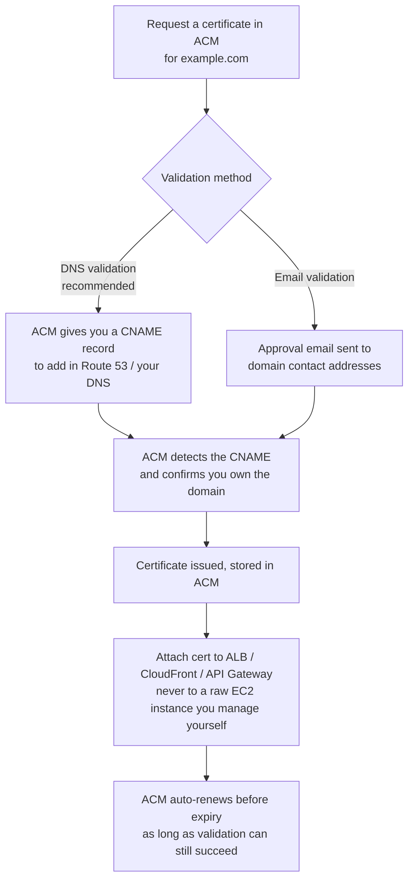

# AWS Certificate Manager (ACM) & Private CA


## Definition

ACM is the service that **issues, renews, and manages free public TLS/SSL certificates** for
AWS resources, so traffic to your website or API can be encrypted (HTTPS) without you ever
buying a certificate from a third party or manually tracking expiry dates. AWS Private CA is a
companion service that lets you run your **own private certificate authority** to issue
certificates for internal systems that should never be trusted by the public internet.

## Purpose

TLS certificate management used to be a recurring operational headache: pay a Certificate
Authority, generate a CSR, install the cert, and — critically — remember to renew it before it
expires (an expired cert is one of the most common causes of unplanned production outages
across the industry). ACM exists to make certificates for AWS-facing services (ALB, CloudFront,
API Gateway) **free and automatically renewed**, removing both the cost and the human
forgetfulness factor. Private CA exists because not every certificate should be trusted by
every browser on Earth — internal service-to-service traffic, IoT device identities, and
employee-only intranets need certificates from an authority *you* control, not a public one.

## How It Works



Step by step:

1. You request a certificate for a domain (e.g., `example.com`, or a wildcard `*.example.com`)
   through ACM.
2. ACM must verify you **actually own** that domain before issuing anything — via **DNS
   validation** (ACM gives you a CNAME record to add to your DNS zone; if you're using Route 53,
   this can even be automated with one click) or the older **email validation** (an approval
   email sent to standard addresses like `admin@domain.com`).
3. Once validation succeeds, ACM issues the certificate and stores it — **the private key
   never leaves ACM and cannot be exported**, which is a deliberate security boundary (and also
   why ACM certs can only be used with integrated AWS services, not installed on an arbitrary
   server you SSH into).
4. You attach the certificate to a service that terminates TLS for you: an Application Load
   Balancer, CloudFront distribution, or API Gateway custom domain. The TLS handshake happens
   at that layer.
5. As long as the DNS validation record is still in place (or email validation can still
   succeed), ACM **automatically renews the certificate before it expires** — no manual
   intervention, no expiry-outage risk, which is the service's single biggest practical value.

## Key Features / Components

- **Public certificates** — free, issued by Amazon's own public CA, trusted by all major
  browsers, used for anything public-facing.
- **DNS validation (recommended) vs. Email validation** — DNS validation is preferred because
  it doesn't depend on a mailbox existing/being monitored and supports fully automated renewal.
- **Only usable with integrated AWS services** — ACM public certificates can be attached to
  ALB/NLB, CloudFront, API Gateway, Elastic Beanstalk — but the private key cannot be
  downloaded/exported for use on a self-managed EC2 instance or on-premises server. If you need
  the actual key material, you must generate/import your own certificate instead.
- **Imported certificates** — you can import a certificate you bought elsewhere (or generated
  yourself) into ACM to get the same easy attachment to AWS services, but ACM does **not**
  auto-renew imported certificates — you're responsible for replacing them before they expire.
- **AWS Private Certificate Authority (Private CA)** — lets you stand up your own root or
  subordinate CA hierarchy, issuing certificates that are trusted only by systems you've
  explicitly configured to trust your private root (via a distributed trust store), used for
  internal mTLS between microservices, IoT device certificates, VPN client certs, and
  code-signing — all without exposing anything to the public CA trust chain.
- **Certificate renewal for Private CA-issued certs** — ACM can manage issuance/renewal of
  certificates whose authority is your own Private CA, same automatic-renewal convenience but
  for private-trust certificates.
- **Certificate transparency logging** — public certs are automatically logged to public CT
  logs (an industry-wide requirement) for auditability.

## Use Cases — When to Use It

- Terminating HTTPS on an Application Load Balancer or CloudFront distribution in front of a
  public website, with zero cost for the certificate itself.
- A multi-service internal API mesh where every service needs to prove identity to every other
  service via mutual TLS (mTLS) — issue each service a certificate from a Private CA.
- IoT fleets where every device needs a unique, revocable certificate identity, issued from a
  private root you control rather than trusting a public CA for internal device auth.
- API Gateway custom domain names needing a valid HTTPS certificate for a branded API endpoint.

## When NOT to Use It / Alternatives

- **You need the raw private key for use outside AWS-integrated services** (e.g., installed
  directly on a self-managed Nginx server on an EC2 instance via SSH) — ACM public certificates
  cannot be exported; either terminate TLS at an ALB in front of the instance instead, or buy/
  generate a certificate elsewhere and import it (accepting you'll manage its renewal manually).
- **You need certificates trusted by the public internet but issued by your own authority**
  — not possible; public trust requires certificates chained to a recognized public root CA.
  Private CA certificates are only trusted by parties you've explicitly configured to trust
  them.
- **Low-volume internal use where standing up a full Private CA hierarchy is overkill** — for
  a handful of internal services, a Private CA's hourly cost may not be justified versus
  simpler self-signed certs managed manually (with the tradeoff of losing automated issuance/
  renewal and centralized revocation).

## Why It's Important

**Real-world weight:** Expired certificates causing outages is a recurring, embarrassing, and
entirely preventable category of incident across the industry (multiple well-known companies
have had public outages from exactly this). ACM's automatic renewal removes an entire class of
human-error risk for free. Private CA is foundational to zero-trust/mTLS architectures, which
are increasingly a compliance and security-posture expectation, not just a nice-to-have.

**Exam weight:**
- **SAA-C03 — Domain 1, Task 1.3 "Determine appropriate data security controls"** explicitly
  lists "ACM/TLS encryption in transit" and "certificate renewal" — know which AWS services ACM
  certs can attach to and that DNS validation enables automatic renewal.
- **DVA-C03 — Domain 2, Task 2.2 "Implement encryption and manage sensitive data"** lists ACM
  and Private CA directly alongside KMS — developers need to know how to request/attach a
  cert via CLI/CloudFormation/CDK as part of deploying an HTTPS-enabled API or app.
- Less central to **MLA-C02**, though encryption-in-transit for model endpoints (API Gateway/
  ALB fronting a SageMaker endpoint) still touches it under Domain 4's security objectives.

## Pricing Model

- **Public ACM certificates are completely free** — no charge for issuance, renewal, or the
  certificate itself; you only pay for the underlying resources (ALB hours, CloudFront
  distribution usage) as normal.
- **AWS Private CA** has real, non-trivial cost: a monthly fee per active private CA
  (tiered: higher for a "General-Purpose" CA used frequently, lower for "Short-Lived" CA mode
  meant for CI/CD or frequently-rotated certs) plus a per-certificate-issued fee.
- See: https://aws.amazon.com/certificate-manager/pricing/ for the current exact numbers (this
  is one of the few AWS security services with real line-item cost that exam questions test
  understanding of — "it's free" is a trap if the question is specifically about Private CA).

## Hands-on Lab (Floci)

ACM in Floci emulates the control-plane API shape (request/list/describe certificates) but
cannot perform real DNS/email domain validation or produce certificates trusted by real
browsers — it's useful for practicing the CLI workflow and IaC integration, not for a real
working HTTPS endpoint:

```bash
# Request a certificate (DNS validation)
awslocal acm request-certificate --domain-name study.example.com \
  --validation-method DNS --subject-alternative-names "*.study.example.com"

# Describe it to see the DNS validation record ACM expects you to create
awslocal acm describe-certificate --certificate-arn <arn-from-above>

# List all certs in the account
awslocal acm list-certificates

# Simulate "importing" an externally generated cert instead
awslocal acm import-certificate \
  --certificate fileb://cert.pem --private-key fileb://key.pem --certificate-chain fileb://chain.pem
```

For a hands-on feel of Private CA's hierarchy concept without the real service, use
`openssl` locally to build a root CA and issue a leaf certificate from it — the same
root-of-trust mental model Private CA automates and manages for you in production.

## Exam Tips

- **ACM certs cannot be exported** — if a question's scenario needs the private key installed
  on a self-managed server outside AWS-integrated services, ACM alone is the wrong tool; it
  needs an imported certificate or a different approach.
- **DNS validation enables auto-renewal; email validation and imported certs do not auto-renew
  reliably** — a question about "the cert keeps expiring and breaking the site" often points to
  an imported certificate or lapsed email-validation contact, not a flaw in ACM itself.
- **ACM is free; Private CA is not** — don't assume all certificate-related AWS costs are zero;
  this exact distinction is tested because it's counter to many people's assumption that
  "ACM = free certs" covers everything in this space.
- **Public vs. Private CA — public trust vs. internal trust** — a scenario describing
  service-to-service mTLS inside a VPC, or IoT device identity, wants Private CA, not a public
  ACM certificate (public certs are for internet-facing endpoints only).
- **Where certs attach** — ALB/NLB, CloudFront, API Gateway custom domains are correct
  attachment points; EC2 instances directly are not (you'd terminate TLS at a load balancer in
  front of them instead).
- Tested within **SAA-C03 Domain 1 (30%)** and **DVA-C03 Domain 2 (26%)**, generally paired
  with KMS questions in the same "data security controls" cluster.

## Related Terms

- [`kms.md`](kms.md) — a related but distinct encryption-key service; ACM handles TLS certs, KMS handles data encryption keys
- [`iam.md`](iam.md) — IAM policies control who can request/manage ACM certificates
- [`secrets-manager-vs-parameter-store.md`](secrets-manager-vs-parameter-store.md) — a private key/cert could alternatively be stored as a secret if not using ACM's managed flow
- `glossary/` — TLS/SSL, CSR, certificate transparency, mTLS, CNAME
