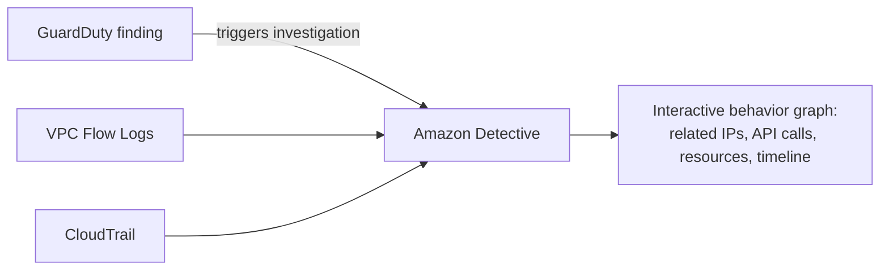
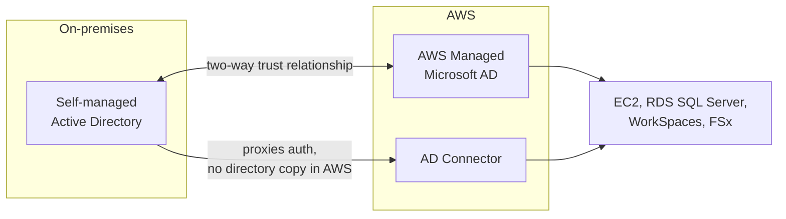
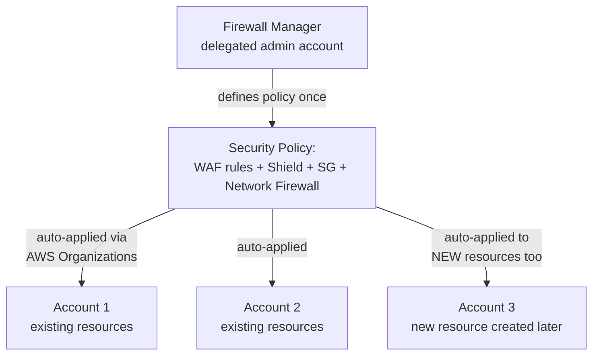

# Additional Security Services — CloudHSM, Detective, Directory Service, Firewall Manager, Network Firewall, RAM, Artifact, Audit Manager

> **Appears in:** [SAA-C03](../../certifications/saa-c03/README.md)

This doc consolidates eight lower-exam-weight security/identity/compliance services confirmed in
the SAA-C03 appendix with no existing standalone doc. Each section covers definition, purpose, a
concrete use case, and the exam-trigger phrasing to recognize — cross-linked to the fuller
existing docs on [GuardDuty](guardduty.md), [Security Hub](security-hub-and-inspector.md), and
[WAF](waf.md) where relevant.

## AWS CloudHSM

### Definition
AWS CloudHSM provides dedicated, single-tenant hardware security modules (HSMs) in the AWS cloud
— physical, FIPS 140-2 validated devices that generate and store cryptographic keys, where AWS
manages the hardware but has **no access to your keys** at all.

### Purpose
AWS Key Management Service (KMS) is multi-tenant and AWS-managed under the hood — sufficient for
the vast majority of encryption needs, but some regulatory regimes or extremely strict security
postures require keys to live in hardware *you alone* control, with no possibility of AWS
operators ever touching the key material, and specific certified hardware compliance (FIPS 140-2
Level 3). CloudHSM exists for that narrow but real requirement: dedicated, single-tenant hardware,
full customer control of the key lifecycle, at the cost of you taking on key management
responsibility KMS normally absorbs for you.

### Use Case
A financial institution's compliance mandate requires that cryptographic keys for its most
sensitive data never be accessible to any third party, including the cloud provider's own
operators, and must run on specific certified hardware — CloudHSM provides single-tenant hardware
meeting that exact requirement, where KMS's shared, AWS-managed model would not satisfy the
compliance mandate.

### Exam Tip
**"Dedicated hardware security module," "FIPS 140-2 Level 3," "AWS has no access to key material,"
"single-tenant HSM"** → CloudHSM. Contrast directly with **KMS**: KMS is simpler, cheaper, and
sufficient for nearly all use cases; CloudHSM is the answer specifically when a question demands
single-tenant hardware control that KMS's shared model can't provide. See [`kms.md`](kms.md) for
the full KMS comparison.

---

## Amazon Detective

### Definition
Amazon Detective automatically collects and correlates log data (VPC Flow Logs, CloudTrail,
GuardDuty findings) into a visual, graph-based model of your environment's behavior, so a security
analyst can investigate *why* a GuardDuty finding happened and trace its full blast radius, rather
than manually cross-referencing raw logs across services.

### Purpose
A GuardDuty finding ("this IP did something suspicious") tells you *that* something happened, but
answering *why*, *what else is connected to it*, and *how far it spread* traditionally means
manually pulling and cross-referencing CloudTrail, VPC Flow Logs, and GuardDuty data by hand — slow
and error-prone during an active incident. Detective exists to pre-build that correlated,
navigable picture continuously, so the investigation step itself is fast.

### Use Case
A security team receives a GuardDuty finding that an EC2 instance is communicating with a known
malicious IP. Instead of manually tracing CloudTrail and VPC Flow Logs by hand, they open that
finding directly in Detective, which has already correlated the related API calls, network
connections, and resource relationships into one navigable graph, letting them establish the full
scope of the incident in minutes rather than hours.

### Exam Tip
**"Investigate the root cause of a GuardDuty finding," "visualize relationships across resources/
API calls," "incident investigation" (after detection, not detection itself)** → Detective.
Detective doesn't *detect* threats itself — it's the investigation layer that sits downstream of
[GuardDuty](guardduty.md); a question describing finding generation points to GuardDuty, one
describing investigating/correlating an existing finding points to Detective.

---

## AWS Directory Service

### Definition
AWS Directory Service provides managed Microsoft Active Directory (or AD-compatible) directories
in AWS — either a full **AWS Managed Microsoft AD**, a lightweight **AD Connector** that proxies
authentication to your existing on-premises AD, or **Simple AD**, a basic standalone directory —
so AWS workloads can authenticate against AD without you running your own domain controllers.

### Purpose
Many enterprise workloads (Windows-based EC2 instances, RDS SQL Server with Windows
authentication, file shares, WorkSpaces) assume an Active Directory is present. Standing up and
patching your own domain controllers on EC2 is real operational overhead, and organizations that
already have an on-premises AD don't want a second, disconnected identity source in the cloud.
Directory Service exists to cover both needs: fully managed AD when you want AWS to run the
directory outright, or a bridge to your existing on-premises AD when you want one unified
identity source.

Walking the diagram: **AWS Managed Microsoft AD** is a real, independent AD directory running in
AWS that can establish a **two-way trust relationship** with an existing on-premises AD — users
and resources on either side can authenticate against the other once the trust is established
(the classic "merge two companies' AD forests" or "extend our existing AD into the cloud without
a single disconnected identity source" pattern). **AD Connector** takes the opposite approach: it
holds no directory data of its own at all — every authentication request is simply proxied through
to your existing on-premises AD, so there's exactly one source of truth and nothing to keep in
sync. **Simple AD** is a basic, standalone directory with no on-premises connection at all, for
workloads needing just a lightweight directory with no existing AD to integrate with.

### Use Case
A company has an established on-premises Active Directory and is migrating Windows workloads to
AWS, and wants users to keep authenticating with their existing corporate credentials without
maintaining two separate identity stores — AD Connector proxies authentication straight to the
existing on-premises AD, or, if deeper native AWS directory features are also needed, AWS Managed
Microsoft AD with a trust relationship achieves the same unified-identity outcome while also
running as a real, independent directory in AWS.

### Exam Tip
**"Active Directory," "Windows authentication," "domain controller without managing it yourself,"
"trust relationship with on-premises AD"** → Directory Service. Know the three flavors by name
and use case: **AWS Managed Microsoft AD** (full, independent, trust-capable AD in AWS), **AD
Connector** (proxy only, zero data stored in AWS, exactly one source of truth), **Simple AD**
(basic standalone directory, no on-premises tie). Distinguish from [IAM Identity Center](iam-identity-center-sso.md),
which is AWS's own SSO/permission layer, not an AD-compatible directory itself (though it can
federate against one).

---

## AWS Firewall Manager

### Definition
AWS Firewall Manager centrally configures and enforces security policies — WAF rules, Shield
Advanced protections, VPC security groups, Network Firewall policies, and Route 53 Resolver DNS
Firewall rules — across every account and resource in an AWS Organization from one place, and
automatically applies them to new accounts/resources as they're created.

### Purpose
In a multi-account organization, manually configuring WAF/security-group/Network Firewall rules
account-by-account doesn't scale and reliably drifts out of sync — one team forgets to apply the
baseline WAF rule set to a new account, creating an inconsistent, weaker security posture
somewhere in the org without anyone noticing until an incident. Firewall Manager exists to make
"every account gets this baseline protection, automatically, forever" a single policy definition
instead of an ongoing manual enforcement effort.

Walking the diagram: a security team defines a policy exactly once from the Firewall Manager
delegated administrator account. AWS Organizations propagates that policy's enforcement across
every member account in scope — critically, this isn't a one-time push: Firewall Manager keeps
watching and automatically applies the same policy to brand-new resources and even newly created
accounts, so there's no manual step anyone can forget for a resource that didn't exist yet when
the policy was written.

### Use Case
A security team wants every VPC across 50 AWS accounts in their Organization to have the same
baseline AWS WAF managed rule set attached to its Application Load Balancers, including any new
account or ALB created in the future with zero manual follow-up. Firewall Manager's policy
automatically applies to every in-scope account now and continuously enforces it on anything new.

### Exam Tip
**"Centrally manage/enforce across multiple accounts in an Organization," "apply automatically to
new accounts/resources," "consistent WAF/security group/Network Firewall policy org-wide"** →
Firewall Manager. It's a *policy distribution and enforcement* layer sitting above
[WAF](waf.md), Shield, security groups, and Network Firewall — it doesn't replace any of them, it
centrally enforces them. Requires AWS Organizations with Firewall Manager enabled via a delegated
administrator account.

---

## AWS Network Firewall

*Figure: AWS's own reference architecture for traffic inspection with AWS Network Firewall — both
inbound traffic to an Application Load Balancer and outbound traffic from instances through a NAT
gateway are transparently inspected. Source: AWS Reference Architecture Diagrams
(docs.aws.amazon.com/reference-architecture-diagrams).*

### Definition
AWS Network Firewall is a managed, stateful network firewall and intrusion detection/prevention
service for a VPC, providing fine-grained traffic filtering (down to domain names, IP ranges,
ports, and protocols, including deep packet inspection) at the network layer, deployed inline
with VPC traffic.

### Purpose
Security groups and NACLs handle basic allow/deny filtering but don't do deep packet inspection,
intrusion detection/prevention signatures, or domain-name-based filtering of outbound traffic.
Some workloads need that deeper inspection — blocking traffic to specific malicious domains
regardless of the destination IP, or detecting known attack signatures in packet payloads. Network
Firewall exists to provide that deeper, stateful inspection layer without standing up and managing
third-party firewall appliances yourself.

### Use Case
A company needs to block all outbound traffic from its VPC to a specific list of known-malicious
domains, and additionally wants intrusion detection on packet payloads crossing its VPC boundary —
Network Firewall's domain-list rules and Suricata-compatible IPS rule groups provide both,
deployed inline on the VPC's traffic path without a third-party firewall appliance.

### Exam Tip
**"Deep packet inspection," "intrusion detection/prevention (IDS/IPS) in a VPC," "domain-name-
based outbound filtering," "stateful firewall for a VPC"** → Network Firewall. Distinguish from
**security groups/NACLs** (stateless/basic IP-port filtering only, no deep inspection) and from
[WAF](waf.md) (application-layer/HTTP(S) filtering for web apps specifically, not general VPC
network traffic). Network Firewall is itself one of the policy types **Firewall Manager** can
centrally deploy across an Organization — the two services frequently appear together.

---

## AWS Resource Access Manager (RAM)

### Definition
AWS Resource Access Manager lets you securely share specific AWS resources you own (subnets,
Transit Gateways, License Manager configurations, Route 53 Resolver rules, and more) with other
AWS accounts or across your whole Organization, without duplicating the resource or granting full
account access.

### Purpose
Some resources are naturally meant to be shared across accounts rather than duplicated per
account — a central Transit Gateway that every account's VPC should attach to, or a shared VPC
subnet multiple teams' accounts should deploy into. Before RAM, achieving this meant either
duplicating infrastructure per account (wasteful, inconsistent) or granting broad cross-account
IAM access (overly permissive). RAM exists to share the *specific resource itself* cleanly, with
access scoped to just that resource.

### Use Case
A central networking team owns one Transit Gateway and wants every application team's AWS account
to attach their own VPCs to it, without giving those teams any broader access to the networking
account itself — RAM shares just that Transit Gateway resource with the other accounts, who can
then attach to it directly.

### Exam Tip
**"Share a resource (subnet, Transit Gateway, License configuration) across accounts/Organization
without duplicating it or granting full account access"** → RAM. Know it's resource-sharing, not
identity/permission management — IAM/Organizations SCPs still govern what each account can
actually *do* with the shared resource once access is granted.

---

## AWS Artifact

### Definition
AWS Artifact is a self-service portal for on-demand access to AWS's compliance reports and
agreements — SOC reports, PCI DSS attestations, ISO certifications, and AWS's own compliance
agreements — letting you download the documentation your own auditors or compliance team need
without contacting AWS support.

### Purpose
Under the AWS Shared Responsibility Model, AWS is responsible for security *of* the cloud and
regularly undergoes third-party audits proving it — but customers' own auditors/compliance teams
need to actually see that proof to satisfy their own regulatory requirements. Artifact exists to
make that proof self-service and always current, rather than a manual request-and-wait process
with AWS support every time an audit cycle comes around.

### Use Case
A company undergoing its annual SOC 2 audit needs to provide its auditor with AWS's own SOC 2
report as evidence of the cloud infrastructure layer's compliance — the compliance team downloads
the current report directly from AWS Artifact instead of filing a support request and waiting.

### Exam Tip
**"Download AWS compliance reports," "SOC/PCI/ISO documentation," "evidence for our own audit
about AWS's compliance"** → AWS Artifact. It's a *documentation portal*, not an auditing or
monitoring tool itself — don't confuse with Audit Manager (which helps build evidence about *your
own* workload's compliance, not AWS's).

---

## AWS Audit Manager

### Definition
AWS Audit Manager continuously and automatically collects evidence (configuration snapshots, API
call logs, resource states) mapped against a chosen compliance framework (PCI DSS, HIPAA,
GDPR-aligned controls, or a custom framework), building an audit-ready evidence folder
continuously instead of a stressful manual scramble right before an audit.

### Purpose
Preparing for a compliance audit traditionally means manually gathering evidence just before the
audit window — screenshots, config exports, log excerpts — a time-consuming, error-prone, and
stressful last-minute effort. Audit Manager exists to automate that evidence collection
continuously throughout the year, mapped directly to the specific controls a chosen framework
requires, so audit prep becomes "review what's already been collected" instead of "start
gathering everything from scratch."

### Use Case
A healthcare company must continuously demonstrate HIPAA-aligned controls across its AWS
environment and dreads the yearly scramble to assemble evidence manually — Audit Manager
continuously collects the relevant configuration and log evidence against a HIPAA-aligned
framework throughout the year, so the audit team has an organized, current evidence folder ready
whenever the actual audit happens.

### Exam Tip
**"Continuously collect evidence for compliance audits," "map AWS resource configuration/logs to
a compliance framework (PCI/HIPAA/GDPR)," "audit-ready reports"** → Audit Manager. Distinguish
from **AWS Artifact** (downloads AWS's *own* third-party audit reports about AWS itself, not
evidence about *your* workload) and from [AWS Config](../management-governance/aws-config.md)
(tracks resource configuration/compliance rules generally; Audit Manager is framework-and-audit-
specific, often consuming Config's data as one evidence source among several).

## Related Terms

- [`guardduty.md`](guardduty.md) — the threat-detection service Detective investigates findings from.
- [`security-hub-and-inspector.md`](security-hub-and-inspector.md) — the aggregated findings
  dashboard these services' output often also feeds into.
- [`waf.md`](waf.md) — the application-layer firewall Firewall Manager can centrally deploy and
  Network Firewall complements at the network layer.
- [`kms.md`](kms.md) — the managed-key service CloudHSM is the dedicated-hardware alternative to.
- [`iam-identity-center-sso.md`](iam-identity-center-sso.md) — AWS's own SSO layer, distinct from
  Directory Service's AD-compatible directories.
- [`../management-governance/aws-config.md`](../management-governance/aws-config.md) — resource
  configuration tracking that Audit Manager often draws evidence from.
- Glossary: HSM, FIPS 140-2, IDS/IPS, Shared Responsibility Model, Trust relationship.
