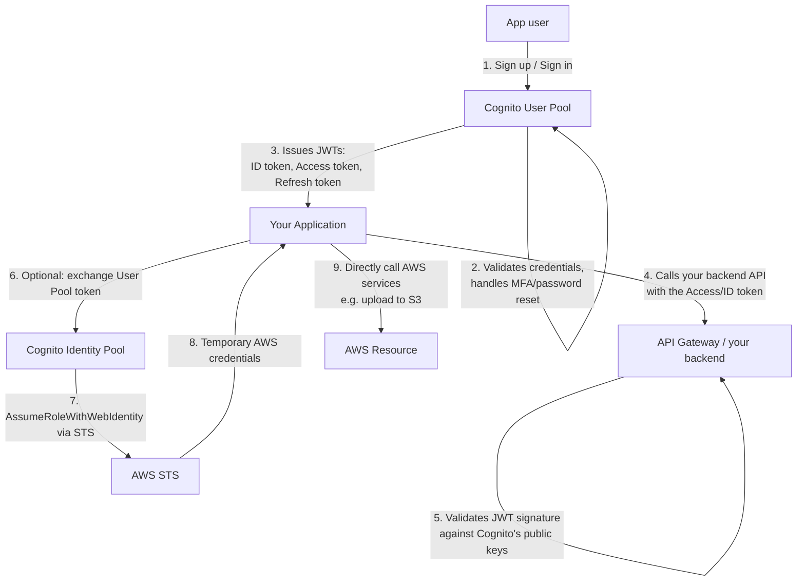

# Amazon Cognito


## Definition

Cognito is AWS's managed service for handling **your application's end-user identity** — sign-
up, sign-in, password resets, social/enterprise login, and issuing the tokens your app uses to
decide what a logged-in user can access — so you don't have to build and secure a user-
authentication system from scratch.

## Purpose

Every consumer-facing app needs user accounts, and building authentication correctly (password
hashing, MFA, account recovery, social login, token issuance/refresh, protecting against
credential stuffing and brute force) is genuinely hard to get right and is a terrible place to
have a bug — authentication bugs are directly exploitable. Cognito exists so application teams
can plug in a battle-tested, scalable identity system (built to handle millions of users) and
spend their engineering time on the actual product instead of reinventing login.

## How It Works

Cognito has **two distinct building blocks** that are frequently confused on the exam: User
Pools (who the user is) and Identity Pools (what AWS resources that user can touch).



Step by step:

1. A user signs up or signs in through a **User Pool** — Cognito's actual user directory. It
   stores user attributes (email, phone, custom attributes), handles password policies, MFA
   (SMS or TOTP authenticator app), account verification, and forgotten-password flows.
2. Sign-in can be done directly against the User Pool's own credentials, or federated through
   **social identity providers** (Google, Facebook, Apple, Amazon) or an **enterprise IdP**
   (SAML or OIDC — Okta, Azure AD) — the User Pool normalizes all of these into the same token
   format regardless of how the user actually authenticated.
3. On successful login, the User Pool issues three **JSON Web Tokens (JWTs)**: an **ID token**
   (claims about who the user is — name, email, etc.), an **access token** (scopes/permissions
   for calling your own backend APIs), and a **refresh token** (used to get new ID/access
   tokens without the user logging in again, valid much longer).
4. Your application presents the ID/access token to your backend (commonly via API Gateway's
   built-in Cognito authorizer), which validates the JWT's signature against Cognito's public
   signing keys — no network round-trip to Cognito required for basic validation, which keeps
   this fast.
5. **If the app also needs its users to directly access AWS resources** (e.g., a user uploading
   a photo straight to their own folder in S3 from a mobile app, bypassing your backend
   entirely), the app exchanges its User Pool token with an **Identity Pool**, which calls
   `sts:AssumeRoleWithWebIdentity` behind the scenes and returns temporary AWS credentials
   scoped to an IAM role — often with fine-grained, per-user restrictions via policy variables
   like `${cognito-identity.amazonaws.com:sub}` mapping to a user's own S3 prefix.

## Key Features / Components

- **User Pools** — the identity directory: sign-up/sign-in, MFA, password policies, email/phone
  verification, Lambda triggers (custom logic at pre-sign-up, post-confirmation, pre-token-
  generation, etc. — e.g., blocking disposable email domains, syncing a new user into another
  system).
- **Identity Pools (Federated Identities)** — the AWS-access bridge: exchanges any trusted
  identity (a User Pool token, or even an unauthenticated "guest" identity) for temporary AWS
  credentials scoped by IAM role, enabling direct, least-privilege AWS resource access from a
  client app.
- **Hosted UI** — a Cognito-provided, customizable login page (OAuth 2.0 / OIDC compliant) so
  you don't have to build your own sign-in screen, supporting the standard Authorization Code
  grant flow.
- **Social and SAML/OIDC federation** — sign in with Google/Facebook/Apple/Amazon, or federate
  an enterprise SAML/OIDC IdP, all normalized to the same User Pool token.
- **Advanced security features** — compromised-credential detection (checks against known
  leaked-password databases), adaptive/risk-based authentication (extra verification on
  suspicious sign-in attempts), and detailed sign-in activity logging.
- **Unauthenticated (guest) identities** — Identity Pools can grant limited, scoped AWS access
  to users who haven't logged in at all, useful for letting an app read public content before
  requiring sign-in.
- **Lambda triggers** — the extensibility point for custom business logic injected at specific
  points in the auth flow without forking Cognito's behavior.

## Use Cases — When to Use It

- A mobile or web app needs user sign-up/login with email/password plus "Sign in with Google."
- An app needs users to upload files directly to their own S3 prefix from a mobile client,
  without routing every upload through a backend server (Identity Pool + scoped IAM role).
- An API Gateway-fronted API needs to authenticate end users and authorize per-scope access
  without building a custom JWT issuer.
- Enterprise customers of your SaaS product want to log in with their own company's SSO
  (SAML/OIDC) instead of creating yet another password.

## When NOT to Use It / Alternatives

- **Your own employees/workforce needing access to AWS accounts and internal tools** — that's
  **IAM Identity Center**, not Cognito; Cognito is for your product's external customers, not
  your staff. See [`iam-identity-center-sso.md`](iam-identity-center-sso.md).
- **Fine-grained, app-specific authorization logic beyond "is this user logged in and what
  scope do they have"** (e.g., complex document-sharing permission graphs) — Cognito handles
  authentication and coarse authorization; for rich, policy-based authorization logic consider
  **Amazon Verified Permissions** alongside Cognito, not instead of it.
- **You already have a mature, in-house or third-party identity provider (Auth0, Firebase
  Auth) that the product is built around** — migrating purely to adopt Cognito isn't worth it
  unless there's a specific AWS-integration reason (e.g., wanting native Identity Pool access
  to AWS resources); Cognito can still federate with that existing IdP via SAML/OIDC instead of
  replacing it outright.

## Why It's Important

**Real-world weight:** Authentication is one of the few parts of an app where a subtle bug
becomes a direct account-takeover vulnerability, not just a feature defect — using a managed,
widely-audited identity service instead of hand-rolled auth meaningfully reduces that risk
surface. Cognito's scale (built to support millions of users) also removes a whole category of
"our login system fell over under load" incidents.

**Exam weight:**
- **SAA-C03 — Domain 1, Task 1.2 "Design secure workloads and applications"** lists Cognito
  explicitly alongside GuardDuty/Macie/Secrets Manager as an application-security control.
- **DVA-C03 — Domain 2, Task 2.1 "Implement authentication/authorization for apps and AWS
  services"** lists Cognito directly next to IAM and STS — developers are tested on wiring
  Cognito into API Gateway authorizers and on the User Pool vs. Identity Pool distinction in
  code-level scenarios.
- **MLA-C02** touches Cognito more lightly, mainly where a GenAI application (e.g., a Bedrock-
  backed chat app) needs end-user authentication in front of an inference endpoint.

## Pricing Model

- **User Pools**: free tier covers a generous number of Monthly Active Users (MAUs); beyond
  that, billed per MAU, with different (lower) rates for SAML/OIDC federated users that scale
  down further at volume.
- **Identity Pools**: free — no additional charge for issuing temporary AWS credentials via
  Identity Pools themselves (you pay only for the IAM-permitted AWS resources actually used).
- **Advanced security features** (compromised credential checks, adaptive auth) are a separate,
  additional per-MAU charge on top of the base User Pool pricing.
- See: https://aws.amazon.com/cognito/pricing/ for current numbers.

## Hands-on Lab (Floci)

```bash
# Create a User Pool
awslocal cognito-idp create-user-pool --pool-name StudyUserPool \
  --auto-verified-attributes email

# Create an app client for that pool (what your app uses to call Cognito)
awslocal cognito-idp create-user-pool-client --user-pool-id <pool-id> \
  --client-name study-app-client --no-generate-secret \
  --explicit-auth-flows ALLOW_USER_PASSWORD_AUTH ALLOW_REFRESH_TOKEN_AUTH

# Sign a user up and confirm them (bypassing email verification for the lab)
awslocal cognito-idp sign-up --client-id <client-id> \
  --username alice@example.com --password "StudyPass123!"
awslocal cognito-idp admin-confirm-sign-up --user-pool-id <pool-id> --username alice@example.com

# Authenticate and get back ID/Access/Refresh tokens
awslocal cognito-idp initiate-auth --client-id <client-id> \
  --auth-flow USER_PASSWORD_AUTH \
  --auth-parameters USERNAME=alice@example.com,PASSWORD=StudyPass123!

# Create an Identity Pool that trusts the User Pool, bridging to AWS credentials
awslocal cognito-identity create-identity-pool \
  --identity-pool-name StudyIdentityPool --no-allow-unauthenticated-identities \
  --cognito-identity-providers ProviderName=cognito-idp.us-east-1.amazonaws.com/<pool-id>,ClientId=<client-id>
```

## Exam Tips

- **User Pool vs. Identity Pool — the #1 trap.** User Pool = "who is this user" (authentication,
  returns JWTs). Identity Pool = "what AWS resources can this user touch" (authorization bridge
  to IAM via STS, returns temporary AWS credentials). A scenario needing "users log in" wants a
  User Pool; a scenario needing "logged-in users upload directly to their own S3 folder" needs
  an Identity Pool layered on top.
- **Cognito vs. IAM Identity Center** — Cognito = your product's external customers;
  Identity Center = your own employees/workforce accessing AWS accounts. If the question says
  "customers of our application," it's Cognito; if it says "our engineers/employees," it's
  Identity Center.
- **Cognito vs. IAM users** — never model app end users as IAM users; that doesn't scale and
  isn't what IAM users are for. Any "millions of app users" scenario rules out IAM entirely.
- **JWT validation doesn't require a live call to Cognito** — tokens are validated locally
  against Cognito's public keys (standard JWT/JWKS pattern); know this is why it's fast enough
  for high-traffic APIs.
- **Advanced security features cost extra** — don't assume compromised-credential detection and
  adaptive authentication are included free with every User Pool.
- Tested in **SAA-C03 Domain 1 (30%)** and **DVA-C03 Domain 2 (26%)**, usually paired against
  IAM Identity Center and STS in the same question set to test the "which identity service for
  which audience" distinction.

## Related Terms

- [`iam-identity-center-sso.md`](iam-identity-center-sso.md) — the equivalent concept for workforce/employee access, not customers
- [`sts-and-role-switching.md`](sts-and-role-switching.md) — `AssumeRoleWithWebIdentity` is what Identity Pools call under the hood
- [`iam.md`](iam.md) — the IAM roles Identity Pools hand out credentials for
- `glossary/` — JWT, OIDC, SAML, MAU (Monthly Active User)
