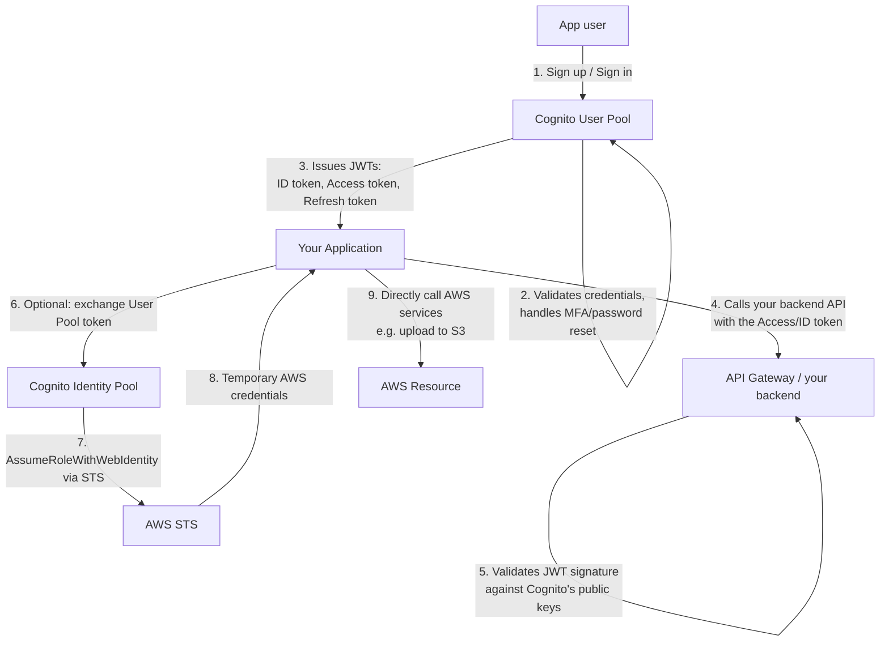
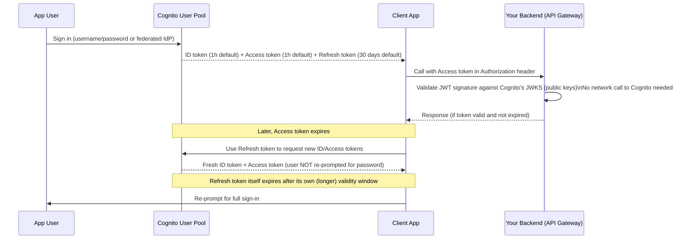
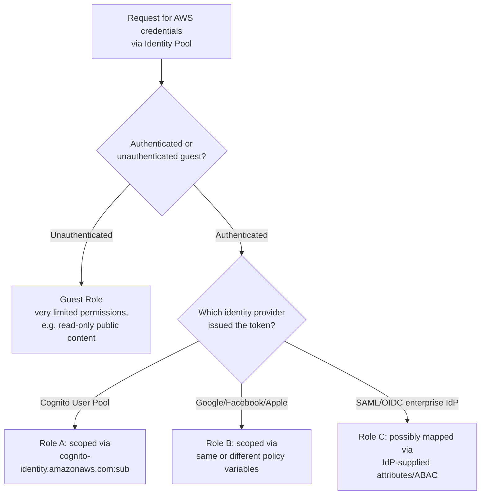
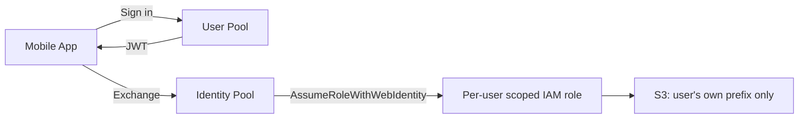
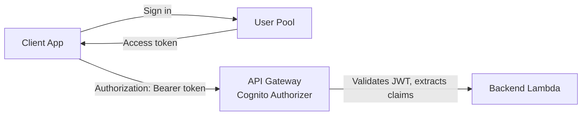
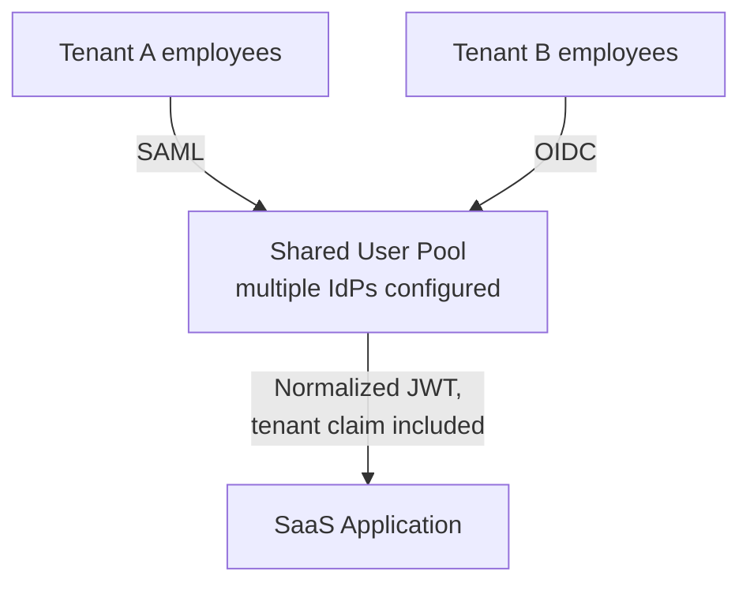
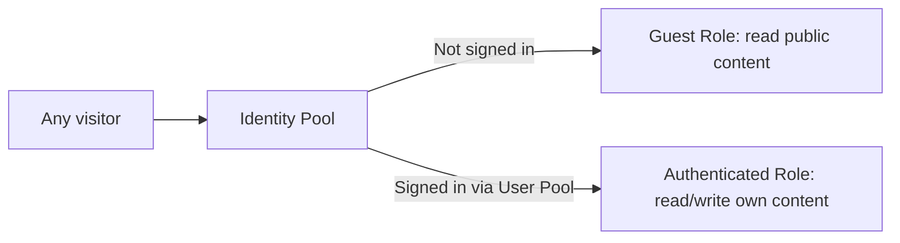
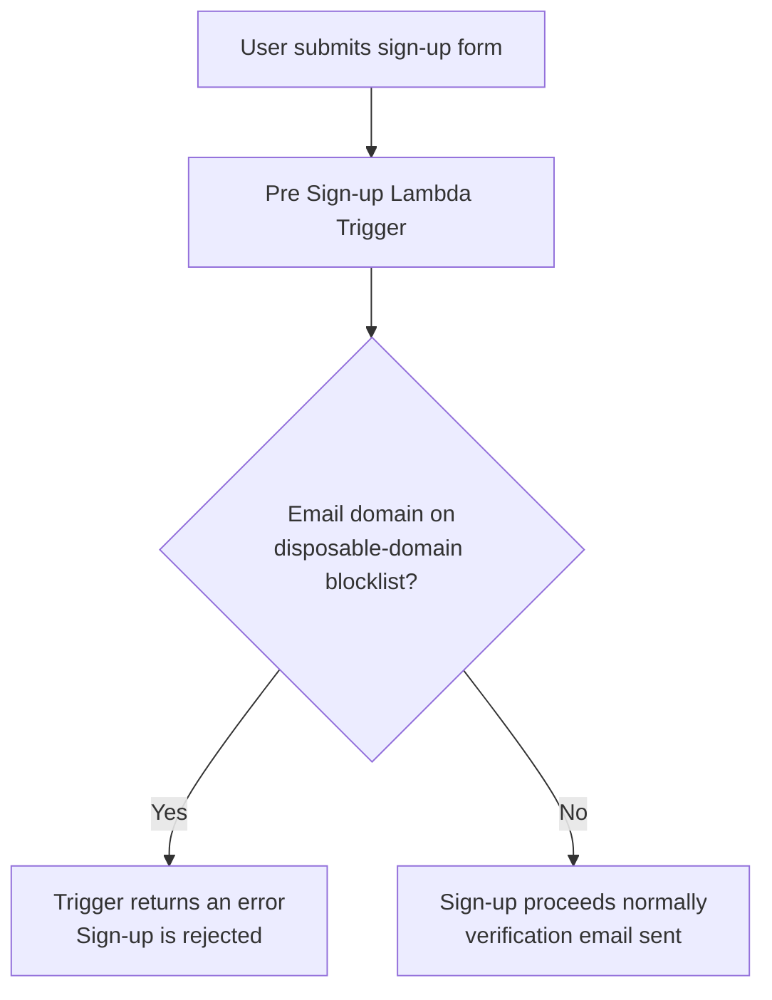

# Amazon Cognito


## Definition

Cognito is AWS's managed service for handling **your application's end-user identity** — sign-
up, sign-in, password resets, social/enterprise login, and issuing the tokens your app uses to
decide what a logged-in user can access — so you don't have to build and secure a user-
authentication system from scratch.

## Purpose

Every consumer-facing app needs user accounts, and building authentication correctly (password
hashing, MFA, account recovery, social login, token issuance/refresh, protecting against
credential stuffing and brute force) is genuinely hard to get right and is a terrible place to
have a bug — authentication bugs are directly exploitable. Cognito exists so application teams
can plug in a battle-tested, scalable identity system (built to handle millions of users) and
spend their engineering time on the actual product instead of reinventing login.

## How It Works

Cognito has **two distinct building blocks** that are frequently confused on the exam: User
Pools (who the user is) and Identity Pools (what AWS resources that user can touch).



Step by step:

1. A user signs up or signs in through a **User Pool** — Cognito's actual user directory. It
   stores user attributes (email, phone, custom attributes), handles password policies, MFA
   (SMS or TOTP authenticator app), account verification, and forgotten-password flows.
2. Sign-in can be done directly against the User Pool's own credentials, or federated through
   **social identity providers** (Google, Facebook, Apple, Amazon) or an **enterprise IdP**
   (SAML or OIDC — Okta, Azure AD) — the User Pool normalizes all of these into the same token
   format regardless of how the user actually authenticated.
3. On successful login, the User Pool issues three **JSON Web Tokens (JWTs)**: an **ID token**
   (claims about who the user is — name, email, etc.), an **access token** (scopes/permissions
   for calling your own backend APIs), and a **refresh token** (used to get new ID/access
   tokens without the user logging in again, valid much longer).
4. Your application presents the ID/access token to your backend (commonly via API Gateway's
   built-in Cognito authorizer), which validates the JWT's signature against Cognito's public
   signing keys — no network round-trip to Cognito required for basic validation, which keeps
   this fast.
5. **If the app also needs its users to directly access AWS resources** (e.g., a user uploading
   a photo straight to their own folder in S3 from a mobile app, bypassing your backend
   entirely), the app exchanges its User Pool token with an **Identity Pool**, which calls
   `sts:AssumeRoleWithWebIdentity` behind the scenes and returns temporary AWS credentials
   scoped to an IAM role — often with fine-grained, per-user restrictions via policy variables
   like `${cognito-identity.amazonaws.com:sub}` mapping to a user's own S3 prefix.

### Official AWS diagram: identity pool sequence (app, identity pool, user pool, STS)


*Source: AWS Cognito Developer Guide, "What is Amazon Cognito?"
(docs.aws.amazon.com/cognito/latest/developerguide/what-is-amazon-cognito.html)*

### Official AWS diagram: accessing AWS services after User Pool sign-in


*Source: AWS Cognito Developer Guide, "Accessing AWS services using an identity pool after
sign-in" (docs.aws.amazon.com/cognito/latest/developerguide/amazon-cognito-integrating-user-pools-with-identity-pools.html)*

### Full token lifecycle — issuance, validation, and refresh



### Identity Pool role-mapping decision flow — authenticated vs. unauthenticated vs. multiple IdPs



## Key Features / Components

- **User Pools** — the identity directory: sign-up/sign-in, MFA, password policies, email/phone
  verification, Lambda triggers (custom logic at pre-sign-up, post-confirmation, pre-token-
  generation, etc. — e.g., blocking disposable email domains, syncing a new user into another
  system).
- **Identity Pools (Federated Identities)** — the AWS-access bridge: exchanges any trusted
  identity (a User Pool token, or even an unauthenticated "guest" identity) for temporary AWS
  credentials scoped by IAM role, enabling direct, least-privilege AWS resource access from a
  client app.
- **Hosted UI / Managed login** — a Cognito-provided, customizable login page (OAuth 2.0 / OIDC
  compliant) so you don't have to build your own sign-in screen, supporting the standard
  Authorization Code grant flow; "Managed login" is the newer, more visually customizable
  evolution of the original "classic hosted UI."
- **Social and SAML/OIDC federation** — sign in with Google/Facebook/Apple/Amazon, or federate
  an enterprise SAML/OIDC IdP, all normalized to the same User Pool token.
- **Advanced security features** — compromised-credential detection (checks against known
  leaked-password databases), adaptive/risk-based authentication (extra verification on
  suspicious sign-in attempts), and detailed sign-in activity logging.
- **Unauthenticated (guest) identities** — Identity Pools can grant limited, scoped AWS access
  to users who haven't logged in at all, useful for letting an app read public content before
  requiring sign-in.
- **Lambda triggers** — the extensibility point for custom business logic injected at specific
  points in the auth flow without forking Cognito's behavior.
- **Role-based and attribute-based access control in Identity Pools** — Identity Pools can map
  different roles to different identity providers, or use ABAC-style attribute matching for
  finer per-user scoping within a single shared role.

## Use Cases — When to Use It

- A mobile or web app needs user sign-up/login with email/password plus "Sign in with Google."
- An app needs users to upload files directly to their own S3 prefix from a mobile client,
  without routing every upload through a backend server (Identity Pool + scoped IAM role).
- An API Gateway-fronted API needs to authenticate end users and authorize per-scope access
  without building a custom JWT issuer.
- Enterprise customers of your SaaS product want to log in with their own company's SSO
  (SAML/OIDC) instead of creating yet another password.

## When NOT to Use It / Alternatives

- **Your own employees/workforce needing access to AWS accounts and internal tools** — that's
  **IAM Identity Center**, not Cognito; Cognito is for your product's external customers, not
  your staff. See [`iam-identity-center-sso.md`](iam-identity-center-sso.md).
- **Fine-grained, app-specific authorization logic beyond "is this user logged in and what
  scope do they have"** (e.g., complex document-sharing permission graphs) — Cognito handles
  authentication and coarse authorization; for rich, policy-based authorization logic consider
  **Amazon Verified Permissions** alongside Cognito, not instead of it.
- **You already have a mature, in-house or third-party identity provider (Auth0, Firebase
  Auth) that the product is built around** — migrating purely to adopt Cognito isn't worth it
  unless there's a specific AWS-integration reason (e.g., wanting native Identity Pool access
  to AWS resources); Cognito can still federate with that existing IdP via SAML/OIDC instead of
  replacing it outright.

## Common Architectures

### 1. Serverless mobile app with direct, scoped S3 access



### 2. API Gateway + Cognito authorizer, no Identity Pool needed


This pattern needs no Identity Pool at all — the backend never hands out AWS credentials to
the client; it only verifies "is this a valid, non-expired token for a real user," then
executes backend business logic under its own execution role.

### 3. B2B SaaS with enterprise SSO federation per tenant



### 4. Guest + authenticated mixed-access content app



## Why It's Important

**Real-world weight:** Authentication is one of the few parts of an app where a subtle bug
becomes a direct account-takeover vulnerability, not just a feature defect — using a managed,
widely-audited identity service instead of hand-rolled auth meaningfully reduces that risk
surface. Cognito's scale (built to support millions of users) also removes a whole category of
"our login system fell over under load" incidents.

**Exam weight:**
- **SAA-C03 — Domain 1, Task 1.2 "Design secure workloads and applications"** lists Cognito
  explicitly alongside GuardDuty/Macie/Secrets Manager as an application-security control.
- **DVA-C03 — Domain 2, Task 2.1 "Implement authentication/authorization for apps and AWS
  services"** lists Cognito directly next to IAM and STS — developers are tested on wiring
  Cognito into API Gateway authorizers and on the User Pool vs. Identity Pool distinction in
  code-level scenarios.
- **MLA-C02** touches Cognito more lightly, mainly where a GenAI application (e.g., a Bedrock-
  backed chat app) needs end-user authentication in front of an inference endpoint.

## Limits & Quotas

| Resource | Default quota | Notes |
|---|---|---|
| User Pools per account per Region | 1,000 (soft) | Rarely binding — most apps need just one or a handful |
| App clients per User Pool | 1,000 (soft) | One per distinct client application/platform is typical |
| Custom attributes per User Pool | 50 | Defined at pool creation; some attribute settings are immutable afterward |
| ID/Access token default validity | 1 hour | Configurable per app client, generally shorter is safer |
| Refresh token default validity | 30 days | Configurable up to 10 years (!) — a real, testable security tradeoff knob |
| Identity Pools per account per Region | 1 soft default, request increase as needed | Most apps need only one |
| Lambda trigger execution time | Standard Lambda timeout limits apply | A slow pre-token-generation trigger can measurably slow every login |

A **10-year maximum refresh token validity** is a specific, testable number — exam questions
about balancing user convenience ("don't make users log in constantly") against security
("don't let a stolen refresh token work forever") point directly at tuning this setting down,
not treating the long default/maximum as automatically safe.

## Pricing Model

- **User Pools**: free tier covers a generous number of Monthly Active Users (MAUs); beyond
  that, billed per MAU, with different (lower) rates for SAML/OIDC federated users that scale
  down further at volume.
- **Identity Pools**: free — no additional charge for issuing temporary AWS credentials via
  Identity Pools themselves (you pay only for the IAM-permitted AWS resources actually used).
- **Advanced security features** (compromised credential checks, adaptive auth) are a separate,
  additional per-MAU charge on top of the base User Pool pricing.
- See: https://aws.amazon.com/cognito/pricing/ for current numbers.

## Hands-on Lab (Floci)

```bash
# Create a User Pool
awslocal cognito-idp create-user-pool --pool-name StudyUserPool \
  --auto-verified-attributes email

# Create an app client for that pool (what your app uses to call Cognito)
awslocal cognito-idp create-user-pool-client --user-pool-id <pool-id> \
  --client-name study-app-client --no-generate-secret \
  --explicit-auth-flows ALLOW_USER_PASSWORD_AUTH ALLOW_REFRESH_TOKEN_AUTH

# Sign a user up and confirm them (bypassing email verification for the lab)
awslocal cognito-idp sign-up --client-id <client-id> \
  --username alice@example.com --password «redacted-secret»
awslocal cognito-idp admin-confirm-sign-up --user-pool-id <pool-id> --username alice@example.com

# Authenticate and get back ID/Access/Refresh tokens
awslocal cognito-idp initiate-auth --client-id <client-id> \
  --auth-flow USER_PASSWORD_AUTH \
  --auth-parameters USERNAME=alice@example.com,PASSWORD=StudyPass123!

# Create an Identity Pool that trusts the User Pool, bridging to AWS credentials
awslocal cognito-identity create-identity-pool \
  --identity-pool-name StudyIdentityPool --no-allow-unauthenticated-identities \
  --cognito-identity-providers ProviderName=cognito-idp.us-east-1.amazonaws.com/<pool-id>,ClientId=<client-id>
```

### Extended lab: per-user scoped S3 role using a policy variable

```bash
# Role trust policy allowing the Identity Pool to hand out this role via AssumeRoleWithWebIdentity
cat > idp-trust.json << 'EOF'
{
  "Version": "2012-10-17",
  "Statement": [
    {
      "Effect": "Allow",
      "Principal": {"Federated": "cognito-identity.amazonaws.com"},
      "Action": "sts:AssumeRoleWithWebIdentity",
      "Condition": {
        "StringEquals": {"cognito-identity.amazonaws.com:aud": "<identity-pool-id>"},
        "ForAnyValue:StringLike": {"cognito-identity.amazonaws.com:amr": "authenticated"}
      }
    }
  ]
}
EOF
awslocal iam create-role --role-name CognitoAuthenticatedRole --assume-role-policy-document file://idp-trust.json

# Per-user S3 scoping via the policy variable every authenticated identity carries
cat > per-user-s3.json << 'EOF'
{
  "Version": "2012-10-17",
  "Statement": [
    {
      "Effect": "Allow",
      "Action": ["s3:GetObject", "s3:PutObject"],
      "Resource": "arn:aws:s3:::user-uploads-bucket/${cognito-identity.amazonaws.com:sub}/*"
    }
  ]
}
EOF
awslocal iam put-role-policy --role-name CognitoAuthenticatedRole \
  --policy-name PerUserS3Access --policy-document file://per-user-s3.json
```

## Troubleshooting / Common Issues

**"User is authenticated but API Gateway rejects every request with 401":**
1. Confirm the API Gateway authorizer is actually configured to validate against the correct
   User Pool/app client — a mismatched pool ID or client ID silently rejects otherwise-valid
   tokens.
2. Check token expiry — the default 1-hour access token lifetime is a common cause of
   "it worked a few minutes ago" symptoms during testing/debugging sessions that run long.
3. Confirm the client is sending the **access token**, not the **ID token**, to API Gateway's
   authorizer (or vice versa, depending on configuration) — these serve different purposes and
   mixing them up is a frequent integration mistake.

**"Identity Pool returns credentials but S3 upload fails with AccessDenied":**
1. Check the IAM role's trust policy `Condition` block — a missing or mismatched
   `cognito-identity.amazonaws.com:aud` (audience, i.e., which Identity Pool) is a common
   silent-trust-policy failure.
2. Check the permissions policy's resource ARN pattern against the actual policy variable —
   `${cognito-identity.amazonaws.com:sub}` resolves to the Identity Pool's own unique identity
   ID, which is **not** the same string as the User Pool's username/sub claim; conflating the
   two is a frequent source of "the policy looks right but still denies."

**"Offboarded/deleted user's refresh token still seems to work":** refresh tokens remain valid
for their configured lifetime regardless of account state changes unless you explicitly revoke
them (`AdminUserGlobalSignOut` or `RevokeToken`) — deleting or disabling a user does not
retroactively invalidate tokens already issued; this is a specific, testable gap between
"account disabled" and "sessions terminated."

## Exam Tips

- **User Pool vs. Identity Pool — the #1 trap.** User Pool = "who is this user" (authentication,
  returns JWTs). Identity Pool = "what AWS resources can this user touch" (authorization bridge
  to IAM via STS, returns temporary AWS credentials). A scenario needing "users log in" wants a
  User Pool; a scenario needing "logged-in users upload directly to their own S3 folder" needs
  an Identity Pool layered on top.
- **Cognito vs. IAM Identity Center** — Cognito = your product's external customers;
  Identity Center = your own employees/workforce accessing AWS accounts. If the question says
  "customers of our application," it's Cognito; if it says "our engineers/employees," it's
  Identity Center.
- **Cognito vs. IAM users** — never model app end users as IAM users; that doesn't scale and
  isn't what IAM users are for. Any "millions of app users" scenario rules out IAM entirely.
- **JWT validation doesn't require a live call to Cognito** — tokens are validated locally
  against Cognito's public keys (standard JWT/JWKS pattern); know this is why it's fast enough
  for high-traffic APIs.
- **Refresh token lifetime is configurable up to 10 years** — a question balancing "minimize
  how often users must log back in" against "limit the blast radius of a stolen refresh token"
  is testing whether you'd tune this value down, not leave the long default/maximum in place.
- **Revoking a token requires an explicit action** — `AdminUserGlobalSignOut`/`RevokeToken`, not
  simply disabling or deleting the user account, which doesn't retroactively kill already-issued
  tokens.
- **Advanced security features cost extra** — don't assume compromised-credential detection and
  adaptive authentication are included free with every User Pool.
- **Policy variable disambiguation** — `${cognito-identity.amazonaws.com:sub}` (Identity Pool's
  unique identity ID) is distinct from a User Pool's own `sub` claim inside its JWT; a question
  mixing these up in a per-user S3 scoping scenario is testing exactly this nuance.
- Tested in **SAA-C03 Domain 1 (30%)** and **DVA-C03 Domain 2 (26%)**, usually paired against
  IAM Identity Center and STS in the same question set to test the "which identity service for
  which audience" distinction.

## Worked example: a complete multi-IdP User Pool configuration (JSON-style reference)

```json
{
  "UserPoolName": "ProductionCustomerPool",
  "Policies": {
    "PasswordPolicy": {
      "MinimumLength": 12,
      "RequireUppercase": true,
      "RequireLowercase": true,
      "RequireNumbers": true,
      "RequireSymbols": true,
      "TemporaryPasswordValidityDays": 3
    }
  },
  "MfaConfiguration": "OPTIONAL",
  "AutoVerifiedAttributes": ["email"],
  "AccountRecoverySetting": {
    "RecoveryMechanisms": [{ "Priority": 1, "Name": "verified_email" }]
  },
  "UserPoolAddOns": { "AdvancedSecurityMode": "ENFORCED" }
}
```

`MfaConfiguration: OPTIONAL` (rather than `OFF` or `ON`) is itself a frequently tested
configuration choice — it lets individual users opt into MFA without forcing it account-wide,
a middle ground many consumer apps choose over an all-or-nothing MFA posture.
`AdvancedSecurityMode: ENFORCED` is what actually turns on compromised-credential detection and
adaptive authentication — a question describing "we configured MFA but still see credential-
stuffing attempts succeeding" is pointing at this setting being left at its default `AUDIT` (log
only) or `OFF` rather than `ENFORCED`.

## Worked example: Lambda trigger blocking a disposable email domain at sign-up



This is the standard pattern for injecting business-specific validation into Cognito's flow
without forking or replacing the service: the Lambda trigger fires synchronously as part of the
`SignUp` API call, and any error it returns aborts the operation before a user record is ever
created — a cheap, maintainable way to add rules Cognito doesn't support natively (disposable-
email blocking, custom username formats, cross-referencing an internal allowlist of approved
corporate domains for a B2B app).

## Cognito Pricing Worked Example — MAU Cost Estimation

A consumer app has 50,000 monthly active users, of which 10,000 authenticate via a SAML
enterprise IdP (B2B tier) and 40,000 via standard email/password or social login. Rough
reasoning: the free tier typically covers a meaningful baseline MAU count before any charge
applies at all; beyond that, standard MAUs are billed at one rate while SAML/OIDC federated
MAUs are billed at a *different*, typically lower per-MAU rate — reflecting that enterprise
federation customers are usually fewer in number but higher-value, and AWS prices accordingly.
The exam-relevant takeaway isn't the exact dollar figure (check current pricing for that) but
recognizing that **federated and standard MAUs are priced on separate schedules**, so a
cost-estimation question mixing both user types needs two separate calculations, not one
blended rate.

## Advanced Security Features Cost/Benefit Table

| Feature | What it adds | Cost impact |
|---|---|---|
| Compromised credential detection | Blocks sign-in attempts using known-leaked password databases | Additional per-MAU charge |
| Adaptive authentication | Risk-scores each sign-in attempt, can require extra verification | Additional per-MAU charge |
| Detailed sign-in activity logging | Deeper audit trail for security investigations | Additional per-MAU charge |

All three ship under the single `AdvancedSecurityMode` toggle — a question asking "which
specific features turning on Advanced Security Mode actually enables" is testing recognition of
this bundled set, not a single standalone capability.

## Further Reading

- AWS Cognito Developer Guide — What is Amazon Cognito?:
  https://docs.aws.amazon.com/cognito/latest/developerguide/what-is-amazon-cognito.html
- AWS Cognito Developer Guide — Authenticating users with Amazon Cognito user pools:
  https://docs.aws.amazon.com/cognito/latest/developerguide/cognito-user-pools.html
- AWS Cognito Developer Guide — Accessing AWS services using an identity pool after sign-in:
  https://docs.aws.amazon.com/cognito/latest/developerguide/amazon-cognito-integrating-user-pools-with-identity-pools.html
- AWS Cognito Developer Guide — How authentication works with Amazon Cognito:
  https://docs.aws.amazon.com/cognito/latest/developerguide/cognito-how-to-authenticate.html
- AWS Cognito pricing: https://aws.amazon.com/cognito/pricing/

## Related Terms

- [`iam-identity-center-sso.md`](iam-identity-center-sso.md) — the equivalent concept for workforce/employee access, not customers
- [`sts-and-role-switching.md`](sts-and-role-switching.md) — `AssumeRoleWithWebIdentity` is what Identity Pools call under the hood
- [`iam.md`](iam.md) — the IAM roles Identity Pools hand out credentials for
- `glossary/` — JWT, OIDC, SAML, MAU (Monthly Active User)
