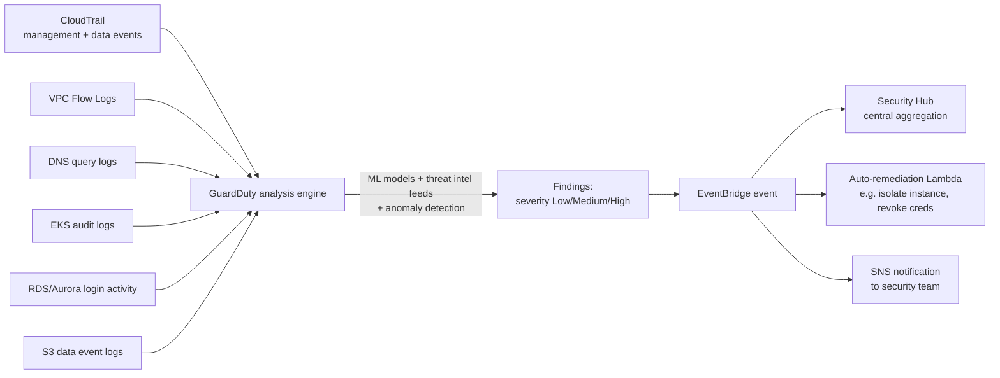

# Amazon GuardDuty


## Definition

GuardDuty is AWS's managed **threat detection** service — it continuously watches activity
across your account (API calls, network traffic metadata, DNS queries, container/Kubernetes
activity) and uses machine learning plus threat intelligence feeds to flag things that look
like an actual attack or compromise, without you having to run or manage any detection
infrastructure yourself.

## Purpose

Most security incidents aren't announced — they look like normal-shaped API calls from a
credential that happens to have been stolen, or an EC2 instance quietly talking to a known
cryptomining pool. Spotting this by manually reading logs doesn't scale, and building your own
anomaly-detection pipeline on top of raw CloudTrail/VPC Flow Logs/DNS logs is a significant
ongoing engineering investment. GuardDuty exists to turn "turn it on" into continuous,
intelligent threat detection across an entire account or AWS Organization, backed by AWS's own
threat intelligence (and curated feeds from partners like Proofpoint and CrowdStrike).

## How It Works



Step by step:

1. GuardDuty **doesn't require you to set up any logging pipeline yourself** — once enabled, it
   reads directly from the relevant data sources behind the scenes: CloudTrail events (every
   API call made in the account), VPC Flow Logs (network connection metadata), DNS query logs,
   and — if those workloads exist — EKS audit logs, RDS/Aurora login activity, and S3 data-
   plane events.
2. It runs this activity through a combination of **curated threat-intelligence lists** (known
   malicious IPs, domains associated with command-and-control infrastructure or cryptomining),
   **machine-learning anomaly models** (e.g., "this IAM user normally calls the API from one
   region at 9am-5pm, now it's calling from an unusual region at 3am"), and **known attack
   signatures**.
2. When something matches, GuardDuty raises a **finding** — a specific, named, severity-rated
   alert (e.g., `UnauthorizedAccess:EC2/TorIPCaller`, `CryptoCurrency:EC2/BitcoinTool.B!DNS`,
   `Recon:IAMUser/MaliciousIPCaller`) with the exact resource involved and supporting evidence.
3. Findings automatically flow into **Security Hub** (if enabled) for centralized visibility
   alongside findings from other security services, and are also published as **EventBridge**
   events, which you can route to a Lambda function for automated remediation (e.g.,
   automatically quarantine a compromised EC2 instance's security group, revoke a compromised
   IAM credential's active sessions) or to SNS for human notification.

## Key Features / Components

- **Foundational data sources** — CloudTrail, VPC Flow Logs, DNS logs — always-on analysis with
  no extra logging setup required on your part.
- **EKS Protection** — analyzes Kubernetes audit logs for suspicious cluster activity (e.g., an
  attempt to create a privileged pod, unusual `kubectl` activity from an unexpected IP).
- **S3 Protection** — monitors S3 data-plane API activity for anomalous access patterns (e.g.,
  an unusual spike in GetObject calls from a new location consistent with data exfiltration).
- **RDS Protection** — flags suspicious database login attempts (e.g., brute-force patterns,
  logins from a Tor exit node).
- **Lambda Protection** — detects when a Lambda function's network activity looks malicious
  (e.g., communicating with a known command-and-control endpoint).
- **Malware Protection** — can trigger an agentless scan of an EBS volume attached to an EC2
  instance or container when a finding suggests malware involvement, without needing to install
  a persistent agent.
- **Multi-account/Organization-wide administration** — a designated delegated administrator
  account can see and manage GuardDuty findings across every member account in an AWS
  Organization from one place.
- **Trusted IP lists / threat lists** — you can supply your own known-safe or known-bad IP
  lists to tune detections to your specific environment.
- **Suppression rules** — mute known-benign findings (e.g., an internal vulnerability scanner
  that would otherwise look like a port scan) without losing visibility into everything else.

## Use Cases — When to Use It

- Detecting a compromised EC2 instance that's been recruited into a botnet or is mining
  cryptocurrency.
- Catching a leaked/stolen IAM access key being used from an unexpected geography or at an
  unusual time.
- Flagging reconnaissance activity (port scanning, unusual API call patterns consistent with an
  attacker mapping out an account) before a bigger breach happens.
- Monitoring an EKS cluster for anomalous control-plane activity consistent with a container
  escape or privilege escalation attempt.
- Org-wide security monitoring from a single delegated security account across dozens of member
  accounts.

## When NOT to Use It / Alternatives

- **You need to discover and classify sensitive data itself (PII, credentials) sitting in S3**
  — that's **Macie**'s job, not GuardDuty's; GuardDuty detects *behavioral* threats, not data
  *content*. See [`macie.md`](macie.md).
- **You need vulnerability scanning of EC2/container/Lambda software for known CVEs** — that's
  **Amazon Inspector**; GuardDuty detects active malicious *behavior*, Inspector finds
  *potential weaknesses* before they're exploited. See
  [`security-hub-and-inspector.md`](security-hub-and-inspector.md).
- **You want a unified dashboard across many security services' findings** — GuardDuty
  produces findings but isn't itself the aggregation layer; pair it with **Security Hub** for
  that central view.
- **Extremely cost-sensitive accounts with negligible attack surface** (e.g., a fully isolated
  internal sandbox with no internet egress at all) — GuardDuty still has real value, but some
  teams deprioritize it there in favor of enabling it first on internet-facing/production
  accounts.

## Why It's Important

**Real-world weight:** The median time to detect a breach without active monitoring is
measured in months in industry breach reports; GuardDuty is one of the cheapest, lowest-effort
ways to collapse that detection window to minutes/hours. It is widely considered a "just turn
it on" baseline control for any serious AWS account, which is exactly why it's tested so
heavily — architects are expected to include it by default in secure designs.

**Exam weight:**
- **SAA-C03 — Domain 1, Task 1.2 "Design secure workloads and applications"** lists GuardDuty
  explicitly alongside Macie, Shield, WAF as the application/workload security toolkit.
- **DVA-C03** touches GuardDuty more lightly (it's primarily an operations/architecture
  concern), but understanding how a finding triggers a Lambda-based auto-remediation (EventBridge
  integration) connects directly to Domain 1's event-driven development patterns.
- **MLA-C02 — Domain 4** references continuous threat monitoring as part of "Operating,
  Monitoring, and Securing ML and AI Solutions" — GuardDuty's EKS/Lambda protections are
  directly relevant to securing ML inference infrastructure.

## Pricing Model

- Billed by **volume of data analyzed**, with separate tiered pricing per data source
  (CloudTrail events, VPC Flow Logs + DNS logs are generally the cheapest, S3/EKS/RDS/Lambda
  protections billed separately based on their respective event volumes).
- **30-day free trial** per account when first enabled, after which it's pay-as-you-go with no
  flat monthly fee — cost scales with your account's actual activity volume.
- See: https://aws.amazon.com/guardduty/pricing/ for current exact rates.

## Hands-on Lab (Floci)

GuardDuty's actual ML-based threat detection against real traffic isn't something a local
emulator can meaningfully replicate (there's no real malicious traffic to detect), but the
control-plane API (enabling the detector, managing findings, filters) is practicable:

```bash
# Enable GuardDuty in the account (creates a "detector")
awslocal guardduty create-detector --enable

# List detectors / confirm it's enabled
awslocal guardduty list-detectors

DETECTOR_ID=<from-above>

# Generate sample findings so you can practice the findings workflow
awslocal guardduty create-sample-findings --detector-id $DETECTOR_ID

# List and inspect findings
awslocal guardduty list-findings --detector-id $DETECTOR_ID
awslocal guardduty get-findings --detector-id $DETECTOR_ID --finding-ids <finding-id>

# Create a suppression filter for a known-benign pattern
awslocal guardduty create-filter --detector-id $DETECTOR_ID \
  --name ignore-internal-scanner --action ARCHIVE \
  --finding-criteria '{"Criterion": {"service.action.actionType": {"Eq": ["PORT_PROBE"]}}}'
```

## Exam Tips

- **GuardDuty vs. Macie vs. Inspector — the recurring three-way trap.** GuardDuty = behavioral
  threat detection (is something actively malicious happening right now). Macie = sensitive
  data discovery/classification in S3 (what sensitive data exists and is it exposed). Inspector
  = vulnerability scanning (what known weaknesses exist in my software/images before they're
  exploited). Memorize which verb goes with which service.
- **No agent required for core detection** — GuardDuty reads existing log sources
  automatically; if a question implies you must install something on every EC2 instance for
  basic GuardDuty coverage, that's wrong (Malware Protection's deeper scan is agentless too,
  triggered on-demand).
- **Findings flow through EventBridge** — automated remediation architectures (isolate an
  instance, revoke a session) are built by routing GuardDuty findings through EventBridge to a
  Lambda function; this pattern recurs across SAA-C03 and DVA-C03 questions about "automated
  incident response."
- **Delegated administrator for multi-account** — a security-tooling account can be the
  Organization-wide GuardDuty admin without needing to be the management account itself.
- Tested in **SAA-C03 Domain 1 (30%)**; present but lighter in **DVA-C03 Domain 2 (26%)** and
  **MLA-C02 Domain 4 (24%)**.

## Related Terms

- [`macie.md`](macie.md) — sensitive data discovery, the content-focused counterpart to GuardDuty's behavior focus
- [`security-hub-and-inspector.md`](security-hub-and-inspector.md) — Security Hub aggregates GuardDuty findings; Inspector covers vulnerability scanning
- [`organizations-and-scps.md`](organizations-and-scps.md) — delegated administrator model for org-wide GuardDuty
- `glossary/` — finding, delegated administrator, EventBridge, IOC (indicator of compromise)
