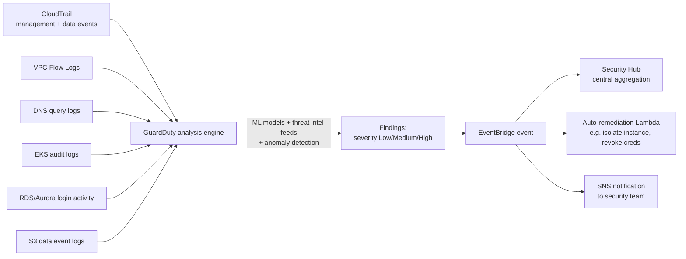
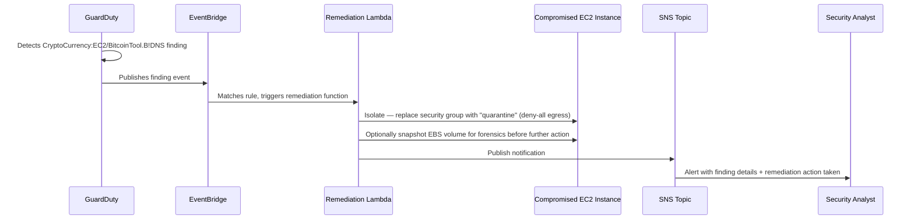
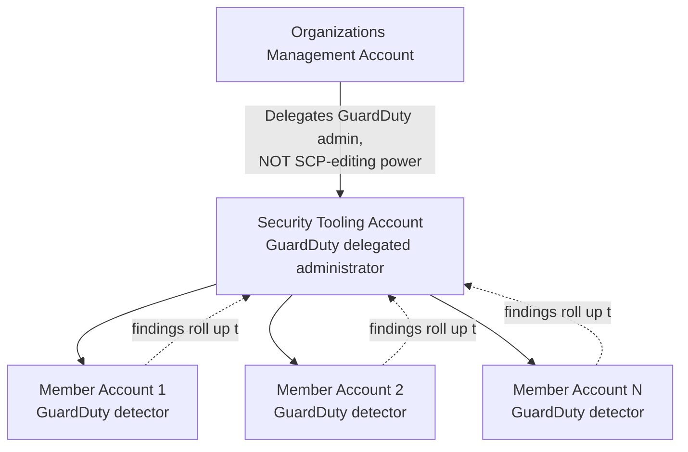
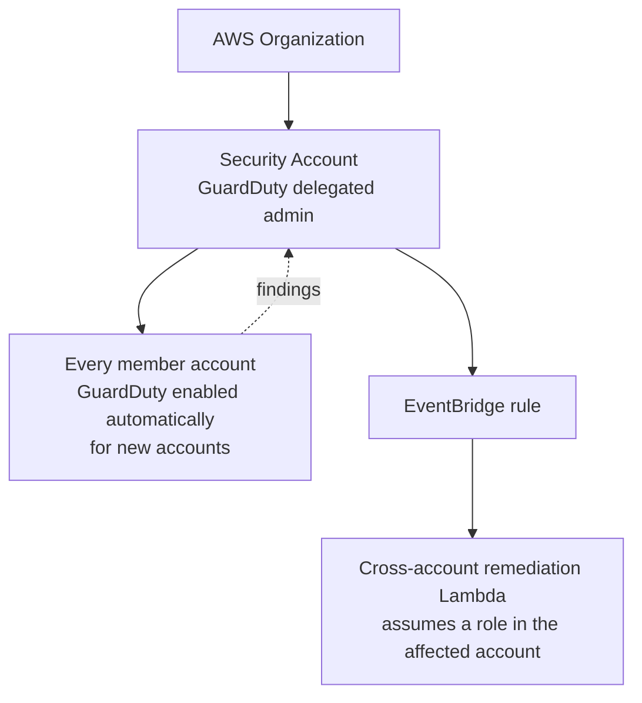
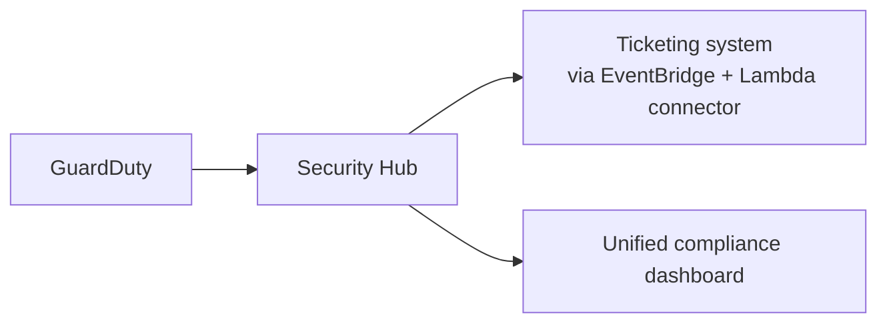
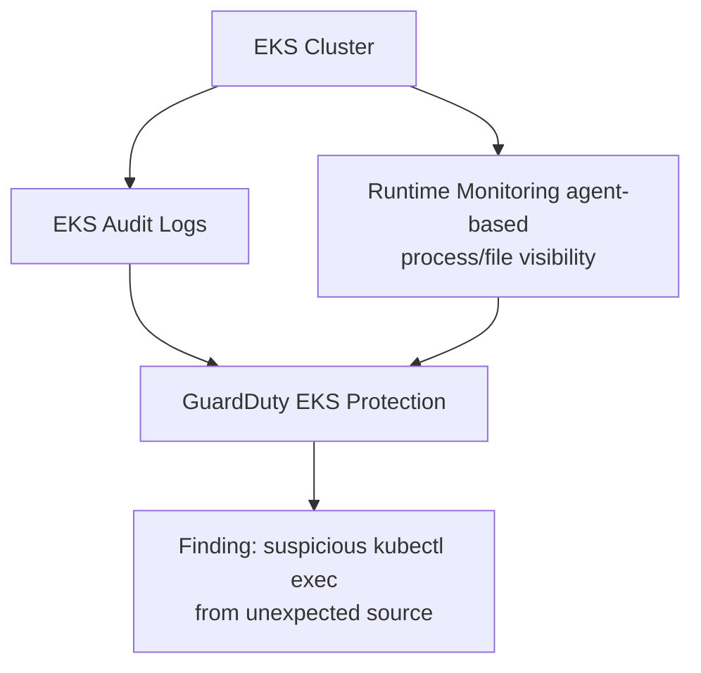
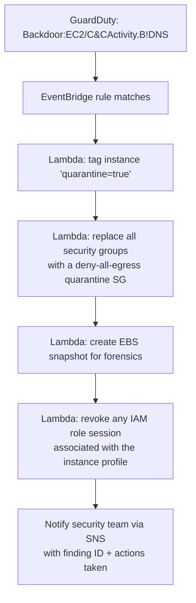
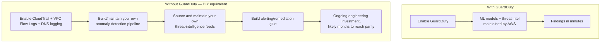
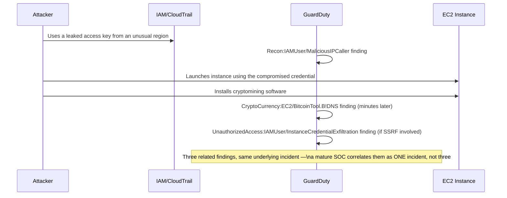

# Amazon GuardDuty


## Definition

GuardDuty is AWS's managed **threat detection** service — it continuously watches activity
across your account (API calls, network traffic metadata, DNS queries, container/Kubernetes
activity) and uses machine learning plus threat intelligence feeds to flag things that look
like an actual attack or compromise, without you having to run or manage any detection
infrastructure yourself.

## Purpose

Most security incidents aren't announced — they look like normal-shaped API calls from a
credential that happens to have been stolen, or an EC2 instance quietly talking to a known
cryptomining pool. Spotting this by manually reading logs doesn't scale, and building your own
anomaly-detection pipeline on top of raw CloudTrail/VPC Flow Logs/DNS logs is a significant
ongoing engineering investment. GuardDuty exists to turn "turn it on" into continuous,
intelligent threat detection across an entire account or AWS Organization, backed by AWS's own
threat intelligence (and curated feeds from partners like Proofpoint and CrowdStrike).

## How It Works



Step by step:

1. GuardDuty **doesn't require you to set up any logging pipeline yourself** — once enabled, it
   reads directly from the relevant data sources behind the scenes: CloudTrail events (every
   API call made in the account), VPC Flow Logs (network connection metadata), DNS query logs,
   and — if those workloads exist — EKS audit logs, RDS/Aurora login activity, and S3 data-
   plane events. This "foundational" tier (CloudTrail, VPC Flow Logs, DNS) is always included
   with zero extra setup the moment GuardDuty is enabled.
2. It runs this activity through a combination of **curated threat-intelligence lists** (known
   malicious IPs, domains associated with command-and-control infrastructure or cryptomining),
   **machine-learning anomaly models** (e.g., "this IAM user normally calls the API from one
   region at 9am-5pm, now it's calling from an unusual region at 3am"), and **known attack
   signatures**.
3. When something matches, GuardDuty raises a **finding** — a specific, named, severity-rated
   alert (e.g., `UnauthorizedAccess:EC2/TorIPCaller`, `CryptoCurrency:EC2/BitcoinTool.B!DNS`,
   `Recon:IAMUser/MaliciousIPCaller`) with the exact resource involved and supporting evidence.
4. Findings automatically flow into **Security Hub** (if enabled) for centralized visibility
   alongside findings from other security services, and are also published as **EventBridge**
   events, which you can route to a Lambda function for automated remediation (e.g.,
   automatically quarantine a compromised EC2 instance's security group, revoke a compromised
   IAM credential's active sessions) or to SNS for human notification.

### Official AWS example: GuardDuty detecting malicious IAM activity via CloudTrail


*Source: AWS Documentation, "Amazon GuardDuty" (SAP on AWS security reference)
(docs.aws.amazon.com/sap/latest/general/guardduty.html)*

In this illustrated scenario: (1) data is written to an S3 bucket for compliance/data-lake
purposes, (2) a malicious actor modifies IAM permissions on that bucket to gain unauthorized
access, (3) CloudTrail captures the IAM change as a management event, and (4) GuardDuty's
analysis of that CloudTrail activity flags the anomalous permission change and alerts
administrators — entirely from log analysis, with no agent ever installed anywhere.

### Official AWS architecture: organization-wide vs. account-focused security services


*Source: AWS Prescriptive Guidance, "Security Reference Architecture — Apply security services
across your AWS organization"
(docs.aws.amazon.com/prescriptive-guidance/latest/security-reference-architecture/security-services.html)*

### Full finding-to-remediation pipeline



### Multi-account delegated administration model



## Key Features / Components

- **Foundational data sources** — CloudTrail, VPC Flow Logs, DNS logs — always-on analysis with
  no extra logging setup required on your part.
- **EKS Protection** — analyzes Kubernetes audit logs for suspicious cluster activity (e.g., an
  attempt to create a privileged pod, unusual `kubectl` activity from an unexpected IP).
- **S3 Protection** — monitors S3 data-plane API activity for anomalous access patterns (e.g.,
  an unusual spike in GetObject calls from a new location consistent with data exfiltration).
- **RDS Protection** — flags suspicious database login attempts (e.g., brute-force patterns,
  logins from a Tor exit node).
- **Lambda Protection** — detects when a Lambda function's network activity looks malicious
  (e.g., communicating with a known command-and-control endpoint).
- **Malware Protection** — can trigger an agentless scan of an EBS volume attached to an EC2
  instance or container when a finding suggests malware involvement, without needing to install
  a persistent agent.
- **Runtime Monitoring** — a newer protection plan covering EC2, EKS, and ECS-Fargate runtime
  behavior at the process/file-system level, going beyond log analysis into actual in-workload
  behavioral signals.
- **AI Protection (newer)** — analyzes CloudTrail data events from Bedrock, Bedrock AgentCore,
  and SageMaker AI specifically for suspicious activity targeting foundation models and the
  applications invoking them — directly relevant to MLA-C02's GenAI security objectives.
- **Multi-account/Organization-wide administration** — a designated delegated administrator
  account can see and manage GuardDuty findings across every member account in an AWS
  Organization from one place.
- **Trusted IP lists / threat lists** — you can supply your own known-safe or known-bad IP
  lists to tune detections to your specific environment.
- **Suppression rules** — mute known-benign findings (e.g., an internal vulnerability scanner
  that would otherwise look like a port scan) without losing visibility into everything else.

## Use Cases — When to Use It

- Detecting a compromised EC2 instance that's been recruited into a botnet or is mining
  cryptocurrency.
- Catching a leaked/stolen IAM access key being used from an unexpected geography or at an
  unusual time.
- Flagging reconnaissance activity (port scanning, unusual API call patterns consistent with an
  attacker mapping out an account) before a bigger breach happens.
- Monitoring an EKS cluster for anomalous control-plane activity consistent with a container
  escape or privilege escalation attempt.
- Org-wide security monitoring from a single delegated security account across dozens of member
  accounts.
- Monitoring Bedrock/SageMaker invocation patterns for suspicious prompt injection or model
  abuse attempts via AI Protection.

## When NOT to Use It / Alternatives

- **You need to discover and classify sensitive data itself (PII, credentials) sitting in S3**
  — that's **Macie**'s job, not GuardDuty's; GuardDuty detects *behavioral* threats, not data
  *content*. See [`macie.md`](macie.md).
- **You need vulnerability scanning of EC2/container/Lambda software for known CVEs** — that's
  **Amazon Inspector**; GuardDuty detects active malicious *behavior*, Inspector finds
  *potential weaknesses* before they're exploited. See
  [`security-hub-and-inspector.md`](security-hub-and-inspector.md).
- **You want a unified dashboard across many security services' findings** — GuardDuty
  produces findings but isn't itself the aggregation layer; pair it with **Security Hub** for
  that central view.
- **Extremely cost-sensitive accounts with negligible attack surface** (e.g., a fully isolated
  internal sandbox with no internet egress at all) — GuardDuty still has real value, but some
  teams deprioritize it there in favor of enabling it first on internet-facing/production
  accounts.

## Common Architectures

### 1. Org-wide GuardDuty with centralized finding aggregation and auto-remediation



### 2. GuardDuty + Security Hub + SOAR integration



### 3. EKS workload protection layering



## Why It's Important

**Real-world weight:** The median time to detect a breach without active monitoring is
measured in months in industry breach reports; GuardDuty is one of the cheapest, lowest-effort
ways to collapse that detection window to minutes/hours. It is widely considered a "just turn
it on" baseline control for any serious AWS account, which is exactly why it's tested so
heavily — architects are expected to include it by default in secure designs.

**Exam weight:**
- **SAA-C03 — Domain 1, Task 1.2 "Design secure workloads and applications"** lists GuardDuty
  explicitly alongside Macie, Shield, WAF as the application/workload security toolkit.
- **DVA-C03** touches GuardDuty more lightly (it's primarily an operations/architecture
  concern), but understanding how a finding triggers a Lambda-based auto-remediation (EventBridge
  integration) connects directly to Domain 1's event-driven development patterns.
- **MLA-C02 — Domain 4** references continuous threat monitoring as part of "Operating,
  Monitoring, and Securing ML and AI Solutions" — GuardDuty's EKS/Lambda protections and the
  newer AI Protection plan are directly relevant to securing ML/GenAI inference infrastructure.

## Limits & Quotas

| Item | Default / Notes |
|---|---|
| Detectors per account per Region | 1 — GuardDuty is enabled/disabled per account per Region, not multiple parallel detectors |
| Suppression (filter) rules per detector | 100 (soft) |
| Threat/trusted IP lists per detector | A small fixed number each (typically 6 of each type) |
| Finding retention in console | 90 days by default; archive/export older findings (e.g., to S3 via Security Hub/EventBridge) for longer retention |
| Free trial | 30 days per account upon first enabling GuardDuty |
| Member accounts per delegated administrator | Scales with your Organization size; no meaningfully low practical ceiling |

## Pricing Model

- Billed by **volume of data analyzed**, with separate tiered pricing per data source
  (CloudTrail events, VPC Flow Logs + DNS logs are generally the cheapest, S3/EKS/RDS/Lambda/
  Runtime Monitoring protections billed separately based on their respective event volumes).
- **30-day free trial** per account when first enabled, after which it's pay-as-you-go with no
  flat monthly fee — cost scales with your account's actual activity volume.
- See: https://aws.amazon.com/guardduty/pricing/ for current exact rates.

## Hands-on Lab (Floci)

GuardDuty's actual ML-based threat detection against real traffic isn't something a local
emulator can meaningfully replicate (there's no real malicious traffic to detect), but the
control-plane API (enabling the detector, managing findings, filters) is practicable:

```bash
# Enable GuardDuty in the account (creates a "detector")
awslocal guardduty create-detector --enable

# List detectors / confirm it's enabled
awslocal guardduty list-detectors

DETECTOR_ID=<from-above>

# Generate sample findings so you can practice the findings workflow
awslocal guardduty create-sample-findings --detector-id $DETECTOR_ID

# List and inspect findings
awslocal guardduty list-findings --detector-id $DETECTOR_ID
awslocal guardduty get-findings --detector-id $DETECTOR_ID --finding-ids <finding-id>

# Create a suppression filter for a known-benign pattern
awslocal guardduty create-filter --detector-id $DETECTOR_ID \
  --name ignore-internal-scanner --action ARCHIVE \
  --finding-criteria '{"Criterion": {"service.action.actionType": {"Eq": ["PORT_PROBE"]}}}'
```

### Extended lab: wiring a sample finding to an EventBridge rule (the real remediation pattern)

```bash
# Create an EventBridge rule matching GuardDuty findings of High severity
awslocal events put-rule --name guardduty-high-severity \
  --event-pattern '{"source":["aws.guardduty"],"detail":{"severity":[{"numeric":[">=","7"]}]}}'

# Target it at an SNS topic (in production, this would be a remediation Lambda)
awslocal sns create-topic --name security-alerts
awslocal events put-targets --rule guardduty-high-severity \
  --targets "Id"="1","Arn"="arn:aws:sns:us-east-1:000000000000:security-alerts"

# Re-generate sample findings to see the rule match
awslocal guardduty create-sample-findings --detector-id $DETECTOR_ID
```

## Troubleshooting / Common Issues

**"GuardDuty is enabled but I'm not seeing expected findings for S3/EKS/RDS activity":** check
whether the specific **protection plan** (S3 Protection, EKS Protection, RDS Protection, Lambda
Protection, Malware Protection, Runtime Monitoring) is actually enabled — the foundational data
sources (CloudTrail, VPC Flow Logs, DNS) are automatic, but the additional protection plans
covering specific services are each independently toggled and are not all on by default.

**"Findings in member accounts aren't visible from the security account":** confirm the
security account is actually configured as the **delegated administrator** for GuardDuty
specifically (this is a per-service delegation, separate from being the delegated admin for
Security Hub or Macie) and that member accounts have accepted the invitation/auto-enrollment.

**"A known-benign internal tool keeps generating the same finding repeatedly":** use a
**suppression (filter) rule** to archive that specific finding pattern going forward — don't
disable the underlying protection plan entirely just to silence one noisy, known-safe source.

**"GuardDuty costs spiked unexpectedly":** check which protection plans were recently enabled
and against which data volume — S3 Protection and VPC Flow Log analysis in a high-traffic
account can meaningfully increase the data-analyzed billing dimension; review the per-source
cost breakdown in the console/Cost Explorer rather than assuming a flat-rate service.

## Exam Tips

- **GuardDuty vs. Macie vs. Inspector — the recurring three-way trap.** GuardDuty = behavioral
  threat detection (is something actively malicious happening right now). Macie = sensitive
  data discovery/classification in S3 (what sensitive data exists and is it exposed). Inspector
  = vulnerability scanning (what known weaknesses exist in my software/images before they're
  exploited). Memorize which verb goes with which service.
- **No agent required for core detection** — GuardDuty reads existing log sources
  automatically; if a question implies you must install something on every EC2 instance for
  basic GuardDuty coverage, that's wrong (Malware Protection's deeper scan is agentless too,
  triggered on-demand; Runtime Monitoring is the one component that does use a lightweight
  agent for deeper behavioral visibility).
- **Findings flow through EventBridge** — automated remediation architectures (isolate an
  instance, revoke a session) are built by routing GuardDuty findings through EventBridge to a
  Lambda function; this pattern recurs across SAA-C03 and DVA-C03 questions about "automated
  incident response."
- **Delegated administrator for multi-account** — a security-tooling account can be the
  Organization-wide GuardDuty admin without needing to be the management account itself, and
  this delegation is per-service (being the GuardDuty admin doesn't automatically make you the
  Macie or Security Hub admin too).
- **Protection plans are independently toggled** — foundational detection (CloudTrail/VPC Flow/
  DNS) is automatic; S3/EKS/RDS/Lambda/Malware/Runtime Monitoring protections are each a
  separate on/off switch and a separate cost dimension.
- **AI Protection is the newest protection plan** — relevant specifically for MLA-C02-style
  scenarios involving Bedrock/SageMaker invocation monitoring.
- Tested in **SAA-C03 Domain 1 (30%)**; present but lighter in **DVA-C03 Domain 2 (26%)** and
  **MLA-C02 Domain 4 (24%)**.

## Common GuardDuty Finding Types — Quick Reference

| Finding type (abbreviated) | What it means | Typical response |
|---|---|---|
| `UnauthorizedAccess:EC2/TorIPCaller` | An EC2 instance is communicating with a Tor exit node | Investigate the instance; Tor usage from production infrastructure is rarely legitimate |
| `CryptoCurrency:EC2/BitcoinTool.B!DNS` | DNS queries consistent with cryptomining software | Isolate the instance, inspect for compromise, check for unexpected billing spikes |
| `Recon:IAMUser/MaliciousIPCaller` | An IAM credential was used from a known-malicious IP | Rotate/revoke the credential immediately; check CloudTrail for what it did |
| `UnauthorizedAccess:IAMUser/InstanceCredentialExfiltration` | An EC2 instance's credentials are being used from outside the instance | Strong signal of SSRF/metadata-service exploitation — rotate and investigate the instance |
| `Backdoor:EC2/C&CActivity.B!DNS` | An instance is communicating with known command-and-control infrastructure | Isolate immediately, treat as an active compromise |
| `PenTest:IAMUser/KaliLinux` | API calls consistent with a known offensive-security toolkit | Confirm whether this is an authorized pen test; if not, investigate as a real attack |
| `Policy:IAMUser/RootCredentialUsage` | The account's root user was used | Investigate why — root usage should be rare and alarmed on even when legitimate |

## Worked remediation example: automated response to a compromised-instance finding



This is the canonical "GuardDuty finding → automatic containment" architecture referenced
across SAA-C03 and DVA-C03 event-driven security questions: isolate first (minimize further
damage), preserve evidence second (snapshot before further changes), revoke credentials third
(limit what the attacker can still do elsewhere), and notify humans last (so containment
doesn't wait on a person being awake and available).

## GuardDuty vs. Native AWS Logging — What You'd Have to Build Yourself Without It



This comparison is the clearest way to internalize GuardDuty's actual value proposition for an
exam scenario emphasizing "minimize operational overhead while still detecting threats" — it is
specifically testing whether you reach for a managed detection service instead of proposing a
custom pipeline built from raw CloudTrail/VPC Flow Log analysis.

## Worked example: a realistic multi-finding incident timeline



Recognizing that multiple GuardDuty findings can represent **one single unfolding incident**
(initial credential compromise → resource launch → cryptomining installation) rather than three
unrelated issues is itself an exam-relevant skill: a scenario describing several findings in
quick succession against related resources/principals is typically testing whether you'd
correlate and respond to the underlying incident, not treat each finding as an isolated event
requiring separate remediation.

## GuardDuty Severity Scoring — How a Finding's Number Maps to Action

| Severity score | Label | Typical response urgency |
|---|---|---|
| 7.0 – 8.9 | High | Immediate investigation, likely automated containment |
| 4.0 – 6.9 | Medium | Investigate within normal operational hours |
| 0.1 – 3.9 | Low | Review in aggregate, often informational/reconnaissance-adjacent |

A finding's numeric severity (not just its High/Medium/Low label) is what EventBridge rules
typically filter on for automated remediation triggers (as shown in the lab's
`"numeric":[">=","7"]` filter) — know that the label is a convenience bucket over a more
granular underlying score, and automation is usually built against the number, not the label
string.

## Further Reading

- AWS GuardDuty User Guide — What is Amazon GuardDuty?:
  https://docs.aws.amazon.com/guardduty/latest/ug/what-is-guardduty.html
- AWS Prescriptive Guidance — Security Reference Architecture, Apply security services across
  your AWS organization:
  https://docs.aws.amazon.com/prescriptive-guidance/latest/security-reference-architecture/security-services.html
- AWS Prescriptive Guidance — Multi-Region Architecture (GuardDuty delegated administration):
  https://docs.aws.amazon.com/prescriptive-guidance/latest/security-reference-architecture/multi-region-architecture.html
- AWS GuardDuty pricing: https://aws.amazon.com/guardduty/pricing/

## Related Terms

- [`macie.md`](macie.md) — sensitive data discovery, the content-focused counterpart to GuardDuty's behavior focus
- [`security-hub-and-inspector.md`](security-hub-and-inspector.md) — Security Hub aggregates GuardDuty findings; Inspector covers vulnerability scanning
- [`organizations-and-scps.md`](organizations-and-scps.md) — delegated administrator model for org-wide GuardDuty
- `glossary/` — finding, delegated administrator, EventBridge, IOC (indicator of compromise)
