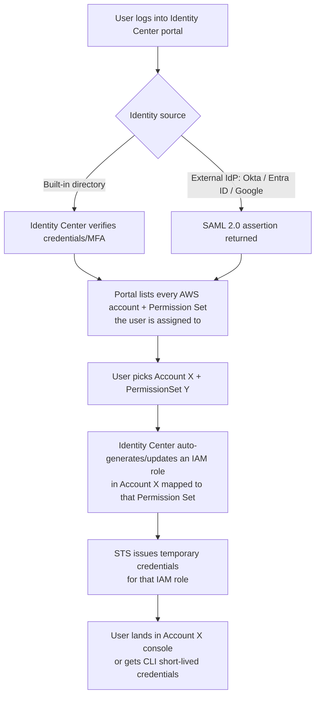
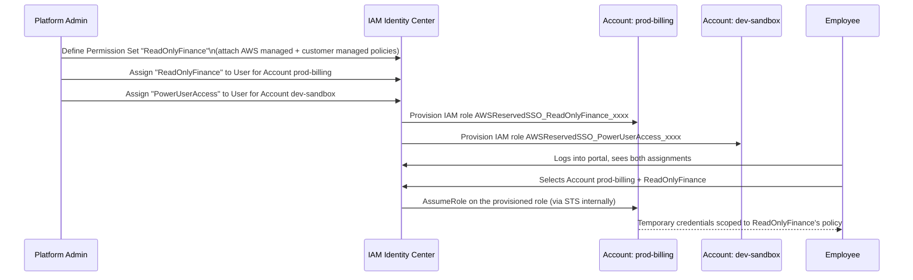
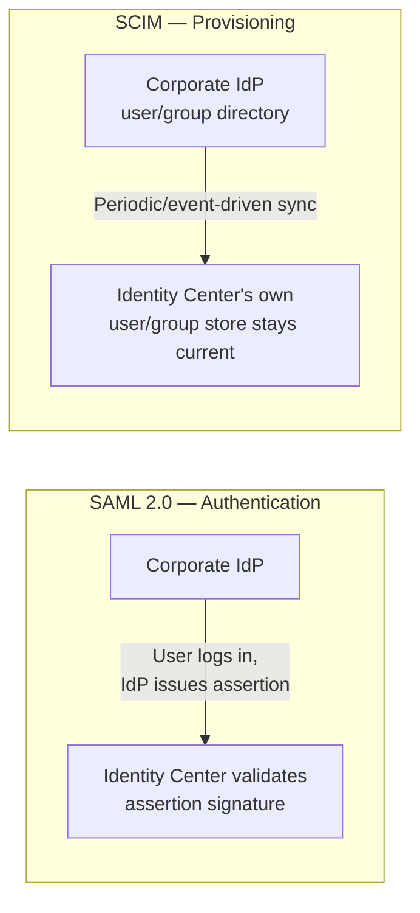
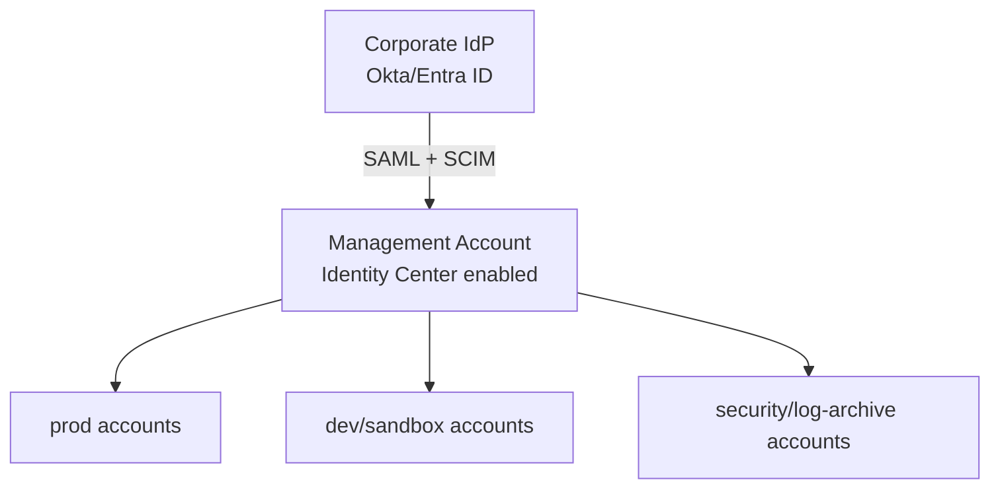
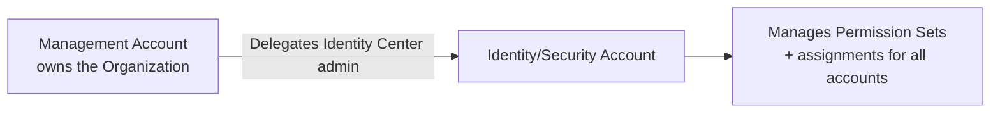
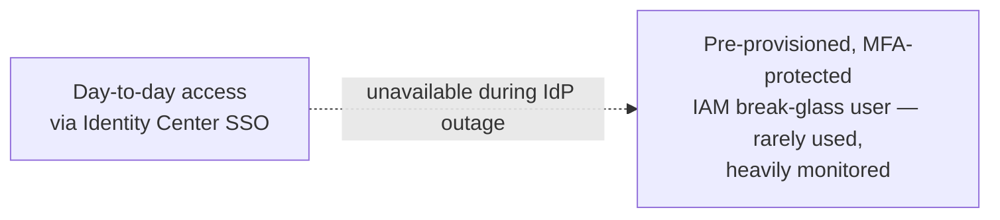
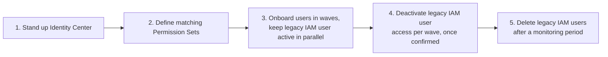

# AWS IAM Identity Center (SSO)


## Definition

IAM Identity Center (formerly AWS Single Sign-On) is the service that lets **one human login**
give a person access to **many AWS accounts and business applications**, with their level of
access in each account decided centrally instead of by creating a separate IAM user in every
account.

## Purpose

A company running SAA-C03-style multi-account setups (one account per environment/team —
dev, staging, prod, shared-services, security, log-archive) runs into a scaling wall fast if
access is managed by hand-creating IAM users in each account: 50 accounts × 30 engineers means
potentially 1,500 sets of credentials to rotate, offboard, and audit. Identity Center solves
this by making **identity a single, central thing** (one login, backed by its own built-in
directory or an external identity provider) and **permission a separately assigned, per-account
thing** via Permission Sets, so a person logs in once and sees a list of every account/role
combination they're allowed to use.

## How It Works

Identity Center sits in the **Organizations management account** (or a delegated
administrator account) and federates into every member account using IAM roles it creates and
manages behind the scenes — you never create or rotate IAM users per account.



Step by step:

1. The user authenticates once against the **identity source** — either Identity Center's own
   built-in directory, or an external provider connected via **SAML 2.0** (Okta, Microsoft
   Entra ID/Active Directory, Google Workspace, Ping, etc.), or via **SCIM** auto-provisioning
   for user/group sync from that external directory.
2. After login, the user sees the **Identity Center portal**: every AWS account they have any
   access to, and under each account, every **Permission Set** assigned to them (e.g., "Account:
   prod-billing, Permission Set: ReadOnlyFinance" and "Account: dev-sandbox, Permission Set:
   PowerUserAccess").
3. Picking an account+permission-set combination causes Identity Center to ensure the
   corresponding **IAM role exists in that target account** (it manages these roles
   automatically — you define the Permission Set's policy centrally once, Identity Center syncs
   it into every assigned account).
4. The user's browser session (or CLI via `aws sso login`) gets **STS-issued temporary
   credentials** scoped to that role, exactly like any other AssumeRole flow — nothing bypasses
   the normal IAM evaluation chain described in `iam.md`.

### Official AWS reference architecture: connecting an existing on-premises identity source


*Source: AWS Prescriptive Guidance, "Security Reference Architecture — AWS IAM Identity Center"
(docs.aws.amazon.com/prescriptive-guidance/latest/security-reference-architecture-identity-management/workforce-iam-identity-center.html)*

### Full Permission Set lifecycle — from definition to a usable role in every assigned account



Updating the Permission Set's attached policy later (e.g., adding one more read-only action)
automatically propagates into the already-provisioned IAM role in every account it's assigned
to — you edit the policy exactly once, centrally, rather than hunting down and re-editing a
dozen copy-pasted IAM roles across a dozen accounts.

### SAML vs. SCIM — the two halves of external IdP integration



SAML proves *who is logging in right now*; SCIM keeps Identity Center's own copy of the
directory (who exists, which groups they're in) synced with the source of truth, so an
employee removed from the corporate directory actually loses Identity Center access rather than
merely failing a future login attempt they never make.

## Key Features / Components

- **Permission Sets** — a named, reusable bundle of IAM policies (AWS managed, customer managed,
  or inline) that gets translated into an IAM role in every account it's assigned to. Change the
  Permission Set once, it propagates everywhere it's used.
- **Built-in identity store** — a free, simple directory for small teams that don't have an
  existing corporate IdP.
- **External IdP federation (SAML 2.0 / SCIM)** — connects to Okta, Entra ID (Azure AD), Google
  Workspace, PingFederate, JumpCloud, etc.; SCIM keeps users/groups automatically synced so
  offboarding in the corporate directory also removes AWS access without a manual step.
- **Attribute-Based Access Control (ABAC) integration** — Identity Center can pass user
  attributes (department, cost-center, employee-ID) from the IdP into the session, which IAM
  policies can then key off of.
- **Application assignments** — beyond AWS accounts, Identity Center can also single-sign-on
  users into supported SaaS business apps (Salesforce, Box, Slack, etc.) and custom SAML apps,
  centralizing *all* workforce access in one portal.
- **AWS CLI v2 `aws sso login`** — developers authenticate once in a browser, and the CLI
  caches short-lived credentials locally, refreshed automatically — no static access keys ever
  touch a laptop.
- **AD Connector** — a directory gateway option for organizations with existing on-premises
  Active Directory who don't want to replicate/cache user data in the cloud; it forwards
  authentication requests back to the on-prem directory in real time.
- **Multi-session support** — a user can be assigned many Permission Sets across many accounts
  simultaneously and switch between active sessions without re-authenticating against the
  identity source each time, as long as the overall Identity Center session is still valid.

## Use Cases — When to Use It

- A company with 10+ AWS accounts under one AWS Organization needs engineers, SREs, and
  auditors to each get the right access level in the right accounts without IAM user sprawl.
- Offboarding an employee should remove their AWS access everywhere in one action (disable them
  in the corporate IdP → SCIM syncs the removal into Identity Center → access revoked
  org-wide instantly).
- Enforcing MFA and session duration policy centrally instead of per-account.
- Giving auditors/finance read-only access across every account without creating a single IAM
  user anywhere.
- Consolidating SSO for both AWS accounts and non-AWS SaaS business apps into one employee
  portal.

## When NOT to Use It / Alternatives

- **A single AWS account with a handful of people** — the overhead of Organizations +
  Identity Center setup isn't worth it; a few IAM users (ideally with federation anyway) or
  direct IAM roles are simpler. Identity Center's value curve kicks in with multiple accounts.
- **Application end-user login (your product's customers)** — this is strictly for workforce
  (employee/contractor) access to AWS/business apps, not for authenticating people who use your
  software product. Use **Amazon Cognito** for that. See [`cognito.md`](cognito.md).
- **Fine-grained per-API-call authorization already covered by a Permission Set's policy** — if
  you only need one AWS account and one broad role, plain IAM roles assumed via STS are
  sufficient and simpler to reason about than standing up full org-wide SSO infrastructure.

## Common Architectures

### 1. Centralized workforce access across a full landing zone



### 2. Delegated administration of Identity Center from a non-management account



### 3. Break-glass emergency access pattern alongside Identity Center


Even organizations fully committed to Identity Center typically keep one or two tightly
controlled, alarmed "break-glass" IAM users per critical account specifically for the scenario
where the identity source itself is unavailable — a specific, testable nuance distinguishing
"we use Identity Center for everything" from "we have zero IAM users anywhere, ever."

## Why It's Important

**Real-world weight:** Identity Center is how virtually every mature AWS organization manages
workforce access today — AWS itself steers customers away from per-account IAM users for
humans. Centralizing identity is also a compliance requirement in most frameworks (SOC 2, ISO
27001, PCI-DSS all expect a documented, centrally revocable access model with MFA).

**Exam weight:**
- **SAA-C03 — Domain 1, Task 1.1 "Design secure access to AWS resources"** explicitly lists
  "IAM Identity Center/SSO" and "multi-account strategy" alongside IAM — this is the
  architectural answer whenever a scenario mentions "multiple AWS accounts" and "centralized
  employee access."
- **DVA-C03 — Domain 2, Task 2.1** — developers are expected to understand `aws sso login` as
  the correct way to get CLI credentials instead of static access keys.
- **MLA-C02 — Domain 4** — centralized access governance across accounts running ML workloads
  (e.g., separate training/prod accounts) touches the same least-privilege and multi-account
  access objectives.

## Limits & Quotas

| Resource | Default quota | Notes |
|---|---|---|
| Permission Sets per Identity Center instance | 500 (soft) | Rarely binding unless Permission Sets aren't being reused thoughtfully |
| Managed policies per Permission Set | 20 | Mirrors IAM's own per-role managed policy attachment behavior underneath |
| Inline policy size per Permission Set | 10,240 characters | Same ceiling as an IAM role's inline policy |
| Account assignments per user/group | No hard low ceiling, scales with org size | Large enterprises routinely assign hundreds of account/Permission Set combinations across their directory |
| Session duration | Configurable per Permission Set, same bounds as STS (up to 12h) | Controlled centrally instead of per-role in each account |

## Pricing Model

**IAM Identity Center itself is free** — no additional charge beyond what the underlying
AWS accounts and resources already cost. If you connect it to an external IdP, your identity
provider (Okta, Entra ID, etc.) may have its own separate licensing cost — that's billed by the
IdP vendor, not AWS. See: https://aws.amazon.com/iam/identity-center/pricing/

## Hands-on Lab (Floci)

Identity Center's full SSO portal/SAML federation flow is a control-plane, multi-account
Organizations feature that Floci does not emulate (see `labs-floci/README.md`'s honest
limitations note). The practical local lab instead focuses on the **mechanism Identity Center
relies on under the hood** — IAM role assumption — which Floci does support:

```bash
# Simulate what Identity Center does per-account: create a role a "federated" user can assume
cat > idc-trust-policy.json << 'EOF'
{
  "Version": "2012-10-17",
  "Statement": [
    { "Effect": "Allow",
      "Principal": {"AWS": "arn:aws:iam::000000000000:root"},
      "Action": "sts:AssumeRole",
      "Condition": {"StringEquals": {"sts:ExternalId": "idc-demo"}}
    }
  ]
}
EOF
awslocal iam create-role --role-name PermissionSet-ReadOnlyFinance \
  --assume-role-policy-document file://idc-trust-policy.json
awslocal iam attach-role-policy --role-name PermissionSet-ReadOnlyFinance \
  --policy-arn arn:aws:iam::aws:policy/ReadOnlyAccess

# "User" assumes it, mimicking what happens after an Identity Center portal click
awslocal sts assume-role \
  --role-arn arn:aws:iam::000000000000:role/PermissionSet-ReadOnlyFinance \
  --role-session-name alice-finance-session \
  --external-id idc-demo
```

### Extended lab: simulating multiple Permission Sets for one user across two "accounts"

```bash
# A second "Permission Set" role, simulating a different account/access level
awslocal iam create-role --role-name PermissionSet-PowerUserDev \
  --assume-role-policy-document file://idc-trust-policy.json
awslocal iam attach-role-policy --role-name PermissionSet-PowerUserDev \
  --policy-arn arn:aws:iam::aws:policy/PowerUserAccess

# The same "user" can assume either, mirroring the Identity Center portal's
# account+PermissionSet picker (in reality, two separate AWS accounts; here, one emulator)
awslocal sts assume-role --role-arn arn:aws:iam::000000000000:role/PermissionSet-PowerUserDev \
  --role-session-name alice-dev-session --external-id idc-demo

# Updating the underlying policy once propagates to anyone currently assigned this Permission Set —
# simulate by attaching an additional managed policy to the SAME role
awslocal iam attach-role-policy --role-name PermissionSet-ReadOnlyFinance \
  --policy-arn arn:aws:iam::aws:policy/AWSBillingReadOnlyAccess
```

This mirrors the real flow: a Permission Set *is* an IAM role template, and selecting it in the
portal *is* an AssumeRole call under the hood.

## Troubleshooting / Common Issues

**"User can log into the portal but doesn't see an expected account/Permission Set":**
1. Confirm the assignment actually exists (Account + Permission Set + User/Group) — a very
   common cause is assigning the Permission Set to the user's *group* in the external IdP, but
   SCIM hasn't yet synced that group membership change into Identity Center.
2. Check whether the Permission Set was assigned to the correct **account** — assignments are
   per-account, not org-wide by default; a Permission Set existing doesn't mean it's usable
   anywhere until explicitly assigned to specific accounts.

**"Offboarded employee still has AWS access" — almost always a SCIM gap, not a SAML gap:**
SAML only matters at the moment of login; if SCIM provisioning isn't actually wired up (or is
failing silently), disabling the user in the corporate IdP does nothing to their existing
Identity Center account/session entitlements until someone manually removes them. Check SCIM
sync status and logs first, before assuming a credentials/session caching issue.

**"`aws sso login` succeeds but subsequent CLI calls fail with AccessDenied":** the CLI
successfully authenticated the human, but the *assigned Permission Set's policy* doesn't grant
the specific action being called — this is a completely normal least-privilege outcome, not a
login failure; treat it like any other IAM AccessDenied investigation from `iam.md`.

**"Permission Set policy change isn't taking effect":** Identity Center provisions/reprovisions
the underlying IAM role asynchronously; a very recent Permission Set edit can take a short time
to propagate into every assigned account — if a question/scenario describes an access issue
"immediately after" a Permission Set edit, propagation delay is a plausible, testable factor.

## Exam Tips

- **Identity Center vs. plain IAM users** — if a scenario says "manage access across multiple
  AWS accounts" or "federate with our existing corporate directory," Identity Center is the
  answer, not "create an IAM user in every account."
- **Identity Center vs. Cognito** — Identity Center = your own employees/workforce accessing
  AWS accounts and internal tools; Cognito = your application's external customers logging
  into your product. Mixing these up is one of the most common exam traps in this category.
- **SCIM vs. SAML** — SAML handles the *authentication* handshake (proving who you are); SCIM
  handles *provisioning* (keeping the user/group list in sync so an offboarded employee
  actually disappears). A question about "access wasn't revoked when someone left the company"
  points to a missing/broken SCIM sync, not a SAML misconfiguration.
- Permission Sets are **not** the same object as IAM policies, though they're built from them —
  a Permission Set is Identity Center's unit of assignment; it gets rendered into an actual IAM
  role per account.
- **AD Connector vs. caching users in the cloud** — a question emphasizing "we don't want user
  data replicated/cached outside our on-premises environment" points specifically to AD
  Connector's real-time forwarding model, not a full directory sync.
- **Break-glass access still has a place** even in a full Identity Center rollout — a question
  asking "how do we get into our accounts if our external IdP has an outage" wants a
  pre-provisioned, tightly monitored IAM emergency-access user, not "Identity Center handles
  this automatically."
- Appears primarily under **SAA-C03 Domain 1 (30%)**; secondary mentions in **DVA-C03 Domain 2
  (26%)** around `aws sso login`/credential handling.

## Worked example: a complete Permission Set JSON reference

```json
{
  "Name": "DatabaseAdminReadWrite",
  "Description": "Scoped DB admin access for the platform team, no IAM/billing access",
  "SessionDuration": "PT4H",
  "ManagedPolicies": ["arn:aws:iam::aws:policy/AmazonRDSFullAccess"],
  "InlinePolicy": {
    "Version": "2012-10-17",
    "Statement": [
      { "Effect": "Deny", "Action": ["iam:*", "organizations:*", "account:*"], "Resource": "*" }
    ]
  },
  "Tags": [{ "Key": "Team", "Value": "platform" }]
}
```

This mirrors exactly the kind of composition seen in a standalone IAM permission boundary
(broad Allow via a managed policy, explicit Deny carve-out via an inline statement) — a
Permission Set is, structurally, just a convenient Identity-Center-native wrapper around the
same IAM building blocks covered in `iam.md`, deployed consistently across every account it's
assigned to rather than hand-copied per account.

## Identity Center vs. Direct Cross-Account Roles — When Each Still Makes Sense

| Scenario | Preferred approach |
|---|---|
| 10+ accounts, ongoing workforce access | IAM Identity Center |
| One-off, time-boxed vendor access to a single account | Direct cross-account role + ExternalId, no Identity Center overhead needed |
| Automated service-to-service access (no human involved) | Direct AssumeRole between roles, not Identity Center (which is human-portal-oriented) |
| Auditors needing read-only access across the whole Organization | IAM Identity Center with a dedicated read-only Permission Set |

A recurring exam trap: proposing Identity Center for a scenario that's actually describing
**machine-to-machine** access (a Lambda function in Account A calling a service in Account B) —
Identity Center is fundamentally a human SSO portal; non-human workload access still goes
through direct `AssumeRole`, regardless of how many accounts are involved.

## Worked example: migrating 200 legacy IAM users to Identity Center

A company with 200 IAM users spread across 15 AWS accounts (created ad hoc over several years)
wants to migrate to Identity Center without a disruptive big-bang cutover. The recommended
sequence: (1) stand up Identity Center with the chosen identity source (built-in or external
IdP), (2) define Permission Sets that mirror each distinct access pattern currently granted by
hand-created IAM user policies, (3) onboard users in waves, granting them Identity Center access
*alongside* their existing IAM user (not yet removing it), (4) once a wave of users confirms
their Identity Center access works for their daily workflow, deactivate (not immediately delete)
their IAM user's console/API access, (5) after a monitoring period confirms no breakage, delete
the legacy IAM users entirely. This staged approach is the specific, testable answer for "how do
we migrate without an access-disruption incident," versus the tempting-but-risky shortcut of
deleting all 200 IAM users the same day Identity Center goes live.



## Identity Center Session and MFA Policy — Centralizing What Used to Be Per-Account

| Setting | Legacy per-account IAM approach | Identity Center approach |
|---|---|---|
| MFA requirement | Configured per account, per user, inconsistently | One central policy, applied uniformly |
| Session duration | Set per IAM role, varies account to account | Set per Permission Set, consistent per assignment |
| Password policy | Per-account IAM password policy | Centralized in the identity source (built-in or external IdP) |

## Further Reading

- AWS Prescriptive Guidance — Security Reference Architecture, IAM Identity Center:
  https://docs.aws.amazon.com/prescriptive-guidance/latest/security-reference-architecture-identity-management/workforce-iam-identity-center.html
- AWS Prescriptive Guidance — Workforce identity management overview:
  https://docs.aws.amazon.com/prescriptive-guidance/latest/security-reference-architecture-identity-management/workforce-identity-management.html
- AWS IAM Identity Center User Guide:
  https://docs.aws.amazon.com/singlesignon/latest/userguide/what-is.html
- AWS IAM Identity Center pricing: https://aws.amazon.com/iam/identity-center/pricing/

## Related Terms

- [`iam.md`](iam.md) — the role/policy mechanics Identity Center builds on top of
- [`sts-and-role-switching.md`](sts-and-role-switching.md) — the AssumeRole call every portal click triggers
- [`organizations-and-scps.md`](organizations-and-scps.md) — the multi-account structure Identity Center is deployed across
- [`cognito.md`](cognito.md) — the equivalent concept for application end users, not workforce
- `glossary/` — SAML, SCIM, federation, Permission Set
