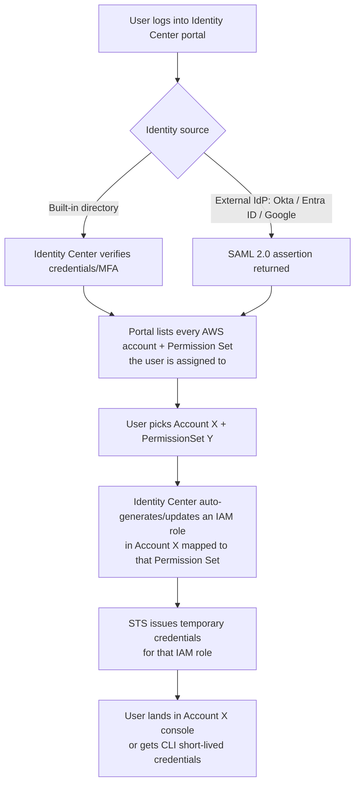

# AWS IAM Identity Center (SSO)


## Definition

IAM Identity Center (formerly AWS Single Sign-On) is the service that lets **one human login**
give a person access to **many AWS accounts and business applications**, with their level of
access in each account decided centrally instead of by creating a separate IAM user in every
account.

## Purpose

A company running SAA-C03-style multi-account setups (one account per environment/team —
dev, staging, prod, shared-services, security, log-archive) runs into a scaling wall fast if
access is managed by hand-creating IAM users in each account: 50 accounts × 30 engineers means
potentially 1,500 sets of credentials to rotate, offboard, and audit. Identity Center solves
this by making **identity a single, central thing** (one login, backed by its own built-in
directory or an external identity provider) and **permission a separately assigned, per-account
thing** via Permission Sets, so a person logs in once and sees a list of every account/role
combination they're allowed to use.

## How It Works

Identity Center sits in the **Organizations management account** (or a delegated
administrator account) and federates into every member account using IAM roles it creates and
manages behind the scenes — you never create or rotate IAM users per account.



Step by step:

1. The user authenticates once against the **identity source** — either Identity Center's own
   built-in directory, or an external provider connected via **SAML 2.0** (Okta, Microsoft
   Entra ID/Active Directory, Google Workspace, Ping, etc.), or via **SCIM** auto-provisioning
   for user/group sync from that external directory.
2. After login, the user sees the **Identity Center portal**: every AWS account they have any
   access to, and under each account, every **Permission Set** assigned to them (e.g., "Account:
   prod-billing, Permission Set: ReadOnlyFinance" and "Account: dev-sandbox, Permission Set:
   PowerUserAccess").
3. Picking an account+permission-set combination causes Identity Center to ensure the
   corresponding **IAM role exists in that target account** (it manages these roles
   automatically — you define the Permission Set's policy centrally once, Identity Center syncs
   it into every assigned account).
4. The user's browser session (or CLI via `aws sso login`) gets **STS-issued temporary
   credentials** scoped to that role, exactly like any other AssumeRole flow — nothing bypasses
   the normal IAM evaluation chain described in `iam.md`.

## Key Features / Components

- **Permission Sets** — a named, reusable bundle of IAM policies (AWS managed, customer managed,
  or inline) that gets translated into an IAM role in every account it's assigned to. Change the
  Permission Set once, it propagates everywhere it's used.
- **Built-in identity store** — a free, simple directory for small teams that don't have an
  existing corporate IdP.
- **External IdP federation (SAML 2.0 / SCIM)** — connects to Okta, Entra ID (Azure AD), Google
  Workspace, PingFederate, JumpCloud, etc.; SCIM keeps users/groups automatically synced so
  offboarding in the corporate directory also removes AWS access without a manual step.
- **Attribute-Based Access Control (ABAC) integration** — Identity Center can pass user
  attributes (department, cost-center, employee-ID) from the IdP into the session, which IAM
  policies can then key off of.
- **Application assignments** — beyond AWS accounts, Identity Center can also single-sign-on
  users into supported SaaS business apps (Salesforce, Box, Slack, etc.) and custom SAML apps,
  centralizing *all* workforce access in one portal.
- **AWS CLI v2 `aws sso login`** — developers authenticate once in a browser, and the CLI
  caches short-lived credentials locally, refreshed automatically — no static access keys ever
  touch a laptop.

## Use Cases — When to Use It

- A company with 10+ AWS accounts under one AWS Organization needs engineers, SREs, and
  auditors to each get the right access level in the right accounts without IAM user sprawl.
- Offboarding an employee should remove their AWS access everywhere in one action (disable them
  in the corporate IdP → SCIM syncs the removal into Identity Center → access revoked
  org-wide instantly).
- Enforcing MFA and session duration policy centrally instead of per-account.
- Giving auditors/finance read-only access across every account without creating a single IAM
  user anywhere.

## When NOT to Use It / Alternatives

- **A single AWS account with a handful of people** — the overhead of Organizations +
  Identity Center setup isn't worth it; a few IAM users (ideally with federation anyway) or
  direct IAM roles are simpler. Identity Center's value curve kicks in with multiple accounts.
- **Application end-user login (your product's customers)** — this is strictly for workforce
  (employee/contractor) access to AWS/business apps, not for authenticating people who use your
  software product. Use **Amazon Cognito** for that. See [`cognito.md`](cognito.md).
- **Fine-grained per-API-call authorization already covered by a Permission Set's policy** — if
  you only need one AWS account and one broad role, plain IAM roles assumed via STS are
  suffiricent and simpler to reason about than standing up full org-wide SSO infrastructure.

## Why It's Important

**Real-world weight:** Identity Center is how virtually every mature AWS organization manages
workforce access today — AWS itself steers customers away from per-account IAM users for
humans. Centralizing identity is also a compliance requirement in most frameworks (SOC 2, ISO
27001, PCI-DSS all expect a documented, centrally revocable access model with MFA).

**Exam weight:**
- **SAA-C03 — Domain 1, Task 1.1 "Design secure access to AWS resources"** explicitly lists
  "IAM Identity Center/SSO" and "multi-account strategy" alongside IAM — this is the
  architectural answer whenever a scenario mentions "multiple AWS accounts" and "centralized
  employee access."
- **DVA-C03 — Domain 2, Task 2.1** — developers are expected to understand `aws sso login` as
  the correct way to get CLI credentials instead of static access keys.
- **MLA-C02 — Domain 4** — centralized access governance across accounts running ML workloads
  (e.g., separate training/prod accounts) touches the same least-privilege and multi-account
  access objectives.

## Pricing Model

**IAM Identity Center itself is free** — no additional charge beyond what the underlying
AWS accounts and resources already cost. If you connect it to an external IdP, your identity
provider (Okta, Entra ID, etc.) may have its own separate licensing cost — that's billed by the
IdP vendor, not AWS. See: https://aws.amazon.com/iam/identity-center/pricing/

## Hands-on Lab (Floci)

Identity Center's full SSO portal/SAML federation flow is a control-plane, multi-account
Organizations feature that Floci does not emulate (see `labs-floci/README.md`'s honest
limitations note). The practical local lab instead focuses on the **mechanism Identity Center
relies on under the hood** — IAM role assumption — which Floci does support:

```bash
# Simulate what Identity Center does per-account: create a role a "federated" user can assume
cat > idc-trust-policy.json << 'EOF'
{
  "Version": "2012-10-17",
  "Statement": [
    { "Effect": "Allow",
      "Principal": {"AWS": "arn:aws:iam::000000000000:root"},
      "Action": "sts:AssumeRole",
      "Condition": {"StringEquals": {"sts:ExternalId": "idc-demo"}}
    }
  ]
}
EOF
awslocal iam create-role --role-name PermissionSet-ReadOnlyFinance \
  --assume-role-policy-document file://idc-trust-policy.json
awslocal iam attach-role-policy --role-name PermissionSet-ReadOnlyFinance \
  --policy-arn arn:aws:iam::aws:policy/ReadOnlyAccess

# "User" assumes it, mimicking what happens after an Identity Center portal click
awslocal sts assume-role \
  --role-arn arn:aws:iam::000000000000:role/PermissionSet-ReadOnlyFinance \
  --role-session-name alice-finance-session \
  --external-id idc-demo
```

This mirrors the real flow: a Permission Set *is* an IAM role template, and selecting it in the
portal *is* an AssumeRole call under the hood.

## Exam Tips

- **Identity Center vs. plain IAM users** — if a scenario says "manage access across multiple
  AWS accounts" or "federate with our existing corporate directory," Identity Center is the
  answer, not "create an IAM user in every account."
- **Identity Center vs. Cognito** — Identity Center = your own employees/workforce accessing
  AWS accounts and internal tools; Cognito = your application's external customers logging
  into your product. Mixing these up is one of the most common exam traps in this category.
- **SCIM vs. SAML** — SAML handles the *authentication* handshake (proving who you are); SCIM
  handles *provisioning* (keeping the user/group list in sync so an offboarded employee
  actually disappears). A question about "access wasn't revoked when someone left the company"
  points to a missing/broken SCIM sync, not a SAML misconfiguration.
- Permission Sets are **not** the same object as IAM policies, though they're built from them —
  a Permission Set is Identity Center's unit of assignment; it gets rendered into an actual IAM
  role per account.
- Appears primarily under **SAA-C03 Domain 1 (30%)**; secondary mentions in **DVA-C03 Domain 2
  (26%)** around `aws sso login`/credential handling.

## Related Terms

- [`iam.md`](iam.md) — the role/policy mechanics Identity Center builds on top of
- [`sts-and-role-switching.md`](sts-and-role-switching.md) — the AssumeRole call every portal click triggers
- [`organizations-and-scps.md`](organizations-and-scps.md) — the multi-account structure Identity Center is deployed across
- [`cognito.md`](cognito.md) — the equivalent concept for application end users, not workforce
- `glossary/` — SAML, SCIM, federation, Permission Set
