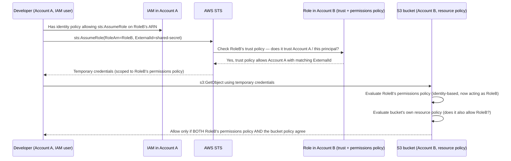
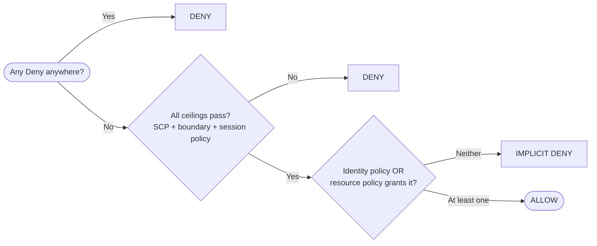
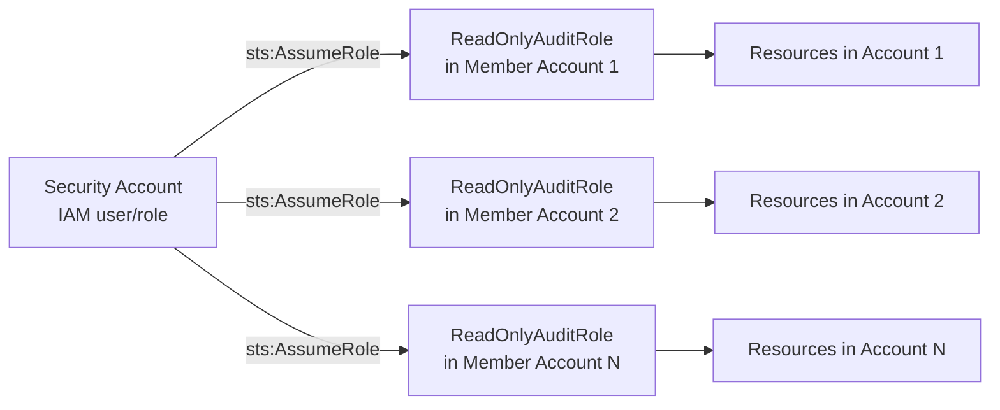
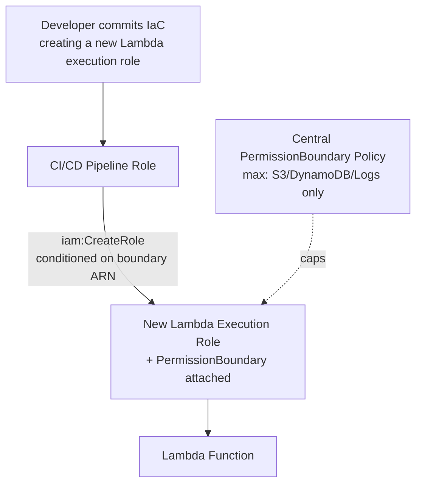
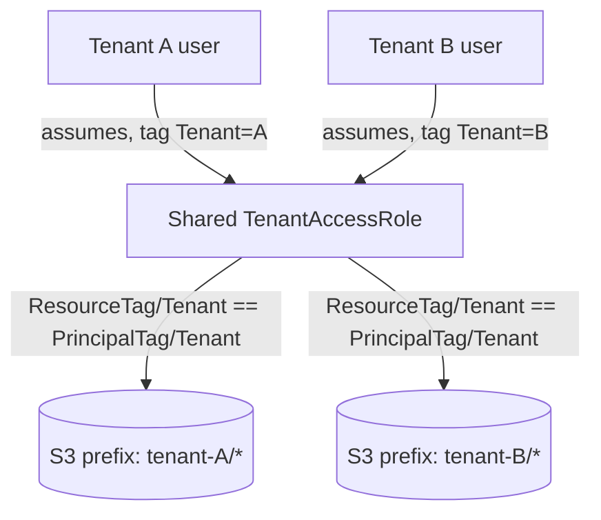
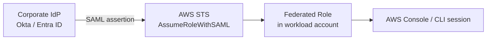

# AWS Identity and Access Management (IAM)

> **Appears in:** [DVA-C03](../../certifications/dva-c03/README.md) · [MLA-C02](../../certifications/mla-c02/README.md) · [SAA-C03](../../certifications/saa-c03/README.md)


## Definition

IAM is the service that controls **who (or what) can do what, to which AWS resource, under
which conditions**. Every single API call made against AWS — console click, CLI command, SDK
call, another AWS service acting on your behalf — is checked against IAM before it's allowed to
happen. If IAM doesn't exist for a resource type, nothing in AWS can touch it, including you.

## Purpose

AWS needed a way to let one AWS account be used safely by many different humans, applications,
and other AWS services simultaneously, each with exactly the access they need and no more. Before
IAM-style systems existed, the common failure mode was "one shared root login, full access,
hope nothing goes wrong" — a single leaked credential meant total account compromise. IAM exists
to make **least privilege** the default operating model: grant only the specific actions on the
specific resources that a specific identity actually needs, and nothing else. It is also the
single mechanism AWS uses internally — every AWS service, from S3 to Lambda to SageMaker, defers
to IAM to decide if a request is allowed.

IAM is also, structurally, **global** — unlike almost every other AWS service, IAM has no
per-Region configuration. An IAM user, role, or policy you create exists identically in every
Region at once; there is no "replicate IAM to eu-west-1" step. Only IAM's STS endpoints have a
regional flavor (and even then, mostly for latency/resilience, not for separate configuration).

## How It Works

### The core entities

- **Principal** — the "who": a human IAM user, an application via an IAM role, or an AWS service.
  Every API request has exactly one principal, identified in CloudTrail logs and policy evaluation
  by its ARN (Amazon Resource Name).
- **IAM User** — a persistent identity with long-term credentials (password for console,
  access keys for API/CLI). Meant for individual humans or, as a last resort, legacy apps that
  can't assume roles. ARN format: `arn:aws:iam::<account-id>:user/<user-name>`.
- **IAM Group** — a named collection of users. Groups have no credentials of their own and
  cannot be referenced by other AWS resources as a principal — they exist purely to attach
  policies to many users at once. ARN format: `arn:aws:iam::<account-id>:group/<group-name>`.
- **IAM Role** — an identity with *no* permanent credentials. Instead, a trusted principal
  (a user, an AWS service like EC2/Lambda, or an external identity provider) **assumes** the
  role via AWS STS and receives short-lived, auto-expiring temporary credentials. Roles are the
  recommended way to grant access to applications and are mandatory for cross-account or
  federated access. ARN format: `arn:aws:iam::<account-id>:role/<role-name>`.
- **Policy** — a JSON document that states Effect (Allow/Deny), Action (which API calls),
  Resource (which ARNs), and optional Condition (time of day, source IP, MFA presence, tags,
  encryption requirements, etc.).
- **ARN (Amazon Resource Name)** — the universal addressing scheme every policy `Resource`
  element and every principal reference uses:
  `arn:partition:service:region:account-id:resource-type/resource-id`. Example:
  `arn:aws:s3:::finance-reports/2024/q1.csv` (S3 ARNs omit region and account because bucket
  names are globally unique). Knowing this format cold is what lets you read any policy's
  `Resource` block without guessing.

### Identity-based vs. resource-based policies — the single most tested IAM distinction

| | Identity-based policy | Resource-based policy |
|---|---|---|
| Attached to | A user, group, or role | A resource (S3 bucket, KMS key, SQS queue, Lambda function, SNS topic) |
| Answers | "What can THIS IDENTITY do?" | "Who is allowed to touch THIS RESOURCE?" |
| Cross-account access | Needs a role in the target account to assume | Can grant access directly to a principal in another account without a role |
| Example | A policy on `DevRole` allowing `s3:GetObject` | An S3 bucket policy allowing `arn:aws:iam::222222222222:user/alice` to read it |

A request is only allowed if **both** sides agree where both apply (e.g., cross-account S3
access needs the identity-based policy in the caller's account to allow the call *and* the
bucket policy in the resource's account to allow that caller) — this is the classic cross-account
access pattern tested on SAA-C03.

**Same-account nuance that trips people up:** when both an identity-based policy AND a
resource-based policy apply *within the same account*, AWS evaluates the **union** of what they
allow — if either one says Allow and neither says Deny, the request succeeds. It's only once a
resource lives in a **different account** from the principal that both sides independently and
separately must say Allow (because now you're combining permissions granted by two different
account's policy authors, and neither trusts the other's policy alone).

### Policy types

- **AWS managed policies** — pre-built, maintained by AWS (e.g., `AmazonS3ReadOnlyAccess`).
  Convenient but coarse; AWS can change them.
- **Customer managed policies** — JSON you write and own, reusable across many identities,
  versioned (up to 5 versions kept, one marked default).
- **Inline policies** — embedded directly in one user/group/role, 1:1 relationship, deleted
  with the identity. Use sparingly — they're invisible in the reusable-policy list and are a
  common source of permission sprawl nobody remembers granting.
- **Permission boundaries** — an advanced guardrail: a *managed policy* attached to a user or
  role that sets the **maximum** permissions it can ever have, regardless of what its identity
  policies grant. Used to let a team create their own roles without being able to escalate
  beyond the boundary (e.g., a CI/CD pipeline role that can create Lambda execution roles, but
  none of those roles can ever reach S3 admin).
- **Service Control Policies (SCPs)** — live in AWS Organizations, not IAM, and apply at the
  account/OU level as an organization-wide maximum ceiling. See
  [`organizations-and-scps.md`](organizations-and-scps.md) — do not confuse with IAM policies.

### Worked example #1: identity-based policy (a developer's day-to-day policy)

```json
{
  "Version": "2012-10-17",
  "Statement": [
    {
      "Sid": "AllowFullDynamoDBOnTeamTables",
      "Effect": "Allow",
      "Action": ["dynamodb:GetItem", "dynamodb:PutItem", "dynamodb:Query", "dynamodb:UpdateItem"],
      "Resource": "arn:aws:dynamodb:us-east-1:111122223333:table/team-orders-*"
    },
    {
      "Sid": "AllowLambdaInvokeOwnFunctions",
      "Effect": "Allow",
      "Action": "lambda:InvokeFunction",
      "Resource": "arn:aws:lambda:us-east-1:111122223333:function:orders-*",
      "Condition": { "StringEquals": { "aws:ResourceTag/Team": "orders-platform" } }
    },
    {
      "Sid": "DenyDeletingProductionTables",
      "Effect": "Deny",
      "Action": "dynamodb:DeleteTable",
      "Resource": "arn:aws:dynamodb:us-east-1:111122223333:table/*-prod"
    }
  ]
}
```

This is an identity-based policy you'd attach directly to a developer's role. Note the
resource-level wildcard scoping (`team-orders-*`), the tag-based condition on the Lambda
statement, and the explicit Deny carve-out that no later Allow statement — in this policy or any
other attached to the same principal — can ever override.

### Worked example #2: resource-based policy (an S3 bucket policy granting cross-account access)

```json
{
  "Version": "2012-10-17",
  "Statement": [
    {
      "Sid": "AllowPartnerAccountReadOnly",
      "Effect": "Allow",
      "Principal": { "AWS": "arn:aws:iam::444455556666:role/PartnerIntegrationRole" },
      "Action": ["s3:GetObject"],
      "Resource": "arn:aws:s3:::shared-reports-bucket/partner-exports/*"
    },
    {
      "Sid": "DenyInsecureTransport",
      "Effect": "Deny",
      "Principal": "*",
      "Action": "s3:*",
      "Resource": ["arn:aws:s3:::shared-reports-bucket", "arn:aws:s3:::shared-reports-bucket/*"],
      "Condition": { "Bool": { "aws:SecureTransport": "false" } }
    }
  ]
}
```

A resource-based policy is the only policy type with a `Principal` element — because the policy
itself lives *on the resource*, it must declare who it's granting access to, rather than
inheriting that from whatever identity it's attached to. The `DenyInsecureTransport` statement
is a near-universal best-practice pattern: it applies to literally every principal (`"*"`)
because enforcing HTTPS-only access is a blanket requirement, not something scoped to one caller.

### Worked example #3: permission boundary capping a delegated role-creation pipeline

```json
{
  "Version": "2012-10-17",
  "Statement": [
    {
      "Sid": "BoundaryAllowedServices",
      "Effect": "Allow",
      "Action": ["s3:*", "dynamodb:*", "lambda:*", "logs:*", "cloudwatch:*"],
      "Resource": "*"
    },
    {
      "Sid": "BoundaryDenyIAMAndOrgEscape",
      "Effect": "Deny",
      "Action": ["iam:*", "organizations:*", "account:*"],
      "Resource": "*"
    }
  ]
}
```

A central platform team attaches this as a **permission boundary** on every role a CI/CD
pipeline is allowed to create. A developer's pipeline might then attach `AdministratorAccess` as
the role's actual identity policy by mistake — it doesn't matter. The **effective permissions are
the intersection** of the identity policy and the boundary, so the resulting role can still only
ever touch S3/DynamoDB/Lambda/Logs/CloudWatch, never IAM or Organizations, no matter what the
identity policy says. This is precisely how a central team "safely empower[s] your application
developers to create new IAM roles," per AWS's own permission-boundary guidance.

### Worked example #4: SCP + identity policy interacting (the full stack)

Scenario: Account `222233334444` sits in an OU with this SCP attached:

```json
{
  "Version": "2012-10-17",
  "Statement": [
    {
      "Sid": "DenyOutsideApprovedRegions",
      "Effect": "Deny",
      "NotAction": ["iam:*", "organizations:*", "support:*", "sts:*"],
      "Resource": "*",
      "Condition": { "StringNotEquals": { "aws:RequestedRegion": ["us-east-1", "eu-west-1"] } }
    }
  ]
}
```

A developer in that account has this identity-based policy attached:

```json
{
  "Version": "2012-10-17",
  "Statement": [
    { "Effect": "Allow", "Action": "ec2:*", "Resource": "*" }
  ]
}
```

The developer's own policy says "full EC2 access, everywhere" — but the account-wide SCP denies
any non-IAM/Organizations/STS/Support action outside `us-east-1`/`eu-west-1`. If this developer
tries to launch an EC2 instance in `ap-southeast-1`, the SCP's explicit Deny fires before the
identity policy is ever consulted, and the call fails with an `AccessDenied`/`UnauthorizedOperation`
error — **even though the developer's own IAM policy would have allowed it on its own.** This is
the single clearest illustration of "SCPs are a ceiling, never a grant": removing the SCP
wouldn't need to add anything to make the call succeed in the approved regions (the identity
policy already allows it there); the SCP only ever subtracts.

### The policy evaluation logic (the exam's favorite diagram)

```mermaid
flowchart TD
    A[Request arrives: Principal + Action + Resource + Context] --> B{Explicit DENY\nin any applicable policy?}
    B -- Yes --> Z[DENY — request stops here]
    B -- No --> C{SCP at Org/OU level\nallows this action?}
    C -- No --> Z
    C -- Yes --> D{Permission boundary\nallows this action?}
    D -- No --> Z
    D -- Yes --> E{Session policy\n(if assumed via STS) allows it?}
    E -- No --> Z
    E -- Yes --> F{Identity-based policy\nALLOWs the action?}
    F -- No --> G{Resource-based policy\nALLOWs the action?}
    G -- No --> Z2[Implicit DENY — default]
    G -- Yes --> H[ALLOW]
    F -- Yes --> H
```

Step by step:

1. **Explicit Deny always wins, immediately, no matter what else says Allow.** This is checked
   first and short-circuits everything else. If *any* applicable policy (identity, resource,
   SCP, permission boundary, session policy) contains a matching `"Effect": "Deny"`, the request
   is rejected full stop.
2. Next, every **containing boundary** must say yes: the SCP ceiling at the org/OU level, the
   permission boundary on the identity (if one is attached), and the session policy (if the
   credentials came from an `AssumeRole` call that passed one). Each of these can only take
   away permissions, never grant new ones beyond what's already allowed elsewhere.
3. Only after all ceilings pass does AWS look at whether an **identity-based policy** grants
   the action, **or** a **resource-based policy** grants it to that principal. Either one alone
   is enough to produce an Allow for most services (S3, KMS, SQS, SNS, Lambda support
   resource-based policies this way); IAM itself, EC2, and most compute/database services only
   support identity-based policies.
4. If nothing explicitly allows the action anywhere in the chain, the result is **implicit
   deny** — AWS's default posture is "deny everything not explicitly allowed."

### The official AWS evaluation diagram


*Source: AWS Identity and Access Management User Guide, "Policy evaluation logic"
(docs.aws.amazon.com/IAM/latest/UserGuide/reference_policies_evaluation-logic_policy-eval-basics.html)*

### The official AWS permission-boundary intersection diagram


*Source: AWS Identity and Access Management User Guide, "Policy evaluation logic"
(docs.aws.amazon.com/IAM/latest/UserGuide/reference_policies_evaluation-logic.html)*

### Full cross-account AssumeRole chain (identity → trust policy → resource policy)



Four separate policy documents have to line up for this to work: (1) the developer's own
identity policy in Account A must allow `sts:AssumeRole` on RoleB's specific ARN, (2) RoleB's
trust policy must list Account A (or the specific user) as a trusted principal, (3) RoleB's
permissions policy must allow `s3:GetObject`, and (4) if the bucket additionally has a resource
policy, it must not conflict (either omit the principal and rely purely on RoleB's permissions
policy, since same-account identity+resource is now evaluated as "RoleB acting within Account B,"
or it must explicitly allow RoleB too if being extra restrictive). Missing any one of the four
breaks the chain — this is the #1 reason "I created the role but still get AccessDenied."

### Policy evaluation decision tree, condensed for quick recall



### STS AssumeRole (brief — full detail in `sts-and-role-switching.md`)

Roles only become usable credentials through STS. In one sentence: a principal calls
`sts:AssumeRole` against a role's ARN, the role's **trust policy** (a resource-based policy
living on the role itself) checks whether that caller is allowed to assume it, and if so STS
hands back a temporary access key, secret key, and session token valid for 15 minutes to 12
hours (sometimes up to 36h for certain federation flows).

### Anatomy of a policy document (read this once, you'll read a thousand of these)

```json
{
  "Version": "2012-10-17",
  "Statement": [
    {
      "Sid": "AllowReadOnlyOnOneBucket",
      "Effect": "Allow",
      "Action": ["s3:GetObject", "s3:ListBucket"],
      "Resource": ["arn:aws:s3:::finance-reports", "arn:aws:s3:::finance-reports/*"],
      "Condition": {
        "Bool": {"aws:MultiFactorAuthPresent": "true"},
        "IpAddress": {"aws:SourceIp": "203.0.113.0/24"}
      }
    },
    {
      "Sid": "DenyOutsideBusinessHours",
      "Effect": "Deny",
      "Action": "*",
      "Resource": "*",
      "Condition": {
        "DateGreaterThan": {"aws:CurrentTime": "2024-01-01T18:00:00Z"},
        "DateLessThan": {"aws:CurrentTime": "2024-01-02T08:00:00Z"}
      }
    }
  ]
}
```

- `Version` — always `"2012-10-17"` for modern policies (an older `2008-10-17` syntax exists
  only for legacy compatibility; new policies should never use it).
- `Statement` — an array, because one policy can bundle multiple independent rules.
- `Sid` (Statement ID) — optional, human-readable label, purely for your own documentation.
- `Effect` — `Allow` or `Deny`, nothing else.
- `Action` — the specific API call(s) this statement governs, in `service:ActionName` format;
  wildcards (`s3:Get*`, or `*` for everything) are allowed but should be used sparingly for
  least privilege.
- `Resource` — the ARN(s) this statement applies to; `*` means "every resource," which is
  usually too broad for anything but the most trusted administrative roles.
- `Condition` — optional, but this is where real-world least privilege gets its teeth: scoping
  by IP range, requiring MFA, restricting time windows, matching tags, enforcing encryption.

This two-statement example demonstrates the evaluation flow directly: even though the first
statement allows S3 read access (subject to MFA + IP conditions), the second statement's
blanket Deny during off-hours would still win if both applied to the same request — explicit
Deny always wins, as covered in the evaluation flowchart above.

### Policy variables — writing one policy that scales to every user

Instead of hardcoding a username into a Resource ARN, IAM supports **policy variables** that
resolve at evaluation time to the calling principal's own attributes:

```json
{
  "Effect": "Allow",
  "Action": ["s3:GetObject", "s3:PutObject"],
  "Resource": "arn:aws:s3:::company-user-homes/${aws:username}/*"
}
```

One policy, attached to an entire group of 500 users, correctly scopes each user to only their
own folder (`company-user-homes/alice/*`, `company-user-homes/bob/*`, ...) without ever writing
a per-user statement. Common variables: `${aws:username}`, `${aws:userid}`,
`${aws:PrincipalTag/TagKey}` (the ABAC pattern below), and
`${cognito-identity.amazonaws.com:sub}` for Cognito Identity Pool-issued roles.

### Attribute-Based Access Control (ABAC) — scaling past hardcoded ARNs

Traditional ("role-based," RBAC-style) policies hardcode specific resource ARNs — this doesn't
scale past a certain number of resources/teams. ABAC instead grants access based on **matching
tags** between the principal and the resource:

```json
{
  "Effect": "Allow",
  "Action": "ec2:StartInstances",
  "Resource": "*",
  "Condition": {
    "StringEquals": {"aws:ResourceTag/Project": "${aws:PrincipalTag/Project}"}
  }
}
```

One policy like this, attached once, correctly scopes every engineer to only the EC2 instances
tagged with their own team's project — adding a new project or a new team member requires
tagging, not rewriting the policy. This is the AWS-recommended pattern once an organization
outgrows resource-by-resource policy authoring, and it shows up on the exam specifically
framed as "the solution that scales without constantly editing IAM policies."

## Key Features / Components

- **MFA (Multi-Factor Authentication)** — virtual (authenticator app), hardware key (e.g.,
  YubiKey), or SMS (legacy, discouraged). Can be *required* via a policy condition
  (`aws:MultiFactorAuthPresent`) before sensitive actions are allowed.
- **Access keys** — long-term programmatic credentials for IAM users. AWS actively discourages
  these in favor of roles; if you must use them, rotate regularly and never commit to source
  control (GitHub secret-scanning + GuardDuty both watch for leaked AWS keys in the wild).
  **Root user access keys should never exist at all.**
  - Root user — the account's original, all-powerful identity created at sign-up. Best
    practice: enable MFA on it, delete any access keys, lock the credentials away, and never
    use it for daily work — create an IAM Identity Center user/admin role instead.
- **IAM Access Analyzer** — scans resource-based policies and tells you which resources are
  reachable from outside your account/org (an S3 bucket that's technically public, a KMS key
  shared further than intended, etc.) and can generate least-privilege policies from
  CloudTrail activity logs.
- **IAM Policy Simulator** — test what a policy would actually allow/deny before attaching it.
- **Credential Report / Access Advisor** — account-wide CSV of every credential's age/last-used
  date (Credential Report) and per-identity "which services has this actually used in the last
  N days" (Access Advisor) — the primary tools for finding and removing unused permissions.
- **Condition keys** — fine-grained context checks inside a policy: `aws:SourceIp`,
  `aws:RequestedRegion`, `aws:SecureTransport` (force HTTPS), `s3:x-amz-server-side-encryption`
  (force encrypted uploads), tag-based conditions (`aws:ResourceTag/Project`), and
  `aws:MultiFactorAuthPresent`.
- **IAM Roles Anywhere** — lets on-premises/non-AWS workloads use IAM roles via X.509
  certificates instead of long-lived keys.
- **Tag-based access control (ABAC)** — grant/deny based on matching tags between principal and
  resource rather than hardcoding ARNs, so a single policy scales across hundreds of resources.
- **Last Accessed information** — per-service, per-action granularity (not just "used the
  service" but "called this specific action N days ago"), the foundation Access Analyzer's
  policy-generation feature uses to recommend tighter policies from real usage.
- **Policy versions** — customer managed policies keep up to 5 versions; exactly one is the
  "default" (active) version at any time, letting you roll back a bad policy edit instantly
  without reconstructing the JSON from memory.

## Use Cases — When to Use It

- Granting an EC2 instance permission to read from a specific S3 bucket (instance profile role)
  — never hardcode access keys on the instance.
- Letting a Lambda function write to DynamoDB and publish to SNS (Lambda execution role).
- Giving a third-party SaaS vendor temporary, auditable access to a specific resource in your
  account via a cross-account role instead of sharing credentials.
- Enforcing that developers can only launch `t3.micro`/`t3.small` EC2 instances in
  `us-east-1`, never delete production S3 buckets, and never touch billing — via a scoped
  customer-managed policy.
- Requiring MFA before anyone can delete a KMS key or modify IAM policies themselves.
- Standing up a multi-tenant SaaS backend where ABAC-based policies isolate each tenant's data
  using one shared set of roles instead of one role per tenant.

## When NOT to Use It / Alternatives

- **End-user/customer authentication for your app's sign-up/login** — don't build this on IAM
  users; use **Amazon Cognito** (user pools), which is designed for millions of app users, not
  AWS account access. See [`cognito.md`](cognito.md).
- **Fine-grained, application-level authorization logic** (e.g., "can user X edit document Y
  they don't own") — that's business logic, not infrastructure access; consider **Amazon
  Verified Permissions** (Cedar policy language) instead of trying to force IAM to model it.
- **Centralized human access across 10+ AWS accounts** — raw IAM users duplicated per account
  doesn't scale and is an audit nightmare; use **IAM Identity Center** for single sign-on across
  the whole AWS Organization. See [`iam-identity-center-sso.md`](iam-identity-center-sso.md).
- **Org-wide guardrails that no account admin should be able to override** (e.g., "nobody in
  any account, even an admin, can disable CloudTrail") — IAM policies are per-identity and can
  be changed by an account admin; use **Service Control Policies** instead, which sit above IAM
  and even account admins cannot bypass them without Organizations-level access.

## Common Architectures

### 1. Cross-account read access for a central security/audit account


One identical `ReadOnlyAuditRole` deployed (e.g., via StackSets or Control Tower) into every
member account, each trusting only the central security account. The security team never holds
credentials in any member account — they assume into it, on demand, for the duration of the
audit.

### 2. CI/CD pipeline with a permission boundary guardrail


The pipeline's own identity policy only allows `iam:CreateRole` when a `Condition` requires the
specific boundary ARN be attached — so even a compromised or buggy pipeline cannot mint a role
that escapes the boundary.

### 3. ABAC multi-tenant SaaS isolation


One role, one policy, tag-matched at evaluation time — scales to thousands of tenants without a
role explosion.

### 4. Federated enterprise login into a workload account


No IAM user ever exists for the employee; their corporate directory is the sole source of
truth, and offboarding there instantly removes AWS access.

## Why It's Important

**Real-world weight:** IAM misconfiguration is consistently the #1 root cause in cloud security
incident reports (AWS's own re:Invent security talks, Verizon DBIR, and countless public S3
breach postmortems trace back to over-broad IAM policies, public resource policies, or leaked
long-term access keys). Getting IAM wrong doesn't crash an app — it leaks a client's customer
database or lets ransomware actors spin up cryptomining fleets on someone else's bill. There is
no AWS skill that matters more than being able to read and write a correct least-privilege
policy and reason about the evaluation order above.

**Exam weight — this is the highest-yield single topic across all three target certs:**

- **SAA-C03 — Domain 1: Design Secure Architectures (30%, the single largest domain),
  Task 1.1 "Design secure access to AWS resources"** — explicitly calls out IAM users/groups/
  roles/policies, least privilege, MFA, and multi-account strategy (which routes straight into
  SCPs and Identity Center).
- **DVA-C03 — Domain 2: Security (26%), Task 2.1 "Implement authentication/authorization for
  apps and AWS services"** — developers are tested on writing execution-role policies for
  Lambda/ECS, resource-based policies for cross-service calls, and STS-based temporary
  credentials rather than embedding access keys in code.
- **MLA-C02 — Domain 4: Operating, Monitoring, and Securing ML and AI Solutions (24%)** —
  least-privilege IAM for SageMaker execution roles, notebook instance roles, and Bedrock
  model-invocation permissions is explicitly listed under the domain's security objectives.

## Limits & Quotas

These are the specific numeric limits most likely to appear as a "why did this fail" exam
distractor — know the defaults even if you've never personally hit them:

| Resource | Default quota | Notes |
|---|---|---|
| IAM users per account | 5,000 | Soft-ish in practice via support request, but a strong signal you should be using Identity Center/federation instead of more users |
| IAM roles per account | 5,000 | Same signal — too many roles usually means missing ABAC/reuse |
| Managed policies attached per user/role/group | 10 | The #1 reason "I attached another policy and it didn't apply" — you hit the cap silently needing a size increase request |
| Managed policy size | 6,144 characters | Per policy; large policies may need splitting across multiple attached policies |
| Inline policy size | 2,048 characters (user), 10,240 (role/group) | Another reason to prefer managed policies for anything non-trivial |
| Policy versions kept per managed policy | 5 | Oldest non-default version is deleted automatically when you create a 6th |
| Group memberships per user | 10 | Rarely hit, but relevant for "why isn't this user getting a policy from a group" troubleshooting |
| Role session duration | 1 hour default, up to 12 hours max (`MaxSessionDuration`) | Chained AssumeRole caps at 1 hour regardless |
| Server certificates per account | 20 (legacy, mostly superseded by ACM) | Rarely tested directly now that ACM is standard |

Hitting any numeric cap above produces a clean, specific error (`LimitExceeded` or similar) —
not a silent failure — which is itself an exam-testable fact: IAM doesn't quietly truncate a
policy attachment list, it rejects the attach call outright.

## Pricing Model

**IAM itself is free** — no charge for users, groups, roles, policies, or policy evaluations,
no matter how many you create or how many API calls check against them. Related services are
not free: IAM Access Analyzer's unused-access findings and external-access findings are free;
custom policy checks (validation at scale, CloudFormation hooks) and some advanced Access
Analyzer features bill per check. See the official pricing page:
https://aws.amazon.com/iam/pricing/

## Hands-on Lab (Floci)

```bash
# Create a group and a user, add the user to the group
awslocal iam create-group --group-name developers
awslocal iam create-user --user-name alice
awslocal iam add-user-to-group --user-name alice --group-name developers

# Create a customer-managed least-privilege policy (S3 read-only on one bucket)
cat > s3-read-only.json << 'EOF'
{
  "Version": "2012-10-17",
  "Statement": [
    {
      "Effect": "Allow",
      "Action": ["s3:GetObject", "s3:ListBucket"],
      "Resource": ["arn:aws:s3:::study-bucket", "arn:aws:s3:::study-bucket/*"]
    }
  ]
}
EOF
awslocal iam create-policy --policy-name S3ReadOnlyStudyBucket --policy-document file://s3-read-only.json
awslocal iam attach-group-policy --group-name developers \
  --policy-arn arn:aws:iam::000000000000:policy/S3ReadOnlyStudyBucket

# Create a role an EC2 instance (or any trusted principal) can assume
cat > trust-policy.json << 'EOF'
{
  "Version": "2012-10-17",
  "Statement": [
    { "Effect": "Allow", "Principal": {"Service": "ec2.amazonaws.com"}, "Action": "sts:AssumeRole" }
  ]
}
EOF
awslocal iam create-role --role-name EC2S3ReadRole --assume-role-policy-document file://trust-policy.json
awslocal iam attach-role-policy --role-name EC2S3ReadRole \
  --policy-arn arn:aws:iam::000000000000:policy/S3ReadOnlyStudyBucket

# Inspect what you built
awslocal iam list-attached-group-policies --group-name developers
awslocal iam get-role --role-name EC2S3ReadRole
awslocal iam simulate-principal-policy --policy-source-arn arn:aws:iam::000000000000:role/EC2S3ReadRole \
  --action-names s3:GetObject --resource-arns arn:aws:s3:::study-bucket/file.txt
```

### Extended lab: proving explicit-deny precedence and a permission boundary ceiling

```bash
# Attach a broad Allow, then add an explicit Deny on one dangerous action — prove Deny wins
cat > broad-allow.json << 'EOF'
{"Version":"2012-10-17","Statement":[{"Effect":"Allow","Action":"s3:*","Resource":"*"}]}
EOF
cat > explicit-deny-delete.json << 'EOF'
{"Version":"2012-10-17","Statement":[{"Effect":"Deny","Action":"s3:DeleteBucket","Resource":"*"}]}
EOF
awslocal iam create-policy --policy-name BroadS3Allow --policy-document file://broad-allow.json
awslocal iam create-policy --policy-name DenyDeleteBucket --policy-document file://explicit-deny-delete.json
awslocal iam attach-user-policy --user-name alice --policy-arn arn:aws:iam::000000000000:policy/BroadS3Allow
awslocal iam attach-user-policy --user-name alice --policy-arn arn:aws:iam::000000000000:policy/DenyDeleteBucket

# Simulate: s3:GetObject should Allow, s3:DeleteBucket should Deny despite the "s3:*" Allow
awslocal iam simulate-principal-policy --policy-source-arn arn:aws:iam::000000000000:user/alice \
  --action-names s3:GetObject s3:DeleteBucket --resource-arns "*"

# Now attach a permission boundary that caps alice to S3 read-only, regardless of attached policies
cat > alice-boundary.json << 'EOF'
{"Version":"2012-10-17","Statement":[{"Effect":"Allow","Action":["s3:GetObject","s3:ListBucket"],"Resource":"*"}]}
EOF
awslocal iam create-policy --policy-name AliceReadOnlyBoundary --policy-document file://alice-boundary.json
awslocal iam put-user-permissions-boundary --user-name alice \
  --permissions-boundary arn:aws:iam::000000000000:policy/AliceReadOnlyBoundary

# Even with BroadS3Allow still attached, s3:PutObject is now denied by the boundary's absence of a grant
awslocal iam simulate-principal-policy --policy-source-arn arn:aws:iam::000000000000:user/alice \
  --action-names s3:PutObject --resource-arns "*"
```

Full walkthrough (attaching a permission boundary, testing explicit-deny precedence, and
chaining into `sts assume-role`) lives in `labs-floci/` under the Domain 1/Domain 2 security
lab files referenced from each cert's README.

### Worked example: tracing a real request through the evaluation chain

Scenario: `alice` (an IAM user in Account A) tries to run `s3:GetObject` on a bucket in
Account B. Account A's SCP allows all S3 actions. Alice's identity-based policy allows
`s3:GetObject` on `*`. Account B's bucket policy allows `arn:aws:iam::A:user/alice`
specifically. No permission boundary or session policy is in play.

1. **Explicit Deny check** — no statement anywhere denies this. Continue.
2. **SCP check (Account A only — SCPs don't apply to Account B's resource)** — allows S3
   actions. Continue.
3. **Permission boundary / session policy** — none attached. Continue.
4. **Identity-based policy (Alice's own policy, evaluated in the context of Account A)** —
   allows `s3:GetObject`. This alone would be enough for a same-account resource, but...
5. **Because the bucket lives in Account B, the bucket's resource-based policy must ALSO
   explicitly allow Alice** — it does (names her ARN directly). Both sides agree → **Allow.**

Change one thing — say, the bucket policy in Account B doesn't mention Alice at all — and the
result flips to **implicit deny**, even though Alice's own policy in Account A still says
`s3:GetObject` on `*`. This is exactly the cross-account trap the exam tests relentlessly: an
identity-based Allow is necessary but **not sufficient** once a resource lives in a different
account.

### Worked example: permission boundary silently blocking a seemingly-correct policy

Scenario: `bob` has an identity-based policy granting `dynamodb:*` on all tables. A permission
boundary (set by a central platform team, which bob cannot see or edit) only allows
`dynamodb:GetItem`/`Query` — no writes.

1. **Explicit Deny** — none anywhere.
2. **SCP** — allows DynamoDB actions org-wide.
3. **Permission boundary** — only allows `GetItem`/`Query`. Bob attempts `dynamodb:PutItem`.
   The boundary doesn't explicitly Deny it — it simply **never grants** it, which for a boundary
   means the intersection calculation excludes it entirely.
4. **Result**: implicit deny on `PutItem`, **despite** bob's own identity policy saying
   `dynamodb:*`. The error message bob sees looks identical to "you have no permissions at all"
   — this is exactly why permission-boundary-capped access is one of the most confusing
   real-world debugging scenarios, and exactly why the exam tests it.

### Worked example: SCP Deny beats an Allow at every level simultaneously

Scenario: an SCP at the Root denies `ec2:TerminateInstances` org-wide as a "production safety
net." An account admin, frustrated, writes an identity-based policy explicitly *allowing*
`ec2:TerminateInstances`, and even tries attaching `AdministratorAccess`.

1. **Explicit Deny check** — the SCP's Deny is evaluated as part of "any applicable policy
   contains Deny," and it applies here. **Denied immediately** — the identity policy's Allow,
   the `AdministratorAccess` managed policy, and even root-user status in that account are all
   irrelevant once an SCP explicitly denies something. This is the textbook case for "why would
   an SCP ever matter if IAM already controls access" — because SCPs are the one thing an
   in-account admin, even root, categorically cannot override.

## Troubleshooting / Common Issues

**"AccessDenied" / "is not authorized to perform" — systematic debugging order:**

1. **Read the error message's Action and Resource fields first** — AWS's `AccessDenied`
   messages name the exact action and resource ARN that failed; don't guess, read it.
2. **Check for an explicit Deny** anywhere in the chain first (it's the most common hidden
   cause and the fastest to rule out) — search every attached identity policy, every applicable
   resource policy, any permission boundary, and (if in an Organization) any SCP in the
   account's OU ancestry for a `"Effect": "Deny"` matching the action.
3. **Confirm the call is cross-account** — if the resource ARN's account ID differs from the
   caller's account, you need a resource-based policy (or an assumed role) on the resource's
   side too; an identity policy alone is never enough across accounts.
4. **Use IAM Access Analyzer's policy generation** against CloudTrail history for the specific
   principal — it will show you exactly which actions were attempted and denied in the lookback
   window, which is faster than hand-tracing every policy.
5. **Use the IAM Policy Simulator** (`simulate-principal-policy` / console simulator) with the
   exact action + resource ARN — it evaluates the full chain (identity + resource + boundary)
   the same way live traffic would, without making a real API call.
6. **Check `MaxSessionDuration` and session expiry** if the failure is intermittent ("worked
   an hour ago, fails now") — this points to expired STS credentials, not a policy problem at
   all; the fix is re-authenticating, not editing a policy.
7. **Check for a permission boundary silently capping an otherwise-correct identity policy** —
   this produces a generic AccessDenied that looks identical to "you have no policy at all,"
   and it's invisible unless you specifically check the identity's boundary attachment.
8. **For resource-based-policy-only services (S3, KMS, SQS, SNS)**, confirm whether the
   resource policy's `Principal` element actually matches the calling identity's *current* ARN
   — a role that was deleted and recreated gets a new unique ID internally, and an old
   resource policy referencing it by the stale underlying ID (rather than by name) can silently
   stop matching.

**"The request was denied due to an explicit deny" vs. a bare "AccessDenied" with no further
detail** — the former tells you definitively to go hunting for a Deny statement; the latter is
more often an implicit deny (nothing granted it anywhere), so start your search with SCPs and
boundaries (ceilings) before assuming it's a missing identity-policy Allow.

**Trust policy errors ("is not authorized to perform: sts:AssumeRole")** — this is specifically
a trust-policy problem, not a permissions-policy problem; see
[`sts-and-role-switching.md`](sts-and-role-switching.md)'s troubleshooting section for the full
trust-vs-permissions distinction.

## Exam Tips

- **Explicit Deny beats everything.** If a question has one statement that Denies and another
  that Allows the same action, the answer is always Deny — this is tested relentlessly, often
  disguised across an identity policy + an SCP + a permission boundary in the same scenario.
- **No matching statement = implicit deny**, not "allowed by default." IAM's default posture is
  deny-all; people forget this and assume silence means access.
- **Identity-based vs. resource-based** — if a question says "Account A's user needs to read a
  bucket in Account B," the trap answer is "just give the user an identity policy" — you also
  need the **bucket policy in Account B** to explicitly allow that principal, or a role in
  Account B that the user assumes. Both single-account-policy-only answers are wrong.
- **Same-account identity+resource policy = union, cross-account = both required separately** —
  this exact nuance (not just "resource policies exist") is what separates a surface-level
  answer from a correct one on harder SAA-C03 questions.
- **SCP vs. IAM policy** — SCPs can only *restrict* the maximum permissions (they never
  *grant* anything); they apply to every principal in the account including the root user; an
  IAM policy in that account still has to separately Allow the action. A question that implies
  "SCP gave someone access" is wrong by definition. Full detail:
  [`organizations-and-scps.md`](organizations-and-scps.md).
- **Permission boundary vs. SCP** — boundary = per-identity ceiling set via IAM, scoped to one
  account; SCP = org/OU-wide ceiling set via Organizations, scoped to every account under it.
  Don't mix them up when a question asks "which is account-specific vs. org-wide."
- **A permission boundary that doesn't explicitly grant an action is the same, in effect, as
  denying it** for the intersection calculation — know this produces an AccessDenied that's
  easy to misdiagnose as "the identity policy must be wrong," when the identity policy may be
  perfectly correct.
- **Roles over long-term access keys, always** — if an exam answer choice has an app
  "storing AWS access keys in code/config" as the fix, that answer is wrong whenever an IAM
  role alternative exists (EC2 instance profile, Lambda execution role, ECS task role).
- **Groups cannot be a policy *principal*** — you cannot write a resource policy or trust
  policy that references a group ARN; groups only exist to attach policies to multiple users.
  A question offering "attach the bucket policy to the group" as an answer for resource-based
  access is a trap.
- **Inline vs. managed policies** — inline policies are 1:1 and deleted with their identity
  (useful for one-off tightly scoped exceptions); managed policies are reusable and versioned.
  A question about reusing the same permission set across 50 roles wants a managed policy.
- **ABAC vs. hardcoded ARNs** — a question about scaling permissions across hundreds of
  resources or a fast-growing multi-tenant system, without rewriting policies for each new
  resource/tenant, wants ABAC (tag-matching conditions), not a bigger pile of per-resource
  statements.
- **Policy variables (`${aws:username}`, etc.)** — recognize these as the mechanism for "one
  policy scoping every user to their own resources," distinct from ABAC's tag-matching (though
  both solve the same "don't write N policies" problem from different angles).
- Shows up in **SAA-C03 Domain 1 (30%)**, **DVA-C03 Domain 2 (26%)**, and **MLA-C02 Domain 4
  (24%)** — across all three certs IAM questions are not confined to "security" sections; they
  appear embedded inside storage, compute, database, and ML questions too ("which policy lets
  this Lambda read this DynamoDB table" is a Domain 1 *and* Domain 3 style question at once).

## IAM Security Best Practices Checklist

A condensed, exam-relevant checklist AWS itself publishes and regularly tests directly:

1. **Lock away the root user** — enable MFA, delete any access keys, never use it day-to-day.
2. **Require MFA for everyone**, especially for any identity with console access.
3. **Use roles, not long-term access keys**, for every application/workload.
4. **Grant least privilege** — start from zero and add only what's proven necessary (Access
   Advisor/Analyzer-driven, not "give Administrator and narrow later," which rarely happens).
5. **Use IAM Access Analyzer** continuously, not as a one-time audit.
6. **Rotate credentials regularly** for any long-term credential that must exist.
7. **Use policy conditions** (MFA, IP, time, tags) to add defense-in-depth beyond coarse Allow/Deny.
8. **Centralize identity via IAM Identity Center** once you have more than a handful of humans
   needing AWS access, instead of IAM users per account.
9. **Use permission boundaries** when delegating role/policy creation to non-admin teams.
10. **Monitor with CloudTrail + GuardDuty** — IAM itself doesn't alert on suspicious usage
    patterns; that's a job for the services layered on top of it.

## IAM vs. Related Services — Quick Disambiguation Table

| Need | Use | Not |
|---|---|---|
| AWS account/resource access for a human/app | IAM (users/roles/policies) | — |
| App's own customer login (millions of users) | Cognito User Pools | IAM users |
| Workforce SSO across many AWS accounts | IAM Identity Center | Per-account IAM users |
| Org-wide, un-overridable guardrails | SCPs (Organizations) | IAM policies alone |
| Temporary credentials for any role switch | STS | Static access keys |
| Encryption key access control | KMS key policy + IAM | IAM alone (KMS keys need their own resource policy) |
| Fine-grained app-level authorization (Cedar) | Amazon Verified Permissions | Stretching IAM policies to model business logic |

## Further Reading

- AWS IAM User Guide — Policy evaluation logic:
  https://docs.aws.amazon.com/IAM/latest/UserGuide/reference_policies_evaluation-logic.html
- AWS IAM User Guide — Policies and permissions:
  https://docs.aws.amazon.com/IAM/latest/UserGuide/access_policies.html
- AWS Security Blog — "When and where to use IAM permissions boundaries":
  https://aws.amazon.com/blogs/security/when-and-where-to-use-iam-permissions-boundaries/
- AWS Security Blog — "Strategies for achieving least privilege at scale" (Parts 1 & 2):
  https://aws.amazon.com/blogs/security/strategies-for-achieving-least-privilege-at-scale-part-1/
- AWS IAM User Guide — IAM Access Analyzer:
  https://docs.aws.amazon.com/IAM/latest/UserGuide/what-is-access-analyzer.html
- AWS IAM Identifiers reference (ARNs, unique IDs):
  https://docs.aws.amazon.com/IAM/latest/UserGuide/reference_identifiers.html
- AWS re:Inforce / re:Invent IAM deep-dive talks (search "IAM policy evaluation" on AWS Events
  YouTube channel) for the live, whiteboard version of the evaluation flowchart above.

## Related Terms

- [`sts-and-role-switching.md`](sts-and-role-switching.md) — how roles actually become usable credentials
- [`iam-identity-center-sso.md`](iam-identity-center-sso.md) — centralized human SSO across accounts
- [`organizations-and-scps.md`](organizations-and-scps.md) — org-wide permission ceilings above IAM
- [`kms.md`](kms.md) — IAM key policies control who can use/manage encryption keys
- [`cognito.md`](cognito.md) — identity for your application's end users, not AWS account access
- [`secrets-manager-vs-parameter-store.md`](secrets-manager-vs-parameter-store.md) — IAM policies gate who can read secrets
- `glossary/` — ARN, principal, least privilege, zero trust
