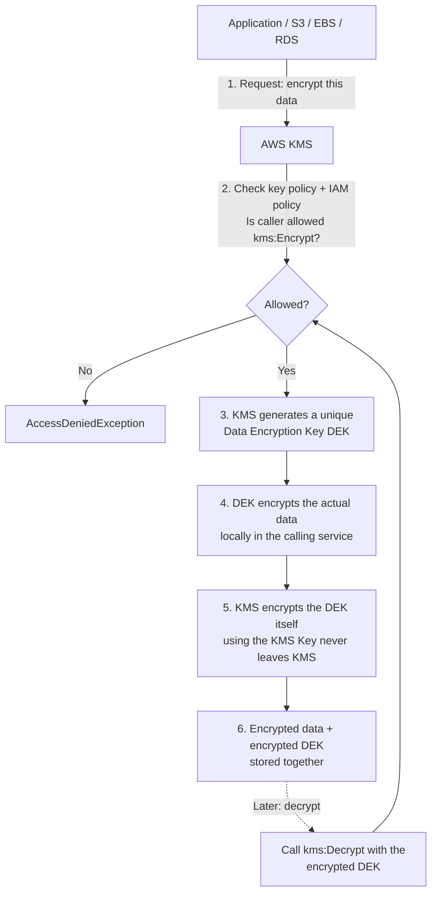
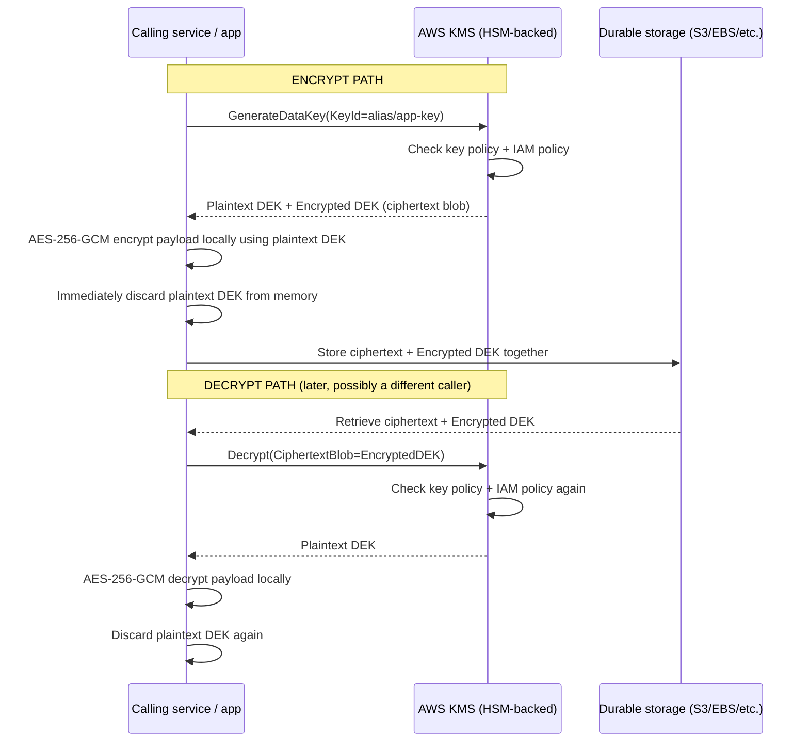
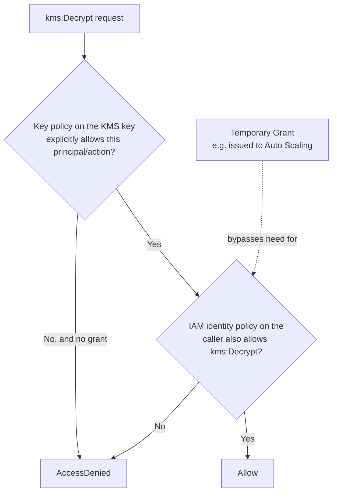
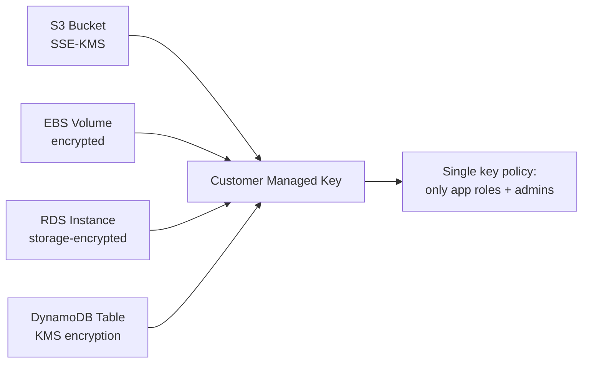
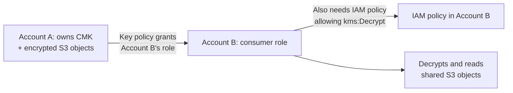
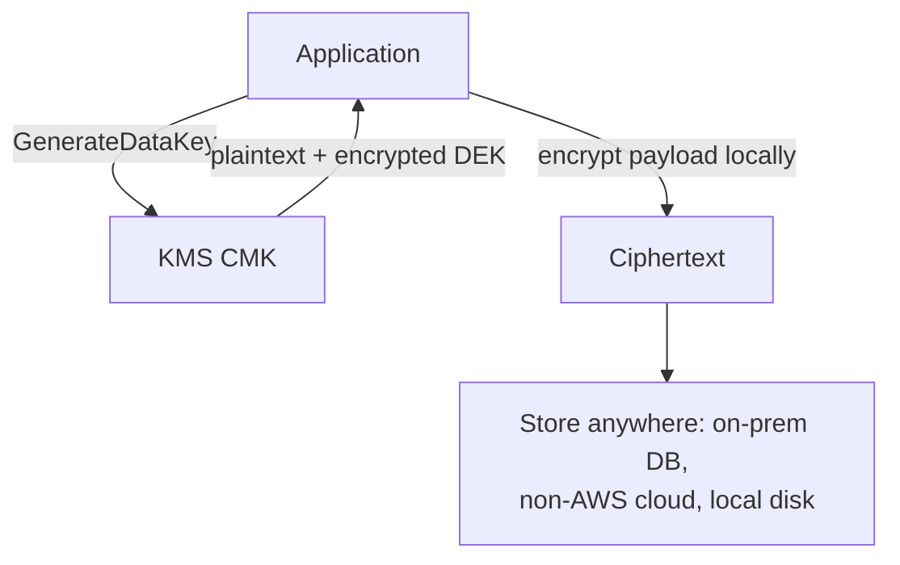
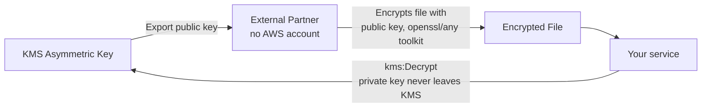
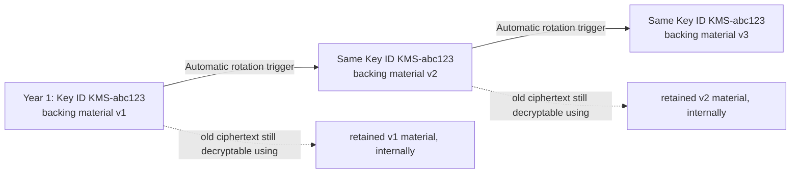
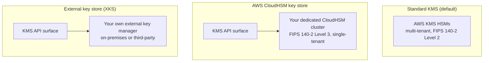

# AWS Key Management Service (KMS)

> **Appears in:** [DVA-C03](../../certifications/dva-c03/README.md) · [MLA-C02](../../certifications/mla-c02/README.md) · [SAA-C03](../../certifications/saa-c03/README.md)


## Definition

KMS is AWS's managed service for creating, storing, and controlling access to the
**cryptographic keys** used to encrypt and decrypt data across almost every other AWS service
(S3, EBS, RDS, DynamoDB, Lambda environment variables, Secrets Manager, and more), without you
ever having to build, run, or secure your own key-management infrastructure.

## Purpose

Encryption is only as strong as the protection around the keys that do the encrypting. Before
services like KMS existed, teams either rolled their own key storage (a notorious source of
breaches — hardcoded keys, keys in version control, keys with no rotation) or didn't encrypt
sensitive data at rest at all because key management was too much operational overhead. KMS
exists to make "encrypt everything, by default, with centrally audited and access-controlled
keys" the path of least resistance — most AWS storage/database services support KMS encryption
with a single checkbox or one extra parameter.

## How It Works

KMS keys never leave KMS in plaintext — the actual encryption/decryption happens inside KMS's
hardware security modules (HSMs), and other services call KMS's API to perform or request the
operations rather than fetching the raw key.



Step by step (this is the **envelope encryption** pattern KMS uses for anything beyond small
payloads):

1. An AWS service or your application asks KMS to encrypt data, referencing a specific **KMS
   key** (identified by key ID or alias).
2. KMS checks whether the caller is authorized — both the **key policy** (a resource-based
   policy attached directly to the KMS key, mandatory for every key) and any IAM identity-based
   policy must allow the specific `kms:*` action. **A KMS key policy that doesn't grant anyone
   access effectively locks the key forever, even from the account root** — this is why every
   KMS key, even AWS-managed ones, ships with a sane default key policy.
3. For anything beyond a tiny payload, KMS doesn't encrypt the actual data itself (its API has
   a 4KB limit for `Encrypt` calls) — it generates a one-time-use **Data Encryption Key (DEK)**
   via `GenerateDataKey`.
4. The calling service (S3, EBS, your app via the SDK) uses that DEK **locally**, in memory, to
   encrypt the actual data with a fast symmetric algorithm (AES-256-GCM) — this is why
   encrypting a 50GB S3 object doesn't require streaming 50GB through KMS.
5. The DEK itself then gets encrypted ("wrapped") by the KMS key, and that encrypted DEK is
   stored alongside the ciphertext. The KMS key itself never leaves AWS's HSMs.
6. To decrypt later, the service sends the encrypted DEK back to KMS, KMS unwraps it (again
   checking permissions), returns the plaintext DEK, and the service uses it locally to decrypt
   the data.

### The official AWS envelope encryption key hierarchy diagram


*Source: AWS Key Management Service Developer Guide, "AWS KMS cryptography essentials"
(docs.aws.amazon.com/kms/latest/developerguide/kms-cryptography.html)*

### The AWS Encryption SDK's client-side envelope encryption flow


*Source: AWS Key Management Service Cryptographic Details Guide, "Client-side encryption"
(docs.aws.amazon.com/kms/latest/cryptographic-details/client-side-encryption.html)*

### Full envelope encryption + decryption sequence, end to end



### Key policy + IAM policy + grant — the three access-control surfaces, visualized



A **grant** is the one case where a caller (often another AWS service acting on your behalf,
like Auto Scaling needing to decrypt an encrypted AMI at launch time) can get a scoped,
revocable permission without needing a full IAM policy edit — grants are created
programmatically, are typically short-lived, and can be retired the moment the operation
completes.

## Key Features / Components

- **Symmetric KMS keys (AES-256)** — the default and most common type: one key does both
  encrypt and decrypt. Used by almost every AWS service integration (S3 SSE-KMS, EBS, RDS).
  The key material never leaves KMS — you can't export it, even as the key's owner.
- **Asymmetric KMS keys (RSA or ECC key pairs)** — a public/private key pair where the public
  key can be exported and shared freely (e.g., given to a partner to encrypt data meant only
  for you, or to verify a digital signature), while the private key never leaves KMS. Used for
  encrypt/decrypt *or* sign/verify workflows where the party encrypting/verifying shouldn't
  need AWS credentials at all.
- **HMAC keys** — generate/verify hash-based message authentication codes inside KMS without
  the HMAC secret ever existing outside it.
- **Customer Managed Keys (CMK)** — you create and fully control the key policy, rotation,
  and lifecycle (including deletion, with a mandatory 7–30 day waiting period as a safety net).
- **AWS Managed Keys** — created automatically by an AWS service on first use (e.g.,
  `aws/s3`), key policy is fixed and managed by AWS, rotated automatically every year, cannot
  be deleted or have their policy edited — convenient but with less control and no cross-service
  reuse.
- **AWS Owned Keys** — not visible in your account at all, used internally by some AWS
  services' default encryption with zero configuration or visibility — the least control, zero
  setup.
- **Automatic key rotation** — for symmetric CMKs, KMS can rotate the backing key material
  yearly while keeping the same key ID/ARN, so nothing referencing the key needs to change.
  Asymmetric and HMAC keys do not support automatic rotation (create a new key and migrate
  manually if rotation is required for those).
- **Multi-Region keys** — a KMS key replicated across regions with the same key material, so
  data encrypted in one region can be decrypted in another (used for cross-region DR/backups
  of KMS-encrypted resources without re-encrypting everything on failover).
- **Key policies, grants, and IAM policies together** — three layers of KMS access control; a
  **grant** is a temporary, revocable permission often used by AWS services themselves to use
  a key on your behalf for a specific operation (e.g., Auto Scaling needing to decrypt an
  encrypted AMI to launch an instance).
- **AWS CloudHSM** — a related but distinct service: single-tenant, dedicated HSM hardware
  you fully control, for workloads with compliance requirements (FIPS 140-2 Level 3) that KMS's
  shared-tenancy HSMs don't satisfy, or that need direct PKCS#11/CNG/JCE access to the HSM.
- **Key material origin** — `KMS` (default, AWS generates and stores it), `EXTERNAL` (you
  import your own key material, giving you control over destruction but losing automatic
  rotation), or `AWS_CLOUDHSM_KEY_STORE` / `EXTERNAL_KEY_STORE` (a custom key store backed by
  CloudHSM or an external key manager, for the strictest compliance needs).
- **Key rotation on imported key material** — unlike AWS-generated symmetric keys, imported
  key material has no automatic rotation at all; you must re-import new material and manage the
  transition yourself.

## Use Cases — When to Use It

- **Encrypting data at rest across the storage/database layer.** Situation: S3, EBS, RDS, and
  DynamoDB all need to be encrypted with a key you control the policy and rotation for. Why this
  fits: SSE-KMS gives one centrally governed key reused across every service, instead of each
  service managing its own ad hoc encryption. Tradeoff: a high-request-volume service (lots of
  `PutObject`/`GetItem` calls) can hit KMS API throttling limits or add measurable per-request
  cost unless you enable a reuse mechanism like S3 Bucket Keys.
- **Lambda environment variable encryption for sensitive config.** Situation: a function needs a
  database connection string or API key available at runtime. Why this fits: KMS encrypts the
  environment variable at rest with a CMK you choose, rather than relying on the default AWS
  managed key with no custom access control. Tradeoff: using a CMK adds the $1/month per-key
  cost and a key-policy dependency — for very simple, low-sensitivity config, Parameter Store's
  `SecureString` may be simpler to operate.
- **Sharing an encryption key with a partner who has no AWS account.** Situation: a partner
  needs to encrypt a file meant only for your systems to decrypt. Why this fits: an asymmetric
  KMS key's public key can be exported and given to the partner with zero AWS credentials
  required on their side — the private key never leaves KMS. Tradeoff: asymmetric operations are
  typically throttled at a lower default rate than symmetric ones, and the partner's own
  encryption tooling (openssl, their own crypto library) must correctly implement the matching
  algorithm — a mismatch produces ciphertext KMS can't decrypt.
- **Signing build artifacts so downstream systems can verify provenance.** Situation: a build
  pipeline needs to prove its packages are genuinely from that pipeline, without distributing a
  shared secret to every verifier. Why this fits: an asymmetric `SIGN_VERIFY` key lets the
  pipeline sign with `kms:Sign` while any verifier checks the signature offline using the
  exported public key — no AWS credentials needed for verification. Tradeoff: if the private
  key material is ever rotated or the key deleted, every previously-distributed public key
  becomes useless for new signatures (though old signatures remain verifiable) — key lifecycle
  planning matters more here than for simple encryption.
- **MFA-gated decryption of highly sensitive data.** Situation: only users who've passed MFA
  should ever decrypt a specific dataset, regardless of their other permissions. Why this fits: a
  key policy condition requiring `aws:MultiFactorAuthPresent` adds this requirement at the
  encryption-key layer itself, so it holds even if an IAM policy elsewhere is misconfigured too
  permissively. Tradeoff: any automated/unattended process that legitimately needs to decrypt
  this data (a nightly batch job, for instance) cannot satisfy an MFA condition — this pattern
  only works for human-driven access paths.
- **Client-side envelope encryption before data ever reaches a database.** Situation: an
  application wants data encrypted before it's written anywhere, so even a full database breach
  doesn't expose plaintext. Why this fits: the AWS Encryption SDK's envelope encryption pattern
  lets the app hold a plaintext DEK briefly in memory, encrypt locally, then discard it — KMS
  never sees the actual payload. Tradeoff: this pushes real cryptographic responsibility into
  application code (correct DEK handling, discarding plaintext promptly) — a coding mistake here
  (e.g., logging the plaintext DEK) defeats the entire purpose in a way KMS itself can't prevent.
- **Cross-account data sharing without copying data.** Situation: Account B's analytics team
  needs to read KMS-encrypted S3 objects owned by Account A. Why this fits: the key policy in
  Account A names Account B's role directly, and once Account B's own IAM policy also allows the
  call, data is readable without ever being duplicated into Account B. Tradeoff: both sides must
  stay in sync — if Account B's role is ever recreated (new underlying principal ID), the key
  policy referencing it by the stale ID can silently stop matching, breaking access with a
  confusing error.
- **M&A — isolating an acquired company's encrypted data during integration.** Situation: after
  an acquisition, the acquired company's KMS-encrypted data should be readable only by the
  specific integration team members who need it, not every employee at the parent company. Why
  this fits: a tightly scoped key policy naming only the integration team's role (plus the
  account root as fallback admin) lets you grant exactly the needed access without re-encrypting
  anything or waiting for a full account migration. Tradeoff: a key policy that omits the account
  root as fallback, in the rush of an acquisition timeline, risks a permanent lockout if the named
  role is later deleted during account consolidation — this is a common, costly mistake under
  M&A time pressure.
- **Compliance evidence for encryption-at-rest requirements (PCI-DSS/HIPAA/SOC 2).** Situation:
  an auditor needs proof that regulated data is encrypted and that key access is tightly
  controlled. Why this fits: CloudTrail logs every KMS API call, and the key policy itself is
  direct, inspectable evidence of exactly who can use or manage the key. Tradeoff: encryption
  alone doesn't satisfy a full compliance requirement — auditors also expect evidence of key
  rotation, access review cadence, and that the key policy's grants are still accurate, not just
  that encryption is technically turned on.
- **Zero-trust data access — decrypt only through an explicitly scoped path.** Situation: a
  security team wants to guarantee a given dataset can only be decrypted when accessed through a
  specific, approved service (not via a direct, unscoped API call from anywhere). Why this fits:
  a `kms:ViaService` condition in the key policy restricts usage to only when invoked through a
  named AWS service (e.g., only via S3), closing off a direct `kms:Decrypt` call from an
  unexpected path even if the caller's IAM policy would otherwise allow it. Tradeoff: this adds a
  layer of conditions that must be kept consistent with how the data is actually accessed — a
  legitimate new access path (a new analytics tool reading the same data) requires updating the
  `kms:ViaService` condition, or access silently fails.

## When NOT to Use It / Alternatives

- **You need dedicated, single-tenant HSM hardware for strict compliance (FIPS 140-2 Level 3)
  or direct cryptographic API access (PKCS#11)** — use **AWS CloudHSM** instead; KMS's default
  HSMs are FIPS 140-2 Level 2 and multi-tenant (though a CloudHSM-backed custom key store in
  KMS bridges the two).
- **You just need to store an application secret/credential itself (a password, API key, DB
  connection string), not perform encrypt/decrypt operations on bulk data** — use **Secrets
  Manager** or **Parameter Store**, which use KMS *underneath* for encryption but are the
  correct service for the "secret lifecycle" (rotation, retrieval, versioning) itself. See
  [`secrets-manager-vs-parameter-store.md`](secrets-manager-vs-parameter-store.md).
- **You need TLS/SSL certificates for HTTPS** — that's **ACM**, not KMS; KMS keys are not TLS
  certificates (though ACM's own private keys are, in effect, managed similarly under the
  hood). See [`acm-and-private-ca.md`](acm-and-private-ca.md).

## Common Architectures

### 1. SSE-KMS at rest across the data layer


One CMK, one key policy, reused across every data store in the application — centralizing key
governance instead of a key-per-service sprawl.

### 2. Cross-account encrypted data sharing


Sharing KMS-encrypted data cross-account needs **both** the key policy in Account A naming the
Account B principal AND an IAM policy in Account B allowing the `kms:Decrypt` call — the same
dual-sided pattern as cross-account resource policies generally.

### 3. Envelope encryption with the AWS Encryption SDK for client-side encryption


Because encryption happens entirely client-side with a locally-held plaintext DEK, the
encrypted payload can be stored anywhere — not only inside AWS-integrated services — while
still relying on KMS for key custody and access control.

### 4. Asymmetric key for partner data exchange without AWS credentials



## Worked key policy example: full lifecycle — admin, usage, and cross-account sharing in one document

```json
{
  "Version": "2012-10-17",
  "Id": "key-policy-finance-reports",
  "Statement": [
    {
      "Sid": "RootAccountFallbackAdmin",
      "Effect": "Allow",
      "Principal": { "AWS": "arn:aws:iam::111122223333:root" },
      "Action": "kms:*",
      "Resource": "*"
    },
    {
      "Sid": "KeyAdministrators",
      "Effect": "Allow",
      "Principal": { "AWS": "arn:aws:iam::111122223333:role/KeyAdminRole" },
      "Action": [
        "kms:Create*", "kms:Describe*", "kms:Enable*", "kms:List*",
        "kms:Put*", "kms:Update*", "kms:Revoke*", "kms:Disable*",
        "kms:Get*", "kms:Delete*", "kms:ScheduleKeyDeletion", "kms:CancelKeyDeletion"
      ],
      "Resource": "*"
    },
    {
      "Sid": "KeyUsageForAppRole",
      "Effect": "Allow",
      "Principal": { "AWS": "arn:aws:iam::111122223333:role/FinanceAppRole" },
      "Action": ["kms:Encrypt", "kms:Decrypt", "kms:ReEncrypt*", "kms:GenerateDataKey*", "kms:DescribeKey"],
      "Resource": "*"
    },
    {
      "Sid": "AllowPartnerAccountToDecryptOnly",
      "Effect": "Allow",
      "Principal": { "AWS": "arn:aws:iam::444455556666:role/PartnerAnalyticsRole" },
      "Action": ["kms:Decrypt", "kms:DescribeKey"],
      "Resource": "*",
      "Condition": { "StringEquals": { "kms:ViaService": "s3.us-east-1.amazonaws.com" } }
    }
  ]
}
```

This single key policy demonstrates the three roles every real production key policy needs to
separate: (1) a root-account fallback so the key can never be permanently locked, (2) a
key-administrator role that manages the key's lifecycle but doesn't necessarily need to *use*
it for encryption, and (3) one or more usage-only roles (including, here, a cross-account
partner) scoped down with a `kms:ViaService` condition so the grant only applies when the key
is invoked through S3 specifically, not via a direct, unscoped `Decrypt` API call.

## Key rotation — deep dive on what actually happens



A common misconception the exam tests directly: rotating a symmetric CMK does **not** re-encrypt
any of your existing ciphertext, and it does **not** invalidate data encrypted under the
previous key material. KMS internally retains all prior backing material forever (as long as the
key itself isn't deleted) specifically so old ciphertext stays decryptable — only *new*
`Encrypt`/`GenerateDataKey` calls start using the newest material. The key's ARN and ID never
change through any number of rotations, which is why nothing referencing the key (IAM policies,
application config, CloudFormation templates) needs updating when rotation happens.

## Why It's Important

**Real-world weight:** "Was the data encrypted at rest, and who could access the key" is one of
the first two questions in almost every data-breach post-incident review and almost every
compliance audit (PCI-DSS, HIPAA, SOC 2, GDPR all have explicit encryption-at-rest and key-access
requirements). Misconfigured KMS key policies — either too permissive (anyone can decrypt) or
too restrictive (an account locks itself out of its own data) — are both genuinely
career-defining mistakes in production.

**Exam weight:**
- **SAA-C03 — Domain 1, Task 1.3 "Determine appropriate data security controls"** names KMS
  encryption at rest and key rotation explicitly — this is one of the most reliably tested
  single facts: symmetric vs. asymmetric, automatic rotation support, and key policy basics.
- **DVA-C03 — Domain 2, Task 2.2 "Implement encryption and manage sensitive data"** lists KMS
  directly alongside ACM and PII masking — developers are tested on calling the KMS SDK
  (`Encrypt`, `GenerateDataKey`, `Decrypt`) correctly in application code.
- **MLA-C02 — Domain 4** lists "KMS encryption" explicitly under the security objectives for
  operating and securing ML/AI solutions (encrypting training data, model artifacts, and
  endpoints).

## Limits & Quotas

| Resource | Default quota | Notes |
|---|---|---|
| `Encrypt`/`Decrypt` payload size | 4 KB | Why envelope encryption/`GenerateDataKey` exists at all |
| CMKs per account per Region | 10,000 (soft, request increase) | Rarely a real constraint if ABAC-style key reuse is practiced |
| Key policy size | 32 KB | Generous, rarely hit |
| Grants per key | 50,000 (soft) | Relevant at very high-scale service-to-service delegation |
| Requests per second (symmetric ops) | Several thousand, varies by Region/key type, shared across the account | Throttling (`ThrottlingException`) is the typical failure mode, not an outright block |
| Deletion waiting period | 7–30 days, configurable | Minimum enforced floor is 7 days; cannot delete instantly even by choice |
| Automatic rotation period (symmetric CMK) | 1 year (365 days), not configurable per-key beyond on/off | Asymmetric/HMAC: no automatic rotation at all |
| Multi-Region key replicas | Up to 50 per primary key (soft) | Each replica is a distinct resource with its own key policy, sharing only the key material |

Asymmetric and HMAC operations are typically throttled at a *lower* request rate than symmetric
operations by default — a scenario describing a high-throughput signing workload hitting
`ThrottlingException` is pointing at this distinction, not a KMS outage.

## Pricing Model

- **$1/month per Customer Managed Key** (AWS Managed Keys are free).
- **API request charges**: a per-10,000-requests rate for cryptographic operations
  (`Encrypt`, `Decrypt`, `GenerateDataKey`, etc.) — free tier covers 20,000 requests/month.
- Asymmetric key operations and HMAC operations are billed at a (typically higher) separate
  rate per request than symmetric operations.
- No charge for key *storage* beyond the flat monthly fee per CMK; no charge for AWS Managed
  Keys at all beyond the request volume they incur.
- See: https://aws.amazon.com/kms/pricing/ for current exact numbers.

## Hands-on Lab (Floci)

```bash
# Create a symmetric customer managed key
awslocal kms create-key --description "Study CMK" --key-usage ENCRYPT_DECRYPT \
  --customer-master-key-spec SYMMETRIC_DEFAULT
# note the KeyId from the output
KEY_ID=<paste-key-id>

# Give it a friendly alias
awslocal kms create-alias --alias-name alias/study-key --target-key-id $KEY_ID

# Encrypt and decrypt a small payload directly
awslocal kms encrypt --key-id alias/study-key --plaintext "super secret value" \
  --query CiphertextBlob --output text > ciphertext.b64
awslocal kms decrypt --ciphertext-blob fileb://<(base64 -d ciphertext.b64) \
  --query Plaintext --output text | base64 -d

# Generate a data key (the envelope-encryption pattern)
awslocal kms generate-data-key --key-id alias/study-key --key-spec AES_256

# Create an asymmetric key pair for sign/verify
awslocal kms create-key --key-usage SIGN_VERIFY \
  --customer-master-key-spec RSA_2048
```

### Extended lab: key policy lockout and recovery, and cross-account sharing

```bash
# Deliberately write a restrictive key policy naming only a specific role (simulating a
# common real mistake: forgetting to include the account root as a fallback administrator)
cat > restrictive-key-policy.json << 'EOF'
{
  "Version": "2012-10-17",
  "Statement": [
    {
      "Sid": "AllowOnlyOneRole",
      "Effect": "Allow",
      "Principal": {"AWS": "arn:aws:iam::000000000000:role/OnlyThisRole"},
      "Action": "kms:*",
      "Resource": "*"
    }
  ]
}
EOF
awslocal kms create-key --policy file://restrictive-key-policy.json

# Best-practice key policy: always include the account root as a safety net, then
# delegate day-to-day administration to a specific role
cat > safe-key-policy.json << 'EOF'
{
  "Version": "2012-10-17",
  "Statement": [
    {
      "Sid": "EnableRootAccountAsFallbackAdmin",
      "Effect": "Allow",
      "Principal": {"AWS": "arn:aws:iam::000000000000:root"},
      "Action": "kms:*",
      "Resource": "*"
    },
    {
      "Sid": "AllowAppRoleToUseKeyDaily",
      "Effect": "Allow",
      "Principal": {"AWS": "arn:aws:iam::000000000000:role/AppRole"},
      "Action": ["kms:Encrypt", "kms:Decrypt", "kms:GenerateDataKey"],
      "Resource": "*"
    }
  ]
}
EOF
awslocal kms create-key --policy file://safe-key-policy.json

# Cross-account grant: Account B's role is allowed to decrypt without a full key-policy edit
awslocal kms create-grant --key-id alias/study-key \
  --grantee-principal arn:aws:iam::111122223333:role/PartnerRole \
  --operations Decrypt GenerateDataKey
```

## Exam Tips

- **Symmetric vs. asymmetric — memorize this table:** symmetric keys never leave KMS (no
  export, period) and support automatic annual rotation; asymmetric keys let you export the
  *public* key (private key material still never leaves KMS) and do **not** support automatic
  rotation. If a question needs "share an encryption key with an external party who has no AWS
  account," the answer is an asymmetric KMS key's public key.
- **KMS key policy is mandatory and resource-based** — unlike most AWS resources, a KMS key
  with no key policy granting access is unusable, even by the account root, without the policy
  explicitly allowing it. This is the opposite failure mode from "forgot to restrict access" —
  here, forgetting to grant correctly locks everyone out.
- **Always keep the account root in the key policy as a fallback administrator** — a key policy
  that names only one specific role and omits the root is the textbook setup for a permanent,
  unrecoverable lockout if that role is ever deleted.
- **AWS Managed Keys vs. Customer Managed Keys** — AWS Managed Keys rotate automatically every
  year with zero configuration but cannot have their policy edited or be shared cross-account;
  Customer Managed Keys cost $1/month but give full control (cross-account sharing via key
  policy, custom rotation period, deletion).
- **Deleting a KMS key is intentionally hard** — enforced 7–30 day waiting period, because
  losing a CMK means losing access to everything it ever encrypted, permanently. A question
  implying "just delete the unused key immediately" to save cost is a trap if any data might
  still depend on it.
- **Envelope encryption / `GenerateDataKey`** — know this is *why* KMS can encrypt arbitrarily
  large objects (S3, EBS) despite the `Encrypt` API's 4KB payload limit; the DEK does the bulk
  work locally, only the small DEK itself round-trips to KMS.
- **Grants vs. key policy edits** — a grant is the right answer for "temporarily and
  programmatically delegate a scoped KMS permission to another AWS service/principal without
  editing the key policy," especially when AWS services do this on your behalf transparently
  (e.g., EBS needing to decrypt a volume at instance launch).
- **Cross-account KMS access needs both sides** — the key policy in the key's account AND an
  IAM policy in the caller's account, exactly like the cross-account S3 pattern in `iam.md`.
- **KMS vs. CloudHSM** — KMS is multi-tenant, managed, FIPS 140-2 Level 2; CloudHSM is
  single-tenant, you manage it, FIPS 140-2 Level 3, needed for strict compliance or direct
  PKCS#11/JCE/CNG access. "Dedicated hardware, full control" in a question = CloudHSM.
- **Imported key material has no automatic rotation** — a question describing "we imported our
  own key material and now rotation doesn't happen automatically" is testing exactly this gap;
  the fix is a manual re-import/migration process, not a missing configuration flag.
- Heavily tested in **SAA-C03 Domain 1 (30%)**, **DVA-C03 Domain 2 (26%)**, and **MLA-C02
  Domain 4 (24%)** — appears in virtually every certification's security section.

## KMS Integration Patterns Across AWS Services

| Service | How it uses KMS | Notes |
|---|---|---|
| S3 (SSE-KMS) | Envelope encryption per object, bucket default encryption optional | Each `PutObject` call checks the key policy; high-volume workloads may need an S3 Bucket Key to reduce KMS API call volume/cost |
| EBS | Volume-level encryption, snapshot encryption inherited | Encrypting an unencrypted volume requires creating a new encrypted volume/snapshot — cannot encrypt in place |
| RDS/Aurora | Storage-level encryption chosen at creation time | **Cannot be enabled after the fact** on an existing unencrypted instance — must snapshot, copy with encryption enabled, and restore |
| DynamoDB | Encryption at rest, default AWS-owned key or customer-managed | Switching to a CMK is a non-disruptive table setting change, unlike RDS |
| Lambda | Environment variable encryption, optional additional "encryption helpers" | Uses a default AWS managed key unless you specify a CMK explicitly |
| Secrets Manager / Parameter Store (SecureString) | Secret value encryption | See [`secrets-manager-vs-parameter-store.md`](secrets-manager-vs-parameter-store.md) |
| CloudTrail / CloudWatch Logs | Log file/log group encryption | A frequently tested exam detail: CloudTrail log integrity validation is separate from (but often paired with) KMS encryption |

**S3 Bucket Keys** deserve a specific callout: for high-request-volume S3 workloads, enabling a
Bucket Key reduces the number of calls actually made to KMS (by reusing a time-limited,
bucket-level data key for many objects), directly lowering the per-10,000-request KMS charge —
a specific, testable cost-optimization lever distinct from anything about the encryption
strength itself.

## Troubleshooting / Common Issues

**"AccessDeniedException" on `kms:Decrypt` / `kms:Encrypt`:**

1. Check the **key policy** first — unlike IAM-only resources, KMS requires the key policy to
   explicitly allow the caller; a perfectly correct IAM identity policy is not sufficient on
   its own.
2. Check the **IAM identity policy** second — both must agree (the KMS equivalent of the
   cross-account dual-policy requirement applies even same-account for KMS specifically, by
   convention/best practice, because the key policy is mandatory).
3. If cross-account, confirm the key policy explicitly names the other account's principal, and
   that account's own IAM policy also allows the call.
4. Check for a pending **grant** that may have been expected but wasn't actually created, or
   check whether a previously-issued grant was retired.

**"The key is pending deletion and cannot be used":** the 7–30 day waiting period is active;
the only fix is `CancelKeyDeletion` before the window elapses — after it elapses, the key and
everything it encrypted is permanently unrecoverable by design.

**"ThrottlingException" on high-volume signing/HMAC workloads:** asymmetric/HMAC operations
share a lower default request-rate quota than symmetric operations; the fix is requesting a
quota increase or batching/caching results, not assuming an outage.

**Application can decrypt in one Region but not another after a DR failover:** confirm the key
is actually a **Multi-Region key** with a replica in the failover Region — a single-Region CMK
referenced by ARN simply doesn't exist in another Region, and "the ARN looks right" is a common
false lead when the underlying key was never replicated.

## Custom Key Stores — bridging KMS and CloudHSM/external managers



A **custom key store** lets you keep using the familiar KMS API (`Encrypt`, `Decrypt`,
`GenerateDataKey`, IAM/key-policy integration, every AWS service integration) while the actual
key material and cryptographic operations happen in hardware or a system *you* control — either
a dedicated CloudHSM cluster (for FIPS 140-2 Level 3 compliance) or an **external key store
(XKS)** backed by a key manager entirely outside AWS. This is the specific, testable answer for
"we need KMS's convenience and AWS service integrations, but our compliance mandate requires
key material to never be stored inside AWS's own infrastructure at all."

## Exam-style additional scenario: choosing the right key type for a signing workflow

A mobile app needs to verify that update packages it downloads were genuinely signed by your
build pipeline, without the app itself ever holding any AWS credentials. The correct answer:
an **asymmetric KMS key with `SIGN_VERIFY` usage**. The build pipeline (holding appropriate IAM
permissions) calls `kms:Sign` to produce a signature over each package; the **public key is
exported** (via `GetPublicKey`) and bundled into the mobile app itself, which performs
`Verify`-equivalent cryptographic verification entirely offline using standard crypto libraries
— no AWS credentials, no network call to KMS, required on the verifying side at all. A common
wrong-answer trap is proposing a symmetric key for this scenario: symmetric keys have no
exportable public component, so there's no way to verify a signature without holding the same
secret key material used to create it (which would mean distributing a shared secret to every
mobile device — exactly the problem asymmetric cryptography exists to avoid).

## Further Reading

- AWS KMS Developer Guide — AWS KMS cryptography essentials (envelope encryption):
  https://docs.aws.amazon.com/kms/latest/developerguide/kms-cryptography.html
- AWS KMS Cryptographic Details Guide — Client-side encryption:
  https://docs.aws.amazon.com/kms/latest/cryptographic-details/client-side-encryption.html
- AWS KMS Developer Guide — Key policies:
  https://docs.aws.amazon.com/kms/latest/developerguide/key-policies.html
- AWS KMS Developer Guide — Grants:
  https://docs.aws.amazon.com/kms/latest/developerguide/grants.html
- AWS Encryption SDK Developer Guide:
  https://docs.aws.amazon.com/encryption-sdk/latest/developer-guide/introduction.html
- AWS KMS pricing: https://aws.amazon.com/kms/pricing/

## Related Terms

- [`iam.md`](iam.md) — key policies work alongside IAM policies for access control
- [`secrets-manager-vs-parameter-store.md`](secrets-manager-vs-parameter-store.md) — both use KMS underneath to encrypt stored secrets
- [`acm-and-private-ca.md`](acm-and-private-ca.md) — a related but distinct certificate-management service
- [`shared-responsibility-model-deep-dive.md`](shared-responsibility-model-deep-dive.md) — encryption at rest is a customer responsibility AWS makes easy via KMS
- `glossary/` — envelope encryption, data encryption key (DEK), HSM, FIPS 140-2
