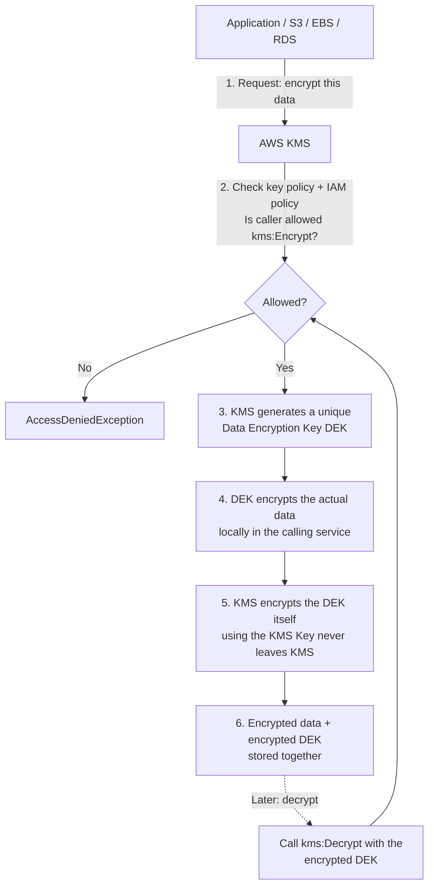

# AWS Key Management Service (KMS)


## Definition

KMS is AWS's managed service for creating, storing, and controlling access to the
**cryptographic keys** used to encrypt and decrypt data across almost every other AWS service
(S3, EBS, RDS, DynamoDB, Lambda environment variables, Secrets Manager, and more), without you
ever having to build, run, or secure your own key-management infrastructure.

## Purpose

Encryption is only as strong as the protection around the keys that do the encrypting. Before
services like KMS existed, teams either rolled their own key storage (a notorious source of
breaches — hardcoded keys, keys in version control, keys with no rotation) or didn't encrypt
sensitive data at rest at all because key management was too much operational overhead. KMS
exists to make "encrypt everything, by default, with centrally audited and access-controlled
keys" the path of least resistance — most AWS storage/database services support KMS encryption
with a single checkbox or one extra parameter.

## How It Works

KMS keys never leave KMS in plaintext — the actual encryption/decryption happens inside KMS's
hardware security modules (HSMs), and other services call KMS's API to perform or request the
operations rather than fetching the raw key.



Step by step (this is the **envelope encryption** pattern KMS uses for anything beyond small
payloads):

1. An AWS service or your application asks KMS to encrypt data, referencing a specific **KMS
   key** (identified by key ID or alias).
2. KMS checks whether the caller is authorized — both the **key policy** (a resource-based
   policy attached directly to the KMS key, mandatory for every key) and any IAM identity-based
   policy must allow the specific `kms:*` action. **A KMS key policy that doesn't grant anyone
   access effectively locks the key forever, even from the account root** — this is why every
   KMS key, even AWS-managed ones, ships with a sane default key policy.
3. For anything beyond a tiny payload, KMS doesn't encrypt the actual data itself (its API has
   a 4KB limit for `Encrypt` calls) — it generates a one-time-use **Data Encryption Key (DEK)**
   via `GenerateDataKey`.
4. The calling service (S3, EBS, your app via the SDK) uses that DEK **locally**, in memory, to
   encrypt the actual data with a fast symmetric algorithm (AES-256-GCM) — this is why
   encrypting a 50GB S3 object doesn't require streaming 50GB through KMS.
5. The DEK itself then gets encrypted ("wrapped") by the KMS key, and that encrypted DEK is
   stored alongside the ciphertext. The KMS key itself never leaves AWS's HSMs.
6. To decrypt later, the service sends the encrypted DEK back to KMS, KMS unwraps it (again
   checking permissions), returns the plaintext DEK, and the service uses it locally to decrypt
   the data.

## Key Features / Components

- **Symmetric KMS keys (AES-256)** — the default and most common type: one key does both
  encrypt and decrypt. Used by almost every AWS service integration (S3 SSE-KMS, EBS, RDS).
  The key material never leaves KMS — you can't export it, even as the key's owner.
- **Asymmetric KMS keys (RSA or ECC key pairs)** — a public/private key pair where the public
  key can be exported and shared freely (e.g., given to a partner to encrypt data meant only
  for you, or to verify a digital signature), while the private key never leaves KMS. Used for
  encrypt/decrypt *or* sign/verify workflows where the party encrypting/verifying shouldn't
  need AWS credentials at all.
- **HMAC keys** — generate/verify hash-based message authentication codes inside KMS without
  the HMAC secret ever existing outside it.
- **Customer Managed Keys (CMK)** — you create and fully control the key policy, rotation,
  and lifecycle (including deletion, with a mandatory 7–30 day waiting period as a safety net).
- **AWS Managed Keys** — created automatically by an AWS service on first use (e.g.,
  `aws/s3`), key policy is fixed and managed by AWS, rotated automatically every year, cannot
  be deleted or have their policy edited — convenient but with less control and no cross-service
  reuse.
- **AWS Owned Keys** — not visible in your account at all, used internally by some AWS
  services' default encryption with zero configuration or visibility — the least control, zero
  setup.
- **Automatic key rotation** — for symmetric CMKs, KMS can rotate the backing key material
  yearly while keeping the same key ID/ARN, so nothing referencing the key needs to change.
  Asymmetric and HMAC keys do not support automatic rotation (create a new key and migrate
  manually if rotation is required for those).
- **Multi-Region keys** — a KMS key replicated across regions with the same key material, so
  data encrypted in one region can be decrypted in another (used for cross-region DR/backups
  of KMS-encrypted resources without re-encrypting everything on failover).
- **Key policies, grants, and IAM policies together** — three layers of KMS access control; a
  **grant** is a temporary, revocable permission often used by AWS services themselves to use
  a key on your behalf for a specific operation (e.g., Auto Scaling needing to decrypt an
  encrypted AMI to launch an instance).
- **AWS CloudHSM** — a related but distinct service: single-tenant, dedicated HSM hardware
  you fully control, for workloads with compliance requirements (FIPS 140-2 Level 3) that KMS's
  shared-tenancy HSMs don't satisfy, or that need direct PKCS#11/CNG/JCE access to the HSM.

## Use Cases — When to Use It

- Encrypting an S3 bucket, EBS volume, RDS database, or DynamoDB table at rest with a key you
  control the policy and rotation for (SSE-KMS).
- Encrypting Lambda environment variables containing sensitive configuration.
- Giving a partner your KMS public key (asymmetric key) so they can encrypt a file meant only
  for your systems to decrypt, without issuing them any AWS credentials.
- Signing a document/API payload with KMS so the private signing key never has to leave AWS,
  and anyone with the public key can verify authenticity.
- Enforcing "only principals that passed MFA may decrypt this data" via a KMS key policy
  condition.

## When NOT to Use It / Alternatives

- **You need dedicated, single-tenant HSM hardware for strict compliance (FIPS 140-2 Level 3)
  or direct cryptographic API access (PKCS#11)** — use **AWS CloudHSM** instead; KMS's default
  HSMs are FIPS 140-2 Level 2 and multi-tenant (though a CloudHSM-backed custom key store in
  KMS bridges the two).
- **You just need to store an application secret/credential itself (a password, API key, DB
  connection string), not perform encrypt/decrypt operations on bulk data** — use **Secrets
  Manager** or **Parameter Store**, which use KMS *underneath* for encryption but are the
  correct service for the "secret lifecycle" (rotation, retrieval, versioning) itself. See
  [`secrets-manager-vs-parameter-store.md`](secrets-manager-vs-parameter-store.md).
- **You need TLS/SSL certificates for HTTPS** — that's **ACM**, not KMS; KMS keys are not TLS
  certificates (though ACM's own private keys are, in effect, managed similarly under the
  hood). See [`acm-and-private-ca.md`](acm-and-private-ca.md).

## Why It's Important

**Real-world weight:** "Was the data encrypted at rest, and who could access the key" is one of
the first two questions in almost every data-breach post-incident review and almost every
compliance audit (PCI-DSS, HIPAA, SOC 2, GDPR all have explicit encryption-at-rest and key-access
requirements). Misconfigured KMS key policies — either too permissive (anyone can decrypt) or
too restrictive (an account locks itself out of its own data) — are both genuinely
career-defining mistakes in production.

**Exam weight:**
- **SAA-C03 — Domain 1, Task 1.3 "Determine appropriate data security controls"** names KMS
  encryption at rest and key rotation explicitly — this is one of the most reliably tested
  single facts: symmetric vs. asymmetric, automatic rotation support, and key policy basics.
- **DVA-C03 — Domain 2, Task 2.2 "Implement encryption and manage sensitive data"** lists KMS
  directly alongside ACM and PII masking — developers are tested on calling the KMS SDK
  (`Encrypt`, `GenerateDataKey`, `Decrypt`) correctly in application code.
- **MLA-C02 — Domain 4** lists "KMS encryption" explicitly under the security objectives for
  operating and securing ML/AI solutions (encrypting training data, model artifacts, and
  endpoints).

## Pricing Model

- **$1/month per Customer Managed Key** (AWS Managed Keys are free).
- **API request charges**: a per-10,000-requests rate for cryptographic operations
  (`Encrypt`, `Decrypt`, `GenerateDataKey`, etc.) — free tier covers 20,000 requests/month.
- Asymmetric key operations and HMAC operations are billed at a (typically higher) separate
  rate per request than symmetric operations.
- No charge for key *storage* beyond the flat monthly fee per CMK; no charge for AWS Managed
  Keys at all beyond the request volume they incur.
- See: https://aws.amazon.com/kms/pricing/ for current exact numbers.

## Hands-on Lab (Floci)

```bash
# Create a symmetric customer managed key
awslocal kms create-key --description "Study CMK" --key-usage ENCRYPT_DECRYPT \
  --customer-master-key-spec SYMMETRIC_DEFAULT
# note the KeyId from the output
KEY_ID=<paste-key-id>

# Give it a friendly alias
awslocal kms create-alias --alias-name alias/study-key --target-key-id $KEY_ID

# Encrypt and decrypt a small payload directly
awslocal kms encrypt --key-id alias/study-key --plaintext "super secret value" \
  --query CiphertextBlob --output text > ciphertext.b64
awslocal kms decrypt --ciphertext-blob fileb://<(base64 -d ciphertext.b64) \
  --query Plaintext --output text | base64 -d

# Generate a data key (the envelope-encryption pattern)
awslocal kms generate-data-key --key-id alias/study-key --key-spec AES_256

# Create an asymmetric key pair for sign/verify
awslocal kms create-key --key-usage SIGN_VERIFY \
  --customer-master-key-spec RSA_2048
```

## Exam Tips

- **Symmetric vs. asymmetric — memorize this table:** symmetric keys never leave KMS (no
  export, period) and support automatic annual rotation; asymmetric keys let you export the
  *public* key (private key material still never leaves KMS) and do **not** support automatic
  rotation. If a question needs "share an encryption key with an external party who has no AWS
  account," the answer is an asymmetric KMS key's public key.
- **KMS key policy is mandatory and resource-based** — unlike most AWS resources, a KMS key
  with no key policy granting access is unusable, even by the account root, without the policy
  explicitly allowing it. This is the opposite failure mode from "forgot to restrict access" —
  here, forgetting to grant correctly locks everyone out.
- **AWS Managed Keys vs. Customer Managed Keys** — AWS Managed Keys rotate automatically every
  year with zero configuration but cannot have their policy edited or be shared cross-account;
  Customer Managed Keys cost $1/month but give full control (cross-account sharing via key
  policy, custom rotation period, deletion).
- **Deleting a KMS key is intentionally hard** — enforced 7–30 day waiting period, because
  losing a CMK means losing access to everything it ever encrypted, permanently. A question
  implying "just delete the unused key immediately" to save cost is a trap if any data might
  still depend on it.
- **Envelope encryption / `GenerateDataKey`** — know this is *why* KMS can encrypt arbitrarily
  large objects (S3, EBS) despite the `Encrypt` API's 4KB payload limit; the DEK does the bulk
  work locally, only the small DEK itself round-trips to KMS.
- **KMS vs. CloudHSM** — KMS is multi-tenant, managed, FIPS 140-2 Level 2; CloudHSM is
  single-tenant, you manage it, FIPS 140-2 Level 3, needed for strict compliance or direct
  PKCS#11/JCE/CNG access. "Dedicated hardware, full control" in a question = CloudHSM.
- Heavily tested in **SAA-C03 Domain 1 (30%)**, **DVA-C03 Domain 2 (26%)**, and **MLA-C02
  Domain 4 (24%)** — appears in virtually every certification's security section.

## Related Terms

- [`iam.md`](iam.md) — key policies work alongside IAM policies for access control
- [`secrets-manager-vs-parameter-store.md`](secrets-manager-vs-parameter-store.md) — both use KMS underneath to encrypt stored secrets
- [`acm-and-private-ca.md`](acm-and-private-ca.md) — a related but distinct certificate-management service
- [`shared-responsibility-model-deep-dive.md`](shared-responsibility-model-deep-dive.md) — encryption at rest is a customer responsibility AWS makes easy via KMS
- `glossary/` — envelope encryption, data encryption key (DEK), HSM, FIPS 140-2
