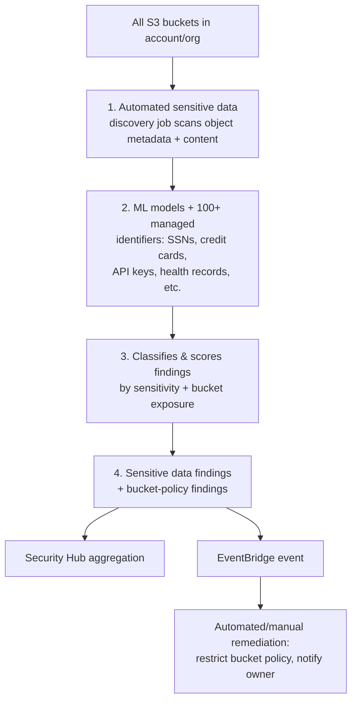

# Amazon Macie


## Definition

Macie is a managed service that automatically **discovers, classifies, and reports on sensitive
data** (like personally identifiable information, credentials, and financial data) stored in
Amazon S3, using a combination of pattern matching and machine learning, so you know exactly
where sensitive data lives and whether it's exposed — without manually auditing every bucket.

## Purpose

Organizations routinely lose track of where sensitive data actually is — a bucket created for a
one-off data export two years ago, a backup that still contains customer PII, a developer's
"just for testing" bucket that somehow has real production data in it. You can't protect data
you don't know exists, and compliance frameworks (GDPR, HIPAA, PCI-DSS) all require knowing
exactly where regulated data lives. Macie exists to continuously answer "what sensitive data do
we have, where is it, and is it safely configured" across potentially thousands of S3 buckets,
at a scale no manual audit process could keep up with.

## How It Works



Step by step:

1. Macie first builds an **inventory** of every S3 bucket across the account (or the whole
   Organization if centrally enabled), capturing bucket-level metadata: encryption status,
   public accessibility, sharing settings — this alone surfaces misconfigured buckets even
   before any content is scanned.
2. You then run **sensitive data discovery jobs** (one-time or scheduled) against chosen
   buckets, or let Macie's automated discovery sample across your whole S3 estate continuously
   at lower cost. Each object's content is scanned using both regex-style **managed data
   identifiers** (built-in patterns for 100+ categories — credit card numbers, AWS access keys,
   passport numbers, national IDs, health insurance numbers, etc.) and machine-learning models
   that catch context-dependent sensitive data regex alone would miss (e.g., recognizing a
   free-text medical record even without a rigid pattern).
3. Macie produces two kinds of findings: **sensitive data findings** (this specific object
   contains X type of sensitive data) and **policy findings** (this bucket itself is
   misconfigured — e.g., publicly accessible, unencrypted, shared outside the account).
4. Findings flow to **Security Hub** for centralized visibility and to **EventBridge**, which
   you can use to trigger automated remediation (e.g., immediately tightening an exposed
   bucket's policy) or to notify the data owner.

## Key Features / Components

- **Automated sensitive data discovery** — a lower-cost, continuous, statistically-sampled scan
  across your whole S3 estate that surfaces new/changed exposure without running full jobs on
  everything constantly.
- **Managed data identifiers** — 100+ pre-built detectors for common sensitive data types
  (financial, health, credentials, personal information) maintained and updated by AWS.
- **Custom data identifiers** — define your own regex-based pattern for organization-specific
  sensitive data (e.g., an internal employee ID format or a proprietary record number).
- **Allow lists** — exclude known-benign matches (like a publicly documented sample credit card
  number used in test fixtures) from triggering findings.
- **Bucket-level policy findings** — flags buckets that are public, unencrypted, or shared
  outside the account, independent of whether sensitive data has actually been found inside.
- **Finding severity and sample locations** — findings include where in the object the match
  was found (without necessarily exposing the full sensitive value itself in the finding),
  letting you investigate without further spreading the sensitive data around.
- **Organization-wide administration** — a delegated administrator account can manage Macie and
  view findings across every member account.

## Use Cases — When to Use It

- Auditing hundreds of S3 buckets accumulated over years to find out where customer PII,
  payment data, or health records actually live.
- Continuously monitoring for a new bucket or object being created that accidentally exposes
  sensitive data, catching it fast instead of during the next annual audit.
- Supporting a compliance audit (PCI-DSS, HIPAA, GDPR) by producing concrete evidence of where
  regulated data resides and that it's properly encrypted/access-controlled.
- Scanning data lake landing zones before they're promoted to production pipelines, to catch
  unintentionally included sensitive fields.

## When NOT to Use It / Alternatives

- **Detecting active attacker behavior** (unusual API calls, compromised credentials) — that's
  **GuardDuty**'s job; Macie looks at data content/exposure, not behavioral threats. See
  [`guardduty.md`](guardduty.md).
- **Data stored outside S3** (RDS, DynamoDB, on-premises) — Macie is S3-specific; for other
  data stores you'd need a different discovery approach (e.g., database-native tools, AWS Glue
  DataBrew profiling, or third-party DSPM tools) since Macie does not scan those directly.
- **Vulnerability/software weakness scanning** — that's **Inspector**; Macie classifies data
  content, Inspector scans for exploitable software flaws. See
  [`security-hub-and-inspector.md`](security-hub-and-inspector.md).
- **Very small S3 footprint with known, well-documented contents** — the cost/benefit of
  running continuous discovery jobs may not be worth it if you already have strict,
  well-audited bucket usage policies and a small number of buckets.

## Why It's Important

**Real-world weight:** Data breaches involving S3 misconfiguration (public buckets containing
customer records) have been some of the most damaging, headline-making incidents in cloud
history — often the root cause wasn't malicious access at all, just nobody realizing sensitive
data was sitting in an exposed bucket. Macie directly targets that exact failure mode, which is
why it's considered a baseline control for any account storing regulated data in S3.

**Exam weight:**
- **SAA-C03 — Domain 1, Task 1.2 "Design secure workloads and applications"** lists Macie
  explicitly as part of the application-security toolkit alongside GuardDuty.
- **DVA-C03** touches it lightly — more relevant to architecture/governance than day-to-day
  development, though understanding how Macie findings feed into automated remediation
  pipelines connects to Domain 1's event-driven patterns.
- **MLA-C02 — Domain 1 (Data Preparation)** and **Domain 4 (security)** both touch this:
  scanning training data sources in S3 for accidental PII before it's used to train a model is
  an increasingly emphasized theme given the new exam's focus on responsible data handling.

## Pricing Model

- Billed based on **the volume of S3 data evaluated** for the automated discovery tier, and
  separately for full sensitive-data-discovery jobs, which price by the amount of data
  processed (per GB) plus a per-object-evaluated component.
- **30-day free trial** of automated sensitive data discovery per account.
- Cost can scale meaningfully for very large S3 estates — running full discovery jobs against
  petabyte-scale buckets is a real line-item cost worth architecting around (e.g., sampling
  strategically rather than scanning everything constantly).
- See: https://aws.amazon.com/macie/pricing/ for current numbers.

## Hands-on Lab (Floci)

Macie's actual ML-based content classification against real sensitive-data patterns isn't
something a local emulator reproduces meaningfully, but the control-plane workflow (enabling
Macie, running a job, listing findings) is practicable against sample/test data:

```bash
# Enable Macie for the account
awslocal macie2 enable-macie

# Create and populate a test bucket with a fake "sensitive" file
awslocal s3 mb s3://macie-study-bucket
echo "fake SSN: 123-45-6789, fake card: 4111-1111-1111-1111" > sample.txt
awslocal s3 cp sample.txt s3://macie-study-bucket/sample.txt

# Create a classification job targeting that bucket
awslocal macie2 create-classification-job --job-type ONE_TIME \
  --name study-job --s3-job-definition '{"bucketDefinitions":[{"accountId":"000000000000","buckets":["macie-study-bucket"]}]}'

# List jobs and findings
awslocal macie2 list-classification-jobs
awslocal macie2 list-findings
```

## Exam Tips

- **Macie vs. GuardDuty vs. Inspector** — same three-way trap as GuardDuty's doc: Macie =
  "what sensitive data exists and is it exposed" (content), GuardDuty = "is something malicious
  happening" (behavior), Inspector = "what software vulnerabilities exist" (weaknesses). A
  question mentioning "PII," "credit card numbers," or "discover sensitive data in S3" always
  points to Macie.
- **Macie is S3-only** — it does not scan RDS, DynamoDB, or EC2 filesystems directly; a
  question describing sensitive data in a database needs a different answer.
- **Automated discovery vs. full jobs** — automated discovery is the continuous, lower-cost,
  sampled option; a full classification job is thorough but costs more and should be targeted,
  not run blindly against your entire S3 estate as a default habit.
- **Findings feed Security Hub + EventBridge**, exactly like GuardDuty — the same
  "centralize, then automate remediation" architectural pattern applies.
- Tested within **SAA-C03 Domain 1 (30%)**; present in **MLA-C02 Domain 1 and Domain 4**
  around sensitive training-data hygiene.

## Related Terms

- [`guardduty.md`](guardduty.md) — the behavioral-threat counterpart to Macie's data-content focus
- [`security-hub-and-inspector.md`](security-hub-and-inspector.md) — central aggregation of Macie findings; Inspector covers vulnerability scanning
- [`kms.md`](kms.md) — encrypting the sensitive data Macie discovers is the natural remediation step
- `glossary/` — PII, DSPM (data security posture management), managed data identifier
